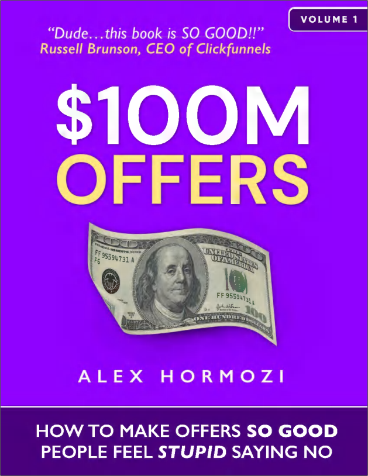

**ACQUISITION.COM** 

**TẬP I: $100M OFFERS** 

**BÍ QUYẾT TẠO RA CÁC GÓI SẢN PHẨM KHÔNG THỂ CHỐI TỪ** 

**ALEX HORMOZI** 

**Copyright © 2021 by Alex Hormozi** 

Mọi quyền được bảo lưu. Không phần nào trong ấn phẩm này được phép sao chép, phân phối hoặc truyền tải dưới bất kỳ hình thức hoặc bằng bất kỳ phương tiện nào, bao gồm photocopy, ghi âm, hoặc các phương pháp điện tử hay cơ học khác, nếu không có sự cho phép trước bằng văn bản của nhà xuất bản, ngoại trừ trường hợp trích dẫn ngắn gọn trong các bài đánh giá mang tính phản biện và một số mục đích phi thương mại khác được luật bản quyền cho phép. Mọi yêu cầu xin cấp phép vui lòng gửi về địa chỉ của nhà xuất bản bên dưới. 

Ebook ISBN: 978-1-7374757-0-5 

Acquisition.com, LLC 3610-2 N Josey Lane #223 

Carrollton, TX 75007-3150 

Thiết kế bìa bởi Charlotte Chan Mikkelsen 

Nhiếp ảnh, Minh họa và Trình bày nội dung bởi Alex Hormozi 

# **<u>TUYÊN BỐ MIỄN TRÁCH</u>** 

Nội dung trong cuốn sách này nhằm cung cấp thông tin hữu ích về các chủ đề được thảo luận. Cuốn sách này không được dùng, và không nên được dùng, để chẩn đoán hoặc điều trị bất kỳ vấn đề y tế nào. Các con số trong sách mang tính lý thuyết và chỉ dùng cho mục đích minh họa. Nhà xuất bản và tác giả không chịu trách nhiệm cho bất kỳ hành động nào bạn thực hiện hay bỏ qua sau khi đọc cuốn sách này, đồng thời không chịu trách nhiệm pháp lý đối với bất kỳ thiệt hại hoặc hậu quả tiêu cực nào phát sinh từ hành động hoặc sự không hành động của bất kỳ ai đọc hoặc áp dụng thông tin trong sách này. Các tài liệu tham khảo chỉ mang tính chất cung cấp thông tin và không cấu thành sự chứng thực cho bất kỳ trang web hoặc nguồn thông tin nào khác. Người đọc cũng cần lưu ý rằng các trang web được liệt kê trong sách có thể thay đổi hoặc trở nên lỗi thời. 

# **ĐÁNH GIÁ TỪ CHUYÊN GIA** 

> **_“Sau khi dành một ngày làm việc với Alex, chúng tôi đã gia tăng 5 TRIỆU ĐÔ LA LỢI NHUẬN MỖI NĂM_** _mà không cần cung cấp thêm bất kỳ dịch vụ mới nào. Khi Alex nói về acquisition (hoạt động thu hút khách hàng), bạn nên lắng nghe (trừ khi bạn ghét tiền).”_ 
> 
> BROOKE CASTILLO, CEO, LIFE COACH SCHOOL 

> _“Sự nghiệp của tôi có thể chia làm hai chương: chương đầu là 15 năm húc đầu vào tường, cố gắng tìm hiểu tại sao mình lại không khai hết tiềm năng bản thân. Chương thứ hai bắt đầu khi tôi đọc ‘100M đô-la Offers’ của Alex Hormozi. Đó là lúc tôi có sự tự tin để biết chính xác làm thế nào để đạt được thành công mà tôi vẫn hằng khao khát. Nếu bạn là một chủ doanh nghiệp đã chán ngấy việc sống dưới tiềm năng của mình, cuốn sách này sẽ nhanh chóng chỉ cho bạn thấy đó không phải lỗi của bạn; chưa từng có ai dạy bạn cách tạo ra những lời đề nghị không thể chối từ._ **_Cuốn sách này sẽ thay đổi điều đó chỉ sau vài chương_** _. Hãy xem đây là chương thứ hai trong cuộc đời bạn_ **_. Nó thực sự là một cú hích thay đổi toàn cục cuộc chơi (game changer)_** _.”_ 
> 
> RYAN DANIEL MORAN, NHÀ SÁNG LẬP CAPITALISM.COM 

> _“Chúng tôi biết đến Alex và lập tức mua sách của ông ấy. Đây thực sự là cuốn sách kinh doanh hay nhất mà tôi từng đọc. Có lẽ bài học lớn nhất tôi học được từ ông ấy là: trong kinh doanh, rất nhiều lần bạn muốn tính phí khách hàng cao hơn và gần như cảm thấy áy náy kiểu ‘ôi trời, liệu mình có làm được thế không?’. Nhưng không ai giỏi hơn Alex trong việc đóng gói và định giá sản phẩm – vừa giúp bạn tăng giá, vừa đồng thời nâng cao giá trị cho khách hàng._ **_Kể từ khi hợp tác với anh ấy... chỉ trong vòng hai tháng... doanh nghiệp của chúng tôi đã đạt mốc doanh thu 10M đô-la/năm... NHÂN ĐÔI LẬP TỨC_** _, và chỉ mới hai tháng trôi qua kể từ khi chúng tôi kết nối với anh ấy, doanh nghiệp đang trên đà chạm mốc doanh thu 23M đô-la/năm_ _. Chỉ nhờ thay đổi cách định giá, cách đóng gói sản phẩm, đồng thời mang lại kết quả tốt hơn cho khách hàng.”_ 
> 
> ANDREW ARGUE, NHÀ SÁNG LẬP KIÊM CEO ACCOUNTINGTAX.COM 

# **_NGUYÊN TẮC CHỈ ĐẠO_** 

**_Không có quy tắc nào cả._** 

# **THANK YOU**

## **Gửi Leila:** 

Em là chỗ dựa trọn đời của anh: 

_thuật ngữ dùng để chỉ một người (thường là phụ nữ) sẵn sàng làm mọi thứ vì người bạn đời, bạn bè hoặc gia đình của họ, ngay cả_ 

_khi đối mặt với nguy hiểm._ 

Anh không thể làm được điều này nếu thiếu em... và cũng chẳng muốn làm thế. 

Em khiến mỗi ngày thức dậy đều trở nên đáng giá. Cảm ơn em vì đã luôn là chính mình một cách trọn vẹn nhất. Em là một người tuyệt vời đúng nghĩa đen. 

## **Gửi Trevor:** 

Cậu là người bạn tốt nhất mà bất cứ ai cũng mong muốn có được. 

Cảm ơn cậu đã dành hàng giờ liền cùng tôi mổ xẻ những ý tưởng để tạo nên cuốn sách này. 

Nó sẽ không thể đạt được một nửa chất lượng hiện tại nếu thiếu đi sự thôi thúc bền bỉ về tính đơn giản và rõ ràng từ cậu. 

Vô cùng biết ơn tình bạn của chúng ta. 

Cậu khiến tôi cảm thấy bớt cô độc hơn trên thế giới này. 

Nâng ly vì chúng ta sẽ trở thành những ông già cáu kỉnh trong tương lai! 

# **MỤC LỤC**

## <u>Bắt đầu từ đây</u> 

## <u>Phần I: Chúng ta đã đi đến đây bằng cách nào</u> 

1. <u>Cách chúng ta đến được đây</u> 

2. <u>Grand Slam Offers (Gói ưu đãi đỉnh cao)</u> 

## <u>Phần II: Định giá (Pricing)</u> 

3. <u>Định giá: Vấn đề hàng hóa tương đương (Commodity)</u> 

4. <u>Định giá: Tìm kiếm thị trường phù hợp -- Một đám đông đang đói khát</u> 

5. <u>Định giá: Thu phí xứng đáng với giá trị</u> 

## <u>Section III: Giá trị - Kiến tạo Offer của bạn</u> 

6. <u>Giá trị Offer: Phương trình giá trị (Value Equation)</u> 

7. <u>Thiện chí miễn phí (Free Goodwill)</u> 

8. <u>Giá trị Offer: Quá trình tư duy</u> 

9. <u>Giá trị Offer: Tạo Grand Slam Offer Phần I: Vấn đề & Giải pháp</u> 

10. <u>Giá trị Offer: Tạo Grand Slam Offer Phần II: Cắt gọt & Chồng tầng (Trim & Stack)</u> 

## <u>Phần IV: Tối ưu hóa Offer của bạn</u> 

11. <u>Nâng cấp Offer: Tính khan hiếm (Scarcity), Tính khẩn cấp (Urgency), Quà tặng (Bonuses), Cam kết (Guarantees) và Đặt tên (Naming)</u> 

12. <u>Nâng cấp Offer: Tính khan hiếm (Scarcity)</u> 

13. <u>Nâng cấp Offer: Tính khẩn cấp (Urgency)</u> 

14. <u>Nâng cấp Offer: Quà tặng (Bonuses)</u> 

15. <u>Nâng cấp Offer: Cam kết (Guarantees)</u> 

16. <u>Nâng cấp Offer: Đặt tên (Naming)</u> 

<u>Phần V: Thực thi để đạt 100.000 đô-la đầu tiên</u> 

# **BẮT ĐẦU TỪ ĐÂY** 

> _"Lợi nhuận vượt trội thường đến từ việc đi ngược lại với trí tuệ thông thường (conventional wisdom), mà trí tuệ thông thường thì thường là đúng. Với 10% cơ hội nhận về khoản lợi nhuận gấp 100 lần, bạn nên chấp nhận ván cược đó mọi lúc. Nhưng bạn vẫn sẽ sai chín lần trên mười... Tất cả chúng ta đều biết rằng nếu bạn vung gậy thật lực để đánh bóng xa, bạn sẽ hụt bóng rất nhiều, nhưng bạn cũng sẽ ghi được những cú home-run (chạy một mạch về home). Tuy nhiên, điểm khác biệt giữa bóng chày và kinh doanh là bóng chày có phân phối kết quả bị giới hạn. Khi bạn vung gậy, dù bạn đánh bóng chuẩn đến đâu, số điểm tối đa bạn nhận được cũng chỉ là bốn. Trong kinh doanh, thỉnh thoảng, khi bạn bước lên chốt đánh bóng, bạn có thể ghi tới 1.000 điểm. Sự phân phối lợi nhuận kéo dài (long-tailed distribution) này là lý do tại sao bạn cần phải táo bạo. Những người chiến thắng lớn sẽ bù đắp cho vô số lần thử nghiệm thất bại."_ 
> 
> JEFF BEZOS 

Là những doanh nhân, chúng ta đặt cược mỗi ngày. Chúng ta là những con bạc – đánh cược số tiền mồ hôi nước mắt của mình vào nhân công, hàng tồn kho, tiền thuê mặt bằng, marketing, v.v., tất cả với hy vọng nhận lại khoản lợi nhuận cao hơn. Nhiều khi, chúng ta thua. Nhưng đôi khi, chúng ta thắng, và thắng LỚN. 

Tuy nhiên, có sự khác biệt giữa việc đánh cược trong kinh doanh và đánh cược trong sòng bạc. Ở sòng bạc, tỷ lệ cược luôn chống lại bạn. Bằng kỹ năng, bạn có thể cải thiện chúng, nhưng không bao giờ đánh bại được nhà cái. Ngược lại, trong kinh doanh, bạn có thể nâng cao kỹ năng để xoay chuyển tỷ lệ cược **về phía có lợi cho mình**. Nói một cách đơn giản, với đủ kỹ năng, chính bạn sẽ trở thành nhà cái. 

Sau khi bắt đầu viết chuỗi sách về acquisition (chiến lược thâu tóm/thu hút khách hàng), tôi nhận thấy mình không thể bàn về bất kỳ chủ đề nào khác nếu trước tiên không giải quyết vấn đề cốt lõi: **OFFERS** (gói lời đề nghị/gói sản phẩm) – điểm khởi đầu của bất kỳ cuộc hội thoại nào nhằm bắt đầu giao dịch với khách hàng. Thứ mà bạn thực sự **cung cấp** cho họ để đổi lấy tiền của họ. Đó là nơi mọi thứ bắt đầu. 

Cuốn sách này nói về cách tạo ra những offer có thể mang về lợi nhuận. Cụ thể là cách **biến đổi một cách đáng tin cậy** ngân sách quảng cáo thành lợi nhuận (khổng lồ) bằng sự kết hợp giữa chiến lược định giá, giá trị, cam kết (guarantees) và cách đặt tên. Tôi gọi sự kết hợp hoàn hảo của các thành phần này là: một **Grand Slam Offer**. 

Tôi chọn thuật ngữ này một phần để bày tỏ sự tôn vinh đối với câu nói của nhà sáng lập Amazon - Jeff Bezos ở trên, và bởi vì, giống như một cú đánh Grand Slam trong bóng chày, Grand Slam Offer vừa cực kỳ chất lượng lại vừa rất hiếm có. Thêm vào đó, nếu kéo dài phép ẩn dụ về bóng chày, việc tạo ra một Grand Slam Offer không tốn nhiều công sức hơn việc đánh hụt bóng. Sự khác biệt được quyết định bởi kỹ năng của nhà làm marketing (marketer) và việc anh ta kết nối offer của mình tốt đến mức nào với khao khát của tệp khách hàng mục tiêu (niche). Trong kinh doanh, bạn có thể có những offer làng nhàng: những cú đánh “đơn” và “đôi” giúp trận đấu tiếp diễn, trả các hóa đơn và duy trì hoạt động. Nhưng không giống như bóng chày – nơi một cú grand slam ghi tối đa bốn điểm, một Grand Slam Offer trong thế giới kinh doanh có thể mang lại cho bạn khoản lợi nhuận gấp ngàn lần và đưa bạn đến một thế giới mà bạn không bao giờ phải làm việc nữa. Nó giống như việc bạn đánh bóng hoàn hảo đến mức chỉ trong một lần lên gậy duy nhất, bạn tự động vô địch mọi giải World Series trong một trăm năm tiếp theo. 

Phải mất nhiều năm luyện tập để khiến một việc phức tạp như đánh quả bóng ném nhanh (fastball) ở giải nhà nghề bay thẳng lên khán đài trông có vẻ dễ dàng. Tư thế, tầm nhìn, khả năng phán đoán, tốc độ bóng, tốc độ vung gậy và vị trí hông của bạn đều phải hoàn hảo. Trong marketing và acquisition (quy trình thu hút khách hàng mới), cũng có từng ấy biến số cần phải đồng bộ hóa để thực sự “đánh bóng ra ngoài sân”. Nhưng với đủ thời gian luyện tập và đủ kỹ năng, bạn có thể biến thế giới hỗn loạn của việc thu hút khách hàng – nơi chắc chắn sẽ ném những đường bóng lắt léo (curveball) vào bạn mỗi ngày – thành một giải đấu home-run derby, đánh bay hết offer này đến offer khác ra khỏi sân vận động. Đối với những người khác, thành công của bạn trông có vẻ khó tin. Nhưng với bạn, nó sẽ giống như “một ngày làm việc bình thường”. Những tay đánh bóng vĩ đại nhất mọi thời đại cũng có rất nhiều lần đánh hụt, giống như có rất nhiều offer thất bại trong bề dày thành tích của các marketer vĩ đại. Chúng ta học kỹ năng thông qua thất bại và luyện tập. Chúng ta làm điều đó với nhận thức rằng mười lần thì sẽ có chín lần sai. Chúng ta vẫn hành động một cách táo bạo, hy vọng vào cái offer mà chúng ta kết nối tốt đến mức mang lại khoản lợi nhuận lớn đời người. 

Tin vui là trong kinh doanh, bạn chỉ cần đánh trúng **một** Grand Slam Offer là có thể nghỉ hưu non vĩnh viễn. Tôi đã làm được điều này bốn hoặc năm lần trong đời. Xét về bề dày thành tích, tôi đạt tỷ suất hoàn vốn trên chi phí quảng cáo (ROI) gấp 36:1 trong suốt sự nghiệp kinh doanh của mình. Hãy coi đây là “tỷ lệ đánh bóng trung bình” trọn đời của tôi, nếu bạn muốn. Điều đó có nghĩa là cứ mỗi 1 đô la tôi chi cho quảng cáo, tôi thu lại 36 đô la, tương đương mức sinh lời 3.600%. Đó là con số **trung bình** của tôi trong suốt tám năm. Và tôi vẫn đang tiếp tục cải thiện nó. 

Cuốn sách này là nỗ lực của tôi nhằm chia sẻ kỹ năng đó với bạn, với trọng tâm cụ thể là xây dựng các Grand Slam Offer, để bạn cũng có thể trải nghiệm mức độ thành công tương tự. Đây cũng là cuốn đầu tiên trong chuỗi sách hướng dẫn các doanh nhân đạt được sự tự do tài chính, nói theo cách bình dân là kiếm được khoản tiền “đéo thèm quan tâm” (“fuck you” money - tự do tài chính tuyệt đối). Các cuốn sách tiếp theo trong chuỗi này sẽ đào sâu hơn vào việc làm sao để có thêm khách hàng, chuyển đổi nhiều prospects (khách hàng tiềm năng) thành clients (khách hàng thực sự) hơn, làm cho những khách hàng đó có giá trị trọn đời cao hơn, cùng những bài học khác mà tôi ước gì mình đã học được sớm hơn khi mở rộng quy mô doanh nghiệp. 

> **Mẹo chuyên gia: Học nhanh hơn và sâu hơn bằng cách vừa đọc vừa nghe cùng lúc** 
> 
> Đây là một mẹo cuộc sống (life hack) mà tôi phát hiện ra từ lâu... Nếu bạn nghe sách nói (audiobook) trong lúc đọc ebook hoặc sách giấy, tốc độ đọc của bạn sẽ tăng lên và bạn sẽ ghi nhớ nhiều thông tin hơn. Nội dung đang được lưu trữ ở nhiều vùng não bộ hơn. Đây là cách tôi đọc hầu hết những cuốn sách đáng đọc. Tôi đã định giá các sản phẩm của mình rẻ nhất có thể theo mức cho phép của các nền tảng, thế nên đây không phải là chiêu trò để kiếm thêm .99 xu đâu – tôi hứa đấy. Nếu bạn muốn thử, hãy cứ tải phiên bản audio về và tự mình kiểm chứng. Bạn có thể thấy nó giá trị y như tôi vậy (đối với một kẻ chật vật trong việc giữ sự tập trung). Tôi đã mất hai ngày để nói ra cuốn sách này thành tiếng và thu âm nó. Tôi nghĩ mình nên đặt “mẹo” này ở đầu sách để bạn có cơ hội áp dụng nếu thấy chương đầu tiên này đủ giá trị để chiếm lấy sự chú ý của bạn. 

# PHẦN I: CHÚNG TA ĐÃ ĐI ĐẾN ĐÂY BẰNG CÁCH NÀO 

**SỰ THẬT PHŨ PHÀNG** 

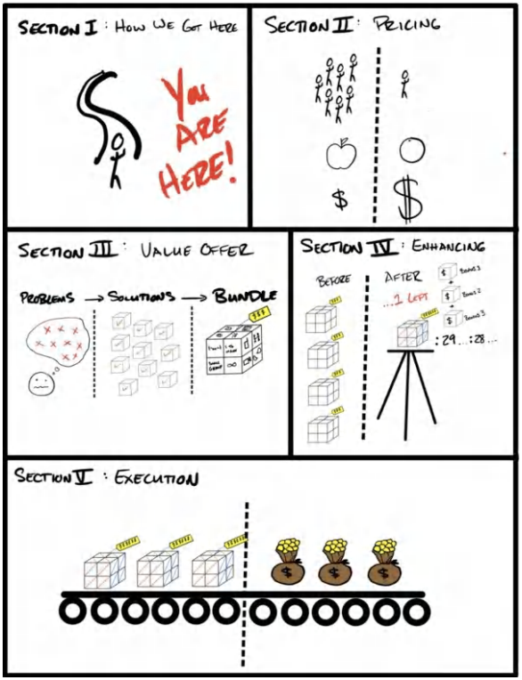

## **1. CÁCH CHÚNG TA ĐẾN ĐƯỢC ĐÂY**

> _"Phép màu sẽ tìm đến những trái tim thuần khiết, ngay cả khi mọi thứ có vẻ như đã mất sạch."_ 
> 
> MORGAN RHODES

**_24 tháng 12, 2016. Đêm Giáng Sinh._**

Căn phòng tối đen như mực. Giày của tôi dính chặt vào sàn nhà phủ đầy nước ngọt đã khô và những mẩu kẹo vụn. Sống mũi tôi ngập tràn mùi bắp rang bơ để qua ngày. Chúng tôi đến quá muộn nên chẳng còn chỗ ngồi tử tế, đành phải chen chúc ở hàng ghế áp chót gần sát màn ảnh. Chỉ cách tôi vài hàng ghế, màn chiếu phim rực rỡ chiếm trọn toàn bộ tầm nhìn của tôi. Trong ánh sáng hắt ra từ màn ảnh, tôi có thể lờ mờ nhận ra khuôn mặt của gia đình Leila. Trông họ chẳng khác nào đang bị thôi miên.

Tôi thèm thuồng được như họ biết bao. Họ ngồi đó, đắm chìm trong kỳ nghỉ lễ có trả lương dịp Giáng Sinh. *Thật sung sướng làm sao.*

Những người khác sẽ không nhận ra, nhưng Leila – bạn gái tôi lúc đó – quá hiểu tôi. Người khác có lẽ sẽ nghĩ tôi đang xem phim, nhưng Leila nhận ra tôi đang trân trân nhìn vô định vào màn hình, đôi mắt hoàn toàn không đuổi theo thước phim. Khuôn mặt tôi tái mét. Gò má và xương hàm hốc hác thấy rõ. Nhiều tuần chịu đựng stress mỏi mòn đã bóp nghẹt cơn thèm ăn của tôi.

“Anh sao thế?” cô hỏi.

Tôi không trả lời.

Cô đặt tay lên tay tôi để gây chú ý. Tôi không phản ứng. Chỉ một thoáng sau, những ngón tay cô siết chặt lấy cổ tay tôi, rồi cô nhìn tôi, đôi mắt dò xét. “Tim anh đập nhanh quá,” cô thì thầm, đầy lo lắng.

Không cần sự cho phép, cô bắt mạch cho tôi.

100 nhịp một phút. Gần như gấp đôi mức bình thường của một nam thanh niên 27 tuổi có thể trạng khỏe mạnh khi đang “nghỉ ngơi” trong một căn phòng mát mẻ, tối tăm. “Có chuyện gì đang xảy ra vậy?” cô hỏi dồn dập hơn, nhưng vẫn giữ giọng thì thầm.

Sự thật là tôi đang sợ hãi tột cùng.

*Vài giờ trước đó. . .*

Tôi trông như một gã khổng lồ. Tôi ngồi co ro trên chiếc ghế đồ chơi mini dành cho trẻ em. Đầu gối gần như chạm ngực, dẫu hai bàn chân tôi đã đặt áp sát xuống tấm thảm màu be cũ kỹ. Chiếc laptop nóng rực đặt trên hai đầu gối gập cao. Xung quanh tôi là búp bê và đồ chơi vương vãi. Chúng nhìn tôi với đôi mắt thao láo và nụ cười toe toét, bất động. Tôi chính là trò tiêu khiển của chúng trong suốt mấy tuần qua.

Tôi đang ở nhà bố mẹ Leila. Họ vừa lên chức ông bà và dùng phòng ngủ trống này làm phòng chơi mỗi khi các cháu qua thăm. Tôi không có chỗ ở. Vì vậy, họ cho phép tôi và Leila ở đó “bao lâu tùy thích”. Họ để tôi dùng phòng chơi của trẻ em làm văn phòng cho cái gọi là “công việc kinh doanh” của mình – mà ở thời điểm đó, nó có vẻ hoang đường chẳng kém gì những câu chuyện cổ tích họ vẫn kể cho đám cháu nghe trong căn phòng này.

Thú thật, tôi thấy mình giống như đang chơi trò đóng vai. Chỉ có điều, rủi ro là có thật. Và đây chính là cuộc đời tôi.

Hai tai tôi nóng ran và đỏ bừng vì chiếc điện thoại ép sát vào tai suốt mấy tiếng đồng hồ. Tôi cứ phải đổi tay liên tục vì cánh tay mỏi nhừ khi phải giơ điện thoại lên quá lâu.

&emsp;“_Tôi rất tiếc, anh Hormozi,_” giọng nói ở đầu dây bên kia vang lên, “_chúng tôi buộc phải giữ lại số tiền này trong sáu tháng tới. Chúng tôi đã phát hiện một số hoạt động bất thường, nên đây là biện pháp phòng ngừa._”

&emsp;“_Anh đang đùa tôi đấy à, 120.000 đô-la cơ mà,_” tôi gắt lên. “_Một biện pháp ‘phòng ngừa’ ư!?_”

&emsp;“_Tôi rất tiếc, thưa anh, đội ngũ thẩm định rủi ro của chúng tôi..._”

&emsp;“_Ừ, tôi nghe rõ rồi,_” tôi ngắt lời hắn. “_Tôi không chấp nhận điều đó._”

&emsp;“_Thưa anh, đó không phải là quyết định của tôi, đó là chính sách..._”

&emsp;“_Rồi tôi biết nói gì với nhân viên kinh doanh của mình, người có một đứa con nhỏ và một đứa nữa sắp chào đời? Anh định bảo cậu ấy rằng vợ bầu và đứa con sơ sinh sẽ không có cơm ăn chắc? Anh có trả tiền mua nhà hộ cậu ấy không?_”

Tôi sôi sục cả máu.

“_Thưa anh..._” hắn lại bắt đầu, với sự dửng dưng vô cảm, chỉ cốt để thông báo cho xong chuyện.

“_Đó không phải tiền của các anh mà đòi giữ._” Sự hung hăng của tôi nhanh chóng biến thành tuyệt vọng. “_Mẹ kiếp, cứ chuyển cho tôi một nửa để tôi còn trả lương nhân viên,_” tôi nài nỉ. “_Hôm nay là Đêm Giáng Sinh đấy, khốn kiếp._”

“_Thưa anh, chúng tôi sẽ giữ lại toàn bộ số tiền của anh trong sáu tháng tới theo đúng thỏa thuận..._” Giọng nói đó nhỏ dần rồi mất hút.

*Khốn thật.*

Tôi cúp máy và kiểm tra tài khoản của mình. *23.036 đô-la.*

Tôi còn nợ nhân viên kinh doanh khoản hoa hồng 22.000 đô-la cho doanh số 120.000 đô-la mà rốt cuộc tôi chẳng nhận được đồng nào.

Không cho phép bản thân có thời gian suy nghĩ thêm, tôi chuyển khoản thẳng cho cậu ta.

_- 22.000 đô-la Thanh toán thành công._

Số dư: 1.036 đô-la.

_Khốn khiếp._

> 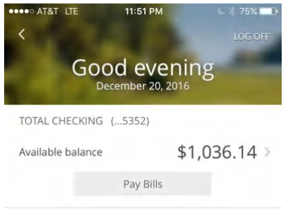
> Tôi chụp lại màn hình tài khoản ngân hàng này vì biết chắc mình sẽ kể lại câu chuyện này vào một ngày nào đó.

Ánh nắng chói chang làm tôi lóa mắt khi chúng tôi bước ra khỏi suất chiếu sớm. Các gia đình ùn ùn qua lại cánh cửa xoay, tận hưởng những ký ức vui vẻ của họ. Tôi ngây như phỗng. Leila dắt tôi ra xe, bàn tay cô siết chặt lấy tay tôi.

&emsp;“_Anh bị làm sao thế? Chuyện gì xảy ra vậy?_” cô hỏi.

&emsp;“_Số tiền đó không về nữa._”

&emsp;“_Ý anh là sao?_” cô hỏi. “_Nó bị chậm trễ à?_”

&emsp;Tôi thở dài ngao ngán. “_Họ giữ lại hết rồi._”

&emsp;“_Họ làm thế được á!?_”

&emsp;“_Rõ là vậy,_” tôi đáp với vẻ mặt lạnh lùng, cố giữ bình tĩnh trước mặt bố mẹ cô.

&emsp;“_Thế còn tiền hoa hồng của nhân viên thì sao?_”

&emsp;“_Anh trả đủ cho cậu ta rồi. Toàn bộ._” Tôi nói mà không dám nhìn thẳng vào mắt cô.

Lo lắng trong lòng Leila nhanh chóng chuyển thành nỗi hoảng sợ.

Chúng tôi ngồi im lặng suốt quãng đường về nhà. Tôi thẫn thờ nhìn ra ngoài cửa sổ. Cô nắm chặt tay tôi. Cảm giác ấy ấm áp hơn tôi tưởng tượng. *Chúng ta sẽ vượt qua được thôi.*

_30 ngày trước đó..._

Tôi quyết định "tất tay" vào công việc kinh doanh mới mang tên “Gym Launch”. Ý tưởng thế này: Tôi sẽ bay khắp cả nước đến các phòng tập và lấp đầy khách cho họ bằng một phương pháp mới, dựa trên nền tảng một **Grand Slam Offer** mà tôi đã trau dồi hoàn hảo từ thời còn sở hữu chuỗi phòng tập của riêng mình.

Trước thời điểm này, tôi đã bán 5 trong tổng số 6 phòng tập của mình. Toàn bộ số tiền bán được – thành quả của cả cuộc đời lao động – tôi đã bỏ vào một tài khoản chung với một đối tác mới. Số tiền này đáng lẽ phải là vốn mồi cho công ty mới của chúng tôi.

*Cuối cùng thì tôi cũng sắp chạm tay vào chút thành công.*

Chuông báo thức reo lên. Tôi mơ màng quờ quạng cánh tay túm lấy bàn cạnh giường ngủ. Tôi tắt báo thức, trong khi Leila vẫn ngủ ngon lành mặc cho mớ hỗn độn xung quanh.

Tôi nằm im lặng, mở tài khoản ngân hàng lên kiểm tra – một thủ tục diễn ra hàng ngày. Số dư hiển thị 300 đô-la.

Khoan đã. Không thể nào đúng được. Hôm qua trong này vẫn còn 46.000 đô-la cơ mà.

Adrenaline trong người tôi trào dâng. Nhìn kỹ hơn, tôi thấy dòng chữ _“-45.700 đô-la Thanh toán thành công.”_ Tôi phát cuồng lên.

Số tiền từ việc bán tất cả các phòng tập của tôi đã bay sạch. Tôi kiểm tra xem tiền đã đi đâu. Nó chuyển đến tài khoản “đối tác” tôi. Hắn ta đã rút sạch tiền.

*Mẹ kiếp.*

Bốn năm cuộc đời của tôi đã biến mất nhanh đến vậy đấy. Tôi chính thức trắng tay, thậm chí còn chẳng có gì để bấu víu. Không phòng tập. Không thiết bị. Không nhân viên. Không gì cả.

Tôi cảm thấy chết lặng từ trong tâm can.

Đã vậy, xui xẻo còn chồng chất xui xẻo, cũng trong khoảng thời gian 30 ngày định mệnh đó, mẹ tôi rơi vào tình trạng nguy kịch vì một vụ tai nạn suýt chết (và vẫn phải nằm dưới sự giám sát 24/24), còn tôi thì tông nát bét chiếc xe hơi của mình trong một vụ tai nạn đối đầu ở vận tốc 100 km/h, và phần thưởng an ủi là một biên bản lái xe khi say rượu (DUI).

Đây đúng là họa vô đơn chí. Điểm tựa duy nhất của tôi trong giai đoạn này là bán một “offer thử thách” (challenge offer) mới cho một phòng tập và thu toàn bộ tiền mặt ngay từ đầu như là “phí” để lật ngược tình thế kinh doanh cho họ.

Thế là tôi làm điều duy nhất mà tôi rành. Tôi *bán hàng*. Nhân viên kinh doanh của tôi đã mang về 120.000 đô-la chỉ trong một tháng, và tôi nợ cậu ta khoản hoa hồng 22.000 đô-la.

Vấn đề là 120.000 đô-la đó chẳng bao giờ về tài khoản.

&emsp;“Chúng ta cần nói chuyện,” tôi nói khi cùng Leila bước sang căn phòng khác. Tôi lấy hết can đảm để cất lời nhưng mắt vẫn dán chặt xuống sàn nhà đầy xấu hổ.

&emsp;“Anh chẳng còn gì cả,” tôi nói với cô. “Anh là con tàu đắm rồi, em không cần phải ở lại với anh đâu.”

Cô nắm lấy cằm tôi, kéo mặt tôi hướng về phía cô để tôi có thể nhìn thẳng vào mắt cô: “Em sẵn sàng ngủ với anh dưới gầm cầu nếu cơ sự phải thế.” Đáng lẽ tôi nên rơi những giọt nước mắt hạnh phúc, nhưng tôi kiệt quệ cảm xúc đến mức câu trả lời của tôi trông chẳng khác gì thờ ơ. *Bản thân tôi còn chẳng buồn ở lại với tôi nữa là.*

&emsp;“Chúng ta vẫn sẽ tiến hành các buổi launch (ra mắt) bắt đầu từ ngày mai chứ?” Cô hỏi. “Tất cả bạn bè của em đều nghỉ việc để làm việc này rồi.” Cô nói một cách rất thực tế, nhưng sao vẫn nhói lòng đến thế. Tôi cảm thấy hoàn toàn đánh mất chí khí. “Nghe này, mọi thứ có thể tồi tệ đến mức thảm họa đấy,”

&emsp;“Em tin anh. Mình sẽ tìm cách giải quyết.”

Lúc đó tôi chỉ còn lại hai thứ: một **Grand Slam Offer** và một chiếc thẻ tín dụng doanh nghiệp cũ có hạn mức 100.000 đô-la từ thời tôi còn làm phòng tập.

Vào ngày sau lễ Giáng Sinh (hai ngày sau cú điện thoại đau đớn đến ruột gan với bên xử lý thanh toán), chúng tôi có lịch trình ra mắt sáu phòng tập mới... cùng một lúc. Tính cả vé máy bay, khách sạn, xe thuê, tiền xăng và chi phí chạy quảng cáo (tất cả nhân lên sáu lần), tôi sẽ phải tiêu tốn 3.300 đô-la *mỗi ngày* bằng số tiền mà tôi hoàn toàn không có. Đồng xu cuối cùng của tôi đã dồn để trả lương cho nhân viên kinh doanh. Tôi vẫn nhớ như in bàn tay mình run lẩy bẩy khi các chiến dịch quảng cáo được bật lên: Tắt $\rightarrow$ **BẬT**.

Cứ thế đấy, tôi lao vào đống nợ với tốc độ 412 đô-la cho mỗi giờ làm việc. Cứ thế đấy, 3.300 đô-la mỗi ngày bắt đầu bị trừ khỏi tài khoản của tôi.

&emsp;_- 3.300 đô-la ... Giờ thì tôi chính thức trắng tay_

&emsp;_- 3.300 đô-la ... Giờ thì tôi chính thức âm cả vào vốn lẫn lời_

&emsp;_- 3.300 đô-la ... Tôi đang nợ nhiều hơn cả số không âm 10.000 đô-la_

&emsp;_- 3.300 đô-la ... Quyết định này sẽ hủy hoại tương lai của tôi đến hết cuộc đời._

Nhưng rồi mọi thứ bắt đầu khởi sắc. Dưới đây là những gì đã diễn ra trong tháng đó (tháng 1 năm 2017), theo các bản kê khai xử lý thanh toán cũ mà tôi lục lại được. Bạn có thể thấy cột mốc thời gian ở cột bên trái và doanh thu thu về tương ứng ở cột bên phải.

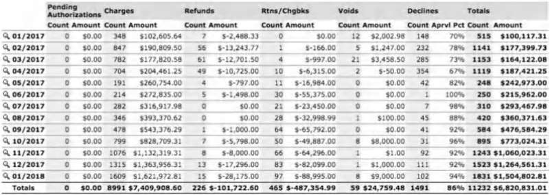

Chúng tôi đã kiếm được 100.117 đô-la! Vừa đủ để bù đắp khoản chi 3.300 đô-la/ngày đã vắt kiệt chiếc thẻ tín dụng. Mọi thứ thực sự đang hoạt động. Tôi khó lòng tin nổi. Tôi tung ra đường chuyền cầu may (hail mary pass), và vũ trụ đã bắt được nó. Từ chỗ đi tìm luật sư chuyên về phá sản, tôi chuyển sang bối cảnh phải đau đầu nghĩ xem nên làm gì với 3.000.000 đô-la lợi nhuận tích lũy chỉ trong vòng mười hai tháng đầu tiên. Cảm giác thật như mơ. Và ngẫm lại, đến giờ đôi khi tôi vẫn thấy nó thật ảo diệu.

Đến cuối năm, chúng tôi đạt doanh thu 1.500.000+ đô-la/tháng. Mười hai tháng sau đó: 4.400.000 đô-la/tháng. Mỗi tháng. Hai mươi bốn tháng tiếp theo, chúng tôi vượt mốc 120.000.000 đô-la doanh số, quyên góp 2.000.000 đô-la để gây quỹ hỗ trợ bình đẳng cơ hội cho các khu vực thu nhập thấp. Chúng tôi đã gặp gỡ và kết bạn với Arnold Schwarzenegger (thần tượng cả đời của tôi) và được mời làm thành viên hội đồng quản trị cho quỹ từ thiện của ông ấy – _After School All Stars_.

> 
>
> *Leila và tôi gặp gỡ Arnold Schwarzenegger tại nhà riêng của ông ấy. Hiện chúng tôi đang nằm trong ban hội đồng quốc gia của quỹ từ thiện After School All Stars do ông sáng lập. Việc tạo ra những Grand Slam Offer đã mang lại cho chúng tôi cơ hội tiếp cận những con người mà trước đây chúng tôi chỉ dám mơ ước.*

Mười hai tháng sau đó nữa, chúng tôi hiện đang sở hữu một danh mục đầu tư gồm bảy công ty đạt quy mô tám con số và đa tám con số trên nhiều lĩnh vực khác nhau (nhiếp ảnh, xuất bản, thể hình, tư vấn doanh nghiệp, làm đẹp) và các mô hình kinh doanh đa dạng (chuỗi cửa hàng truyền thống, phần mềm, dịch vụ, thương mại điện tử, đào tạo & giáo dục). Các công ty trong danh mục đầu tư của chúng tôi hiện tạo ra khoảng 1.600.000 đô-la *mỗi tuần* (và vẫn đang tiếp tục tăng trưởng).

Tôi kể những điều này vì thú thực chính bản thân tôi cũng khó mà tin nổi. Tất cả cơ ngơi này có được chỉ nhờ một cô gái tin tưởng tôi, một chiếc thẻ tín dụng và một **Grand Slam Offer**.

Tôi biết mình vừa "dắt tay" bạn bay vèo từ cảnh bần hàn đến giàu sang. Và câu hỏi hiển nhiên lúc này là: *làm thế nào?* Đó chính là những gì tôi sẽ dùng phần còn lại của cuốn sách này (cùng các cuốn sách và khóa học miễn phí còn lại trong series Acquisition.com này) để mổ xẻ chi tiết.

Kỹ năng tạo lập offer đã cứu tôi khỏi phá sản và có lẽ đã cứu cả mạng sống của tôi. Tôi đã mắc vô số sai lầm trong đời. Tôi đã đưa ra biết bao quyết định tồi tệ. Tôi từng làm tổn thương người khác cả vô tình lẫn cố ý. Tôi làm những việc tồi tệ với những thiện ý ban đầu. Tôi nói điều này vì tôi cũng chỉ là một con người bằng xương bằng thịt. Tôi không dám vỗ ngực nhận mình nắm giữ mọi chân lý. Tôi cũng có những con quỷ dữ trong tâm trí phải chiến đấu mỗi ngày. Nhưng bất chấp nhiều thiếu sót của bản thân, tôi vẫn xoay sở để trở nên thực sự cừ khôi ở đúng *một* thứ này... và tôi muốn chia sẻ nó với bạn. Tôi có thể dạy bạn cách xây dựng những offer đỉnh cao.

Tôi không biết bạn là ai (vâng, chính là bạn, người đang đọc những dòng này). Nhưng tôi gửi lời cảm ơn từ tận đáy lòng. Cảm ơn bạn vì đã cho phép tôi làm một công việc mà tôi thấy có ý nghĩa. Cảm ơn bạn đã trao cho tôi tài sản giá trị nhất của mình – sự chú ý của bạn. Tôi hứa sẽ cố gắng hết sức để mang lại cho bạn tỷ suất lợi nhuận xứng đáng (ROI).

Đây là tin vui đầu tiên dành cho bạn: nếu bạn đang đọc đến đây, tức là bạn đã nằm trong top 10 phần trăm dẫn đầu. Hầu hết mọi người mua đồ về rồi phớt lờ nó ngay lập tức. Tôi cũng xin hé lộ trước một điều: càng đi sâu vào các chương sau, những "viên kim cương" nhận được càng trở nên giá trị hơn. Cứ chờ mà xem.

Cuốn sách này chắc chắn sẽ đem lại kết quả thực chiến.

Thế giới này cần nhiều doanh nhân hơn nữa. Cần nhiều chiến binh hơn nữa. Cần nhiều phép màu hơn nữa. Và đó chính là những gì tôi đang chia sẻ với bạn – phép màu.

## **2. GRAND SLAM OFFERS**

> _“Hãy đưa cho khách hàng một offer tốt đến mức họ cảm thấy mình thật ngu ngốc nếu từ chối.”_
> 
> – TRAVIS JONES –

Năm ấy tôi 23 tuổi và, mượn câu nói của Ruth trong phim *Ozark*, tôi chẳng biết “khỉ khô gì về mớ đời”. Nhưng ngặt nỗi tôi đang ngồi trong một phòng khách sạn penthouse ở Las Vegas cùng với mười chủ doanh nghiệp để học về marketing và bán hàng... diện trên mình chiếc áo thun “beast mode” bảnh chọe nhất (một chiếc áo tôi nhận miễn phí, và là một trong năm chiếc áo hiếm hoi tôi sở hữu lúc bấy giờ).

Thú thật, tôi lo lắng, tự ti và nghĩ rằng mình đang mắc một sai lầm tồi tệ. Tôi đã phải trả 3.000 đô-la bằng số tiền không có sẵn để giành lấy một chỗ ngồi ở đó. Tôi biết mình cần phải học hỏi. Tất cả mọi người ở đó đều đã có doanh nghiệp... trừ tôi. Tôi đang lên kế hoạch khởi nghiệp với một phòng tập gym.

TJ, người tổ chức sự kiện, sở hữu nhiều doanh nghiệp thành công. Trong lúc điểm qua chương trình nghị sự, tôi nhớ anh ấy có nhắc bâng quơ về việc kiếm được 1.000.000 đô-la trong năm đó.

Một. Triệu. Đô-la. Tôi hoàn toàn bị thôi miên. *Mình muốn được như gã này. Mình sẽ làm bất cứ điều gì.* Vấn đề là, tôi chẳng hiểu họ đang nói cái quái gì. KPI là gì? CPL là gì? Tỷ lệ chuyển đổi là gì? Đầu óc tôi quay cuồng trong khi vẫn phải cố ra vẻ như mình đang nắm bắt mọi thứ. Nhưng thực tế là không, và tôi lại rất dở trong việc giả vờ.

Giữa các “phiên thảo luận”, TJ tìm đến tôi. Anh ấy nhận ra tôi đang với quá sức. TJ là một người tử tế, tò mò và chu đáo. Sau vài câu chuyện xã giao, anh ấy hỏi tôi một câu hỏi đơn giản đã thay đổi cuộc đời tôi mãi mãi...

&emsp;“Cậu có muốn biết bí quyết bán hàng là gì không?”

Chưa bao giờ trong đời tôi bán được thứ gì. Tôi thậm chí chưa từng đọc một cuốn sách nào về nó. Tôi chỉ mới vừa tìm hiểu thuật ngữ đó nghĩa là gì gần đây thôi (thật đấy). Tôi chồm người về phía trước, quyết tâm "tải" trọn từng âm tiết thốt ra từ miệng anh ấy thẳng vào não bộ.

Tôi mở cuốn sổ tay ra và nhìn anh ấy chằm chằm đầy tập trung. Tôi đã sẵn sàng đón nhận bí quyết tối thượng.

Anh ấy nhìn tôi với vẻ mặt nghiêm nghị và nói: “**_Hãy đưa cho khách hàng một offer tốt đến mức họ cảm thấy mình thật ngu ngốc nếu từ chối._**”

Tôi gật đầu, ghi lại, gạch chân và khoanh tròn câu nói đó. Và thế là, toàn bộ thế giới quan về việc bán hàng của tôi hoàn toàn đảo lộn.

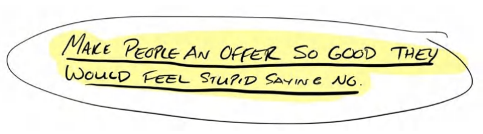

Tâm trí tôi bắt đầu phóng như bay. Tôi không cần phải quá khéo léo... hay thậm chí phải giỏi giang gì cho cam. Tôi chỉ cần nghĩ ra những thứ mà *bất cứ ai* cũng phải gật đầu đồng ý. Trò chơi vĩ đại nhất cuộc đời tôi đã chính thức bắt đầu.

### **Cuốn sách này nói về điều gì?** 

Vào một thời điểm nào đó, mọi chủ doanh nghiệp thành công đều từng là một **gã-khởi-nghiệp** (_wantrepreneur_). Họ là những người đầy ắp ý tưởng nhưng lại chán nản vì tiềm năng của bản thân chưa được khai phá hết. Rồi bỗng nhiên có một khoảnh khắc bừng tỉnh, khi họ nhận ra cái cái giá quá đắt mà họ (và rất nhiều người khác) đang trả — đó là đánh đổi sự tự do lấy một cảm giác an toàn (ảo tưởng). 

Nỗi thống khổ cứ thế nhân lên. Và một khi sự khó chịu của việc dậm chân tại chỗ vượt qua nỗi sợ thay đổi, họ quyết định liều một phen. _"Mình phải làm chủ để được tự do. Tự do làm điều mình thích, vào bất cứ lúc nào, với bất kỳ ai mình muốn."_ 

&emsp;_Có người ngộ ra chân lý khởi nghiệp qua các khóa học phát triển bản thân._ 

&emsp;_Có người bước chân vào con đường này thông qua việc mua nhượng quyền (franchise)._ 

&emsp;_Có người mua các khóa học kinh doanh._ 

&emsp;_Và có những kẻ gạt phăng tất cả: "MẶC KỆ MẸ NÓ. Làm luôn! Mình sẽ bắt nó phải hoạt động."_ 

&emsp;_Và quả thật, họ đã làm được._ 

Hầu hết chúng ta mở cửa hàng với mong muốn giúp đỡ mọi người bằng cách này hay cách khác. Đa phần, sự trợ giúp ấy xuất phát từ một vấn đề mà chính chúng ta từng trải qua. Chúng ta bắt đầu hành trình "đền đáp xã hội" (give back) bằng cách mang lại giá trị cho người khác, giúp họ giải quyết cái rắc rối từng hành hạ chúng ta trong quá khứ. Dĩ nhiên, đôi khi câu chuyện lại khởi đầu theo một hướng khác. Dù bằng cách nào đi nữa, tất cả chúng ta đều bám chặt lấy giấc mơ kiếm được nhiều tiền hơn và tự do hơn hiện tại. 

Nhiều người trong chúng ta từng ngây thơ nghĩ rằng việc sở hữu một doanh nghiệp sẽ là thành tựu đỉnh cao — là cái đích cuối cùng — để rồi nhận ra thực tế phũ phàng: đó mới chỉ là vạch xuất phát. 

Chẳng hiểu sao, trong khoảng chuyển giao giữa "nhiệt huyết muốn giúp đời" và "làm chủ doanh nghiệp đầu tiên", chúng ta dần nhận ra mình chẳng biết mọe gì về kinh doanh cả, chứ đừng nói đến chuyện tạo ra lợi nhuận. 

Ta có thể rất am hiểu về đam mê của mình, hiểu rõ _lý do_ tại sao ta khởi nghiệp, nhưng điều đó không có nghĩa là ta biết cách thành công trong kinh doanh. Trái với sự vỡ mộng của những kẻ mộng mơ đứng ngoài lề, thành công trong kinh doanh đồng nghĩa với việc khiến khách hàng tiềm năng móc tiền đổi lấy dịch vụ của ta. Đổi đam mê lấy từng đồng tiền mồ hôi xương máu của họ. Cuộc giao dịch là thế đấy. Cách duy nhất để xúc tiến thương vụ đó, để thực hiện giao dịch, để vận hành một doanh nghiệp đúng nghĩa _chính là tạo ra cho khách hàng tiềm năng một Grand Slam Offer_ (Lời đề nghị không thể chối từ).

### **Rốt cuộc, Offer (Lời đề nghị) là cái quái gì?** 

Cách _duy nhất_ để làm kinh doanh là thông qua việc trao đổi giá trị: đổi tiền lấy giá trị. Offer chính là thứ khởi xướng màn trao đổi này. Nói một cách ngắn gọn, offer bao gồm sản phẩm và dịch vụ bạn cam kết cung cấp, cách thức bạn nhận thanh toán, và các điều khoản trong thỏa thuận. Nó là thứ châm ngòi cho quá trình tìm kiếm khách hàng và kiếm tiền. Nó là điểm chạm đầu tiên của mọi khách hàng mới với doanh nghiệp của bạn. Vì offer là thứ thu hút khách hàng mới, nó chính là mạch máu nuôi sống doanh nghiệp bạn. 

&emsp;_Không có offer?_ Không kinh doanh. Không sự sống. 

&emsp;_Offer tồi?_ Lỗ chổng vó. Dẹp tiệm. Cuộc đời bế tắc. 

&emsp;_Offer tàng tàng?_ Không lời. Doanh nghiệp dậm chân tại chỗ. Cuộc đời tẻ nhạt. 

&emsp;_Offer khá?_ Có chút lợi nhuận. Kinh doanh tàm tạm. Cuộc sống bình thường. 

&emsp;_Grand Slam Offer?_ Lợi nhuận khủng. Doanh nghiệp đột phá. Tự do tài chính. 

Cuốn sách này sẽ giúp những nhà khởi nghiệp tạo ra những Grand Slam Offer như thế. Đó là những lời đề nghị cực kỳ hiệu quả, mang lại lợi nhuận cao và làm thay đổi cuộc đời đến mức thoạt nhìn người ta tưởng đó là do may mắn! Ít nhất thì những kẻ ngoại đạo sẽ nhìn nhận như vậy. 

Như bạn có thể đã biết, tôi đã thiết kế hàng ngàn offer trong suốt thập kỷ qua. Phần lớn thất bại. Một số làm ăn tàm tạm. Và một vài cái đã trúng mỏ vàng... nhưng thú thực, tôi chẳng bao giờ _thực sự_ hiểu tại sao. Như Tiến sĩ Burgelman, một giáo sư nổi tiếng tại trường kinh doanh Stanford từng nói: hiểu được lý do vì sao mình thất bại còn giá trị hơn gấp nhiều lần việc mù tịt không biết vì sao mình thành công. 

Nhưng khi dữ liệu bắt đầu đổ về, những thứ thoạt nhìn giống như "vận may" thực chất lại là một bộ khung có thể lặp lại (repeatable framework). Tôi đã đủ may mắn trúng mỏ vàng nhiều lần để đúc kết lại các bộ khung này và chứng minh rằng "sấm chớp có thể đánh cùng một chỗ hai lần". 

Tôi đã biên soạn các bước và thành phần của những bộ khung đó theo một định dạng logic và dễ tiêu hóa để bạn có thể áp dụng được ngay. Ngay bây giờ. Thay vì một cuốn sách sướt mướt nhưng quen thuộc chứa đầy những lý thuyết kinh doanh sáo rỗng và những màn "tự sướng" tinh thần. 

### **Hai Vấn Đề Lớn Nhất Mà Hầu Hết Chủ Doanh Nghiệp Phải Đối Mặt Và Cuốn Sách Này Giải Quyết Chúng Như Thế Nào** 

Mặc dù bạn _có thể_ liệt kê danh sách những rắc rối của mình dài cả cây số — một cách tuyệt vời để tự chuốc lấy stress — thì nhìn chung, tất cả các vấn đề đó đều bắt nguồn từ hai "ông lớn": 

1. Không đủ khách hàng 

2. Không đủ tiền mặt (lợi nhuận dư dả vào cuối tháng) 

Nghe có vẻ hiển nhiên phải không? Bạn sẽ tốn thêm tiền và thời gian để có thêm khách hàng, qua đó giải quyết vấn đề thứ nhất, nhưng số tiền đó lại được rút ra từ biên lợi nhuận, thế là lại sinh ra vấn đề thứ hai! Đã vậy, bọn khách hàng tiềm năng còn liên tục dìm hàng, so sánh dịch vụ của chúng ta với những lựa chọn rẻ tiền và lởm khởm hơn — và kẻ nào rẻ nhất sẽ "chiến thắng". Dĩ nhiên, "chiến thắng" ở đây đồng nghĩa với việc phải cày cuốc nhiều hơn với mức thù lao ít hơn (thật đáng buồn). 

Giả sử bạn đã phá giá để kéo khách. Thậm chí bạn có thể đang ngập ngụa trong đống hợp đồng. Nhưng rồi bạn nhận ra mình đang thoi thóp vì biên lợi nhuận quá mỏng. Cuộc đua "cạnh tranh" biến thành một cuộc đua xuống đáy. 

Nếu bạn đang vật lộn với một hoặc cả hai vấn đề này, hãy nhớ rằng bạn không cô độc. Tôi đã từng ở hoàn cảnh đó. 

Thực tình, tôi nghĩ _mọi_ nhà sáng lập đều phải đối mặt với những thử thách y chang nhau. 

Tôi cũng muốn bạn biết rằng đó không phải lỗi của bạn. Các mô hình kinh doanh truyền thống vốn không được thiết kế để tối đa hóa lợi nhuận. Chúng được tạo ra bởi những tập đoàn lắm tiền nhiều của, những kẻ có thể chấp nhận kinh doanh lỗ chỏng vó trong _nhiều năm trời_. Khi các mô hình này được áp dụng vào đời thực, chủ doanh nghiệp chỉ có thể thoi thóp "sống qua ngày". Thực chất họ đang "tự mua cho mình một công việc" và làm việc 100 tiếng một tuần chỉ để trốn tránh việc làm công ăn lương 40 tiếng. Một sự đánh đổi tồi tệ. Tôi đoán rằng nếu bạn cũng giống tôi, bạn khởi nghiệp là để tìm kiếm một thứ tốt đẹp hơn. 

Hãy cởi mở đón nhận. Nội dung của cuốn sách này, nếu được thực thi, có thể lột xác doanh nghiệp của bạn... một cách chớp nhoáng. 

Không sao cả nếu bạn không rành về các con số tài chính hay mô hình kinh doanh. Tôi đã làm thay bạn hết rồi. Tôi sẽ dắt tay bạn đi qua từng bước một trong những trang sách này. Tôi sẽ phân tích chi tiết từng vấn đề lớn trong hai vấn đề kể trên, bao gồm cả lý do tại sao chúng lại thất bại. Sau đó, tôi sẽ chỉ cho bạn giải pháp. Và để khép lại hành trình này, tôi sẽ hướng dẫn bạn cách gia tăng giá trị (enhance value) để tối đa hóa số tiền kiếm được từ mỗi khách hàng, giúp bạn đè bẹp mọi đối thủ trên mặt trận marketing và chất đầy tiền vào két. 

Chúng tôi đã áp dụng mô hình offer này cho mọi ngách thị trường mà chúng tôi làm việc cùng (chiropractor, nha sĩ, phòng gym, agency, thợ sửa ống nước, thợ lợp mái, dịch vụ dắt chó đi dạo, sản phẩm vật lý, phần mềm, cửa hàng truyền thống, và vô số ngành khác), và thật đáng kinh ngạc khi thấy mọi thứ chuyển biến nhanh đến thế nào đối với từng ngách khi họ áp dụng bộ khung này. 

### **Bạn Nhận Được Gì Từ Cuốn Sách Này?** 

Tôi đã mắc mọi sai lầm (ngu ngốc) có thể xảy ra trong kinh doanh được ghi trong sách. Giờ đây, bạn có thể học hỏi từ những cú vấp ngã ê chề, đắt giá và tốn hàng triệu đô của tôi mà không phải chịu đựng nỗi đau tương tự. 

Xây dựng những doanh nghiệp này là một hành trình đầy gian nan và cảm xúc đối với tôi. Tôi sẽ không đánh đổi những trải nghiệm đó bằng bất cứ thứ gì trên đời. Tuy nhiên, nếu cuốn sách này chỉ giúp được một nhà sáng lập tránh khỏi việc chịu đựng đau khổ như tôi, giữ được doanh nghiệp sống sót, hay thực hiện hóa giấc mơ của họ, thì mọi thứ đều hoàn toàn xứng đáng. 

Nếu bạn sẵn sàng đánh đổi thời gian bằng việc xem hai tập phim truyền hình yêu thích để thực sự nghiền ngẫm cuốn sách này — và nếu bạn _triển khai_ dù chỉ một thành phần duy nhất của offer — tôi đảm bảo bạn sẽ có thêm nhiều khách hàng và tăng thêm doanh thu. Đọc cuốn sách này và khắc cốt ghi tâm nó sẽ là khoản đầu tư sinh lời cao nhất về mặt thời gian cho doanh nghiệp của bạn. Không gì khác có thể mang lại cho bạn kết quả lớn nhường này trong cùng một khoảng thời gian. Đó là một lời hứa. 

Một lợi ích kèm theo — triển khai một offer mới là một trong những việc dễ làm nhất trong kinh doanh. Thế nên bạn hoàn toàn _có thể_ làm được điều này. Đây không phải là mấy cái lý thuyết quản trị hay văn hóa doanh nghiệp nhảm nhí nào cả. Đây là thứ kiến thức thực chiến "làm thế nào để bán thứ quái quỷ gì đó với giá cao ngất ngưởng". 

### **Tôi Nhận Được Gì Từ Việc Này?** 

Tôi cung cấp toàn bộ các tài liệu này (cuốn sách này, khóa học đi kèm, cùng tất cả các sách và khóa học khác mà bạn có thể tìm thấy tại _acquisition.com_) hoàn toàn miễn phí hoặc chỉ tính phí tượng trưng với mong muốn giúp đỡ tối đa con người kiếm nhiều tiền hơn và phục vụ khách hàng tốt hơn. Tôi làm điều này với mục tiêu mang lại giá trị lớn hơn bất kỳ khóa học 1.000 đô nào, bất kỳ chương trình coaching 30.000 đô nào, và buồn cười thay, là vượt trội hơn hẳn tấm bằng đại học trị giá 200.000 đô. Tôi làm vậy bởi vì, mặc dù tôi hoàn toàn có thể bán những tài liệu này dưới những định dạng đó, _tôi đơn giản là không thích_. Tôi kiếm tiền bằng cách _làm_ những việc này, chứ không phải bằng cách _dạy người khác làm_, trái ngược với phần lớn cộng đồng marketing ngoài kia. Vì vậy mô hình của tôi rất khác (tôi sẽ giải thích kỹ hơn ngay sau đây). 

Mặc dù vậy, có hai nhóm đối tượng chính (archetypes) mà tôi muốn mang lại giá trị thông qua các ấn phẩm của mình. Nhóm thứ nhất, các nhà sáng lập có doanh thu _dưới_ 3.000.000 USD mỗi năm, mục tiêu của tôi là giúp bạn đạt được mốc đó và _chiếm lấy lòng tin của bạn_. Hãy thử chỉ một vài chiến thuật từ cuốn sách này, chứng kiến chúng phát huy hiệu quả, sau đó thử thêm vài chiến thuật khác, lại thấy chúng hiệu quả... cứ thế tiếp tục. Bạn càng thấy kết quả rõ rệt trong doanh nghiệp của mình bao nhiêu, thì càng tuyệt vời bấy nhiêu. 

Một khi bạn đã thành công, bạn sẽ bước sang nhóm 2, những nhà sáng lập có doanh thu hằng năm _tối thiểu trong khoảng_ từ 3M USD đến 10M USD. Một khi bạn đạt được mốc đó, hoặc nếu đó chính là bạn ở hiện tại, tôi sẽ rất vinh dự được đầu tư vào doanh nghiệp của bạn và giúp bạn vượt mốc 30M, 50M, hay 100M+ USD. Tôi không bán các chương trình coaching, mastermind, khóa học hay bất cứ thứ gì tương tự. Thay vào đó, tôi sở hữu một danh mục các công ty mà tôi nắm giữ cổ phần. Tôi sử dụng hạ tầng, nguồn lực và đội ngũ của tất cả các công ty của mình để phóng đại tốc độ tăng trưởng của họ. 

Nhưng đừng vội tin tôi ngay... _chúng ta chỉ mới gặp nhau thôi_. 

Nếu bạn tò mò, mô hình kinh doanh của tôi rất đơn giản, giống y như logo hình kim tự tháp bốn mảnh: 

1. Cung cấp giá trị hoàn toàn miễn phí, vượt xa những gì phần còn lại của thị trường đang tính phí. 

2. Giúp các chủ doanh nghiệp áp dụng những tài liệu thực sự hiệu quả và kiếm tiền bằng cách phục vụ nhiều người hơn. 

3. Chiếm trọn lòng tin của những chủ doanh nghiệp siêu hành động — những người sử dụng các bộ khung để mở rộng quy mô kinh doanh lên 3M-10M USD/năm và hơn thế nữa. 

4. Đầu tư vào các doanh nghiệp đó để tạo ra tác động lớn hơn ở tầm quy mô, đồng thời tiếp tục giúp đỡ tất cả những người khác hoàn toàn miễn phí. 

Nếu nhìn kỹ, bạn sẽ thấy quá trình này đảo ngược công thức thành công (reverse-engineers success). Tôi nghĩ nó khá hay ho. Cụ thể thế này: Tôi biết những chủ doanh nghiệp này có thể tự thực thi các bộ khung của tôi mà không cần cầm tay chỉ việc, và do đó, họ cực kỳ có khả năng thành công với bộ khung tiếp theo (đạt mốc 30M, 50M, 100M đòi hỏi cách làm khác với việc leo lên mốc 3M-10M). Họ biết rằng phong cách của tôi phù hợp với họ, vì nó đã chứng minh hiệu quả rồi. Thế là chúng ta làm việc dựa trên lòng tin sẻ chia — tôi tin họ có khả năng thực thi, và họ tin hệ thống của chúng tôi mang lại kết quả — nhắc lại lần nữa, vì nó đã làm được điều đó rồi... trong khi vẫn giúp đỡ tất cả những người khác.... hoàn-toàn-miễn-phí. Nhờ đó, tôi có thể chủ động triệt tiêu các thất bại từ trong trứng nước và nâng cao đáng kể xác suất thành công. Để tôi cho bạn thấy con số đó khủng đến mức nào nhé.... 

Tính đến thời điểm viết những dòng này, mọi doanh nghiệp tôi khởi xướng kể từ tháng 3 năm 2017 đều đạt tốc độ tăng trưởng doanh thu 1.500.000 USD/tháng (run rate). Theo Cơ quan Quản lý Doanh nghiệp Nhỏ (SBA), xác suất để một doanh nghiệp đơn lẻ đạt doanh thu 10 triệu USD/năm chỉ là 0.4%, tức là 1 trên 250. Việc đạt được cột mốc đó 4 lần liên tiếp sẽ là: 0.4% x 0.4% x 0.4% x 0.4% = xác suất cực kỳ, cực kỳ thấp để gọi đó là may mắn. Do đó, tôi có thể tự tin khẳng định rằng chúng tôi biết cách tái tạo thành công bằng cách sử dụng các bộ khung mà tôi chia sẻ, hết lần này đến lần khác. Chúng hoạt động hiệu quả vì chúng là những nguyên lý kinh doanh vượt thời gian. 

Tôi vẫn thường hình dung rất rõ ràng, mỗi ngày, cảm giác thức giấc giữa đêm với những giọt mồ hôi lạnh vã ra như tắm, tự hỏi làm thế nào để trả lương cho nhân viên vào ngày mai. Buổi "thiền định" thót tim đó giữ cho tôi luôn khát khao như một kẻ mới khởi nghiệp, đồng thời khiến tôi biết ơn sự an toàn và sự bình yên trong tâm trí mà mình đang có. Tôi muốn mang lại điều đó cho bạn và bất kỳ ai thực sự tâm huyết với những gì họ làm. 

Như vậy đủ công bằng chứ? 

Tuyệt. Giờ thì bắt tay vào việc thôi nào. 

### **Cấu Trúc Cơ Bản Của Cuốn Sách Này** 

Cuốn sách này được định hướng là một tài liệu tham khảo (resource). Đã là tài liệu tham khảo nghĩa là bạn sẽ đọc nó một lượt rồi cất vào hộp dụng cụ, để rồi lật giật lại nó hết lần này đến lần khác. Tại sao ư? Như Einstein từng nói: "Đừng bao giờ nhớ những gì bạn có thể tra cứu." Kinh doanh không phải là môn thể thao để ngồi xem khán đài. Bạn không phải đang nhồi nhét chữ nghĩa để thi giữa kì, và bạn càng không phải là một triết gia tay yếu chân mềm. 

Bạn là người làm việc thực tế. Và để làm việc, bạn cần công cụ. Cuốn sách này, người anh em ạ, chính là một trong những công cụ đó.

**<u>Khái quát chung</u>** 

**Phần I:** Chúng ta đã đến đây bằng cách nào (Bạn vừa đọc xong) 
**Phần II:** Định giá: Cách thu phí cao cho các sản phẩm/dịch vụ 
**Phần III:** Giá trị: Xây dựng Offer của bạn: Cách tạo ra thứ tốt đến mức khách hàng xếp hàng để mua 
**Phần IV:** Nâng tầm Offer: Cách biến Offer của bạn trở nên hấp dẫn đến mức từ chối là dại dột 
**Phần V:** Bước tiếp theo: Biến những điều này thành hiện thực 

> Để nhận các khóa học và sách miễn phí chất lượng đến mức chúng tự động phát triển doanh nghiệp của bạn, hãy truy cập: Acquisition.com.

# **PHẦN II: ĐỊNH GIÁ**

**CÁCH THU PHÍ CAO CHO CÁC SẢN PHẨM/DỊCH VỤ** 

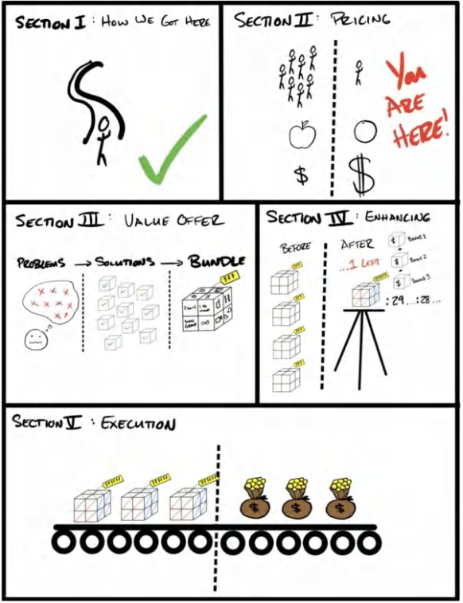

## **3. ĐỊNH GIÁ: BÀI TOÁN HÀNG HÓA PHỔ THÔNG (COMMODITY PROBLEM)** 

> _“Think different.”_ (Hãy suy nghĩ khác biệt) - STEVE JOBS 

“Phát triển hay là chết” là tôn chỉ cốt lõi tại các công ty của chúng tôi. Chúng tôi tin rằng mọi cá nhân, mọi doanh nghiệp và mọi sinh vật đều đang hoặc là phát triển, hoặc là chết dần. Duy trì hiện trạng là một ảo tưởng. 

Điều này có nghĩa là, nếu doanh nghiệp của bạn không phát triển, nó đang chết đi. Đây là một thực tế phũ phàng đối với nhiều người trong chúng ta. Tôi đã phải trả giá đắt, và các doanh nghiệp của tôi đã lao đao trong một thời gian dài vì điều đó. 

Hãy để tôi giải thích. Thị trường không ngừng phát triển. Thị trường chứng khoán tăng trưởng 9% mỗi năm. Nếu chúng ta không tăng trưởng 9% mỗi năm, chúng ta đang bị tụt lại phía sau. Khái niệm “duy trì”, theo nghĩa thông thường nhất, chính là mức tăng trưởng 9% mỗi năm. Hơn nữa, nếu bạn đang hoạt động trong một thị trường tăng trưởng mạnh, bạn có thể phải đạt mức tăng trưởng 20-30% mỗi năm chỉ để bắt kịp cuộc chơi, nếu không muốn bị bỏ lại phía sau. Thế nên bạn có thể thấy, việc “duy trì hiện trạng” thực chất chỉ là ảo tưởng. 

Vậy, điều gì là cần thiết để phát triển? Rất may là chỉ có ba yếu tố đơn giản sau: 

1. Có thêm nhiều khách hàng hơn 
2. Tăng giá trị trung bình trên mỗi đơn hàng (average purchase value) 
3. Khiến họ mua lặp lại nhiều lần hơn 

Chỉ vậy thôi. 

Đương nhiên, có rất nhiều cách để có được khách hàng (Lead), và vô vàn cách để tăng giá trị đơn hàng cũng như tần suất mua hàng, nhưng nói một cách đơn giản, chỉ có bấy nhiêu đó. Đó là ba con đường duy nhất để tăng trưởng. 

Ví dụ: Nếu mỗi tháng tôi chốt được 10 khách hàng, và một khách hàng mang lại giá trị trọn đời (LTV - Lifetime Value) là 1.000 USD (tính bằng giá trị giỏ hàng trung bình nhân với số lần mua trung bình), thì doanh thu tối đa của tôi sẽ chạm trần ở mức 10.000 USD/tháng (10 x 1.000 USD). 

> 10 Khách hàng mới/tháng x 1.000 USD Giá trị trọn đời (LTV) = Doanh thu tối đa 10.000 USD/tháng. 

Nếu muốn phát triển, bạn buộc phải bán được cho nhiều khách hàng hơn mỗi tháng (trong khi vẫn duy trì biên lợi nhuận hợp lý) hoặc gia tăng giá trị của họ (bằng cách tăng lợi nhuận trên mỗi lần mua hoặc tăng số lần họ mua). Chỉ có vậy thôi. 

> **Ghi chú của Tác giả - Chỉ có Hai Con Đường Tăng Trưởng** 
>
> Để đơn giản hóa khái niệm này hơn nữa: Thực chất chỉ có hai cách để tăng trưởng: có thêm khách hàng và tăng giá trị của mỗi khách hàng. “Tăng giá trị của mỗi khách hàng” bao gồm hai nhánh nhỏ: 
> 1) Tăng lợi nhuận trên mỗi lần mua 
> 2) Tăng số lần họ mua hàng. 
>
> Trong phạm vi cuốn sách này, tôi tách hai nhánh nhỏ này thành hai hướng đi chiến lược độc lập. Tôi làm vậy vì nghĩ rằng điều này sẽ giúp bạn dễ hình dung hơn về các mô hình tiền bạc sẽ xuất hiện ở Phần III. Cả ba yếu tố — có thêm khách hàng, tăng giá trị trung bình của đơn hàng, và khiến họ mua nhiều lần hơn — là những chủ đề được lặp đi lặp lại xuyên suốt cuốn sách này. Nhưng nếu bạn tìm kiếm sự đơn giản, thì cả việc tăng giá trị trung bình đơn hàng lẫn tăng số lần mua đều dẫn đến một kết quả duy nhất: gia tăng giá trị của mỗi khách hàng (LTV). 

**Thuật ngữ Kinh doanh** 

Trước khi đi xa hơn, và để làm rõ các khái niệm tiếp theo, chúng ta nên dành một chút thời gian để định nghĩa và thấu hiểu một số thuật ngữ cốt lõi trong kinh doanh. Khi tôi đứng trong căn penthouse ở Las Vegas với chiếc áo thun “beast mode”, tôi hoàn toàn mù tịt về những thuật ngữ này. Hãy để tôi giúp bạn làm tốt hơn tôi ngày trước nhé. 

**<u>Lợi nhuận gộp (Gross Profit):</u>** Doanh thu trừ đi chi phí trực tiếp để phục vụ MỘT khách hàng PHÁT SINH THÊM. Nếu tôi bán một lọ dưỡng da giá 10 USD và tốn 2 USD chi phí sản xuất, lợi nhuận gộp của tôi là 8 USD hay 80%. Nếu tôi bán dịch vụ agency với giá 1.000 USD/tháng và tốn 100 USD/tháng tiền nhân công để chạy quảng cáo cho khách hàng đó, lợi nhuận gộp của tôi là 900 USD hay 90%. Lưu ý: Đây *không phải* là lợi nhuận ròng (Net Profit). Lợi nhuận ròng là khoản tiền còn lại sau khi đã thanh toán *tất cả* mọi chi phí, chứ không chỉ riêng chi phí thực hiện dịch vụ trực tiếp. 

**<u>Giá trị trọn đời (Lifetime Value - LTV):</u>** Tổng lợi nhuận gộp tích lũy trong suốt vòng đời của một khách hàng. Đây là lợi nhuận gộp nhân với số lần mua mà một khách hàng trung bình thực hiện trong suốt vòng đời của họ. Lấy ví dụ trên, nếu khách hàng trung bình ở lại trong năm tháng, trả 1.000 USD/tháng trong khi tôi tốn 100 USD mỗi tháng để cung cấp dịch vụ, thì giá trị trọn đời của họ là 4.500 USD. Dưới đây là bảng phân tích chi tiết: 

Doanh thu: (1.000 USD/tháng * 90% Biên lợi nhuận gộp * 5 tháng) = 4.500 USD Giá trị trọn đời (LTV) 

Lưu ý rằng các chi phí gián tiếp như hành chính, phần mềm, tiền thuê mặt bằng, v.v., không được tính vào LTV. 

**<u>Lưu ý:</u>** Bạn sẽ tìm thấy các định nghĩa khác nhau về giá trị trọn đời tùy theo nguồn tài liệu. Điểm khác biệt lớn nhất là một số nguồn chỉ tính tổng doanh thu, trong khi những nguồn khác tập trung vào lợi nhuận gộp trong suốt vòng đời. Tôi tập trung vào lợi nhuận gộp. Để rõ ràng hơn, đôi khi bạn sẽ thấy tôi gọi đây là **LTGP (Lifetime Gross Profit - Lợi nhuận gộp trọn đời)** trong các tài liệu khác. 

### **Mua hàng dựa trên Giá trị so với Mua hàng dựa trên Giá cả** 

Cuốn sách này được định hướng là cẩm nang cho bất kỳ doanh nghiệp nào muốn *tăng trưởng*. Tôi đã dành (và vẫn đang tiếp tục dành) hàng trăm giờ gọi điện và họp trực tiếp để tư vấn cho các nhà sáng lập cách thiết kế Offer của họ. Tôi đã chứng kiến những Offer bứt phá vỡ oà lên tận mây xanh và cả những Offer chết yểu. 

Sở hữu một Grand Slam Offer khiến việc thất bại trở nên gần như bất khả thi. Nhưng tại sao? Điều gì tạo nên sức ảnh hưởng lớn đến vậy? Nói ngắn gọn, sở hữu một Grand Slam Offer giúp giải quyết trọn vẹn *cả ba* yêu cầu tăng trưởng: có thêm khách hàng, khiến họ trả nhiều tiền hơn, và khiến họ mua nhiều lần hơn. 

Bằng cách nào? Nó cho phép bạn tạo sự khác biệt so với phần còn lại của thị trường. Nói cách khác, nó cho phép bạn bán sản phẩm dựa trên GIÁ TRỊ chứ không phải dựa trên GIÁ CẢ. 

_Hàng hóa phổ thông (Commoditized)_ = Mua hàng dựa trên giá (cuộc đua xuống đáy) 

_Khác biệt hóa (Differentiated)_ = Mua hàng dựa trên giá trị (bán hàng trong một phân khúc độc tôn, không có đối thủ so sánh. Vâng, thị trường đóng vai trò rất quan trọng, tôi sẽ bàn sâu hơn ở chương tiếp theo). 

Hàng hóa phổ thông, theo định nghĩa của tôi, là sản phẩm có sẵn ở rất nhiều nơi. Vì lý do đó, nó rất dễ dẫn đến việc khách hàng mua dựa trên “giá cả” thay vì “giá trị”. Nếu mọi sản phẩm đều “như nhau”, thì sản phẩm rẻ nhất nghiễm nhiên trở nên đáng giá nhất. Nói cách khác, nếu một khách hàng tiềm năng (Lead) so sánh sản phẩm của bạn với sản phẩm khác và nghĩ rằng “chúng y chang nhau thôi, mua cái rẻ hơn cho rồi”, thì bạn đã bị biến thành một mặt hàng phổ thông mất rồi. Thật đáng xấu hổ làm sao! Nhưng mà thực sự... đó là một trong những trải nghiệm tồi tệ nhất mà một nhà kinh doanh hướng về giá trị phải chịu đựng. 

Đây là một bài toán cực kỳ đau đầu đối với các doanh nghiệp, bởi vì các mặt hàng thông thường thường được định giá theo điểm cân bằng của thị trường. Điều này có nghĩa là thị trường sẽ kéo giá xuống thông qua cạnh tranh cho đến khi biên lợi nhuận *vừa đủ* để duy trì hoạt động: “vừa đủ” để biến chủ doanh nghiệp thành nô lệ cho chính mô hình của họ. Doanh nghiệp làm ra số tiền “vừa đủ” để chủ nhân của nó tiếp tục thấp thỏm chờ đợi mọi thứ “khấm khá hơn”, và đến khi nhận ra đó chỉ là một cú lừa... thì đã quá muộn để xoay chuyển tình thế (ít nhất là cho đến lúc này). 

_<u>Một Grand Slam Offer sẽ giải quyết triệt để vấn đề này.</u>_

### **Nhưng Grand Slam Offer thực sự làm được gì?** 

Được rồi, hãy bắt đầu bằng việc định nghĩa thế nào là một Grand Slam Offer. 

Đó là một offer mà bạn tung ra thị trường, thứ mà không thể đem ra so sánh với bất kỳ sản phẩm hay dịch vụ nào khác đang có sẵn. Nó kết hợp một chương trình quảng cáo hấp dẫn, một thông điệp giá trị không thể chối từ, mức giá cao cấp (premium price), một cam kết không có đối thủ (guarantee), cùng với một mô hình thanh toán (payment terms) cho phép bạn *được trả tiền* để có được khách hàng mới... qua đó vĩnh viễn xóa bỏ gánh nặng dòng tiền đối với sự phát triển của doanh nghiệp. 

Nói cách khác, nó cho phép bạn bán hàng trong một “phân khúc độc tôn”, hoặc nói theo một thuật ngữ tuyệt vời khác là “bán hàng trong một không gian chân không”. Quyết định mua hàng của khách hàng lúc này chỉ là lựa chọn giữa sản phẩm của bạn *<u>và không có lựa chọn nào khác</u>*. Nhờ đó, bạn có thể bán với bất kỳ mức giá nào mà bạn khiến khách hàng cảm nhận được, chứ không phải đem ra so sánh với bất kỳ thứ gì khác. Kết quả là, bạn có được nhiều khách hàng hơn, với giá vé cao hơn (high-ticket), tốn ít chi phí hơn. Nếu bạn thích các thuật ngữ marketing hoa mỹ, nó được chia nhỏ như sau: 

1. <u>Tỷ lệ phản hồi cao hơn (hãy nghĩ đến số lượt click)</u> 

2. <u>Tỷ lệ chuyển đổi cao hơn (hãy nghĩ đến doanh số)</u> 

3. <u>Mức giá cao cấp (hãy nghĩ đến việc thu phí thật đắt).</u> 

Sở hữu một Grand Slam Offer giúp gia tăng tỷ lệ phản hồi đối với các chiến dịch quảng cáo (còn gọi là nhiều người sẽ click hoặc thực hiện hành động hơn khi nhìn thấy quảng cáo chứa Grand Slam Offer). 

Nếu bạn bỏ ra cùng một số tiền để thu hút sự chú ý (eyeballs), nhưng 1) có nhiều người phản hồi hơn, 2) nhiều người trong số đó mua hàng hơn, và 3) họ mua với giá cao hơn, thì doanh nghiệp của bạn chắc chắn sẽ *tăng trưởng*. 

Tôi đã từng “hốt bạc” với không ít các Offer của mình. Không phải vì tôi có siêu năng lực gì cả, mà đơn giản là vì tôi đã làm việc này rất nhiều lần (và thất bại còn nhiều hơn thế). Tôi đã đãi cát tìm vàng, gạt bỏ những thứ rác rưởi liên tục thất bại và giữ lại tất cả những gì mang lại thành công có thể lặp lại (và đưa chúng vào cuốn sách này). 

Điểm đọng lại quan trọng nhất ở đây là: một doanh nghiệp phải bỏ ra khối lượng công việc *như nhau* trong cả hai trường hợp (dù dùng Offer hàng hóa phổ thông hay Grand Slam Offer). Khâu thực hiện và fulfillment là hoàn toàn giống nhau. Nhưng nếu một doanh nghiệp dùng Grand Slam Offer còn bên kia dùng Offer “phổ thông”, thì Grand Slam Offer sẽ khiến doanh nghiệp đó trông như thể đang bán một sản phẩm hoàn toàn khác biệt — và điều đó dẫn đến hành vi mua hàng dựa trên giá trị thay vì dựa trên giá cả. 

Nếu bạn sở hữu một Offer “phổ thông”, bạn sẽ phải cạnh tranh về giá (mua hàng dựa trên giá cả thay vì giá trị). Ngược lại, Grand Slam Offer của bạn sẽ buộc khách hàng tiềm năng phải dừng lại và *suy nghĩ khác đi* để đánh giá đúng giá trị của sản phẩm khác biệt mà bạn cung cấp. Làm được điều này sẽ định vị bạn vào một đẳng cấp riêng biệt, khiến việc so sánh giá trở nên bất khả thi, điều đó đồng nghĩa với việc *chính bạn* là người thiết lập lại chiếc thước đo giá trị trong tâm trí khách hàng.

### **Toán học tiền tệ thực tế của một Grand Slam Offer: Trước và Sau**

Kể nhanh câu chuyện hậu trường nhé... Một trong những công ty của chúng tôi sở hữu một phần mềm chuyên dụng cho các agency quảng cáo để chăm sóc khách hàng tiềm năng (lead) cho đối tác của họ. Nhờ phần mềm này, các agency đã lột xác lời chào hàng của họ – từ một dịch vụ tạo lead mờ nhạt, phổ thông thành một **Grand Slam Offer**: “chỉ trả phí theo hiệu quả thực tế”. Hãy để tôi cho bạn thấy sức mạnh nhân đôi, nhân ba mà nó mang lại cho doanh thu của doanh nghiệp.

*(Dù các con số đã được làm tròn để dễ hình dung, chúng đều dựa trên số liệu thực tế mà một agency tạo lead chuyên phục vụ các doanh nghiệp truyền thống đang trải qua).*

**<u>Cách làm cũ mang tính phổ thông (Dựa vào giá cả) — Cuộc đua xuống đáy</u>**

**<u>Commoditized Offer (Lời chào hàng phổ thông):</u>** Trả trước 1.000 đô-la, sau đó là phí duy trì (retainer) 1.000 đô-la/tháng cho các dịch vụ của agency.

| Chỉ số (Metric) | Sản phẩm thông thường (Commodity) | Gói Siêu Giá Trị (Grand Slam Offer) | Giải thích |
| :--- | :---: | :---: | :---|
| Chi phí quảng cáo (Advertising Spend) | 10.000 đô-la | | Tổng tiền chi cho quảng cáo |
| Lượt tiếp cận (Impressions Reached) | 300.000 đô-la | | Số lượng "con mắt" tiếp cận từ quảng cáo |
| Tỷ lệ phản hồi (Response Rate) | 0,00013 | | Tỷ lệ phần trăm người đặt lịch hẹn (CTR x Tỷ lệ đăng ký %) |
| Lịch hẹn được đặt (Appts Booked) | 40 | | Số lượng lịch hẹn chốt được |
| Tỷ lệ tham gia (Show Rate) | 75% | | Tỷ lệ phần trăm khách thực sự có mặt |
| Khách đến hẹn (Appts Showed) | 30 | | Số lượng người thực sự tham dự buổi hẹn |
| Tỷ lệ chốt đơn (Closing %) | 16% | | Tỷ lệ phần trăm khách quyết định mua hàng |
| Đơn hàng chốt thành công (Appts Closed) | 5 | | Số lượng khách hàng hoàn tất thanh toán |
| Giá trị (Price) | 1.000 đô-la | | Số tiền khách hàng thanh toán để bắt đầu sử dụng dịch vụ |
| Tổng doanh thu (Total) | 5.000 đô-la | | Tổng tiền mặt thu về ngay từ đầu (Up-front cash) |
| Lợi nhuận trên chi phí quảng cáo (ROAS) | 0,5 : 1 | | Tỷ suất hoàn vốn đầu tư quảng cáo (Return on Advertising Spend) |

**<u>Phân tích chi tiết:</u>** Với tỷ suất lợi nhuận trên chi phí quảng cáo (ROAS) từ 0.5 đến 1, bạn sẽ lỗ tiền khi kiếm khách hàng mới. Nhưng trong 30 ngày, 5 khách hàng đó sẽ trả thêm mỗi người 1.000 đô-la, đưa tổng doanh thu của bạn lên 10.000 đô-la và hòa vốn. Sang tháng tiếp theo, khoản thu 5.000 đô-la đổ về sẽ chính là tháng có lợi nhuận đầu tiên của bạn, và các tháng sau đó đều có lãi (giả sử tất cả khách hàng đều ở lại).

Đây là một ví dụ điển hình về dịch vụ mang tính phổ thông hóa — công việc agency thông thường. Có hàng triệu agency như vậy, và tất cả đều trông nhàm chán giống hệt nhau. Các doanh nghiệp và lời chào hàng bị phổ thông hóa luôn chật vật trong việc thu hút phản hồi từ quảng cáo, bởi vì hoạt động marketing của họ chẳng khác gì đối thủ.

> **Lưu ý:** Tất cả đều giống nhau vì chúng đều đưa ra một lời chào hàng giống hệt nhau. 
> 
> *Bạn trả tiền để chúng tôi làm việc.*
> 
> *Chúng tôi làm việc.*
> 
> *Có thể bạn sẽ đạt được kết quả từ công việc đó. Cũng có thể là không.*

Cách làm này nghe có vẻ hợp lý, nhưng lại rất dễ bị sao chép (và dễ rơi vào bẫy phổ thông hóa). *Sự phổ thông hóa này tạo ra một cuộc mua sắm chỉ dựa vào giá cả...*

Bạn bị ép phải đặt mức giá “cạnh tranh” chỉ để kiếm được khách hàng, *và* phải giữ nguyên mức giá đó để giữ chân họ. Nếu khách hàng nhìn thấy một phiên bản rẻ hơn của “cùng một thứ đó”, sự chênh lệch về giá trị sẽ khiến họ quay lưng và đổi nhà cung cấp. Đây là một bài toán tiến thoái lưỡng nan... hoặc là mất khách hàng này, mất luôn những khách hàng còn lại cùng các khách hàng tiềm năng; hoặc là phải tiếp tục “cạnh tranh”. Biên lợi nhuận của bạn mỏng đi đến mức *biến mất* hoàn toàn.

Hơn thế nữa, rất khó để thuyết phục khách hàng tiềm năng gật đầu đồng ý (và *giữ* họ tiếp tục gật đầu) trừ khi bạn luôn cảnh giác cao độ trước việc khách hàng cố gắng hạ thấp giá trị doanh nghiệp của bạn bằng cách đòi hỏi mức giá “cạnh tranh”. Và đó chính là vấn đề của cách làm phổ thông cũ kỹ này. Họ có khả năng so sánh. Trừ khi bạn chuyển sang sử dụng một **Grand Slam Offer**, nếu không giá của bạn sẽ liên tục bị ép xuống. Cuối cùng, doanh nghiệp sẽ chết yểu, hoặc nhà sáng lập sẽ buông xuôi bỏ cuộc. Thật tệ hại (No bueno).

Chúng ta muốn tạo ra một lời chào hàng khác biệt đến mức bạn có thể bỏ qua phần giải thích dài dòng, gượng gạo về việc tại sao sản phẩm của mình lại vượt trội hơn phần còn lại (vì nếu họ phải hỏi câu đó, thì có lẽ họ quá khờ khạo để có thể hiểu được lời giải thích). Thay vào đó, hãy để chính lời chào hàng làm thay công việc đó cho bạn. Đó chính là cách làm của một **Grand Slam Offer**.

Hãy đi sâu vào để thấy sự đối lập rõ rệt trong các con số doanh thu.

**<u>Cách làm mới với Grand Slam Offer (Khác biệt, Không thể so sánh) (Dựa trên Giá trị)</u>**

**<u>Grand Slam Offer:</u>** Chỉ thanh toán một lần duy nhất. (Không phí định kỳ. Không phí giữ chân retainer). Chỉ cần chi trả tiền chạy quảng cáo. Tôi sẽ tạo lead và trực tiếp xử lý lead thay cho bạn. Bạn chỉ phải trả tiền khi có khách hàng thực sự bước chân đến cửa. Hơn thế nữa, tôi cam kết bạn sẽ có tối thiểu 20 khách hàng trong tháng đầu tiên, nếu không tháng tiếp theo sẽ được miễn phí. Tôi cũng sẽ cung cấp toàn bộ các bí quyết thực chiến (best practices) từ những mô hình kinh doanh thành công tương tự như bạn.

* Huấn luyện bán hàng qua điện thoại hằng ngày cho đội ngũ nhân sự của bạn.
* Kịch bản bán hàng đã được kiểm chứng (tested scripts).
* Khung giá và lời chào hàng đã kiểm chứng để bạn chỉ việc "sao chép và áp dụng" (swipe and deploy).
* Các bản ghi âm cuộc gọi chốt sale thực tế.

... và mọi thứ khác bạn cần để bán hàng và phục vụ khách hàng của mình. Tôi sẽ trao toàn bộ cẩm nang chiến lược (playbook) của ngành hàng (điền tên ngành của bạn vào đây) hoàn toàn miễn phí, như một món quà khi bạn trở thành khách hàng.

Tóm lại, tôi đang mang khách hàng về cho doanh nghiệp của bạn, chỉ cho bạn thấy chính xác cách chốt đơn họ để bạn có thể bán với mức giá cao nhất, đồng nghĩa với việc bạn kiếm được nhiều tiền nhất có thể... nghe có vẻ công bằng chứ?

Rõ ràng đây là những lời chào hàng hoàn toàn khác biệt... nhưng thì sao chứ? *Tiền* ở đâu!? Hãy cùng so sánh cả hai mô hình trong bảng dưới đây.

| Chỉ số (Metric) | Sản phẩm thông thường (Commodity) | Gói Ưu đãi Đỉnh cao (Grand Slam Offer) | Sự khác biệt (Difference) |
| :--- | :---: | :---: | :--- |
| Ngân sách quảng cáo (Advertising Spend) | 10.000 đô-la | 10.000 đô-la | Không đổi |
| Lượt hiển thị tiếp cận (Impressions Reached) | 300.000 | 300.000 | Không đổi |
| Tỷ lệ phản hồi (Response Rate) | 0,00013 | 0,00033 | Phản hồi cao gấp 2.5 lần (Hấp dẫn hơn nên nhiều người tương tác hơn) |
| Lịch hẹn đã đặt (Appts Booked) | 40 | 100 | Kết quả |
| Tỷ lệ có mặt (Show Rate) | 75% | 75% | Không đổi |
| Lịch hẹn thực tế (Appts Showed) | 30 | 75 | Kết quả |
| Tỷ lệ chốt đơn (Closing %) | 16% | 37% | Chốt đơn cao gấp 2.3 lần (Nhiều giá trị hơn nên nhiều người mua hơn) |
| Khách mua thành công (Appts Closed) | 5 | 28 | Kết quả |
| Mức giá (Price) | 1.000 đô-la | 3.997 đô-la | Giá cao gấp 4 lần (Thanh toán một lần so với định kỳ) |
| Tổng doanh thu (Total) | 5.000 đô-la | 112.000 đô-la | Tiền mặt thu về ban đầu cao gấp 22.4 lần |
| Lợi nhuận trên chi phí quảng cáo (ROAS) | 0,5 : 1 | 11,2 : 1 | Vừa có khách hàng, lại vừa có tiền đút túi. |

**<u>Phân tích chi tiết:</u>** Bạn chi ra cùng một số tiền để tiếp cận cùng một lượng khách hàng tiềm năng (eyeballs). Sau đó, bạn thu hút được số lượng người phản hồi quảng cáo cao gấp 2.5 lần vì lời chào hàng quá sức hấp dẫn. Tiếp theo, bạn chốt sale thành công gấp 2.5 lần cũng vì lý do tương tự. Từ đó, bạn có thể định giá sản phẩm cao gấp 4 lần ngay từ đầu. Kết quả cuối cùng là: 2,5 x 2,5 x 4 = Tiền mặt thu về ngay lập tức cao gấp **22,4 lần**. Đúng vậy, bạn bỏ ra 10.000 đô-la tiền quảng cáo để thu về 112.000 đô-la. Bạn vừa *kiếm được tiền* ngay trong lúc đi tìm khách hàng mới.

**<u>So sánh:</u>** Hãy nhớ lại cách làm cũ, cách mà bạn lỗ một nửa tiền quảng cáo ngay từ bước đầu? Với cách làm mới, bạn vừa kiếm được *nhiều tiền hơn*, vừa có *nhiều khách hàng hơn*. Điều này có nghĩa là chi phí để có được một khách hàng (CAC) cực kỳ rẻ (so với số tiền bạn kiếm được), đến mức yếu tố kìm hãm duy nhất của bạn lúc này chính là... năng lực thực hiện công việc mà bạn vốn đã yêu thích. Dòng tiền và việc tìm kiếm khách hàng không còn là điểm nghẽn nữa, bởi vì mô hình này mang lại lợi nhuận cao gấp 22.4 lần so với mô hình cũ. Chuẩn xác 100%. Bạn không đọc nhầm đâu. Đây chính là khoảnh khắc trong các bộ phim hành động, khi bạn thong thả bước đi trong khung cảnh đằng sau là một vụ nổ lớn làm nền.

Đây chính xác là **Grand Slam Offer** mà chúng tôi đã áp dụng cho công ty phần mềm chuyên phục vụ các agency của mình. Các con số có thể bùng nổ... một cách chóng mặt. Tôi biết mức tăng trưởng 22.4 lần nghe có vẻ phi lý, nhưng đó mới là điểm mấu chốt. Nếu bạn chơi cùng một "luật chơi" với tất cả mọi người, bạn sẽ chỉ nhận lại kết quả tầm thường giống như họ. Bạn chỉ đạt được những cú đánh bóng đơn, bóng đôi (singles and doubles), đủ tiền trả hóa đơn tiền điện nước, nhưng chẳng bao giờ bứt phá lên được. 

Hãy nhớ lại phần mở đầu của cuốn sách này: khi bạn sắp xếp tất cả các mảnh ghép lại với nhau một cách hoàn hảo, bạn có thể tung ra một cú đánh home-run vang dội để giành chiến thắng *vĩnh viễn*. Trong 18 tháng đầu tiên kinh doanh, chúng tôi đã phóng vọt doanh thu từ 500k đô-la/năm lên tới 28M đô-la/năm với số tiền chi cho quảng cáo chưa đến 1M đô-la. Thế nên, khi tôi nói về mức tỷ suất lợi nhuận 20:1... 50:1... 100:1, tôi hoàn toàn nghiêm túc. Khi bạn làm đúng mọi thứ, kết quả đạt được sẽ thật sự... khó tin.

### **Tóm tắt cốt lõi**

Chương này đã chỉ ra vấn đề cốt lõi của việc phổ thông hóa (commoditization) và cách mà **Grand Slam Offer** giải quyết triệt để vấn đề đó. Điều này giúp bạn thoát khỏi cuộc chiến giá cả và đưa doanh nghiệp vào một đẳng cấp độc tôn (a category of one). 

Chương tiếp theo sẽ tập trung vào việc tìm kiếm thị trường mục tiêu chính xác để áp dụng các chiến lược định giá của chúng ta. Đây là một trong những yếu tố quan trọng bậc nhất cần phải làm cho đúng. Một **Grand Slam Offer** tuyệt vời nếu ném sai đối tượng thì cũng chỉ như nước đổ đầu vịt. Chúng ta phải tuyệt đối tránh điều đó bằng mọi giá. Sẽ có một khoảng dừng ngắn trong việc bàn về giá cả để tìm hiểu xem chúng ta cần tìm kiếm điều gì ở một thị trường. Đó là một hộp kiểm (checklist) bắt buộc phải hoàn thành trước khi tiếp tục cuộc hành trình.

> **QUÀ TẶNG MIỄN PHÍ #1 - HƯỚNG DẪN ĐẶC BIỆT: “BẮT ĐẦU TỪ ĐÂY”**
> 
> Nếu bạn muốn đào 1. sâu hơn, hãy truy cập <u>Acquisition.com/training/offers</u> và xem video đầu tiên trong khóa học miễn phí (do chính tôi chủ trì) về cách tôi tạo sự khác biệt cho các lời chào hàng trong các doanh nghiệp mà tôi cố vấn, giúp họ tự tin thu mức phí cao cấp (premium prices). Tôi cũng đã soạn sẵn một số tài liệu SOPs/Mã gian lận (Cheat Codes) miễn phí để bạn có thể áp dụng nhanh hơn. Hoàn toàn miễn phí. Hãy tận dụng nó nhé.

## **4. ĐỊNH GIÁ: TÌM KIẾM THỊ TRƯỜNG PHÙ HỢP -- MỘT ĐÁM ĐÔNG ĐANG ĐÓI KHÁT**

> *“Hạt giống rơi xuống đất tốt tượng trưng cho những người nghe và hiểu Lời Chúa, rồi sinh hoa kết trái, gấp ba mươi, sáu mươi, hay thậm chí một trăm lần so với những gì được gieo xuống!”*
> 
> MATHIEU 13:23 (NLT)

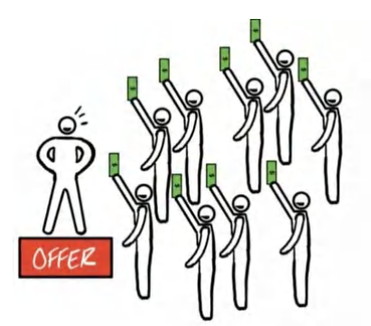

Một giáo sư marketing từng hỏi các sinh viên của mình: “Nếu các em mở một quầy bán xúc xích, và chỉ được phép có *đúng một* lợi thế cạnh tranh duy nhất so với đối thủ... thì đó sẽ là gì...?” 

*“Vị trí! ...Chất lượng! ...Giá rẻ! ...Hương vị ngon nhất!”*

Các sinh viên nhao lên trả lời cho đến khi cạn kiệt ý tưởng. Họ nhìn nhau chờ đợi vị giáo sư lên tiếng. Căn phòng cuối cùng chìm trong im lặng.

Vị giáo sư mỉm cười và đáp: *“Một đám đông đang đói khát.”*

Bạn có thể sở hữu những chiếc xúc xích dở tệ nhất, giá cả đắt đỏ nhất, và đặt cửa hàng ở một vị trí tồi tệ nhất; nhưng nếu bạn là quầy xúc xích duy nhất trong thị trấn ngay lúc trận đấu bóng bầu dục của trường đại học vừa kết thúc, bạn chắc chắn sẽ bán sạch bách. Đó chính là sức mạnh tối thượng của một đám đông đang đói khát.

Cuối cùng thì, nếu nhu cầu về một giải pháp đang cực kỳ khổng lồ, bạn có thể chỉ là một kẻ tầm thường trong kinh doanh, có một lời chào hàng tệ hại, chẳng có chút kỹ năng thuyết phục nào, nhưng bạn *vẫn* có thể kiếm được tiền.

Một ví dụ điển hình chính là tình trạng khan hiếm giấy vệ sinh vào giai đoạn đầu của đại dịch Covid-19. Khi đó chẳng có lời chào hàng nào cả. Giá cả thì cắt cổ. Và cũng chẳng có bài pitch bán hàng nào hấp dẫn. Nhưng vì đám đông quá lớn và đang khao khát đến tuyệt vọng, những cuộn giấy vệ sinh vẫn được bán với giá 100 đô-la hoặc hơn thế. Đó chính là giá trị của một đám đông đang đói khát.

**Bán Báo Giấy**

Một người bạn thân của tôi, Lloyd, đã sở hữu một công ty phần mềm chuyên phục vụ các tòa soạn báo trong gần một thập kỷ. Họ thiết lập các dịch vụ quảng cáo kỹ thuật số trên trang web của báo chỉ với vài cú nhấp chuột, giúp các tòa soạn ngay lập tức bán được một sản phẩm quảng cáo hoàn toàn mới. Lloyd chỉ thu phí dựa trên phần trăm doanh thu tăng thêm mà anh ấy mang lại. Thế nên, nếu các tờ báo không kiếm thêm được đồng nào, anh ấy cũng không nhận được xu nào. Đó là lợi ích tuyệt đối cho các tòa soạn và là một lời chào hàng tuyệt vời.

Nhưng, dù sở hữu một lời chào hàng xuất sắc và năng khiếu bán hàng bẩm sinh, công việc kinh doanh của Lloyd bắt đầu xuống dốc. Là một doanh nhân xuất chúng, anh ấy đã thử mọi góc độ khác nhau để giải quyết vấn đề — *nhưng chẳng có gì hiệu quả cả*. Anh ấy không thể tìm ra nguyên nhân nằm ở đâu. Thật khó lòng khi nhìn Lloyd phải vật lộn với chuyện này, bởi vì tôi nghĩ anh ấy thông minh hơn tôi rất nhiều, và đáp án đối với tôi thì hiển hiện ngay trước mắt. Nhưng chứng kiến hành trình đó đã để lại cho tôi một bài học nhớ đời. Trước khi tôi tiết lộ, theo bạn vấn đề nằm ở đâu? 

Sản phẩm ư? Lời chào hàng? Marketing và bán hàng ư? Hay đội ngũ nhân sự của anh ấy?

Hãy cùng mổ xẻ nhé. Không phải sản phẩm — nó rất tuyệt vời. Không phải lời chào hàng — anh ấy áp dụng mô hình chia sẻ doanh thu (rev-share) không rủi ro. Không phải kỹ năng bán hàng — anh ấy là một tay sales bẩm sinh. Vậy thì vấn đề ở đây là gì? *Anh ấy đang bán hàng cho các tòa soạn báo!* Thị trường của anh ấy đang teo tóp lại 25% *mỗi năm*! Anh ấy đã soi xét mọi ngóc ngách, ngoại trừ điểm hiển nhiên nhất. Cuối cùng, sau nhiều năm chiến đấu với một cuộc chiến ngược dòng đầy bế tắc trên thị trường của mình, anh ấy nhận ra chính thị trường mới là cội nguồn của mọi vấn đề và quyết định thu hẹp quy mô công ty.

Đừng lo lắng — câu chuyện này vẫn còn phần hai. Để minh họa cho sức mạnh hủy diệt của một thị trường, ngay khi đại dịch COVID bùng phát, Lloyd đã lập tức xoay trục (pivot). Anh ấy thành lập một công ty chuyên sản xuất khẩu trang tự động. Với công nghệ mới, anh ấy đã kéo chi phí sản xuất mỗi chiếc khẩu trang xuống thấp hơn cả mức giá mà mọi người phải mua từ Trung Quốc. Chỉ trong vòng 5 tháng, doanh thu của anh ấy đã đạt mức *hàng triệu đô la mỗi tháng*. Vẫn là nhà sáng lập đó. Nhưng là một thị trường hoàn toàn khác. Anh ấy áp dụng *chính xác* bộ kỹ năng cũ của mình vào một lĩnh vực kinh doanh mà *trước đó anh ấy chưa từng có chút kinh nghiệm nào*, và anh ấy đã chiến thắng. Đó chính là sức mạnh của việc lựa chọn đúng thị trường.

Tôi kể câu chuyện này như một lời cảnh tỉnh dành cho bạn. *Thị trường của bạn cực kỳ quan trọng.* Lloyd là một con người *rất* thông minh. Rõ ràng anh ấy là một người cực kỳ có năng lực. Nhưng tất cả chúng ta đều có thể bị che mờ tầm nhìn với tư cách là những doanh nhân, bởi vì bản tính chúng ta không thích bỏ cuộc. Chúng ta đã quá quen với việc giải quyết những bài toán bất khả thi đến mức cứ cắm đầu đâm đầu vào tường. Chúng ta căm ghét sự từ bỏ. Nhưng thực tế phũ phàng là: bất kỳ ai cũng sẽ bị chi phối bởi thị trường của họ.

Vậy làm thế nào để chọn đúng thị trường?

### **Bí Quyết Chọn Thị Trường**

Có một thị trường đang khát khao năng lực của bạn. Việc của bạn là tìm ra nó. Và một khi đã tìm thấy, bạn sẽ hốt bạc và tự hỏi tại sao mình không làm điều này sớm hơn. Đừng quá cảm tính khi chọn đối tượng mục tiêu. Hãy phục vụ những người có khả năng trả tiền xứng đáng với giá trị của bạn. Và hãy nhớ rằng, việc lựa chọn thị trường — cũng như mọi thứ khác — luôn là quyết định của chính bạn, thế nên hãy chọn cho khôn ngoan.

Để bán được bất kỳ thứ gì, bạn cần có nhu cầu (demand). Chúng ta không cố gắng tạo ra nhu cầu. Chúng ta đang cố gắng khơi thông và dẫn dắt nó. Đó là một điểm khác biệt cực kỳ quan trọng. Nếu bạn không có thị trường cho **Grand Slam Offer** của mình, thì mọi nỗ lực sau đó đều vô nghĩa. Toàn bộ cuốn sách này được xây dựng dựa trên giả định rằng bạn có ít nhất một thị trường "bình thường" — mà tôi định nghĩa là thị trường đang tăng trưởng tương đương với nhịp độ chung của nền kinh tế, và có những nhu cầu chưa được đáp ứng thuộc một trong ba nhóm chính: cải thiện sức khỏe, gia tăng tài chính, hoặc cải thiện các mối quan hệ. Ví dụ như Lloyd, nhân vật trong câu chuyện báo chí ở trên, dù có đọc hết cuốn sách này thì cũng chẳng có chiêu thức nào cứu nổi anh ta. Tại sao? Vì anh ta đang nhắm vào ngành báo giấy — một thị trường đang chết dần chết mòn.

Nói như vậy không có nghĩa là sở hữu một thị trường tuyệt vời là chưa đủ tốt; thực tế đó là một lợi thế lớn. Nhưng bạn hoàn toàn có thể hoạt động trong một thị trường bình thường với tốc độ tăng trưởng trung bình <u>và vẫn kiếm được bộn tiền. Nói tóm lại, bạn sẽ chẳng bao giờ dại dột đi bán tủ lạnh cho người Eskimo cả</u>.

Dưới đây là những tiêu chí cốt lõi mà tôi tìm kiếm ở một thị trường. Hãy điểm qua chúng trước khi chúng ta quay lại với chủ đề Offer. Khi chọn thị trường, tôi đánh giá dựa trên 4 chỉ báo sau:

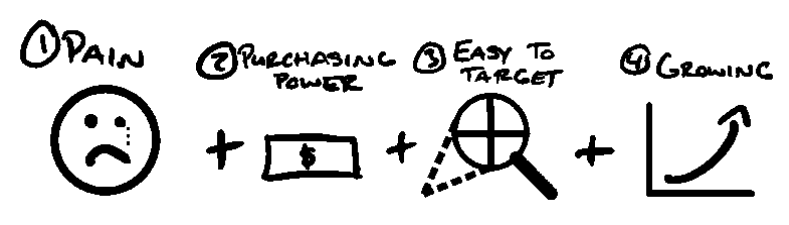

**1) Nỗi đau cực lớn (Massive Pain)**

Họ không chỉ muốn, mà phải là đang khát khao đến tuyệt vọng những gì bạn cung cấp. Nỗi đau có thể là bất cứ điều gì khiến mọi người cảm thấy bức bối trong cuộc sống. Viêm màng túi là một nỗi đau. Hôn nhân địa ngục là một nỗi đau. Xếp hàng dài ở siêu thị là một nỗi đau. Đau lưng... cười duyên mà răng hô cũng là một nỗi đau... Con người ta phải chịu đựng vô vàn thứ khổ sở. Thế nên đối với chúng ta — những nhà <u>kinh doanh</u> — cơ hội kiếm tiền là vô tận.

Mức độ nỗi đau sẽ tỉ lệ thuận với mức giá bạn có thể thu về (chúng ta sẽ bàn kỹ hơn ở chương Value Equation - Phương trình giá trị). Khi họ nghe về giải pháp cho nỗi đau của mình, và ngược lại, cuộc sống của họ sẽ tồi tệ ra sao nếu _không có_ giải pháp đó, họ sẽ tự khắc bị thu hút bởi bạn.

Tôi có một câu cửa miệng khi đào tạo các đội ngũ sales: _“Nỗi đau chính là kịch bản chốt sale.”_ Nếu bạn có thể gọi tên chính xác nỗi đau mà khách hàng tiềm năng (lead) đang gánh chịu, họ gần như sẽ luôn rút hầu bao mua những gì bạn bán. Khách hàng bắt buộc phải có một vấn đề nhức nhối để chúng ta giải quyết, và từ đó mới có thể thu tiền cho giải pháp đó.

> **Mẹo cao thủ (Pro Tip)**
> 
> Mục đích của văn hay chữ tốt là để người đọc _hiểu_.
> 
> Mục đích của nghệ thuật thuyết phục đỉnh cao là để khách hàng cảm thấy mình _được thấu hiểu_.

**2) Sức mua (Purchasing Power)**

Một người bạn của tôi có một hệ thống cực kỳ xịn sò giúp mọi người cải thiện CV (hồ sơ xin việc) để săn được nhiều buổi phỏng vấn hơn. Anh ấy rất giỏi việc này. Nhưng dù cố gắng thế nào đi nữa, anh ấy vẫn không tài nào thu phí được từ khách hàng của mình. Tại sao? Bởi vì tất cả bọn họ đều đang thất nghiệp!

Điều này nghe có vẻ hiển nhiên. Nhưng ban đầu anh ấy nghĩ: _“Mấy người này tiếp cận dễ ợt. Họ đang đau đầu vì túng quẫn. Lượng người thất nghiệp thì đông đúc và ngày một tăng. Đây chính là thị trường ngon ăn!”_

Anh ấy đã quên mất một điểm chí mạng: đối tượng mục tiêu của bạn phải có khả năng chi trả cho dịch vụ mà bạn đang rao bán. Hãy chắc chắn rằng khách hàng mục tiêu của bạn có tiền, hoặc có khả năng tiếp cận nguồn tài chính cần thiết để mua dịch vụ của bạn ở mức giá đủ để bõ công sức bạn bỏ ra.

**3) Dễ tiếp cận (Easy to Target)**

Giả sử bạn có một thị trường hoàn hảo, nhưng lại mù tịt cách tìm ra những con người thuộc về thị trường đó. Chà, việc tạo ra một **Grand Slam Offer** sẽ trở nên vô cùng gian nan. Tôi luôn tự làm cho cuộc sống dễ thở hơn bằng cách tìm kiếm những thị trường dễ tiếp cận. Lấy ví dụ như các nhóm khách hàng (avatar) có tham gia vào các hội nhóm, danh sách email (mailing list), các cộng đồng mạng xã hội, các kênh truyền thông mà họ cùng theo dõi, v.v. Nếu khách hàng tiềm năng của chúng ta tụ họp ở đâu đó, chúng ta có thể tiếp thị (market) đến họ ở đó. Ngược lại, nếu việc tìm kiếm họ chẳng khác nào mò kim đáy bể, thì bạn sẽ rất khó để đưa **offer** của mình lọt vào tầm ngắm của những người thực sự quan tâm.

Điểm này mang tính chiến thuật rõ ràng. Đó là thực tế chứ không phải lý thuyết suông. Chẳng hạn, bạn có thể _muốn_ phục vụ tệp bác sĩ giàu có. Nhưng nếu quảng cáo của bạn lại đập vào mắt đám sinh viên điều dưỡng, thì offer của bạn coi như đổ sông đổ biển, dẫu nó có tuyệt vời đến đâu đi nữa. Chốt lại: bạn phải đảm bảo mình có thể tiếp cận tệp khán giả mục tiêu một cách dễ dàng. _(Làm rõ thêm — không có vấn đề gì với việc muốn phục vụ các bác sĩ giàu có cả, họ rất dễ tìm. Ví dụ này chỉ để minh họa rằng các chương trình quảng cáo của bạn phải được hiển thị đúng đối tượng)._

**4) Đang tăng trưởng (Growing)**

Thị trường đang tăng trưởng giống như việc bạn đi xuôi chiều gió. Nó đẩy mọi thứ tiến về phía trước nhanh hơn. Thị trường đang suy thoái chẳng khác nào đi ngược chiều gió. Nó khiến mọi nỗ lực của bạn trở nên nặng nhọc hơn. Hãy nhớ lại ví dụ về anh chàng Lloyd ở trên. Ngành báo giấy có 3 trong 4 yếu tố của một thị trường tuyệt vời: (1) nỗi đau lớn, (2) sức mua mạnh, (3) dễ tiếp cận. Nhưng ngặt một nỗi là nó đang lụi tàn (với tốc độ chóng mặt). Dù anh ta có cố gắng cách mấy, thì toàn bộ xu hướng thị trường đang chống lại anh ta. Kinh doanh vốn dĩ đã đủ cam go, và thị trường thì biến động từng ngày. Thế nên tốt nhất là hãy chọn một thị trường đang lên để mượn gió bẻ măng, giúp hành trình của bạn bớt chông gai hơn.

### **Hiện Thực Hóa Vấn Đề**

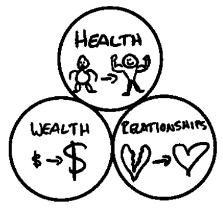

Có ba thị trường lớn sẽ trường tồn mãi với thời gian: Sức khỏe (Health), Tài chính (Wealth), và Các mối quan hệ (Relationships). Lý do chúng luôn tồn tại là bởi con người luôn cảm thấy đau khổ tột cùng khi thiếu vắng chúng. Nhu cầu tìm giải pháp cho những nỗi đau nguyên thủy này chưa bao giờ hạ nhiệt. Mục tiêu của bạn là tìm ra một ngách nhỏ hơn (subgroup) nằm trong ba chiếc "giỏ" lớn đó — một thị trường đang tăng trưởng, có sức mua và dễ tiếp cận (3 biến số còn lại).

Vì vậy, nếu tôi là một chuyên gia tư vấn tình cảm đang đi tìm **avatar** cho mình, tôi sẽ thà tập trung vào dịch vụ coaching "hâm nóng tình cảm nửa sau cuộc đời" cho các cô chú lớn tuổi, còn hơn là đi gỡ rối tơ lòng cho đám sinh viên đại học. Tại sao? Bởi vì những người lớn tuổi sống cô đơn thường chịu nhiều dằn vặt nội tâm hơn khi cái chết cận kề (nỗi đau), có tài chính vững vàng hơn (tiền bạc), và dễ bề tìm kiếm hơn (khả năng tiếp cận). Cuối cùng, tính đến thời điểm viết cuốn sách này, số lượng người bước sang tuổi 65 mỗi năm còn nhiều hơn số người chạm mốc 20 (đang tăng trưởng).

Đó chính là tư duy cốt lõi. Hãy ngẫm xem thế mạnh của bạn nằm ở đâu trong 3 lĩnh vực Sức khỏe, Tài chính, hay Mối quan hệ. Sau đó, suy xét xem ai là người sẽ trân trọng dịch vụ của bạn nhất (đang chịu nỗi đau lớn nhất), có đủ tiềm lực tài chính để trả mức giá mà *bạn* muốn (tiền bạc), và có thể được tìm thấy dễ dàng (khả năng tiếp cận). Miễn là ba tiêu chí này vững chắc *và* thị trường không bị thu hẹp, bạn chắc chắn sẽ ở một vị thế thắng lợi.

Nhưng rốt cuộc, việc tìm kiếm một thị trường "tuyệt vời" so với thị trường "bình thường" hay thị trường "tệ hại" quan trọng đến mức nào đối với thành công của bạn? Câu trả lời là: tùy trường hợp. Hãy để tôi giải thích.

### **Thứ Tự Quan Trọng: Ba Đòn Bẩy Dẫn Đến Thành Công**

Sẽ khó có chuyện bạn bước chân vào một thị trường đang chết yểu như ngành báo giấy. Và cũng khó có chuyện bạn đi bán giấy vệ sinh giữa mùa dịch COVID (thời điểm người người nhà nhà cuống cuồng vơ vét). Khả năng cao là bạn sẽ hoạt động trong một thị trường "bình thường". Và điều đó hoàn toàn ổn. Có cả một mỏ vàng đang chờ bạn khai thác trong các thị trường bình thường. Ý duy nhất của tôi ở đây là bạn tuyệt đối không được lao vào một thị trường "tệ hại", nếu không muốn mọi thứ sụp đổ. Dù vậy, dưới đây là biểu đồ đơn giản nhất về mức độ quan trọng giữa thị trường, offer và kỹ năng thuyết phục:

**Đám Đông Đang Cực Kỳ Khát (Thị trường) > Sức Mạnh Của Offer > Kỹ Năng Thuyết Phục**

Giả sử bạn xếp hạng các yếu tố này theo các mức độ: tuyệt vời, bình thường, và tệ hại. Bạn có thể lần lượt đi từ trái sang phải theo thứ tự ưu tiên. Một đánh giá "tuyệt vời" ở tầng ưu tiên cao hơn sẽ lấn át bất cứ thứ gì nằm ở bậc thấp hơn. Một đánh giá "bình thường" sẽ chuyển "quả bóng trách nhiệm" sang phần tiếp theo của phương trình. Một đánh giá "tệ hại" sẽ chặn đứng toàn bộ phương trình — *trừ khi* có một yếu tố "tuyệt vời" từ cấp độ ưu tiên cao hơn đến giải cứu. Dưới đây là vài ví dụ minh họa:

<u>Ví dụ #1: Ngay cả khi offer của bạn dở ẹc và kỹ năng chốt sale của bạn làng nhàng, bạn vẫn sẽ kiếm được bộn tiền nếu nhảy vào một thị trường tuyệt vời</u>. Nếu bạn đứng bán hot dog ở góc đường khi các quán bar đóng cửa lúc 2 giờ sáng, vây quanh bởi một đám đông những kẻ say xỉn đang đói lả, bạn thể nào cũng bán sạch bách chỗ hot dog đó cho xem.

<u>Ví dụ #2 (đại đa số chúng ta): Nếu bạn đang ở trong một thị trường bình thường nhưng lại sở hữu một Grand Slam Offer (tuyệt vời), bạn vẫn có thể hốt bạc</u> ngay cả khi kỹ năng thuyết phục của bạn không có gì nổi trội. Đây là trường hợp của phần lớn độc giả đang đọc cuốn sách này. Đó cũng là lý do tôi viết ra cuốn sách này — để giúp bạn tối <u>ưu hóa</u> thành công bằng cách học cách xây dựng một **Grand Slam Offer** thực thụ.

<u>Ví dụ #3: Giả sử bạn đang đứng ở một thị trường bình thường và có một offer cũng làng nhàng nốt. Để đạt được thành công vang dội, bạn bắt buộc</u> phải sở hữu kỹ năng thuyết phục _cực kỳ xuất chúng_. Chỉ khi đó và duy nhất khi đó bạn mới thành công, với kỹ năng thuyết phục đóng vai trò là điểm tựa đòn bẩy cho toàn bộ cơ nghiệp. Chà, rất nhiều đế chế đã được gầy dựng bởi những bậc thầy thuyết phục thiên bẩm. Chỉ là đó là con đường chông gai nhất, đòi hỏi nhiều công sức và thời gian học hỏi nhất mà thôi. Việc tối ưu hóa **offer** sẽ giúp bạn đi đường tắt để đến với thành công. Bằng không, bạn sẽ chỉ sở hữu một doanh nghiệp bình bình và phải dùng đến những kỹ năng thượng thừa mới mong bứt phá (điều đó chẳng có gì sai, nhưng có lẽ đó không phải là thứ bạn kỳ vọng khi bắt đầu dấn thân).

### **Cam Kết Sâu Sắc Với Ngách (Commit to the Niche)**

Tôi có một câu khẩu quyết khi cố vấn cho các nhà khởi nghiệp về cách chọn thị trường mục tiêu: _“Đừng để tôi phải ‘vả ngách’ bạn.”_

Quá thường xuyên, những nhà khởi nghiệp non trẻ hời hợt thử nghiệm *đúng một* offer trong *đúng một* ngách, không kiếm được nổi một triệu đô, rồi lầm tưởng rằng “đây là một thị trường tồi tệ”. Đa số các trường hợp sự thật không phải vậy. Chỉ là họ vẫn chưa tìm ra một **Grand Slam Offer** thực sự để áp dụng cho thị trường đó mà thôi.

Họ nghĩ ngợi: _Mình sẽ chuyển từ việc phục vụ nha sĩ sang phục vụ bác sĩ nắn xương khớp — thế là xong!_ Trong khi thực tế, cả hai thị trường đó đều là thị trường bình thường và đại diện cho doanh thu hàng tỷ đô. Lựa chọn nào cũng tiềm năng cả, _nhưng không thể ôm đồm cả hai_. Bạn bắt buộc phải chọn _một_. Không ai có thể phục vụ cùng lúc hai ông chủ.

Tôi đã chế ra thuật ngữ “niche slap” (cái tát vực dậy ngách) để nhắc nhở các thành viên trong cộng đồng của mình rằng hãy kiên định một khi đã chọn. Mọi doanh nghiệp và mọi thị trường đều có những góc khuất khó chịu riêng. Cỏ không bao giờ xanh hơn ở phía bên kia đồi đâu. Nếu bạn cứ nhảy cóc từ ngách này sang ngách khác, với hy vọng thị trường sẽ tự động giải quyết giúp bạn mọi rắc rối, thì bạn hoàn toàn xứng đáng nhận một “cái tát tỉnh ngộ”.

Bạn phải kiên trì bám trụ với lựa chọn của mình đủ lâu để trải qua quá trình thử và sai (trial and error). Bạn sẽ vấp ngã. Thậm chí, bạn sẽ thất bại liên tục cho đến khi chạm tay vào thành công. Nhưng bạn sẽ còn thất bại dài dài nếu cứ mãi thay đổi đối tượng mục tiêu, bởi vì mỗi lần đổi là một lần bạn phải đập đi xây lại từ vạch xuất phát. Vì vậy: đã chọn là phải cam kết tới cùng.

### **Tiền Bạc Nằm Trong Ngách (Riches Are In The Niches)**

Lý do tiếp theo để bạn gắn bó sâu sắc với thị trường ngách chính là khoản lợi nhuận khổng lồ mà nó mang lại.

Nói một cách đơn giản, việc thu hẹp quy mô vào thị trường ngách (niching down) sẽ giúp bạn kiếm được nhiều tiền hơn rất nhiều.

> **Lời chú thích từ tác giả – Khi nào nên mở rộng thị trường (Lời khuyên cho phần lớn mọi người)**
> 
> Đối với đại đa số, nếu doanh thu của bạn chưa đạt 10 triệu USD/năm, việc thu hẹp ngách (niching down) sẽ giúp bạn kiếm được nhiều tiền hơn. Sau mốc đó, nó sẽ phụ thuộc vào mức độ hẹp của ngách, hay còn gọi là TAM (tổng quy mô thị trường có thể tiếp cận - total addressable market). Một doanh nghiệp thực tế chỉ có thể phát triển đến giới hạn của tổng quy mô thị trường đó. Dù vậy, với phần lớn mọi người, việc vươn lên mốc 10 triệu USD/năm vốn dĩ đã là một thành tựu thuộc top 0,4% (chỉ có 1 trong số 250 doanh nghiệp đạt được điều này). Thế nên, với 99,6% độc giả đang có doanh thu dưới 10 triệu USD/năm, việc phục vụ _ít_ khách hàng hơn _theo chiều sâu_ hầu như luôn là con đường dễ dàng hơn. Nhưng nếu bạn muốn tiến xa hơn nữa, bạn _<u>có thể</u>_ (tùy thuộc vào quy mô TAM của bạn) sẽ phải mở rộng tệp khán giả bằng cách hướng lên phân khúc cao hơn (up market), xuống phân khúc thấp hơn (down market), hoặc lấn sang một thị trường lân cận nơi các dịch vụ hiện tại của bạn có thể tạo ra giá trị.
>
> Để bạn dễ hình hình dung, rất nhiều công ty đã bứt phá lên mức doanh thu 30 triệu USD+/năm chỉ bằng cách phục vụ một ngách duy nhất: Bác sĩ nắn xương, phòng gym, thợ sửa ống nước, ngành năng lượng mặt trời, thợ lợp mái, chủ salon tóc, v.v. Nếu doanh nghiệp của bạn đang ở mốc 1 triệu hay 3 triệu USD và nghĩ rằng mình đã chạm trần để rồi phải vội vàng mở rộng, thì bạn đã sai lầm. Bạn chỉ cần làm tốt hơn nữa mà thôi.

Khi tôi thực sự ngộ ra rằng mình đang để lại bao nhiêu _lợi nhuận_ bàn quang, nó đã thay đổi cuộc đời tôi. Đó là bước ngoạt đưa tôi từ việc làm dịch vụ thu hút khách hàng (acquisition) cho _bất kỳ ai_ sang việc huấn luyện nó cho một chân dung khách hàng mục tiêu (avatar) cụ thể. Trong trường hợp của tôi, tôi nhắm đến chủ phòng gym quy mô nhỏ với khoảng 100 hội viên, đã thuê mặt bằng, có ít nhất một nhân viên, và muốn giúp khách hàng giảm cân. Khái niệm đó cụ thể hơn rất nhiều so với “chủ doanh nghiệp nhỏ” hay “bất kỳ ai chịu trả tiền cho tôi” vốn rất phổ biến ngoài kia. Và tôi đã vô cùng kiên định với ngách đó. Tại doanh nghiệp đó (Gym Launch) – chúng tôi từng từ chối – và cho đến nay vẫn vậy – bất kỳ ai không thuộc chân dung đó. Điều này có nghĩa là không có huấn luyện viên cá nhân, không có huấn luyện viên online, v.v.

Tôi có giúp được họ không? Chắc chắn là có chứ. Thậm chí phần lớn danh portfolio của chúng tôi là các công ty phi-phòng-gym. Nhưng để duy trì sự tập trung vào sản phẩm (product focus) và thông điệp có tỷ lệ chuyển đổi cao (high-converting messaging), việc biết _chính xác_ sản phẩm này dành cho ai chính là chìa khóa thay đổi cuộc chơi.

Nó giúp chúng tôi biết _chính xác_ mình đang trò chuyện với ai vào mọi thời điểm. Và _chính xác_ vấn đề của ai là người chúng ta đang giải quyết.

Nhưng sự đơn giản và dễ dàng có lẽ vẫn chưa đủ sức thuyết phục bạn, vậy nên hãy để tôi minh họa lý do tại sao việc xoáy sâu vào một ngách duy nhất sẽ giúp bạn kiếm được nhiều **tiền** hơn.

**Lý do**: Bạn hoàn toàn có thể tính giá cao hơn gấp 100 lần cho _chính xác_ một sản phẩm đó. Dan Kennedy là người đầu tiên minh họa điều này cho tôi, và tôi sẽ cố gắng hết sức để truyền lại ngọn đuốc đó cho bạn qua những trang sách này.

**<u>Ví dụ về Định giá sản phẩm theo Ngách:</u>**

| Sản phẩm | Giá |
| :--- | :---: |
| Quản lý Thời gian (Time Management) | 19 đô-la |
| Quản lý Thời gian dành cho Chuyên gia Bán hàng (Time Management For Sales Professionals) | 99 đô-la |
| Quản lý Thời gian dành cho Sales B2B Outbound (Time Management For Outbound B2B Sales) | 499 đô-la |
| Quản lý Thời gian dành cho Sales Rep Ngành Dụng cụ Cầm tay & Làm vườn B2B Outbound (Time Management For Outbound B2B Power Tools & Gardening Sales Reps) | 1 đô-la.997 |

Dan Kennedy đã dạy tôi điều này (và nó đã thay đổi cuộc đời tôi mãi mãi). Giả sử bạn bán một khóa học chung chung về Quản lý thời gian. Trừ khi bạn là một "guru" đình đám nào đó về quản lý thời gian với một câu chuyện ly kỳ hoặc độc nhất vô nhị, thì khóa học đó khó lòng tạo ra cú hích đáng kể nào. Bạn nghĩ một khóa học quản lý thời gian “lại-là-một-khóa-nữa” có giá trị bao nhiêu? 19 USD, 29 USD ư? Chắc vậy rồi. Chẳng có gì đáng để khoe khoang cả. Cứ cho là 19 đô-la đi cho dễ hình dung nhé.

_**Bây giờ, chúng ta sẽ giải phóng sức mạnh của việc định giá theo ngách qua các cấp độ khác nhau cho sản phẩm của bạn:**_

Giờ hãy tưởng tượng bạn làm cho sản phẩm trở nên cụ thể hơn, vẫn giữ nguyên các nguyên tắc đó, và đặt tên nó là: “Quản lý thời gian dành cho Chuyên gia Sales.” Đột nhiên, khóa học này nhắm đến một nhóm đối tượng cụ thể hơn. Chúng ta có thể gắn kết mức tăng trưởng của họ với chỉ một đơn hàng hoặc một thương vụ bổ sung thôi, và nó đã trở nên có giá trị hơn rồi. Nhưng có rất nhiều người làm sales. Vậy nên đây có thể là một sản phẩm giá 99 đô-la. Khá ổn đấy, nhưng chúng ta còn làm tốt hơn thế.

Thực hiện thêm một tầng thu hẹp ngách nữa, và gọi sản phẩm của chúng ta là…. “Quản lý thời gian dành cho Nhân viên Sales B2B Outbound.” Vẫn tuân theo các nguyên tắc về tính cụ thể, lúc này chúng ta biết rằng những nhân viên sales của mình có lẽ đang xử lý các thương vụ lớn và nhận hoa hồng cao. Chỉ một giao dịch duy nhất cũng có thể dễ dàng mang về cho nhân viên sales này 500 USD (hoặc hơn), thế nên việc biện minh cho mức giá 499 USD là hoàn toàn khả thi. Đây đã là mức tăng giá gấp 25 lần cho một sản phẩm gần như y hệt. Tôi có thể dừng lại ở đây, nhưng tôi sẽ tiến thêm một bước nữa.

Hãy thu hẹp ngách thêm một tầng cuối cùng…. “Quản lý thời gian dành cho Nhân viên Sales B2B Outbound mảng Dụng cụ Điện cầm tay & Làm vườn.” Bùm!

Hãy suy nghĩ về điều này trong giây lát, nếu bạn là một nhân viên sales outbound ngành dụng cụ điện, bạn sẽ thầm nghĩ: “Sản phẩm này sinh ra để dành cho mình đây rồi” và sẽ _vui vẻ_óc hầu bao khoảng 1.000 đến 2.000 USD cho một chương trình quản lý thời gian có thể giúp bạn đạt được mục tiêu của mình.

Các thành phần thực tế của chương trình có thể vẫn giống y hệt khóa học 19 USD chung chung kia, nhưng vì chúng đã được ứng dụng thực chiến, và thông điệp marketing có thể chạm đúng vào tử huyệt của chân dung khách hàng này, họ sẽ thấy nó hấp dẫn hơn _đồng thời_ thu về nhiều giá trị thực tế hơn từ đó. Khái niệm này áp dụng cho bất cứ thứ gì bạn quyết định làm. Bạn muốn trở thành ‘the guy’ (chuyên gia số một) phục vụ ‘loại người này’ hoặc giải quyết ‘loại vấn đề này’. Thậm chí ngách hơn nữa là: ‘Tôi giải quyết vấn đề này cho một kiểu người cụ thể theo cách độc đáo đi ngược trực giác nhằm đảo ngược nỗi sợ sâu kín nhất của họ.’

Đó là lý do tại sao một chương trình thể hình giảm cân chung chung có giá chỉ 19 USD, trong khi một chương trình thể hình được thiết kế và tiếp thị riêng cho các điều dưỡng viên làm việc theo ca lại có giá tới 1.997 USD…. (mặc dù cốt lõi của chương trình có lẽ cũng tương tự nhau – ăn ít lại, vận động nhiều hơn).

Kết quả cuối cùng: Thị trường rất quan trọng. Ngách của bạn rất quan trọng. Và nếu bạn có thể bán cùng một sản phẩm với giá cao hơn 100 lần, bạn có nên làm vậy không?

Tôi để bạn tự quyết định.

### **Tóm tắt chương**

Mục đích của chương này nhằm củng cố hai điều. Đầu tiên, đừng chọn một thị trường _tệ_. Thị trường bình thường là được rồi. Thị trường tuyệt vời thì quá xuất sắc. Thứ hai, một khi đã chọn, hãy cam kết với nó cho đến khi bạn làm ra kết quả.

Nếu bạn thử _một trăm Offer (lời chào hàng)_, _tôi hứa_ bạn sẽ thành công. Phần lớn mọi người chẳng bao giờ chịu thử bất cứ thứ gì. Số khác thất bại một lần rồi bỏ cuộc. Cần phải có sự kiên cường để chạm tới thành công. Đừng cá nhân hóa mọi thứ! Nó không phải về bạn! Nếu Offer của bạn không hiệu quả, điều đó không có nghĩa là bạn kém cỏi. Nó chỉ có nghĩa là Offer của bạn tệ mà thôi. Khác biệt lớn lắm đấy. Bạn chỉ thực sự kém cỏi khi bạn ngừng cố gắng. Vì vậy, hãy thử lại. Bạn sẽ chẳng bao giờ vươn tầm thế giới nếu bỏ cuộc chỉ sau một lần vấp ngã.

Nếu bạn tìm thấy một thị trường điên rồ-tuyệt-vời, hãy cưỡi sóng nó, và cưỡi thật máu lửa. Và nếu bạn kết hợp một Grand Slam Offer với một thị trường béo bở như thế, có lẽ bạn sẽ chẳng bao giờ phải làm việc nữa (nói thật đấy). Thế nên, hãy giắt lưng bộ kỹ năng này — khả năng đánh giá chính xác các thị trường dựa trên việc cân nhắc mức độ đau đớn (pain), tiền bạc (money), khả năng nhắm mục tiêu (targeting) và tiềm năng tăng trưởng (growth) — để khi cơ hội gõ cửa, bạn có thể chắc chắn nó sẽ giáng xuống hai lần.

Sau khi đã nắm vững cách chinh phục một thị trường, hãy quay lại với bài toán định giá. Bước đầu tiên để kiếm được những còn số tiền khủng khiếp chính là định giá ở mức cao cấp (premium prices).

> **QUÀ TẶNG MIỄN PHÍ #2 - BÀI HƯỚNG DẪN KÈM THEO: CHINH PHỤC THỊ TRƯỜNG**
> 
> Nếu bạn muốn biết thêm về cách tôi chọn thị trường và tìm ra những ngách có tính sinh lời cao, hãy truy cập <u>Acquisition.com/training/offers course và xem</u> video ngắn hướng dẫn “Winning Markets” (Chinh phục thị trường). Tôi cũng đính kèm sẵn một Bảng kiểm tra miễn phí (Free Checklist) để xem thị trường hoặc ngách của bạn đạt tiêu chuẩn đến đâu. Hoàn toàn miễn phí nhé, cứ tận hưởng đi.

## **5. ĐỊNH GIÁ: HÃY ĐỊNH GIÁ XỨNG ĐÁNG VỚI GIÁ TRỊ**

> _“Hãy ra giá cao nhất có thể thốt lên thành lời mà không bị nhe răng cười trừ.”_
> 
> DAN KENNEDY

> 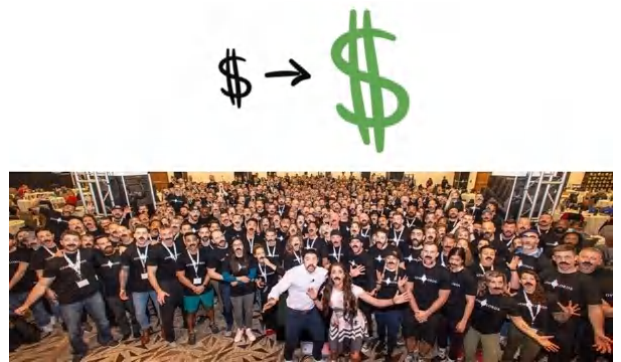
> 
> Bức ảnh chụp tại sự kiện Gym Lords Summit 2019 dành cho các chủ phòng gym ở cấp độ cao nhất của chúng tôi, tất cả đều để bộ râu kiểu cách giống tôi.

**_Tháng 1 năm 2019._**

Thứ duy nhất tôi nhìn thấy là một màu đen đặc quánh. Mắt tôi dính chặt lại với nhau. Tôi đã tỉnh giấc, nhưng cảm giác mệt mỏi ở hai bên thái dương nặng trịch như thể có một khối tạ năm pao bị dán băng keo chặt vào hộp sọ, kéo sụp mí mắt tôi xuống. Tôi phải dùng hết sức để ép chúng mở ra. Chi tiết căn phòng mờ ảo hiện dần lên. Tôi xoay người lăn ra mép giường khách sạn, cảm nhận rõ từng thớ cơ trong cơ thể khi trọng lượng dịch chuyển. Gập người sang một bên, tôi thấy quần áo của mình vứt ngổn ngang trên sàn. Tối hôm trước tôi kiệt sức đến mức chẳng nhớ nổi mình đã cởi chúng ra từ lúc nào.

Tôi vừa kết thúc chuỗi năm ngày marathon thuyết trình keynote liên tục. Hai ngày thuyết trình liền mạch cho các khách hàng VIP cấp cao nhất, tiếp nối ngay sau đó là hai ngày họp bàn chiến lược cùng toàn thể công ty (hơn 135 nhân sự).

Tôi đã bỏ lỡ một cuộc gọi FaceTime của bố vào ngày hôm trước. Lịch trình buổi sáng của tôi hoàn toàn trống. Thế nên tôi lồm cồm bò dậy, xỏ đại chiếc áo hoodie cùng quần nỉ, rồi bước ra hành lang khách sạn để gọi lại cho ông. Sau màn chào hỏi xã giao ban đầu, ông đi thẳng vào lý do gọi điện – sự lo lắng của đấng sinh thành.

“Bố thấy bức ảnh con đăng chụp chung với tất cả khách hàng của mình…” ông nói, nhưng với giọng điệu lo lắng bất thường. “Bố tưởng sự kiện đó chỉ dành cho những khách hàng trả phí cao nhất chứ? Con bé không biết đó là một sự kiện lớn đấy. Trông như con có cả nghìn người ở đó vậy!”

Đứng một mình ngoài hành lang và vật lộn để xua tan cơn mệt mỏi vẫn còn đeo bám, tôi cố phán đoán xem mối lo của ông xuất phát từ đâu và ông đang nhắm đến điều gì. Tôi đã giải thích toàn bộ chuyện này cho ông rồi cơ mà. “Đó chỉ là dành cho các khách hàng cấp cao nhất của con thôi, không phải tất cả khách hàng đâu,” tôi đáp. “Chỉ những ai trả 42.000 USD/năm thôi… hội Gym Lords của con, như con đã kể với bố rồi đấy.”

“Từng người một trong bức ảnh đó đều trả cho con 42.000 USD á?” Giọng ông nghe có vẻ hoảng hốt trước ý nghĩ đó.

“Vâng, điên rồ phải không bố?” Giọng tôi khản đặc sau nhiều ngày thuyết trình và hàng nghìn cuộc trò chuyện kéo dài hai mươi giây.

“Mấy việc con đang làm có hợp pháp không đấy?” ông hỏi. _Chà, chuyện đi xa nhanh thật đấy, tôi thầm nghĩ._ “Họ có biết là họ đang trả cho con nhiều tiền đến thế không?”

“Có chứ, hợp pháp ạ. Và đương nhiên là họ biết. Con có phải đang âm thầm rút ruột tiền bạc gì đâu.”

“Nhiều tiền lắm đấy. Bố chỉ mong những gì con đang cho họ đi phải xứng đáng.”

- Tôi đắn đo không biết có nên tốn sức giải thích hay lờ đi cho xong. Nhưng biết thừa đây sẽ lại là “một câu chuyện dài dòng” đây,

- tôi hít một hơi thật sâu và bắt đầu giải thích. “Nếu con giúp bố kiếm thêm 239.000 USD trong năm nay, bố có sẵn sàng trả cho con 42.000 USD không?” tôi hỏi, lấy con số

- “239.000 USD” vì đó là mức doanh thu thuần gia tăng trung bình của một phòng gym khi áp dụng hệ thống của chúng tôi trong 11 tháng.

  - “Chắc chắn rồi,” ông nói, “ý bố là nếu bố biết chắc mình sẽ kiếm lại được khoản đó. Nhưng bố sẽ phải làm những gì?”

  - “Khoảng 15 tiếng làm việc mỗi tuần ạ.”

  - “Và bố sẽ mất bao lâu để kiếm được 239.000 USD đó?”

  - “Mười một tháng ạ.”

- “Và con bắt bố phải trả trước bao nhiêu trong số 42.000 USD đó?”

- “Không đồng nào cả. Chỉ cần trả cho con khi bố bắt đầu kiếm được tiền nhờ áp dụng hệ thống thôi.”

Tôi thấy bóng đèn trong đầu ông sáng lên. Bố tôi đã hiểu vấn đề. “Ồ,” ông nói, “thế thì, ừ, bố sẽ làm.”

“Và đó cũng là lý do tại sao họ làm điều đó.”

Kiếm được đống tiền khủng khiếp khiến người ta phát rồ. Nó thực sự bẻ cong tâm trí họ vượt xa những gì họ tin là khả thi, khiến họ mặc định rằng bạn đang làm điều gì đó mờ ám hoặc phi pháp. Họ thực sự “cạn lời” luôn.

Tại sao ư? Bởi vì họ tự nhủ… _họ không thể thông minh hơn mình nhiều đến thế hay làm việc chăm chỉ hơn mình nhiều đến thế, vậy làm quái nào mà họ lại có thể kiếm được gấp 1.000 lần mình? Số tiền đủ để tôi phải mất tận mười kiếp mới làm ra được bằng số họ kiếm trong một năm._

Trong ba năm dẫn đến thời điểm viết cuốn sách này, tôi đã đút túi hơn 1.200.000 USD/tháng tiền lợi nhuận ròng. Đều đặn. Mỗi. Một. Tháng. Con số đó còn lớn hơn tổng thu nhập của các CEO hãng Ford, McDonald’s, Motorola và Yahoo… cộng lại… trong một năm… khi đó tôi chỉ là một thằng nhóc ở độ tuổi hai mươi.

Nó khiến những kẻ tin rằng cuộc đời này bất công phải sôi máu. Nó khiến những kẻ không thể nhận thức nổi phải hoang mang và tin rằng chắc chắn phải có sự nhầm lẫn gì ở đây. Và nó thắp lên ngọn lửa truyền cảm hứng cho một nhóm nhỏ được chọn, những kẻ sinh ra để vĩ đại.

Tôi hy vọng bạn thuộc nhóm đối tượng cuối cùng, bởi vì đó chính là người mà tôi viết cuốn sách này cho họ.

Bạn _có thể_ làm được điều này.

Bạn chỉ cần học cách _làm như thế nào_ thôi.

Và tôi sẽ chỉ cho bạn thấy.

**Độ chênh lệch giữa Giá cả và Giá trị** 

_“Tôi hy vọng những gì anh đang trao cho họ thực sự xứng đáng.”_ 

Câu nói đó có lẽ sẽ khiến phần lớn mọi người cảm thấy nhói lòng, nhưng khi bố tôi thốt lên câu ấy, tôi biết thừa ông chẳng hiểu gì về _giá trị_ mà chúng tôi đang mang lại. Điều tôi muốn cho bạn thấy là cách tạo ra và truyền tải giá trị — hay còn gọi là độ “đáng đồng tiền bát gạo” của một lời chào hàng (**Grand Slam Offer**). 

Để hiểu cách tạo ra một lời chào hàng sức hút, trước tiên bạn phải hiểu rõ về _giá trị_. Lý do con người mua _bất cứ thứ gì_ là để săn được một _món hời_. Họ tin rằng thứ họ nhận được (GIÁ TRỊ) có giá trị _lớn hơn_ thứ họ bỏ ra để đổi lấy nó (GIÁ CẢ). Ngay khoảnh khắc giá trị họ nhận về tụt xuống thấp hơn số tiền họ phải trả, họ sẽ lập tức ngừng mua hàng của bạn. Khoảng chênh lệch giữa giá cả và giá trị này chính là thứ bạn phải bằng mọi giá tránh để nó xảy ra. 

Rốt cuộc, đúng như lời Warren Buffett từng nói: “Giá cả là thứ bạn trả. Giá trị là thứ bạn nhận được.” 

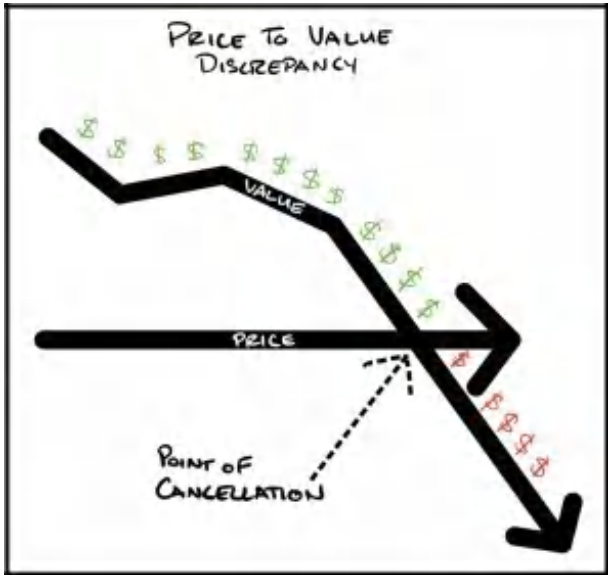

Cách đơn giản nhất để nới rộng khoảng cách giữa giá cả và giá trị là hạ giá xuống. Nhưng trong phần lớn trường hợp, đó lại là một quyết định sai lầm đối với doanh nghiệp. 

Mục tiêu của một doanh nghiệp KHÔNG PHẢI là làm sao để chốt được khách hàng. Mục tiêu tối thượng là kiếm tiền. Và việc hạ giá bán chính là con đường một chiều dẫn đến diệt vong đối với hầu hết mọi người — bạn chỉ có thể giảm xuống 0 đô-la, nhưng lại có thể tăng lên vô tận theo chiều ngược lại. Thế nên, trừ khi bạn nắm trong tay một cách mạng nào đó giúp cắt giảm chi phí xuống còn 1/10 so với đối thủ, bằng mọi giá đừng cạnh tranh bằng giá. 

Như Dan Kennedy từng nói: “Chẳng có chút lợi thế chiến lược nào khi đứng thứ nhì về giá rẻ trên thị trường cả, nhưng lại có rất nhiều lợi thế nếu bạn là kẻ đắt đỏ nhất.” 

Vì vậy, mục tiêu của **Grand Slam Offer** là khiến nhiều người gật đầu đồng ý hơn _ở một mức giá cao hơn_ thông qua việc nới rộng khoảng cách giữa giá trị và giá cả. Nói cách khác, chúng ta chỉ tăng giá _sau khi_ đã gia tăng đầy đủ giá trị. Bằng cách này, khách hàng vẫn cảm thấy mình mua được một món hời lớn (hãy hình dung cảm giác mua được khối giá trị trị giá 100.000 đô-la chỉ với 10.000 đô-la). Đó chính là “mua tiền với giá chiết khấu”. 

> **QUÀ TẶNG MIỄN PHÍ #3: BÀI HƯỚNG DẪN KÈM TÀI LIỆU TẢI VỀ MIỄN PHÍ: Định Giá Xứng Tầm (Charge What It’s Worth)** 
> 
> Nếu bạn muốn biết cách tôi tạo ra độ chênh lệch giá trị cho các sản phẩm B2B hoặc B2C, hãy truy cập khóa học tại **<u>Acquisition.com/training/offers</u>** và xem video hướng dẫn ngắn có tựa đề **“Charge What It’s Worth”**. Mục tiêu của tôi là xây dựng lòng tin và trao đi giá trị trước. Vì vậy, nó hoàn toàn miễn phí. Hãy tận hưởng nó nhé. 

### **Tại sao bạn nên hét giá thật cao đến mức thấy xót ví?** 

Hầu hết các chủ doanh nghiệp đều _không_ cạnh tranh bằng giá hay giá trị. Thực chất, họ chẳng cạnh tranh dựa trên bất cứ tiêu chí nào cả. Quy trình định giá của họ thường diễn ra theo công thức sau: 

1. Nhìn ngó thị trường 

2. Xem đối thủ đang bán bao nhiêu 

3. Lấy con số trung bình 

4. Giảm đi một chút để giữ thế “cạnh tranh” 

5. Cung cấp những gì đối thủ có kèm theo “thêm một chút xíu” 

6. Và cuối cùng kết thúc với một tuyên ngôn giá trị kiểu “nhiều hơn với giá hời hơn” 

Và bí mật động trời là gì? Những đối thủ mà họ đang bắt chước kia đang nghèo rớt mồng tơi. _Vậy hà cớ gì lại đi sao chép họ?_ Định giá theo mặt bằng chung của thị trường đồng nghĩa với việc bạn đang định giá dựa trên tính _hiệu suất_ của thị trường. Theo thời gian, trong một thị trường hiệu quả, sẽ có thêm nhiều đối thủ nhảy vào với chiêu bài “nhiều hơn một chút, rẻ hơn một chút”, cho đến khi chẳng ai có thể cung cấp thêm được gì với mức giá thấp hơn nữa. Đến thời điểm đó, thị trường đạt đến độ bão hòa hoàn hảo, và những chủ doanh nghiệp tham gia chỉ kiếm đủ tiền vào cuối tháng để tiếp tục duy trì sự sống. Top 10-20% doanh nghiệp kém nhất sẽ bị quét sạch hoặc mất đi ý chí chiến đấu. Sau đó, những nhà sáng lập non trẻ mới bước chân vào cuộc chơi với một đầu óc mù mờ và lại lặp lại chu kỳ của các bậc tiền bối. Cứ thế, vòng lặp xoay vần mãi không thôi. 

Nói một cáchhuỵch toẹt, định giá theo kiểu này có nghĩa là bạn đang cung cấp một dịch vụ với mức giá chỉ nhỉnh hơn chút xíu so với chi phí để bạn không bị chết chìm. Chúng ta _không_ ở đây để ngoi ngóp sống qua ngày. Chúng ta ở đây để kiếm những khoản tiền kếch xù đến mức họ hàng láng giềng phải hoài nghi không biết việc bạn đang làm có hợp pháp hay không. Nhắc lại lần nữa, mục tiêu của chúng ta không phải là ôm lấy nhiều khách hàng nhất. Mục tiêu của chúng ta là kiếm được nhiều tiền nhất. 

Đã vậy, vì chẳng có chút lợi thế chiến lược nào khi đứng vị trí á quân về giá rẻ trên thị trường, hãy cho phép tôi phác thảo ngắn gọn lý do tại sao tôi coi việc định giá cao cấp (premium pricing) không chỉ là một quyết định kinh doanh cực kỳ khôn ngoan, mà còn là một quyết định mang tính đạo đức. Hơn thế nữa, đó là lựa chọn duy nhất giúp bạn thực sự mang lại nhiều giá trị nhất — một vị thế độc tôn và vững chắc trên thị trường. Hãy để tôi giới thiệu cho bạn chu kỳ nhân quả của giá cả (Virtuous Cycle of Price). 

### **Chu kỳ nhân quả của Giá cả** 

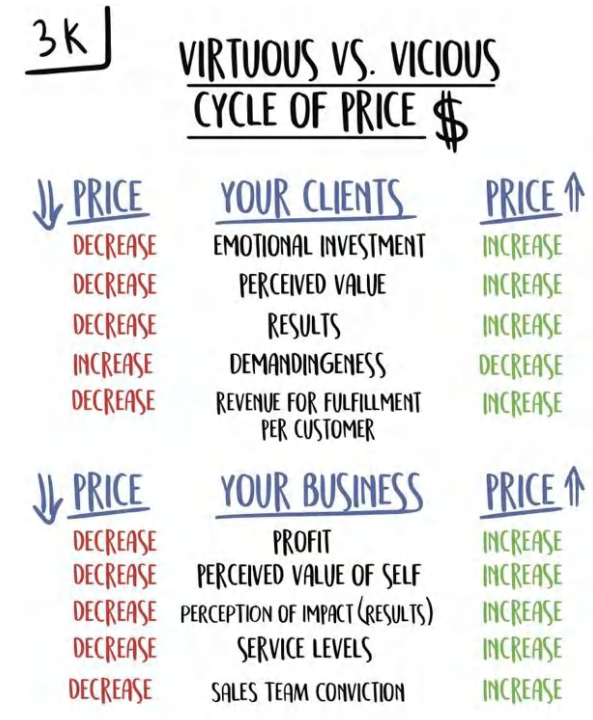

Tôi đã sử dụng bộ khung này trong hầu hết các tài liệu của mình bởi vì nó cần phải được củng cố liên tục. Những áp lực từ thị trường sẽ liên tục bào mòn hệ thống niềm tin của bạn. Bạn phải thật vững vàng và phớt lờ chúng đi! Dưới đây là tiền đề cơ bản giải thích tại sao bạn _bắt buộc_ phải định giá cao cấp nếu muốn phục vụ khách hàng tốt nhất. 

Khi bạn hạ giá, bạn đang...

&emsp;...Làm giảm sự đầu tư cảm xúc của khách hàng vì họ chẳng tốn mấy tiền 

&emsp;...Làm giảm giá trị cảm nhận của khách hàng về dịch vụ của bạn — bởi vì rẻ thế thì chẳng thể nào tốt được, hoặc giá cũng làng nhàng như bao kẻ khác 

&emsp;...Làm giảm kết quả đầu ra của khách hàng vì họ không coi trọng dịch vụ và chẳng bỏ chút tâm sức nào 

&emsp;...Thu hút những khách hàng tồi tệ nhất — những kẻ _không bao giờ_ cảm thấy thỏa mãn cho đến khi dịch vụ của bạn trở thành _đồ miễn phí_ 

&emsp;...Tiêu diệt mọi biên lợi nhuận (margin) mà bạn còn sót lại để có thể thực sự tạo ra một trải nghiệm xuất sắc, thuê những nhân tài xuất chúng, đầu tư cho đội ngũ, cưng chiều khách hàng, đầu tư vào tăng trưởng, mở rộng chi nhánh hay quy mô, và mọi thứ khác mà bạn hằng mong mỏi với mục tiêu giúp đỡ nhiều người hơn giải quyết bất kỳ vấn đề nào họ đang gặp phải. 

Tóm lại, cuộc đời bạn lúc này sẽ cực kỳ tồi tệ. Và tệ hơn nữa, dịch vụ của bạn có lẽ cũng chẳng ra gì bởi vì bạn đang cố vắt cổ chày ra nước. Chẳng còn lại bao nhiêu tiền để tạo nên một thứ gì đó xuất sắc cả. Kết quả là, bạn chìm nghỉm vào đám đông tầm thường đang trên đường đua lao dốc xuống đáy. Tôi đã từng sống qua những tháng ngày đó. Nó khủng khiếp lắm. Nếu bạn yêu quý khách hàng và nhân viên của mình, xin hãy ngừng việc bóp nghẹt họ khi vẫn còn một lối đi tốt hơn. 

Và đây là chiều ngược lại. Điều gì sẽ xảy ra khi bạn nâng giá? 

Khi bạn tăng giá, bạn đang...

&emsp;..._Gia tăng_ sự đầu tư cảm xúc của khách hàng 

&emsp;..._Gia tăng_ giá trị cảm nhận của khách hàng về dịch vụ 

&emsp;..._Gia tăng_ kết quả của khách hàng vì họ trân trọng dịch vụ và đã bỏ vốn đầu tư tâm sức 

&emsp;...Thu hút những khách hàng _tốt nhất_ — những người _dễ phục vụ nhất_, thực tế lại _tốn ít chi phí chăm sóc hơn_, và là những người có khả năng cao nhất trong việc đón nhận và cảm nhận được giá trị tương xứng cao nhất 

&emsp;..._Nhân lên_ biên lợi nhuận của bạn vì bạn có sẵn nguồn lực để _đầu tư_ vào hệ thống nhằm tạo ra hiệu suất cao hơn; thuê nhân sự thông minh; cải thiện trải nghiệm khách hàng; mở rộng quy mô kinh doanh; và quan trọng nhất là chứng kiến những con số trong tài khoản ngân hàng cá nhân của mình nhảy vọt từng tháng, ngay cả sau khi đã tái đầu tư vào doanh nghiệp. Điều này cho phép bạn thực sự tận hưởng cuộc chơi đường dài và giúp đỡ nhiều người hơn khi quy mô lớn mạnh, thay vì bị kiệt sức (burnout) rồi lụi tàn vào quên lãng. 

Để củng cố thêm sức nặng cho luận điểm nâng giá, dưới đây là một vài khái niệm cực kỳ thú vị. Khi bạn tăng giá, bạn đang gia tăng giá trị mà người tiêu dùng nhận được mà không cần thay đổi bất cứ điều gì khác về sản phẩm. Khoan đã, gì cơ? Đúng vậy đấy. 

### **Giá cao hơn đồng nghĩa với Giá trị cao hơn (Theo đúng nghĩa đen)** 

Trong một bài kiểm tra mù (blind taste test), các nhà nghiên cứu yêu cầu người tiêu dùng đánh giá ba loại rượu vang: rượu giá rẻ, rượu tầm trung và rượu cao cấp. Xuyên suốt nghiên cứu, những người tham gia đánh giá các chai rượu khi nhìn thấy rõ mức giá. Không có gì bất ngờ khi họ chấm điểm theo đúng thứ tự giá tiền: chai đắt nhất là “ngon nhất”, chai đắt thứ nhì là “ngon nhì”, và chai thứ ba — lựa chọn rẻ nhất — bị xếp hạng là “rượu kém chất lượng”. 

Điều mà những người thử rượu không hề biết là các nhà nghiên cứu đã đưa cho họ chính xác cùng một loại rượu vang cho cả ba lần thử. Thế nhưng, họ vẫn báo cáo lại một khoảng chênh lệch cực kỳ lớn giữa chai “giá cao” và chai “rượu rẻ”. Phát hiện này mang những hàm ý sâu sắc về mối quan hệ nhân quả trực tiếp giữa giá trị và giá cả. 

Nói một cách bản chất, việc tăng giá có thể trực tiếp nâng tầm giá trị mà bạn cung cấp. Hơn thế nữa, giá càng cao, sản phẩm hoặc dịch vụ của bạn càng có sức hút mãnh liệt. Con người _luôn muốn_ mua những thứ đắt tiền. Họ chỉ cần một lý do mà thôi. Và mục tiêu không phải là nhỉnh hơn giá thị trường một chút — mục tiêu là phải đẩy giá cao đến mức người tiêu dùng phải tự nhủ rằng: <u>“Món này đắt thế này chắc chắn phải có một điều gì đó hoàn toàn khác biệt ở đây rồi.”</u> 

Đó chính là cách bạn tự tạo ra một thị trường độc tôn cho riêng mình (category of one). Trong thị trường mới do bạn định hình trong tâm trí khách hàng đó, bạn chính là kẻ độc quyền và có thể thu về lợi nhuận độc quyền. Đó mới là đích đến cuối cùng. 

Một điểm mấu chốt cuối cùng tôi muốn nhấn mạnh: nếu bạn cung cấp một dịch vụ mà khách hàng buộc phải hành động để đạt được kết quả, hoặc để giải quyết vấn đề mà bạn cam kết, thì họ bắt buộc phải có sự đầu tư. Họ càng đầu tư nhiều, khả năng đạt được kết quả tích cực càng cao. Do đó, suy cho cùng, nếu bạn thực sự quan tâm đến khách hàng, bạn phải ép họ đầu tư càng nhiều càng tốt — ở mức độ cao nhất có thể về mặt con người. Lý tưởng nhất là định giá sản phẩm hoặc dịch vụ sao cho họ cảm thấy hơi _xót ví_ một chút khi xuống tiền. Sự xót ruột đó sẽ buộc họ phải tập trung cao độ và dồn toàn lực vào sản phẩm hoặc dịch vụ của bạn. Kẻ nào trả nhiều tiền nhất, kẻ đó sẽ chú tâm nhất. Và nếu khách hàng của bạn tuân thủ nghiêm ngặt quy trình, kiên trì đến cùng, đồng thời đạt được kết quả vượt trội hơn hẳn so với khi họ dùng sản phẩm của đối thủ, thì bạn đang thực hiện một sứ mệnh thiết thực: trao đi nhiều giá trị hơn bất kỳ ai khác. Đó chính là cách bạn chiến thắng cuộc chơi. 

Nhưng tôi biết điều này không hề dễ dàng, và thực tế nó không được phép dễ dàng. Sản phẩm của bạn buộc phải _giao được kết quả_. Rất nhiều kẻ muốn đi đường tắt để né tránh công việc thực sự. Cứ làm thế đi và bạn _chắc chắn_ sẽ thất bại. Trong thế giới thực, để có đủ “can đảm” hét những mức giá cao ngất ngưởng (high-ticket), bạn phải _chiến thắng được tiếng nói hoài nghi của chính mình_. Bạn phải thật sự tự tin vào năng lực thực thi của mình — bởi vì bạn đã làm điều đó _quá nhiều lần rồi_, đến mức bạn _thừa biết_ khách hàng này chắc chắn sẽ thành công. Chính trải nghiệm thực chiến mới đem lại cho bạn niềm tin sắt đá để dám cất lời yêu cầu khách hàng trả mức thù lao tương đương cả một năm lương của họ. Bạn phải có niềm tin sâu sắc vào giải pháp của mình đến mức khi đứng soi mình trước gương trong phòng tối một mình vào ban đêm, niềm tin đó vẫn không hề lung lay. Vậy nên, hãy để tôi đúc kết phần này bằng chính trải nghiệm thực tế của bản thân.

### **Trải nghiệm định giá cao cấp của tôi**

Trong doanh nghiệp tư vấn ngách đầu tiên của tôi — Gym Launch — tôi dạy các chủ phòng gym một mô hình kinh doanh tốt hơn. Trước khi thương mại hóa các dịch vụ tư vấn, tôi đã bay đến 33 phòng gym trong vòng 18 tháng để thực hiện các cuộc lột xác toàn diện.

Chúng tôi sẽ bay tới nơi, sửa chữa mọi thứ trong phòng gym và tái ra mắt nó chỉ trong 21 ngày. Chúng tôi đạt mức tăng trưởng trung bình 42.000 USD doanh số bổ sung trong vòng 21 ngày đó. Thật là điên rồ. Phí dịch vụ của tôi là 100% doanh thu gia tăng mà tôi mang lại.

Vào thời kỳ đỉnh cao, chúng tôi lột xác tới 8 phòng gym mỗi tháng. Việc này nhanh chóng trở thành một cơn ác mộng về hậu cần. Sau sự mòn mỏi và kiệt quệ của việc sống trong các nhà nghỉ hết tháng này sang tháng khác, tôi tự nhủ: *phải có một cách nào đó hay ho hơn chứ.*

Có một tháng, có một phòng gym mà chúng tôi đã lên lịch bay đến. Nhưng, tôi hoàn toàn không muốn làm điều đó nữa. Thế là tôi bảo họ rằng chúng tôi sẽ hủy lịch hẹn. Chủ phòng gym suýt chút thế đã đe dọa tôi phải giúp anh ta bằng được. Vì vậy, tôi nói tôi sẽ giúp, nhưng anh ta sẽ phải tự làm tất cả mọi việc, còn tôi sẽ chỉ cho anh ta cách làm.

Trong vòng 30 ngày, phòng gym này đã kiếm được gần 44.000 USD tiền mặt doanh số thu về ngay từ đầu (gấp 4 lần tháng trước đó). Ngay khi thấy quy trình của mình có thể được nhân bản từ xa mà tôi không cần phải cử người bay đến tận nơi... công việc kinh doanh của chúng tôi đã bùng nổ. Tôi đã tìm ra mảnh ghép còn thiếu vì lịch trình di chuyển của tôi không còn là điểm nghẽn nữa. Chúng tôi tiếp tục bán dịch vụ cho hơn 4.000+ phòng gym trong vài năm tiếp theo (và vẫn đang tăng) bằng cách sử dụng mô hình *đồng hành cùng khách hàng (done-with-you)* thay vì *làm trọn gói thay khách hàng (done-for-you)*. Nhưng... quay lại chuyện định giá cao cấp.

Khi tôi mới bước chân vào lĩnh vực này, các đối thủ giá rẻ cung cấp dịch vụ marketing trọn gói với giá 500 USD/tháng, trong khi chỉ có một đối thủ cao cấp duy nhất tính phí 5.000 USD cho sản phẩm của anh ta.

Tôi muốn trở thành người dẫn đầu về mức giá cao cấp. Tôi muốn đắt đỏ đến mức tạo ra sự cuốn hút cho những gì chúng tôi đang làm. Vì vậy, chúng tôi đưa ra mức giá gấp ba lần đối thủ đắt nhất và gấp 32 lần đối thủ rẻ nhất: 16.000 USD cho một chương trình huấn luyện chuyên sâu kéo dài 16 tuần theo mô hình đồng hành cùng khách hàng. Sau đó, chúng tôi upsell 35% số khách hàng đó vào một hợp đồng kéo dài ba năm, trị giá 42.000 USD/năm để chúng tôi tiếp tục giúp họ phát triển phòng gym.

Để bạn dễ hình dung: Một chủ phòng gym trung bình kiếm được 35.280 USD/năm lợi nhuận ròng. Nếu đó là mức trung bình, có nghĩa là *một nửa* số chủ phòng gym kiếm được *thậm chí còn ít hơn* con số đó. Vậy nên đối với nhiều người trong số họ, họ đang cam kết chi ra *một nửa* (hoặc hơn) thu nhập cả năm của mình để mua chương trình của chúng tôi. Và tôi lúc đó mới chỉ là một thằng nhóc độ tuổi đôi mươi, đi bán hàng cho những người đàn ông trưởng thành và tuyên bố rằng tôi sẽ giúp họ kiếm được nhiều tiền hơn. Điều này khả thi là nhờ niềm tin của tôi mạnh mẽ hơn sự hoài nghi của họ. *Bằng cách nào?*

Dựa trên một khảo sát tự nguyện được thực hiện tại sự kiện toàn công ty gần đây nhất của chúng tôi với 158 phòng gym phản hồi, chúng tôi nhận thấy một phòng gym thuộc hệ thống Gym Launch đã tham gia chương trình của chúng tôi trong 11 tháng sẽ đạt được các mức cải thiện trung bình sau:

_Tăng trưởng doanh thu tổng (Top Line Revenue):_ +19.932 đô-la/tháng (+239.000 đô-la/năm)

- _Tăng trưởng doanh thu định kỳ (Recurring Revenue):_ +13.339 đô-la/tháng (+160.068 đô-la/năm)
- _Tăng trưởng lợi nhuận ròng (Bottom Line):_ Tăng từ 2.943 đô-la/tháng lên 8.940 đô-la/tháng (gấp 3,1 lần!)
- _Tăng trưởng khách hàng:_ +67 khách hàng
- _Tỷ lệ rời bỏ (Churn - % khách hàng rời đi mỗi tháng):_ Giảm từ 10,7% xuống 6,8%
- _Doanh số bán lẻ:_ +4.400 đô-la/tháng từ doanh thu sản phẩm bán lẻ
- _Giá dịch vụ:_ Tăng từ 129 đô-la/tháng lên 167 đô-la/tháng

Cuộc khảo sát chỉ một lần nữa chứng minh điều mà tôi đã biết rõ từ trước. Tôi có niềm tin tuyệt đối vào sản phẩm của mình. Tôi biết nó thực sự hiệu quả. Tôi đã *vượt qua sự tự hoài nghi của chính mình bằng khối lượng công việc thực tế.*

### **Tóm tắt cốt lõi**

Bạn nên rút ra bài học gì từ điều này?

Đầu tiên và quan trọng nhất, hãy định giá cao. Nó sẽ cho phép bạn làm những điều không ai khác làm được để giúp khách hàng của mình thành công. Chúng tôi có thể định giá cao vì chúng tôi mang lại nhiều giá trị hơn bất kỳ ai khác trong ngành. Thực tế mà nói, mức phí chúng tôi thu chỉ chiếm một *phần nhỏ* so với số tiền khách hàng kiếm được nhờ hệ thống của chúng tôi. Điều này rất quan trọng. <u>Khách hàng của chúng tôi vẫn nhận được một</u> _<u>món hời lớn</u>_. Khoảng cách giữa số tiền họ bỏ ra (giá cả - price) và những gì họ nhận lại (giá trị - value) là vô cùng khổng lồ. Nhờ đó, vòng lặp vô tận của sự thịnh vượng tiếp tục quay. Chúng tôi thu phí cao nhất. Chúng tôi cung cấp giá trị lớn nhất.

Các phòng gym của chúng tôi vẫn giữ vững vị thế cạnh tranh mạnh mẽ nhất, kiếm được nhiều tiền nhất, luôn sở hữu các hệ thống thu hút khách hàng mới nhất và tốt nhất, đồng thời có sự hậu thuẫn để triển khai chúng với tốc độ chớp nhoáng.

Chúng tôi đã mắc nhiều sai lầm trên chặng đường đã qua, nhưng mô hình định giá thì không nằm trong số đó. Nó cho phép tôi có đủ dư địa để chơi những ván cược lớn mà không sợ sạt nghiệp. Sự thật là 99% doanh nghiệp cần phải tăng giá để phát triển, chứ không phải giảm giá. Lợi nhuận chính là ôxy. Nó tiếp nhiên liệu cho ngọn lửa tăng trưởng. Bạn bắt buộc phải có nó nếu muốn tiếp cận nhiều người hơn và tạo ra ảnh hưởng lớn hơn.

Tuy nhiên, để có thể tính phí cao như vậy, bạn phải học cách tạo ra giá trị khổng lồ. Hãy cùng đi sâu vào phần đó ngay sau đây.

# **PHẦN III: GIÁ TRỊ - TẠO RA GIA SẢN ƯU ĐÃI (GRAND SLAM OFFER) CỦA BẠN**

**CÁCH TẠO RA NHỮNG ƯU ĐÃI TUYỆT VỜI ĐẾN MỨC KHÁCH HÀNG SẼ CẢM THẤY NHƯ MÌNH ĐANG KHO KHỜ NẾU TỪ CHỐI**

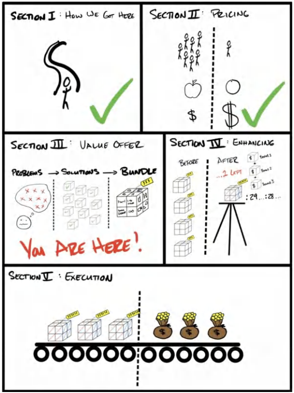

## **6. CUNG CẤP GIÁ TRỊ: PHƯƠNG TRÌNH GIÁ TRỊ (THE VALUE EQUATION)**

*“Chúng ta hoài nghi mọi niềm tin của mình, trừ những điều chúng ta thực sự tin tưởng, và đó lại là thứ chúng ta chẳng bao giờ nghĩ đến việc phải hoài nghi.”* - ORSON SCOTT CARD

Tôi muốn làm rõ một điều: mục tiêu của bạn phải là thu mức phí cao nhất có thể cho các sản phẩm hoặc dịch vụ của mình. Tôi đang nói đến những còn số tiền tệ khổng lồ. Mặc dù vậy, bất kỳ ai cũng có thể tăng giá, nhưng chỉ một số ít người có thể áp dụng mức giá này *và khiến mọi người đồng ý mua*.

Từ thời điểm này trở đi, bạn phải vứt bỏ mọi quan niệm về cái gọi là “sự công bằng”. Mọi tập đoàn khổng lồ trên thế giới đều đang tính tiền bạn cho những thứ vốn chẳng tốn chút chi phí nào để sản xuất. Các công ty viễn thông chỉ tốn vài xu để thêm một người dùng mới, nhưng họ chẳng ngại thu của bạn hàng trăm đô la mỗi tháng để sử dụng dịch vụ. Ngành dược phẩm chỉ tốn vài xu để sản xuất thuốc, nhưng họ sẵn sàng tính giá hàng trăm đô la mỗi tháng cho chúng. Các công ty truyền thông tính phí các nhà quảng cáo một cái giá cắt cổ cho từng con mắt theo dõi của bạn, trong khi chi phí để họ khiến bạn bấm thích những bức ảnh chú mèo con trên mạng xã hội là gần như bằng không. Bạn *phải* tạo ra một khoảng cách lớn giữa chi phí bạn bỏ ra để tạo ra sản phẩm và mức giá bạn thu về. Đó là con đường duy nhất để đạt được thành công phi thường.

Nhiều doanh nhân tin rằng việc tính phí “quá cao” là điều xấu. Thực tế là, đúng vậy, bạn không bao giờ nên định giá sản phẩm cao hơn giá trị thực tế của nó. Nhưng bạn nên định giá sản phẩm và dịch vụ của mình *cao hơn rất nhiều* so với chi phí để thực hiện nó. Hãy nghĩ đến mức cao gấp hàng trăm lần, chứ không chỉ gấp hai hay ba lần. Và nếu bạn cung cấp đủ *giá trị*, nó vẫn sẽ luôn là một *món hời* đối với khách hàng tiềm năng. Đó chính là sức mạnh của giá trị. Nó giải phóng tiềm năng định giá và lợi nhuận vô hạn để mở rộng quy mô doanh nghiệp của bạn.

Ví dụ, một trong những khách hàng tư vấn riêng của tôi (người mà tôi có cổ phần trong công ty) hoạt động trong lĩnh vực nhiếp ảnh. Trong vòng hai năm, nhờ áp dụng các chiến thuật được vạch ra trong cuốn sách này, chủ doanh nghiệp đã có thể nâng giá trị trung bình mỗi đơn hàng (average ticket) từ 300 USD lên 1.500 USD. Đó là mức tăng gấp 5 lần (ngạc nhiên chưa). Tuyệt vời hơn nữa, giờ đây họ tốn ít thời gian hơn cho mỗi khách hàng nhưng mức độ hài lòng của khách hàng lại *cao hơn*. Mức tăng 5 lần ở giá trị đơn hàng trung bình đã nhân 38 lần lợi nhuận của doanh nghiệp. Nó đã tăng từ mức lợi nhuận 1.000 USD/tuần lên 38.000 USD/tuần, và vẫn đang tiếp tục tăng trưởng. Nhờ đó, công ty cuối cùng đã có thể mở rộng quy mô ra nhiều chi nhánh và mang lại những công việc ý nghĩa cho các nhân viên tuyệt vời. Và một lợi ích thú vị nữa, chúng tôi có thể quyên góp nhiều tiền hơn nữa cho các quỹ từ thiện trẻ em – điều mà tôi và chủ doanh nghiệp có chung điểm chí hướng (gần 500.000 USD tính đến thời điểm viết cuốn sách này). Nhưng không điều nào trong số đó có thể thành hiện thực nếu không tìm ra điều mà mọi người trân trọng nhất, dồn toàn lực gấp ba lần cho nó, và tàn nhẫn loại bỏ mọi thứ khác. Mức tăng giá 5 lần nghe có vẻ điên rồ với bạn, nhưng khách hàng đã dùng chính tiền túi của họ để bầu chọn rằng những gì công ty cung cấp hiện tại *tốt hơn rất nhiều* so với trước đây. Giải mã được bài toán giá trị sẽ mở ra thế giới của lợi nhuận vô hạn, tầm ảnh hưởng và mọi khả năng.

Những ai thấu hiểu về *giá trị* sẽ là những người có thể thu phí cao nhất cho dịch vụ của họ. Tin vui là tôi đã đúc kết được một công thức có thể lặp lại (tôi chưa từng thấy nó xuất hiện ở bất kỳ đâu khác) nhằm giúp định lượng các biến số tạo ra giá trị cho bất kỳ ưu đãi nào. Tôi gọi nó là *Phương trình Giá trị (The Value Equation)*. Một khi bạn đã nhìn thấy nó, bạn sẽ không bao giờ có thể "unsee" (quên đi) được nữa. Nó sẽ hoạt động trong tiềm thức của bạn, chạy ngầm liên tục và vẫy gọi bạn. Đó là một lăng kính hoàn toàn mới để nhìn nhận thế giới.

### **Phương trình Giá trị**

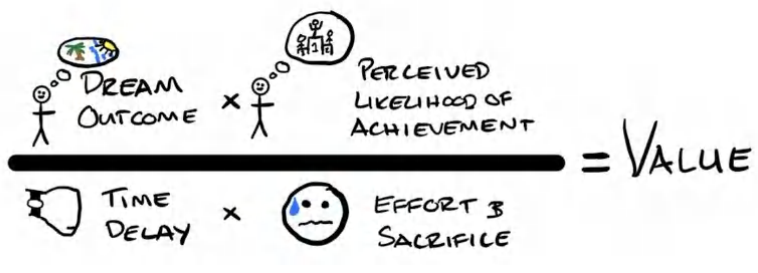

> **QUÀ TẶNG MIỄN PHÍ #4: Hướng dẫn bổ trợ về Phương trình Giá trị & Tài liệu tải về miễn phí:**
> 
> Nếu bạn muốn biết cách tôi chia nhỏ cốt lõi sản phẩm của một doanh nghiệp thành thứ gì đó có giá trị hơn, hãy truy cập **<u>acquisition.com/offers</u>** và chọn video **“Value Equation”** để xem một hướng dẫn ngắn. Tôi cũng đã đính kèm một checklist có thể tải về. Mục tiêu của tôi là *chiếm được lòng tin của bạn* và trao đi giá trị trước. Do đó, nó hoàn toàn miễn phí. Hãy tận hưởng nhé.

Như bạn có thể thấy từ hình minh họa, có 4 yếu tố thúc đẩy giá trị cốt lõi. Hai yếu tố (nằm ở phía trên) là những thứ bạn sẽ tìm cách **gia tăng**. Hai yếu tố còn lại (nằm ở phía dưới) là những thứ bạn sẽ tìm cách **cắt giảm**.

1. (Yay) Kết cục mong ước - Dream Outcome (Mục tiêu: Tăng)

2. (Yay) Khả năng đạt được kết cục trong tâm trí khách hàng - Perceived Likelihood of Achievement (Mục tiêu: Tăng)

3. (Boo) Độ trễ thời gian từ lúc bắt đầu đến khi đạt kết quả trong tâm trí khách hàng - Perceived Time Delay (Mục tiêu: Giảm)

4. (Boo) Công sức & sự đánh đổi trong tâm trí khách hàng - Perceived Effort & Sacrifice (Mục tiêu: Giảm)

Nếu bạn để ý những câu hỏi mà cha tôi đã hỏi tôi trong phần trước, bạn sẽ thấy chúng hoàn toàn trùng khớp với các trụ cột này:

- *Tôi sẽ kiếm được gì?* (Kết cục mong ước - Dream Outcome)

- *Làm sao tôi biết chắc điều đó sẽ xảy ra?* (Khả năng đạt được - Perceived Likelihood of Achievement)

- *Sẽ mất bao lâu?* (Độ trễ thời gian - Time Delay)

- *Tôi phải đánh đổi hay làm những gì?* (Công sức & Sự đánh đổi - Effort & Sacrifice)

### **Đưa mẫu số về bằng Không**

Vào đầu sự nghiệp của mình, tôi dồn toàn bộ sự chú ý vào kết cục mong ước và niềm tin đạt được kết quả (bằng chứng xã hội, sự chứng thực từ bên thứ ba, v.v.). Nói cách khác là phần tử số (phía trên) của phương trình. Đó là nơi các nhà marketing nghiệp dư thường đưa ra những lời hứa hẹn ngày càng phóng đại. Điều đó rất dễ làm và đầy tính lười biếng.

Nhưng khi thời gian trôi qua, tôi nhận ra rằng những lời hứa hẹn lớn lao kiểu "vẽ rồng vẽ phượng" đó là thứ dễ tạo ra nhất (và vì thế cũng ít mang tính độc nhất nhất). Rốt cuộc, ai mà chẳng hứa được. Phần khó hơn và mang tính cạnh tranh cao hơn chính là Độ trễ thời gian (Time Delay) và Công sức & Sự đánh đổi (Effort & Sacrifice). Các công ty xuất sắc nhất trên thế giới đều dồn toàn lực vào phần mẫu số (phía dưới) của phương trình: Làm cho mọi thứ trở nên tức thì, liền mạch và không tốn chút sức lực nào. Apple đã biến iPhone trở nên dễ sử dụng đến mức không tốn sức so với các dòng điện thoại khác vào thời điểm đó. Amazon biến việc mua sắm chỉ thành một cú nhấp chuột *đồng thời* khiến hàng hóa được giao đến tay gần như ngay lập tức (có thể khi bạn đọc đến đây, họ đã dùng drone để giao hàng tận cửa trong vòng 60 phút). Netflix giúp việc giải trí qua truyền hình trở nên tức thì và không chút rắc rối. Vì vậy, tôi càng lớn tuổi, tôi càng chuyển dịch sự tập trung sang “những thứ hóc búa” — đó là giảm thiểu phần mẫu số của phương trình. Và tôi tin rằng bạn làm điều này càng tốt bao nhiêu, bạn càng được thị trường thưởng lớn bấy nhiêu.

Lời nhắn cuối cùng: Lý do đây là một phép chia chứ không phải phép cộng (“+”) là vì tôi muốn truyền đạt một điểm mấu chốt. Nếu bạn có thể **biến phần mẫu số của phương trình bằng không**, bạn đã nắm chắc phần thắng. Cho dù phần tử số có nhỏ đến đâu, bất kỳ số nào chia cho số không cũng bằng vô cực (về mặt toán học thì không xác định, nhưng hãy tạm hiểu theo nghĩa đó cho các tín đồ toán học). Nói cách khác, nếu bạn có thể giảm độ trễ thời gian thực tế của khách hàng trong việc nhận giá trị xuống bằng không (tức là họ đạt được kết cục mong ước ngay lập tức), và công sức cùng sự đánh đổi của họ bằng không, bạn đang sở hữu một sản phẩm có giá trị vô hạn. Nếu bạn làm được điều này, bạn đã chiến thắng cuộc chơi.

Với giả định này, một khách hàng tiềm năng (về lý thuyết) sẽ mua thứ gì đó từ bạn, và ngay khoảnh khắc thẻ tín dụng của họ được quẹt, điều đó sẽ lập tức trở thành hiện thực của họ. *Đó* chính là giá trị vô hạn.

Hãy tưởng tượng bạn bấm nút mua một sản phẩm giảm cân và ngay lập tức thấy cơ thể mình xuất hiện cơ bụng 6 múi. Hoặc tưởng tượng bạn thuê một công ty marketing, và ngay khi vừa ký vào tài liệu, điện thoại của bạn bắt đầu reo lên với hàng loạt khách hàng tiềm năng chất lượng cao. Các sản phẩm/dịch vụ đó sẽ có giá trị đến mức nào? Giá trị vô hạn. Và đó chính là điểm mấu chốt.

Tôi không biết liệu chúng ta, những nhà kinh doanh, có bao giờ đạt được cảnh giới đó hay không, nhưng đó chính là giới hạn lý tưởng mà tất cả chúng ta nên hướng tới, và đó là lý do tại sao tôi cấu trúc phương trình theo cách này.

### **Nhận thức chính là Thực tại** 

Nhận thức chính là thực tại. Vấn đề không nằm ở việc bạn gia tăng xác suất thành công cho khách hàng tiềm năng đến mức nào, rút ngắn thời gian đạt được kết quả ra sao, hay giảm thiểu công sức và sự đánh đổi của họ lớn thế nào. Bản thân những điều đó _không hề_ tạo ra giá trị. Rất nhiều lần, họ chẳng hề hay biết gì về những nỗ lực đó. Một Grand Slam Offer (Gói ưu đãi đỉnh cao) chỉ thực sự có giá trị một khi khách hàng _cảm nhận được_ xác suất thành công tăng lên, _cảm nhận được_ thời gian chờ đợi được rút ngắn, và _cảm nhận được_ công sức cũng như sự đánh đổi đã giảm xuống. 

Một ví dụ điển hình cho điều này diễn ra ngay trong hệ thống tàu điện ngầm ở London. Mức độ hài lòng của hành khách tăng lên cao nhất ( _hay còn gọi là giá trị_ ) chưa bao giờ đến từ việc chạy tàu nhanh hơn để giảm thời gian chờ đợi. Thay vào đó, nó đến từ một tấm bản đồ đơn giản có đính các dấu chấm, cho họ biết khi nào chuyến tàu tiếp theo sẽ đến và họ còn phải đợi bao lâu nữa. Tấm bản đồ chấm bi ấy, với chi phí chỉ vài triệu đô-la, đã làm giảm _nhận thức_ của hành khách về thời gian chờ đợi và sự bất tiện (cảm giác chán nản khi phải ngóng chờ) tốt hơn nhiều so với việc thực sự làm cho các đoàn tàu chạy nhanh hơn (vốn ngốn tới hàng tỷ đô-la chi phí). Thú vị phải không? Đó chính là cách chúng ta cần phải tư duy về các sản phẩm của mình. 

> **Mẹo thực chiến: Giải pháp logic so với Giải pháp tâm lý** 
> 
> Hầu hết mọi người đều theo bản năng tìm cách giải quyết vấn đề bằng các giải pháp mang tính _logic_. Nhưng ngặt một nỗi, những giải pháp logic ấy thường đã bị thử chán chê rồi... đơn giản vì chúng quá logic (đó là điều mà bất kỳ ai cũng sẽ nghĩ ra và làm thử). 
> 
> Với tư cách là chủ doanh nghiệp và những nhà sáng lập, tôi ngày càng có xu hướng tiếp cận vấn đề theo hướng tìm kiếm các giải pháp mang tính _tâm lý_ hơn là _logic_. Bởi vì nếu đã có sẵn một giải pháp logic nào đó, thì rất có thể nó đã được giải quyết từ lâu rồi, và nhờ đó vấn đề cũng đã biến mất. Tất cả những gì còn lại chính là các vấn đề về mặt _tâm lý_. 
> 
> ### <u>Các ví dụ lấy cảm hứng từ Rory Sutherland, Giám đốc Marketing (CMO) của Ogilvy Advertising:</u> 
> 
> _“Bất kỳ kẻ ngốc nào cũng có thể bán một sản phẩm bằng cách giảm giá, nhưng phải là một bậc thầy marketing xuất sắc mới bán được chính sản phẩm đó với giá cao hơn”_ 
> 
> _Giải pháp logic:_ làm tàu chạy nhanh hơn để tăng sự hài lòng 
> _Giải pháp tâm lý:_ giảm bớt sự khó chịu khi chờ đợi bằng cách lắp bản đồ chấm bi 
> _Giải pháp tâm lý:_ thuê các người mẫu làm tiếp viên trên chuyến tàu (mọi người thậm chí còn ước gì hành trình đi đến đích lâu hơn cơ!) 
> 
> _Giải pháp logic:_ làm thang máy chạy nhanh hơn 
> _Giải pháp tâm lý:_ lắp gương từ sàn đến trần để mọi người mải mê ngắm mình trong gương và quên mất họ đã ở trong thang máy bao lâu 
> 
> _Giải pháp logic:_ bán rẻ hơn 
> _Giải pháp tâm lý:_ sản xuất số lượng ít đi và đẩy giá lên cao, điều này càng khiến mọi người thèm thuồng khao khát sở hữu hơn. 
> 
> Thông thường, hầu hết các giải pháp logic đều đã được thử nghiệm và thất bại. Tại thời điểm này trong lịch sử, chúng ta buộc phải trao cơ hội cho các giải pháp tâm lý để giải quyết vấn đề. 

Cũng chính vì vậy, với tư cách là chủ doanh nghiệp, nhiệm vụ của chúng ta là phải truyền đạt những yếu tố thúc đẩy giá trị (value drivers) này một cách thật rõ ràng để củng cố nhận thức của khách hàng về những thực tại đó. Mức độ bạn giải đáp được những câu hỏi này trong tâm trí khách hàng sẽ quyết định giá trị mà bạn đang tạo ra. Chỉ khi đó, chúng ta mới thực sự hiện thực hóa được giá trị đích thực của sản phẩm đối với thị trường, và rộng ra là mức giá đắt đỏ mà chúng ta muốn thu về. 

Thật khó để tách bạch bốn yếu tố thúc đẩy giá trị này ra khỏi nhau, vì hầu hết các mô hình đều kết hợp nhiều yếu tố trong số này lại với nhau, nhưng tôi sẽ cố gắng hết sức để tách rời và giải thích rõ ràng từng yếu tố dưới đây. 

### **#1 Kết quả mong đợi - Dream Outcome (Mục tiêu = Tăng)** 

Con người luôn có những khao khát sâu sắc và bất biến. Đó là lý do khiến những cuộc hôn nhân đổ vỡ, những cuộc chiến tranh nổ ra, và là thứ mà con người sẵn sàng hy sinh cả tính mạng để đánh đổi. Mục tiêu của chúng ta không phải là tạo ra khao khát. Đơn giản là chúng ta đang khơi dòng chảy cho những khao khát đó thông qua offer (lời chào hàng) và cỗ máy kiếm tiền (monetization vehicle) của mình. 

Kết quả mong đợi chính là sự bộc lộ của những cảm xúc và trải nghiệm mà khách hàng tiềm năng đã mường tượng sẵn trong đầu họ. Đó là khoảng cách giữa thực tại hiện tại và những giấc mơ của họ. Mục tiêu của chúng ta là phản chiếu chính xác giấc mơ đó lại cho họ, để họ cảm thấy mình được thấu hiểu, đồng thời giải thích cách mà phương tiện của chúng ta sẽ đưa họ đến đó. 

Kết quả mong đợi về cơ bản là rất đơn giản; chính cái quá trình “hành trình vươn tới đó” mới là nơi giá trị được gia tăng hoặc bị sụt giảm. 

Nói chung, khách hàng của chúng ta (và cụ thể hơn là khách hàng mục tiêu) đều muốn: 

&emsp;...Được nhìn nhận là xinh đẹp/đẹp đẽ 

&emsp;...Được tôn trọng 

&emsp;...Được nhìn nhận là quyền lực 

&emsp;...Được yêu thương 

&emsp;...Gia tăng _địa vị xã hội (status)_ 

Đây đều là những động lực vô cùng mạnh mẽ. 

Nhưng có rất nhiều phương tiện khác nhau có thể đạt được cùng một cái đích. Lấy khao khát _“được nhìn nhận là xinh đẹp”_ làm ví dụ, dưới đây là vô số thứ chạm đến khao khát này: 

&emsp;Mỹ phẩm trang điểm 

&emsp;Kem/serum chống lão hóa 

&emsp;Thực phẩm bổ sung 

&emsp;Quần áo định hình (Shapewear) 

&emsp;Phẫu thuật thẩm mỹ 

&emsp;Thể hình (Fitness) 

&emsp;&rarr; Tất cả những phương tiện này đều khơi thông khao khát được nhìn nhận là xinh đẹp. 

Và nếu chúng ta mổ xẻ sâu hơn về khao khát làm đẹp, chúng ta sẽ thấy đó có thể chỉ là tuyên bố ở bề nổi của một khao khát sâu kín hơn: đạt được địa vị cao hơn trong nhóm xã hội của mình. 

Yếu tố thúc đẩy giá trị "kết quả mong đợi" được sử dụng nổi bật nhất khi so sánh giá trị tương đối _giữa hai khao khát khác nhau được thỏa mãn_. Nhìn chung, kết quả mong đợi nào làm gia tăng địa vị của khách hàng một cách trực tiếp nhất sẽ là thứ họ trân trọng nhất. Do đó, một khách hàng tiềm năng có thể đánh giá cao toàn bộ danh mục phương tiện thỏa mãn khao khát này hơn một danh mục khác thỏa mãn khao khát khác. Đối với nhiều đàn ông, kiếm được tiền quan trọng hơn là có một ngoại hình đẹp trai. Tại sao? Bởi vì tiền bạc đem lại địa vị cho nam giới lớn hơn nhiều so với việc sở hữu một vẻ ngoài bảnh bao. Thế nên, nhìn chung, họ sẽ đánh giá cao mọi offer giúp họ kiếm ra tiền hơn là những offer giúp họ trông đẹp mã. 

Tôi đã từng nghe Russell Brunson kể một câu chuyện về khái niệm này. Anh ấy giải thích rằng vợ anh, chị Collette, khi lần đầu nghe về khái niệm địa vị này đã phản ứng kịch liệt. Chị ấy quả quyết rằng bản thân không hề bị thúc đẩy bởi địa vị và sẽ không bao giờ muốn lái một chiếc Lamborghini. Thay vào đó, chị chuộng chiếc xe minivan (xe gia đình) của mình hơn. Nhưng sau khi trò chuyện sâu hơn, chị tiết lộ lý do thực ra là vì lái một chiếc Lamborghini sẽ làm giảm địa vị của chị trong mắt hội các bà mẹ bỉm sữa bạn bè, trong khi lái xe minivan lại chứng minh chị là một người mẹ tốt (giúp gia tăng địa vị). Vì vậy, vấn đề không nằm ở tiền bạc, mà nằm ở _địa vị (sự gia tăng hoặc sụt giảm được cảm nhận về vị thế tương đối của một cá nhân khi so sánh với những người khác về mặt xã hội hoặc công việc)_. Hãy nói chuyện theo ngôn ngữ của những thứ mà khách hàng tin rằng sẽ làm gia tăng địa vị của họ, và bạn sẽ khiến khách hàng phải thèm thuồng nhỏ dãi. 

> **Mẹo thực chiến: Đóng khung lợi ích dưới lăng kính gia tăng địa vị** **_từ góc nhìn của người khác_** 
> 
> Khi viết copy (lời văn quảng cáo), bạn có thể làm cho thông điệp trở nên vô cùng mạnh mẽ bằng cách bàn về việc _những người khác_ sẽ nhìn nhận thành tựu của khách hàng như thế nào. Hãy nối các điểm chấm lại cho họ. Ví dụ: Nếu bạn mua cây gậy đánh golf này, cú đánh driver của bạn sẽ bay xa thêm 40 yard. Hàm của đám bạn chơi golf sẽ rớt xuống tận đất khi chúng nhìn thấy quả bóng của bạn bay vút qua bóng của tụi nó 40 yard... tụi nó sẽ hỏi bạn đã dùng bí quyết gì... và chỉ có một mình bạn biết câu trả lời. 

Điều đó có nghĩa là, khi so sánh hai sản phẩm hoặc dịch vụ đáp ứng _cùng một_ khao khát, giá trị đến từ kết quả mong đợi sẽ triệt tiêu lẫn nhau (vì chúng giống hệt nhau). Chính ba biến số còn lại mới tạo nên sự khác biệt về giá trị cảm nhận, và cuối cùng là quyết định mức giá. Ví dụ, nếu chúng ta có hai sản phẩm hoặc dịch vụ đều giúp làm đẹp cho một người, thì xác suất đạt được kết quả, thời gian chờ đợi, và công sức bỏ ra mới là những yếu tố phân định giá trị cảm nhận của từng offer. 

Nói một cách đơn giản: nếu hai thứ đều giúp một người trở nên xinh đẹp, điều gì khiến một thứ có giá 50.000 USD còn thứ kia chỉ có 5 USD? Câu trả lời: Mức độ của ba biến số giá trị còn lại. 

### **#2 Khả năng đạt được kết cục trong tâm trí khách hàng - Perceived Likelihood of Achievement (Mục tiêu = Tăng)** 

Đây là biến số cuối cùng tôi bổ sung khi cố gắng hoàn thiện bộ khung tư duy này vài năm trước. Tôi cảm thấy có gì đó thiếu thiếu nếu chỉ dựa vào ba biến số kia. 

Rồi tôi nhận ra mọi người sẵn sàng trả tiền cho sự chắc chắn. Họ đánh giá cao sự chắc chắn. Tôi gọi đây là “khả năng đạt được kết cục trong tâm trí khách hàng.” Nói cách khác, “Tôi tin tưởng đến mức nào rằng mình sẽ đạt được kết quả mong muốn nếu tôi thực hiện giao dịch mua hàng này?” 

Ví dụ, bạn sẵn sàng trả bao nhiêu tiền để trở thành bệnh nhân thứ 10.000 của một bác sĩ phẫu thuật thẩm mỹ so với bệnh nhân đầu tiên của họ? 

Nếu bạn là một người bình thường, tỉnh táo, bạn sẽ trả nhiều hơn rất nhiều. Thậm chí, bạn có lẽ còn đòi ngược lại tiền công từ họ nếu bạn là ca phẫu thuật đầu tiên trong đời của bác sĩ đó. 

Vì vậy, bạn có thể thấy ngay cả từ ví dụ đơn giản này, dù dịch vụ bạn nhận được về mặt kỹ thuật là hoàn toàn giống nhau, thì thứ duy nhất thay đổi chính là khả năng đạt được điều bạn muốn trong tâm trí bạn. 

Cả hai vị bác sĩ đều mất từng đó thời gian để thực hiện ca phẫu thuật (thậm chí, vị bác sĩ mổ 10.000 ca có khi còn làm nhanh hơn và _vẫn_ thu phí _cao hơn_). Vị bác sĩ giàu kinh nghiệm hơn có bề dày thành tích thực tế trong việc tạo ra kết quả, điều này kích thích tính đáng thèm muốn đối với dịch vụ của họ. 

Mọi người rất coi trọng khả năng đạt được kết cục này. Việc củng cố niềm tin của khách hàng tiềm năng rằng offer của bạn sẽ “thực sự” phát huy hiệu quả với họ sẽ làm cho offer của bạn trở nên vô cùng giá trị, dẫu cho khối lượng công việc ở phía bạn vẫn giữ nguyên không đổi. Do đó, để gia tăng giá trị cho mọi offer, chúng ta phải truyền đạt khả năng đạt được kết cục thông qua thông điệp, bằng chứng, những gì chúng ta chọn đưa vào hoặc loại bỏ khỏi offer, và các chính sách bảo hành (guarantees) của chúng ta (sẽ bàn kỹ hơn ở phần sau). 

### **#3 Độ trễ thời gian - Time Delay (Mục tiêu = Giảm)** 

Độ trễ thời gian là khoảng thời gian từ lúc khách hàng thanh toán cho đến khi họ nhận được lợi ích đã cam kết. Khoảng cách thời gian từ lúc họ mua hàng cho đến khi nhận được giá trị/kết quả càng ngắn, thì sản phẩm hoặc dịch vụ của bạn càng có giá trị. 

Có hai yếu tố cấu thành nên yếu tố thúc đẩy giá trị này: Kết quả dài hạn và trải nghiệm ngắn hạn. Rất nhiều lần, có những trải nghiệm ngắn hạn diễn ra trên đường đi đến kết quả dài hạn. Chúng xuất hiện “trên chặng đường đó” và mang lại giá trị. 

Thật tốt khi hiểu rõ cả hai điều này. Thứ mà mọi người _mua_ chính là giá trị dài hạn, hay còn gọi là “kết quả mong đợi” của họ. Nhưng thứ giữ chân họ _ở lại đủ lâu_ để đạt được điều đó lại là trải nghiệm ngắn hạn. Đây là những cột mốc nhỏ mà khách hàng nhìn thấy trên chặng đường đi, cho họ thấy rằng họ đang đi đúng hướng. Chúng tôi cố gắng lồng ghép càng nhiều những cột mốc này càng tốt vào bất kỳ dịch vụ nào mình cung cấp. Chúng ta muốn khách hàng có được một chiến thắng cảm xúc lớn ngay từ sớm (càng gần thời điểm mua hàng càng tốt). Điều này tạo cho họ sự cam kết về mặt cảm xúc và động lực để “kiên trì đến cùng” cho đến mục tiêu tối thượng. 

Ví dụ, sẽ mất một khoảng thời gian để tạo thêm 239.000 USD doanh thu mỗi năm cho một phòng gym. Nhưng đó lại là thứ họ đang mua. Vì vậy, ngay khi họ đã mua hàng, chúng ta cần phải tạo ra những cột mốc chiến thắng cảm xúc một cách nhanh chóng. Một cách để chúng tôi làm điều này là đưa các chiến dịch quảng cáo của họ lên sóng trực tuyến và giúp họ chốt giao dịch trị giá 2.000 USD đầu tiên ngay trong vòng bảy ngày đầu tiên. Bằng cách làm này, quyết định hợp tác với chúng tôi của họ được củng cố mạnh mẽ, và họ lập tức đặt trọn niềm tin vào chúng tôi hơn. Điều này khiến họ có xu hướng tuân thủ phần còn lại trong các hệ thống của chúng tôi và tiến đến đích đến cuối cùng một cách thuận lợi hơn.

> **Mẹo chuyên gia: Chiến thắng chớp nhoáng (Fast Wins)**
> 
> Hãy luôn tìm cách tạo ra những chiến thắng ngắn hạn, ngay lập tức cho khách hàng. Hãy sáng tạo. Họ chỉ cần biết rằng họ đang đi đúng hướng và quyết định đặt niềm tin vào bạn cùng doanh nghiệp của bạn là hoàn toàn chính xác.

Tôi lấy cho bạn một ví dụ khác. Nếu tôi bán cho ai đó một gói "thân hình bikini", khoảng cách thời gian để họ đạt được kết quả đó có thể là 12 tháng hoặc thậm chí lâu hơn. Tuy nhiên, trên hành trình đó, khi cơ thể bắt đầu thay đổi, họ có thể trải nghiệm ham muốn tình dục cao hơn, nhiều năng lượng hơn, và mở rộng được vòng kết nối bạn bè. 

Ban đầu họ không mua những thứ đó, nhưng chúng lại trở thành những lợi ích ngắn hạn giữ chân họ ở lại cuộc chơi đủ lâu để đạt được cái đích cuối cùng. Họ mua giấc mơ, nhưng họ ở lại vì những lợi ích họ khám phá ra dọc đường. Bạn chứng minh những lợi ích đó càng nhanh và rõ ràng bao nhiêu, dịch vụ của bạn càng trở nên có giá trị bấy nhiêu. Đối với một khách hàng giảm cân, chúng tôi sẽ kết nối họ với những người khác để họ ngay lập tức nhận được giá trị gắn kết xã hội từ chương trình, *đồng thời* chúng tôi thường áp dụng một chế độ ăn kiêng mạnh mẽ hơn vào giai đoạn đầu. Tại sao? Bởi vì chúng tôi muốn họ có được một chiến thắng cảm xúc lớn và nhanh chóng, từ đó giúp họ cam kết gắn bó lâu dài. Điều này cũng được khoa học chứng minh. Những người gặt hái được thành công từ sớm có xu hướng tiếp tục hành trình cao hơn hẳn những người không có được điều đó.

Dẫu vậy, việc phải chờ đợi từ 12 đến 24 tháng để có được thứ mình muốn là một khoảng *thời gian dài* trong khi bạn có thể đi hút mỡ và hoàn tất mọi thứ chỉ trong một buổi chiều. Điều này lý giải vì sao mọi người sẵn sàng chi 25.000 USD để hút mỡ kết hợp tạo hình thành bụng, trong khi họ lại thấy tiếc nuối khi phải trả vỏn vẹn 100 USD/tháng để tham gia một lớp tập thể hình (bootcamp).

Nhưng đó chưa phải là lý do duy nhất, đúng không?

Điều đó đưa tôi đến yếu tố thúc đẩy giá trị cuối cùng – công sức và sự đánh đổi (effort & sacrifice).

> **Mẹo chuyên gia: Tốc độ chiến thắng "Miễn phí" (Fast Beats Free)**
> 
> Thứ duy nhất đánh bại được từ "miễn phí" chính là "nhanh chóng". Mọi người sẵn sàng trả tiền cho tốc độ. Rất nhiều công ty đã thâm nhập vào các thị trường miễn phí và cực kỳ thành công với chiến lược "tốc độ là trên hết". Một vài ví dụ tiêu biểu: Cảnh sát giao thông/Phòng quản lý phương tiện (MVD vs DMV) - xếp hàng chờ đợi mòn mỏi hoặc trả 50 USD để được ưu tiên qua hàng và đổi bằng lái riêng. FedEx và USPS (khi bưu phẩm bắt buộc phải đến nơi vào ngày hôm sau). Spotify và dịch vụ nghe nhạc miễn phí nhưng chậm. Uber và việc đi bộ. Tốc độ chiến thắng sự miễn phí. Rất nhiều người sẽ luôn sẵn sàng trả chi phí (price) để đổi lấy giá trị (value) của tốc độ. Vì vậy, nếu bạn thấy mình đang cạnh tranh với một đối thủ "miễn phí", hãy nhân đôi sự tập trung vào tốc độ.

### **#4 Công sức & Sự đánh đổi (Mục tiêu = Cắt giảm)**

Đây là cái "giá phải trả" bằng những chi phí phát sinh, hay còn gọi là "các chi phí phụ sinh ra dọc đường". Chúng có thể là hữu hình hoặc vô hình.

Lấy ví dụ so sánh giữa việc tập luyện thể hình (fitness) và hút mỡ, chúng ta hãy nhìn vào sự khác biệt về công sức và sự đánh đổi:

| Nỗ lực và sự đánh đổi để tập luyện thể hình: | Nỗ lực và sự đánh đổi để hút mỡ (liposuction): |
| :--- | :--- |
| Dậy sớm hơn một đến hai tiếng mỗi sáng | Chìm vào giấc ngủ |
| Mất từ năm đến mười tiếng mỗi tuần | Thức dậy với thân hình thon gọn, cam kết 100% |
| Ngừng ăn những món mình yêu thích | Đau nhức cơ bắp từ hai đến bốn tuần |
| Cảm giác đói cồn cào liên tục | |
| Đau nhức cơ thể | |
| Sự ngại ngùng vì không biết cách tập luyện | |
| Nguy cơ chấn thương | |
| Buồn nôn thực sự khi tập luyện nặng | |
| Chuẩn bị sẵn bữa ăn (meal prepping) | |
| Mua thực phẩm mới/tốn kém hơn | |
| Mua quần áo mới (có thể là điểm cộng với một số người) | |
| Nỗi sợ tăng cân trở lại sau bao nỗ lực (tính tạm thời) | |
| V.v. . . | |

Sự khác biệt là quá khổng lồ, đúng không?

Thực tế, khi nghiên cứu chiến dịch marketing của các bác sĩ thẩm mỹ, đây chính là những nỗi đau (*pain points*) cốt lõi mà họ nhắm đến qua các câu khẩu hiệu như: *“Đã chán ngấy việc lãng phí vô số giờ đồng hồ trong phòng gym... chán ngấy việc thử những chế độ ăn kiêng chẳng đi đến đâu?”*

Đó là lý do tại sao khi bạn bán các chương trình thể hình, bạn phải tốn cả tiếng đồng hồ vật lộn để thuyết phục khách hàng móc hầu bao bằng 1/10 hoặc thậm chí 1/100 số tiền họ bỏ ra cho phẫu thuật thẩm mỹ. Đơn giản là vì giá trị cảm nhận quá thấp, trong khi khả năng đạt được kết cục trong tâm trí khách hàng, độ trễ thời gian, cùng công sức và sự đánh đổi lại quá cao.

Vì vậy, dù kết quả mang lại là như nhau, giá trị của các giải pháp (vehicles) lại khác biệt một cách kịch liệt, dẫn đến sự chênh lệch khổng lồ về giá. Việc cắt giảm công sức và sự đánh đổi, hoặc ít nhất là giảm bớt cảm giác phải bỏ ra nhiều công sức và sự đánh đổi, có thể vực dậy sức hút cho **Grand Slam Offer** của bạn.

Trong một thế giới lý tưởng, khách hàng tiềm năng chỉ muốn đơn giản là "nói đồng ý" và đạt được kết quả mơ ước mà không cần phải tốn thêm bất kỳ nỗ lực nào từ phía họ.

Đó là lý do tại sao các dịch vụ "làm trọn gói cho khách" (done-for-you services) hầu như luôn đắt hơn các dịch vụ "tự làm" (do-it-yourself), bởi vì khách hàng không phải gánh chịu toàn bộ công sức và sự đánh đổi. Ở đây cũng có sự góp mặt của yếu tố "khả năng đạt được kết cục trong tâm trí khách hàng". Mọi người tin rằng nếu một chuyên gia nhúng tay vào, họ sẽ có nhiều khả năng chạm đến đích hơn là tự mày mò một mình.

Tôi kỳ vọng rằng giờ đây bạn đã nắm được nền tảng cốt lõi về các thành phần cấu thành giá trị, và cách sự tương tác qua lại giữa chúng tạo ra hoặc làm suy giảm mức giá mà khách hàng sẵn sàng chi trả.

### **Tổng Kết Lại**

Như tôi đã đề cập trước đó, các yếu tố giá trị này không hoạt động một cách cô lập. Chúng song hành và kết hợp chặt chẽ với nhau. Hãy cùng nhìn vào một số ví dụ áp dụng đồng thời cả 4 thành phần giá trị này.

Để lượng hóa giá trị, tôi sẽ chấm điểm chúng theo hệ thống nhị phân 0 hoặc 1. Số 1 đại diện cho việc đạt được giá trị. Số 0 đại diện cho sự thiếu vắng. Sau đó, tôi sẽ cộng cả 4 yếu tố lại để đưa ra mức xếp hạng giá trị tương đối cho một loại hình dịch vụ. Mục tiêu của chúng ta với tư cách là các nhà làm marketing và chủ doanh nghiệp là *gia tăng* giá trị của kết quả mơ ước và khả năng đạt được nó trong tâm trí khách hàng, đồng thời *cắt giảm* độ trễ thời gian và công sức, sự đánh đổi mà họ phải bỏ ra để chạm tay tới đích.

Để bắt đầu, tôi sẽ đặt lên bàn cân so sánh song song hai "giải pháp" mang lại kết quả mơ ước y hệt nhau: Thiền định (Meditation) và thuốc Xanax. Cả hai đều mang lại cho người mua sự thư giãn, giảm lo âu và cảm giác an yên. Tôi sẽ chứng minh cách ba biến số còn lại xoay chuyển kịch liệt giá trị của việc mang lại kết quả mơ ước đó, và cuối cùng là mức giá.

**Ví dụ:** Kết quả mơ ước: "Sự thư giãn", "Giảm lo âu", "Cảm giác an yên" — *Thiền định vs Xanax*

| Tiêu chí Giá trị (Value Measure) | Thiền định (Meditation) | Điểm số (Score) | Thuốc Xanax (Xanax) | Điểm số (Score) |
| :--- | :--- | :---: | :--- | :---: |
| **Kết quả mong ước (Dream Outcome)** | "Thư giãn" "Giảm lo âu" "Cảm giác bình yên, khỏe khoắn" | 1/1 | "Thư giãn" "Giảm lo âu" "Cảm giác bình yên, khỏe khoắn" | 1/1 |
| **Xác suất đạt được (Perceived Likelihood)** | Thấp, vì hầu hết mọi người dễ bị xao lãng và không thực sự tin rằng họ sẽ duy trì được việc thiền mỗi ngày. | 0/1 | Cao, vì hầu hết mọi người đều tin chắc rằng chỉ cần uống viên thuốc là sẽ thấy thư giãn hơn ngay. | 1/1 |
| **Thời gian chờ đợi (Time Delay)** | Mất nhiều thời gian để có hiệu quả lâu dài. Chỉ có một chút lợi ích tức thì sau 10 đến 20 phút (với điều kiện bạn không thấy nản chí). | .5/1 | Chỉ 15 phút là cảm nhận được tác dụng. | 1/1 |
| **Nỗ lực & Sự đánh đổi (Effort & Sacrifice)** | Khó khăn về thể chất (tê mỏi chân tay). Khó khăn về tinh thần (cảm giác như mình liên tục thất bại). Đánh đổi thời gian (phải chừa ra một khoảng trống mỗi ngày để thực hiện). | 0/1 | Chỉ là nuốt một viên thuốc. | 1/1 |
| **Tổng giá trị (Overall Value)** | **Thấp (Low)** | **1.5/4** | **Cao (High)** | **4/4** |

Và đó là lý do tại sao Xanax là một sản phẩm trị giá hàng tỷ đô la, trong khi tôi hầu như không biết bất kỳ doanh nghiệp thiền định nào đạt quy mô tỷ đô... tất cả nằm ở giá trị.

Tôi không ở đây để tranh cãi xem thiền định có tốt hơn Xanax hay không (hiển nhiên là có), nhưng điều đó không có nghĩa là nó được cảm nhận là có giá trị cao hơn.

Đây cũng là lý do vì sao ngành thực phẩm bổ sung (123 tỷ USD, theo *Grandview Research*) có quy mô lớn gấp đôi ngành câu lạc bộ sức khỏe - phòng gym (62 tỷ USD, theo *IHRSA*). Cả hai đều đạt được những mục tiêu tương tự trong tâm trí khách hàng — "sẻ chia sức khỏe", "giảm cân", "ngoại hình đẹp", "tăng cường năng lượng", v.v. — nhưng một bên được nhìn nhận là có giá trị cao hơn vì nó đòi hỏi ít "chi phí" hơn.

Mọi người sẵn sàng trả 200 USD cho thực phẩm bổ sung hơn là một gói hội viên 29 USD/tháng. Việc uống một viên thuốc, hay nhấp một ngụm shake, nhanh chóng và dễ dàng hơn rất nhiều so với việc lết tới phòng gym mỗi ngày. Do đó... nó có giá trị hơn.

Thật là một thế giới điên rồ mà chúng ta đang sống.

Và bạn có thể chọn ngồi đó để viết những bài "than thở" về việc mọi người "lẽ ra phải" thế này thế khác. Hoặc bạn có thể tận dụng cách mà con người *thực sự đang sống* để trục lợi từ đó. Cuốn sách này dành cho những ai muốn làm kẻ chiến thắng, chứ không phải nạn nhân của hoàn cảnh.

Bạn có thể chọn đúng, hoặc bạn có thể chọn giàu. Cuốn sách này sinh ra để giúp bạn làm giàu. Nếu điều đó làm bạn chướng tai gai mắt, hãy gấp sách lại và quay về với việc tranh cãi lại bản chất con người đi. Gợi ý nhỏ nhé: Bạn không thay đổi được nó đâu.

Nói như vậy không có nghĩa là ta bỏ qua việc thấu hiểu điều khách hàng trân trọng và điều thực sự tốt cho họ. Ý nghĩa thực sự ở đây là bạn có thể tìm ra cách kiếm tiền từ những thứ mà khách hàng định giá cao, để từ đó trao cho họ những gì họ thực sự cần.

Cả hai cùng thắng (Win-win).

Bạn có thể tạo ra dấu ấn của riêng mình cho vũ trụ *trong khi* vẫn bỏ túi lợi nhuận.

## **7. THIỆN Ý MIỄN PHÍ (FREE GOODWILL)**

> *“Ai nói tiền không mua được hạnh phúc, chắc chắn là chưa biết cách cho đi đủ nhiều.”*
> 
> UNKNOWN (KHÔNG RÕ TÁC GIẢ)

Những người giúp đỡ người khác (với số không kỳ vọng đền đáp) sẽ trải nghiệm mức sống viên mãn hơn, sống thọ hơn, *và* kiếm được nhiều tiền hơn. 

Tôi muốn tạo ra cơ hội để trao đi giá trị này cho bạn ngay trong quá trình bạn đọc hoặc nghe cuốn sách này. Để làm được điều đó, tôi có một câu hỏi đơn giản dành cho bạn...

*<u>Bạn có sẵn sàng giúp đỡ một người mà bạn chưa từng gặp mặt, nếu việc đó không tốn tiền của bạn, nhưng bạn cũng chẳng bao giờ được ghi nhận công trạng không?</u>*

Nếu có, tôi muốn đưa ra một "lời thỉnh cầu" thay mặt cho một người mà bạn không quen biết. Và nhiều khả năng, sẽ chẳng bao giờ gặp mặt.

Họ cũng giống như bạn, hoặc giống như bạn của vài năm trước: ít kinh nghiệm hơn, tràn đầy khát khao giúp đỡ thế giới, đang tìm kiếm thông tin nhưng lạc lối không biết nhìn về đâu... và đây là lúc bạn bước vào.

Cách duy nhất để đội ngũ tại acquisition.com hoàn thành sứ mệnh giúp đỡ các doanh nhân chính là tiếp cận được họ. Và thực tế là phần lớn mọi người vẫn đánh giá một cuốn sách qua trang bìa (và qua các phần đánh giá/review). Nếu bạn thấy cuốn sách này hữu ích cho đến thời điểm hiện tại, bạn có vui lòng dành ra một phút ngắn ngủi ngay lúc này để để lại một đánh giá trung thực về cuốn sách và nội dung bên trong không? Nó sẽ tiêu tốn của bạn 0 đồng và chưa đầy 60 giây.

Đánh giá của bạn sẽ giúp ích cho...

- ....thêm một doanh nhân có thể vững vàng lo cho gia đình họ.

- ....thêm một nhân viên tìm được công việc mang lại ý nghĩa cho cuộc đời họ.

- ....thêm một khách hàng trải nghiệm được sự chuyển hóa mà lẽ ra họ không bao giờ có cơ hội chạm tới.

- ....thêm một cuộc đời thay đổi theo chiều hướng tốt đẹp hơn.

**Để biến điều đó thành hiện thực... tất cả những gì bạn cần làm là... và việc này tốn chưa đầy 60 giây... hãy để lại một bài đánh giá.**

- *<u>Nếu bạn đang nghe trên Audible - hãy bấm vào biểu tượng ba chấm ở góc trên bên phải thiết bị của bạn, chọn Rate & Review, sau đó để lại vài câu nhận xét về cuốn sách kèm theo số sao đánh giá.</u>*
- *<u>Nếu bạn đang đọc trên Kindle hoặc các thiết bị đọc sách điện tử - bạn có thể cuộn xuống cuối sách, sau đó vuốt ngược lên, hệ thống sẽ tự động hiển thị bảng nhắc nhở đánh giá.</u>*
- *<u>Nếu vì lý do nào đó mà các tính năng này thay đổi - bạn có thể truy cập thẳng vào trang sách trên Amazon (hoặc nền tảng bất kỳ mà bạn dùng để mua sách) và để lại đánh giá trực tiếp trên trang đó.</u>*

*T.S -* Nếu bạn cảm thấy vui vẻ khi giúp đỡ một vị doanh nhân vô danh nào đó, bạn chính là "gu" của tôi. Tôi lại càng hào hứng hơn nữa để giúp bạn càn quét qua các chương tiếp theo (bắc buộc bạn sẽ mê mẩn các chiến thuật tôi sắp sửa bật mí).

*T.P.S -* Bí kíp cuộc sống (Life hack): nếu bạn giới thiệu một thứ giá trị cho ai đó, họ sẽ gắn liền giá trị đó với chính bạn. Nếu bạn muốn nhận lại thiện ý trực tiếp từ một doanh nhân khác - hãy gửi cuốn sách này cho họ.

Từ tận đáy lòng, tôi xin chân thành cảm ơn bạn. Bây giờ, chúng ta hãy quay trở lại với chương trình quen thuộc.

- Fan cuồng số một của bạn, Alex

## **8. GRAND SLAM OFFER: TƯ DUY XÂY DỰNG**

> *“Nếu lần đầu không thành công, hãy cứ thử, thử và thử lại.”*
> 
> THOMAS H. PALMER, SÁCH HƯỚNG DẪN DÀNH CHO GIÁO VIÊN

Tôi muốn thực hiện một bài tập cùng bạn ngay bây giờ. Tôi muốn cho bạn thấy sự khác biệt giữa giải quyết vấn đề theo hướng hội tụ (convergent) và phân kỳ (divergent). Tại sao ư? Để bạn thực sự có thể tạo ra một Grand Slam Offer - tảng đá tảng làm nền móng cho doanh nghiệp của bạn.

**Tư duy Hội tụ & Phân kỳ**

Nói một cách đơn giản, giải quyết vấn đề theo hướng hội tụ là khi bạn gom lấy vô số biến số (đều đã biết rõ) với các điều kiện không đổi để hội tụ về một đáp án duy nhất. Hãy nghĩ đến toán học.

Ví dụ:

Bạn có 3 nhân viên kinh doanh, mỗi người có thể thực hiện 100 cuộc gọi mỗi tháng. Cần 4 cuộc gọi để tạo ra 1 đơn hàng thành công (bao gồm cả những khách bùng hẹn). Bạn cần đạt mốc 110 đơn hàng...

**Bạn phải tuyển thêm bao nhiêu nhân viên kinh doanh?**

Thông tin suy luận:

1 nhân viên = 100 cuộc gọi
4 cuộc gọi = 1 chốt đơn thành công
100 cuộc gọi / 4 cuộc gọi mỗi chốt đơn = 25 đơn chốt trên mỗi 100 cuộc gọi
25 đơn chốt cho mỗi nhân viên

Mục tiêu: Tổng 110 đơn hàng / 25 đơn hàng mỗi nhân viên = 4,4

Vì bạn không thể tuyển 0,4 nhân viên, bạn quyết định phải cần *năm* người.

<u>ĐÁP ÁN: Và vì bạn đang có sẵn 3 người, bạn cần tuyển thêm</u> *<u>hai</u>* <u>người nữa.</u>

Các bài toán là dạng hội tụ. Có rất nhiều biến số và chỉ có một đáp án duy nhất. Chúng ta được dạy dỗ suốt bao năm tháng ngồi trên ghế nhà trường để tư duy theo kiểu này. Đơn giản vì nó dễ chấm điểm.

Nhưng cuộc đời sẽ trả tiền cho khả năng giải quyết vấn đề bằng tư duy phân kỳ của bạn. Nói cách khác, hãy nghĩ ra nhiều giải pháp cho một vấn đề duy nhất. Hơn thế nữa, các đáp án hội tụ mang tính nhị phân: Chúng chỉ có đúng hoặc sai. Với tư duy phân kỳ, bạn có thể có nhiều đáp án đúng, và sẽ có một đáp án "đúng hơn hẳn" so với phần còn lại. Tuyệt vời đúng không nào?

Và đây là những gì cuộc sống ném vào chúng ta đòi hỏi tư duy phân kỳ: Nhiều biến số, bao gồm cả đã biết và ẩn số, các điều kiện thay đổi liên tục, và vô số đáp án.

Do đó, tôi muốn cùng bạn thực hiện một bài tập nhằm kích hoạt vùng não mà bạn bắt buộc phải dùng đến nếu muốn tạo ra một thứ gì đó ma thuật.

Tôi gọi đó là bài tập "viên gạch". Đừng lo, nó chỉ tốn vỏn vẹn 120 giây thôi.

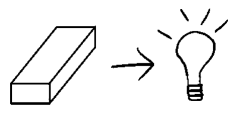

**Bài tập Viên gạch**

Ngay lúc này, tôi muốn bạn cài đồng hồ bấm giờ trên điện thoại trong 120 giây. Việc bạn cần làm là: Nghĩ đến một viên gạch. Hãy viết ra càng nhiều công dụng _khác nhau_ của viên gạch càng tốt. Liệt kê mọi cách mà một viên gạch có thể được sử dụng trong đời sống để tạo ra giá trị.

Sẵn sàng chưa? Bắt đầu. Bạn hoàn toàn có thể viết trực tiếp vào sách.

Được rồi — dừng lại. Trước khi tôi cho bạn xem danh sách của mình, bạn đã cân nhắc đến những điều này chưa...

... Viên gạch kích thước ra sao? To bằng viên kẹo cao su, chuẩn 3-5/8" x 2-1/4" x 8", hay loại lớn 2 ft x 2 ft x 6ft? ... Viên gạch làm bằng gì? Nhựa, Vàng, Đất nung, Gỗ, Kim loại?

... Hình dáng viên gạch thế nào? Có lỗ không? Có rãnh để lắp ghép vào nhau không?

Khi nghĩ về những điều đó, liệu bạn có nghĩ ra thêm nhiều công dụng khác của viên gạch so với những gì vừa viết không? Dưới đây là danh sách của tôi:

- Chặn giấy

- Chặn cửa

- Xây dựng công trình

- Làm nhà cho cá trong bể cá

- Chậu trồng cây với đất nhét trong các lỗ (gạch lỗ)

- Làm cúp lưu niệm (gạch được sơn vẽ)

- Trang trí phong cách mộc mạc

- Đập vỡ cửa sổ

- Làm tranh khảm/mural (gạch nhỏ sơn màu)

- Tạ tập thể lực

- Chêm dưới bệ bị cập khiễng

- Giữ bút (gạch lỗ)

- Đồ chơi cho trẻ em (gạch Lego)

- Thiết bị phao nổi (gạch nhựa)

- Dùng làm tiền thanh toán (gạch vàng)

- Vật chèn cố định đồ vật dựa vào

- Lưu trữ giá trị tài sản (gạch vàng)

- Đế cắm cờ (gạch lỗ)

- Ghế ngồi (gạch khổ lớn)

Mọi **Grand Slam Offer** đều có các khối xây dựng (building blocks) — những mảnh ghép khi kết hợp lại sẽ tạo ra một lời đề nghị không thể chối từ. Mục tiêu của chúng ta là sử dụng tư duy phân kì (divergent thought process) để tìm ra thật nhiều cách đơn giản nhằm kết hợp các yếu tố này lại và mang lại giá trị.

Thế nên, nếu tôi bán một viên gạch, tôi sẽ tìm hiểu mong muốn của khách hàng là gì, sau đó nghĩ xem mình có thể tạo ra bao nhiêu giá trị từ "viên gạch" đó.

Bây giờ, chúng ta hãy bắt tay vào làm thật.

## 9. VALUE OFFER: TẠO RA GRAND SLAM OFFER PHẦN I: VẤN ĐỀ & GIẢI PHÁP

> _“ABC, Easy as 123 Ah, simple as doh reh mi”_
> 
> MICHAEL JACKSON, “ABC”

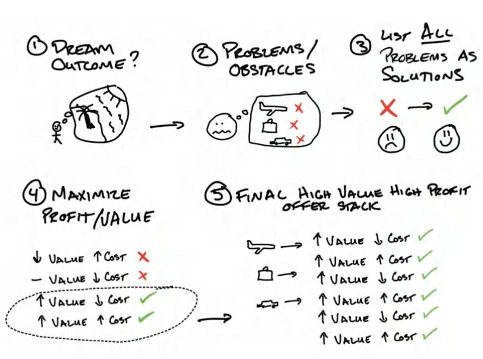

Khi mới mở phòng gym, tôi đã gặp vô vàn khó khăn. Tôi khao khát thành công đến cháy bỏng, muốn chứng minh cho bố thấy quyết định tự kinh doanh của tôi là đúng, và chứng minh với chính bản thân rằng tôi là một người có giá trị. Nhưng dù cố gắng thế nào, tôi thậm chí chẳng thể bán nổi một gói bootcamp giá 99 USD/tháng. Khách hàng thường chê: “LA Fitness có 29 USD/tháng kìa. Chỗ này đắt quá.” Tôi thậm chí còn thử cho họ tập miễn phí. Nhưng họ bảo họ cũng chẳng màng tới, vì sau đó vẫn phải trả 99 USD/tháng thì vẫn quá đắt, và họ không muốn bắt đầu một thứ mà họ biết chắc mình sẽ không duy trì được.

Cảm giác bất lực chạm đến một đỉnh cao mới khi bạn thậm chí còn không thể cho không dịch vụ của mình. Tôi cảm thấy bản thân thật vô tích sự và chẳng biết phải làm sao. May thay, trong giai đoạn đó, tôi tham gia vào các hội nhóm của những chủ phòng gym khác và bắt đầu biết đến giới làm marketing cũng như các đầu sách chuyên ngành. Tôi ngấu nghiến mọi thứ có thể. Và ngay khi chạm tay vào những cuốn sách của Dan Kennedy, tôi đã bị cuốn hút hoàn toàn.

Trong sách của ông, ông nhắc đến việc tạo ra những “lời đề nghị không thể chối từ” (**irresistible offers**). Lại một lần nữa, chủ đề “tạo ra một lời đề nghị tuyệt vời đến mức khách hàng sẽ cảm thấy thật ng u ngốc nếu từ chối” cứ lặp đi lặp lại. Nhưng lần này, nhớ lại những gì TJ từng dạy, tôi quyết định dồn 100% tâm sức vào khái niệm này, thay vì chỉ hùa theo những gì người khác đang làm.

_Nhưng làm thế nào đây?_ Tất cả mọi người ngoài kia đang bán gói bootcamp giá 99 USD/tháng. Làm sao tôi cạnh tranh nổi? Thế nên, tôi quyết định nhìn sâu vào những gì chúng tôi làm khác biệt. Tôi tự hỏi — rốt cuộc họ _thực sự_ muốn gì? Chẳng ai muốn mua thẻ hội viên cả; thứ họ muốn là giảm cân.

### **Bước #1: Xác định Kết quả trong mơ (Dream Outcome)**

Tôi từng nghe về các thử thách giảm cân, thế nên tôi bắt đầu từ đó.

Giảm 9kg (20lbs) trong 6 tuần.

_Kết quả lớn trong mơ —_ giảm 9kg.

_Với độ trễ thời gian (time delay) được rút ngắn —_ 6 tuần.

Lưu ý: Lúc này tôi không còn bán thẻ hội viên nữa. Tôi không bán tấm vé máy bay. _Tôi đang bán kỳ nghỉ dưỡng._ Khi nghĩ về kết quả trong mơ của khách hàng, bạn phải nhắm đến thời điểm họ chạm đích và những gì họ muốn được _trải nghiệm_.

### **Bước #2: Liệt kê các Vấn đề (Problems)**

Tiếp theo, tôi viết ra tất cả những nỗi đau mà mọi người phải vật lộn cùng những rào cản tâm lý của họ. Khi liệt kê vấn đề, hãy nghĩ xem điều gì xảy ra ngay trước và ngay sau khi ai đó sử dụng sản phẩm/dịch vụ của bạn. Đâu là rắc rối “tiếp theo” mà họ cần hỗ trợ? Đó chính là tất cả các vấn đề. Hãy suy ngẫm chúng thật chi tiết, đến mức phát điên. Nếu làm được điều này, bạn sẽ tạo ra một lời đề nghị có giá trị và sức hút cực lớn, bởi bạn sẽ liên tục giải quyết các vấn đề tiếp theo của khách hàng ngay khi chúng phát sinh.

Nào, hãy cùng liệt kê các vấn đề từ góc nhìn của khách hàng tiềm năng (**lead**). Những điểm ma sát (**friction points**) nào đang cản trở họ? Tôi thích tư duy theo chuỗi tuần tự mà khách hàng sẽ trải qua từng chướng ngại vật này. Lại một lần nữa, hãy đào sâu đến mức điên cuồng (càng nhiều vấn đề càng tốt!).

**<u>Ví dụ về Danh sách Vấn đề: Giảm cân</u>**

Việc đầu tiên họ phải làm: Mua đồ ăn lành mạnh, đi siêu thị

1. Mua đồ ăn lành mạnh rất khó, phức tạp, và tôi sẽ không thích nó.

2. Mua đồ ăn lành mạnh tốn quá nhiều thời gian.

3. Mua đồ ăn lành mạnh quá đắt đỏ.

4. Tôi không thể mua đồ ăn lành mạnh mãi được. Nhu cầu của gia đình sẽ ngáng đường tôi. Nếu đi du lịch, tôi sẽ chẳng biết phải mua gì.

Việc tiếp theo họ phải làm: _Nấu đồ ăn lành mạnh_

1. Nấu đồ ăn lành mạnh rất khó và phức tạp. Tôi sẽ không thích và làm rất dở.

2. Nấu đồ ăn lành mạnh tốn quá nhiều thời gian.

3. Nấu đồ ăn lành mạnh quá đắt. Không đáng để làm.

4. Tôi không thể duy trì việc mua đồ ăn lành mạnh mãi được. Nhu cầu gia đình sẽ cản trở tôi. Nếu đi du lịch, tôi sẽ không biết cách nấu ăn lành mạnh.

Việc tiếp theo họ phải làm: _Ăn đồ ăn lành mạnh_

1) V.v...

Việc tiếp theo họ phải làm: _Tập thể dục đều đặn_

- 1) V.v...

Bây giờ chúng ta sẽ đi trọn một vòng khép kín. Mỗi vấn đề kể trên đều chứa bốn yếu tố tiêu cực. Và như bạn có thể đoán, mỗi yếu tố này đều tương ứng với bốn trụ cột giá trị (**value drivers**).

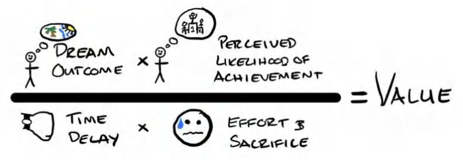

1. _Kết quả trong mơ (Dream Outcome) →_ Việc này không đáng giá về mặt tài chính.

2. _Khả năng đạt được kết cục trong tâm trí khách hàng (Perceived Likelihood of Achievement) →_ Nó sẽ không hiệu quả với riêng mình tôi. Tôi sẽ không thể kiên trì nổi. Các yếu tố ngoại cảnh sẽ cản trở tôi. (Đây là nhóm vấn đề mang tính cá nhân hóa và đặc thù dịch vụ cao nhất).

3. _Công sức và sự đánh đổi (Effort & Sacrifice) →_ Việc này quá khó, phức tạp. Tôi sẽ không thích. Tôi sẽ làm rất tệ.

4. _Thời gian (Time) →_ Việc này tốn quá nhiều thời gian. Tôi quá bận rộn để làm. Sẽ mất rất lâu mới có kết quả. Nó không thuận tiện cho tôi chút nào.

Bây giờ, hãy tiếp tục liệt kê _tất cả_ các vấn đề mà khách hàng tiềm năng của bạn đang gặp phải. Đừng để những chiếc giỏ phân loại trên — vốn chỉ nhằm kích hoạt tư duy của bạn — làm bạn bị gò bó. Nếu thấy dễ hơn, bạn cứ việc liệt kê bất cứ điều gì nảy ra trong đầu.

Tuy nhiên, những gì tôi vừa thể hiện không chỉ đơn thuần là bốn vấn đề. Chúng ta có tới 16 vấn đề cốt lõi, với từ hai đến bốn vấn đề phụ bên dưới. Tổng cộng là từ 32 đến 64 vấn đề. Ồ hố! Thảo nào hầu hết mọi người chẳng bao giờ đạt được mục tiêu của mình. Đừng cảm thấy quá tải nhé. Đây chính là tin tuyệt vời nhất. Bạn nghĩ ra càng nhiều vấn đề, bạn càng có nhiều vấn đề để giải quyết.

Tóm lại, hãy liệt kê từng công việc cốt lõi mà một người phải làm. Sau đó, nghĩ ra tất cả lý do khiến họ không thể làm được hoặc không thể duy trì nó (bằng cách lấy bốn trụ cột giá trị làm kim chỉ nam).

Bây giờ chúng ta sẽ đến phần thú vị nhất: _biến vấn đề thành giải pháp_.

### **Bước #3: Danh sách Giải pháp**

Bây giờ, khi đã có kết quả trong mơ cùng toàn bộ chướng ngại vật ngáng đường khách hàng, đã đến lúc chúng ta định nghĩa và liệt kê các giải pháp.

Việc tạo ra danh sách giải pháp gồm hai bước. Đầu tiên, chúng ta sẽ biến các vấn đề thành giải pháp. Thứ hai, chúng ta sẽ đặt tên cho các giải pháp đó. Chỉ vậy thôi! Hãy nhìn lại danh sách vấn đề trước đó của chúng ta. Việc chúng ta cần làm đơn giản là lật ngược chúng thành giải pháp bằng cách tự hỏi: _“Mình cần phải cho họ thấy điều gì để giải quyết vấn đề này?”_ Sau đó, chúng ta đảo ngược từng yếu tố cản trở thành ngôn ngữ hướng đến giải pháp. Đây là kiến thức nền tảng về Copywriting. Việc đi sâu vào phân tích nằm ngoài phạm vi cuốn sách này, nhưng với những ai mới bắt đầu, việc đơn giản thêm cụm từ “cách để” rồi đảo ngược vấn đề sẽ mang lại một điểm khởi đầu tuyệt vời. Về cơ bản, chúng ta đang tự lập ra một danh sách kiểm tra (checklist) gồm những việc chính xác mà chúng ta phải làm cho khách hàng tiềm năng và những rắc rối mà chúng ta sẽ giải quyết giúp họ.

Ngay khi có danh sách giải pháp, chúng ta sẽ vạch ra kế hoạch vận hành cách chúng ta sẽ _thực sự_ giải quyết những vấn đề đó (tạo ra giá trị) ở bước tiếp theo. Và tôi muốn khẳng định rõ ràng 100%. Bạn _sắc bén_ sẽ giải quyết mọi vấn đề. Chúng ta sẽ cùng nhau khám phá cách thực hiện ở bước kế tiếp.

**<u>VẤN ĐỀ → GIẢI PHÁP</u>**

_**VẤN ĐỀ: Mua đồ ăn lành mạnh, đi siêu thị**_

_. . . rất khó, phức tạp, tôi sẽ không thích, và sẽ làm rất tệ →_ Cách làm cho việc mua đồ ăn lành mạnh trở nên dễ dàng và thú vị, để bất cứ ai cũng có thể làm được (đặc biệt là các bà mẹ bận rộn!)

&emsp;_. . . tốn quá nhiều thời gian →_ Cách mua đồ ăn lành mạnh một cách nhanh chóng.

&emsp;_. . . quá đắt đỏ →_ Cách mua đồ ăn lành mạnh với chi phí thấp hơn hóa đơn đi chợ hiện tại của bạn.

&emsp;_. . . không thể duy trì lâu dài →_ Cách mua đồ ăn lành mạnh tốn ít công sức hơn cả việc mua đồ ăn không lành mạnh.

&emsp;_. . . không phải ưu tiên của tôi, nhu cầu gia đình sẽ cản trở →_ Cách mua đồ ăn lành mạnh cho cả bạn và gia đình cùng lúc.

&emsp;_. . . bất khả thi khi đi du lịch, tôi không biết phải mua gì →_ Cách tìm mua đồ ăn lành mạnh khi đang đi du lịch.

**_VẤN ĐỀ: Nấu đồ ăn lành mạnh_**

&emsp;_. . . rất khó, phức tạp, tôi sẽ không thích và làm rất tệ →_ Cách giúp bất cứ ai cũng có thể tận hưởng việc nấu các bữa ăn lành mạnh một cách dễ dàng.

&emsp;_. . . tốn quá nhiều thời gian →_ Cách nấu xong bữa ăn trong chưa đầy 5 phút.

&emsp;_. . . đắt đỏ, không đáng tiền →_ Cách ăn uống lành mạnh thực ra lại rẻ hơn đồ ăn không lành mạnh.

&emsp;_. . . không bền vững →_ Cách duy trì thói quen ăn uống lành mạnh mãi mãi.

&emsp;_. . . không phải ưu tiên, nhu cầu gia đình ngáng đường →_ Cách nấu ăn bất chấp những băn khoăn từ gia đình bạn.

&emsp;_. . . bất khả thi khi đi du lịch, tôi không biết cách nấu đồ ăn lành mạnh →_ Cách đi du lịch mà vẫn nấu được đồ ăn lành mạnh.

**_VẤN ĐỀ: Ăn đồ ăn lành mạnh_**

&emsp;_. . . rất khó, phức tạp, và tôi sẽ không thích →_ Cách thưởng thức những món ăn lành mạnh ngon miệng mà không cần phải theo đuổi những hệ thống phức tạp... v.v.

**_VẤN ĐỀ: Tập luyện đều đặn_** 

&emsp;. . . quá khó, rối rắm, tôi sẽ không thích, và tôi làm tệ lắm →_ Hệ thống bài tập dễ áp dụng, ai cũng thấy hào hứng

&emsp;. . . v.v. 

Uầy, phào cả người. Quá trời vấn đề (cộng thêm hàng đống giải pháp trực giác nhờ tư duy khác biệt). Bạn cũng sẽ thấy là rất nhiều vấn đề trong số đó bị lặp đi lặp lại. Hoàn toàn bình thường nhé. Các động lực tạo giá trị (value drivers) xoay quanh bốn lý do cốt lõi. Vấn đề của chúng ta luôn gắn liền với những động lực đó, và giải pháp của chúng ta đưa ra đáp án cần thiết để thuyết phục khách hàng "gật đầu" mua hàng. Thậm chí còn điên rồ hơn thế này: chỉ cần _một_ trong các nhu cầu này vắng mặt trong giải pháp, khách hàng có thể sẽ _không thèm mua_ luôn. Bạn sẽ phải _há hốc mồm_ trước những lý do khiến khách hàng không chịu rút hầu bao đấy. Thế nên, đừng tự giới hạn bản thân ở đây. 

Brooke Castillo là một người bạn của tôi, đang vận hành một đế chế coaching cuộc sống (life coaching) cực khủng. Để mang đến cho bạn một góc nhìn khác về danh sách vấn đề - giải pháp, Brooke đã gửi cho tôi danh sách của cô ấy khi cô ấy áp dụng cuốn sách này để tạo ra một Grand Slam Offer cho khóa học Quan hệ tình cảm 90 ngày. Hãy thử nhìn quy trình này qua một lăng kính hoàn toàn mới xem sao. Nhưng bài học cốt lõi rút ra là: Đừng làm gì quá phức tạp hóa. Cứ liệt kê hết mọi vấn đề ra rồi biến chúng thành giải pháp là được. 

Dù offer bạn đang xây dựng xoay quanh thể hình (như ví dụ), khóa học hẹn hò (như Brooke), hay một lĩnh vực quái đản nào khác (như đau tai), thì giờ đây chúng ta đã biết mình cần phải làm _gì_. Bước bốn chính là _làm thế nào_ (và làm sao để thực hiện mà không phá sản). 

### **QUÀ TẶNG MIỄN PHÍ #5 - Video hướng dẫn Bonus: Tạo Offer - Phần 1** 

Nếu bạn muốn cùng tôi đi qua quy trình này một cách thực chiến, hãy truy cập **<u>Acquisition.com/training/offers</u>** rồi chọn **“Offer Creation Part 1”** để xem một video hướng dẫn ngắn. Như mọi khi, hoàn toàn miễn phí nhé. Tôi cũng chuẩn bị sẵn một **Checklist Tạo Offer Miễn Phí** để bạn có thể "mượn" ngay về và triển khai thẳng vào doanh nghiệp của mình. Chúc bạn tận hưởng nó. 

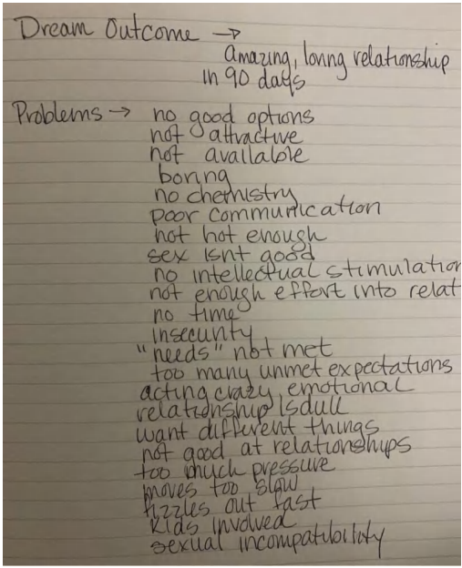

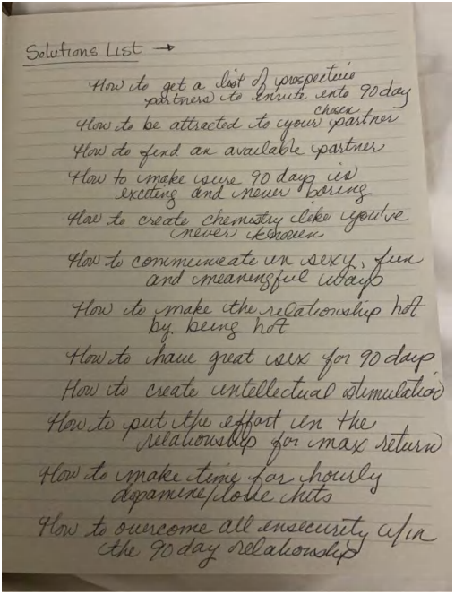

## **10. GIÁ TRỊ OFFER: TẠO GRAND SLAM OFFER PHẦN II: CẮT TỈA & XẾP CHỒNG** 

> _“Cắt! Cắt! Cắt nữa đi!”_ 
> 
> BẠN BÈ NÓI VỚI RACHEL GREEN TRONG PHIM FRIENDS 

Tôi chia chương này làm hai phần vì đây là phần "nhiều thịt" và dày dặn nhất trong sách. Nó cũng là phần quan trọng nhất. Nếu không có một sản phẩm hoặc dịch vụ giá trị, những phần còn lại của cuốn sách sẽ khó mà áp dụng nổi **.** Chúng ta vừa điểm qua tất cả các vấn đề cần giải quyết. Nửa chặng đường còn lại trong việc tạo offer chính là mổ xẻ một cách chiến thuật xem chúng ta sẽ làm gì/cung cấp gì cho khách hàng. Về lý thuyết, ai mà chẳng thích bay thẳng đến ở cùng khách hàng để giải quyết mọi rắc rối cho họ. Nhưng thực tế thì mô hình đó chẳng thể scale (mở rộng quy mô) nổi. Chúng ta cần offer của mình vừa siêu hấp dẫn, _lại_ vừa phải có lời (profitable). 

Nói đi cũng phải nói lại, nếu đây là Grand Slam Offer đầu tiên của bạn, việc over-deliver (vượt trên mong đợi) điên cuồng là cực kỳ quan trọng. Có khi bay đến tận nơi lúc mới bắt đầu lại là một ý hay đấy chứ. Cứ chốt vài đơn đi đã, rồi tính tiếp chuyện làm sao để tối ưu hóa trải nghiệm cho khách hàng sau. Bạn muốn họ phải thốt lên rằng: "Mình nhận được từng này thứ, mà chỉ với từng đó tiền á?". Về bản chất, bạn muốn họ cảm nhận được _giá trị khổng lồ_ (tremendous value). 

Ai mà chẳng thích mua được món hời. Chỉ là có người thích mua món đồ trị giá 100.000 USD nhưng chỉ với giá 10.000 USD thôi. Đó mới là nơi chúng ta muốn hướng tới: giá cao ngất ngưởng, nhưng lại là một _món hời thế kỷ_ nếu so với giá trị nhận được (hy vọng cuốn sách này đến giờ cũng mang lại cảm giác đó cho bạn). 

### **Đường liên tục Bán hàng đến Fulfillment (Sales to Fulfillment Continuum)** 

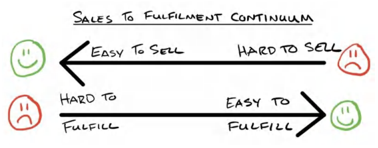

Để ngấm trọn vẹn khái niệm cắt tỉa và xếp chồng, chúng ta cần một sự chuyển dịch tư duy (mental reframe). Xin giới thiệu: Đường liên tục bán hàng - fulfillment. 

Bất cứ khi nào xây dựng doanh nghiệp, bạn luôn đứng trên một trục liên tục giữa "dễ fulfillment" (giao hàng/thực thi) và "dễ bán hàng". Nếu bạn cắt giảm bớt việc phải làm, sản phẩm hoặc dịch vụ của bạn sẽ khó bán hơn. Nếu bạn làm mọi thứ có thể, sản phẩm/dịch vụ sẽ dễ bán khủng khiếp nhưng lại cực kỳ khó fulfillment vì nó ngốn quá nhiều thời gian của bạn. Bí quyết, cũng là cái đích cuối cùng, là tìm ra điểm ngọt (sweet spot): bán cực kỳ trơn tru mà việc fulfillment lại nhàn tênh. 

Tôi luôn sống theo châm ngôn: “Tạo dòng chảy (flow). Kiếm tiền từ dòng chảy đó. Rồi mới thêm ma sát (friction) vào sau.” Nghĩa là, tôi tạo ra nhu cầu (demand) _trước_ . Sau đó, dùng offer của mình để khiến họ gật đầu. Một khi họ đã đồng ý, lúc đó và chỉ lúc đó thôi, tôi mới thêm các yếu tố ma sát vào khâu marketing, hoặc quyết định cung cấp _ít đi_ với mức giá cũ. 

Thực tế dẫn dắt cuộc chơi này. Nếu bạn không thể khơi thông dòng tiền và nhu cầu đổ vào, bạn sẽ chẳng thể biết sản phẩm của mình tốt hay dở. Thà rằng tôi làm nhiều hơn cho mỗi khách hàng để dòng tiền đổ về, còn hơn là tối ưu hóa doanh nghiệp nhưng doanh thu bằng không (và chẳng mường tượng nổi mình cần sửa đổi cái gì để phục vụ khách hàng tốt hơn). 

Dưới đây là một ví dụ hoàn hảo để khắc sâu điều này. Khi tôi bắt đầu làm Gym Launch, các chủ phòng gym liên tục tìm đến nhờ tôi giúp đỡ. Nhu cầu lớn đến mức tôi chẳng biết bắt đầu từ đâu. Nhưng tôi muốn chắc chắn rằng họ nhận được giá trị vượt xa số tiền họ bỏ ra. Thế là tôi đã làm thế này để lấp đầy phòng gym cho họ: Tôi bay thẳng đến phòng gym của họ trong suốt 21 ngày, tự bỏ tiền túi lo khách sạn, thuê xe, ăn uống, chạy quảng cáo, tự tìm lead (khách hàng tiềm năng), tự chăm sóc lead, và trực tiếp chốt sales thay họ. Tôi thậm chí còn đứng ra chủ trì buổi onboarding (hướng dẫn nhập môn) đầu tiên để khởi động cho khách hàng của họ. Tóm lại, tôi bao thầu _tất tần tật_ . Tôi gánh mọi rủi ro về mình. 

Họ chỉ phải đặt cọc 500 USD để "giữ chỗ" ngày khởi chạy, và tôi sẽ hoàn lại số tiền này vào ngày cuối cùng của chiến dịch. Thành ra họ chịu 0 rủi ro tài chính, 0 rủi ro thời gian, 0 công sức, còn giao kèo là: tôi giữ lại toàn bộ số tiền mặt thu được ngay từ đầu khi bán các gói dịch vụ của họ, và họ có khách hàng mới hoàn toàn miễn phí. Bạn có thể tưởng tượng đây là một offer hấp dẫn đến mức nào rồi đấy. 

Chỉ với một mình tôi, tôi đã có thể tự tay chốt khoảng 100.000 USD/tháng tiền mặt trả trước. Vậy nên những thương vụ này cực kỳ béo bở đối với tôi. Theo thời gian, tôi scale mô hình này lên thành một đội ngũ gồm 8 anh em ngày đêm chốt sales. Nhưng điều này bắt đầu vắt kiệt sức lực của tôi và cả team. Chính vào khoảnh khắc đó, tôi nhận ra rằng nếu tôi chỉ đơn giản là dạy lại họ cách làm như tôi, tôi có thể chỉ thu về khoảng một phần ba số tiền trước đây, nhưng tôi lại có thể giúp hàng trăm phòng gym mỗi tháng thay vì chỉ có tám. Thêm nữa, tôi được ngủ trên chiếc giường êm ái của mình mỗi tối. 

- Lời hứa của tôi về cơ bản không thay đổi: Tôi sẽ lấp đầy phòng gym cho bạn trong 30 ngày. Chỉ có _cách làm (how)_ và _những gì tôi làm (what)_ là thay đổi mà thôi. 

- Phần _how và what_ chính là thứ chúng ta đang mổ xẻ đây. 

Khi trò chuyện với các chủ doanh nghiệp về mô hình của họ, tôi luôn khuyên họ hãy tạo ra dòng tiền bằng cách over-deliver điên cuồng ở giai đoạn đầu. Sau đó, dùng chính dòng tiền đó để tinh chỉnh vận hành và tối ưu hóa doanh nghiệp. Quá trình cải tiến này có thể diễn ra cực kỳ mượt mà. Thậm chí bạn chẳng cần phải thay đổi những gì mình đang cung cấp. Bạn chỉ cần xây dựng các hệ thống mang lại giá trị tương đương cho khách hàng nhưng tiêu tốn ít nguồn lực hơn hẳn. 

Đó cũng chính là cách các doanh nghiệp hạ gục đối thủ trên thương trường. Thấu hiểu điều này sẽ cực kỳ quan trọng khi bạn scale doanh nghiệp của mình. 

Giờ chúng ta đã xác định được tầm quan trọng của điểm tựa và cách cân bằng giữa sales và fulfillment ngay từ vạch xuất phát, hãy cùng đi nốt hai bước cuối cùng để hoàn thiện Grand Slam offer. Nhắc lại nhanh một chút, chúng ta đã đi qua các bước: xác định kết cục hằng mong ước (bước một), liệt kê vấn đề (bước hai), và xác định giải pháp (bước ba). 

### **Bước #4: Tạo ra Phương tiện Chuyển giao Giải pháp ("Làm thế nào")** 

Bước tiếp theo là nghĩ về mọi thứ bạn có thể _làm_ để giải quyết từng vấn đề mà bạn vừa liệt kê. Đây là bước quan trọng nhất trong toàn bộ quy trình. Đây chính là thứ bạn sẽ _giao hàng (deliver)_. Đây là thứ bạn làm hoặc cung cấp để đổi lấy tiền. 

- Để giữ cho sự sáng tạo bay cao (tư duy khác biệt - divergent thinking), hãy nghĩ đến _bất cứ thứ gì bạn có thể làm_. Hãy nghĩ đến mọi 

- thứ có thể làm gia tăng giá trị cho offer của bạn. Tăng đến mức mà từ chối bạn sẽ là một quyết định ngớ ngẩn. 

   - Bạn có thể làm gì để khách hàng lập tức thốt lên: “Nhiều thế này á? Thật á? Chốt đơn, tôi tham gia.” Làm bài tập này sẽ giúp công việc sales của bạn Dễ. Hơn. Rất. Nhiều. 

- Dù bạn nghĩ ra một thứ gì đó mà thực tâm bạn không muốn làm lắm, thì cũng chẳng sao cả. Mục tiêu ở đây là đẩy giới hạn của bản thân và 

- kích thích bộ não nghĩ ra một phiên bản giải pháp khác biệt hoàn toàn với lối mòn thông thường. Đây là lúc bạn tung hoành khả năng sáng tạo của một entrepreneur (doanh nhân thực thụ). 

- **Nhắc nhở** : Bạn chỉ cần làm việc này _đúng một lần duy nhất_. Theo đúng nghĩa đen là _một lần_ cho một sản phẩm có thể sống khỏe trong nhiều năm. Đây là công việc tạo ra giá trị cao và có đòn bẩy khủng (high-leverage). Cuối cùng thì bạn được trả tiền cho _suy nghĩ_ của mình cơ mà. Bạn làm được mà. Việc này phải vui chứ. Nào, giờ thì liệt kê toàn bộ các khả năng ra đi. Sau đó tôi sẽ dẫn dắt bạn qua ví dụ của chính tôi nhé. Tôi sẽ lấy lại vấn đề mua đồ ăn lúc nãy làm ví dụ. Tôi thích gom nhóm chúng lại dựa trên việc tôi sẽ phục vụ bao nhiêu người cùng một lúc. 

   - Danh sách của tôi ở ngay dưới đây. Và ở phần cuối, tôi sẽ bật mí cho bạn những "mã gian lận" (cheat codes) của tôi để kích hoạt não bộ sáng tạo bùng nổ hơn nữa. **<u>Vấn đề: Mua đồ ăn sạch quá khó, rối rắm, và tôi sẽ không thích đâu</u>** 

_Nếu tôi muốn cung cấp giải pháp 1 kèm 1 (one-on-one), tôi có thể offer…_ 

1. Đi chợ trực tiếp cùng khách hàng, đưa họ đến cửa hàng và dạy họ cách chọn đồ 

2. Lên danh sách đi chợ cá nhân hóa, dạy họ cách tự lên list đồ ăn 

3. Đi chợ trọn gói (full-service), tôi tự mua đồ ăn giùm họ. Hoàn toàn 100% làm thay từ A đến Z. 

4. Hướng dẫn trực tiếp (không tại cửa hàng), dạy họ biết cần phải mua những gì 

5. Nhắn tin hỗ trợ qua lại trong lúc họ đi chợ, giúp họ gỡ rối nếu bị kẹt ở đâu đó 

6. Gọi điện thoại trong lúc họ đi chợ, tôi sẽ call trực tiếp khi họ bước chân vào siêu thị để chỉ đường dẫn lối và hỗ trợ kịp thời 

_Nếu tôi muốn cung cấp giải pháp cho nhóm nhỏ, tôi có thể offer…_ 

1. Đi chợ nhóm trực tiếp, tập hợp một nhóm khách hàng và dẫn tất cả đi mua sắm cùng nhau 

2. Lên danh sách đi chợ cá nhân hóa cho nhóm, dạy một nhóm người cách tự làm list hàng tuần. Tôi có thể làm 1 lần hoặc làm hàng tuần tùy thích. 

3. Mua hộ đồ ăn cho cả nhóm, tự tay mua và ship thẳng đến tận nơi 

4. Hướng dẫn trực tiếp offsite, dạy một nhóm nhỏ ở một địa điểm khác (không phải siêu thị) về những việc cần làm 

_Nếu tôi muốn cung cấp giải pháp 1-nhiều (one-to-many), tôi có thể offer…_ 

1. Tour đi chợ ảo trực tiếp (live), livestream cảnh tôi đi siêu thị cho toàn bộ khách hàng mới xem và cho phép họ đặt câu hỏi tương tác trực tiếp 

2. Tour đi chợ được quay video sẵn (recorded), tôi đi mua một lần, quay lại, rồi dùng nó làm tài liệu tham khảo từ đó về sau để khách hàng tự xem bất cứ lúc nào 3. Công cụ tự tính toán mua sắm (DIY grocery calculator), tạo ra một công cụ dễ chia sẻ hoặc hướng dẫn họ cách dùng tool để tự tính ra danh sách đồ cần mua 

4. Danh sách thực phẩm định sẵn trước, mỗi gói của khách hàng đi kèm sẵn list đồ ăn cho từng tuần. Tôi soạn sẵn trước để họ cứ thế dùng. Họ có thể tự áp dụng theo thời gian biểu của riêng mình 

5. Hệ thống "bạn đồng hành đi chợ" (grocery buddy system), ghép đôi các khách hàng lại với nhau (việc này chẳng tốn mấy thời gian), để họ tự xách giỏ đi chợ cùng nhau 

6. Giỏ hàng Insta-cart được soạn sẵn để delivery, tôi dựng sẵn các list đồ trên Insta-cart để khách hàng chỉ cần click một phát là đồ ăn tự động ship đến tận cửa nhà 

Như bạn thấy đấy, danh sách này có thể kéo dài vô tận. Phần này chỉ nhằm minh họa cho bạn thấy có vô vàn cách để giải quyết _một_ vấn đề. 

Giờ hãy làm điều tương tự cho _tất cả_ các vấn đề trong tâm trí khách hàng mà họ gặp phải trước, trong, và sau khi trải nghiệm sản phẩm/dịch vụ của bạn. Đến cuối bài tập này, bạn sẽ có một danh sách "quái vật" cho mà xem.

**Mã Gian Lận Về Giao Sản Phẩm (Product Delivery Cheat Codes)**

Sao nào? Bạn đang thấy bí ý tưởng à? Tôi sẽ bật mí cho bạn những "mã gian lận" (cheat code) ngay bây giờ, kiểu như ví dụ về viên gạch mà tôi từng nói: *"viên gạch có thể bằng vàng, bằng nhựa, có khoét lỗ, hoặc là một miếng Lego, v.v."*. Dưới đây là các "mã gian lận" của tôi giúp biến hóa và nâng cấp sản phẩm, kèm theo một sơ đồ trực quan từ tài liệu tư vấn của tôi để bóc tách quy trình này cho bạn:

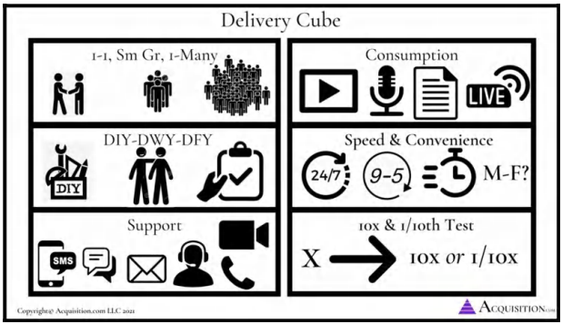

1. <u>Tôi muốn cung cấp mức độ quan tâm cá nhân hóa đến đâu? 1 kèm 1 (one-on-one), nhóm nhỏ, hay 1 kèm nhiều (one-to-many)?</u>

2. <u>Khách hàng phải bỏ ra mức độ nỗ lực như thế nào? Tự làm - DIY (tự tìm cách xoay sở); Cùng làm với họ - DWY (bạn dạy họ cách làm); Hay làm trọn gói cho họ - DFY (bạn làm thay họ)?</u>

3. <u>Nếu triển khai theo hình thức _trực tiếp_ (live), tôi muốn dùng môi trường hoặc phương tiện giao tiếp nào? Gặp trực tiếp, hỗ trợ qua điện thoại, email, tin nhắn, Zoom hay chat?</u>

4. <u>Nếu là nội dung ghi hình/ghi âm, tôi muốn họ tiêu thụ nó qua định dạng nào? Âm thanh (Audio), video, hay văn bản?</u>

5. <u>Chúng ta muốn phản hồi nhanh đến mức nào? Vào những ngày nào? Trong khung giờ nào? 24/7, giờ hành chính 9-5, trong vòng 5 phút, trong vòng 1 tiếng, hay trong vòng 24 giờ?</u>

6. <u>Thử nghiệm nhân 10 hoặc chia 10 (10x to 1/10th test).</u> Nếu khách hàng trả cho tôi gấp 10 lần mức giá hiện tại (hoặc 100.000 USD), tôi sẽ cung cấp cho họ những gì? Ngược lại, nếu họ chỉ trả 1/10 mức giá đó, trong khi tôi vẫn phải làm cho sản phẩm giá trị hơn hiện tại, thì tôi sẽ làm thế nào? Làm sao để họ vẫn đạt được thành công với chỉ 1/10 cái giá đó? Hãy vắt óc suy nghĩ theo cả hai hướng, bạn sẽ tìm ra vô số giải pháp khác nhau hoàn toàn.

Nói cách khác, làm thế nào để tôi có thể _giao sản phẩm_ thực tế cho những giải pháp mà tôi đang lớn tiếng cam kết sẽ cung cấp? Hãy làm điều này cho từng vấn đề một, bởi vì giải pháp cho vấn đề này sẽ khơi gợi cho bạn những ý tưởng tuyệt vời đối với các vấn đề khác mà bình thường bạn chẳng bao giờ mảy may nghĩ tới.

Hãy nhớ rằng, việc giải quyết _mọi_ vấn đề là cực kỳ quan trọng. Tôi không thể đếm xuể có bao nhiêu lần chỉ vì _một_ chi tiết nhỏ xíu xiu lại trở thành lý do khiến ai đó quyết định không mua hàng.

> **Câu chuyện thực tế: Tại sao chúng ta phải giải quyết MỌI vấn đề trong tâm trí khách hàng**
> 
> Hồi tôi còn kinh doanh mảng giảm cân, tôi bắt kè kè các học viên phải tự chuẩn bị toàn bộ đồ ăn ở nhà. Tôi thấy việc giúp khách hàng giảm cân quá khó khăn nếu họ cứ ăn tiệm, vì họ sẽ phá nát chế độ ăn kiêng ngay lập tức. Thay vì tìm cách giải quyết vấn đề đó, tôi khăng khăng bắt họ phải làm theo cách của mình, nếu không thì nghỉ khỏe. Kết quả là tôi mất toi rất nhiều đơn hàng.
> 
> Có tháng nọ, tôi đang túng quẫn tiền thuê nhà và cực kỳ cần chốt sale. Khách hàng tiềm năng tiếp theo bước vào cửa - đó là một nữ doanh nhân đang có nhu cầu giảm cân. Khi chúng tôi bước vào buổi thuyết trình bán hàng (sales presentation), chị ấy nói ngay là chương trình này sẽ không khả thi với chị, vì ngày nào chị cũng phải đi ăn trưa ngoài hàng. 
> 
> Bình thường là tôi đã mất khách này rồi. Tôi vốn là một kẻ cứng nhắc, cực kỳ dị ứng việc bắt người ta _không_ được ăn tiệm. Nhưng ngặt nỗi lúc đó tôi đang rất _cần tiền_. Quyết định không để mất deal chỉ vì _mỗi lý do đó_, tôi nhượng bộ: *"Em sẽ làm riêng cho chị một cẩm nang ăn uống ngoài hàng. Nhờ đó chị vẫn có thể đi ăn tiệm 100% thời gian mà vẫn đạt được mục tiêu của mình. Chị thấy thế nào?"* Chị ấy gật đầu cái rụp, và tôi chốt sale thành công.
> 
> Tôi đã dành thời gian làm riêng cho chị ấy cuốn cẩm nang ăn uống ngoài hàng đó. Nhưng kể từ khoảnh khắc đó trở đi, cứ mỗi khi có ai thắc mắc *"nhưng còn chuyện ăn tiệm thì sao??"*, tôi đã sẵn trong tay câu trả lời. Theo thời gian, tôi tiếp tục triệt tiêu các rào cản bằng các biểu mẫu (templates) và tài liệu huấn luyện cho đến khi chẳng còn bất kỳ *"vật cản độc nhất"_ nào có thể ngáng đường tôi bán hàng nữa. Bài học đó theo tôi đến tận ngày nay. Đừng có quá lãng mạn hóa _cách thức_ bạn muốn giải quyết vấn đề. Hãy tìm mọi cách để giải quyết toàn bộ các vấn đề mà khách hàng tiềm năng đưa ra. Khi làm được điều đó, bạn sẽ tạo ra một **Grand Slam Offer** khiến người ta không thể thốt lên từ "không". Và đó chính là thứ chúng ta đang xây dựng ở đây.
> 
> *Lưu ý:* Bạn phải giải quyết triệt để mọi rào cản mà người mua tin rằng họ sẽ gặp phải thì mới thuyết phục được lượng người tối đa mua hàng. Không có nghĩa là nếu bạn không làm vậy thì bạn chẳng bán được gì cho ai. Không hề. Nhưng bạn sẽ không bán được _nhiều khách hàng như lẽ ra bạn có thể_. Và đó mới là mục tiêu của chúng ta: bán được cho nhiều người nhất, với mức giá cao nhất có thể, cùng biên độ lợi nhuận (margin) cao nhất có thể.

### **Bước #5: Cắt tỉa & Chồng chất (Trim & Stack)**

Bây giờ, sau khi đã liệt kê hàng loạt giải pháp tiềm năng, chúng ta sẽ có một danh sách khổng lồ. Tiếp theo, tôi sẽ xem xét chi phí để cung cấp những giải pháp này đối với phía tôi (doanh nghiệp). Tôi sẽ loại bỏ trước những giải pháp có chi phí cao nhưng giá trị mang lại thấp. Sau đó, tôi tiếp tục loại bỏ các hạng mục có chi phí thấp mà giá trị cũng thấp nốt.

Nếu bạn không chắc thế nào là giá trị cao, hãy lướt qua **Value Equation** (Phương trình Giá trị) và tự hỏi bản thân xem những thứ này sẽ khiến khách hàng:

1. Đánh giá cao về mặt tài chính (Financially value)

2. Tin tưởng mạnh mẽ rằng họ sẽ đạt được kết cục mong muốn (perceived likelihood of achievement)

3. Cảm thấy họ có thể làm được với ít công sức và sự đánh đổi hơn hẳn (effort & sacrifice)

4. Hoàn thành mục tiêu và đạt được kết quả họ muốn với thời gian đầu tư ít hơn rất nhiều (time delay).

Những gì còn lại phải là các hạng mục offer thuộc nhóm: 1) chi phí thấp - giá trị cao và 2) chi phí cao - giá trị cao. 

**<u>Ví dụ:</u>** Giả sử tôi dọn đến ở cùng một ai đó và lo toàn bộ chuyện mua sắm, tập luyện, nấu nướng cho họ. Chắc chắn họ sẽ tin sái cổ là mình thế nào cũng giảm được cân. Nhưng đời nào tôi thèm làm chuyện đó trừ khi họ trả cho tôi một số tiền lớn gấp... một tỷ lần.

Câu hỏi tiếp theo đặt ra là: Liệu có phiên bản "nhẹ đô" hơn của trải nghiệm này mà tôi có thể cung cấp trên diện rộng (at scale) hay không?

Hãy lùi lại từng bước một cho đến khi bạn chạm đến một phương án có mức độ cam kết thời gian hoặc chi phí mà bạn sẵn sàng chung sống được (hoặc tất nhiên, tăng giá lên mức khủng khiếp để nó trở nên bõ bèn với bạn — ví dụ như đòi một tỷ đô để sang ở cùng họ chẳng hạn).

Nếu phải chọn ra _một_ loại phương tiện giao sản phẩm (delivery vehicle) để tập trung, thì đó chính là việc tạo ra các giải pháp giá trị cao theo mô hình "1 kèm nhiều" (one-to-many). Đây thường là những giải pháp có sự chênh lệch lớn nhất giữa chi phí bỏ ra và giá trị thu về. 

Chẳng hạn, trước khi mở phòng gym đầu tiên, tôi từng kinh doanh dịch vụ huấn luyện trực tuyến. Tôi đã lập một ứng dụng bảng tính Excel nhỏ: sau khi nhập toàn bộ mục tiêu của khách hàng vào, nó sẽ tự động tạo ra hơn 100 thực đơn hoàn toàn phù hợp với nhu cầu calo và đa lượng (macro) của họ. Tuyệt vời hơn nữa, tùy thuộc vào các món họ chọn, hệ thống sẽ tự động liệt kê chính xác họ cần mua những nguyên liệu gì ở siêu thị với số lượng bao nhiêu, _và_ cách sơ chế chúng thành lượng lớn (meal prep) chuẩn xác từng gram. Tôi mất khoảng 100 tiếng để hoàn thiện toàn bộ hệ thống này. Nhưng từ đó về sau, tôi bán các kế hoạch ăn uống thực sự cá nhân hóa với giá rất đắt, mà mỗi lần làm tôi chỉ mất vỏn vẹn khoảng 15 phút. Giá trị cao. Chi phí thấp.

Những loại giải pháp này đòi hỏi chi phí sáng tạo ban đầu rất cao, nhưng nỗ lực bổ sung về sau thì thấp đến mức vô tận. *(Bật mí: Đây chính là lý do vì sao phần mềm - software - lại trở nên có giá trị khủng khiếp đến vậy).*

Điều đó không có nghĩa là bạn không bao giờ nên làm việc theo nhóm nhỏ hay mô hình 1 kèm 1. Suy cho cùng, tôi vẫn đang làm việc 1 kèm 1 với tất cả các CEO của các công ty trong danh mục đầu tư mà chúng tôi đang hỗ trợ bứt phá quy mô vượt mốc 30 triệu USD+. Chỉ là bạn phải đảm bảo dành riêng những hạng mục chi phí cao đó cho các điểm gia tăng giá trị _lớn_ mà thôi. Nếu bạn nghĩ mình có thể đạt được mức giá trị tương đương bằng một giải pháp thay thế rẻ hơn, hãy chọn phương án rẻ hơn.

Hồi còn vận hành phòng gym của mình, tôi đã áp dụng bài tập này và cho ra đời: các bản thiết kế tăng cân (bulking blueprints), hệ thống ăn tiệm, cẩm nang ăn uống và tập luyện khi đi du lịch, thực đơn cho mọi thể trọng và giới tính, công cụ tính danh sách mua sắm siêu thị, thực đơn phá vỡ điểm chững cân (dành cho những lúc khách hàng bị chững ký), cẩm nang nấu ăn nhanh kết hợp với dịch vụ chuẩn bị bữa ăn (meal prep), và trực tiếp tổ chức các buổi định hướng dinh dưỡng 1 kèm 1 cho từng học viên.

Phần lớn các giải pháp "1 kèm nhiều" đòi hỏi lượng công việc dồn vào giai đoạn đầu nhiều hơn. Tuy nhiên, một khi đã được tạo ra, chúng sẽ trở thành những tài sản có giá trị vĩnh cửu. Rất đáng để bỏ thời gian xây dựng chúng vì chúng sẽ mang lại biên lợi nhuận cao ngất ngưởng trong nhiều năm tới.

Thật lòng mà nói: những thực đơn tôi làm cho phòng gym của mình giờ đây đã được sử dụng bởi hơn 4.000 phòng gym và hàng trăm ngàn con người. Chúng rất đơn giản và dễ làm theo. Thế nên chúng đã mang lại khoản lợi nhuận hoàn vốn vượt mong đợi cho chỉ vỏn vẹn một hoặc hai tuần cắm mặt làm việc của tôi.

Và nếu bạn có khát khao xây dựng một mô hình kinh doanh có thể lặp lại, một thứ có khả năng mở rộng quy mô (scale), thì những tài sản bạn tạo ra này chính là nền móng vững chắc nhất. Cuốn sách này chẳng hạn, là một tài sản giá trị cao nhưng có tổng chi phí thấp. Đúng là tôi tốn kém rất nhiều ở giai đoạn đầu, nhưng mỗi cuốn sách bán ra tiếp theo sau cuốn đầu tiên tiêu tốn của tôi rất ít chi phí mà lại mang lại giá trị to lớn.

### **Sản Phẩm Bàn Giao Giá Trị Cao Cuối Cùng (The Final High Value Deliverable)**

Hãy tổng kết lại mọi thứ trước khi chúng ta cấu hình sản phẩm bàn giao giá trị cao cuối cùng.

**Bước #1:** Chúng ta đã tìm ra kết cục mơ ước của khách hàng tiềm năng. 
**Bước #2:** Chúng ta liệt kê toàn bộ các rào cản mà họ có khả năng gặp phải trên đường đi (đây chính là cơ hội tạo ra giá trị của chúng ta). 
**Bước #3:** Chúng ta chuyển hóa tất cả các rào cản đó thành các giải pháp.

**Bước #4:** Chúng ta tìm ra mọi cách thức khác nhau để giao các giải pháp đó. 
**Bước #5a:** Chúng ta cắt tỉa các phương án đó để chỉ giữ lại những thứ mang lại giá trị cao nhất và chi phí thấp nhất cho phía chúng ta. Tất cả những gì chúng ta phải làm bây giờ là...

**Bước #5b:** Ghép toàn bộ các gói (bundles) lại với nhau thành siêu phẩm bàn giao giá trị cao tối thượng.

Giờ hãy quay lại ví dụ trên. Chúng ta thấy khách hàng tiềm năng của mình gặp khó khăn ở các điểm sau:

> **Lưu ý về Định dạng**
> 
> &emsp;Tôi sẽ trình bày từng cặp vấn đề &rarr; giải pháp theo cấu trúc:
>
> &emsp;Vấn đề &rarr; Cách gọi giải pháp &rarr; Tên gói dịch vụ kêu hơn (Sexier Name for Bundle).
> 
> &emsp;Sau đó, ở bên dưới, bạn sẽ thấy phương tiện giao sản phẩm thực tế (thứ mà chúng ta thực sự sẽ làm cho họ/cung cấp cho họ):

_Mua đồ ăn (Buying food)_ &rarr; Cách bất cứ ai cũng có thể mua đồ ăn nhanh chóng, dễ dàng, giá rẻ &rarr; Hệ Thống Mua Sắm Siêu Thị Tiết Kiệm, Không Lối Thoát (Foolproof Bargain Grocery System) . . . giúp bạn tiết kiệm hàng trăm đô la mỗi tháng tiền ăn và tốn ít thời gian hơn thói quen mua sắm hiện tại của bạn (trị giá 1.000 USD tính trên số tiền tiết kiệm được trong suốt quãng đời còn lại của bạn)

1. Buổi định hướng dinh dưỡng 1 kèm 1, nơi tôi giải thích cách sử dụng...
2. Video ghi hình chuyến đi siêu thị thực tế
3. Công cụ tự tính toán danh sách siêu thị (DIY Grocery Calculator)
4. Mỗi thực đơn đi kèm danh sách mua sắm riêng cho từng tuần
5. Đào tạo kỹ năng săn đồ siêu thị giá hời
6. Hệ thống bạn đồng hành đi chợ (Grocery Buddy System)
7. Giỏ hàng đi chợ dựng sẵn trên ứng dụng Insta-cart để đặt giao hàng tận nơi
8. Và một tin nhắn check-in kiểm tra tiến độ mỗi tuần.

_Nấu nướng (Cooking)_ &rarr; Cẩm nang nấu ăn cho phụ huynh bận rộn, sẵn sàng trong 5 phút (Ready in 5min Busy Parent Cooking Guide) . . . hướng dẫn cách bất cứ ai cũng có thể ăn uống lành mạnh ngay cả khi không có thời gian (trị giá 600 USD tính trên việc tiết kiệm lại 200 giờ mỗi năm — tương đương 4 tuần làm việc!)

1. Buổi định hướng dinh dưỡng 1 kèm 1, nơi tôi giải thích cách sử dụng...
2. Hướng dẫn chuẩn bị bữa ăn (Meal Prep Instructions)
3. Công cụ tự tính toán sơ chế bữa ăn (DIY Meal Prep Calculator)
4. Mỗi kế hoạch đi kèm hướng dẫn sơ chế bữa ăn riêng cho từng tuần
5. Hệ thống bạn đồng hành chuẩn bị bữa ăn (Meal prep buddy system)
6. Cẩm nang làm món ăn vặt lành mạnh dưới 5 phút
7. Một bài đăng hàng tuần mà họ phải đăng lên để tag tôi vào nhận feedback.

_Ăn uống (Eating)_ &rarr; Thực đơn cá nhân hóa "Ăn ngon nuốt lưỡi luôn" (Personalized Lick Your Fingers Good Meal Plan) . . . ngon đến mức việc tuân thủ nó còn dễ hơn cả việc ăn đồ "cheat" mà lại rẻ hơn! (trị giá 500 USD)

1. Buổi định hướng dinh dưỡng 1 kèm 1, nơi tôi giải thích cách sử dụng...
2. Thực đơn cá nhân hóa (Personalized Meal Plan)
3. Cẩm nang làm sinh tố buổi sáng trong 5 phút
4. Bữa trưa tiết kiệm trong 5 phút
5. Bữa tối tiết kiệm trong 5 phút
6. Các món ăn phần lớn dành cho gia đình
7. Hình ảnh bữa ăn gửi báo cáo mỗi ngày
8. Buổi họp 1 kèm 1 để đánh giá và điều chỉnh kế hoạch (đồng thời chốt sales **upsell** họ lên gói cao hơn).

_Tập luyện (Exercise)_ &rarr; Các bài tập đốt mỡ đã được chứng minh đốt mỡ nhiều hơn so với tập một mình (Fat Burning Workouts Proven To Burn More Fat Than Doing It Alone) . . . được điều chỉnh theo nhu cầu của bạn để không bao giờ bị quá sức, bị chững cân, hay có nguy cơ chấn thương (trị giá 699 USD)

_Khi đi du lịch (Traveling)_ &rarr; Cẩm nang ăn uống và tập luyện săn chắc cơ thể tối thượng khi đi du lịch (The Ultimate Tone Up While You Travel Eating & Workout Blueprint) . . . giúp bạn tập luyện cực sung mà không cần dụng cụ, nhờ đó bạn có thể thoải mái tận hưởng chuyến đi mà không thấy cắn rứt lương tâm (trị giá 199 USD)

_Cách để kiên trì đến cùng (How to actually stick with it)_ &rarr; Hệ thống trách nhiệm "Không bao giờ bỏ cuộc" (The “Never Fall Off” Accountability System) . . . hệ thống bất bại hoạt động tự động không cần bạn phải xin phép (nó thậm chí còn khiến những kẻ ghét đến phòng gym cũng phải mong ngóng được xách giày tới tập) (trị giá 1.000 USD)

_Cách để giao lưu xã hội (How To Be Social) →_ Hệ thống ăn tiệm "Sống hết mình mà vẫn thon gọn" (The ‘Live It Up While Slimming Down” Eating Out System) mang lại cho bạn sự tự do đi ăn nhà hàng và tận hưởng cuộc sống mà không có cảm giác bị "lạc loài" (trị giá 349 USD)

Tổng giá trị: **4.351 USD (!)** Tất cả trọn gói chỉ với **599 USD**.

> **Lưu ý từ tác giả** 
> 
> Hầu hết các cơ sở của chúng tôi giờ đây bán gói sản phẩm này trong các khung thời gian dài hơn với giá từ 2.400 USD đến 5.200 USD. _Thật là điên rồ_ . Khi chúng tôi ngày càng giỏi hơn trong việc tạo ra và kiếm tiền từ giá trị, giá cả và lợi nhuận tại các cơ sở của chúng tôi đã tăng vọt. Một khi bạn đã bắt đầu hành trình kiến tạo giá trị này, mỗi thành phần giá trị bổ sung mà bạn tạo ra sẽ chồng chất lên nhau theo thời gian. Đó là lý do tại sao việc bắt đầu là vô cùng quan trọng. 

_Bạn có thấy gói sản phẩm này mang lại giá trị vượt trội thế nào so với một thẻ tập gym thông thường không?_ Gói sản phẩm này giải quyết ba vấn đề cốt lõi: 

1. Giải quyết _toàn bộ_ các vấn đề trong tâm trí khách hàng (chứ không chỉ một vài vấn đề) 

2. Mang lại cho bạn sự xác tín tuyệt đối rằng những gì bạn đang bán là "có 1-0-2" (vấn đề này cực kỳ quan trọng) 

3. Khiến cho việc so sánh hoặc nhầm lẫn doanh nghiệp hay **Grand Slam Offer** của bạn với đối thủ ở cuối con đường trở nên bất khả thi 

Phù! Cuối cùng thì chúng ta cũng đã hình thành xong toàn bộ **Grand Slam Offer** với diện mạo hoành tráng nhất. Mặc dù vậy, rất khó có khả năng chúng ta sẽ chào bán nó nguyên si theo cách này. Tùy thuộc vào việc chúng ta bán 1-kèm-1 (one-on-one) hay bán 1-nhiều (one-to-many), chúng ta sẽ có cách trình bày khác nhau. Tôi sẽ hướng dẫn chi tiết cách trình bày từng hạng mục trong gói sản phẩm này ở phần quà tặng (phần tiếp theo). 

### **Tóm tắt cốt lõi** 

Chúng ta đã trải qua toàn bộ tiến trình này nhằm đạt được một mục tiêu duy nhất: tạo ra một **Grand Slam Offer** có tính khác biệt cao và không thể đặt lên bàn cân so sánh với bất kỳ thứ gì khác trên thị trường. Chúng ta đang bán một thứ độc nhất vô nhị. Nhờ đó, chúng ta không còn bị chi phối bởi các quy luật định giá thông thường của việc "bình dân hóa" sản phẩm (commoditization). Khách hàng tiềm năng giờ đây sẽ đưa ra quyết định mua hàng dựa trên **giá trị** thay vì dựa trên **giá cả**. Hoan hô! 

Bây giờ, khi đã có sản phẩm cốt lõi trong tay, phần tiếp theo sẽ dành riêng cho việc _<u>tối ưu hóa và nâng tầm</u>_ nó. Chúng ta sẽ kết hợp sử dụng các đòn bẩy tâm lý: **bonuses** (quà tặng), **urgency** (tính khẩn trương), **scarcity** (sự khan hiếm), **guarantees** (chính sách bảo đảm) và đặt tên cho **Offer**. 

> **Quà tặng miễn phí #6: HƯỚNG DẪN BỔ SUNG: Kiến tạo Offer Phần II:** 
> 
> Nếu bạn muốn cùng tôi đi qua quy trình tinh chỉnh và chồng chất giá trị nhằm tối đa hóa lợi nhuận qua một buổi thực chiến trực tiếp, hãy truy cập Acquisition.com/training/offers và chọn “Creating Offers Part 2”. Bạn cũng sẽ tìm thấy các checklist (danh sách kiểm tra) do chính tôi thiết kế nhằm đơn giản hóa quy trình này, giúp bạn có thể tái sử dụng cho từng sản phẩm mà mình tạo ra. Như thường lệ, nó hoàn toàn miễn phí. Hãy tận hưởng nhé. 

# **PHẦN IV: NÂNG TẦM **GRAND SLAM OFFER** CỦA BẠN** 

**SỰ KHAN HIẾM, TÍNH KHẨN TRƯƠNG, QUÀ TẶNG, BẢO ĐẢM VÀ CÁCH ĐẶT TÊN**

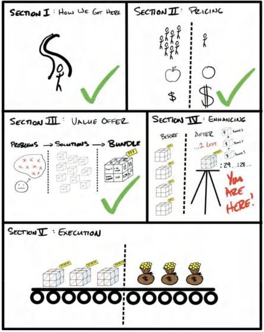

## 11. NÂNG TẦM **GRAND SLAM OFFER**: SỰ KHAN HIẾM, TÍNH KHẨN TRƯƠNG, QUÀ TẶNG, BẢO ĐẢM VÀ CÁCH ĐẶT TÊN 

> _“Nhưng chưa hết đâu... nếu bạn đặt hàng ngay hôm nay...”_ 
> 
> MỌI QUẢNG CÁO TRUYỀN HÌNH (INFOMERCIAL) THẬP NIÊN 90 

**_Tháng 5 năm 2019. Biệt thự của Arnold Schwarzenegger._** 

Buổi gây quỹ từ thiện của tổ chức After School All Stars. Dàn xe xếp hàng dài vòng qua cả góc phố bên ngoài nhà Arnold... và chúng tôi đang ngồi trên một chiếc trong số đó. Chúng tôi đang ngồi trong xe Uber thì một nhân viên bảo vệ mặc vest đen, đeo kính râm đen và tai nghe bộ đàm gõ vào cửa sổ ghế lái. Cảnh tượng hệt như trong phim điện ảnh. 

Tài xế hạ kính xuống. “Tên gì?” “Alex và Leila Hormozi.” 

Anh ta lướt nhanh danh sách trên chiếc kẹp giấy, gật đầu rồi đánh dấu tên chúng tôi. “Tuyệt vời,” anh ta nói. Thái độ từ nghiêm nghị chuyển sang niềm nở. “Chào mừng quý vị đến với buổi gây quỹ. Cứ đi thẳng theo làn này, rẽ trái và đội an ninh sẽ hộ tống quý vị đoạn đường còn lại.” 

Người bảo vệ nói vào bộ đàm với chốt gác tiếp theo ở phía trước, ra hiệu rằng xe của chúng tôi đã được thông qua. 

Tiến vào cổng chính của khu biệt thự chẳng khác nào bước vào một bộ phim James Bond. Những chiếc Lamborghini, Bugatti, Ferrari và cả những dòng xe đắt đỏ đến mức khó mà gọi tên. Những quý ông lớn tuổi đi cùng các cô nàng trẻ trung, ăn mặc kiệm vải. Những diễn viên hạng A. Những người nổi tiếng có hàng triệu người theo dõi đang tự quay phim khi bước đến, vừa trò chuyện qua iPhone với khán giả của họ. Và... cả chúng tôi nữa. 

Vé tham dự buổi gây quỹ có giá 25.000 USD một người, với danh sách khách mời giới hạn chỉ 100 người. Có cả thảm đỏ hẳn hoi. Hàng năm, điểm nhấn của sự kiện là phiên đấu giá lớn các vật phẩm lưu niệm và những món đồ do chính các chủ doanh nghiệp tham dự đóng góp cho quỹ từ thiện. 

Chúng tôi rảo bước ngắm nhìn các khu vực giải trí được chủ ý thiết kế để đưa các nhà tài trợ vào “tâm trạng muốn chi tiền”. Chúng tôi thấy những chai scotch giá 10.000 USD... những điếu xì gà 500 USD... những sản phẩm chưa từng phát hành của các thương hiệu lớn, vốn phải vài tháng nữa mới ra mắt công chúng. Và tất nhiên, là những món ẩm thực đắt đỏ nhất mà bạn có thể tưởng tượng được. Leila và tôi cứ thế tận hưởng không khí ấy. Quả là một đêm tuyệt vời. Chúng tôi thực sự cảm thấy mình trông thật ngầu. 

Ben, Giám đốc điều hành của quỹ từ thiện, nhìn thấy chúng tôi có vẻ đang bơ vơ liền bước tới. Anh ấy nắm lấy cánh tay tôi để giới thiệu tôi với một vài nhà tài trợ khác. Toàn bộ đều là những người đàn ông lớn tuổi hơn tôi và sẵn sàng vung ra từ 100.000 USD trở lên mà không cần phải chớp mắt. 

Người mà anh ấy giới thiệu với tôi là một trong những nhà tài trợ lớn nhất của quỹ. Ông ấy điều hành một đế chế kinh doanh trang sức và đồng hồ siêu cao cấp. Ý tôi là những biểu tượng địa vị quý hiếm có giá 100.000 USD, 500.000 USD, thậm chí hơn 2.000.000 USD mà mọi người mua chỉ để nhóm 0,001% tinh hoa khác biết rằng họ thuộc về đẳng cấp đó. Ông ấy đã đóng góp số hàng hóa trị giá lên tới hơn 700.000 USD làm vật phẩm đấu giá cho buổi gây quỹ tối hôm đó. 

“Alex và Leila, hãy gặp George nhé,” Ben nói. “Ông ấy đã rất hào phóng cống hiến thời gian và tiền bạc cho sự nghiệp này. George, đây là Alex và Leila Hormozi. Họ sẽ đóng góp 1.000.000 USD cho ASAS tối nay. Tôi nghĩ hai bên đều là những người tuyệt vời nên muốn kết nối mọi người lại với nhau.” 

“Rất vui được gặp hai bạn,” George nói với ánh mắt bình thản và từng trải. Ông ở độ tuổi cuối lục tuần, cao lớn và vạm vỡ. Bạn có thể nghe thấy âm hưởng Đông Âu trong giọng nói của ông. Nghe như thể chất giọng của một người đã phải chiến đấu sứt đầu mẻ trán để đứng vững ở vị trí này, nhưng đã thuần tính lại trong những buổi tụ họp thế này. Dù vậy, con mãnh hổ với nanh vuốt sắc nhọn vẫn ẩn giấu bên dưới lớp vỏ bọc, sẵn sàng tung hoành bất cứ lúc nào. Tôi có cảm giác mình thấu hiểu con người này. 

Ben phá vỡ sự im lặng. “Ừ thì... George chính là người đã khuyên tôi nâng giá vé từ 15.000 USD lên 25.000 USD đấy. Năm nay nhu cầu tham dự của mọi người cao hơn bao giờ hết. Và tôi đã nghe theo lời khuyên của ông ấy: cắt giảm số lượng vé bán ra _đồng thời_ đẩy giá lên cao.” 

“Đúng vậy,” George nói, tỏ vẻ hài lòng vì lời khuyên kinh doanh khôn ngoan của mình đã được áp dụng. “Khi nhu cầu tăng lên, hãy cắt giảm nguồn cung.” Ông phấn khởi hẳn lên khi chúng tôi bàn về chuyện tiền nong. 

Người đàn ông này đã gầy dựng sự nghiệp từ bàn tay trắng và tìm ra cách bán sản phẩm với biên lợi nhuận khổng lồ nhờ thấu hiểu tâm lý con người. Từ lâu tôi đã nắm vững lý thuyết cung cầu, nhưng gã này đang ứng dụng chính nền tảng tâm lý học của nó để thổi bùng một chiến dịch gây quỹ. Có thể đưa con hổ ra khỏi rừng rậm, nhưng không thể xóa bỏ bản chất rừng rậm khỏi con người con hổ. 

_Con người luôn khao khát những thứ họ không thể có. Con người thèm thuồng những thứ người khác đang nhòm ngó. Con người muốn sở hữu những thứ mà chỉ một nhóm nhỏ được quyền tiếp cận._ Ông ấy hoàn toàn chính xác. Họ đã huy động thêm được _một triệu đô la_ ngay trong đêm đó trước cả khi sự kiện chính thức bắt đầu, chỉ bằng cách cắt giảm nguồn cung vé _và_ đẩy giá lên cao. Chưa hết, tệp khách mời tham dự năm nay lại càng chất lượng hơn bao giờ hết để trở thành những đại gia tài trợ lớn. Sự kiện khép lại với tư cách là đêm thành công nhất trong lịch sử quỹ từ thiện, thu về gần 5.400.000 USD chỉ từ 100 người (tính ra là 54.000 USD mỗi đầu người!). Mỗi vật phẩm đều được đấu giá như một món đồ độc nhất vô nhị. Và nếu bạn bỏ lỡ, bạn sẽ không bao giờ có cơ hội thứ hai để mua lại nó. Arnold thậm chí còn tung thêm các **bonuses** khi có hai vị khách đẩy giá đấu lên quá cao, nhờ đó quỹ từ thiện có thể hốt trọn tiền tài trợ từ cả hai người. 

Đó là một màn trình diễn đỉnh cao của tâm lý học hành vi trong một bối cảnh mà người ta biết thừa mình đang mua hớ sản phẩm. _Sản phẩm hoàn toàn giữ nguyên_ , thế nhưng đặt trong không gian này, một món đồ nếu bán ở một nơi khác với giá 10.000 USD nay lại được chốt giá 100.000 USD. Sức mạnh của **scarcity** (sự khan hiếm), **urgency** (tính khẩn trương) và **bonuses** (quà tặng) thực sự khủng khiếp đến vậy đấy. Và việc mổ xẻ cách sử dụng chúng để tiếp tục đẩy nhu cầu đối với **Grand Slam Offer** của bạn lên cao hơn nữa—mà không cần phải thay đổi sản phẩm—chính là mục đích của phần này. 

> **Lưu ý từ tác giả - Các đòn bẩy tâm lý thuyết phục khác đang hoạt động** 
> 
> **Scarcity** (sự khan hiếm), **urgency** (tính khẩn trương), **bonuses** (quà tặng) và **guarantees** (chính sách bảo đảm) không phải là những công cụ thuyết phục _duy nhất_ được sử dụng để tạo ra mức giá phi lý tại buổi gây quỹ. Họ còn tận dụng cả tính cam kết và nhất quán, địa vị, áp lực đồng trang lứa, thiện chí, sự chứng thực của người nổi tiếng, tính cạnh tranh, v.v. Tuy nhiên, **scarcity**, **urgency** và **bonuses** là ba yếu tố duy nhất tôi sẽ phân tích kỹ trong cuốn sách này. Bởi vì tôi tin rằng chúng gắn liền với phần **"Grand Slam Offer"** nhiều hơn là với hoạt động **"Bán hàng"** thuần túy—vấn đề mà tôi sẽ bàn luận sâu hơn trong cuốn Acquisition: Volume IV $100M Sales.

### **Vũ điệu tinh tế của khao khát**

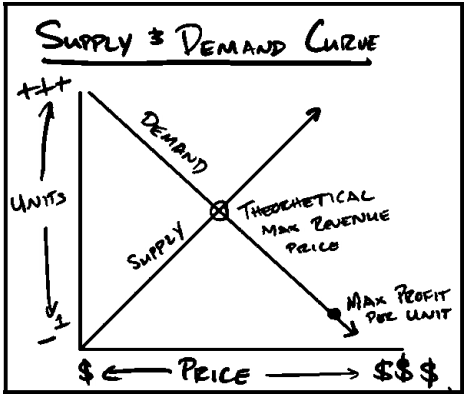

Về mặt bản chất, toàn bộ hoạt động marketing sinh ra là để tác động lên đường cung và cầu. Chúng ta chủ động đẩy nhu cầu về sản phẩm và dịch vụ lên cao thông qua các hình thức truyền thông thuyết phục. Khi nhu cầu tăng, chúng ta bán được nhiều sản phẩm hơn.

Khi chúng ta giảm nguồn cung, chúng ta có thể bán những sản phẩm đó với giá cao hơn. "Công thức lợi nhuận hoàn hảo" chính là: nhu cầu lớn đi kèm với nguồn cung khan hiếm (hoặc nguồn cung được _tạo cảm giác_ khan hiếm). Quá trình tối ưu hóa Grand Slam Offer của bạn được thiết kế để làm đồng thời hai việc này: vừa tăng nhu cầu vừa giảm nguồn cung (trong tâm trí khách hàng), giúp bạn bán được *chính những sản phẩm đó* với giá *cao hơn* so với bình thường, và với số lượng *lớn hơn* mức bạn từng đạt được (tính trên một chân trời thời gian dài hơn).

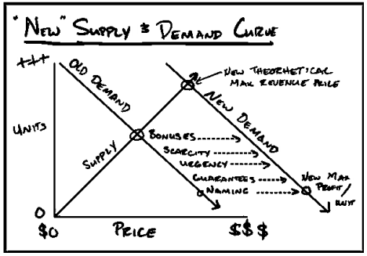

> **Ghi chú của tác giả:** 
> 
> *Phần này áp dụng cho các doanh nghiệp thông thường, không tính những bên đang cố gắng chiếm lĩnh thị phần đại chúng vì các mục tiêu chiến lược khác.*

Khao khát bắt nguồn từ việc bạn *không* có được thứ mình muốn. Thật vậy, tôi cực kỳ tâm đắc câu nói này của Naval Ravikant: “Khao khát là một lời hứa mà bạn tự ký với chính mình rằng bạn sẽ bất hạnh cho đến khi có được thứ mình muốn.” Suy ra, chúng ta chỉ khao khát những thứ mà chúng ta *chưa* có. Ngay khi có được chúng, khao khát sẽ biến mất. Do đó, nếu muốn gia tăng nhu cầu (hay khao khát), chúng ta bắt buộc phải giảm bớt hoặc *trì hoãn* việc thỏa mãn ham muốn của khách hàng tiềm năng (Lead). Chúng ta phải bán ra số lượng *ít hơn* mức mà lẽ ra chúng ta *có thể* bán. Hãy ngẫm nghĩ thật kỹ điều này trong một giây nhé.

Hãy xét ví dụ sau. Chúng ta quảng bá cho một hội thảo hai ngày sắp diễn ra. Đầu tiên, chúng ta úp mở về nó. Tiếp theo, chúng ta thả thính bằng một số lợi ích. Sau đó, chúng ta hô hào rằng sự kiện sẽ ra mắt sau một tuần nữa. Rồi cuối cùng, khi chúng ta chính thức tung ra hội thảo tuyệt vời này, chúng ta sẽ có hai kịch bản cung - cầu:

- *Kịch bản một:* Chúng ta bán 10 suất với giá 500 đô-la mỗi suất (bán sạch nguyên phễu ở mức giá mà ai cũng gật đầu đồng ý).

- *Kịch bản hai:* Chúng ta bán hai suất huấn luyện 1-1 kéo dài một ngày với giá 5.000 đô-la mỗi suất (chỉ hớt lớp váng ở đỉnh tháp, để 80% khách hàng không mua được).

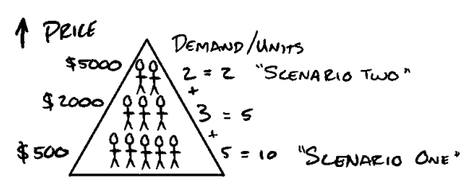

Cần lưu ý rằng mỗi nhóm khách hàng tiềm năng này có ngưỡng mua hàng (buying threshold) hoàn toàn khác nhau. Theo kinh nghiệm của tôi, nhu cầu đối với các dịch vụ mang tính phi tuyến tính (non-linear). Thay vào đó, tôi nhận ra nhu cầu vốn mang tính phân hình - fractal (theo quy luật 80/20). Nói cách khác, cứ một phần năm số khách hàng tiềm năng sẽ sẵn sàng trả mức giá gấp năm lần (hoặc hơn thế nữa).

Trong ví dụ trên, tôi có thể có mười người sẵn sàng trả 500 đô-la, nhưng chỉ có hai người sẵn sàng trả 5.000 đô-la. Nhờ vậy, tôi sẽ kiếm được nhiều tiền hơn, chi phí thấp hơn (lợi nhuận cao hơn), mang lại nhiều giá trị hơn, đồng thời đẩy nhu cầu của tập khách hàng còn lại lên cao hơn bằng cách bán số lượng *ít hơn*. Hãy thử tưởng tượng sự độc quyền (exclusivity) trong kịch bản một sẽ *cảm giác* khác thế nào so với kịch bản hai. Hãy nghĩ về tất cả những người muốn mua nhưng không thể mua được. Liệu điều này làm tăng hay giảm khao khát của họ? Chắc chắn là nó sẽ làm tăng vọt rồi.

Thêm vào đó, nếu mọi người thấy những ai ‘may mắn lọt vào trong’ đang mê mẩn trải nghiệm đó đến nhường nào, khao khát của họ sẽ càng được thổi bùng hơn nữa. Và ở lần mở bán tiếp theo, họ sẽ hành động với sự khẩn cấp (urgency) cao hơn, sẵn sàng chi trả *nhiều tiền hơn* cho cùng một thứ so với ban đầu. Thế nên, hệ quả từ kịch bản thứ hai của chúng ta là vẫn còn đó tám người đang mang trong mình sự thèm khát chưa được thỏa mãn. Điều này tiếp tục đẩy khao khát của họ lên một tầng cao mới. Chưa hết, chúng ta giờ đây còn thu hút thêm những khách hàng tiềm năng mới – những người không nằm trong tệp ban đầu – nay cũng muốn có được thứ chúng ta đang sở hữu.

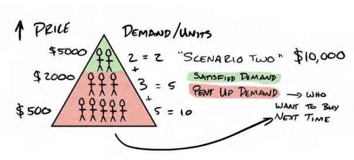

Lần tới khi chạy lại kịch bản hai, chúng ta sẽ mở thêm *ba* suất ở mức giá cũ và bán sạch băng (mà vẫn khiến một lượng khách hàng tiềm năng tiếp tục thòm thèm vì chưa mua được!). Đây là một vòng lặp chiến lược xuyên suốt.

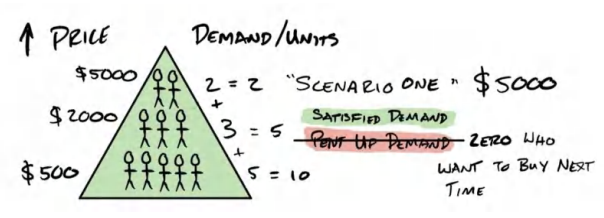

Ngược lại, nếu chúng ta tiếp tục áp dụng kịch bản một (mức giá 500 USD), khả năng cao chúng ta sẽ bán được ít suất hơn ở lần mở bán thứ hai. Tại sao? Vì chúng ta chẳng còn chút nhu cầu bị kìm nén (pent-up demand) nào cả. Mọi khao khát đã được thỏa mãn sạch sành sanh. Khi bạn “bóp cò quá sớm,” ở mỗi lần quảng bá tiếp theo, số lượng bán được sẽ càng ít đi. Cuối cùng, chúng ta cạn kiệt hoàn toàn nguồn nhu cầu để có thể chốt nổi dù chỉ một đơn hàng đơn lẻ. Đây là tình trạng đáng buồn của rất nhiều doanh nghiệp hiện nay – *luôn oằn mình tìm cách tạo ra thêm nhu cầu* chỉ để kiếm một đơn hàng chớp nhoáng.

<u>Định luật Hormozi: Càng trì hoãn việc chốt sales (the ask), bạn càng có thể đưa ra mức đề nghị lớn bấy nhiêu. “Đường băng càng dài, máy bay cất cánh càng to.”</u>

Chúng ta phải nỗ lực kiểm soát nguồn cung (cũng như việc thỏa mãn khao khát) ở mức thấp hơn nhu cầu mà chúng ta có khả năng tạo ra. Điều này giúp tối đa hóa lợi nhuận và giữ cho tệp khách hàng luôn ở trạng thái thèm khát tột độ. Đây chính là chìa khóa cốt lõi để không bao giờ phải chịu cảnh đói kém.

### **Tóm tắt các ý chính**

Lý do tôi đặt tên tiểu mục này là “Vũ điệu tinh tế của khao khát” vì cung và cầu vốn có mối quan hệ nghịch đảo (về mặt lý thuyết). Nếu bạn thỏa mãn mức khao khát bằng không (cung bằng không), bạn sẽ không kiếm được tiền, và *rồi sẽ* khiến mọi người cảm thấy bị cự tuyệt (Lưu ý: việc này mất nhiều thời gian hơn bạn tưởng).

Ngược lại, nếu bạn thỏa mãn toàn bộ nhu cầu, bạn sẽ tự tay giết chết con ngỗng đẻ trứng vàng của mình, và chẳng thể biết bữa ăn tiếp theo của mình ở đâu. Làm chủ cung và cầu chính là nắm bắt vũ điệu uyển chuyển giữa hai yếu tố này. Nếu bạn "ân ái" với người yêu mỗi ngày, họ sẽ ít cảm thấy khao khát hơn so với việc bạn "bỏ đói" họ suốt một tuần. Chúng ta cần những khách hàng tiềm năng thèm khát tột độ (ravenous), chứ không phải những kẻ chỉ mới dừng lại ở mức kích động (aroused).

Do đó, việc thấu hiểu sự tương tác qua lại giữa các biến số này là chìa khóa để nâng cấp Offer của bạn cũng như biên độ lợi nhuận mà bạn sẽ tạo ra *<u>theo thời gian</u>*. Cho đến thời điểm này, chúng ta đã điểm qua tất cả các yếu tố *bên trong* Offer có thể giúp nó miễn nhiễm với việc so sánh giá, đồng thời biến các sản phẩm và dịch vụ thông thường thành những thứ mà *khách hàng sẽ bất chấp tìm cách để móc hầu bao*. Suy ra, biến số tiếp theo có thể giúp Offer của bạn trở nên đáng khao khát hơn chính là cách thức nó được trình bày. Nói cách khác, đó là các yếu tố *bên ngoài* định vị sản phẩm trong tâm trí khách hàng tiềm năng. Những sức mạnh này đôi khi còn lớn lao hơn cả sản phẩm cốt lõi bên trong. Ở phần tiếp theo mang tên Tối ưu hóa Offer (Enhancing Your Offer), tôi sẽ chỉ cho bạn cách tôi:

1. Sử dụng tính *khan hiếm* (scarcity) để bóp nghẹt nguồn cung, qua đó đẩy giá lên cao (và gián tiếp thúc đẩy nhu cầu thông qua cảm giác độc quyền).

2. Sử dụng tính *khẩn cấp* (urgency) để kích cầu bằng cách hạ thấp ngưỡng hành động của khách hàng tiềm năng.

3. Sử dụng các *gói quà tặng* (bonuses) để gia tăng nhu cầu (đồng thời tăng *cảm giác độc quyền*).

4. Sử dụng *chính sách bảo hành/cam kết* (guarantees) để kích cầu bằng cách triệt tiêu rủi ro.

5. Sử dụng *tên gọi* (names) để tái kích thích nhu cầu và mở rộng độ nhận diện của Offer đối với đối tượng mục tiêu (niche/target audience).

Tôi sẽ định nghĩa từng khái niệm, sau đó cung cấp ví dụ thực chiến về cách ứng dụng chúng. Chúng ta sẽ tận dụng tất cả các biến số này để nâng cấp Offer, bẻ cong đường cầu về phía có lợi cho chúng ta, khiến khách hàng lúc nào cũng thòm thèm muốn thêm nữa. Chúng ta sẽ bắt đầu bằng cách kích thích một cách có chiến thuật “nợ sợ bỏ lỡ” hay còn gọi là *FOMO* thông qua tính *khan hiếm* (*scarcity*).

## **12. TỐI ƯU HÓA OFFER: TÍNH KHAN HIẾM (SCARCITY)**

> *“Đã bán hết.”*

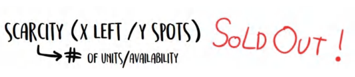

Tính khan hiếm là một trong những sức mạnh tối tân nhất nhưng lại ít được thấu hiểu nhất để mở khóa quyền lực định giá vô hạn. Nếu bạn muốn học cách bán không khí với giá hàng triệu đô la, hãy chú ý tập trung.

Lý do tại sao một chuyên gia có thẩm quyền (như bác sĩ), một ngôi sao lớn (như Oprah), hay một chuyên gia nổi tiếng trên truyền thông (như Dr. Oz hay Dr. Phil) có thể thu những mức phí trên trời chính là nhờ nhu cầu *ngầm hiểu* (implied demand). Mọi người mặc định rằng có rất nhiều người đang săn lùng thời gian của họ, và do đó, nguồn cung thời gian chắc chắn là rất khan hiếm. Hệ quả là, nó phải cực kỳ đắt đỏ.

Mặc dù vậy, phần lớn các doanh nghiệp rất khó hình dung cảm giác thực sự khi sở hữu một đường cung - cầu chênh lệch như thế nào cho đến khi họ tự mình trải nghiệm nó. Tôi sẽ cố gắng dẫn dắt bạn qua cảm giác của chính tôi trong lần đầu tiên trải nghiệm điều đó, nhằm giúp bạn nếm thử quyền lực thực sự của nó.

Khi bước chân vào thế giới M&A (mua bán và sáp nhập doanh nghiệp) này, tôi thấy các cố vấn của mình bán từng ngày thời gian với giá từ 50.000 đô-la trở lên. Trí óc tôi lúc đó gần như nổ tung vì hai lý do. Thứ nhất, tôi không hiểu làm cách nào họ có thể kiếm được ngần ấy tiền chỉ trong một ngày. Thứ hai, tôi không thể hiểu nổi kẻ nào lại điên rồ đến mức bỏ tiền ra mua nó. Theo thời gian, cuối cùng tôi cũng ngộ ra.

<u>Tôi sẽ bắt đầu từ góc độ của người mua. Nếu tôi vướng phải một vấn đề hiểm nghèo, và tôi</u> *bắt buộc* phải giải quyết nó vì mục tiêu chinh phục thành công của bản thân, vấn đề đó sẽ chiếm trọn toàn bộ sự chú ý của tôi. Vì bản chất vấn đề của tôi rất chuyên biệt, sẽ chỉ có rất ít người có khả năng giải quyết nó. Điều này có nghĩa là số lượng “thầy phù thủy” gỡ rối không hề dồi dào. Trong nhiều trường hợp, tôi sẽ chỉ nhìn thấy duy nhất một “cứu tinh” khả dĩ (Nguồn cung = 1).

> **Nghiên cứu tình huống giá trị thực tế (Real Life Value Case Study)**
> 
> Có rất nhiều người đủ khả năng giải quyết bài toán: *Làm thế nào để kiếm 10.000 đô-la mỗi tháng?*
> 
> Nhưng lại cực kỳ hiếm người giải được bài toán: *Làm thế nào để tăng thêm 5 triệu đô-la lợi nhuận mà không cần bổ sung bất kỳ dòng sản phẩm mới nào cho doanh nghiệp? (Đây là một dự án thực tế tốn của tôi đúng 60 phút, mang lại chính xác 5 triệu đô-la lợi nhuận ròng chỉ bằng cách tinh chỉnh nhẹ mô hình định giá của doanh nghiệp).* Bạn có thể đoán được là chủ doanh nghiệp lúc đó… “vui đến mức nào” với kết quả của màn bắt tay này rồi đấy.

Hơn thế nữa, nếu việc giải quyết bài toán đó giúp tôi rút ngắn thời gian đạt được mục tiêu đi một hoặc hai năm, hoặc lập tức giúp tôi bỏ túi hàng trăm nghìn hay hàng triệu đô la, thì giải pháp đó trở nên vô cùng giá trị, đúng không nào? Dĩ nhiên là thế rồi. Và suy ra, nếu tôi trả cho ai đó 50.000 đô-la cho một ngày làm việc của họ, để rồi thu về mức tăng trưởng doanh thu 500.000 đô-la mỗi tháng chỉ trong vòng ba tháng nhờ những góc nhìn chiến lược và insight được hé lộ, thì đó quả là một tỷ suất lợi nhuận trên vốn đầu tư (ROI) tuyệt đỉnh, phải không?

Do đó, giá trị cấu thành từ hai yếu tố: thứ nhất, mức độ khan hiếm của nguồn lực; thứ hai, giá trị thực tế được trao đi. Giá trị và độ khan hiếm kết hợp với nhau tạo ra những khoản lợi nhuận thực sự ngoạn mục.

Những nhà tư vấn chuyên sâu được trả hàng triệu đô la để giải quyết các bài toán trị giá hàng chục triệu đô cho khách hàng. Khách hàng chi tiền để đổi lấy toàn bộ kinh nghiệm và chuyên môn của chuyên gia, đồng thời né tránh được cái giá của những sai lầm (cả về thời gian lẫn tiền bạc). Tóm lại, họ bỏ qua phần tẻ nhạt, tiến thẳng đến phần ngọt ngào một cách nhanh chóng hơn và với số tiền rẻ hơn nhiều so với việc tự mày mò tự lực gánh sinh... một cuộc trao đổi kinh tế tuyệt đẹp.

Bản thân tôi đã trải nghiệm điều này lần đầu tiên khi có hai con người *hoàn toàn khác nhau* đề nghị trả cho tôi 50.000 đô-la cho một ngày làm việc sau khi tôi vừa thuyết trình tại một sự kiện. Họ đang scale-up một mô hình kinh doanh giáo dục trong một ngách cụ thể (không khác mấy so với mô hình của tôi) nhưng mãi không tài nào vượt qua được cột mốc 1 triệu USD/tháng. Với tư cách là một kẻ đang bỏ túi 1 triệu USD mỗi *tuần* trong cùng một ngách kinh doanh đó (vào thời điểm ấy), tôi chính là một mẫu người *cực kỳ* đặc thù nắm giữ chiếc chìa khóa giải quyết bài toán của họ.

Vậy chuyện gì đã xảy ra, bạn đoán xem? *Tiếng trống dồn vang…* Tôi đã từ chối lời đề nghị của họ. Tại sao ư? Vì tôi kiếm được hơn 50,000 USD lợi nhuận mỗi ngày từ chính doanh nghiệp của mình và tôi không muốn bị phân tâm.

> **Ghi chú của tác giả:** 
> 
> *Mãi nhiều năm sau đó, tôi mới thành lập Acquisition.com để giúp đỡ chính những đối tượng này. Nhưng thay vì thu phí theo ngày, tôi chọn cách trở thành cổ đông sở hữu cổ phần trong công ty để đồng điệu hoàn toàn lợi ích ngắn hạn và dài hạn (và để tôi có thể giám sát việc thực thi đến nơi đến chốn).* *Và vì thời gian của tôi bị giới hạn bởi các định luật vật lý, nên đối với tất cả những ai chưa đạt mức doanh thu từ 3 triệu đến 10 triệu USD mỗi năm, tôi làm miễn phí toàn bộ những tài liệu này cho các bạn nhé :)*

Sau khi sự kiện khép lại và trò chuyện cùng Leila, tôi bỗng nhận ra hóa ra mình đã vô tình trở thành ‘một trong số những người mà tôi từng luôn tò mò’. Đó là một trải nghiệm siêu thực đối với tôi. Cuối cùng tôi cũng thấu hiểu cách mà những mức giá premium (cao cấp) được tạo ra *thực sự* ra sao… đơn giản chỉ là cung và cầu. Chẳng có thứ gì có thể thay thế được một nhu cầu khổng lồ. Bạn có thể cố gắng diễn kịch làm hàng, nhưng cái thần thái “bố mày đếch cần” (0 fucks given) là thứ cực kỳ khó bắt chước khi mà thực sự bạn không hề cần tiền của một người (hoặc thậm chí chẳng thèm muốn nó).

*Đó* chính là cách những gã đó có thể hét giá trên trời… bởi vì họ chẳng cần tiền. Kẻ nào ít cần cuộc trao đổi hơn sẽ luôn là kẻ cầm chuôi. Tôi luôn ghi nhớ điều này. Đó là một trong những nguyên tắc đàm phán và định giá đã phục vụ tôi đắc lực nhất trong cuộc đời.

“Nhưng này Alex, thế anh sẽ chỉ tôi cách dùng tính khan hiếm để tăng số lượng người thèm muốn Offer của tôi kiểu gì khi mà hiện tại chẳng có ma nào thèm dòm ngó?” Câu hỏi rất hay. Hãy cùng mổ xẻ những chiến lược thực chiến, bám sát chiến hào để tạo ra tính khan hiếm một cách *đáng tin cậy*.

### **Tạo Sự Khang Hiếm (Scarcity)**

Khi nguồn cung hoặc số lượng sản phẩm/dịch vụ có sẵn để mua bị giới hạn, nó sẽ tạo ra sự "khang hiếm" hoặc "nỗi sợ bị bỏ lỡ" (FOMO). Điều này thúc đẩy khách hàng hành động nhanh hơn, và qua đó, chốt đơn **Grand Slam Offer** của bạn. Đây là lúc bạn công khai tuyên bố rằng mình chỉ sản xuất ngần này sản phẩm hoặc chỉ có thể nhận ngần này khách hàng mới.

Ví dụ, nếu một nghệ sĩ tung ra dòng áo hoodie giới hạn và tuyên bố anh ấy chỉ làm đúng 100 chiếc và sẽ không bao giờ sản xuất lại nữa, bạn có muốn mua nó hơn so với một chiếc áo lúc nào cũng có sẵn không? Chắc chắn là có rồi. Ý tưởng về việc bạn sẽ _không bao giờ_ có lại cơ hội đó khiến món đồ trở nên khao khát hơn bao giờ hết.

Đây chính là bản chất của tính khang hiếm. Nó khai thác nỗi sợ tâm lý bị bỏ lỡ một thứ gì đó. Nó tác động vào nỗi sợ mất mát của con người để buộc chúng ta phải hành động. Con người có xu hướng muốn hành động để tích trữ một nguồn tài nguyên khan hiếm cao hơn nhiều so với việc hành động vì một thứ gì đó chỉ mang tính chất _giúp ích_ cho họ. _Nỗi sợ mất mát_ mạnh mẽ hơn _khao khát kiếm được_. Chúng ta sẽ sử dụng đòn bẩy tâm lý này để khiến khách hàng đổ xô đi mua, mua sạch bách, cho đến khi bạn _cháy hàng_.

**Ba Loại Khang Hiếm**

1. Giới hạn số lượng chỗ ngồi/slot: tính chung hoặc trong một khoảng thời gian X.

2. Giới hạn số lượng quà tặng (**Bonuses**).

3. Vĩnh viễn không bao giờ bán lại.

Nhưng làm thế nào để áp dụng điều này một cách hiệu quả mà không bị gượng gạo, giả trân? Tôi sẽ chia sẻ với bạn một vài ví dụ thực tế.

**<u>Sản Phẩm Vật Lý (Physical Products)</u>**

Việc tung ra các đợt phát hành giới hạn (limited release) là một chiến lược kinh điển đã được kiểm chứng để biến thiên tài tâm lý này thành lợi thế của bạn. Bạn có thể áp dụng cho hương vị, màu sắc, thiết kế, kích cỡ, v.v. "Tháng này, chúng tôi chỉ tung ra 100 hộp thanh protein vị bánh quy socola bạc hà." Điểm quan trọng cốt lõi: để tận dụng triệt để phương pháp này, bạn _<u>luôn luôn</u>_ phải <u>bán sạch hàng.</u>

Lý do là: việc bán sạch đều đặn tốt hơn nhiều so với việc nhập quá nhiều hàng rồi thất bại trong việc tạo ra sự khang hiếm. Phương pháp này sẽ nhân đôi hiệu quả nếu được thực hiện lặp đi lặp lại theo thời gian (chỉ là đừng làm quá dày đặc). Một tháng một lần dường như là "điểm ngọt" (sweet spot) đối với hầu hết các công ty mà tôi biết đang áp dụng đều đặn chiến lược này.

Lưu ý quan trọng thứ hai: Khi áp dụng chiến thuật này, bạn phải cho tất cả mọi người biết rằng bạn đã cháy hàng. Đó là một phần lý do khiến nó phát huy tác dụng mạnh mẽ đến vậy. Bằng cách này, ngay cả những khách hàng còn đang do dự, khi thấy sản phẩm đã bán hết sạch, họ sẽ nhận được một sự bảo chứng xã hội (social proof) rằng _những người khác_ đều nghĩ nó thực sự đáng giá. Và giờ đây, khi quyết định đã nằm ngoài tầm với, họ càng khao khát nó hơn vì biết rằng chẳng còn cách nào mua lại được nữa. Thế nên, vào lần tới khi bạn tung ra ưu đãi, họ sẽ có khả năng cao chốt đơn ngay lập tức.

Sự thật thú vị: Chanel, một thương hiệu đã duy trì mức biên lợi nhuận và định giá điên rồ trong hơn một thế kỷ qua, chính là bậc thầy về sự khang hiếm. Họ chỉ gửi đúng 1-2 món cho mỗi cửa hàng, khiến mỗi chi nhánh có một bộ sưu tập khác nhau và mọi món đồ đều là sản phẩm cuối cùng hoặc áp chót trên kệ. Điều này cho phép họ định giá cao hơn nhiều so với thị trường và biến các quyết định mua hàng bốc đồng thành những giao dịch thực tế.

**<u>Dịch Vụ (Services)</u>**

Đối với mảng dịch vụ, đặc biệt là khi bạn muốn liên tục tìm kiếm khách hàng mới (**Lead**), việc áp dụng sự khang hiếm có thể hơi lắt léo một chút. Nhưng tôi sẽ chỉ cho bạn một vài cách đơn giản để ứng dụng tính khang hiếm một cách đạo đức nhằm tăng tỷ lệ chốt đơn. Tất cả các cách này đều có các yếu tố tương đồng với một vài tinh chỉnh nhỏ. Tôi liệt kê chúng ra đây vì rất có thể một trong số đó sẽ phù hợp với mô hình kinh doanh của bạn.

**1. Giới hạn tổng quy mô doanh nghiệp - Chỉ nhận... X khách hàng.** Chỉ nhận X khách hàng ở cấp độ dịch vụ này (mang tính dài hạn). Điều này đặt ra trần giới hạn về số lượng khách hàng bạn phục vụ, đồng thời giữ chân họ ở lại. Bạn sẽ tạo ra một danh sách chờ (waiting list) cho các khách hàng tiềm năng mới. Ngay khoảnh khắc cánh cửa mở ra, họ sẽ lao vào ngay và mọi sự kháng cự về giá sẽ biến mất. Định kỳ, bạn có thể tăng công suất phục vụ thêm 10-20% rồi lại siết trần giới hạn tiếp. Cách này hoạt động cực kỳ hiệu quả cho các gói dịch vụ cao cấp nhất của bạn.

**a)** Điều này giống như việc nói rằng: "Agency của tôi chỉ phục vụ tổng cộng hai mươi lăm khách hàng. Chấm hết." Theo thời gian, bạn có thể tăng giá, loại bỏ các tài khoản mang lại hiệu quả kém và đưa vào những tài khoản mới mang lại lợi nhuận cao hơn; hoặc bạn có thể định kỳ "mở slot" tùy theo năng lực phục vụ cho phép (luôn để lại một phần nhu cầu chưa được đáp ứng).

**2. Giới hạn tốc độ tăng trưởng - Chỉ nhận X khách hàng** **_<u>mỗi tuần</u>_ (dài hạn).** "Chúng tôi chỉ nhận 5 khách hàng mới mỗi tuần và hiện đã kín 3 suất đầu tiên. Tôi còn 6 cuộc gọi (call) nữa trong tuần này, vì vậy bạn có thể chốt suất ngay bây giờ hoặc chờ đến cuộc gọi tiếp theo của tôi và phải đợi cho đến khi chúng tôi mở cửa nhận khách trở lại." Tôi đã áp dụng phương pháp này từ những ngày đầu khởi nghiệp. Tôi luôn biết rõ năng lực xử lý của mình trong một tuần là bao nhiêu, và đơn giản là chọn cách thông báo cho khách hàng tiềm năng biết chúng tôi còn lại bao nhiêu chỗ trống. Phương pháp này dựa trên thực tế là dù sao đi nữa bạn cũng chỉ có thể xử lý một số lượng khách hàng mới nhất định trong một thời gian định kỳ, vậy tại sao không thông báo cho họ biết luôn.

**3. Giới hạn theo đợt tuyển sinh/Cohort - Chỉ nhận... X khách hàng** **_<u>cho mỗi lớp học hoặc đợt (cohort)</u>_.** Tương tự như trên, nhưng được thực hiện theo bất kỳ chu kỳ nào bạn muốn. Chỉ nhận số lượng X học viên cho mỗi lớp hoặc mỗi đợt trong một khoảng thời gian nhất định là một góc nhìn khác. Hãy tưởng tượng bạn chỉ bắt đầu nhận khách hàng mới theo tháng hoặc theo quý. Điều này giúp bạn thiết lập các nhịp vận hành ổn định cho doanh nghiệp, đồng thời cung cấp cho đội ngũ sales một lý do khan hiếm hoàn toàn hợp pháp. Ví dụ: "Chúng tôi nhận 100 khách hàng 4 lần một năm. Cửa sẽ mở rồi lại đóng." V.v.

> **Mẹo chuyên gia - Cung cấp quyền truy cập giới hạn cho các dịch vụ giá trị cao (High-ticket)**
> 
> Các chiến thuật khan hiếm này phát huy hiệu quả đặc biệt tốt đối với các gói **Upsell** giá trị cao (**High-ticket**). Nếu bạn muốn tạo ra các workshop, buổi huấn luyện, sự kiện, hội thảo, tư vấn 1 kèm 1, v.v. Đây là những thứ bản chất đòi hỏi thời gian và mang lại quyền truy cập sâu hơn. Kết hợp chúng với tính khang hiếm rõ ràng hoặc số lượng giới hạn, ghế ngồi hoặc slot cố định sẽ nhanh chóng đẩy nhu cầu lên cao chót vót. Nhưng hãy luôn ghi nhớ: _hãy để số lượng chỗ trống ít hơn mức bạn nghĩ mình có thể bán_... để rồi lần tới khi bạn mở lại, ai ai cũng sẽ nhớ rằng _bạn đã cháy hàng... cực kỳ nhanh chóng._ Đây là một chiến lược cộng dồn (compounding) giúp gia tăng hiệu quả theo thời gian. Một trong số ít vũ khí hiếm hoi trong kho tàng marketing.

Hãy để tôi lấy cho bạn một ví dụ thực tế về sự khang hiếm để gia tăng giá trị cho một phần quà miễn phí (**Lead Magnet**). Nếu ngay lúc này tôi nói với bạn rằng tôi có một checklist mà bạn có thể tải về miễn phí, tổng hợp tất cả các tài liệu trong cuốn sách này dưới dạng các gạch đầu dòng (bullet point), bạn _có thể_ sẽ cảm thấy muốn đặt cuốn sách này xuống và truy cập ngay để tải về. 

_Nhưng_, nếu tôi nói rằng tôi đã thiết lập hệ thống sao cho mỗi tuần trang web đó chỉ cho phép _hai mươi_ người mới tải về, bạn sẽ _<u>có khả năng cao hơn rất nhiều</u>_ tìm cách vào lấy cho bằng được. Và thậm chí còn hơn thế nữa, khi bạn truy cập vào và nhận ra hạn ngạch của tuần đó đã hết sạch. Kết quả là gì? Bạn sẽ tham gia vào một danh sách chờ để nhận thông báo vào tuần tới khi có thêm 20 checklist mới được mở tải. Điều gì xảy ra tiếp theo? Khi nhận được thông báo đó, bạn sẽ bấm ngay vào đường link trên điện thoại và truy cập trang web vì bạn không muốn bỏ lỡ cơ hội thêm một lần nữa.

Bằng cách ứng dụng sự khang hiếm, chúng ta đã biến một thứ vốn dĩ chỉ là "một bản tải về miễn phí bình thường" thành một món đồ ao ước mà không phải ai cũng có quyền tiếp cận. Xét về lâu dài, bạn cũng sẽ có xu hướng đọc và áp dụng nó cao hơn rất nhiều khi cuối cùng đã cầm được nó trên tay... tất cả chỉ vì cách chúng ta kiểm soát nguồn cung. Tuyệt vời phải không nào?

### **Khang Hiếm Chân Thực (Sự Khang Hiếm Đạo Đức Nhất)**

Chiến thuật khang hiếm dễ dàng nhất chính là sự trung thực. Khoan, gì cơ? Để tôi giải thích.

Tôi cá là ngay lúc này, bạn chắc chắn không thể phục vụ nổi 1,000 khách hàng vào ngày mai phải không? Nhưng bạn có thể xử lý được bao nhiêu? 5? 10? 25? Vậy thì, bạn hoàn toàn có thể định nghĩa một con số mà bạn sẵn sàng nhận trong một khoảng thời gian nhất định, sau đó quảng bá con số đó ra ngoài. Đơn giản là cho mọi người biết rằng bạn đã đạt 3/4 công suất trong tuần này sẽ là cú huých đẩy khách hàng đưa ra quyết định mua hàng ngay lập tức. Hoặc thông báo cho mọi người biết rằng tổng quy mô kinh doanh của bạn đã đạt 81% công suất, điều đó sẽ khiến khách hàng có xu hướng đăng ký với bạn cao hơn "trước khi họ đánh mất cơ hội." Sự khang hiếm cũng ngầm ẩn chứa bên trong nó bằng chứng xã hội (**social proof**). Nếu bạn đã đạt 81% công suất, nghĩa là đã có một lượng người đáng kể đưa ra quyết định làm việc với bạn, và khi bạn càng tiến gần đến giới hạn "đầy" do chính bạn định ra, các chỗ trống sẽ càng biến mất nhanh hơn. Nhưng chỉ có bạn mới là người được phép vạch ra ranh giới "đầy" đó nằm ở đâu. Thật thú vị phải không nào?

### **Tổng Kết**

Hãy áp dụng một hoặc nhiều phương pháp khang hiếm vào mô hình kinh doanh của bạn. Bạn sẽ thúc đẩy khách hàng đưa ra quyết định mua hàng nhanh hơn, và với mức giá cao hơn. Chỉ cần cho họ biết giới hạn của bạn và để tâm lý học làm phần việc còn lại.

Bây giờ chúng ta đã điểm qua một số chiến thuật khang hiếm yêu thích mà bạn có thể áp dụng quanh năm, bạn còn có thể làm gì để gia tăng nhu cầu _mà không cần_ thay đổi bất cứ điều gì về ưu đãi của mình? Hãy gia tăng tính cấp bách (**Urgency**). Chúng ta sẽ bàn về điều đó ngay sau đây.

> **Mẹo chuyên gia - Tính Khang Hiếm Cực Độ (Extreme Scarcity)**
> 
> Nếu bạn không ghét tiền, hãy bán một số lượng _rất_ giới hạn quyền truy cập 1-1 với bạn. Bạn có thể thực hiện thông qua bất kỳ phương thức nào được mô tả trong "Khối Giao Hàng" (Delivery Cube). Quyền nhắn tin trực tiếp (DM). Quyền gửi email. Quyền gọi điện thoại. Quyền gửi voice memo. Quyền gọi Zoom. V.v. Có rất nhiều cách để bạn làm điều này. Nhưng tôi hứa với bạn rằng — nếu bạn muốn kiếm được nhiều tiền ngay lập tức, hãy tạo ra một cấp độ dịch vụ _cực kỳ_ độc quyền dựa trên quyền tiếp cận trực tiếp với bạn (vâng, không thể scale/mở rộng hàng loạt), và giới hạn nó ở một con số _rất nhỏ_. Hãy định giá nó _thật cao_. Sau đó, hãy thông báo cho mọi người biết. Bạn sẽ kiếm được nhiều tiền hơn những gì bạn tưởng tượng. Đây cũng thường là nhóm khách hàng tuyệt vời nhất. Và hãy giới hạn cách thức giao hàng sao cho bạn không cảm thấy chán ghét nó. Với bản thân tôi, tôi ghét email và tin nhắn nhưng không phiền các cuộc gọi Zoom. Hãy biến nó thành một cơ chế phù hợp với phong cách làm việc của bạn. Những người xuất sắc nhất (tốp 1% của 1% sẽ tự điều chỉnh và hành động).

> **Mẹo chuyên gia - Một Khi Đã Rời Đi, Bạn Sẽ Không Bao Giờ Trở Lại**
> 
> Bạn cũng có thể tạo ra sự khang hiếm bằng cách áp trần cấp độ dịch vụ _và_ tuyên bố rằng một khi đã rời đi, họ sẽ không bao giờ được phép quay lại. Loại khang hiếm này khiến mọi người phải suy nghĩ cực kỳ cẩn trọng trước khi quyết định rời đi. Tôi bắt đầu áp dụng điều này với các phòng gym của mình từ những ngày đầu. Sau đó, tôi tham gia một nhóm mastermind áp dụng chiến thuật này. Rồi tôi bắt đầu đưa nó vào các gói dịch vụ cấp độ cao hơn của Gym Lords. Cách này hoạt động hiệu quả nhất với các nhóm nhỏ (như ví dụ trên). Khi các nhóm trở nên quá lớn, chiến thuật này sẽ giảm bớt sức nặng (tôi nói điều này từ chính kinh nghiệm thực tế của mình).

## **13. NÂNG TẦM ƯU ĐÃI: TÍNH CẤP BÁCH (URGENCY)**

> _“Deadline. Thúc đẩy. Quyết định.”_
> 
> TÔI

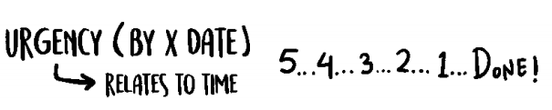

Sự khang hiếm là hàm số của _số lượng_. Tính cấp bách là hàm số của _thời gian_.

Đây là lúc bạn _chỉ_ giới hạn _thời điểm_ mọi người có thể đăng ký, thay vì giới hạn _số lượng_. Việc đặt ra một deadline hoặc thời hạn chót rõ ràng cho một giao dịch hoặc hành động cần thực hiện sẽ tạo ra tính cấp bách. Thông thường, sự khang hiếm và tính cấp bách được sử dụng kết hợp với nhau, nhưng tôi sẽ tách chúng ra để bạn dễ hình dung các khái niệm này.

Tôi chuẩn bị chỉ cho bạn 4 cách yêu thích nhất của tôi để ứng dụng tính cấp bách một cách đều đặn và đạo đức: 1) Các đợt tuyển sinh luân phiên (Rolling Cohorts), 2) Tính cấp bách theo mùa luân phiên (Rolling Seasonal Urgency), 3) Tính cấp bách từ chương trình khuyến mại hoặc giá cả (Promotional or Pricing Urgency) và 4) Cơ hội vụt qua (Exploding Opportunity). Chúng sẽ đưa tính cấp bách vào doanh nghiệp của bạn một cách hoàn toàn tự nhiên, không giả trân. Cách tôi yêu thích nhất là tổ chức các đợt khách hàng bắt đầu theo một nhịp điệu cố định. Điều này mang lại một lợi ích vận hành đi kèm là giúp bạn tạo ra một trải nghiệm chào mừng (onboarding) được biên đạo bài bản cho khách hàng mới. Khi bạn scale doanh nghiệp, điều này sẽ ngày càng trở nên tối quan trọng.

### **1) Tính cấp bách luân phiên theo đợt (Cohort-Based Rolling Urgency)** 

Ví dụ, nếu bạn nhận khách hàng mới mỗi tuần (ngay cả với số lượng không giới hạn), bạn có thể nói: 

_“Nếu anh/chị đăng ký hôm nay, tôi có thể xếp anh/chị vào nhóm tiếp theo khai giảng vào thứ Hai, bằng không anh/chị sẽ phải đợi đến đợt khai giảng kế tiếp.”_ 

Nếu muốn tăng thêm chút sức hút, bạn có thể nói: 

_“Thực ra tôi vừa có một học viên đăng ký vài tuần trước xin rút, nên tôi đang trống một suất cho nhóm khai giảng vào thứ Hai tới. Nếu anh/chị kiểu gì cũng sẽ làm sớm hay muộn, thì tham gia luôn bây giờ để bắt đầu gặt hái thành quả sớm vẫn hơn là trả cùng một mức phí mà lại phải chờ đợi.”_ 

Hai cách điều chỉnh nhỏ trên đã giúp chốt vô số đơn hàng bằng cách nhắc nhở khách hàng tiềm năng rằng nếu đăng ký, họ sẽ bắt đầu vào thứ Hai, còn nếu không, họ sẽ phải đợi thêm một tuần. Chính những chi tiết nhỏ này lại là đòn bẩy thúc đẩy mọi người hành động — điều mà thâm tâm họ biết mình nên làm. 

Hiển nhiên là tần suất khai giảng khách hàng mới càng ít, thì chiến thuật này càng mạnh mẽ. Ví dụ, nếu bạn chỉ nhận khách mới hai lần một năm, mọi người sẽ cực kỳ hào hứng đăng ký, nhất là khi ngày khai giảng đến gần. Ngay cả việc nhận khách mới hai tuần một lần cũng đủ tạo ra hiệu ứng thúc bách này. 

> **Chữ mất khách hàng thì sao? (What if I lose sales by turning business away?)** 
> 
> Giống như các chính sách bảo đảm (Guarantees), luôn có nỗi sợ rằng bạn sẽ kiếm ít tiền hơn khi áp dụng chiến thuật này. Chúng ta sợ mất đi những đơn hàng mà lẽ ra mình đã có thể chốt. Mọi marketer lão luyện trên hành tinh này đều sẽ nói với bạn rằng — đó chỉ là nỗi sợ, và nó hoàn toàn vô căn cứ. Những đơn hàng lớn nhất trong một chiến dịch kéo dài một tuần hoặc một đợt launch thường diễn ra vào 4 tiếng cuối cùng của ngày cuối (chiếm tới 50-60%). Điều đó có nghĩa là 3% thời gian cuối cùng lại tạo ra 50-60% doanh số... nghe thì hoàn toàn vô lý, nhưng đó lại là bản chất _rất con người_ . Thế nên, cũng giống như chính sách bảo đảm, bạn sẽ kiếm được nhiều tiền hơn từ số đông quyết định hành động, thay vì tiếc nuối những người thực tế đã bỏ lỡ — bởi vì trên thực tế, những người đó vốn dĩ chẳng bao giờ định mua cả (quái lạ là ngay cả khi nước đến chân họ còn chẳng mua, thì lấy lý do gì để họ mua lúc bình thường?). Một bài học rất đáng ghi nhớ. 

> **Phải làm sao nếu vừa khai giảng một đợt mà có khách muốn mua….** 
> 
> Bạn có hai lựa chọn: 1) Bạn có thể cung cấp cho họ một buổi onboarding (hướng dẫn khởi động) cá nhân hóa siêu tốc để bắt kịp tiến độ như một món **bonuses** (quà tặng) vì đã đăng ký hôm nay và vẫn nhận họ vào nhóm. Hoặc, lựa chọn tôi yêu thích hơn, 2) Bạn giải thích cho họ rằng vì nhóm tiếp theo còn một chút thời gian nữa mới bắt đầu, họ sẽ có lợi thế là có nhiều thời gian hơn để nghiên cứu tài liệu, trao đổi với nhân viên (đối với sản phẩm B2B) hoặc các thành viên trong gia đình (đối với sản phẩm B2C). Hơn thế nữa, họ còn có thể nhận được một kế hoạch thanh toán kéo dài (extended payment plan) linh hoạt hơn — điều mà bạn chỉ có thể dành riêng cho họ vì thời gian khai giảng còn ở khá xa... một lợi thế mà phần lớn khách hàng khác không có được. Suy cho cùng, hãy nhớ rằng bạn luôn chiếm thế thượng phong vì bạn mới là người cầm trịch. 

### **2) Tính cấp bách theo mùa luân phiên (Rolling Seasonal Urgency)** 

Trong môi trường kỹ thuật số, việc có đồng hồ đếm ngược đến ngày hết hạn đăng ký thực sự _rất_ hữu ích. Nhưng hãy đảm bảo chúng là thật. Nếu không, bạn sẽ mất uy tín và trông giống như _mọi tay mơ tập tòi làm marketing khác_. Điều này cực kỳ phổ biến ở các doanh nghiệp internet sử dụng mô hình “launch” (ra mắt sản phẩm). Cá nhân tôi rất thích đưa ngày chạy chương trình lên landing page _và_ vào cả copy (nội dung quảng cáo). Tôi muốn nó hiển thị ở mọi nơi. Điểm tuyệt vời là bạn luôn có thể bật một chiến dịch quảng cáo khác cùng một landing page mới với những mốc thời gian mới mà vẫn mượt mà như thường. Bạn sẽ thấy tỷ lệ chuyển đổi của mình tăng vọt, trong khi chỉ tốn khoảng năm phút chỉnh sửa — hoàn toàn xứng đáng với thời gian bỏ ra. 

_Ví dụ:_ Chương trình khuyến mãi năm mới của chúng tôi kết thúc vào ngày 30 tháng 1! _Tháng tiếp theo:_ Khuyến mãi Lễ Tình Nhân kết thúc vào ngày 30 tháng 2! _Tháng tiếp theo:_ Ưu đãi Đón Xuân Sexy kết thúc vào ngày 31 tháng 3! _Tháng tiếp theo:_ Khuyến mãi Khờ Dại Tháng Tư kết thúc vào ngày 30 tháng 4! 

Bản thân chương trình ưu đãi có thể vẫn giữ nguyên, nhưng việc "đổi vỏ" theo mùa mang đến cho bạn một điểm khác biệt "hàng thật giá thật" có ngày bắt đầu và ngày kết thúc rõ ràng. Deadline (thời hạn) tạo ra quyết định. Chỉ bằng cách đưa ra các mốc này, bạn có thể nhắc nhở khách hàng và để chính họ tự vượt qua rào cản tâm lý để không bỏ lỡ cơ hội. 

> **Mẹo chuyên gia - Doanh nghiệp địa phương (Pro Tip - Local Businesses):** Đây là chiến lược số một của tôi dành cho các doanh nghiệp địa phương. Họ phải thay đổi hoạt động marketing thường xuyên hơn các nhà quảng cáo toàn quốc. Khoác một chiếc áo mới có đính kèm thời hạn lên cùng một dịch vụ cốt lõi sẽ tạo ra tính cấp bách và sự mới lạ, giúp bạn luôn vượt trội so với các chiến dịch "bình mới rượu cũ" quen thuộc. 

### **3) Tính cấp bách dựa trên giá hoặc quà tặng (Pricing or Bonus-Based Urgency)** 

Đây là một cách khác để tạo tính cấp bách bằng cách dùng chính offer (ưu đãi), chương trình khuyến mãi hoặc cấu trúc giá của bạn làm thứ mà họ có thể bỏ lỡ (nghe khá là thiên tài đấy chứ!). Nó cho phép các doanh nghiệp bán hàng quanh năm vẫn có thể áp dụng tính cấp bách. Ví dụ, _“Vâng, hãy bắt đầu ngay hôm nay để anh/chici tận dụng mức chiết khấu mà anh/chị vừa tìm đến. Tôi không chắc chúng tôi sẽ chạy mức giá này trong bao lâu vì cứ khoảng 4 tuần là chúng tôi lại thay đổi, và đây là một trong những ưu đãi hời nhất mà chúng tôi từng tung ra trong thời gian qua.”_ 

Cách này tạo ra một chút sợ hãi bị bỏ lỡ FOMO đối với chương trình khuyến mãi (hoặc chiết khấu, quà tặng), thay vì tạo áp lực lên chính dịch vụ cốt lõi của bạn. Sẽ là nói dối nếu bạn kinh doanh dịch vụ lợp mái nhà mà lại bảo rằng không phục vụ khách nếu họ mua sau ngày đó. Tuy nhiên, nếu bạn nói cụ thể về chương trình khuyến mãi, bạn thường có thể kích thích được tính cấp bách mua hàng tương tự ở khách hàng tiềm năng trong khi vẫn giữ được uy tín của mình — đôi bên cùng có lợi. Bạn có thể hoán đổi linh hoạt một chương trình khuyến mãi về giá, chiết khấu, hoặc các **bonuses** đi kèm như miễn phí lắp đặt, miễn phí onboarding, hay một buổi workshop bổ sung (trị giá 1.000 USD) nếu họ mua ngay. Đây đều là những quân bài bạn có thể biến hóa xoay quanh **Grand Slam Offer** (ưu đãi đỉnh cao) để tạo ra tính cấp bách. 

> **Mẹo chuyên gia - Làm sạch pipeline (danh sách khách hàng tiềm năng) với mỗi đợt thay đổi giá (Pro Tip - Clean Your Pipeline With Every Price Change)** : Nếu bạn thực sự có ý định tăng giá (hy vọng là sớm nếu bạn đang đọc cuốn sách này!) thì bạn luôn có thể lọc sạch pipeline của mình bằng cách thông báo cho mọi người biết: “Giá sắp tăng rồi! Đăng ký ngay đi thôi!” Đừng bao giờ tăng giá mà không thông báo trước cho khách hàng. Hành động này thể hiện vị thế mạnh mẽ _đồng thời_ mang lại cho bạn một nguồn tiền mặt kha khá từ những khách hàng tiềm năng đang chần chừ trong pipeline. 

### **4) Cơ hội vụt qua (Exploding Opportunity)** 

Thỉnh thoảng, bạn sẽ đặt khách hàng tiềm năng vào một cơ hội kinh doanh chênh lệch giá (arbitrage opportunity). Bản thân cơ hội đó có một đồng hồ đếm ngược, giống như mọi cơ hội lớn khác. Cứ mỗi giây ai đó chần chừ, họ lại bỏ lỡ những khoản lợi nhuận khổng lồ. 

Ví dụ: Nếu tôi đang giải thích về cơ hội chênh lệch giá giữa việc mua sản phẩm trên ebay và bán lại trên amazon, sự thiếu hiệu quả của thị trường này theo thời gian sẽ tự được điều chỉnh lại. Ai hành động càng sớm thì càng có lợi. Điều này cũng đúng khi thuyết phục ai đó nắm bắt cơ hội giao dịch tiền mã hóa, mua cổ phiếu, hoặc tham gia vào một nền tảng quảng cáo mới trước khi các đối thủ cạnh tranh nhảy vào cuộc đua. Trong môi trường làm việc có tính cạnh tranh cao, các lời mời nhận việc thường là những "cơ hội vụt qua" (exploding offers) — cứ mỗi ngày trôi qua mà họ chần chừ nhận việc, mức lương hoặc tiền thưởng của họ lại giảm xuống. Điều này ép khách hàng tiềm năng phải đưa ra quyết định nhanh chóng thay vì cố "ngồi chờ xem" liệu mình có nhận được lời đề nghị nào tốt hơn không. 

Tất cả các ví dụ trên đều cho thấy những cơ hội sẽ mai một dần theo thời gian, thế nên nếu bạn thấy mình đang đứng trước một cơ hội như vậy, hãy chắc chắn là phải nhấn mạnh nó! 

### **Tóm tắt (Summary Points)** 

Việc bổ sung một deadline (thời hạn) và kết hợp một hoặc nhiều hình thức tạo tính cấp bách sẽ giúp thúc đẩy nhiều người hành động hơn so với bình thường. Tôi đã áp dụng cả bốn phương pháp này với hiệu quả vô cùng lớn. Tôi khuyên bạn cũng nên làm như vậy. Tiếp theo sẽ là….**Bonuses**! 

> **Quà tặng miễn phí #7: Hướng dẫn bổ sung: Cách sử dụng Đạo đức Tính khan hiếm & Tính cấp bách** 
> 
> Nếu bạn muốn cùng tôi đi qua một số ví dụ thực chiến (mang tính đạo đức) về **Scarcity & Urgency** (Tính khan hiếm & Tính cấp bách), hãy truy cập **<u>Acquisition.com/training/offers</u>** và chọn **“Scarcity & Urgency”** để xem một video hướng dẫn ngắn. Bạn cũng sẽ có thể tải về **<u>Bảng kiểm tra Tính khan hiếm & Cấp bách</u>** mà tôi thường dùng khi thiết kế các offer. Như mọi khi, nó hoàn toàn miễn phí. Chúc bạn tận hưởng giá trị từ nó. 

## **14. NÂNG TẦM OFFER: QUÀ TẶNG (BONUSES)** 

> _“Toàn là phần ngon và lời lãi thôi anh em ạ”_ 
> 
> BIẾN TẤU TỪ MỘT CÂU NÓI CỔ CỦA NGƯỜI ANH. 

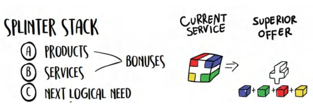

Tôi phải gửi lời cảm ơn đặc biệt đến Jason Fladlien vì đã thắp lại trong tôi sự trân trọng dành cho **bonuses**. Chúng thực sự có sức mạnh lớn đến mức tôi đã dành hẳn một chương riêng cho chúng. Trong chương này, tôi sẽ đề cập đến: nên tặng gì, cách chọn ra sao, cách định giá trị, cách trình bày, và cách định giá chúng. 

Điểm chính tôi muốn bạn đúc rút ra được từ đây là: _một offer đơn lẻ sẽ có giá trị thấp hơn chính offer đó khi được bẻ nhỏ thành các thành phần cấu thành và xếp chồng lên nhau như các **bonuses** (xem hình)_ . Toàn bộ offer của chúng tôi đã được hoàn thiện ở cuối phần trước. Phần này sẽ nói về cách trình bày những mảnh ghép đó theo thứ tự nào. Ví dụ, thực tế tôi có thể làm rất nhiều việc trong dịch vụ của mình, nhưng cho đến khi tôi liệt kê chúng ra, mọi người vẫn sẽ mù tịt. Đó là lý do tại sao mọi quảng cáo truyền hình (infomercial) từ xưa đến nay đều bất hủ với câu: “nhưng chưa hết đâu….vẫn còn nữa!” 

Họ sẽ chẳng dại gì dùng những chiêu thức này nếu chúng không hiệu quả, bởi vì từng giây lên sóng đều tốn tiền và phải được chứng minh bằng **ROI** (tỷ suất sinh lợi). Bạn cũng sẽ nhận ra rằng nếu xem lại những đoạn quảng cáo truyền hình đời cũ đó, họ sẽ bán một con dao với giá 38,95 USD rồi kèm theo 37 con dao khác, đồ mài dao, chảo, và cả chính sách bảo đảm để "bón hành" cho đến khi khách hàng tâm phục khẩu phục. Họ thiết lập một mức giá cơ sở, rồi sau đó bồi đắp thêm dần cho đến khi bạn cảm thấy _đây là một món hời lớn đến mức nếu bỏ qua thì đúng là đồ ngốc_ . 

Lý do chiến thuật này hiệu quả là vì chúng ta đang nới rộng khoảng cách giữa giá bán và giá trị trong tâm trí khách hàng bằng cách gia tăng giá trị trao đi thay vì giảm giá. Chúng ta "ghim" mức giá mà ta thông báo vào offer cốt lõi. Sau đó, với mỗi **bonus** ngày càng có giá trị hơn được cộng vào, khoảng cách đó ngày càng giãn rộng ra cho đến khi vượt quá sức chịu đựng, khiến chúng ta "bật chốt" chiếc dây chun đang kìm giữ chiếc ví trong túi họ. 

Bây giờ, chúng ta sẽ trình bày "tập hợp" các hạng mục bàn giao (deliverables) mà chúng ta đã gom lại trước đó theo cách khiến khách hàng không thể cưỡng lại nổi. 

> **Mẹo chuyên gia: Luôn thêm Bonus thay vì Giảm giá cho các Offer Cốt lõi nếu có thể** 
> 
> Bất cứ khi nào cố gắng chốt deal, tuyệt đối đừng bao giờ giảm giá offer chính. Điều đó dạy cho khách hàng của bạn biết rằng giá cả của bạn có thể thương lượng được (điều này cực kỳ tệ hại). Việc thêm các **bonuses** để gia tăng giá trị nhằm chốt deal hiệu quả hơn việc cắt giảm giá rất nhiều. Nó đặt bạn vào thế thượng phong và sự thiện chí thay vì thế yếu. 

### **Trình bày Bonus: 1 đối 1 so với Bán hàng theo Nhóm** 

Có những khác biệt cốt lõi giữa việc chốt deal trước một nhóm người so với một cá nhân đơn lẻ. Việc bán hàng theo nhóm nằm ngoài phạm vi của cuốn sách này. Nhưng tôi ít nhất muốn đề cập đến thời điểm một **bonus** nên được tung ra trong kịch bản bán hàng 1-1. Khi bán hàng 1-1, bạn hãy **chốt sale trước**, rồi mới đưa ra các **bonuses** sau. Nếu họ đồng ý, thì sau khi họ đã đăng ký xong, bạn mới thông báo cho họ về những **bonuses** _bổ sung_ mà họ sẽ nhận được. Điều này tạo ra một _trải nghiệm "wow"_ và củng cố thêm quyết định mua hàng của họ. 

Ngược lại, nếu khách hàng _không_ mua sau lần chốt đầu tiên, lúc đó bạn mới tung ra một **bonus** giải quyết đúng điểm nghẽn (obstance) mà họ đang lo ngại, rồi chốt deal lại lần nữa. Đừng cảm thấy kỳ cục khi phải đề nghị lại. Bạn chỉ cần đồng tình với khách hàng tiềm năng, thêm **bonus** vào, và hỏi xem sự bù đắp này đã "Đủ hợp lý chưa." Con người rất khó từ chối tính có qua có lại (reciprocity), thế nên việc thêm một **bonus** để chiều lòng họ, rồi thêm cái nữa, rồi cái nữa, sẽ khiến khách hàng cảm thấy gần như có nghĩa vụ phải mua hàng từ bạn. 

Nếu bạn còn nhớ từ chương "Cắt tỉa và Xếp chồng" (Trim and Stack), từng hạng mục bàn giao đó giờ đây đang được biến thành vũ khí và tung ra vào thời điểm hoàn hảo nhất. Dù sao thì chúng ta cũng sẽ cung cấp tất cả những **bonuses** này cho họ, nhưng việc xếp chồng các **bonuses** này từng cái một sẽ làm gia tăng mạnh mẽ cảm nhận về giá trị của offer.

### **Các Gạch Đầu Dòng Về Quà Tặng Kèm (Bonus)**

Mặc dù vậy, vẫn có một số nguyên tắc cốt lõi bạn cần ghi nhớ khi tặng kèm quà tặng (Bonus):

1. Luôn luôn kèm theo quà tặng (bạn có thể sử dụng gói quà tặng gạch đầu dòng mà chúng ta đã phác thảo ở cuối Mục III).
2. Đặt cho chúng một cái tên đặc biệt chứa đựng lợi ích ngay trong tiêu đề.
3. Cho khách hàng biết:
   a) Món quà này giải quyết vấn đề của họ như thế nào.
   b) Nó là gì.
   c) Bạn đã phát hiện ra nó thế nào, hoặc bạn phải trải qua những gì để tạo ra nó.
   d) Nó sẽ giúp cải thiện cuộc sống hoặc trải nghiệm của họ cụ thể ra sao theo hướng:
   i) Nhanh hơn, dễ dàng hơn, hoặc tốn ít công sức/sự đánh đổi hơn (Value Equation – Phương trình giá trị).
4. Cung cấp bằng chứng (có thể là số liệu thống kê, khách hàng cũ, hoặc trải nghiệm cá nhân) để chứng minh món quà này thực sự giá trị.
5. Vẽ ra một bức tranh tâm trí thật sinh động về cuộc sống của họ khi *giả định* rằng họ đã sử dụng nó và đang tận hưởng những lợi ích đó.
6. Luôn gán một mức giá cụ thể cho các món quà và đưa ra lý do hợp lý cho mức giá đó.
7. Các công cụ (tools) và danh sách kiểm tra (checklists) luôn hữu ích hơn các khóa đào tạo bổ sung (vì công sức và thời gian bỏ ra ít hơn, nên giá trị mang lại cao hơn. Value Equation vẫn là vua).
8. Mỗi món quà nên giải quyết một mối bận tâm/rào cản cụ thể trong đầu khách hàng tiềm năng về lý do tại sao họ nghĩ mình không thể hoặc sẽ không thành công (bonus phải chứng minh rằng niềm tin đó là sai lầm).
9. Món quà này cũng có thể là thứ mà họ sẽ nhận ra một cách logic rằng họ cần tiếp theo. Bạn muốn giải quyết vấn đề tiếp theo của họ ngay cả trước khi họ chạm trán với nó.
10. Giá trị của các món quà tặng kèm phải làm lu mờ giá trị của **Core Offer** (Gói sản phẩm cốt lõi). Về mặt tâm lý, khi bạn tiếp tục cộng dồn các ưu đãi, khoảng cách giữa giá bán và giá trị cảm nhận sẽ ngày càng giãn rộng. Nó cũng ngầm truyền tải một thông điệp tiềm thức rằng: *Core Offer chắc chắn phải cực kỳ giá trị*, vì nếu đây chỉ là quà tặng kèm, thì sản phẩm chính phải khủng đến thế nào nữa, đúng không? (Thực tế không hẳn vậy, nhưng bạn hoàn toàn có thể tận dụng điểm mù tâm lý này để làm cho **Grand Slam Offer** của mình trở nên hấp dẫn đến mức khó cưỡng).
11. Bạn có thể gia tăng hơn nữa giá trị của quà tặng bằng cách áp dụng tính khan hiếm (**Scarcity**) và tính khẩn cấp (**Urgency**) cho chính những món quà đó (kỹ thuật này sẽ nhân đôi sức mạnh cho ưu đãi của bạn).

a) Quà Tặng Kèm Gắn Liền Với Tính Khan Hiếm (Scarcity)

<u>Phiên bản 1:</u> Chỉ những ai đăng ký chương trình XYZ mới có quyền truy cập vào Bonus #1, #2, #3 – những thứ chưa từng được bán hoặc xuất hiện ở bất cứ đâu ngoài chương trình này.

<u>Phiên bản 2:</u> Tôi chỉ còn 3 vé tham dự sự kiện ảo trị giá 5.000 USD của mình; nếu bạn mua chương trình này ngay bây giờ, bạn sẽ nhận được một trong 3 chiếc vé cuối cùng đó như một phần quà tặng kèm.

b) Quà Tặng Kèm Gắn Liền Với Tính Khẩn Cấp (Urgency)

<u>Phiên bản 1:</u> Nếu bạn mua ngày hôm nay, tôi sẽ tặng kèm miễn phí món quà XYZ vốn có giá thông thường là 1.000 USD. Tôi làm điều này vì tôi muốn thưởng cho những người ra quyết định hành động ngay.

c) Hy vọng bạn có thể nhận ra những điểm khác biệt tinh tế ở đây. Hai ví dụ đầu tiên không bị giới hạn bởi thời gian. Chúng khẳng định rằng nếu bạn mua chương trình, bạn sẽ nhận được những thứ mà bình thường bạn không thể có được. Trong khi đó, quà tặng kèm có tính khẩn cấp lại gắn liền với hành vi mua hàng *ngay trong ngày hôm nay*, và nếu họ không mua hôm nay, họ sẽ mất đi những món quà đó. Sự khác biệt nhỏ nhưng rất đáng lưu tâm.

### **Quà Tặng Cấp Độ Nâng Cao – Sản Phẩm và Dịch Vụ Của Người Khác**

Bạn hoàn toàn có thể thuyết phục các doanh nghiệp khác cung cấp sản phẩm và dịch vụ của họ làm quà tặng kèm cho bạn, đổi lại bạn sẽ quảng bá thương hiệu của họ tới khách hàng của bạn một cách miễn phí. Đây là chiến lược marketing 0 đồng cho họ, và là nguồn sản phẩm giá trị cao 0 đồng cho bạn. Các doanh nghiệp sẵn sàng làm điều này vì bạn đang mang thương hiệu của họ tiếp cận trực tiếp với nhóm khách hàng tiềm năng chất lượng nhất – chính là khách hàng của bạn. Miễn là họ không phải là đối thủ cạnh tranh trực tiếp, bạn vừa ghi điểm, vừa tích lũy được những lời hứa hẹn giới thiệu khách hàng (referral IOUs) trong tương lai, lại vừa gia tăng giá trị cho **Offer** của mình ngay lập tức. Nếu bạn thiết lập đủ các mối quan hệ kiểu này, bạn có thể bù đắp toàn bộ chi phí sản phẩm nhờ vào khoản tiết kiệm và những món quà tặng có giá trị thực tế cao.

Ví dụ – nếu tôi sở hữu một phòng khám chuyên điều trị đau nhức, tôi có thể thỏa thuận để một chuyên gia xát-xa (massage) tặng tôi 1-2 buổi xoa bóp miễn phí để đưa vào gói **Offer**. Chưa hết, tôi có thể nhận thêm:

...một bác sĩ thần kinh cột sống (chiropractor) tặng tôi hai buổi nắn chỉnh miễn phí. (Trị giá: 100 USD)

...một công ty thực phẩm kháng viêm giảm giá các sản phẩm của họ (Tiết kiệm: 50 USD)

...giảm giá cho các thiết bị nẹp chỉnh hình và đế giày y khoa (Tiết kiệm: 150 USD)

...một câu lạc bộ sức khỏe địa phương tặng một buổi tập huấn luyện viên cá nhân miễn phí cùng một tháng sử dụng hồ bơi miễn phí (Trị giá: 100 USD)

...giảm giá thuốc từ nhà thuốc địa phương (Tiết kiệm: 100 USD/tháng)

...lặp lại các bước trên với nhiều nhà cung cấp dịch vụ khác (ví dụ, tôi có thể liên hệ với 10 chuyên gia nắn chỉnh cột sống để mỗi người tặng một buổi miễn phí, thế là tôi đã có ngay 10 buổi nắn chỉnh miễn phí trong gói ưu đãi của mình).

...Vân vân.

Lúc này, nếu gói **Offer** của tôi có giá 400 USD, thì giá trị của riêng các món quà tặng miễn phí này THẬM CHÍ ĐÃ VƯỢT HƠN con số 400 USD đó rồi.

Nếu điều đó vẫn chưa đủ khiến bạn thấy phấn khích, thì đây là nước đi của một "bậc thầy Jedi": hãy đàm phán để nhận mức chiết khấu nhóm (group discount) *đồng thời* hưởng hoa hồng cho chính bạn. Đây chính xác là những gì chúng tôi đã làm với công ty thực phẩm bổ sung của mình. Các chủ phòng gym – khách hàng của chúng tôi – khi sử dụng các vận động viên được tài trợ bởi công ty thành viên Prestige Labs sẽ nhận được mức chiết khấu 30% cho các sản phẩm của chúng tôi. Không những thế, các vận động viên được tài trợ đó còn được trả 40% hoa hồng trên tổng doanh thu ròng sau khi đã áp dụng chiết khấu.

Một mũi tên trúng nhiều đích cho tất cả các bên. Khách hàng của họ mua được sản phẩm với giá rẻ hơn 30% so với website chính của chúng tôi. Các đối tác được trả tiền khi tặng các mức chiết khấu độc quyền. Còn chúng tôi có thêm khách hàng mới để đổi lấy khoản hoa hồng đã chi trả. Tất cả đều thắng.

Nếu bạn theo dõi từ đầu đến giờ, mỗi món quà tặng kèm này có thể trở thành nguồn doanh thu cho bạn theo hai cách: gián tiếp bằng cách giúp khách hàng nói LỚN ĐỒNG Ý dễ dàng hơn, và trực tiếp bằng cách đàm phán để các doanh nghiệp này trả hoa hồng cho bạn dựa trên lượng khách bạn giới thiệu đến họ.

Giờ hãy cùng tính xem chúng ta kiếm được bao nhiêu tiền... Gói **Offer** 400 USD của chúng ta giờ đây có cơ hội mang về thêm 350 USD... *lợi nhuận ròng*! Đó chính là sức mạnh kỳ diệu từ những mối quan hệ hợp tác này. Các doanh nghiệp khác sẽ trả tiền cho bạn, trong khi bạn chẳng phải làm *gì cả* ngoài việc giới thiệu cho họ những khách hàng mà bạn vốn dĩ đã phải bỏ tiền túi ra để thu hút từ trước.

Và nếu bạn *thực sự* muốn "chơi lớn", hãy kết hợp với các doanh nghiệp đối tác này để tạo ra một **Grand Slam Offer** bằng cách áp dụng chính xác các nguyên tắc trong cuốn sách này. Nhờ đó, bản thân mỗi món quà tặng kèm sẽ trở nên giá trị hơn rất nhiều so với một dịch vụ mang tính hàng hóa phổ thông.

> **Quà Tặng Miễn Phí #8: BONUS... CỦA... BONUS**
> 
> Có hàng triệu cách để tận dụng quà tặng kèm trong các chiến dịch **Offer** của bạn. Bạn có thể dùng chúng để thúc đẩy khách hàng hành động nhanh hơn. Bạn có thể định vị mức giá và sản phẩm (chiêu thức ít người biết). Bạn có thể khiến nhiều người gật đầu đồng ý hơn bình thường. Nếu bạn muốn cùng tôi mổ xẻ sâu hơn về chủ đề này qua một buổi học trực tiếp, hãy truy cập **<u>Acquisition.com/training/offers</u>** và chọn **“Bonus Creation”** để xem video hướng dẫn ngắn. Tôi cũng chuẩn bị sẵn một **<u>Bản Kiểm Tra Quà Tặng Miễn Phí (Free Bonus Checklist)</u>** mà tôi vẫn dùng mỗi khi thiết lập các ưu đãi. Hãy "mượn" nó cho doanh nghiệp của bạn, hoàn toàn miễn phí nhé!

### **Tổng Kết**

Chúng ta muốn tận dụng các món quà tặng kèm (Bonus) vì chúng làm giãn khoảng cách giữa giá trị và giá bán, đồng thời thuyết phục những khách hàng vốn định rời đi phải rút hầu bao. Chúng làm tăng vọt nhận thức của khách hàng tiềm năng về giá trị của gói **Offer**. Dưới đây là những việc bạn cần làm:

1. Tạo ra các danh sách kiểm tra (checklists), công cụ (tools), bộ tài liệu mẫu (swipe files), kịch bản (scripts), biểu mẫu (templates), và bất cứ thứ gì tiêu tốn nhiều thời gian và công sức nếu tự làm từ đầu, nhưng lại cực kỳ dễ sử dụng khi đã hoàn thành. Bất cứ thứ gì bạn chỉ cần đầu tư một lần, rõ ràng tốn kém thời gian hoặc tiền bạc để tạo ra, nhưng có thể đem tặng vô thời hạn – đều là ứng cử viên hoàn hảo cho một món quà tặng kèm.
2. Ngoài ra, hãy biến việc ghi hình lại mọi buổi workshop, hội thảo trực tuyến (webinar), sự kiện, phỏng vấn thành thói quen, sau đó sử dụng chúng làm quà tặng bổ sung (khi cần thiết để đập tan một rào cản tâm lý nào đó).
3. Chủ động đàm phán mức chiết khấu nhóm và hoa hồng giới thiệu với các doanh nghiệp lân cận – những nơi cung cấp giải pháp cho các nhu cầu phát sinh của khách hàng sau khi họ bắt đầu hành trình với bạn. Bước tiếp theo tự nhiên họ sẽ muốn gì? Hãy đến gặp các doanh nghiệp đó, đàm phán một mức giá hời mà khách hàng tự mình không bao giờ có được (vì bạn đang đại diện cho sức mua của toàn bộ khách hàng của mình gộp lại – một sức mạnh cực kỳ lớn).

> **Lưu ý từ Tác giả**: Doanh nghiệp của bạn càng hoạt động lâu năm, bạn càng có nhiều tài sản quà tặng trong tay. Tất cả những thứ đó đều rất có giá trị. Hãy cất chúng vào "kho" và giữ sẵn trong túi áo để lôi ra bất cứ lúc nào cần "chốt đơn". Các sản phẩm thông tin (information products) cực kỳ hiệu quả trong trường hợp này vì chúng có giá trị cảm nhận cao, chi phí thấp và gần như bằng không về mặt vận hành – ngoài việc cấp quyền đăng nhập bổ sung. Vé tham dự các sự kiện hoặc trải nghiệm ảo cũng hoạt động rất tốt tương tự. Điều này cũng áp dụng cho các dịch vụ cấp cao hơn có chi phí cố định, chẳng hạn như tặng ai đó dịch vụ VIP trong một tháng (đồng thời đóng vai trò là cách **Upsell** họ lên mức dịch vụ đó để duy trì dài hạn... chúng ta sẽ bàn kỹ hơn ở Sách II).

> **Đâu là ranh giới giữa quà tặng kèm (Bonus) và một phần của Core Offer nếu tôi là người trực tiếp thực hiện nó?**
> 
> Câu trả lời ngắn gọn: **Yếu tố Wow** – nói cách khác – là thứ mà bạn không muốn bất kỳ ai bỏ lỡ. Rất nhiều lần, bạn cung cấp cho khách hàng quá nhiều "đồ chơi" (một tín hiệu tốt), khiến cho những viên kim cương quý giá bị chìm nghỉm giữa đám đông. Bạn cần chọn ra những phần đặc sắc nhất, có khả năng tự đứng vững độc lập, rồi tách chúng ra để làm nổi bật. Điều này đặc biệt đúng với những nội dung ngắn gọn nhưng có chất lượng hoặc giá trị cực cao. Các danh sách kiểm tra (checklists) hoặc đồ họa thông tin (infographics) có thể cô đọng lượng lớn thông tin vào một không gian nhỏ gọn. Sẽ có lúc khách hàng thấy không đáng bỏ ra nhiều tiền chỉ để mua một bản đồ ra mắt sản phẩm (ví dụ vậy), nhưng nếu nó xuất hiện dưới dạng một món quà tặng kèm, giá trị cảm nhận của nó sẽ tăng vọt.

### **Tiếp Theo Là Gì...**

Chúng ta đã có trong tay **Core Offer**. Chúng ta đang trình bày nó theo cách gia tăng tính khan hiếm (**Scarcity**) và tính khẩn cấp (**Urgency**) nhằm thổi bùng khao khát sở hữu của khách hàng. Chúng ta đã "xếp chồng" các món quà tặng kèm để nới rộng khoảng cách giữa giá bán và giá trị lên mức phi thực tế, khiến cho khách hàng phải kinh ngạc. Trạm dừng chân tiếp theo trong hành trình diệu kỳ này sẽ là giải quyết con voi lớn đang lừng lững giữa phòng... đó chính là **Rủi ro (Risk)**. Chúng ta sẽ xóa sổ hoàn toàn nó bằng một hệ thống bảo hành/hoàn tiền kết hợp, khiến khách hàng không còn bất kỳ lý do gì để từ chối mua hàng nữa.

## **15. NÂNG TẤM ƯU ĐÃI: CAM KẾT VÀ BẢO HÀNH (GUARANTEES)**

> _“Bạn sẽ thích cách mình trông như thế nào... Tôi cam kết đấy.”_
> 
> QUẢNG CÁO KINH ĐIỂN CỦA THƯƠNG HIỆU MEN’S WAREHOUSE ĐÃ TỒN TẠI XUYÊN THỜI GIAN.

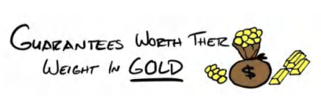

Trở ngại lớn nhất đối với bất kỳ sản phẩm hay dịch vụ nào khi được chào bán chính là... tiếng trống vang lên... *rủi ro.* Rủi ro rằng nó sẽ không mang lại kết quả như họ hằng mong đợi. Do đó, việc xóa bỏ rủi ro là cách nhanh nhất để làm cho bất kỳ **Grand Slam Offer** nào trở nên hấp dẫn hơn. Bạn sẽ muốn dành một lượng thời gian đáng kể để tìm ra cách xóa tan nỗi sợ này. Đã vậy, một chính sách bảo đảm (guarantee) có thể làm cho lời đề nghị trở nên hấp dẫn hơn bao nhiêu?

Jason Fladlien, người mà tôi đã nhắc đến trước đó, từng chia sẻ rằng ông đã thấy tỷ lệ chốt đơn tăng từ 2 đến 4 lần chỉ đơn thuần bằng cách nâng cao chất lượng của chính sách bảo đảm. Nó thực sự quan trọng đến vậy đấy.

Nhìn chung, có bốn loại chính sách bảo đảm:

1. Không điều kiện (Unconditional)

2. Có điều kiện (Conditional)

3. Chống bảo đảm (Anti-Guarantee)

4. Bảo đảm ngầm định (Implied Guarantees).

Bạn phải *luôn luôn* xoáy sâu vào chính sách bảo đảm của mình, ngay cả khi bạn không có sẵn một chính sách nào cả. Hãy tuyên bố nó một cách thật dõng dạc và đưa ra lý do tại sao. **Nhưng bộ phận khách hàng sẽ không lợi dụng một chính sách bảo đảm điên rồ như vậy sao?**

Đôi khi có, nhưng phần lớn là không. Dù vậy, bạn phải nắm rõ bài toán tài chính. Nếu bạn chốt được số lượng khách hàng nhiều hơn 130 phần trăm, và tỷ lệ hoàn tiền của bạn *tăng gấp đôi* từ 5 phần trăm lên 10 phần trăm, thì bạn vẫn kiếm được gấp 1,23 lần số tiền, tương đương với mức tăng 23 phần trăm, và tất cả số đó đều chảy thẳng vào lợi nhuận ròng (bottom line).

Ví dụ: 100 đơn bán, 5 đơn hoàn tiền (5%) = 95 Đơn Bán Ròng (Net Sales) với Offer có bảo đảm. 130 đơn bán, 13 đơn hoàn tiền (10%) = 117 Đơn Bán Ròng. 117/95 = 1,23x (tăng 23%).

Đừng để cảm xúc chi phối, hãy làm toán. Để một chính sách bảo đảm *không* mang lại hiệu quả kinh tế, mức tăng doanh số phải bị triệt tiêu hoàn toàn bởi số người đòi hoàn tiền. Do đó, mức tăng tuyệt đối 5 phần trăm trong doanh số sẽ cần phải bù đắp bằng mức tăng tuyệt đối 5 phần trăm trong số lượt hoàn tiền (nhưng điều đó đồng nghĩa với việc hoàn tiền tăng gấp đôi, vốn rất khó xảy ra). Vì vậy, nhìn chung, chính sách bảo đảm càng mạnh, mức tăng *ròng* của tổng lượng mua hàng càng cao, ngay cả khi tỷ lệ hoàn tiền có tăng theo đi chăng nữa.

<u>Cảnh báo: Mặc dù chính sách bảo đảm có thể là công cụ bán hàng cực kỳ hiệu quả, nhưng những người mua hàng</u> *chỉ vì* <u>có bảo đảm lại có thể trở thành những khách hàng rất tồi tệ.</u> Một người chỉ mua vì có bảo đảm là người có khả năng không muốn bỏ ra công sức cần thiết để đạt được thành công với sản phẩm hoặc dịch vụ của bạn. Trong một thế giới mà bạn vừa muốn xóa bỏ rủi ro *vừa* muốn mang lại kết quả tốt nhất cho khách hàng, việc gắn chính sách bảo đảm của bạn với những hành động mà họ cần làm để thành công sẽ giúp ích cho tất cả các bên.

> **Mẹo chuyên gia: Cảnh báo với Dịch vụ Chi phí Cao**
> 
> Nếu sản phẩm hoặc dịch vụ của bạn đi kèm với chi phí thực hiện quá lớn, bạn có thể sẽ muốn áp dụng chính sách bảo đảm có điều kiện hoặc chính sách CHỐNG bảo đảm (ANTI guarantee), vì bạn sẽ phải gánh cả chi phí hoàn tiền LẪN chi phí vận hành dịch vụ.

### **Các Loại Chính Sức Bảo Đảm**

Yếu tố tạo nên sức mạnh cho một chính sách bảo đảm chính là câu điều kiện: Nếu bạn không đạt được kết quả X trong khoảng thời gian Y, chúng tôi sẽ Z. Để chính sách bảo đảm có *sức nặng*, bạn phải xác định rõ mình sẽ làm gì nếu họ *không* đạt được kết quả. Nếu thiếu phần “nếu không thì sao” (or what) đó, lời cam kết sẽ trở nên yếu ớt và nhàu nhĩ.

**Lưu ý**: Đây là cách mà phần lớn các nhà làm tiếp thị (marketer) hay làm.

Ví dụ tồi: Cam kết mang lại cho bạn 20 khách hàng.

Ví dụ tốt hơn: Bạn sẽ nhận được 20 khách hàng trong 30 ngày đầu tiên, nếu không chúng tôi sẽ hoàn lại toàn bộ tiền + chi phí quảng cáo bạn đã chi cho chúng tôi. Đây là một chính sách bảo đảm đơn giản nhưng vô cùng mạnh mẽ.

Dưới đây là bốn loại chính sách bảo đảm. Tôi sẽ đi qua phần lý thuyết trước rồi sau đó chúng ta sẽ áp dụng chúng vào thực tế.

#### **<u>1) Chính Sức Bảo Đảm Không Điều Kiện (Unconditional Guarantees)</u>**

Như tôi đã đề cập trước đó, chúng ta có các dạng bảo đảm không điều kiện, có điều kiện và chống bảo đảm ("anti-"). Bảo đảm không điều kiện là những chính sách mạnh mẽ nhất. Về cơ bản, chúng giống như một chương trình dùng thử (trial), nơi họ thanh toán trước rồi mới xem xét xem mình có thích nó hay không. Điều này giúp thu hút MỘT LƯỢNG lớn người mua hơn rất nhiều, nhưng bạn *chắc chắn* sẽ phải đối mặt với một số trường hợp đòi hoàn tiền, đặc biệt là khi văn hóa tiêu dùng đang dịch chuyển dần theo hướng đòi hỏi quyền lợi mà không cần chịu bất kỳ trách nhiệm nào.

#### **<u>2) Chính Sức Bảo Đảm Có Điều Kiện (Conditional Guarantees)</u>**

Chính sách bảo đảm có điều kiện đi kèm với các “điều khoản và điều kiện” cho lời cam kết. Đây là dạng chính sách mà bạn có thể thỏa sức SÁNG TẠO. Nhìn chung, bạn sẽ muốn những điều khoản này trở thành cam kết “hơn cả hoàn tiền”. Bởi vì khi họ đã bỏ vốn đầu tư, bạn muốn đáp ứng khoản đầu tư đó về mặt tâm lý bằng một mức độ cam kết tương đương hoặc cao hơn từ phía họ. Chúng cũng có thể tạo ra hiệu quả *cực kỳ* mạnh mẽ trong việc giúp khách hàng đạt được kết quả. Nếu bạn biết đâu là những hành động then chốt mà một người cần thực hiện để thành công, hãy biến chúng thành một phần của điều kiện bảo đảm. Trong một thế giới hoàn hảo, 100% khách hàng của bạn sẽ đủ điều kiện nhận bảo đảm có điều kiện, nhưng thực tế họ sẽ đạt được kết quả, và do đó sẽ không cần phải đòi hoàn tiền nữa. Đó là một lý tưởng mà tất cả chúng ta đều hướng tới. Và tiện thể xin bật mí luôn - nếu đứng trước lựa chọn giữa việc nhận lại tiền hoàn hay nhận được kết quả như đã hứa, phần lớn đại đa số mọi người sẽ chọn kết quả.

#### **<u>3) Chính Sức Chống Bảo Đảm (Anti-Guarantees)</u>**

Chính sách chống bảo đảm là khi bạn tuyên bố một cách rõ ràng rằng “mọi đơn hàng đều là giao dịch cuối cùng - miễn đổi trả”. Bạn sẽ muốn kiên định với lập trường này. Bạn phải đưa ra một “lý do tại sao” thật sáng tạo để giải thích tại sao không được hoàn tiền. Thông thường, bạn sẽ muốn phô bày một điểm yếu hoặc rủi ro lớn từ phía bạn mà người tiêu dùng có thể ngay lập tức thấu hiểu và nghĩ rằng: “Ờ ha, điều đó hợp lý đấy.” Các loại chính sách bảo đảm này đặc biệt quan trọng đối với các mặt hàng tiêu hao hoặc những thứ bị sụt giảm giá trị nghiêm trọng một khi đã được bàn giao.

#### **<u>4) Chính Sức Bảo Đảm Ngầm Định (Implied Guarantees)</u>**

Bảo đảm ngầm định là bất kỳ lời chào hàng nào mang tính chất dựa trên hiệu suất (performance-based offer). Dạng này có rất nhiều hình thức khác nhau. Chia sẻ doanh thu (Revshare), chia sẻ lợi nhuận (profitshare), các mốc kích hoạt (triggers), cơ chế trượt (ratchets), tiền thưởng hiệu suất (monetary bonuses), v.v., đều là những ví dụ điển hình. Điểm cốt lõi cuối cùng vẫn là: nếu tôi không tạo ra kết quả, tôi sẽ không được trả tiền. Điểm độc đáo của cấu trúc này là nó cũng mang lại một upside (tiềm năng tăng trưởng) hấp dẫn: “Nếu tôi làm tốt công việc của mình, tôi sẽ được đền đáp rất xứng đáng.” Chúng chỉ phát huy tác dụng trong những tình huống mà bạn có sự minh bạch trong việc đo lường kết quả và có được sự tin tưởng (hoặc quyền kiểm soát) rằng bạn sẽ được trả thù lao khi hoàn thành tốt nhiệm vụ.

**Chồng Sức Các Chính Sức Bảo Đảm (Stacking Guarantees)**

Một người làm sales có kinh nghiệm hiểu rằng, giống như các khoản quà tặng kèm (**Bonuses**), bạn hoàn toàn có thể *chồng các chính sách bảo đảm lại với nhau*. Ví dụ, bạn có thể đưa ra chính sách bảo đảm không điều kiện trong 30 ngày không cần hỏi lý do, rồi bồi thêm một lớp bảo đảm có điều kiện hoàn tiền gấp ba trong 90 ngày. Đó sẽ là một ví dụ về việc kết hợp giữa bảo đảm không điều kiện và bảo đảm có điều kiện.

Bạn cũng có thể chồng hai chính sách bảo đảm có điều kiện xung quanh các kết quả khác nhau (hoặc tuần tự). Ví dụ: bạn sẽ kiếm được 10.000 USD trong vòng 60 ngày, 30.000 USD trong vòng 90 ngày miễn là bạn thực hiện đầy đủ hành động 1, 2 và 3. Điều này giúp định hướng tương lai cho khách hàng tiềm năng về một kết quả mà giờ đây họ tin là có khả năng xảy ra cao hơn rất nhiều (vì bạn đã vạch ra rõ ràng trong một chính sách bảo đảm có điều kiện kèm theo mốc thời gian cụ thể). Làm như vậy sẽ cho khách hàng thấy rằng bạn cực kỳ nghiêm túc trong việc mang lại kết quả cho họ và hoàn toàn tin tưởng rằng họ sẽ đạt được điều mình muốn. Điều này giúp chuyển gánh nặng rủi ro từ vai họ quay trở lại vai chúng ta... một chiến lược vô cùng mạnh mẽ.

Hãy cùng điểm qua một số ví dụ về các chính sách bảo đảm khác nhau:

> **Bảo đảm: Nếu bạn không đạt được X, trong thời gian Y, chúng tôi sẽ [chèn lời đề nghị] . . .**
> 
> **[Không điều kiện] Chính sách hoàn tiền “Không cần hỏi lý do” (No Questions Asked)**

**<u>Khách hàng nhận được gì:</u>** A) hoàn tiền 100%, B) hoàn tiền 50%, C) hoàn lại chi phí quảng cáo và mọi chi phí phát sinh liên quan, D) bạn tài trợ tiền để họ tham gia chương trình của đối thủ cạnh tranh, E) bạn trả lại tiền kèm thêm 1.000 USD (hoặc một khoản tiền phù hợp khác).

**<u>Góc nhìn của tôi:</u>** Đây là hình thức đơn giản nhất có thể. Nó cũng vô cùng rủi ro. Bạn tự đẩy mình vào tình huống mà nếu khách hàng không đạt được kết quả, dù là do lỗi của bạn hay không, bạn vẫn phải chịu trách nhiệm. Rõ ràng đây là một chính sách bảo đảm mạnh mẽ nhưng không có gì mới mẻ. Bạn có thể thêm các điều kiện, nhưng càng thêm nhiều điều kiện, chính sách bảo đảm này càng nhanh chóng mất đi sức nặng.

**<u>Cách diễn đạt:</u>** Tôi từng nghe Jason Fladlien, người mà tôi đã nhắc đến trước đó, chào bán chính sách bảo đảm không điều kiện của anh ấy trong một buổi hội thảo trực tuyến (webinar) và tôi thấy nó thực sự khó tin. Đây hoàn toàn là lời văn của anh ấy chứ không phải của tôi. Tôi không nhận công trạng gì ở đây nhưng vẫn đưa nó vào để đảm bảo tính toàn diện. _“Tôi không yêu cầu bạn phải quyết định đồng ý hay từ chối ngày hôm nay... Tôi chỉ yêu cầu bạn đưa ra một quyết định hoàn toàn có căn cứ, thế thôi. Cách duy nhất để bạn có thể đưa ra một quyết định có căn cứ là trải nghiệm thực tế bên trong chứ không phải nhìn từ bên ngoài. Vì vậy, hãy bước vào bên trong và kiểm chứng xem mọi điều chúng tôi nói trong buổi hội thảo này có đúng và giá trị với bạn hay không. Sau đó, nếu đúng là như vậy, đó mới là lúc bạn quyết định giữ lại nó. Nếu nó không dành cho bạn, không có gì phải bận lòng cả. Bạn sẽ có thể đưa ra quyết định sáng suốt rằng sản phẩm này không phù hợp với mình sau khi đăng ký tại URL. Nhưng bạn không thể đưa ra quyết định đó ngay lúc này cũng giống như lý do bạn không mua một ngôi nhà mà chưa từng bước vào bên trong để xem xét vậy. Và hãy ghi nhớ điều này... dù là 29 phút hay 29 ngày kể từ bây giờ... nếu bạn không thấy hài lòng, tôi cũng sẽ không vui. Vì bất kỳ lý do gì đi nữa, nếu bạn muốn lấy lại tiền, bạn hoàn toàn có thể nhận được nó bởi vì tôi chỉ muốn giữ tiền của bạn khi bạn thực sự hạnh phúc. Tất cả những gì bạn phải làm là truy cập_ _<u>support@xyz.com và nói với chúng tôi rằng “hãy trả lại tiền cho tôi” là bạn sẽ nhận được nó, và trong thời gian ngắn nhất – thời gian phản hồi của chúng tôi đối với mọi yêu cầu hỗ trợ trung bình là 61 phút hoạt động 24/7. Bạn chỉ có thể đưa ra một cam kết như vậy khi bạn tự tin rằng những gì bạn đang có là hàng thật giá thật và tôi khá tự tin rằng khi bạn đăng ký tại URL, bạn sẽ nhận được chính xác những gì bạn cần để NHẬN ĐƯỢC GIÁ TRỊ.”</u>_

> **Mẹo chuyên gia: Hãy đặt tên cho chính sách bảo đảm của bạn một cái tên thật ngầu**
> 
> Nếu bạn định đưa ra một chính sách bảo đảm, hãy tô điểm cho nó thêm phần hấp dẫn. Thay vì sử dụng từ “sự hài lòng” (satisfaction) hoặc một từ ngữ “nhạt nhẽo” nào đó, hãy mô tả nó bằng những ngôn từ mạnh mẽ hơn. **<u>Ví dụ chung chung</u>** (Tồi): Bảo đảm hài lòng hoàn tiền trong 30 ngày.
> 
> **<u>Ví dụ hình ảnh sáng tạo #1</u>** (Tốt): Trong 30 ngày tới, nếu bạn không sẵn sàng lao xuống vùng biển đầy cá mập để lấy lại sản phẩm của chúng tôi, chúng tôi sẽ hoàn trả từng xu mà bạn đã thanh toán.
> 
> **<u>Ví dụ hình ảnh sáng tạo #2</u>** (Tuyệt vời): Bạn sẽ nhận được chính sách nổi tiếng “Đánh bả chú hải cẩu con” của chúng tôi. Sau 30 ngày sử dụng dịch vụ, nếu bạn không sẵn sàng dùng gậy đập một chú hải cẩu con để được tiếp tục làm khách hàng, bạn không phải trả một xu nào cả.

> **[Không điều kiện] Chính sách hoàn tiền dựa trên mức độ hài lòng (Phát triển từ phần trên):**

**<u>Khách hàng nhận được gì:</u>** Nếu vào bất kỳ thời điểm nào họ cảm thấy không hài lòng với chất lượng dịch vụ mà họ nhận được từ bạn, họ có thể yêu cầu hoàn tiền (vào bất kỳ lúc nào) cho chương trình đó.

**<u>Góc nhìn của tôi:</u>** Tin hay không tùy bạn, đây chính là chính sách bảo đảm của tôi khi tôi còn bán các chương trình giảm cân. Ngoài việc là một lời chào hàng không thể chối từ, tôi cam kết đảm bảo sự hài lòng. Tôi đã dùng sức nặng của chính sách bảo đảm này để chốt vô số hợp đồng. “Bạn có nghĩ rằng tôi vẫn có thể trụ vững trong ngành kinh doanh này nếu tôi đưa ra một chính sách bảo đảm điên rồ như vậy trong khi bản thân tôi lại không giỏi những việc mình làm không? Giờ thì tôi *không* cam kết rằng bạn sẽ đạt được mục tiêu này trong sáu tuần đâu, suy cho cùng, tôi đâu thể ăn hộ bạn được. Nhưng tôi cam kết rằng bạn sẽ nhận được giá trị và dịch vụ trị giá 500 USD từ chúng tôi để hỗ trợ bạn. Nếu bạn cảm thấy chúng tôi chưa mang lại cho bạn mức độ dịch vụ đó, tôi sẽ viết séc hoàn tiền ngay vào ngày bạn nói rằng chúng tôi làm việc quá tệ.”

Phương pháp này kết hợp hoàn hảo với phương pháp chốt đơn theo kịch bản "tình huống tốt nhất / tình huống xấu nhất". “Tình huống tốt nhất là bạn có được vóc dáng mơ ước và chúng tôi sẽ cộng toàn bộ số tiền của bạn vào việc tiếp tục đồng hành để đạt được mục tiêu dài hạn. Tình huống tồi tệ nhất là bạn bảo tôi làm ăn như hạch, tôi viết cho bạn một tấm séc hoàn tiền, và bạn nhận được sáu tuần tập luyện miễn phí. Cả hai lựa chọn đều không có rủi ro. Nhưng điều duy nhất được bảo đảm *<u>không</u>* thể giúp ích cho bạn chính là việc bước chân ra khỏi đây ngày hôm nay.” Nếu bạn giỏi trong lĩnh vực của mình, bạn có thể sử dụng một chính sách bảo đảm thế này để đẩy hàng loạt khách hàng ra quyết định mua ngay lập tức. Câu nói đó đã kiếm cho tôi rất nhiều tiền. Tôi chỉ có đúng hai người khách đòi hoàn tiền trong tổng số 4.000 đơn hàng được chốt trong vòng ba năm rưỡi.

Bảo đảm hài lòng / không cần hỏi lý do là hình thức bảo đảm cao cấp nhất. Nó có nghĩa là ngay cả khi chúng ta đã làm mọi thứ hoàn hảo, khách hàng vẫn có thể yêu cầu hoàn tiền. Miễn là bạn nắm rõ bài toán tài chính, bạn thường sẽ bù đắp lại được số tiền hoàn lại nhờ vào tỷ lệ chốt đơn hàng nhanh hơn và nhiều hơn ở phía trước. *Nhưng bạn phải giỏi trong khâu thực hiện và cam kết của mình.* Nếu không, hãy tránh xa hình thức này ra. Tôi tin rằng lời đề nghị này hoạt động hiệu quả hơn rất nhiều đối với các phân khúc giá rẻ (lower-ticket). Nó sẽ trở nên cực kỳ rủi ro khi bạn tiến vào các dịch vụ giá cao (high-ticket) với chi phí thực hiện tốn kém hơn.

> **Mẹo chuyên gia: Bảo hiểm vô điều kiện (Unconditional) vs. Có điều kiện (Conditional) tùy theo loại hình doanh nghiệp**
> 
> Các chính sách bảo hiểm hoàn tiền rộng và khái quát hơn sẽ phát huy hiệu quả tốt hơn đối với các mô hình B2C giá thấp (vì nhiều khách hàng đơn giản là chẳng buồn bỏ thời gian ra đòi). Ngược lại, sản phẩm có giá trị càng cao (high-ticket) và mang tính định hướng kinh doanh (B2B) càng nhiều, bạn càng nên hướng tới các gói bảo hiểm cụ thể. Các gói này có thể bao gồm hoặc không bao gồm việc hoàn tiền, và có thể đi kèm điều kiện hoặc không.

> **[Có điều kiện] Bảo hiểm hoàn tiền vượt mức (Outsized Refund Guarantee)**

**<u>Khách hàng nhận được gì:</u>** Nhận lại gấp đôi hoặc gấp ba số tiền đã trả, hoặc một khoản tiền mặt cố định trị giá $X,XXX (hoặc một con số lớn hơn nhiều so với số tiền họ bỏ ra) mà không kèm bất kỳ ràng buộc nào.

**<u>Góc nhìn của tôi:</u>** Hình thức này dành cho các sản phẩm có biên lợi nhuận cao. Đây là loại bảo hiểm nên được bổ sung *kèm theo* điều kiện về mức độ tiêu thụ/thực hiện (consumption condition). Nghĩa là khách hàng phải hoàn thành một loạt hành động cụ thể thì mới đủ điều kiện nhận bảo hiểm. Jason Fladlien – một affiliate marketer đẳng cấp thế giới (từng kiếm được 27 triệu USD chỉ trong một ngày) – gần đây đã áp dụng một chính sách bảo hiểm cực kỳ ấn tượng cho khóa học do anh ấy bán. Anh ấy nói rằng: *"Nếu bạn mua khóa học này, chi X đô-la để chạy quảng cáo cho cửa hàng thương mại điện tử bằng các phương pháp trong đây mà không kiếm được đồng nào, tôi sẽ mua lại cửa hàng đó từ bạn với giá 25.000 USD mà không hỏi thêm câu nào."* Anh ấy tiết lộ rằng chính sách bảo hiểm điên rồ này đã đem lại thêm 3 triệu USD doanh thu cho một khóa học giá 2.997 USD. Hơn thế nữa, anh ấy chỉ phải chi trả vỏn vẹn 10 khoản hoàn tiền 25.000 USD đó. Tính ra, chính sách hoàn tiền này đã mang về 2,75 triệu USD doanh thu ròng. Đó chính là sức mạnh của một chính sách bảo hiểm đột phá.

Nhìn chung, một chính sách bảo hiểm siêu mạnh như thế này chắc chắn sẽ thúc đẩy doanh số tăng vọt. Nó cực kỳ hữu ích khi bạn muốn khách hàng tiềm năng phải hoàn thành *rất nhiều* công việc, và với giả định là họ đã làm đủ các bước đó, khả năng không đạt được kết quả là cực kỳ thấp. Đôi khi, một chính sách bảo hiểm kiểu này còn giúp khách hàng đạt kết quả xuất sắc hơn nữa. Về mặt chuyển đổi ròng (doanh số trừ đi tiền hoàn lại), hình thức này thường sẽ vượt trội hơn hẳn so với bảo hiểm hoàn tiền 30 ngày truyền thống.

> **[Có điều kiện] Bảo hiểm dịch vụ (Service Guarantee)**

**<u>Khách hàng nhận được gì:</u>** Bạn sẽ tiếp tục làm việc miễn phí cho họ cho đến khi đạt được kết quả X.

**<u>Góc nhìn của tôi:</u>** Đây có lẽ là chính sách bảo hiểm cá nhân mà tôi thích nhất mọi thời điểm. Bản chất nó là cam kết chắc chắn họ sẽ đạt được mục tiêu, nhưng lại loại bỏ được yếu tố thời gian. Bạn không hề gặp rủi ro mất tiền. Cam kết tập trung hoàn toàn vào kết quả (outcome). Để tăng thêm sức nặng, bạn có thể đặt điều kiện là họ phải thực hiện các hành động then chốt gắn liền với thành công: thiết lập trang web, tham gia các buổi gọi tư vấn (call), có mặt ở các buổi tập, cân trọng lượng, báo cáo số liệu, v.v.

Thực tế phũ phàng: Từ khi tôi khuyên các doanh nghiệp áp dụng gói bảo hiểm này, tôi chưa từng thấy một ai bị khách hàng bắt đền cả. Thực tế là, nếu ai đó thực sự làm mọi thứ bạn yêu cầu mà vẫn không đạt kết quả vào thời điểm bạn đã hứa, thường sẽ có một trong hai kịch bản xảy ra:

1. Nhìn thấy sự tận tâm của bạn, khách hàng sẽ vui vẻ để bạn tiếp tục đồng hành cho đến khi họ đạt được kết quả mong muốn.

2. Vấn đề tự, được gác lại. Khách hàng khi đó có lẽ đã ở rất sát vạch đích, đồng nghĩa với việc họ đã cảm thấy hài lòng.

Thêm nữa, cuộc gọi chốt sale có bảo hiểm đó đã diễn ra từ nhiều tháng trước. Những điều từng rất quan trọng trong buổi bán hàng giờ chỉ còn là ký ức xa xăm, đã được thay thế bằng thiện cảm của họ dành cho bạn và doanh nghiệp của bạn.

> **[Có điều kiện] Bảo hiểm dịch vụ mở rộng (Modified Service Guarantee)**

**<u>Khách hàng nhận được gì:</u>** Bạn cung cấp cho họ thêm một khoảng thời gian Y (dài bằng một khoảng nhất định) để tiếp tục sử dụng dịch vụ hoặc truy cập sản phẩm/dịch vụ hoàn toàn miễn phí. Nhìn chung, khoảng thời gian Y này nên dài ít nhất gấp đôi thời hạn ban đầu.

**<u>Góc nhìn của tôi:</u>** Hình thức này tương tự như bảo hiểm dịch vụ, nhưng nó gắn thời gian làm việc/hỗ trợ kéo dài với một mốc thời gian Y cụ thể. Thay vì phải "gánh" trách nhiệm mãi mãi, bạn chỉ bị ràng buộc trong một khoảng thời gian bổ sung Y. Tôi đã chứng kiến phương pháp này phát huy hiệu quả kỳ diệu. Nó giúp doanh nghiệp chỉ phải chịu trách nhiệm trong một khung thời gian hữu hạn – một điểm khởi đầu dễ chịu hơn rất nhiều trước khi bạn dám thử sức với "Bảo hiểm dịch vụ toàn diện" (Service Guarantee) ở trên.

> **[Có điều kiện] Bảo hiểm hoàn tiền dạng tín dụng (Credit-based Guarantee)**

**<u>Khách hàng nhận được gì:</u>** Bạn trả lại số tiền họ đã thanh toán, nhưng dưới hình thức tín dụng (credit) có thể quy đổi sang bất kỳ dịch vụ nào do bạn cung cấp.

**<u>Góc nhìn của tôi:</u>** Hình thức này phát huy tác dụng tốt nhất trong quá trình chốt đơn upsell để thuyết phục khách hàng mua một dịch vụ mà họ còn đang đắn đo không biết mình có thích hay không. Họ đã thích những gì đang có sẵn, và bạn đang cố bán cho họ *nhiều hơn* những thứ đó. Tệ nhất là họ có thể dùng khoản tín dụng đó cho thứ mà họ vốn dĩ đã thích từ trước. Nhờ vậy, bạn vẫn giữ được thiện cảm (goodwill) tuyệt đối với khách hàng.

> **[Có điều kiện] Bảo hiểm dịch vụ cá nhân hóa 1 kèm 1 (Personal Service Guarantee)**

**<u>Khách hàng nhận được gì:</u>** Bạn trực tiếp làm việc 1 kèm 1 với họ, hoàn toàn miễn phí, cho đến khi họ đạt được mục tiêu hoặc kết quả X.

**<u>Góc nhìn của tôi:</u>** Đây chắc chắn là một trong những chính sách bảo hiểm mạnh mẽ nhất hành tinh. Nó giống như bảo hiểm dịch vụ nhưng được "bơm doping" vậy. Tuy nhiên, bạn *chắc chắn* phải kèm theo các điều kiện: họ phải phản hồi lại trong vòng 24 giờ, họ phải sử dụng đúng các sản phẩm bạn chỉ định, họ phải thực hiện các bước XYZ. Chỉ khi họ làm đúng những điều đó, bạn mới tiếp tục đồng hành 1 kèm 1 với họ.

Hình thức này cực kỳ uy lực khi bạn mở rộng quy mô (scale) và tạo dựng được uy tín vững chắc hơn với tư cách là một chủ doanh nghiệp. Bạn có thể tưởng tượng cảnh một nhân viên sales của tôi nói rằng: *"Alex sẽ trực tiếp làm việc với bạn cho đến khi offer của bạn chuyển đổi ra đơn" chứ?* Đúng vậy. Nó sẽ rất hiệu quả. Nhưng đồng thời nó cũng sẽ là một cơn ác mộng. Thế nên tôi sẽ phải đặt ra các điều kiện ràng buộc như: *"Với điều kiện bạn đã chi ít nhất 10.000 USD vào offer hiện tại bằng cách sử dụng cấu trúc của chúng tôi, offer bạn chạy là để thu hút lead (lead generation), và đó là một offer miễn phí."* Đây là những yếu tố khiến cho khả năng họ thất bại gần như bằng không. Nếu vì lý do nào đó mà họ *vẫn thất bại* dù đã đáp ứng đủ các điều kiện trên, tôi có lẽ chỉ mất mười phút nhìn qua là có thể giải quyết dứt điểm vấn đề cho họ.

> **[Có điều kiện] Bảo hiểm tặng kèm chi phí Khách sạn + Vé máy bay (Hotel + Airfare Perks Guarantee)**

**<u>Khách hàng nhận được gì:</u>** Nếu bạn không nhận được giá trị tương xứng, chúng tôi sẽ hoàn tiền sản phẩm *cùng với* chi phí khách sạn và vé máy bay của bạn.

**<u>Góc nhìn của tôi:</u>** Về mặt kỹ thuật, đây chính là hình thức "hoàn trả chi phí phát sinh" (ancillary costs) từ ví dụ đầu tiên của chúng ta. Tôi cực kỳ thích cách này khi áp dụng cho các buổi workshop và sự kiện trực tiếp (in-person experiences). Thông thường, chi phí tổ chức sự kiện sẽ cao hơn tiền khách sạn và vé máy bay, thế nên việc này giống như cộng thêm 1.000 USD vào gói bảo hiểm nhưng lại mang tính thực tế và hiện hữu rõ ràng hơn nhiều. Nó đủ mới mẻ để lấy được thiện cảm từ khách hàng.

> **[Có điều kiện] Bảo hiểm chi trả tiền lương (Wage-Payment Guarantee)**

**<u>Khách hàng nhận được gì:</u>** Bạn đề xuất trả theo mức lương theo giờ của họ (bất kể mức đó là bao nhiêu) nếu họ cảm thấy cuộc gọi/buổi làm việc với bạn không mang lại giá trị.

**<u>Góc nhìn của tôi:</u>** Đây cũng là một dạng bảo hiểm chi phí phát sinh, chỉ là theo một cách vô cùng độc đáo. Nếu có ai thực sự đòi bạn trả tiền lương theo giờ kiểu này, hãy yêu cầu họ đưa ra tờ khai thuế thu nhập rồi chia cho 1.960 (tổng số giờ làm việc trong một năm, tính 40 giờ/tuần). Sẽ chẳng có vị khách nào đi đòi hoàn tiền lại chịu làm trò đó đâu, thế nên bạn sẽ chẳng bao giờ phải thực sự móc tiền ra trả cả. Gần như là không bao giờ luôn.

> **[Có điều kiện] Bảo hiểm hủy hợp đồng không mất phí (Release of Service Guarantee)**

**<u>Khách hàng nhận được gì:</u>** Bạn cho phép họ chấm dứt hợp đồng trước hạn mà không mất bất kỳ khoản phí nào.

**<u>Góc nhìn của tôi:</u>** Hình thức này giúp xóa bỏ mọi cam kết hoặc phí hủy dịch vụ. Nếu doanh nghiệp của bạn đang áp dụng các hình thức cam kết, hợp đồng hoặc điều khoản có tính ràng buộc pháp lý, đây sẽ là một thứ vũ khí bảo hiểm cực kỳ lợi hại. Tuyệt vời hơn nữa, nếu doanh nghiệp của bạn vốn không quá khắt khe trong việc thi hành hợp đồng, thì bạn chẳng có gì để mất khi bổ sung chính sách bảo hiểm này cả.

> **[Có điều kiện] Bảo hiểm hoãn thanh toán lần hai (Delayed Second Payment Guarantee)**

**<u>Khách hàng nhận được gì:</u>** Bạn sẽ không thu khoản tiền tiếp theo cho đến *sau khi* họ đạt được kết quả đầu tiên. Ví dụ: Giảm được 5 cân đầu tiên... ra được đơn hàng đầu tiên... đưa được trang web lên sóng (live), v.v.

**<u>Góc nhìn của tôi:</u>** Tôi cực kỳ thích cách này, đặc biệt là khi bạn có một quy trình cực kỳ chuẩn hóa (sytematized) để mang lại kết quả đầu tiên cho khách hàng. Nó buộc khách hàng tiềm năng phải tư duy theo hướng hành động nhanh và đẩy họ vào guồng quay thực chiến. Nó đồng thời cũng giúp đội ngũ của bạn tập trung cao độ vào việc kích hoạt (activation) khách hàng. Đây là một lựa chọn tuyệt vời khi bạn đã nắm rõ số liệu (metric) hoặc hành động nào sẽ kích hoạt thành công khách hàng (chỉ báo dự báo mức độ gắn bó dài hạn - long-term retention). Tôi đã áp dụng thành công rực rỡ chính sách bảo hiểm này rất nhiều lần.

> **[Có điều kiện] Bảo hiểm cho đến khi đạt kết quả đầu tiên (First Outcome Guarantee)**

**<u>Khách hàng nhận được gì:</u>** Bạn tiếp tục chi trả các chi phí phát sinh của họ (tiền chạy quảng cáo, khách sạn, v.v.) cho đến khi họ đạt được kết quả đầu tiên. Ví dụ: Nếu trong vòng 14 ngày bạn không chốt được đơn hàng đầu tiên, chúng tôi sẽ tài trợ tiền chạy quảng cáo cho bạn cho đến khi làm được thì thôi.

**<u>Góc nhìn của tôi:</u>** Hình thức này tương tự như chính sách hoãn thanh toán lần hai, chỉ là tập trung vào một loại chi phí khác. Bản thân tôi rất thích cách thiết lập này. Nó giữ cho tất cả mọi người tập trung vào mục tiêu đưa "đồng tiền đầu tiên" vượt qua cây cầu chuyển đổi. Ngay khi đồng tiền đầu tiên cập bến, đồng tiền thứ hai sẽ nhanh chóng nối gót theo sau.

> **[Chống Cam Kết] Miễn Đổi Trả Dưới Mọi Hình Thức (All Sales Are Final)** 

**<u>Khách hàng nhận được gì:</u>** Quyền truy cập vào một dịch vụ hoặc sản phẩm cực kỳ độc quyền và có giá trị cao. Thường thì đây là một thứ có sức mạnh to lớn đến mức "một khi đã thấy thì không thể chưa thấy, hoặc một khi đã dùng thì không thể lấy lại". Ví dụ: một dòng mã code giúp cải thiện trải nghiệm thanh toán trên website của bạn. Ngay khi nhận được đoạn mã này, họ có thể thử và dùng nó mà không cần trả tiền cho bạn. Hoặc một chuỗi tin nhắn mở đầu để làm quen với các cô gái, hay câu mở đầu để nhắn tin cho khách hàng lạnh (cold prospects). Những thứ có giá trị rất cao nhưng lại cực kỳ dễ bị đánh cắp sau khi đã được nhìn thấy hoặc thấu hiểu. 

**<u>Góc nhìn của tôi:</u>** Điều này có thể làm tăng tính thuyết phục của thương vụ và giá trị của sản phẩm/dịch vụ. Về cơ bản, nó *ngầm định* rằng khách hàng sẽ sử dụng và thấy được lợi ích to lớn, qua đó đặt doanh nghiệp vào thế rủi ro. Nó đóng vai trò như một đòn "tự thú bất lợi" (damaging admission). Chúng ta có chính sách "miễn đổi trả dưới mọi hình thức", *nhưng* đó là vì sản phẩm của chúng ta quá độc quyền và quá mạnh mẽ đến mức một khi đã dùng thì không thể hoàn tác. Vì việc đưa ra một loại cam kết nào đó đã là chuyện quá phổ biến, nên việc KHÔNG có cam kết lại chính là thứ thu hút sự chú ý. 

Vì vậy, thay vì tỏ ra ba phải, hãy xoáy sâu vào sự thật rằng thứ này hoạt động cực kỳ hiệu quả và rất dễ bị sao chép, nên bạn *bắt buộc* phải áp dụng chính sách miễn đổi trả. Họ sẽ càng tin tưởng bạn hơn khi bạn giữ lập trường này. "Chúng tôi chuẩn bị cho bạn thấy quy trình độc quyền mà chúng tôi đang dùng ngay lúc này để tạo ra lead trong doanh nghiệp của mình. Các phễu bán hàng (funnels), quảng cáo và chỉ số của chúng tôi. Chúng tôi sẽ phơi bày hoạt động cốt lõi bên trong doanh nghiệp, và kết quả là, mọi đơn hàng sẽ được miễn đổi trả." Lưu ý: Cần phải có một lý do thuyết phục ở đây. Hãy tự bịa ra một lý do nghe thật lọt tai. Càng thể hiện được sự "rủi ro thật", chiến thuật này càng mang lại hiệu quả cao. 

Chống cam kết (anti-guarantee) cũng hoạt động cực kỳ hiệu quả với các sản phẩm và dịch vụ phân khúc cao cấp (high-ticket) đòi hỏi nhiều công sức hoặc sự cá nhân hóa. "Nếu bạn là kiểu khách hàng cần một lời cam kết trước khi lao vào cuộc chơi, thì bạn không phải là tuýp người mà chúng tôi muốn hợp tác. Chúng tôi muốn những người có động lực tự thân, biết tuân thủ hướng dẫn và không tìm đường lui trước khi mọi thứ bắt đầu. Nếu bạn không nghiêm túc, đừng mua. Nhưng nếu bạn nghiêm túc, ôi chao, bạn sẽ kiếm bộn tiền đấy." Từ những ví dụ này, hẳn bạn đã nắm được cốt lõi vấn đề. 

> **Cam kết Ngầm định: Mô hình Hiệu suất (Performance Models), Chia sẻ Doanh thu (Revshares), và Chia sẻ Lợi nhuận (Profit-Sharing)** 
> 
> **Hiệu suất (Performance):** A) ...Chỉ trả tôi $XXX cho mỗi đơn hàng/ $XXX cho mỗi lịch hẹn chốt thành công B) $XX cho mỗi cân nặng giảm được. 
> 
> **Chia sẻ Doanh thu (Revshare):** A) 10% tổng doanh thu top-line B) 20% chia sẻ lợi nhuận C) 25% tăng trưởng doanh thu so với mốc cơ sở (baseline). 
> 
> **Chia sẻ Lợi nhuận (Profit-Share):** A) X% lợi nhuận B) X% Lợi nhuận gộp (Gross Profit). 
> 
> **Bậc thang thưởng (Ratchets):** 10% nếu vượt mốc X, 20% nếu vượt mốc Y, 30% nếu vượt mốc Z. 
> 
> **Thưởng/Kích hoạt (Bonuses/Triggers):** Tôi nhận được X khi Y xảy ra. 

**<u>Khách hàng nhận được gì:</u>** Nếu bạn không tạo ra kết quả, họ không phải trả tiền. Nếu bạn làm được, thù lao của bạn đã được ấn định dựa trên thỏa thuận được chốt *trước* khi bạn bắt đầu làm việc. 

**<u>Góc nhìn của tôi:</u>** Mô hình Hiệu suất, Chia sẻ doanh thu và Chia sẻ lợi nhuận không hẳn là các "cam kết" theo nghĩa đen, nhưng xét về mọi mặt thì chúng chính là cam kết. Luôn có một cam kết ngầm khi bạn bước vào một mối quan hệ đối tác chia sẻ doanh thu hoặc hiệu suất: nếu bạn không kiếm được tiền, bạn không phải trả tiền cho tôi. Theo quan điểm của tôi, đây là một trong những mô hình đáng khao khát nhất, nếu không muốn nói là DUY NHẤT. Đầu tiên, vì nó buộc bạn phải chịu trách nhiệm hoàn toàn với kết quả của khách hàng. Thứ hai, nó lọc sạch những kẻ làm ăn kém cỏi. Sự gắn kết hoàn hảo giữa khách hàng và nhà cung cấp dịch vụ sẽ nuôi dưỡng tinh thần hợp tác và mối quan hệ dài lâu. Tôi cực kỳ thích điều này. Điểm trừ duy nhất là khâu theo dõi và thu hồi công nợ. Thế nên, nếu bạn tìm được cách giải quyết vấn đề đó... bạn đã trúng mỏ vàng. Đây là một phần trong gói ưu đãi mà chúng tôi dạy cho các agency đang sử dụng phần mềm của mình. Chúng tôi giúp họ chuyển từ mô hình giữ chỗ (retainer model) sang mô hình hiệu suất và gói gọn nó vào Grand Slam Offer mà tôi đã trình bày trước đó. Tôi đã chứng kiến vô số agency phất lên từ 20k đô-la/tháng thành 200k đô-la+/tháng chỉ trong vài tháng ngắn ngủi. 

Bạn cũng có thể kết hợp mô hình chia sẻ doanh thu hoặc hiệu suất với một mức sàn tối thiểu. Sẽ giống như việc nói rằng: "chúng tôi nhận mức cao hơn giữa 1000 đô-la hoặc 10% tổng doanh thu tạo ra." Nhờ đó, nếu vì bất kỳ lý do gì mà khách hàng không tạo ra tiền, thì khoản này ít nhất cũng bù đắp được chi phí dịch vụ của bạn, v.v. 

Hoặc nói rằng chúng tôi nhận 1000 đô-la/tháng cho 3 tháng đầu tiên, sau đó sẽ chuyển sang 100% tính theo hiệu suất. Đây là lựa chọn lý tưởng cho các mô hình mất nhiều thời gian để khởi động. 

Những loại ưu đãi này hoạt động cực kỳ hiệu quả khi bạn có các kết quả có thể đo lường được bằng con số. Tất nhiên, phương án mạnh mẽ nhất vẫn là: không có hiệu suất thì miễn thanh toán. 

### **Tự Tạo Ra Cam Kết Chiến Thắng Cho Riêng Bạn** 

Đảo ngược rủi ro (Reversing risk) là cách số một để tăng tỷ lệ chuyển đổi của một offer. Những nhà tiếp thị lão luyện dành nhiều thời gian để nhào nặn ra các bản cam kết chẳng kém gì chính sản phẩm/dịch vụ cốt lõi. Nó quan trọng đến thế là cùng. 

Tôi đã tự mình áp dụng tất cả các loại cam kết được liệt kê ở trên (ngoại trừ cái vụ khách sạn và cuộc gọi, tôi vừa thấy và thấy khá hay). Nhưng bạn hoàn toàn có thể tự nghĩ ra cam kết cho riêng mình! Chìa khóa ở đây là phải xác định được nỗi sợ lớn nhất, nỗi đau và những vật cản trong tâm trí khách hàng. "Điều gì họ *không* muốn xảy ra nhất nếu họ trả tiền cho bạn? Họ sợ điều gì nhất?" Hãy biến những nỗi sợ đó thành một cam kết ngược. Hãy nghĩ đến thời gian, cảm xúc và các chi phí phát sinh đi kèm với bất kỳ chương trình hay dịch vụ nào. Cam kết càng cụ thể và sáng tạo bao nhiêu, kết quả càng tốt bấy nhiêu. 

Dù vậy, cam kết chỉ là những chất xúc tác tăng cường (enhancers). Chúng có thể làm tăng độ hút khách của bất kỳ offer nào, nhưng không thể gầy dựng nên cả một doanh nghiệp. Nếu dùng cam kết để che đậy một đội ngũ sales tồi hoặc một sản phẩm kém chất lượng, nó sẽ phản tác dụng và đem lại một lượng lớn yêu cầu hoàn tiền. No bueno (Không ổn chút nào). 

Lời khuyên của tôi: Hãy bắt đầu bán các dịch vụ có cam kết hoặc thiết lập quan hệ đối tác dựa trên hiệu suất. Điều này sẽ khiến mọi đơn hàng đều là miễn đổi trả (loại bỏ hoàn toàn nỗi sợ hoàn tiền). Quan trọng nhất, nó buộc bạn phải gắn chặt với kết quả của khách hàng và giữ cho bạn sự liêm chính. Từ đó, bạn có thể giữ nguyên cam kết đó và scale-up (hoàn toàn ổn), hoặc tiến lên các nấc thang cao hơn với những cam kết ít ràng buộc hơn nhằm gia tăng doanh số. Đến đây, chúng ta đã có một core offer (sản phẩm cốt lõi) được xây dựng vững chắc và các cam kết đã được lựa chọn xong xuôi. 

### **Tiếp Theo Là Gì...** 

Bây giờ, việc duy nhất chúng ta cần làm là thắt chiếc nơ xinh xắn lên "chú cún" này và đặt tên cho nó. Đặt tên offer đúng cách sẽ quyết định mức độ chuyển đổi quảng cáo của bạn cao ra sao, bạn nhận được phản hồi lớn thế nào từ email outbound/cold call/tin nhắn, và bao nhiêu lượt phản hồi inbound từ các bình luận tự nhiên (organic). 

Nó thực sự rất quan trọng. 

Dù vậy, tôi sẽ chỉ cho bạn cách tạo ra vô hạn các tên gọi – hay ví von là "tấm giấy gói" – cho offer của bạn. Nhờ đó, nó sẽ chẳng bao giờ bị nhàm chán (fatigue), cho dù thị trường của bạn có nhỏ hẹp đến đâu đi nữa. Đây chính là chìa khóa để tạo lead trường tồn (evergreen lead generation). 

> **Quà Tặng Miễn Phí #9 BONUS: Cùng Tôi Tạo Ra Một Cam Kết Chiến Thắng** 
> 
> Cam kết có thể làm nên thành công hoặc bóp chết một doanh nghiệp. Chúng giống như thuốc nổ vậy, cực kỳ uy lực *nếu* nằm trong tay một chuyên gia. Hãy truy cập **<u>Acquisition.com/training/offers</u>** và chọn **“Creating Guarantees”** để xem một video hướng dẫn ngắn, từ đó bạn có thể áp dụng ngay vào doanh nghiệp của mình để chốt thêm nhiều đơn hàng ASAP (càng sớm càng tốt). Tôi cũng làm sẵn một **<u>Bản Kiểm Tra Cam Kết Miễn Phí (Free Guarantee Checklist)</u>** để bạn dùng khi suy xét mọi biến số. Như mọi khi, nó hoàn toàn miễn phí. Hãy tận hưởng nhé. 

## **16. TĂNG CƯỜNG OFFER: ĐẶT TÊN** 

_Hiệu ứng tự ngầm yêu (Implicit-egotism effect): chúng ta thường có xu hướng bị thu hút bởi những thứ và những người giống với bản thân mình nhất._ 

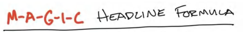

Giống như cái cây đổ trong rừng mà không ai nghe thấy, việc sở hữu một Grand Slam Offer sẽ chẳng thể kiếm cho bạn đồng nào nếu không ai phát hiện ra nó. Mục tiêu đặt ra là khi nghe về offer của bạn, những chân dung khách hàng lý tưởng (ideal prospects) phải đủ hào hứng để hành động. Đặt tên đúng cách là một phần không thể thiếu của quá trình này. 

Dưới đây là một ví dụ. Giả sử bạn nhìn thấy dòng chữ "Thử thách 6 Tuần Giải Tỏa Căng Thẳng Miễn Phí" và "Buổi Trải Nghiệm Buồng Phao Tắm (Float Tank Center Session)". Dù chúng có thể là một, chỉ khác tên gọi, nhưng chắc chắn bạn sẽ có xu hướng tương tác với cái đầu tiên nhiều hơn. 

Và đây là khúc mắc: theo thời gian, các offer sẽ bị nhàm chán (fatigue). Ở các thị trường địa phương (local markets), sự nhàm chán này còn diễn ra nhanh hơn nữa. Tại sao? Trong một thị trường nội địa, chi phí để tiếp cận toàn bộ dân số là tương đối thấp. Trên hầu hết các nền tảng, bạn chỉ mất khoảng 20 đô-la để tiếp cận 1.000 người. Vậy nên, nếu khu vực mục tiêu của bạn có 200.000 dân, bạn chỉ tốn vỏn vẹn 10.000 đô-la để tiếp cận toàn bộ họ một lần. 

<u>Tuyên bố miễn trừ quan trọng: tiếp cận khán giả một lần không đồng nghĩa với việc offer đã bị nhàm chán.</u> Hầu hết mọi người thậm chí còn chẳng chú ý đến một offer ngay từ lần đầu tiên nhìn thấy. Đó là lý do bạn cần tạo ra các tài nguyên sáng tạo mới (video, hình ảnh), những cái móc câu (hooks) mới, câu chuyện mới và copy mới xoay quanh cùng một offer đó. Bạn vẫn có thể sử dụng các offer trong một thời gian dài. Nhưng khi chúng ta nói đến việc sử dụng tính bằng *năm*, chứ không phải bằng tháng, các offer cuối cùng cũng sẽ đến lúc bị bão hòa. 

Theo thời gian, bạn có thể đổi tên offer để làm mới nó. Chỉ riêng khái niệm này thôi cũng sẽ đem lại cho bạn lead mãi mãi. Tôi không đùa đâu. Thế nên hãy chú ý kỹ. Chúng ta *không hề* thay đổi offer thực tế. Chúng ta chỉ thay đổi *tấm giấy gói* mà thôi. 

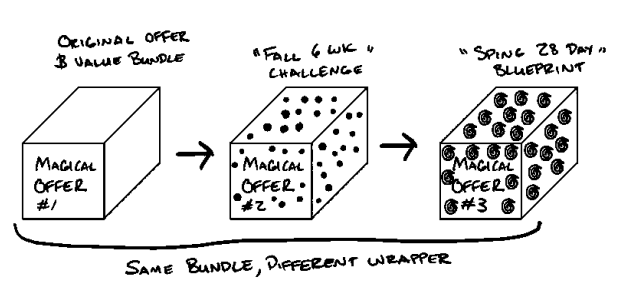

Nếu bạn đã dựng lên một gói sản phẩm/dịch vụ tổng hợp (bundled offering), về cơ bản bạn vẫn sẽ làm những công việc giống hệt nhau. Công sức bạn bỏ ra, dịch vụ bạn cung cấp và sản phẩm bạn mang lại sẽ giữ nguyên không đổi khi cái tên dịch chuyển. Một lần nữa, chúng ta chỉ đang thay đổi lớp vỏ bọc bên ngoài. 

Dưới đây là công thức đơn giản nhất mà tôi đúc kết được cho quá trình này: 

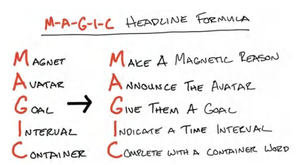

Lưu ý quan trọng: Không phải tất cả các thành phần này đều bắt buộc. Thông thường, bạn sẽ dùng từ ba đến năm thành phần trong số đó khi đặt tên cho một chương trình hoặc dịch vụ. Nếu nhét được tất cả vào thì quá tuyệt, nhưng khả năng cao là cái tên sẽ trở nên quá dài dòng. 

Càng ngắn gọn và súc tích càng tốt. Vì vậy, đó là bài toán cân bằng giữa độ ngắn và tính cụ thể. Cách duy nhất để thực sự biết thứ gì hiệu quả là viết các cái tên ra và kiểm chứng chúng. Giờ hãy cùng đi qua từng thành phần nhé. 

> **Lời Tác Giả: Lý Thuyết Marketing** 
> 
> Nếu bạn thích tìm hiểu các khái niệm đằng sau công thức M-A-G-I-C do tôi lựa chọn, thì mỗi chữ cái tượng trưng cho: Sự chú ý (M-Magnet), Sự phân tách/lọc khách hàng (A-Avatar), Mục đích (G-Goal), Khung thời gian (I-Interval), và Phương pháp (C-Container). 

### **Tạo Ra "Lý Do" Đầy Sức Hút (Magnetic “Reason Why”)** 

Chúng ta bắt đầu tên gọi bằng một từ hoặc cụm từ cho mọi người biết "lý do" tại sao chúng ta đang chạy chương trình khuyến mãi này. 

Tôi thích khuyên mọi người hãy tư duy như một tay tổ chức tiệc của hội sinh viên (fraternity). Hồi tôi còn học đại học, chúng tôi từng tổ chức một bữa tiệc chỉ vì có một anh chàng vừa đi nhổ răng khôn. Tôi kể chuyện này để thấy rằng... "lý do" thực sự có thể là bất cứ thứ gì. 

Nó không thực sự quan trọng miễn là bạn tin vào điều đó. Bạn thậm chí có thể biến nó thành một trò đùa giống như ví dụ về hội sinh viên kia. Nhưng nó phải trả lời được một hoặc cả hai câu hỏi sau: *Tại sao họ lại tung ra một offer tuyệt vời đến vậy?* hoặc *Tại sao tôi nên phản hồi lại offer này? / Tôi nhận được lợi ích gì từ nó?* 

**<u>Ví dụ:</u>** Miễn phí, Giảm giá 88%, Tặng quà; Giảm giá 88%, Mùa Xuân, Mùa Hè, Tựu Trường; Khai Trương; Ban Quản Lý Mới; Tòa Nhà Mới; Kỷ Niệm Ngày Thành Lập; Lễ Hội Ma Quái (Halloween); Năm Mới. 

**<u>Lưu ý:</u>** Tôi sẽ bàn về cách kiếm tiền từ các offer miễn phí và giảm giá trong Tập III: Các Mô Hình Tiền Tệ (Money Models). 

### **Công Bố Chân Dung Khách Hàng (Avatar) Của Bạn** 

Thành phần này gọi tên trực tiếp avatar lý tưởng của bạn: ai là người bạn đang tìm kiếm và ai là người bạn KHÔNG muốn phục vụ làm khách hàng. Bạn cần phải cụ thể hóa hết mức có thể, nhưng đừng quá đà. Khi ở một thị trường địa phương, tiêu đề của bạn càng gắn mốc địa phương bao nhiêu, tỷ lệ chuyển đổi càng cao bấy nhiêu. Vì vậy, đừng chỉ nêu tên thành phố, hãy cố gắng thu hẹp xuống các khu vực thị trường nhỏ hơn (sub-market), hoặc khu vực siêu địa phương (hyper-local). Đừng ghi Baltimore, hãy ghi Towson, MD. Đừng ghi Chicago, hãy ghi Hinsdale, v.v. 

**<u>Ví dụ:</u>** Nha sĩ vùng Bee Cave, Cácà bà nội trợ vùng Rolling Hills, Doanh nghiệp Gạch & Vữa (Brick & Mortar), Chủ Salon, Vận động viên Đã Giải Nghệ, Các Giám Đốc Bận Rộn ở Brooklyn. 

### **Giao Cho Họ Một Mục Tiêu (Give Them A Goal)** 

Đây là nơi bạn diễn đạt kết quả trong mơ (dream outcome) của khách hàng. Nó có thể chỉ là một từ đơn hoặc một cụm từ. Đó có thể là một sự kiện, một cảm xúc, một trải nghiệm, hoặc một kết quả – bất cứ thứ gì khiến họ hào hứng. Càng cụ thể và hữu hình bao nhiêu càng tốt. **<u>Ví dụ:</u>** Không Đau Đớn, Nụ Cười Người Nổi Tiếng, Hạng Nhất, Không Bao Giờ Hụt Hơi, Sản Phẩm Hoàn Hảo, Grand Slam Offer, Chiếc Váy Đen Nhỏ, Nhân Đôi Lợi Nhuận, Khách Hàng Đầu Tiên, Phân Khúc Cao Cấp (High Ticket), Doanh Thu 7 Con Số, 100k, v.v.

### **Chỉ định Khoảng thời gian (Time Interval)**

Bạn chỉ đơn giản là cho mọi người biết khoảng thời gian họ có thể kỳ vọng. Điều này đưa ra một ví dụ về việc kết quả của họ sẽ mất bao lâu để đạt được.

*Lưu ý:* Nếu bạn đưa ra bất kỳ tuyên bố định lượng nào (như mức tăng thu nhập hoặc giảm cân), hầu hết các nền tảng sẽ *không* phê duyệt kiểu thông điệp này *nếu kèm theo* một khoảng thời gian cụ thể để đạt được kết quả, bởi vì nó ngụ ý một sự đảm bảo. Nó ngụ ý rằng họ chắc chắn sẽ đạt được kết quả này trong một khoảng thời gian nhất định, điều này đi ngược lại các quy tắc của nhiều nền tảng. Vì vậy, đừng đưa ra kết quả định lượng đi kèm khoảng thời gian trừ khi nền tảng của bạn cho phép điều đó. Dù vậy, thời gian là một thành tố cực kỳ mạnh mẽ trong một Grand Slam Offer (Lời chào hàng đỉnh cao) và bạn chắc chắn nên sử dụng nó ở bất cứ đâu không bị vướng về vấn đề kiểm duyệt (compliance). Hoặc nếu mục tiêu bạn giúp họ đạt được không hẳn là một "tuyên bố" mang tính cam kết, thì hãy cứ thoải mái sử dụng khoảng thời gian. "10.000 đô-la trong 10 ngày" so với "Chốt Đơn Hàng Đầu Tiên Trong 10 Ngày".

**<u>Ví dụ:</u>** AA Phút, BB Giờ, CC Ngày, DD Tuần, Z Tháng. "4 Giờ", "21 Ngày", "6 Tuần", "3 Tháng".

### **Hoàn thiện với Từ khóa Nhóm (Container Word)**

Từ khóa nhóm biểu thị rằng lời chào hàng này là một gói gồm rất nhiều thành phần được kết hợp lại với nhau. Nó là một hệ thống. Nó là thứ không thể bị đánh đồng với các lựa chọn thay thế mang tính hàng hóa phổ thông (commoditized alternative).

**<u>Ví dụ:</u>** Thử thách (Challenge), Bản thiết kế (Blueprint), Trại huấn luyện (Bootcamp), Khóa chuyên sâu (Intensive), Vườn ươm (Incubator), Siêu khóa học (Masterclass), Chương trình (Program), Giải độc (Detox), Trải nghiệm (Experience), Hội nghị thượng đỉnh (Summit), Trạm tăng tốc (Accelerator), Lối tắt (Fast Track), Đường tắt (Shortcut), Chạy nước rút (Sprint), Lễ ra mắt (Launch), Dây thun trợ lực (Slingshot), Máy phóng (Catapult), Sự bùng nổ (Explosion), Hệ thống (System), Chuyến nghỉ dưỡng (Getaway), Buổi gặp gỡ (Meetup), Sự chuyển đổi (Transformation), Nhóm cao thủ (Mastermind), Kế hoạch hành động (Game Plan), Nghiên cứu chuyên sâu (Deep Dive), Buổi workshop (Workshop), Cuộc lội ngược dòng (Comeback), Sự tái sinh (Rebirth), Cuộc tấn công (Attack), Cuộc đột kích (Assault), Đợt thiết lập lại (Reset), Giải pháp (Solution), Mẹo hay (Hack), Mã gian lận (Cheatcode), Cú bứt phá (Liftoff), V.v.

> **Mẹo chuyên gia: Tìm vần điệu (Rhyme)**
> 
> Những vần điệu hay sẽ đọng lại trong tâm trí khách hàng. Hãy đặt tên chương trình có vần điệu để nắm chắc phần thắng.
> 
> Hãy tra Google "từ điển vần điệu" (rhyming dictionary) để tìm kiếm một lối tắt đơn giản. Lưu ý - Đừng cố ép buộc. Nó không phải là điều bắt buộc, nó chỉ là một yếu tố "có thì tuyệt" (nice-to-have).
> 
> Ví dụ: Lối tắt 6 múi (Six-Pack Fast Track), Chạy nước rút in sách 5 ngày (5-Day Book Print Sprint), Chuyên sâu hâm nóng hôn nhân (Marriage Thrive Deep Dive), Lối tắt 2 gạt bóng 12 tuần (12-Week 2-Putt Shortcut), Thiết lập lại không nợ 12 tuần (12-Month No-Debt Reset), Lối tắt vòng ba siêu sao (Celebrity Butt Shortcut), Siêu khóa học săn người yêu (just thought it was funny - đoạn này tác giả đùa vui), v.v. Bạn hiểu ý tôi rồi đấy.

> **Mẹo chuyên gia: Phép Điệp Âm (Alliteration)**
> 
> Điệp âm là khi bạn làm cho tất cả (hoặc phần lớn) các từ bắt đầu bằng cùng một chữ cái hoặc âm tiết.
> 
> Một cách tiếp cận thay thế cho việc gieo vần là sử dụng phép điệp âm khi đặt tên cho chương trình của bạn. Điều này dễ thực hiện hơn đối với hầu hết mọi người so với việc tìm vần. Một lần nữa, bạn không bắt buộc phải gieo vần hay điệp âm. Đừng cố gượng ép.
> 
> **Ví dụ:** Siêu khóa học kiếm tiền (Make Money Masterclass), Thử thách thay đổi cuộc đời (Change Your Life Challenge), Trại huấn luyện vòng ba khủng (Big Booty Bootcamp), Giải độc nợ nần (Debt Detox), Thiết lập lại bất động sản (Real Estate Reset), Cú bứt phá cho Life Coach (Life Coach Liftoff), V.v.

Tôi có thể hơi kỳ quặc, nhưng việc đặt tên cho các offer là một trong những phần tôi thích nhất trong toàn bộ quy trình này. Điều tôi muốn nhấn mạnh, một lần nữa, là mô hình kiếm tiền, chiến lược giá và các dịch vụ thực tế của bạn sẽ hầu như không thay đổi. Việc thay đổi lớp vỏ bọc (wrapper) đơn giản có nghĩa là thay đổi nhận thức bên ngoài về Grand Slam Offer của bạn là gì.

Dưới đây, bạn sẽ tìm thấy một vài ví dụ về các offer được đặt tên cho các ngành hàng khác nhau.

**<u>Sức khỏe & Thể hình (Wellness)</u>**

- Thử thách 6 tuần lấy lại vóc dáng đón Halloween (Miễn phí)
- Giảm 88% Gói thiết kế Bikini 12 tuần
- 21 ngày lột xác cho mẹ bỉm sữa (Miễn phí)
- Hệ thống tóc chuẩn người mẫu khiến bạn bè ghen tị trong 60 phút
- Thử thách 6 tuần xả stress
- Cúi người không đau trong 42 ngày (Miễn phí!) . . . Chạy nước rút phục hồi nhanh

**<u>Y tế & Nha khoa (Doctors)</u>**

- Giảm 2.000 USD cho gói biến hóa nụ cười ngôi sao
- Các mẹ bỉm Lakeway - Giảm 1.500 USD niềng răng cho bé
- Các mẹ bỉm Lakeway - 12 tháng để có nụ cười hoàn hảo (Giảm 1.000 USD cho 15 gia đình)
- Quà tặng niềng răng miễn phí mùa tựu trường
- Khai trương: Miễn phí X-quang & Điều trị - Giảm đau tức thì
- Hết đau lưng! Chuyên sâu phục hồi nhanh 90 ngày (Giảm 81%!)
- Căng cơ ư? Ưu đãi mùa hè 1 USD cho khách hàng mới trải nghiệm massage

**<u>Huấn luyện & Đào tạo (Coaching)</u>**

- Bản thiết kế chốt 5 khách hàng trong 5 ngày
- Chương trình chuyên sâu 12 tuần dành cho Agency 7 con số
- 14 ngày tìm ra sản phẩm ra mắt hoàn hảo
- Lấp đầy phòng tập của bạn trong 30 ngày (Miễn phí!)

Tôi có thể tiếp tục liệt kê danh sách này, nhưng hy vọng bạn đã hiểu rõ ý tưởng. Giờ là lúc bạn tự tay áp dụng nó cho Grand Slam Offer của mình. Một lần nữa, bạn không nhất thiết phải dùng mọi thành tố quyền năng của tiêu đề. Việc sử dụng từ ba đến năm thành tố thường sẽ tạo ra một thứ gì đó độc đáo và đáng khao khát hơn, cho phép bạn tách biệt bản thân khỏi các đối thủ cạnh tranh và tạo ra một offer thu hút lượt click, tương tác, và cuối cùng là mang lại tiền cho bạn.

Hơn nữa, bạn không cần phải sắp xếp chúng theo thứ tự M-A-G-I-C. Hãy làm bất cứ điều gì nghe có vẻ ấn tượng và mạnh mẽ nhất đối với bạn. Sau khi làm việc này một thời gian, bạn sẽ thấy một số offer có tỷ lệ chuyển đổi tốt hơn những cái khác. Đó là điều tự nhiên. Và thỉnh thoảng, bạn sẽ tạo ra một cái tên bay cao như tên lửa. Thành thật mà nói, tôi hoàn toàn không hiểu tại sao một số cái tên lại thắng đậm trong khi những cái khác thì không. Vì vậy, đừng quá cảm tính về điều đó. Hãy tiếp tục thử nghiệm. Tiếp tục vấp ngã. Rồi lại thử tiếp. Bạn sẽ đạt được kết quả mong muốn.

Bây giờ bạn đã có vài cái tên khả thi cho offer của mình, bạn có thể dùng 2 đến 3 cái tên xuất sắc nhất trong chiến dịch quảng cáo của mình. Nhanh chóng xác định cái tên chiến thắng, sau đó dùng nó làm chuẩn (control) để thử nghiệm đọ sức với các cái tên mới. Đó là cách bạn triển khai truyền thông.

> **Mẹo chuyên gia - Đặt tên cho Tiểu mục & Quà tặng (Bonuses)**
> 
> Hãy áp dụng công thức tiêu đề thần kỳ cho từng mục trong danh mục sản phẩm và gói ưu đãi (stack and bundle) của bạn. Nó sẽ tự động nâng tầm giá trị các dịch vụ của bạn chỉ bằng cách đặt tên sao cho chạm đúng tần số với khách hàng tiềm năng.

### **Chuyện gì xảy ra khi Khách hàng nhàm chán với Offer (Offers Fatigue)**

Khi bạn tiếp tục chạy quảng cáo các offer, bạn sẽ cần tạo ra các biến thể theo thời gian khi thị hiếu của thị trường thay đổi. Dưới đây là thứ tự các bước bạn sẽ thay đổi để giữ cho dòng chảy lead (khách hàng tiềm năng) luôn ổn định.

1. Thay đổi yếu tố sáng tạo (creative - hình ảnh và video trong quảng cáo của bạn)
2. Thay đổi phần nội dung văn bản (body copy) trong quảng cáo
3. Thay đổi tiêu đề - "lớp vỏ bọc" (wrapper) của offer
4. Đổi từ "Thử thách 6 tuần lấy lại vóc dáng" thành "Thử thách 6 tuần săn chắc cơ thể"
5. Đổi từ "Hậu tiệc tùng mùa lễ hội" thành "Năm mới, Tôi phiên bản mới"
6. Thay đổi độ thời gian (duration) của offer
7. Thay đổi chất xúc tác/thành tố gia tăng giá trị (enhancer) của offer (phần quà tặng miễn phí hoặc giảm giá của bạn)
8. Thay đổi cấu trúc kiếm tiền (monetization structure), chuỗi các offer bạn đưa ra cho khách hàng tiềm năng, và mức giá đi kèm với chúng (Sách II)

Tôi tuân theo bộ khung biến thể này bởi vì phần lớn thời gian, chỉ cần thay đổi vài hạng mục đầu tiên là đủ. Thông thường, chúng cần được thay đổi lặp đi lặp lại mà không cần chạm vào bất cứ thứ gì ở cuối danh sách.

Ví dụ, khi quảng cáo bắt đầu thoái trào, chúng ta không thay đổi toàn bộ mô hình kinh doanh; chúng ta chỉ chạy lại chính quảng cáo đó với một video hoặc hình ảnh khác. Một khi cách đó ngừng hiệu quả, chúng ta lại thay đổi tiếp. Cuối cùng, bạn sẽ cần phải đổi câu chữ trong quảng cáo. Và lặp lại quy trình đó. Lúc đó, và chỉ khi đó, bạn mới cần thay đổi lớp vỏ bọc (wrapper).

Giả sử chúng ta đổi từ "Thử thách 6 tuần xả stress" thành "Thử thách 42 ngày thư giãn mùa lễ hội" cho một trung tâm massage. Vẫn là offer cốt lõi đó, chỉ là một lớp vỏ bọc khác. Sau đó, tất nhiên, bạn có thể thay đổi thời gian của offer - từ sáu tuần thành 28 ngày hoặc tám tuần, v.v. Bạn càng xuống sâu phía dưới danh sách, áp lực vận hành càng lớn, vì vậy hãy chắc chắn rằng bạn đã vắt kiệt sức các cách biến hóa "nhẹ nhàng" hơn ở phía trên.

Một khi bạn đã kiếm được tiền từ một offer, rất hiếm khi bạn phải thay đổi nó. Chỉ cần làm sạch, lặp đi lặp lại và lặp lại liên tục. Điều này có thể rất khó đối với chúng ta vì bản chất là những nhà sáng lập (entrepreneurs) và chúng ta *rất thích* sự thay đổi. Sự thay đổi ở đây thường chỉ tạo ra sự kém hiệu quả và lực cản vận hành, làm bạn mất tiền. No bueno (Không ổn chút nào).

Vì vậy, hãy trút chứng "tăng động giảm chú ý" (ADD) của nhà sáng lập lên phần "lớp vỏ bọc" trước - giao diện và cảm nhận của offer (copy, hình ảnh sáng tạo, tiêu đề). Sau đó thay đổi tính thời vụ của offer. Tiếp đến là thay đổi thời gian. Nếu bạn vẫn thấy bế tắc, hãy thay đổi thứ bạn đang tặng miễn phí hoặc giảm giá. Thay đổi toàn bộ cỗ máy phía sau *chỉ khi* là phương án cuối cùng và có lý do chính đáng, đặc biệt là một khi bạn đã tạo được đà (traction).

*Nhưng làm thế nào để tạo được đà ban đầu?* Câu hỏi hay đấy. Hãy thử cấu trúc offer và tiêu đề mà bạn cho là có khả năng thành công cao nhất. Sau đó kiên định với nó.

Và nếu thoạt đầu chúng chưa tạo ra chuyển đổi, đừng lo lắng. Bạn sẽ làm tốt dần lên. Thông thường, nếu bạn đang áp dụng những mô hình này, *rất nhiều* trong số chúng sẽ thành công. Trong trường hợp đó, hãy gắn bó với cái mang lại cho bạn lợi nhuận cao nhất. Bạn cũng có thể luân chuyển giữa các offer nếu việc đó không tạo ra quá nhiều lực cản vận hành đối với loại hình kinh doanh của bạn. Đây chính là vị thế quyền lực tối thượng. Bạn có nhiều "quân át chủ bài" trong tay để tung ra bất cứ lúc nào, giúp hoạt động marketing của bạn duy trì tỷ lệ chuyển đổi ở mức cao hơn nữa.

> **Ghi chú từ Tác giả - Marketing cho Doanh nghiệp Địa phương (Local Businesses)**
> 
> Trớ trêu thay, marketing cho doanh nghiệp địa phương vừa dễ hơn lại vừa khó hơn so với marketing cấp quốc gia. Dễ khiến nó hoạt động trơn tru lúc đầu, nhưng lại khó duy trì hiệu quả hoặc mở rộng quy mô về lâu dài. Lý do là - tại các thị trường địa phương, việc tạo dựng niềm tin nhờ sự quen thuộc sẽ dễ hơn. Vì vậy, việc bán hàng trực tiếp với mức giá cao hơn tại thị trường địa phương vốn dĩ dễ dàng hơn rất nhiều. Điều đó có nghĩa là bạn sẽ chốt được tỷ lệ phần trăm lead cao hơn đáng kể. Điều này giúp cho marketing hầu như luôn hiệu quả.
> 
> Mặt trái của marketing địa phương là các offer rất nhanh bị nhàm chán (fatigue) bởi vì doanh nghiệp địa phương chỉ có thể phục vụ trong một bán kính giới hạn. Nhắc lại một khái niệm trước đó, TAM (tổng thị trường khả dụng - total addressable market) của một cửa hàng mặt đất (brick & mortar) chỉ là bán kính lân cận ngay quanh nó (hầu hết là vậy). Do đó, suy rộng ra, bán kính càng nhỏ, offer càng nhanh thoái trào. Đây chính là con dao hai lưỡi của marketing địa phương.
> 
> Học cách biến hóa nhanh chóng các offer, tiêu đề và hình ảnh sáng tạo khi tôi làm kinh doanh địa phương là một kỹ năng nền tảng giúp việc mở rộng sang quảng cáo cấp quốc gia trở nên dễ dàng hơn rất nhiều đối với tôi. Vì vậy, nếu bạn đang ở thị trường địa phương, hãy nhớ rằng bạn sẽ không thay đổi tháp giá trị (value stack) của offer. Bạn chỉ đơn giản là thay đổi cách nó *trông có vẻ* hấp dẫn như thế nào đối với thị trường trong chiến dịch marketing của mình.

### **Tóm tắt về Cách đặt tên (Naming Summary)**

Chúng ta phải đặt tên cho offer một cách thích hợp để thu hút đúng đối tượng mục tiêu (avatar) đến với doanh nghiệp của mình. Quả thực đúng như câu tục ngữ, người ta *vẫn* đánh giá một cuốn sách qua trang bìa của nó. Việc đặt tên hời hợt cho sản phẩm hoặc offer có thể phá hỏng tỷ lệ chuyển đổi. Đừng biến mình thành nạn nhân của sự lười biếng trong việc đặt tên. Hãy làm theo các bước ở đây để đặt tên cho dịch vụ hoặc sản phẩm của bạn và chứng kiến cùng một offer đó đạt tỷ lệ phản hồi gấp 2x, 3x, hoặc thậm chí 10x. Bạn sẽ tin điều đó khi tận mắt nhìn thấy nó - tôi biết tôi đã từng như vậy.

### **Tổng kết Phần Nâng tầm Offer (Enhancing Your Offer Section Recap)**

Xin chúc mừng! Bạn đã tìm ra cách làm cho offer của mình trở nên giá trị, cách chia nhỏ dịch vụ thành các thành phần, và cách đóng gói lại chúng thành một tổng thể giá trị hơn.

Bạn đã thêm vào một lời bảo đảm (guarantee) để nhiều người mua offer của bạn hơn và thực sự tiêu thụ nó để họ có thể đạt được thành công lớn hơn. Bạn đã trình bày nó bằng sự cấp bách (urgency) và sự khan hiếm (scarcity) để khiến nhiều người khao khát nó hơn.

Và giờ đây, bạn đã đặt tên cho offer của mình để thu hút đúng khách hàng tiềm năng và loại bỏ những kẻ tồi tệ, đồng thời truyền tải một lời hứa to lớn mà ai cũng có thể hiểu được.

Nhưng chúng ta đã đi qua rất nhiều thứ, nên tôi muốn cho bạn nghỉ ngơi một chút trước khi dấn thân vào Sách II để giúp bạn thu hút khách hàng và kiếm tiền từ offer của mình.

> **Quà tặng Miễn phí # 10 BONUS: Tạo Cái tên Hoàn hảo Cho Sản phẩm của Bạn**
> 
> Đặt tên sản phẩm đúng cách giúp khách hàng mục tiêu biết rằng sản phẩm đó dành riêng cho họ, rất có giá trị và sẽ giải quyết được vấn đề của họ. Nếu bạn muốn thực hành điều này trực tiếp cùng tôi, hãy truy cập **<u>Acquisition.com/training/offers</u>** và chọn **“Naming Products”** để xem video hướng dẫn ngắn, giúp bạn bắt đầu áp dụng ngay vào doanh nghiệp để chốt thêm nhiều đơn hàng CÀNG SỚM CÀNG TỐT. Tôi cũng đã soạn sẵn một **<u>Bản kiểm tra công thức đặt tên miễn phí (Free Naming Formula Checklist)</u>** cho bạn sử dụng và tái sử dụng cùng đội ngũ của mình. Nó cũng hoạt động hiệu quả khi đặt tên cho các chương trình khuyến mãi. Như mọi khi, nó hoàn toàn miễn phí. Hãy tận hưởng nhé.

# PHẦN V: THỰC THI (EXECUTION)

**LÀM THẾ NÀO ĐỂ BIẾT ĐIỀU NÀY THÀNH HIỆN THỰC TRONG THẾ GIỚI THỰC**

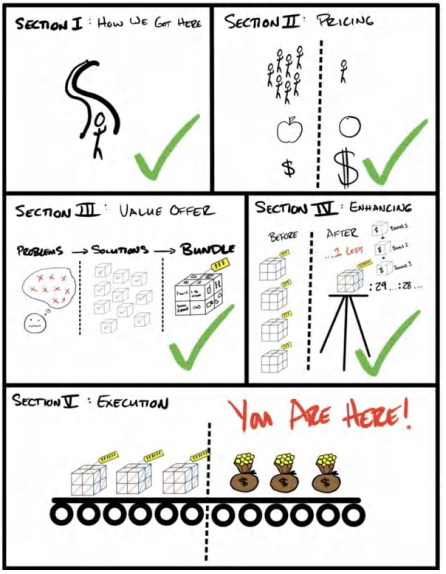

## 100.000 USD ĐẦU TIÊN CỦA BẠN

> *"100.000 USD đầu tiên thực sự là một cơn ác mộng quái quỷ, nhưng bạn bắt buộc phải vượt qua nó. Tôi không quan tâm bạn phải làm gì—nếu điều đó có nghĩa là đi bộ khắp mọi nơi và không ăn bất cứ thứ gì không được mua bằng phiếu giảm giá, hãy tìm cách bỏ túi cho bằng được 100.000 USD. Sau đó, bạn có thể giảm bớt áp lực chân ga một chút."*
> 
> CHARLIE MUNGER, PHÓ CHỦ TỊCH BERKSHIRE HATHAWAY

**_Tháng 3 năm 2017._**

Tim tôi đập loạn nhịp. Tôi có thể cảm nhận rõ từng nhịp đập thình thịch trong lồng ngực. Tôi nghiến chặt hàm để ngăn cục nghẹn ở cổ họng – thứ chực chờ biến thành những giọt nước mắt. Tôi muốn buông xuôi. Bao năm qua, biết bao cảm xúc đã bị dồn nén đến tận cùng.

Nhiều năm phớt lờ thực tại và những thất bại ê chề. Nhiều năm gác lại mọi cảm xúc cá nhân để chỉ tập trung vào việc *tiến về phía trước*. Áp lực đã chực trào lên bề mặt. Tôi có thể *cảm nhận* rõ điều đó.

“Chúng ta làm được rồi em,” tôi nói.

Leila, người giờ đây là vợ tôi, ngẩng lên nhìn tôi. Cô ấy đang nấu bữa tối trong bếp và khựng lại, tay vẫn cầm chiếc xẻng lật thức ăn. “Ý anh là sao?”

“Chúng ta làm được rồi. Chúng ta chạm mốc 100k rồi.” Tôi cố rít từng từ qua kẽ răng vì sợ những giọt nước mắt sẽ phá vỡ giọng nói đang run lẩy bẩy của mình.

“Ý anh là doanh thu á?”

- “Không. Là tiền trong tài khoản cá nhân ấy.”

- “Vãi chưởng, thật á?! Đỉnh thế!!”

Cô ấy chạy ào về phía tôi, mặc kệ nồi niêu trên bếp, vòng tay ôm chầm lấy cổ tôi, tay vẫn cầm nguyên chiếc xẻng.

“Em tự hào về anh quá.”

Cô ấy siết chặt lấy tôi. Tôi đổ sụp vào vòng tay cô. Cảm giác như mọi nút thắt trong cơ thể mà tôi phải gồng mình gánh chịu bấy lâu nay đã tan chảy cùng một lúc. Tôi suýt không kìm được cảm xúc của mình. Nhưng khi nghĩ lại, cảm giác lúc đó không phải là hạnh phúc. Mà là sự nhẹ nhõm. Tôi đã chuyển từ sợ hãi sang an tâm. Tôi đã từ bỏ cái cảm giác mỗi ngày đều thấy mình như một kẻ thất bại, nhìn công sức và nỗ lực đổ sông đổ biển, để cuối cùng biến một giấc mơ thành hiện thực. Sự lo lắng và nỗi sợ trực chờ “rồi tụi mình sẽ sống sao đây” *cuối cùng* đã được thay thế bằng một thứ khác. Cuối cùng tôi cũng có thời gian để cho phép bản thân cảm nhận một điều gì đó.

Tôi có cảm giác chương sách “đầy gian truân” trong cuộc đời mình cuối cùng đã khép lại.

“Nhìn này,” tôi nói. “Thật đấy, không đùa đâu.”

Tôi rướn đầu ra khỏi vòng tay Leila. Tôi không dám nhìn thẳng vào mắt cô ấy vì biết điều đó sẽ khiến tôi vỡ oà. Tôi rút điện thoại ra và đặt lên giữa hai chúng tôi. Cả hai cùng dán mắt vào màn hình hiển thị số dư tài khoản ngân hàng không thay đổi. _101.018 đô-la_

Ánh mắt chúng tôi không rời, xác nhận một thực tại mới mà cả hai cùng chia sẻ. Đó không phải là ảo ảnh. Đó không phải là doanh thu. Đó cũng chẳng phải là “lợi nhuận” vẫn nằm trong tài khoản công ty, chực chờ bị khoắng sạch bởi một khoản chi phí phát sinh nào đó. Đó không phải là khoản tiền “đã bị đánh dấu” để chuẩn bị trả nợ. Đó là của *chúng tôi*. Hoàn toàn là sự thật.

“Em yêu,” tôi nói. “Dù tụi mình có làm ăn bết bát đến mức không kiếm nổi một xu nào trong ba năm liền, thì chúng ta vẫn sống ổn.”

Vào thời điểm đó, 33.000 USD mỗi năm là quá đủ để chúng tôi chi trả cho mức sống hiện tại trong suốt ba năm, *thậm chí còn dư dả chán*.

Nhiều năm thăng trầm. Nhiều năm đổ tiền vào (các) doanh nghiệp chỉ để nhìn nó bốc hơi vào chi phí vận hành, lương bổng và những sai lầm ngớ ngẩn. Nhiều năm tham gia hội thảo, khóa học, workshop, chương trình coaching, mastermind… C-U-Ố-I CÙNG cũng đã chuyển hóa thành tài sản thực thụ. Cảm giác lúc đó như thể tôi vừa bước sang một đẳng cấp hoàn toàn mới. Sự gia tăng vượt bậc về tài sản này lớn hơn bất cứ cảm xúc nào tôi từng trải qua.

Nhiều năm sau, khi trong ngân hàng đã có hàng chục triệu đô la, thì đây vẫn là khoảnh khắc tôi cảm thấy mình giàu có nhất trong đời. Đó là khởi đầu cho chương tiếp theo trong cuộc đời tôi với tư cách là một doanh nhân.

Có người đạt được điều đó nhanh chóng. Có người đi chậm hơn. Nhưng cuối cùng thì ai rồi cũng sẽ tới đích, miễn là bạn không từ bỏ. Hãy tiếp tục tiến bước. Hãy đứng dậy sau vấp ngã. Hãy tiếp tục tin tưởng điều đó có thể xảy ra.

Và nó nhất định sẽ xảy ra.

## **Tóm Lại**

Chúng ta đã đi qua rất nhiều nội dung. Và tôi tin rằng để kiến thức thực sự ngấm vào đầu, nó cần được cô đọng và hệ thống hóa lại. Dưới đây là danh sách tóm tắt theo kiểu “ghi chú trên mặt sau khăn giấy” để tổng kết lại những gì chúng ta đã học và lý do tại sao:

1. Chúng ta đã bàn về lý do tại sao bạn không được phép trở thành một mặt hàng đại trà (commodity) trên thị trường này.

2. Tại sao bạn nên chọn một thị trường đang phát triển hoặc ổn định, và tại sao ngách (niche) lại mang lại sự giàu có.

3. Tại sao bạn nên định giá sản phẩm thật cao.

4. Cách định giá cao dựa trên bốn động lực giá trị cốt lõi (four core value drivers).

5. Cách xây dựng Grand Slam Offer chỉ trong năm bước.

6. Cách gia tăng giá trị (stack the value), bàn giao nó và tối ưu hóa lợi nhuận.

7. Cách xoay chuyển đường cầu (demand curve) về phía có lợi cho bạn bằng sự khan hiếm (scarcity).

8. Cách tận dụng tính cấp bách (urgency) để giảm ngưỡng hành động (action threshold) của người mua.

9. Cách sử dụng quà tặng (bonuses) một cách chiến lược để thổi bùng nhu cầu đối với offer của bạn.

10. Cách xóa sạch rủi ro cho người mua bằng một chính sách bảo đảm (guarantees) sáng tạo.

11. Cách đặt tên sao cho chạm đến đúng khách hàng mục tiêu (avatar) của bạn.

Giờ đây, bạn đang nắm trong tay một Grand Slam Offer có giá trị cao, biên lợi nhuận lớn và không bị đại trà hóa. Đây là viên gạch nền móng đầu tiên để xây dựng một doanh nghiệp tuyệt vời — một sản phẩm hoặc dịch vụ mà mọi người khao khát sở hữu và thực sự giải quyết được vấn đề của họ. Đối với nhiều người, chừng này là quá đủ để tạo ra doanh số khủng hơn, giá bán cao hơn và nhiều lợi nhuận hơn. Grand Slam Offer thực thụ đầu tiên sẽ là bệ phóng đưa bạn chạm mốc 100.000 USD đầu tiên. Với những ai vẫn muốn tiến xa hơn — điều đó hoàn toàn là quyền lợi chính đáng của một nhà tư bản như bạn.

Xây dựng một cỗ máy thu hút khách hàng *sinh lời* còn đòi hỏi nhiều hơn thế. Tôi không thể nhồi nhét tất cả vào một cuốn sách duy nhất. Để tôn trọng thời gian của bạn, tôi muốn cuốn sách này vừa sâu sắc vừa dễ tiêu hóa. Dù vậy, cuốn sách tiếp theo sẽ dành riêng cho mục tiêu đó — *kiếm được nhiều hơn nữa* — thông qua việc tạo ra khách hàng tiềm năng (Lead Generation). Trong cuốn sách đó, tôi sẽ mổ xẻ *từng bước một* cách để có được khách hàng *có lãi*. Nghĩa là, nếu bạn thiết kế các chương trình khuyến mãi chuẩn xác, bạn sẽ chẳng bao giờ phải bỏ tiền túi ra để mua khách hàng mới nữa. Đó chính là chủ đề của **<u>Acquisition.com Tập II - 100M: Lead Generation</u>**.

## **Lời Kết**

Làm kinh doanh suy cho cùng là quá trình mài giũa các kỹ năng, niềm tin và phẩm chất cá nhân. Để tiến xa hơn, tôi nhận thấy chúng ta phải xác định được mình còn *thiếu* kỹ năng, niềm tin hay phẩm chất gì. Hầu hết thời gian, chúng ta chỉ đơn giản là cần phải giỏi lên. Và cách duy nhất để làm được điều đó là học hỏi từ kinh nghiệm thực chiến và/hoặc từ các nguồn uy tín chất lượng cao. Tôi từng nhận những lời khuyên tồi tệ từ những người đi trước mình vào thời điểm đó. Và dù kinh nghiệm là người thầy *tuyệt vời nhất*, nhưng cô ta chưa bao giờ là người dịu dàng.

Tôi kỳ vọng tha thiết rằng những gì tôi truyền tải sẽ cung cấp ngọn hải đăng chỉ đường mà tôi từng khao khát đến cháy bỏng khi mới bắt đầu hành trình khởi nghiệp. Ước gì tôi có thể nhét tất cả vào một cuốn sách duy nhất (vì lợi ích của cả bạn và tôi). Nhưng để làm tròn trách nhiệm với bạn – điều mà tôi từng ước mình nhận được – tôi không thể làm thế. Con quỷ nằm ở chi tiết (the devil is in the details). Sự xuất sắc nằm ở chiều sâu kiến thức và những tiểu tiết tinh tế. Đó là lằn ranh phân định giữa những người vĩ đại và phần còn lại. Tôi hy vọng qua mọi nội dung tôi sản xuất, bạn sẽ thấy tâm huyết của tôi dành cho những chi tiết và tinh tế ấy – thứ tạo nên *sự khác biệt tuyệt đối*. Những bài học này đều được đánh đổi bằng máu và mồ hôi.

Tôi hy vọng bạn đã tận hưởng trọn vẹn tập đầu tiên trong series sách về Offer của tôi. Trước khi bước sang tập thứ hai tập trung vào việc tạo khách hàng tiềm năng như đã đề cập ở trên, tôi muốn quay trở lại điểm xuất phát ban đầu. Sau khi đọc xong cuốn sách này, tôi hy vọng rằng:

1. Bạn đã vững bước trên con đường tạo ra Grand Slam Offer đầu tiên của mình. Hoặc ít nhất, bạn đã có thể nhặt nhạnh những mảnh ghép còn thiếu để bổ sung vào offer của mình, giúp nó trở nên hấp dẫn hơn đối với thị trường.

2. Tôi đã giữ đúng lời hứa từ đầu sách: rằng việc đầu tư hai đến ba tiếng đồng hồ đọc sách này sẽ mang lại cho bạn tỷ suất lợi nhuận cao hơn hầu hết mọi thứ khác mà bạn có thể làm.

3. Đổi lại, tôi hy vọng mình đã đi được một bước nhỏ trên con đường chinh phục thứ tôi trân quý nhất từ bạn — **niềm tin của bạn**.

Cuối cùng, tôi hy vọng cuốn sách này sẽ góp phần tạo ra một cú hích nhỏ trong việc làm cho thế giới tốt đẹp hơn, bởi tôi tin chẳng có ai đến cứu chúng ta cả. Tất cả tùy thuộc vào chúng ta – những doanh nhân – tự đổi mới để kiến tạo một thế giới tốt đẹp hơn. Và đó là điều tôi sẵn sàng dâng hiến cả cuộc đời mình. Tôi cũng hy vọng bạn sẽ như vậy.

Tôi vô cùng biết ơn sự chú ý của bạn. Bạn có thể dành nó cho bất cứ thứ gì, nhưng bạn đã chọn đầu tư nó cùng tôi. Tôi thực sự trân trọng điều đó. Từ đáy lòng, xin cảm ơn bạn.

Hãy luôn khát khao, luôn dại khờ,

Alex

P.S - (hãy xem chiếc vé vàng bên dưới)

> **VÉ VÀNG: DÀNH CHO MỘT NGƯỜI**
> 
> **Nếu doanh nghiệp của bạn đang đạt mức doanh thu từ 3 triệu đến 50 triệu USD mỗi năm và bạn muốn nhận sự trợ giúp 1-1 từ tôi để scale (mở rộng) doanh nghiệp, hãy truy cập vào Acquisition.com. Cụ thể, chúng tôi chuyên giúp các công ty cung cấp dịch vụ, giáo dục, đào tạo, tư vấn, doanh nghiệp truyền thống (brick and mortar), hoặc cấp phép ngách scale** **_đến mức siêu lợi nhuận để họ chỉ cần làm giàu một lần duy nhất trong đời_ .** Tôi không phải kiểu người dạy bạn “kiếm đồng đô-la đầu tiên”, tôi là kiểu người giúp bạn “kiếm đồng đô-la cuối cùng mà bạn cần phải kiếm trong đời”. Nếu điều đó đúng với bạn, bạn đủ nhạy bén để tìm cách liên hệ với tôi qua website và đặt lịch gọi. Rất mong được gặp bạn, lắng nghe câu chuyện kinh doanh của bạn và xem liệu chúng tôi có thể giúp gì được cho bạn.

> **Bạn có từ chối việc tăng trưởng nhanh hơn không? Nếu không...**
> 
> **<u>SÁCH TIẾP THEO.</u>** Bạn có thể ngó qua cuốn **sách tiếp theo** của tôi với tựa đề rất sát nghĩa: **Acquisition.com Tập II - Lead Generation.** Cuốn sách này bàn về… việc tạo khách hàng tiềm năng. Bạn sẽ chẳng bao giờ cạn kiệt khách hàng mới nếu tuân thủ các bước trong cuốn sách đó (đặc biệt là khi bạn đã trang bị sẵn Grand Slam Offer mà chúng ta vừa xây dựng). Tôi chưa chắc đó có phải là tiêu đề chính thức không (sách vẫn đang trong quá trình biên tập), nhưng nếu bạn tìm kiếm tên tôi, bạn sẽ thấy nó. Bạn cũng có thể tìm thấy nó trên trang web của tôi Acquisition.com (hy vọng là vậy).
> 
> **<u>SÁCH NÓI (AUDIOBOOK).</u>** Nếu bạn thích nghe và muốn mang theo tất cả sách bên mình để tiện tra cứu (đó là cách tôi hay làm) thì bạn có thể tậu **bản audible & kindle của bất kỳ hoặc tất cả các cuốn sách của tôi trên Amazon.** Tôi thích vừa đọc vừa nghe cùng lúc để tăng tốc độ hấp thụ và tiêu thụ kiến thức. Chỉ cần gõ tên sách là cả hai định dạng sẽ hiện ra.
> 
> **<u>PODCAST.</u>** Nếu bạn thích nghe, tôi có một **Podcast tên là “The Game”**, nơi bạn có thể nghe các tập ngắn gọn cung cấp các bài học chiến thuật thực chiến (rút ra từ những lần thất bại) để giúp bạn đạt mục tiêu nhanh hơn. Hãy nghía qua podcast tại đây: alexspodcast.com
> 
> **<u>YOUTUBE.</u>** Tôi có một kênh Youtube đăng tải các video hướng dẫn mới hoàn toàn vài lần mỗi tuần: chỉ cần gõ tên tôi **“Alex Hormozi”** là tìm thấy.
> 
**<u>INSTAGRAM.</u>** Bạn có thể theo dõi tôi trên IG nếu thích những nội dung mang tính cá nhân hơn: **@hormozi**

