# **Lời khen dành cho** **_Gym Launch Secrets_**

Nhờ *Gym Launch Secrets*, chúng tôi từ chỗ lỗ chổng vó (doanh thu 3.000 USD/tháng nhưng chi tới 8.000 USD), chỉ còn cách ngày đóng cửa vỏn vẹn 3 tuần, đã vươn lên đạt doanh thu hơn 600.000 USD trong vòng 18 tháng và xây dựng được một đội ngũ 8 người. Quan trọng hơn, nó đã cứu sống toàn bộ sự nghiệp của chúng tôi và thắp lại ngọn lửa đam mê giúp đỡ mọi người! Cảm ơn anh, Alex!

**— Chris Barnett | Dream Body Fitness | Boise, Idaho**

Nếu bạn đọc kỹ, bạn sẽ tìm thấy câu chuyện của chính mình trong cuốn sách này. Khi gặp Alex, tôi chỉ còn chưa đầy một tháng nữa là phá sản và phải dùng tiền lẻ vét trong xe hơi để mua thức ăn cho con. Gym Launch không phải là một công ty Marketing, không phải là một chương trình coaching (huấn luyện), thậm chí cũng chẳng phải là động lực suông. Nó giống như một tấm vé số trúng thưởng mà bạn có thể đổi thưởng hết lần này đến lần khác nhờ vào những kỹ năng mà Alex và đội ngũ của anh ấy truyền授.

**— Josh Ponton | Renegade Boot Camps | Plano, Texas**

Những kiến thức trong cuốn sách này đã giúp chúng tôi nhân đôi doanh thu, giúp cơ sở thứ hai có lãi ngay trong tháng đầu tiên khai trương, và quan trọng nhất: xây dựng một doanh nghiệp thực thụ chứ không phải đi làm thuê cho chính mình! Đây là những kiến thức vô giá.

**— Mike and Dori Berean | Krav Maga Great Lakes | Brighton, Michigan**

Nhờ những kiến thức về marketing và retention (giữ chân khách hàng) mà Alex viết trong đây, chúng tôi đã tăng gấp đôi số lượng hội viên và gần như nhân ba doanh thu chỉ trong 6 tháng đầu tiên áp dụng hệ thống của anh ấy! Quả thực đây là cẩm nang vận hành phòng gym toàn diện nhất mà tôi từng thấy!

**— Ryan Carow | Vinco Fitness Systems LLC | Little Chute, Wisconsin**

Đây là tài liệu mang tính thực tiễn và cung cấp nhiều thông tin giá trị nhất mà tôi từng đọc trong suốt 15 năm qua. Nếu bạn đang kinh doanh trong lĩnh vực fitness (thể hình), bạn bắt buộc phải đọc cuốn sách này.

**— Trevor Kashey | TKN | Hilliard, Ohio**

Hệ thống của Alex Hormozi giống như một cỗ máy in tiền. Hãy áp dụng chúng để bỏ túi lợi nhuận gấp 10 lần.

**— Monika Arora | Women Rock Center | Calgary, Alberta, Canada**

Từ khi làm việc với Alex, tôi đã giảm được một nửa tỷ lệ attrition (khách hàng rời bỏ) chỉ bằng cách áp dụng vài chiến thuật của anh ấy. Gym Launch và đội ngũ của họ đơn giản là tuyệt vời nhất và họ thực sự quan tâm đến thành công của bạn. Nếu bạn muốn tiết kiệm hàng ngàn đô và kiếm được hàng ngàn đô, hãy đọc cuốn sách này.

**— Billy Whitehead | Quakertown Fitbody Boot Camp | Quakertown, Pennsylvania**

Với bản kế hoạch hành động từng bước đơn giản mà Alex đã vạch ra trong cuốn sách này, ngay cả một kẻ ngốc nghếch chẳng có chút kinh nghiệm kinh doanh nào cũng không thể làm hỏng việc. Đây chính là những mã gian lận (cheat codes) để xây dựng một phòng gym tạo ra doanh thu 7 con số cực kỳ lợi nhuận chỉ trong vài tháng, thay vì hàng thập kỷ.

**— Dallas James Wicker | The Transformation Center | Santa Rosa, California**

Nhờ *Gym Launch Secrets*, tôi đã vực dậy studio huấn luyện cá nhân (personal training studio) từ đống nợ 45.000 USD, chật vật không biết cách trả hóa đơn, để rồi kiếm được một phần tư triệu đô trong vòng 11 tháng nhờ áp dụng các quy trình từng bước này! Thật là một phước lành.

**— Mel Batterman | AMP Personal Fitness LLC | Las Vegas, Nevada**

Chính nhờ *Gym Launch Secrets* và Alex Hormozi, tôi đã cứu phòng gym của mình khỏi trát đòi nhà vì nợ tiền thuê mặt bằng. Tôi làm theo kế hoạch của anh ấy, kết nạp thêm 53 hội viên mới và mang về 34.277 USD doanh thu chỉ trong vỏn vẹn 9 ngày hội viên!!! Tôi đã trả đủ tiền thuê nhà và giữ chân được 38 hội viên trong số đó thanh toán định kỳ qua hình thức EFT cho đến tận ngày nay!! Phòng gym của tôi chắc đã dẹp tiệm nếu không có sự giúp đỡ của anh ấy! Cuốn sách này thực sự thay đổi cả cuộc đời.

**— Robyn Thrasher | Robyn Thrasher Fitness | Tampa, Florida**

Tôi biết đến Gym Launch đúng vào tuần mà tôi bị một huấn luyện viên cũ cướp mất 50 hội viên khi người này mở một phòng gym cách đó đúng một dặm. Lúc đó tôi chỉ còn 75 hội viên và tiền thu qua hình thức EFT thậm chí còn không đủ trả tiền thuê mặt bằng. Tôi đã lên cuộc gọi tư vấn [với Alex], dù rất hoài nghi nhưng tôi vẫn đăng ký vì tôi buộc phải thành công. Đó là ngày 1 tháng 10 năm 2017. Đến ngày 1 tháng 1 năm 2018, số lượng hội viên thanh toán qua EFT của chúng tôi đã tăng lên 170 người. Chúng tôi đã xây dựng hệ thống, tin tưởng tuyệt đối vào quy trình, cày cuốc hết mình và đã làm được. Chúng tôi bù đắp toàn bộ số hội viên đã mất và kiếm thêm được 25 hội viên mới trên tổng số đó. Cứu nguy thành công phòng gym của tôi.

**— Robert Walter | Probodies Fitness Pearland | Pearland, Texas**

Trước khi biết đến Gym Launch, tôiật vật quản lý hai cơ sở và một đội ngũ 8 nhân sự. Alex đã giúp tôi tái cấu trúc doanh nghiệp đúng nghĩa đen và giúp tôi giành lại sự tự do cho chính mình! Nguồn doanh thu gia tăng từ chương trình này thực sự là một bước ngoặt thay đổi cuộc chơi, không chỉ cho riêng tôi mà còn cho gia đình, nhân viên và cả khách hàng của tôi!

**— Matt Priess | North Lincoln Fitbody Bootcamp | North Lincoln, Nebraska**

Những trang sách này chứa đựng câu chuyện của tôi và vô số người khác. Tôi cá rằng chỉ đọc qua vài trang, bạn cũng sẽ thấy hình bóng của chính mình trong đó. Ngành thể fitness vốn đầy rẫy những người tâm huyết và hy sinh vì nghề để giúp đỡ những ai cũng đang đói khát và khánh kiệt. Gym Launch sẽ không chỉ cứu doanh nghiệp của bạn, mà nó còn cứu chính bạn. Giống như cách nó đã cứu cuộc đời tôi. Và đó là cách di sản của bạn được tạo dựng. Đây không chỉ là một cuốn sách về marketing—nó sẽ dạy bạn cách tìm lại ngọn lửa nhiệt huyết để tiếp tục bám trụ với cuộc chơi này lâu hơn và tạo ra sức ảnh hưởng lớn hơn. Sẽ càng tuyệt vời hơn khi nó đã giúp chúng tôi từ một công ty có doanh. thu 15.000 USD vươn lên thành một doanh nghiệp có lãi đạt doanh thu 6 con số.

**— Anthony Ronchi | Crossfit Paradigm Performance | Rochester, New York**

Alex Hormozi đã dạy tôi cách đập tan những giới hạn trong suy nghĩ về việc một phòng gym quy mô nhỏ (microgym) có thể đạt được mức độ thành công đến đâu và tốc độ phát triển nhanh thế nào nếu áp dụng đúng hệ thống. Những hệ thống đó—như cơ chế thu hút khách hàng tự tài trợ chi phí (client-financed acquisition), đào tạo sales đỉnh cao và các chiến lược retention siêu vững chắc—chính là vũ khí bí mật giúp tôi bứt phá quy mô thần tốc, đưa phòng gym của mình tăng trưởng từ 626.000 USD lên 1,3 triệu USD (nhân đôi quy mô) chỉ trong vỏn vẹn 12 tháng. Cảm ơn anh, Alex.

**— Joey Huber | Body By Design | Waukesha, Wisconsin**

Tôi từng mù tịt về cách vận hành một phòng gym. Khi mới bắt đầu với Alex, tôi chỉ huấn luyện cho một vài người trong nhà để xe của mình, vậy mà chỉ hai tuần sau, chúng tôi quá tải và buộc phải chuyển đến một mặt bằng lớn hơn. Tôi đã học được vô số thứ, từ cách chạy Paid Ads trên mạng xã hội cho đến việc gia tăng dòng tiền. Nhưng một trong những chiến lược tuyệt vời nhất, tạo ra sự khác biệt lớn nhất chính là retention (giữ chân khách hàng)—tâm lý học mà anh ấy truyền đạt về cách tạo ra giá trị cho chương trình tập luyện, từ đó xây dựng một văn hóa mà ở đó khách hàng chẳng bao giờ muốn rời đi đâu khác. Chỉ riêng khối kiến thức đó thôi đã là vô giá. Tôi đời nào tự mình nghĩ ra được những chiêu thức này.

**— Vickie Lencrerot Clark | The Weight Loss Connection Transformation Center | Stone Mountain, Georgia**

Nhờ có Gym Launch, đội ngũ của Alex và Leila, tôi đã thực sự trở thành một chủ phòng gym THÀNH CÔNG. Với tất cả những hệ thống tối ưu và đã được kiểm chứng của Gym Launch, giờ đây tôi đã có được thứ mà mọi chủ doanh nghiệp đều mơ ước—SỰ TỰ DO. Tôi có tự do để dành thời gian cho vợ con. Tôi có sự ổn định tài chính lần đầu tiên trong suốt hành trình kinh doanh, cho gia đình và cho tương lai của họ.

Cảm ơn Alex Hormozi, Leila Hormozi và toàn thể đội ngũ nhân sự Gym Launch.

**— Mikey Shields | Get Fit NM | Albuquerque, New Mexico**

Nhờ *Gym Launch Secrets*, chúng tôi đã vực dậy được việc kinh doanh sau 3 tháng liền bù lỗ vì marketing không hiệu quả. Mọi chiến dịch quảng cáo Facebook chúng tôi đổ tiền vào đều muối mặt vì chẳng mang lại đồng lợi nhuận nào. Đội ngũ tự vận hành mọi thứ theo bản năng. Ngày nào chúng tôi cũng kiệt sức, tuyệt vọng và mất phương hướng. Thậm chí tôi đã tính đi làm thêm một công việc tay trái để kiếm tiền cứu lấy phòng gym. Nhưng từ khi làm việc với Alex, doanh thu của chúng tôi đã vọt từ 39.000 USD/tháng lên đỉnh điểm 100.000 USD/tháng. Giờ đây, chúng tôi tập trung 100% vào việc xây dựng hệ thống, đào tạo đội ngũ và tối ưu hóa cơ sở vật chất tuyệt vời của mình. Chúng tôi không còn là những kẻ “bán mặt cho đất bán lưng cho trời” vận hành phòng gym nữa, mà đã thực sự trở thành những chủ doanh nghiệp thực thụ. Cảm ơn Alex vì đã cho chúng tôi thấy những kỳ tích là có thật và giúp chúng tôi thay đổi cuộc sống của cả một cộng đồng.

**— Trami Thi | Twice Bitten CrossFit | Oklahoma City, Oklahoma** 

*Gym Launch Secrets* đã cứu sống phòng gym của chúng tôi. Trước khi biết đến Gym Launch, chúng tôi làm việc quần quật, nhận mức thù lao bèo bọt và hoàn toàn mù mịt về tương lai của phòng gym. Nhưng *Gym Launch Secrets* đã trao cho chúng tôi sức mạnh để sòng phẳng đối đầu với các chuỗi gym nhượng quyền có tiềm lực tài chính hùng hậu. 

Từ chỗ chật vật thanh toán từng hóa đơn, chúng tôi đã nhân đôi doanh thu chỉ trong chưa đầy một năm. Giờ đây, chúng tôi sở hữu một phòng gym đông nghẹt học viên, một cộng đồng gắn kết và một cỗ máy kinh doanh đủ sức lo trọn vẹn cho gia đình. Alex và các chiến lược kinh doanh của anh ấy đã thực sự tạo ra một cuộc địa chấn trong ngành công nghiệp microgym (phòng gym quy mô nhỏ). Những chiến thuật kinh doanh trong cuốn sách này sẽ trao cho bạn quyền kiểm soát hoàn toàn một tương lai thịnh vượng và phát đạt. 

**— Brian Sweeney | Raise The Bar Strength & Conditioning | Manassas, Virginia** 

Alex đã giúp tôi nhân ba dòng tiền EFT (thu nhập định kỳ hàng tháng từ học viên) chỉ trong chưa đầy 9 tháng, sau khi tôi đã chật vật mãi mà không tài nào vượt qua mốc 10.000 USD suốt hơn một năm trời. Từ chỗ chán ngản việc kinh doanh, giờ đây tôi lại yêu công việc của mình hơn bao giờ hết. 

**— Chris Schenck | Tribird Personal Training | Mesa, Arizona** 

Nhờ áp dụng các chiến lược mastermind (nhóm cố vấn chiến lược) của Alex, tôi đã đi từ chỗ nhận trát đòi nhà cho đến việc tự tin đứng ra mua đứt luôn tòa nhà đó! Tôi đã nhân bốn doanh thu EFT chỉ trong 4 tháng, giờ đây tôi có thời gian ngủ đủ giấc, chơi đùa cùng các con, quản lý một đội ngũ 5 nhân sự và thực sự làm việc *trên* doanh nghiệp chứ không phải cắm cổ làm *trong* doanh nghiệp nữa! 

**— Claire Pearson Raw | Raw Fitness | Lafayette, Colorado** 

Nhờ Gym Launch, chúng tôi từ chỗ nơm nớp lo không biết có đủ tiền đóng tiền thuê mặt bằng vào tháng tới hay không đã vươn lên kiếm được 16.000 USD chỉ trong 3 tuần! Quá sức tưởng tượng. Tất cả những gì bạn cần làm là tuân thủ chặt chẽ từng bước và xắn tay áo lên làm việc, hệ thống này sẽ tự khắc vận hành để tạo ra kết quả cho bạn!! Cảm ơn Alex rất nhiều. Anh đúng là ân nhân cứu mạng của tôi. 

**— Alexis Mokuahi-Reyes | Fusion Health & Fit Training Center | Atascadero, California** 

Nhờ *Gym Launch Secrets*, tôi có thể mang lại kết quả tuyệt vời cho mọi học viên, và quan trọng nhất là lần đầu tiên tôi có thể tự trả lương cho chính mình sau 5 năm ròng rã làm chủ phòng gym. Giờ đây, doanh nghiệp của tôi chạy mượt mà như đồng hồ Thụy Sĩ. Tôi hoàn toàn có thể đi du lịch xa mà khi trở về doanh thu vẫn tăng trưởng! Tham gia Gym Launch là quyết định sáng suốt nhất cuộc đời tôi! 

**— Saul Carter | Turlock Fit Body Boot Camp | Turlock, California** 

Alex và Gym Launch đã thực sự lột xác doanh nghiệp của tôi từ một phòng gym tầm thường thành một điểm đến đẳng cấp! Vô cùng cảm ơn họ vì bộ quy trình chuẩn chỉnh từng bước một! 

**— Taylor Nelson | Train Smart Health And Fitness Center | Pocatello, Idaho** 

Nhờ Gym Launch, tôi đã vực dậy phòng gym bên bờ vực phá sản với doanh thu èo uột 3.000 USD/tháng lên mức 25.000 – 30.000 USD/tháng, có lãi và tăng trưởng đều đặn mỗi tháng chỉ trong vỏn vẹn 12 tháng. Chưa kể, từ một kẻ phải cày cuốc 16 tiếng mỗi ngày và làm thêm đủ thứ việc bán thời gian để trả nợ, giờ đây tôi không cần phải đứng lớp giờ nào, đã thuê được một đội ngũ 4 nhân sự và tự trả cho mình mức thu nhập lớn hơn cả những gì tôi từng dám mơ tưởng khi làm chủ phòng gym. 

**— Jay Duquette | MVNU Training | Shrewsbury, Massachusetts** 

Khi tôi liên hệ với Gym Launch, tôi đã rơi vào đường cùng. Tôi ôm đống hóa đơn 9.500 USD không có khả năng chi trả, trong tài khoản ngân hàng của doanh nghiệp chỉ còn vỏn vẹn 500 USD. Tôi nói thẳng với nhân viên của Gym Launch rằng họ có thể trừ tiền đợt một, nhưng nếu họ không giúp tôi kiếm được khách hàng mới trong vòng 7 ngày tới, sẽ chẳng còn xu nào trong tài khoản để họ trừ đợt hai đâu. Hai tháng sau, tôi đã bán được 82 gói thử thách (challenge) với giá 499 USD mỗi gói và nhân đôi doanh thu EFT hàng tuần. Gym Launch đã cứu sống doanh nghiệp của tôi, cứu lấy căn nhà của tôi khỏi nguy cơ bị siết nợ. Biết ơn họ mãi mãi. 

**— Ben Hawksworth | TNT Group Training | Perth, West Australia** 

Tôi là một bà mẹ đơn thân nuôi hai cậu con trai, từng có lúc bất an không biết liệu ngày mai mình có còn tiền đóng tiền nhà hay không. Thế rồi Gym Launch xuất hiện. Từ chỗ phải đi vay mượn để trả tiền thuê mặt bằng và lương nhân viên, tôi đã nhân 10 chỉ số **ROI** (Lợi tức đầu tư) chỉ trong đúng 6 tháng, và giờ đây dòng tiền đang ùn ùn đổ vào tài khoản ngân hàng! Chỉ cần Alex lên tiếng là thẻ tín dụng của tôi đã sẵn sàng để quẹt. Áp dụng những gì anh ấy và cộng đồng này dạy đã mang lại cho tôi sự tự do tài chính mà trước đây tôi chưa từng dám nghĩ tới, và tôi mới chỉ chạm tới bề nổi của tảng băng chìm thôi đấy. Thật tuyệt vời khi tìm được một chương trình coaching (huấn luyện) dám hứa hẹn mang lại giá trị vượt trội và rồi thực tế họ còn làm được nhiều hơn thế nữa. Nếu bạn không mua cuốn sách này, chứng tỏ bạn đang... ghét tiền. Mọi chuyện đơn giản thế thôi. 

**— Kathe Shandera Downs | Gretna Fit Body Boot Camp | Gretna, Nebraska** 

Là một HLV giỏi không có nghĩa là bạn sẽ biết cách vận hành một doanh nghiệp thể hình thành công. Tôi có thể kể lể dài dòng về các hệ thống, chiến thuật sales (bán hàng), các đòn bẩy marketing và vô số yếu tố cốt lõi khác mà Alex đã truyền dạy, nhưng có lẽ tôi nên nói cho bạn nghe những điều thực tế nhất mà bạn cần phải nghe lúc này. Trước khi làm việc với Alex, tôi là nhân viên duy nhất tại phòng gym của mình, cắm cổ làm việc 16 tiếng mỗi ngày, chẳng có thời gian dành cho con trai, KHÔNG có nổi một **Lead** (khách hàng tiềm năng) nào, hoàn toàn mù tịt về cách làm marketing hiệu quả, và kết quả là tôi nợ đền tiền thuê mặt bằng suốt 2 tháng liền VÀ đứng trước bờ vực phá sản. Chỉ sau đúng 1 tháng đồng hành cùng Alex, doanh thu định kỳ hàng tháng đã vọt lên 25.000 USD. 

Giờ đây, chúng tôi đã có 3 nhân sự toàn thời gian và các hệ thống được thiết lập hoàn chỉnh đến mức phòng gym C TỰ VẬN HÀNH. Tôi làm việc tối đa chưa đầy 10 tiếng mỗi tuần, có thừa thời gian để quấn quýt bên con trai, VÀ DOANH THƯ VẪN TIẾP TỤC TĂNG TRƯỞNG PHƠ PHỚI!! 

**— Dan Drynan | Orchard City Athletics | Kelowna, British Columbia, Canada** 

Chúng tôi từng là những tay mơ mở phòng gym với mong muốn thoát khỏi “công việc văn phòng tẻ nhạt” và làm những điều mình đam mê để kiếm sống. Chỉ trong vòng 4 tháng làm việc cùng Alex, Leila và đội ngũ của họ, cả hai vợ chồng đã chính thức thoát khỏi vòng xoáy “chuột chạy đua” (rat race), sở hữu trong tay 2 cơ sở phòng gym và chưa bao giờ phải hối hận về quyết định đó. Nếu bạn đã và đang làm chủ một phòng gym, cuốn sách này sẽ tạo ra một cuộc cách mạng trong cách bạn vận hành và kiếm tiền, giúp bạn giúp được nhiều người hơn nữa. Còn nếu bạn chưa sở hữu phòng gym nào, hãy làm đúng những gì chúng tôi đã làm cho cơ sở thứ hai của mình: bắt đầu từ con số không và ứng dụng toàn bộ những gì họ cung cấp. 

**— Dominic Parker | Impact Athletics | Uncasville, Connecticut** 

Trước khi đến với Gym Launch, tôi liên tục bù lỗ, phải dựa dẫm vào các công ty marketing để kiếm **Lead** (nhưng hiệu quả thì kém vô cùng) và chật vật lắm mới đủ bù đắp chi phí. Chưa đầy 2 tháng sau khi gia nhập Gym Launch, doanh thu của tôi đã tăng vọt gấp 4 lần. Giờ đây, tôi đã tự làm chủ được khâu marketing và thu hút **Lead** một cách có lãi. 

**— Jen Shifflett | Myrtle Beach Fit Body Boot Camp | Myrtle Beach, South Carolina** 

Nhờ các công cụ mà Gym Launch cung cấp, chúng tôi đã gia tăng lượng hội viên định kỳ, học được cách nâng cao trải nghiệm khách hàng và nắm vững bí quyết thu hút khách hàng mới một cách có lãi. Một điểm cộng tuyệt vời nữa: khách hàng mới của chúng tôi có chất lượng cao hơn hẳn! Họ nhìn thấy giá trị thực sự trong những gì chúng tôi cung cấp và ít đòi hỏi hơn rất nhiều so với những hội viên ban đầu.

**— Jason Caryl | Elite Functional Fitness | Yakima, Washington** 

Khi tìm đến Gym Launch, chúng tôi suýt phải đóng cửa phòng tập. Chỉ trong vòng 2 tháng, chúng tôi đã đạt doanh thu 40.000 USD tại một thị trấn chỉ có 1.800 dân. Nhưng điều quan trọng nhất là vợ chồng tôi từ chỗ phải cày mặt 15 tiếng mỗi ngày nay đã tuyển được đủ nhân sự để tự giải thoát bản thân khỏi các công việc vận hành hàng ngày. Đây thực sự là MỎ VÀNG, ngay cả ở những thị trường nhỏ nhất. 

**— Shelby Snodgrass | 719 Fitness Center | Neligh, Nebraska** 

Tôi từng nghĩ mình đang sở hữu một mô hình fitness khá thành công với 350 hội viên và 5 nhân viên. Nhưng khi gia nhập Gym Launch, tôi mới nhận ra thực ra mình đang ở trên một con tàu sắp đắm. Tỷ lệ rời bỏ (attrition) của khách hàng rất cao, doanh thu thì lẹt đẹt, và tôi còn chẳng đặt ra tiêu chuẩn đủ cao cho đội ngũ của mình. Alex đã trao cho tôi các hệ thống cụ thể để cắt giảm một nửa tỷ lệ rời bỏ, tăng mạnh giá gói tập – giúp doanh thu bứt phá tức thì thêm 20.000 USD mỗi tháng – cùng các chiến lược lãnh đạo và phát triển bản thân để nâng tầm tiêu chuẩn vượt xa những gì tôi từng tưởng tượng. Chỉ sau 2 tháng, tất cả những điều này đã thành hiện thực, và tôi biết rằng một năm nữa thôi, tôi sẽ phải ngỡ ngàng khi nhận ra mình đang trên đường xây dựng một di sản và đế chế thực thụ! 

**— Sean Van Horn | Freight House Fitness | Kansas City, Missouri** 

Nhờ Gym Launch, tôi đã có thể chuyển phòng tập từ một nhà để xe chật chội ra ngay vị trí mặt tiền ven sông đắc địa ở trung tâm thành phố! Đây là một bước ngoặt thay đổi hoàn toàn cuộc chơi đối với tôi. Tôi đang được sống với giấc mơ của mình. 

**— Aaron Dawson | Hustle Athletic Training | Summerside, Prince Edward Island, Canada** 

Điều tuyệt vời nhất mà Gym Launch mang lại cho tôi—không chỉ là có thêm hơn 200 khách hàng ngay trong năm đầu tiên, mà còn là các chiến dịch được thiết kế bài bản nhằm mang đến dịch vụ chăm sóc khách hàng đỉnh cao để giữ chân họ. Tôi rất tự hào về phòng tập của mình và những gì chúng tôi đã gầy dựng. Sẽ không có chuyện đó thành hiện thực nếu thiếu đi Alex, Leila cùng đội ngũ tuyệt vời tại Gym Launch. 

**— John Rudolf | Iron Empire 24 Hour Elite Fitness | Dover, New Hampshire** 

Gym Launch Secrets không chỉ cung cấp cho chúng tôi các công cụ để chạy các chiến dịch **Paid Ads** chuẩn chỉnh, mà còn vạch ra từng bước cụ thể để kéo các KHTN tiềm năng đến thẳng phòng tập, giúp chúng tôi dễ dàng chốt sales thẻ hội viên và các thử thách (challenges). Đội ngũ kỹ thuật của GL phải nói là đỉnh của chóp và luôn sẵn sàng hỗ trợ bất cứ khi nào chúng tôi cần. Hệ thống thì xuất sắc khỏi bàn, nhưng bản thân tôi cũng đã trưởng thành hơn rất nhiều với tư cách là một chủ doanh nghiệp thông qua việc kết nối và làm bạn với các chủ phòng tập khác trên khắp cả nước. Từ Texas, Canada, châu Âu cho đến California, những mối thâm tình tôi có được là hoàn toàn chân thực và ở đây không có chỗ cho sự cạnh tranh độc hại. Nếu lỡ nhân sự GL bận, tôi biết mình luôn có thể trông cậy vào cộng đồng chủ phòng tập sẵn sàng nhảy vào trợ giúp bất cứ lúc nào. Cảm ơn Alex Hormozi vì đã luôn tung ra những sản phẩm đỉnh cao và không ngừng cập nhật tài liệu mới. 

**— Steve Morici | Be1ST Fitness | Westbury, New York** 

Chương trình của Alex đã cứu cuộc đời tôi khỏi cảnh làm việc hơn 100 tiếng mỗi tuần, chắt bóp kiếm 2.000–3.000 bảng Anh mỗi tháng, chật vật trả hóa đơn, phục vụ những khách hàng kém văn minh, và luôn kiệt quệ thời gian, năng lượng lẫn nguồn lực. Đã có lúc tôi muốn bỏ cuộc để đi làm một công việc “bình thường”, nhưng khát vọng thay đổi cuộc sống mọi người thông qua fitness vẫn thôi thúc tôi. Chẳng có chút kinh nghiệm nào về vận hành một doanh nghiệp fitness, chính Alex là người đã chỉ cho tôi đường đi nước bước. Giờ đây, tôi có thể phục vụ khách hàng ở đẳng cấp cao nhất và mang lại cho họ những kết quả xứng đáng. Tôi cuối cùng cũng có thời gian dành cho đứa con trai hai tuổi của mình. Tôi đã bỏ túi hơn 140.000 bảng Anh, mở rộng được một cơ sở lớn hơn, mà mới chỉ khai thác bề nổi từ các khóa đào tạo của anh ấy. Tôi thực sự mang ơn Alex rất nhiều. 

**— Chris Charlton | Boss Fitness | Durham, Vương quốc Anh** 

Áp dụng các công cụ và chiến lược do Alex truyền dạy không chỉ cứu lấy phòng tập của tôi mà còn giúp doanh thu gộp hàng tháng tăng hơn gấp đôi ngay trong năm đầu tiên. Những công cụ được chia sẻ không phải là loại dùng một lần rồi bỏ. Chúng thực sự rèn giũa bạn trở thành một chủ phòng tập xuất sắc hơn. Cuốn sách này là tài sản vô giá đối với bất kỳ nhà, kinh doanh nào. 

**— William Davis | Steel Mill Fleming Island | Fleming Island, Florida** 

Chúng tôi đã gầy dựng phòng tập được hơn 3 năm trước khi gia nhập Gym Launch và Legacy. Lúc đó dòng tiền EFT (thu phí tự động hàng tháng) của chúng tôi ở mức khoảng 22.000 USD với 8 nhân sự. Tôi hiếm khi có thời gian nghỉ ngơi, đừng nói chi đến ngày nghỉ, và cảm thấy vô cùng lạc lối. Nhờ kiến thức và sự hỗ trợ từ Alex cùng Leila, chúng tôi không những tuyển dụng mà còn xây dựng thành công một đội ngũ hoàn chỉnh gần 20 nhân sự, giúp phòng tập vừa có lợi nhuận vừa có thời gian nghỉ ngơi. Giờ đây tôi không còn phải trực tiếp đứng lớp coaching nữa, có 2 nhân sự admin bán thời gian, và chúng tôi lại yêu thiết tha công việc mình đang làm! Dòng tiền EFT hiện đã chạm mốc 28.000 USD trong khi doanh số bán hàng từ **Funnel** đầu phễu (front-end sales) đang bùng nổ mạnh mẽ hơn bao giờ hết! Chúng tôi đã có thể tận hưởng tuần trăng mật trong mơ, tích lũy tài chính mua nhà, và tràn đầy hy vọng về một tương lai tươi sáng! Họ đã dạy tôi cách bán hàng, cách lãnh đạo, và cách làm chủ cũng như vận hành một doanh nghiệp tạo ra tác động mạnh mẽ đến cộng đồng. Còn mong chờ gì hơn thế nữa? 

**— Brandy Martin | Feed Your Soul Fitness | Denver, Colorado** 

Quá nhiều người tài năng và chuyên gia giỏi đang chật vật để xây dựng một doanh nghiệp thành công. Các chủ phòng tập cũng không nằm ngoài quy luật này! Đa phần nguyên nhân chỉ đơn giản là vì những yếu tố để tạo nên một doanh nghiệp tự vận hành nằm vượt ra ngoài khuôn khổ của các hiệp tập (sets), số lần lặp (reps), dinh dưỡng, v.v. Alex và ĐỘI NGŨ của anh ấy cung cấp chính xác những mảnh ghép còn thiếu đó, giúp bạn sở hữu một mô hình kinh doanh tối ưu để vừa tối đa hóa lợi nhuận, vừa hoàn thành sứ mệnh giúp đỡ người khác. 

**— Michael Ranfone | Ranfone Training Systems | Hamden, Connecticut** 

Trước khi gặp Alex, chúng tôi suýt chạm đáy vực thẳm do gánh nặng chi phí từ một đợt chuyển cơ sở lớn. Nhờ có Alex, chúng tôi đã lội ngược dòng mang về hơn 2 triệu USD doanh thu. Vốn là một chuyên gia thể lực (strength coach) có tiếng, tôi từng nghĩ mọi người phải tự tìm đến mình để sử dụng dịch vụ, chính Alex là người đã dạy tôi cách thực sự kéo họ bước qua cánh cửa phòng tập. Từ mức doanh thu 20.000 USD/tháng, chúng tôi đã vươn lên hơn 140.000 USD/tháng. Mang ơn anh ấy suốt đời. 

**— Ryan Karas | Vigor Performance | Loveland, Colorado** 

Alex đã cứu tôi khỏi tình trạng kiệt sức (burnout) một cách ngoạn mục. Sau 7 năm kinh doanh, tôi phải làm việc ca gãy 5 ngày/tuần cộng thêm sáng thứ Bảy, tự tay coaching mọi buổi tập, tự dọn dẹp phòng tập ngoài giờ, mà tiền kiếm được vừa đủ trả hóa đơn. (Thực tế, tháng tôi gia nhập Gym Launch cũng là lần đầu tiên tôi phải email cho chủ nhà với nội dung: “Em không trả nổi tiền thuê nhà.”) Một năm sau, tôi nhân đôi số lượng khách hàng và nhân 3 tổng doanh thu (nhờ việc tăng giá dịch vụ), và giờ đây tôi đã có một đội ngũ 5 người gánh vác khâu vận hành hàng ngày. Nói đây là một bước ngoặt thay đổi cuộc chơi thì vẫn còn quá nhẹ nhàng—phải gọi đây là bước ngoặt ĐỔI ĐỜI! 

**— Paul Lyngso | Experity Functional Strength | Burr Ridge, Illinois** 

Thay đổi cuộc đời! Tôi từng phải ôm đồm một công việc toàn thời gian song song với việc vận hành phòng tập full-time. Thu nhập thì nhỏ giọt hoặc không có, còn thời gian dành cho gia đình thì vô cùng eo hẹp. Cho đến khi Gym Launch Secrets xuất hiện… Doanh nghiệp của tôi đã tăng trưởng gấp 6 lần trong năm qua, tôi đã chính thức bỏ được công việc toàn thời gian kia, ngọn lửa đam mê giúp đỡ khách hàng ngày càng bùng cháy, và quan trọng nhất là tôi có được sự tự do và thời gian để ở bên những người thân yêu. Biết ơn mãi mãi. 

**— Josh Lynch | Ignite Training Facility | Salem, Virginia**

Tôi đã có hơn 10 năm huấn luyện học viên và thực chất là một "gánh xiết một người" (one-man show). MỌI khía cạnh trong doanh nghiệp của tôi (từ viết giáo án, huấn luyện học viên cho đến cọ nhà vệ sinh và đổ rác) đều phụ thuộc vào sự hiện diện của tôi. Chỉ trong vòng một năm gia nhập Gym Launch, chúng tôi đã mở rộng được đội ngũ lên tới 6 huấn luyện viên và coach, ĐỒNG THỜI tăng gấp 5 lần lượng khách hàng (book of business) của phòng tập. CHỈ TRONG MỘT NĂM NGẮN NỦI. Những hệ thống này không chỉ lột xác hoàn toàn doanh nghiệp mà còn nâng tầm chất lượng cuộc sống của chúng tôi. Chúng tôi sẽ biết ơn mãi mãi. Cảm ơn Alex!

**— Shawn Carlson | BodyFit Personal Training & Nutrition | Boise, Idaho**

Suốt 8 năm trời, chúng tôi chật vật tìm cách “cày cuốc” để vượt qua khó khăn, chỉ biết ngậm ngùi hy vọng cộng đồng gắn kết và chất lượng huấn luyện đỉnh cao sẽ cứu vớt mình. Từ khi gặp Alex và áp dụng các phương pháp từng bước (step-by-step) của anh ấy, cuối cùng chúng tôi cũng được trang bị những vũ khí và công cụ sắc bén—không chỉ để tạo ra dòng tiền khủng cùng lượng KHTN mới dồi dào, mà còn để nâng tầm dịch vụ lên một đẳng cấp trước đây chưa từng có. Nhờ Alex, giờ đây tôi đã nắm rõ như lòng bàn tay những bước đi thiết thực để mang lại sự thịnh vượng ổn định, lâu dài cho chính mình, cho cộng đồng và gia đình. Cảm ơn Alex Hormozi rất nhiều!!

**— Jason Skeesick | Bucktown CrossFit | Chicago, Illinois**

Alex và Gym Launch Secrets đã giúp tôi chuẩn hóa hệ thống tạo **Leads (lead gen)** và chốt sale trên cả 3 cơ sở, đồng thời trao cho tôi sự tự do để vận hành chúng từ bất cứ đâu. Tôi hiện đang tận hưởng những ngày cuối của kỳ nghỉ nhiệt đới kéo dài 3 tuần, trong khi các studio của tôi vẫn tự động sinh ra doanh thu và cung cấp dịch vụ tuyệt vời. Alex và Leila là những con người chân thành và luôn đặt tâm huyết vào sự thành công của khách hàng. Tôi cực kỳ hạnh phúc khi được trở thành một Gym Lord. :)

**— James Tosoff | Kickboxing Victoria | Victoria, British Columbia, Canada**

Chúng tôi đã làm khá tốt trước khi đến với Gym Launch, mở rộng được tới 5 trung tâm và đạt doanh thu triệu đô cho một cơ sở. Tuy nhiên, tốc độ tăng trưởng nóng lại đẩy chúng tôi vào cảnh cạn kiệt tiền mặt (cash poor), quy trình vận hành kém hiệu quả và chất lượng bắt đầu sụt giảm. Chúng tôi đã kiệt quệ hoàn toàn trong việc duy trì dòng KHTN (lead flow) để giữ cho tất cả các cơ sở đều hoạt động trơn tru. Và rồi Gym Launch xuất hiện. Thực ra, chúng tôi từng làm việc với khá nhiều cố vấn kinh doanh và cũng gặt hái một số thành công nhất định, nhưng không gì có thể sánh được với các giải pháp thực chiến, lắp-là-chạy (plug-and-play) mà Alex và Leila mang lại. Đây là một đẳng cấp hoàn toàn khác biệt và vượt trội hơn bất kỳ chương trình "mastermind" nào. Gym Launch đã trao cho chúng tôi kim chỉ nam: luôn đặt khách hàng lên hàng đầu và tạo ra một lượng lớn khách hàng thực sự khao khát được đồng hành cùng chúng tôi. Giờ đây, chúng tôi đã có 6 trung tâm, tất cả đều đang tăng trưởng với tốc độ mà trước đây tôi chưa từng dám tin là có thật. Chúng tôi chỉ thấy tiếc hùi hụi vì đã không đăng ký tham gia sớm hơn 9 tháng, ngay từ cuộc gọi đầu tiên.

**— James Buchanan | The Body Consultants | East Perth, Australia**

Hơn 30 năm gắn bó với ngành thể hình, tôi có thể thành tâm khẳng định rằng Gym Launch chính là khoản đầu tư tốt nhất mà tôi từng bỏ ra cho bản thân. Quyết định này đã tạo ra tác động trực tiếp không chỉ đến tình hình tài chính mà quan trọng hơn là chất lượng cuộc sống của tôi. Chỉ trong một năm gia nhập GL, tôi không chỉ gia tăng tổng doanh thu gộp (gross revenues) hơn 200.000 USD mỗi năm, mà còn đẩy lợi nhuận ròng (net profit) tăng thêm 100.000 USD và tăng dòng tiền **EFT** hàng tháng lên hơn 25.000 USD. Từ một chủ studio đơn độc phải tự tay dạy mọi lớp học, làm mọi việc và làm việc *trong* doanh nghiệp (in my business), giờ đây tôi đã có đội ngũ 7 coach và có thể thảnh thơi làm việc *về* doanh nghiệp (on my business). Nhưng tuyệt vời hơn thế, Gym Launch đã giúp tôi tìm ra những mảnh đời mà mình có thể chạm đến và thay đổi họ! Xin gửi lời cảm ơn sâu sắc đến Alex Hormozi cùng toàn thể đội ngũ Gym Launch, những người đã giúp tôi thực hiện sứ mệnh cuộc đời mình bằng cách vươn tới, chạm đến và biến đổi vô số cuộc đời!

**— Barbara Vinciguerra | Fit House New York | Ardsley, New York**

Sau gần 30 năm trong ngành thể hình, tôi đã suýt buông xuôi vì mọi thứ đi vào ngõ cụt—dù tôi đã thuê qua tất cả những "guru" xuất sắc nhất. Thế nhưng, chỉ sau 12 tháng đồng hành cùng Alex, GL và Legacy, mọi thứ đã đảo chiều hoàn toàn! Giờ đây, tôi sở hữu một doanh nghiệp tự động hóa từ khâu tạo **Leads (lead gen)**, chăm sóc (**nurture**), chốt sale, thực thi dịch vụ (**fulfillment**), giữ chân khách hàng (**retention**) cho đến vươn xa hơn thế! #highlyrecommend

**— Spencer Cuckney | Fit Body Bournemouth | Bournemouth, England**

Tôi nhớ lại cảnh mình đứng trong phòng tập vài năm trước. Cảm giác bất lực và thầm nghĩ: “Trời ạ, ước gì có ai đó bước vào đây và chỉ cho mình phải làm gì!”. Chúng tôi đã vắt kiệt sức lực nhưng kết quả thu lại chẳng đáng là bao. Nhận đủ thứ lời khuyên mâu thuẫn từ các coach và cố vấn khác nhau. Đó là lúc chúng tôi lần đầu nghe đến Gym Launch. Tôi tự nhủ: “Mặc kệ đi. Làm luôn xem sao! Những gì mình đang làm có hiệu quả đâu”. Và đó là khoảnh khắc cục diện thay đổi hoàn toàn. Mọi thứ đều là kiến thức thực chiến, lắp-là-chạy (plug-and-play). Đừng hiểu lầm ý tôi, công việc vẫn phải làm. Nhưng cảm giác giống như việc bạn đứng trước một cây ATM nhả ra những tờ 5 hay 10 đô la liên tục vậy. Bạn sẽ đứng đó cho đến khi không thể chịu nổi thì thôi. Đó chính là hình ảnh duy nhất hiện lên trong đầu tôi. Chúng tôi đã nhân đôi thu nhập chỉ trong vài tháng ngắn ngủi. Alex và Leila là những tư tưởng lớn thực sự có tâm với khách hàng. Họ đang thay đổi cả ngành công nghiệp này và phụng sự bằng cả trái tim. Tôi thực sự biết ơn vì được trở thành một phần của đội ngũ chiến thắng này.

**— Rob Grupe | Twice Bitten CrossFit | Oklahoma City, Oklahoma**

Đam mê không thể trả hóa đơn, hệ thống và chiến lược cập nhật từng ngày mới làm được điều đó. Gym Launch đã vực tôi dậy từ bờ vực đóng cửa phòng tập để rồi tự tin khai trương cơ sở thứ hai chỉ trong vòng 6 tháng. Cảm ơn Alex và Leila vì tất cả những gì anh chị đã làm.

**— Matthew Boccaccio | Republic of Fitness | Westport, Ireland**

Tôi từng cày cuốc một "công việc chân chính" hơn 50 tiếng mỗi tuần, đứng lớp 11 buổi và tự tay ôm trọn mọi KHTN mỗi tháng. Alex và Leila đã giúp chúng tôi phất lên từ 20 hội viên thành hơn 250 hội viên chỉ trong 8 tháng. Và giờ đây, tôi đã có thể tự trả lương cho chính mình.

**— Daniel Romigh | Redemption Fitness Mason | Mason, Michigan**

Tôi cứ nghĩ mình đang sở hữu một studio thành công… hoặc ít ra là tôi từng nghĩ vậy. Lượng hội viên của tôi chưa bao giờ vượt qua mốc 150 người suốt bao nhiêu năm qua. Alex đã giúp tôi hiểu lý do tại sao, đồng thời chỉ ra rằng cấu trúc mô hình kinh doanh của tôi đang có vấn đề trầm trọng. Mọi thứ vẫn chưa hoàn hảo, nhưng tôi đang từng bước củng cố sự ổn định và vận hành cỗ máy đó để sẵn sàng bước sang năm mới với một hệ thống vững chắc. Trước đây, tôi từng tham gia một nhóm kinh doanh và bị họ "luộc" sạch tiền. Alex có đắt không? Có chứ. Nhưng khi bạn chọn nha sĩ hay bác sĩ cho mình, bạn luôn muốn tìm người giỏi nhất và sẵn sàng chi tiền—không cần phải thắc mắc. Ngoài kia có rất nhiều kẻ bất tài đang sao chép Alex và nhận vơ đó là ý tưởng gốc của họ. Đừng sa bẫy nhé. Thú thật, ban đầu tôi cũng không tin tưởng 100% vì đã quá nhiều lần bị lừa đau đớn. Facebook từng khóa tài khoản của tôi vài tháng trước. Tôi đã ném vào đó hàng ngàn đô la nhưng họ chẳng màng quan tâm. Tôi mất một khoản tiền khổng lồ. Hầu hết các coach khác sẽ phớt lờ chuyện này. [Nhưng] Alex đã trực tiếp liên hệ để giúp tôi gỡ rối vấn đề. Không phải trợ lý nào cả, chính là Alex. Tôi dự định sẽ đồng hành cùng GL lâu nhất có thể.

**— Bill Bennett | Bill Bennett Boot Camps | Orlando, Florida**

Gym Launch đã giúp tôi đưa doanh thu định kỳ của doanh nghiệp từ 15.000 USD lên mức 25.000–30.000 USD chỉ trong vòng 4 tháng! Tôi có nhiều thời gian tự do hơn để làm những gì mình yêu thích và bớt đi những việc mình chán ngấy! Điều tuyệt vời là tôi mới chỉ bắt đầu chạm ngõ vào kho tàng giá trị mà họ mang lại. Cảm ơn Alex Hormozi! 

**— Riley Trombley | CrossFit Landmine | Las Vegas, Nevada** 

Khi Josh và tôi biết đến Gym Launch, chúng tôi đã vận hành phòng tập được 4 năm và mọi thứ chỉ ở mức tàm tạm. Chúng tôi hoàn toàn bế tắc trong việc đưa phòng tập lên một tầm cao mới và vượt qua mốc 120 hội viên. Trước kia, mỗi khi chạy chiến dịch marketing, chỉ có vỏn vẹn 5 người đến buổi định hướng và 1 hoặc 2 người hoàn thành thử thách. Sau khi áp dụng mô hình thử thách 6 tuần do Alex sáng tạo ra, chúng tôi bắt đầu đều đặn chốt được các nhóm 30 người tham gia thử thách, với tỷ lệ hoàn thành và đạt kết quả lên tới 90%. Điều này đã nhân đôi lượng hội viên đóng phí định kỳ (EFT) của chúng tôi chỉ trong 6 tháng, đồng thời thắp lại ngọn lửa đam mê giúp mọi người sống khỏe mạnh hơn! 

**— Stephanie Sweeney Commons | West Carmel Fit Body Boot Camp | Indianapolis, Indiana** 

Chúng tôi đã kinh doanh được 8 năm trước khi nhận ra một sự thật cay đắng: dù vẫn sống được, chúng tôi hoàn toàn không đi trên con đường dẫn đến sự tự do. Ý tôi là, tôi cứ cắm cổ đi tìm khách hàng mới rồi chật vật giữ chân họ, mà quên bén mất mục đích cốt lõi của việc làm kinh doanh. Nếu mọi thứ cứ giữ nguyên như vậy, thì 8 năm nữa tôi vẫn sẽ lặp lại chuỗi ngày này: 3h30 sáng thức dậy, kèm khách tới tận trưa, rồi tiếp tục làm marketing và sales cho đến các ca tập buổi tối. Không thế thì chắc tôi đã bỏ nghề từ lâu. Hóa ra tôi chỉ đang đi làm thuê cho chính mình mà thôi. Hợp tác với Gym Launch không CHỈ để kiếm được những còn số điên rồ (dù điều đó chắc chắn xảy ra), mà là để kiến tạo một di sản. Một doanh nghiệp có thể tự vận hành ngay cả khi bạn không thể có mặt ở đó hoặc không muốn xuất hiện ở đó. Gần đây, chúng tôi vừa chào đón cô con gái thứ hai. Nhờ có Gym Launch, không những tôi được ở nhà quây quần bên gia đình sau khi con chào đời, mà công việc kinh doanh vẫn tiếp tục tăng trưởng. Đó là điều tôi chưa bao giờ dám mơ tới trước khi đồng hành cùng họ. Cộng đồng này và những hệ thống họ cung cấp sẽ thúc đẩy bạn tiến bước, mang lại một cuộc sống vượt xa mọi trí tưởng tượng. Tôi đang nói với những ai đang lăn lộn với nghề HLV ngoài kia – những người thừa hiểu rằng bước đột phá tiếp theo đang chờ sẵn ngay trước mắt, nhưng cái đích đó cứ dịch chuyển ngày một xa dần. Tôi của trước kia cũng y hệt vậy. Và tôi khẳng định với bạn, nó sẽ không tự nhiên mà đến đâu. Tôi tự hào về doanh nghiệp của mình, về những gì chúng tôi đã đạt được và những cuộc đời mà chúng tôi đang thay đổi. 

**— Kian Ameli | Training For Warriors Concord | Concord, California** 

Dù tôi đã trả hơn 50.000 USD cho Alex và Gym Launch, nhưng khoản tiền đó thực ra là HOÀN TOÀN MIỄN PHÍ. Bởi vì tất cả những hệ thống mà Alex hào phóng chia sẻ trong cuốn sách này đã mang lại tỷ suất lợi nhuận **ROI** gấp 10 lần cho phòng tập của tôi, đồng thời trả lại cho tôi sự tự do để làm những gì mình muốn. 

**— Manzanares Logan Lee | Big Sky Barbell | Big Sky, Montana** 

Gym Launch đã cho tôi sự tự do và dũng khí để rũ bỏ sự nghiệp đã đeo b đuổi hơn 15 năm! Lần đầu tiên trong đời, tôi thực sự cảm thấy mình đang sống đúng với sứ mệnh. Doanh thu của tôi đã vọt từ 25.000 USD lên 45.000 USD mỗi tháng chỉ trong chưa đầy một năm. Thú thật, tôi lại thấy mừng vì mình đã từng thuê một coach khác trước khi gặp Alex Hormozi. Tôi trân trọng Alex gấp 100 lần bởi vì tôi là người trong cuộc và hiểu rõ rằng chương trình này mang lại nhiều giá trị hơn bất kỳ ai khác trong ngành! 

**— Joe Green | Sweat Heroes Boot Camp | Vacaville, California** 

Nếu bạn muốn nhân 3 quy mô công ty, nhân 5 bộ kỹ năng của bản thân, và muốn lột xác hoàn toàn công việc kinh doanh, các mối quan hệ lẫn tư duy của mình, thì những kiến thức trong cuốn sách này quý giá như những cục vàng ròng. Đừng chỉ mua nó—hãy sống chết với nó. 

**— Ally Johnson | Ninja Fitness Academy | Albuquerque, New Mexico** 

Tôi từng không có phòng tập và trong tay là con số không tròn trĩnh khi biết đến Alex và Leila Hormozi. Thực tế, lúc đó tôi đang làm việc cho một phòng tập lớn, chuyên đi bán các gói cá nhân vì vị “fintess guru” (chuyên gia thể hình) trước đó đã đẩy tôi đến bờ vực phá sản (khi tôi đang làm huấn luyện viên online). Tôi đã nướng sạch toàn bộ tiền tiết kiệm và đầu tư của gia đình—TẤT CẢ MỌI THỨ. Vợ chồng tôi quyết định chơi canh bạc liều lĩnh, và chỉ trong 13 ngày đầu tiên làm việc với Alex, chúng tôi đã chốt được 70 khách hàng cho ngày khai trương với doanh thu hơn 34.000 USD. Thú thật là chúng tôi đã bị “ngợp”, và mất toi 6 tháng đầu với tỷ lệ chốt đơn (close rate) thảm hại chỉ 25%. Nhưng sau khi cày ải qua 800 cuộc hẹn sales trực tiếp bằng các quy trình và hệ thống đã được kiểm chứng của Alex, cuối cùng chúng tôi cũng nâng cấp được kỹ năng và đạt tỷ lệ chốt đơn trên 50%—và duy trì con số đó cho đến tận bây giờ. Chỉ trong 9 tháng đầu khai trương, doanh thu tổng của chúng tôi đã vượt mốc 200.000 USD. Nhưng quan trọng hơn hết, chúng tôi vừa trải qua tháng lợi nhuận cao nhất từ trước đến nay (13.000 USD TRONG MỘT THÁNG, ngay cả sau khi đã tự trả lương cho bản thân 4.000 USD). Một điểm nhỏ bên lề: trước khi gặp Alex và Leila, tôi từng có ý định từ bỏ việc làm chủ phòng tập, bởi vì nhìn xung quanh, tôi thấy hầu hết (à không, là tất cả) chủ phòng tập đều khánh kiệt, kiệt sức và tự vắt kiệt sinh lực của mình. Alex đã thắp lại trong vợ chồng tôi ngọn lửa đam mê giúp đỡ mọi người và xây dựng một văn hóa trắc ẩn mang tính sát thương cao (weapons-grade compassion). Xin bạn đừng chỉ đọc cuốn sách này. Hãy chấm dứt cái khuôn mẫu lỗi thời về những người chủ phòng tập làm việc quắt quay nhưng thu nhập bèo bọt, và hãy cùng chúng tôi tham gia vào chiến dịch vực dậy cả ngành công nghiệp này từ vũng bùn! 

**— Cody Weber | Elevation Performance | Wichita, Kansas** 

Đây đích thị là một bản đồ chỉ dẫn để tìm ra tấm vé số độc đắc và cách để đem nó đi đổi thưởng. Sau đó, anh ấy còn dạy bạn cách thuê người khác đi tìm tấm vé số tiếp theo và bắt họ đi lĩnh tiền thay cho bạn! Bởi vì đó chính xác là những gì chúng tôi—những ông chủ phòng tập—đang làm mỗi tuần. Tôi đã tăng từ 67 hội viên EFT với giá 125 USD lên 165 hội viên với giá 147 USD/tháng, và giờ đây là 165 hội viên với mức phí 200 USD/tháng chỉ trong vòng một năm. Con số đó thậm chí còn chưa tính đến tiền mặt thu trước (up-front cash), các chiến dịch nội bộ hay doanh thu bán thực phẩm bổ sung mà anh ấy khéo léo lồng ghép vào mô hình! 

**— Kyle Barker | Training For Warriors East Bay | Pleasanton, California** 

Gym Launch đã đưa doanh thu của chúng tôi từ 27.000 USD vào năm 2016 lên mức 250.000 USD vào năm 2017. Tính đến thời điểm hiện tại của năm 2018, chúng tôi đã vượt mốc nửa triệu đô, và năm 2019 sẽ là năm đầu tiên chúng tôi chạm mốc triệu đô! 

**— Dean Trinklein | Muscle Monkey Functional Fitness | Pueblo, Colorado** 

Lần đầu tiên tôi biết đến Alex Hormozi là khi một khách hàng nói với tôi rằng: “Này, có một cậu nhóc nào đó đang mở phòng tập ở ngay cuối con phố kìa.” Lúc đó tôi đang ở Huntington Beach, CA—thị trường cạnh tranh khốc liệt nhất nước Mỹ. Tôi chẳng mảy quan tâm lắm vì phòng tập mọc lên như nấm ở cái đất này. Chỉ trong vòng một đến hai năm, cậu ta đã sở hữu tận 5 phòng tập (và có lẽ đã "hốt" luôn vài khách hàng cũ của tôi). Nhanh chóng tua nhanh 4 hay 5 năm sau. Tôi có

tôi đã thuê và làm việc với đủ mọi "guru" (chuyên gia) và coach trong ngành, ai cũng hứa hẹn sẽ lấp đầy phòng tập của tôi. Tôi đã ném hàng chục nghìn đô la vào những lời khuyên nghe có vẻ rất kêu nhưng thực tế chẳng đi đến đâu. Khi một người bạn gợi ý về Gym Launch, tôi không giấu gì: cái tôi của tôi nổi lên ngay. *"Ơ, cái thằng nhóc từng nẫng tay trên khách hàng của mình đây mà, đời nào tao trả tiền cho nó."* Nhưng rồi quá nhiều người quen bắt đầu phất lên nhờ Gym Launch, cuối cùng tôi cũng quyết định liều một phen. Tháng 9 năm 2017, chúng tôi chỉ có vỏn vẹn khoảng 60 hội viên đóng phí theo hình thức EFT (thanh toán tự động), doanh thu 16.000 đô la một tháng, chật vật lắm mới trả nổi lương cho chính mình, tự tay làm từ lao công đến HLV, và hoàn toàn bế tắc. Từ tháng 1 đến tháng 9 năm đó, tổng doanh thu của chúng tôi đạt 148.000 đô la nhưng chẳng đọng lại gì ngoài những đống hóa đơn thẻ tín dụng. Nhanh chóng chuyển đến cùng kỳ năm sau, chúng tôi đã đạt 368.000 đô la, có hẳn một đội ngũ hoàn chỉnh, và vợ chồng tôi cuối cùng cũng được ở nhà quây quần bên 3 đứa con (5 tuổi, 3 tuổi và 2 tuổi). Công việc vẫn vất vả đấy, nhưng ngay tháng Mười vừa rồi, chúng tôi đã nghỉ trọn vẹn cả tháng để lái xe xuyên quốc gia cùng gia đình, trong khi đội ngũ ở nhà vẫn vận hành (và phát triển) phòng tập suôn sẻ. Tháng đó, chúng tôi lập kỷ lục doanh thu gộp lên tới 55.000 đô la. À quên, diện tích phòng tập của chúng tôi cũng chỉ có gần 150 mét vuông thôi đấy. Khi mới biết đến Gym Launch, tôi đã nghe về Alex, biết tuốt về mô hình 6 tuần của cậu ấy, nhưng khi bước chân vào bên trong và nhận ra mọi thứ xoay quanh kinh doanh, hệ thống, quy trình đào tạo — tất cả đều từ một người thực chiến — cục diện hoàn toàn thay đổi. Tôi đã nói với Alex rằng tôi rất bực mình khi cậu ấy xuất bản cuốn sách này, bởi vì những kiến thức mà tôi phải tốn hàng chục nghìn đô la mua gói coaching trong suốt 18 tháng mới chắt lọc được từ cậu ấy, giờ đây ai cũng có thể sở hữu với mức giá gần như cho không. Hãy nhìn vào những con số của tôi mà xem — theo tôi, những trang sách này chứa đựng lượng thông tin trị giá hơn 300.000 đô la, miễn là bạn thực thi nó.

**— Justin Lesh | Training For Warriors Estrella | Goodyear, Arizona** 

Gym Launch chính là cứu cánh cuối cùng của chúng tôi! Nhiều năm qua, tôi đã ném hàng ngàn đô la vào những kẻ tự phong là mentor (cố vấn) mà chẳng thu lại được tiến triển gì, đơn giản vì họ giấu nghề, không chịu chỉ cách làm! Những gì Alex tạo ra đích thực là một mô hình “kinh doanh trọn gói” được bơm doping cực mạnh. Không bỏ sót một ngách nào. Công việc kinh doanh của tôi đã tăng gấp ba lần chỉ sau 6 tháng ngắn ngủi. Tương lai quá đỗi rực rỡ… tương lai chính là Gym Launch. 

**— Russ Lubin | 30+ Men’s Fitness Essex | London, England** 

Gym Launch Secrets đã đưa chúng tôi từ một phòng tậpboxing địa phương nhỏ bé với 150 hội viên đóng mức phí bèo bọt trở thành một thương hiệu đình đám trong khu vực. Nhờ các công cụ Social Media Marketing (tiếp thị mạng xã hội) chuẩn chỉnh cùng những lời khuyên kinh doanh sắc sảo về chiến lược định giá, cách tạo ra giá trị và sự hài lòng cho khách hàng, chúng tôi đã nâng số lượng hội viên vượt mốc 450 và tăng giá dịch vụ lên tới 400%. Sau một năm áp dụng chương trình Gym Launch Secrets, doanh thu hàng năm của chúng tôi đã tăng gấp 5 lần và vẫn đang tiếp tục tăng trưởng mạnh mẽ. Chúng tôi cũng đã tích hợp thành công 3 nguồn thu nhập mới vào mô hình kinh doanh và trở thành địa chỉ vàng cho những cú lột xác thể hình nhanh chóng, bền vững! Cảm ơn Alex, Leila, đại gia đình Gym Launch và toàn thể các Gym Lords. 

**— Cody Thompson | White Collar Boxing Company | Airdrie, Alberta, Canada** 

Gym Launch và trên hết là Alex chính là chất xúc tác tạo nên cuộc cách mạng lột xác toàn diện cho mọi khía cạnh trong doanh nghiệp của chúng tôi. Chỉ trong vòng một năm, chúng tôi không chỉ nhân đôi doanh thu hàng tháng và lượng khách hàng định kỳ, mà còn nhân ba quy mô nhân sự, để giờ đây chúng tôi hoàn toàn có được sự tự do tận hưởng cuộc sống của những người làm chủ doanh nghiệp. Alex đã cho chúng tôi thấy lãnh đạo thực thụ là như thế nào, và giờ đây, chúng tôi trang bị đầy đủ năng lực hơn bao giờ hết để tạo ra sức ảnh hưởng mạnh mẽ đến vô số cuộc đời. Alex thực sự đang vực dậy ngành thể fitness theo hướng tốt đẹp hơn. Nếu bạn không bắt nhịp, bạn sẽ bị bỏ lại phía sau. 

**— Nicole Race | Elevate St. Pete | Saint Petersburg, Florida** 

Khi tôi biết đến Gym Launch Secrets, tôi chuẩn bị mất sạch mọi thứ — doanh nghiệp đang lỗ 15.000 đô la mỗi tháng, tôi không đủ tiền trả lương cho 3 nhân viên bán thời gian lẫn tiền thuê mặt bằng. Tôi sắp mất cả nhà lẫn xe. (Nghe cứ như một bài nhạc đồng quê buồn thảm). Tôi cần một cái gì đó… bất cứ cái gì… để lật ngược tình thế. Và Gym Launch Secrets xuất hiện. Chỉ trong vòng 14 ngày, chúng tôi đã kéo về 68 khách hàng mới và thu về hơn 30.000 đô la tiền mặt ngay từ cú chạm đầu tiên (front-end cash). Nhanh chóng tiến đến một năm sau, tôi vẫn đang bám sát mô hình Gym Launch Secrets và càn quét mọi kỷ lục. Tôi đã có thể cho chồng nghỉ việc ở nhà, thậm chí cứu vãn cuộc hôn nhân đang đứng bên bờ vực, mở rộng đội ngũ lên 9 nhân viên, tậu xe mới, trả sạch các khoản nợ một cách dứt điểm, và trải qua năm kinh doanh rực rỡ nhất sau suốt 7 năm chật vật tìm lối thoát. Cuối cùng thì tôi cũng cảm nhận được đà tăng trưởng thực sự. 

**— Sara Goossen | Fit Body Boot Camp Cheyenne | Cheyenne, Wyoming** 

“Ồ! Hóa ra CẢM GIÁC NÀY đây — cảm giác THỰC SỰ kiếm được tiền từ việc làm điều mình yêu thích!” Câu nói cửa miệng của tôi mỗi ngày kể từ khi gia nhập Gym Launch! 

**— Nathalie Huerta | The Queer Gym | Oakland, California** 

Điều tuyệt vời nhất đối với một kẻ ngoại đạo về bán hàng như tôi là được trao cho những công cụ để tự tin chốt sales. Và giờ thì người ta đồn rằng fitness là thứ khó bán nhất ư? Cảm giác lúc này chắc tôi bán cả đá lạnh cho người Eskimo cũng được ấy chứ! Mà thực ra, với tư cách là một giáo viên, tôi đang ứng dụng kha khá thứ học được vào ngay lớp học của mình. Ai mà ngờ chuyện đó lại có thể xảy ra cơ chứ!! 

**— Gill Mills | Trimnasium Performance Gym | UK** 

Vào tháng 1 năm 2018, tôi hoàn toàn mù mịt không biết lấy đâu ra tiền trả tiền nhà cho tháng 2. Tôi gia nhập Gym Launch vào ngày 12. Ngay cuối tháng đó, tôi đã đủ tiền đóng trước tiền nhà 2 tháng và lần đầu tiên sau 4 năm tự viết được một tấm séc trả lương cho chính mình. Quyết định sáng suốt nhất đời tôi chính là gia nhập Gym Launch! 

**— Resendez | Beast Mode CrossFit | Friendswood, Texas** 

Tháng trước buổi gọi điện đầu tiên với Alex, phòng tập của chúng tôi chỉ còn cách bờ vực phá sản và dẹp tiệm tầm một hay hai tháng nữa. Lúc đó hình như chúng tôi chưa nổi 20 học viên. Nhưng rồi tôi tìm thấy Alex và biết đến Gym Launch. Tôi đặt trọn niềm tin vào những gì cậu ấy cam kết có thể giúp chúng tôi. Đó hoàn전히 là quyết định tuyệt vời nhất cuộc đời! 72 HỌC VIÊN MỚI đã bước qua cánh cửa và ký hợp đồng ngay trong 3 tuần đầu tiên chúng tôi đồng hành cùng Gym Launch. Những gì Gym Launch làm cho doanh nghiệp đã giúp tôi chính thức nghỉ hưu sớm khỏi ngành cứu hỏa. Mọi thứ bắt đầu từ đó và vẫn đang tiếp tục bùng nổ vượt ngoài mọi sức tưởng tượng điên rồ nhất của tôi. Thật quá đỉnh! Tôi đã "all-in" trọn đời với họ rồi. 

**— Matt Carter | Training For Warriors Firehouse Fit OKC | Del City, Oklahoma** 

Alex đã vạch ra cho tôi một lộ trình từng bước rõ mồn một, chi tiết và thực tế hơn bất cứ thứ gì tôi từng thấy trước đây. Chưa bao giờ tôi phải hoang mang không biết nên làm gì, làm bao nhiêu hay làm vào lúc nào. Mọi đáp án đều nằm ngay trước mắt. Có những thời điểm kết quả không được như ý, tôi thừa hiểu điều đó bắt nguồn trực tiếp từ năng lực thực thi của chính mình đối với những tài liệu đang có sẵn trong tay. Sự rạch ròi cả về mặt chiến thuật lẫn chiến lược đã mang lại cho tôi cảm giác làm chủ cuộc chơi một lần nữa. Chúng tôi thực sự đã nhân đôi doanh thu và nhân ba lợi nhuận nhờ áp dụng những kỹ thuật trong cuốn sách này. 

**— Austin Michael Hair | 9 Round Williamsburg | Orlando, Florida**

Năm 2011, tôi bắt đầu làm việc tại phòng gym của chính mình, cày cuốc những ca làm việc kéo dài đằng đẵng và ôm đồm mọi công việc vận hành hằng ngày. Tôi gắn bó với phòng gym suốt 6 năm liền cho đến tận 2017. Trong một lần tham gia hội thảo của "guru" (chuyên gia) nọ, tôi thấy một người bạn ngồi thảnh thơi tận hưởng trọn vẹn cuối tuần, trong khi tôi đang cố viết kín 3 cuốn sổ—mà chắc là cả đời tôi chẳng bao giờ thèm mở ra xem lại. Khi tôi hỏi sao cậu ấy lại thư thả thế, cậu ấy chỉ đáp gọn lỏn: *"Gym Launch Secrets" (Bí quyết vận hành phòng gym).* Đương nhiên, tôi về tìm hiểu ngay và đăng ký tham gia chỉ 5 ngày sau đó. Kể từ khoảnh khắc đó, tôi không còn là một nhân viên làm thuê trong chính phòng gym của mình nữa—tôi đã thực sự làm chủ nó. *Gym Launch Secrets* sẽ trao cho bạn một bản thiết kế thành công (blueprint) trọn vẹn, việc của bạn đơn giản là XẮN TAY VÀO LÀM. 

**— Joshua D Rupprecht | Training For Warriors DuPage | Villa Park, Illinois** 

Chúng tôi đã cạn kiệt đồng xu cuối cùng, hay đúng hơn là cạn sạch hạn mức thẻ tín dụng. Từng có lúc chúng tôi đặt niềm tin vào các guru thể hình khác—những kẻ hứa hẹn đủ điều nhưng làm thì chẳng tới đâu, chỉ chực moi sạch tiền của chúng tôi. Rồi Alex và Leila bùng nổ trên bản đồ ngành thể hình để giải cứu những chủ phòng gym đang khánh kiệt, lâm vào cảnh đường cùng, chật vật kiếm từng bữa ăn qua ngày và lo tiền đóng hóa đơn tiền điện. 

Công ty Gym Launch và đội ngũ đẳng cấp thế giới của họ đã giúp các chủ phòng gym bằng cách truyền đạt 5 chức năng cốt lõi mà bất kỳ doanh nghiệp nào cũng cần để chạm tay đến thành công. Họ làm điều đó thông qua một phương pháp từng bước (step-by-step) mà bất kỳ ai cũng có thể làm được. Doanh thu của chúng tôi đã tăng vọt 20.000 USD chỉ trong vòng 3 tháng! Công ty này sắp sửa tạo ra một cuộc cách mạng trong toàn bộ ngành thể hình! 

**— Willis Renee Hicks | Gracie Jiu-Jitsu | Fort Wayne, Indiana** 

Trước khi đến với Gym Launch, chúng tôi cũng từng thuê coach (huấn luyện viên/cố vấn kinh doanh), nhưng chưa bao giờ học được cách vận hành doanh nghiệp bài bản như bây giờ. Chúng tôi gần như mù tịt về cách làm sao để thực sự kéo KHTN tiềm năng bước chân qua cửa. *Gym Launch Secrets* đã dạy chúng tôi cách tuyển thêm nhân sự để gánh vớt bớt các đầu việc huấn luyện, nhờ đó chúng tôi có thể lùi lại nhìn vào bức tranh tổng thể và tập trung phát triển phòng gym. Từ chỗ chỉ có 2 HLV làm việc bán thời gian, chúng tôi đã vươn lên thành một đội ngũ 5 người! Chúng tôi đã học được cách tối ưu doanh thu để đạt được cột mốc này. Những kiến thức tôi thu lượm được về **Marketing** và sales (bán hàng) thực sự vô giá!! Hồi đại học tôi còn học chuyên ngành marketing ấy chứ, há há. Cảm ơn GL Secrets nhé!! 

**— Shawna Frank | CrossFit Slake | Aubrey, Texas** 

Chúng tôi đã thử đủ mọi cách từ thuê coach khác, mua chương trình, đọc sách, cho đến đủ thứ trên đời… nhưng kết quả vẫn chật vật hoàn chật vật! Với bốn đứa con nhỏ, chúng tôi cần tiền để trang trải cuộc sống nhưng các con số cứ nhảy múa chẳng khớp vào đâu. Thuê coach vào lúc đó là một canh bạc thực sự—dùng số tiền mà chúng tôi chẳng có để rồi ôm nỗi sợ mất trắng và dậm chân tại chỗ. Nhưng kết quả hoàn toàn ngược lại. Chúng tôi đã lĩnh hội được lượng kiến thức khổng lồ, và chồng tôi đã vực dậy studio của mình chỉ trong chớp mắt. Alex Hormozi đã chắt lọc và gói gọn quá nhiều kiến thức đỉnh cao để giúp bạn thành công, mang lại cho bạn sự tự do tài chính và sự bình yên trong tâm hồn! Bạn không hề trả tiền để họ làm thay bạn, mà bạn thực sự được DẠY CÁCH LÀM, đồng thời luôn nhận được những thông tin mới nhất, chuẩn xác nhất và thực chiến nhất để thống trị phòng gym cũng như cuộc đời mình! Cuốn sách này sẽ thay đổi cuộc đời bạn mãi mãi, và bạn sẽ không bao giờ phải hối hận đâu! Chúng tôi mang ơn *Gym Launch Secrets* suốt đời! 

**— Heather Dunham | Redzone Performance Fitness Center | Bradenton, Florida** 

Chúc mừng Alex! Các công cụ của anh đã biến một chủ phòng gym từng stress nặng và ngập ngụa trong đống việc thành một người nắm trong tay tấm bản đồ chính xác để xây dựng doanh nghiệp triệu đô, thay đổi cả cuộc đời. Con người, quy trình, lợi nhuận, tuyệt vời ông mặt trời!! 

**— Heather DeWitt | EvoFit | Dover, New Hampshire** 

Nói một cách ngắn gọn, Gym Launch đã cứu sống doanh nghiệp và cả cuộc đời chúng tôi. Trước đó chúng tôi cứ ì ạch lết đi, chẳng làm được mấy, nhưng giờ thì đang bay cao vút với lượng hội viên đông đảo và một mô hình kinh doanh tuyệt vời. Gym Launch đã cứu chúng tôi. Đơn giản vậy thôi. 

**— Gary Dempsey | Match Fit Fitness | Wicklow, Ireland** 

Alex Hormozi và *Gym Launch Secrets* đã đả thông tư duy cho tôi về việc làm chủ một phòng gym ở vùng quê. Anh ấy đã dạy tôi rằng thị trường ở đâu không quan trọng, hệ thống của anh ấy chắc chắn vận hành tốt. Nhờ *Gym Launch Secrets*, phòng gym của chúng tôi đã bứt tốc từ 2.000 USD/tháng lên 30.000 USD/tháng chỉ trong vỏn vẹn 60 ngày, dù tọa lạc tại một thị trấn có mức thu nhập trung bình chỉ 21.000 USD/năm. Bạn mở phòng gym là để giúp đỡ mọi người, vậy nên hãy để Alex giúp bạn biến điều đó thành hiện thực. 

**— Jonathan Serrano | CrossFit Dark Zone | Hudson, Florida** 

Nhờ Gym Launch, từ một chủ phòng gym kiệt sức, tả tơi, chán nản và chuẩn bị dẹp tiệm, tôi đã đưa doanh thu tăng trưởng (hơn 10 lần!!) chỉ trong vài tháng ngắn ngủi. Không những thế, tôi còn tìm lại được ngọn lửa khát khao rực cháy sâu thẳm trong tâm hồn—lý do thuở ban đầu đưa tôi dấn thân vào con đường kinh doanh này. Đây thực sự là một cú lật ngược thế cờ ngoạn mục! 

**— Kattie Fleece | Fleece Fitness | Pittsboro, Indiana** 

Trước khi đọc *Gym Launch Secrets*, tôi chỉ là một chủ doanh nghiệp làng nhàng với mức **run rate** (tốc độ doanh thu dự phóng) 30.000 USD, 4 nhân sự, mức lương èo uột và những ngày làm việc kéo dài hơn 12 tiếng. Đó là thành quả sau 2 năm tự mở công ty và hơn 20 năm bươn chải trong ngành thể hình. Đúng một năm kể từ ngày cầm trên tay cuốn *Gym Launch Secrets*, doanh thu dự phóng của tôi đã chạm mốc 85.000 USD, tôi có 12 nhân sự và quan trọng nhất là tối nào cũng được quây quần ăn bữa tối cùng gia đình—những bữa tối NGON LÀNH! Cuộc đời tôi đã sang trang chỉ sau một năm. Và với những chiến lược dễ thực hiện mà Alex chia sẻ, tôi tin chắc cuộc sống sẽ còn khởi sắc hơn nữa trong năm nay và những năm tiếp theo. Nhờ *Gym Launch Secrets*, cuối cùng tôi cũng có thể thực hiện hóa tâm nguyện “giúp đỡ hàng triệu người trong khi vẫn kiếm được hàng triệu đô la.” 

**— Tom Miller | Lifelight Fitness | Pleasanton, California** 

Vào năm 2017, tất cả những cách thức kéo KHTN cũ kỹ của tôi đều ĐÃ VÔ TÁC DỤNG. Kiếm được 30 KHTN mỗi tháng đối với tôi lúc đó đã là mộth may mắn lắm rồi!! Giờ đây, nhờ áp dụng Gym Launch, tôi nhẹ nhàng bỏ túi 300 KHTN mỗi tháng, thậm chí có lúc vượt mốc 600. Tôi cũng từng rất cần sự trợ giúp về cơ cấu tổ chức, cũng như mọi chi tiết về cách lãnh đạo đội ngũ bài bản và giữ chân khách hàng!! Thế là tôi gia nhập Gym Legacy và nhận được tất cả những điều đó, thậm chí còn hơn thế nữa. Trình độ sales của tôi đã đạt đến một tầm cao mới nhờ Alex Hormozi và Gym Launch. Trước đây tôi cực kỳ ghét việc bán hàng, nhưng giờ thì thấy nó cũng tạm ổn (cười lớn), và tôi đang chốt sales cực kỳ mượt mà nhờ áp dụng hệ thống của Gym Launch. Năm nay, tôi đã gia tăng chỉ số EFT (Dòng tiền định kỳ hằng tháng từ hội viên) tại một cơ sở lên thêm 10.000 USD/tháng nhờ hệ thống của anh ấy! Doanh thu tổng thể cũng đã tăng hơn 400.000 USD chỉ trong một năm! 

**— Stephanie Flynn | Bixby & Owasso Fit Body Boot Camp | Oklahoma City, Oklahoma** 

*Gym Launch Secrets* là "thủ phạm" trực tiếp giúp doanh thu phòng gym của tôi tăng gấp 5 lần trong vòng 10 tháng. Đang rất háo hức áp dụng triệt để những gì họ dạy để nhân 5 lần tiếp theo đây! 

**— Patrick Reid | Grounded CrossFit | Hanover, Maryland** 

Khi bắt đầu tham gia Gym Launch, doanh thu phòng gym của tôi chỉ vỏn vẹn bằng một phần ba so với các hóa đơn phải chi trả. Tôi đang lao dốc không phanh và mất tiền cực nhanh, thế nhưng ngay trong tháng đầu tiên áp dụng, tôi đã mang về 15.000 USD doanh thu từ khách hàng mới. Việc bám sát hệ thống của Alex đã cứu nguy cho con tàu của chúng tôi, và nó cứ thế tăng trưởng cho đến tận bây giờ. Cảm ơn Alex! 

**— Mollie Estes | Training For Warriors Lee’s Summit & Overland Park | Lee’s Summit, Missouri** 

Chúng tôi đã đầu tư vào chương trình của Alex trong vài tháng ngắn ngủi nhiều hơn tổng số tiền từng bỏ ra cho bất kỳ thứ gì trong suốt 12 năm mở phòng tập. Thế nhưng, chỉ trong vòng 3 tháng, chúng tôi đã nhân đôi doanh thu nhờ lượng KHTN nhiều chưa từng thấy, và họ sẵn sàng trả mức giá cao gấp 4 lần so với bất kỳ khách hàng nào chúng tôi từng nhận trước đó. Sự lột xác về tư duy mà chương trình này mang lại sẽ tái định hình hoàn toàn doanh nghiệp của bạn. 

**— Craig Kinsey | Kinetics Gym & Personal Training | Lytham St. Annes, Lancashire, UK**

Tôi tự hào là một trong những khách hàng OG (đời đầu) của Gym Launch. Vốn là một kẻ hoài nghi vì từng vứt qua bao đống tiền cho mấy gã “guru” (chuyên gia tự phong) với mớ kiến thức lỗi thời... cho đến khi tôi gặp và trả phí cho Alex. Tôi đã chứng kiến Gym Launch lớn mạnh và giúp đỡ hàng ngàn con người. Tôi đồng hành cùng họ nhiều năm nay, và những gì họ mang lại vượt xa chuyện kiếm thêm tiền. Nếu bạn muốn trở thành một **entrepreneur** (doanh nhân), họ chính là đội ngũ hoàn hảo để “bảo kê” cho bạn.

**— George Perelshteyn | Gravity Training Zone | Nhiều cơ sở tại New Jersey** 

Tôi đã liều một phen đặt trọn niềm tin vào Gym Launch, và nó thực sự lột xác hoàn toàn studio của tôi. Từ một nơi chỉ biết mở lớp tập luyện, chúng tôi đã vươn lên thành một tổ hợp wellness (chăm sóc sức khỏe toàn diện) thực thụ. Sau vô số lần vỡ mộng với các bên khác, tôi lại vỡ òa một cách tuyệt vời trước hệ thống, công cụ và sự hỗ trợ mà mình nhận được lúc này. Khoản đầu tư này quá hời. Cuối cùng thì tôi cũng cảm thấy mình ra dáng một chủ doanh nghiệp cứng cựa. 

**— Tiffany “InMotion” Lymon | Emerge Wellness | Joppa, Maryland** 

GLS đã hoàn toàn bẻ lái quỹ đạo cuộc đời tôi. Khi viết những dòng này, nhìn lại 18 tháng qua, tôi vẫn không thể tin nổi mọi thứ đã diễn ra thế nào. Từ bờ vực phá sản đến một phòng gym đông nghẹt khách cùng đội ngũ nhân sự vận hành trơn tru như máy. Từ chỗ chẳng có thời gian nhìn mặt gia đình đến việc được làm việc tại nhà. Từ nỗi sợ quẹt thẻ ở tiệm tạp hóa cho đến việc tậu hẳn một căn nhà. Thật khó để diễn tả sự thay đổi ngoạn mục mà Alex và GLS đã mang lại! 

**— Cale Owen | The Exchange Fitness | Saint Augustine, Florida** 

Đây tính đến nay là khoản đầu tư tốt nhất, không chỉ cho doanh nghiệp mà còn cho chính bản thân tôi. Nó biến việc vận hành các phòng gym thành một trải nghiệm tuyệt vời. Riêng việc học cách chạy **Paid Ads** (Quảng cáo trả phí) trên Facebook sao cho chuẩn đã là một cú lật bàn ngoạn mục. Nó sẽ nhân 10 cuộc đời bạn lên đấy. 

**— Joshuah Ackiss | Washington, DC** 

Nhờ áp dụng các hệ thống và lời khuyên của Alex, chỉ trong vòng một năm rưỡi, tỷ lệ **churn rate** (tỷ lệ khách hàng rời bỏ) của chúng tôi đã lao dốc từ mức 12% - 20% xuống còn 4.5% - 9%. Giá trị trung bình mỗi khách hàng chi trả hằng tháng đã tăng từ \$80 lên \$150. Và quỹ lương hằng tuần của chúng tôi đã giảm từ \$4.500 - \$5.500 xuống chỉ còn \$1.900 - \$2.200/tuần. Alex cùng đội ngũ Gym Launch/Legacy đã cứu sống phòng gym của tôi và thắp lại ngọn lửa đam mê để tôi xây dựng cơ sở tuyệt vời nhất có thể. CỰC KỲ RECOMMEND (KHUYÊN DÙNG) 

**— Kirk Huggins Rogers | Heroic Fitness | Charlotte, North Carolina** 

Gym Launch đã giúp tôi nhân đôi quy mô doanh nghiệp phòng gym chỉ trong chưa đầy 4 tháng. Nhưng Alex & Leila không chỉ dạy cách vận hành một phòng gym siêu lợi nhuận. Họ dạy những kỹ năng cốt lõi của **entrepreneurship** (tinh thần doanh nghiệp). Những công cụ mà nhà trường không bao giờ dạy, nhưng có thể và chắc chắn sẽ nâng cấp bất kỳ dự án kinh doanh nào của bạn lên một tầm cao mới. Hãy tập trung vào, các bạn tôi ơi, hành trình cực kỳ bùng nổ đang chờ đón các bạn đấy. 

**— Ben Chew | CrossFit Ashland | Charlotte, North Carolina** 

Tôi đã “nhảy cóc” gia nhập Gym Launch từ trước cả khi khai trương phòng gym. Tôi đã đi từ con số không đến điểm hòa vốn (break-even) chỉ trong vòng một tháng. Đó là màn khởi động kinh doanh dễ dàng nhất mà tôi từng trải nghiệm. Những gì Gym Launch mang lại cho thấy việc đạt được sự tăng trưởng quy mô lớn và chớp nhoáng hoàn toàn là điều khả thi. Không chỉ nhanh, mà tệp khách hàng chúng tôi thu hút được cũng tuyệt vời vô cùng. 

**— Luke Elrod | Champion Karate Winter Park | Winter Park, Florida** 

Chỉ trong 8 tháng, chương trình của Alex đã đưa doanh thu phòng gym của chúng tôi phóng vùn vụt từ \$10.000/tháng lên \$65.000/tháng, và con số vẫn đang tiếp tục tăng! 

**— Sam Grantham | Whole Health Club | Littleton, Colorado** 

Mỗi chương trong cuốn sách này đều là "must-read" (cuốn sách bắt buộc phải đọc). Nhờ các hệ thống và sự hỗ trợ của Alex, doanh thu của chúng tôi đã tăng vọt hơn 300% chỉ trong 18 tháng với tỷ lệ **retention rate** (tỷ lệ giữ chân khách hàng) vượt mốc 96%. Kế hoạch là thế này: cuốn sách này có thể đưa doanh nghiệp và cuộc đời bạn tiến xa tùy thích, đi đúng hướng bạn muốn. À quên, điểm ngọt ngào nhất là Alex thực sự CÓ TÂM. 

**— Dave Regula | TrAk Athletics | Akron, Ohio** 

Khoảng thời gian từ ngày 20 đến 31 tháng 8, thế giới của tôi đã sang trang theo chiều hướng tốt đẹp hơn. Chúng tôi kiếm đủ tiền để trả tiền mặt bằng, tiền thế chấp nhà, hóa đơn, thẻ tín dụng,... Thậm chí, ngay ngày 1 tháng 9 (kỳ nghỉ lễ dài ngày), doanh số thu về đã đủ trả tiền thuê nhà của cả tháng đó — việc mà bình thường chúng tôi phải mất cả tuần mới làm được. Tính đến năm 2019, cộng thêm các khoản **EFT** (Thanh toán điện tử định kỳ), chúng tôi đang trên đà vượt gấp ba lần tốc độ doanh thu trước khi gia nhập GLS, tối ưu lợi nhuận đáng kể và thiết lập các hệ thống chuẩn chỉnh để tôi có thể dành ít thời gian vận hành studio hơn, thay vào đó là tập trung tận hưởng cuộc sống và công việc. Cảm ơn Alex và Leila! 

**— Cyrus Osena | Spartan Krav Maga | Burlington, Ontario, Canada** 

Alex Hormozi đã giúp tôi đưa doanh nghiệp lên một tầm cao mới. Chỉ riêng một trong số hàng tá mẹo và thủ thuật anh ấy chia sẻ đã bỏ túi cho tôi hàng chục ngàn đô-la. Tổng kết lại, anh ấy đã giúp tôi kiếm được hàng trăm ngàn đô-la và MỘT CÁCH NHƯ BÃO. Không đùa đâu. Và anh ấy đã gói gọn tất cả những bài học đó vào cuốn sách này, giúp bạn tiếp cận trực tiếp những gì các "cá mập" thống trị thị trường đang làm trong doanh nghiệp của họ ngay lúc này. Thậm chí chỉ một mẹo duy nhất từ cuốn sách này cũng đủ đút túi cho bạn hàng ngàn đô. Đây chắc chắn là khoản đầu tư hời nhất từ trước đến nay cho doanh nghiệp fitness của bạn. Tôi chỉ ước gì mình biết đến cuốn sách này sớm hơn. 

**— Ben Krymis | Strong Together Byram | Stanhope, New Jersey** 

Nhờ Gym Launch, đội ngũ của Alex và sự hỗ trợ từ họ, chúng tôi đã chuyển từ câu hỏi “Làm sao để trả hết đống hóa đơn đây?” sang “Làm sao để tuyển người đủ nhanh nhằm theo kịp tốc độ tăng trưởng và áp dụng các quy trình chuẩn đây?”. Trong 3 tháng đầu, chúng tôi đã chốt thêm 40 hội viên với mức giá cao hơn nhiều nhưng mang lại trải nghiệm tốt hơn hẳn. Nếu được làm lại từ đầu, tôi sẽ xây dựng phòng gym từ con số không với những kiến thức có trong cuốn sách này! Nó đã giúp tôi tiết kiệm được tận 4 năm cuộc đời. 

**— Jeff Stoffel | Centripetal CrossFit | Erie, Colorado** 

Chỉ hơn một năm áp dụng *Gym Launch Secrets*, chúng tôi đã phát triển quy mô từ 4 lên 14 nhân sự toàn thời gian tại 4 cơ sở, đồng thời đẩy doanh thu tăng đến 50% ở mỗi chi nhánh, trong khi vẫn kiểm soát tỷ lệ **attrition** (rời bỏ) hằng tháng dưới 5%. Hệ thống từng bước một (step-by-step) này chính là chìa khóa vàng mà bất kỳ chủ phòng **microgym** (phòng gym quy mô nhỏ) nào cũng cần để thành công bền vững. 

**— David Rubin | CrossFit Durham | Durham, North Carolina** 

Khi ký hợp đồng với Alex, tôi vừa trắng tay… lại vừa kiệt quệ. Kể từ lúc đó, tôi đã nhân đôi thu nhập hằng tháng, gầy dựng được một doanh nghiệp đáng tự hào và kiến tạo nên phòng gym trong mơ của đời mình. 

**— Daythan Nottke | Body Burn Women’s Fitness Center | Kankakee, Illinois** 

*Gym Launch Secrets* không chỉ giúp chúng tôi nhân đôi doanh thu (từ \$250K lên hơn \$500K) chỉ trong 12 tháng ngắn ngủi, mà còn giải cứu tôi khỏi cảnh cắm đầu tập luyện 8 tiếng mỗi ngày để về con số KHÔNG tròn trĩnh. Nó dạy tôi cách vận hành một doanh nghiệp có lãi thay vì để doanh nghiệp "bóp nghẹt" mình. Biết ơn đội ngũ GLS đến cuối đời. 

**— John Madsen | Athletic And Fit | Salt Lake City, Utah** 

Tôi cứ nghĩ mình đã nắm thóp được chiến lược **client-financed acquisition** (thu hút khách hàng tự tài trợ chi phí) và giữ chân khách hàng cho đến khi gặp Alex. Anh ấy đã mở ra cho tôi một đẳng cấp hoàn toàn mới. Culprit Athletics, đội ngũ nhân sự, khách hàng của tôi và bản thân tôi phải gửi lời cảm ơn anh ấy vì đã giúp dòng tiền **EFT** hằng tháng tăng thêm \$20K. Chúng tôi có nhiều thời gian hơn, nhiều tự do hơn và sự ổn định vững chắc hơn trong cuộc sống. EFT 12 tháng trước khi gặp Alex: \$186K. EFT 12 tháng sau khi gặp Alex: \$450K. Cảm ơn Alex Hormozi lần nữa nhé! 

**— Austin Culp | Culprit Athletics | Dalton, Georgia**

Gym Launch chính là chiếc phao cứu sinh giúp phòng gym vốn chỉ tự lực cánh sinh của chúng tôi đủ sức cạnh tranh với các tập đoàn lớn. Họ đóng vai trò y hệt như một phòng Nghiên cứu & Phát triển (R&D) của chúng tôi vậy. Trước đây, chúng tôi thường ném qua cửa sổ hàng ngàn đô-la để test các chiến dịch **Paid Ads** (quảng cáo trả phí) trên quy mô nhỏ, nhưng giờ đây, mọi **ad copy** (nội dung quảng cáo) đều được họ viết sẵn và thử nghiệm trên quy mô cực lớn. Điều này đảm bảo chúng tôi luôn nhận được giá trị tối đa trên từng đồng chi phí quảng cáo bỏ ra!

**— Evan Daiber | 2 Tone Boxing Club | Beachwood, Ohio** 

Chúng tôi gia nhập Gym Launch như một nỗ lực vớt vát cuối cùng để biến đam mê thành một công việc kinh doanh có lãi. Lúc đó, chúng tôi vô cùng chán nản, kiệt quệ và tuyệt vọng tìm kiếm một ngọn đuốc soi đường đến lợi nhuận. Chỉ trong 6 tháng, họ đã dẫn dắt chúng tôi tăng gấp đôi số lượng hợp đồng EFT, tuyển thêm 5 huấn luyện viên và một giám đốc vận hành. Hơn hết thảy, họ trao cho chúng tôi một lộ trình rõ ràng để tiếp tục phát triển và gặt hái thành công. Chúng tôi không biết phải cảm ơn Gym Launch thế nào cho đủ vì những nỗ lực mỗi ngày của họ nhằm củng cố niềm tin và dẫn lối chúng tôi đến một tương lai thịnh vượng. 

**— Larry Ramey | Power Performance Strength & Conditioning | Loveland, Ohio** 

Khi mới bắt đầu làm việc với Alex, tôi kiếm được con số thảm hại là 25.000 USD một năm và ngập chìm trong nợ nần sau 6 năm lăn lộn kinh doanh. Chỉ một năm sau khi thuê Alex, doanh thu của chúng tôi đã vượt mốc 120.000 USD và vẫn đang tiếp tục tăng. Quan trọng nhất là chúng tôi đã có một **TEAM** (đội ngũ) từ GL luôn hậu thuẫn "phong cách thể fitness đặc thù" của mình, giúp chúng tôi không ngừng phát triển trong khi bản thân trông vẫn cực kỳ tài giỏi! 

**— Drew Reddish | Zoo Fit | Fayetteville, Georgia** 

Chúng tôi luôn chật vật với khâu **lead generation** (tạo nguồn khách hàng tiềm năng), và suốt 6 năm trời không thể bứt phá nổi mốc 40 khách hàng. Đã có lúc chúng tôi phải ngủ lại ngay trong phòng gym và mất cả căn hộ đang ở. Mọi thứ thực sự quá tồi tệ. Chúng tôi chuyển phòng gym đến một địa điểm tốt hơn cách đó 7 dặm và hậu quả là mất đi một nửa số khách hàng trong quá trình chuyển đổi. Thế nên, khi bắt đầu áp dụng Gym Launch Secrets, chúng tôi vừa phải gánh tiền thuê mặt bằng mới, định giá dịch vụ quá thấp, chỉ vỏn vẹn 20 khách hàng và không có nổi một hệ thống **lead generation** nào. Chúng tôi đang sống bằng tiền đi vay và lỗ chỏng vó mỗi tháng. Chỉ trong vòng 3 tháng áp dụng các hệ thống tạo KHTN học được, chúng tôi đã phóng vù vù từ 20 lên 150 hội viên, ghi nhận năm kinh doanh rực rỡ nhất từ trước đến nay. Tất cả là nhờ Gym Launch Secrets. 

**— Ashe Starbuck | The Nerd Gym | Tucson, Arizona** 

Kể từ khi gặp Alex hơn một năm trước, công việc kinh doanh phòng gym của tôi đã bước sang một trang hoàn toàn mới. Thật nóng lòng chờ đón năm tiếp theo—chắc chắn sẽ là một hành trình cực kỳ bùng nổ. Các chương trình đào tạo và hỗ trợ ở đây đỉnh đến mức khó tin. Tôi từng nghĩ phòng gym của mình mãi chỉ là một thú vui giết thời gian, nhưng giờ đây tôi nhìn thấy một tương lai vô cùng rộng mở cho gia đình mình. Cảm ơn đội ngũ GL rất nhiều. 

**— Scott Labeda | CrossFit Uncensored | Lake Elsinore, California** 

Vợ chồng tôi bắt đầu dấn thân vào ngành kinh doanh thể hình hơn 8 năm trước. Đối với chúng tôi, đây chưa bao giờ chỉ là một công việc kiếm sống, hay thậm chí là một sự nghiệp đơn thuần. Việc giúp người khác đạt được các mục tiêu sức khỏe mang lại cho chúng tôi ý nghĩa sống lớn lao hơn. Cả hai đều cực kỳ đam mê và làm việc cật lực. Trước khi gia nhập Gym Launch, chúng tôi đã trầy trật để duy trì sự sống còn cho phòng gym. Để bạn dễ hình dung tình cảnh thê thảm lúc đó: chúng tôi gánh khoản nợ hơn 70.000 USD và thừa hiểu rằng chẳng còn cách nào khác ngoài việc phải sập tiệm chỉ trong vài tuần ngắn ngủi. Chúng tôi cũng sẽ mất luôn ngôi nhà (nơi chốn đi về suốt hơn 10 năm qua) vào tay chủ nợ. Thật may mắn, Gym Launch đã xuất hiện. Khi chúng tôi quyết định đặt trọn niềm tin vào họ, họ đã giúp chúng tôi lật ngược tình thế với tốc độ chóng mặt!! Chỉ trong 5 tháng ngắn ngủi, chúng tôi đã nhân 3 doanh thu (từ 20.000 USD lên hơn 66.000 USD mỗi tháng) và cắt giảm một nửa số nợ!! Hiện tại, chúng tôi đang trên đà xóa sạch 100% nợ nần vào năm tới, và cả hai vợ chồng không biết phải nói lời CẢM ƠN thế nào cho đủ đến GYM LAUNCH SECRETS cùng đội ngũ tuyệt vời của họ vì đã giúp chúng tôi cứu vớt cả việc kinh doanh lẫn cuộc đời mình. 

**— Silas & Amy Robinson | Lift Personal Fitness Inc. | Fredericton, New Brunswick** 

Gym Launch đã giúp tôi bứt phá doanh thu từ 2.500 bảng Anh mỗi tháng lên tận 15.000 bảng! Thêm nữa, hồi mới bắt đầu, tôi phải làm tất cả mọi việc một mình, nhưng giờ đây tôi đã có một đội ngũ 7 người, bao gồm cả một giám đốc vận hành! Cảm ơn Alex Hormozi, Leila Hormozi và toàn bộ Team GL. 

**— Jack Rigby | Strength Camp Chester | Chester, Cheshire** 

Trong 12 tháng ứng dụng hệ thống Gym Launch của Alex, chúng tôi đã nhân đôi số lượng hội viên, cắt giảm một nửa tỷ lệ hủy gói tập hàng tháng, và xây dựng được một văn hóa vô cùng tuyệt vời tại cơ sở của mình. Alex là nhà đổi mới vĩ đại nhất trong ngành thể hình, và phần tuyệt vời nhất là: anh ấy mới chỉ bắt đầu thôi. #gymlordforever 

**— Donnie Jaeger | Detroit Thrive | Detroit, Michigan** 

Gym Launch đã cứu lấy sự nghiệp kinh doanh của tôi, cứu lấy cuộc hôn nhân của tôi, và thắp lại ngọn lửa đam mê trong tôi. Tôi sẽ không bao giờ có được cuộc sống hằng ao ước nếu không có Alex và Gym Launch. Họ đã cứu và thay đổi mọi thứ! 

**— James McQueen | Fuel Fitness Boot Camp | Tallahassee, Florida** 

Gym Launch đã cứu rỗi công việc kinh doanh của tôi. Legacy chính là bản thiết kế cho sự tự do của mọi chủ phòng gym. Sự hỗ trợ và tinh thần đổi mới không ngừng nghỉ của họ là hoàn hảo tuyệt đối. Tôi không biết phải dùng từ nào để diễn tả lòng biết ơn khi được trở thành một phần của đội ngũ này. Cảm ơn Leila và Alex. Tôi vô cùng trân trọng cả hai bạn! 

**— Yano Anaya | Crew Core Fitness | Woodstock, Georgia** 

Nếu bạn đang tìm cách đưa doanh nghiệp của mình lên tầm v đẳng cấp (elite), Gym Legacy sinh ra là dành cho bạn. Tôi đã lăn lộn trong ngành thể hình hơn 38 năm. Tôi đã chứng kiến RẤT NHIỀU thứ. Tư duy của tôi từ trước đến nay luôn là: “Muốn trở thành người giỏi nhất, bạn phải ở cạnh những người giỏi nhất.” Alex đã quy tụ được những bộ óc XUẤT SẮC NHẤT trong ngành thể hình để mang đến mọi thứ mà một chủ phòng gym cần có nhằm vươn lên tầm đẳng cấp. Tôi thực sự kinh ngạc trước nguồn năng lượng không ngừng nghỉ của Alex trong việc liên tục cung cấp các chiến lược và cải tiến mới, đảm bảo phòng gym của tôi luôn giữ vững vị trí số #1. Anh ấy không bỏ sót bất kỳ khía cạnh nào. Từ việc **thu hút khách hàng mới** (acquisition) cho đến xử lý các vấn đề nhân sự, GL luôn sẵn sàng "bật chế độ bảo kê" cho bạn. Ước gì tôi được tiếp cận với một chương trình thế này từ những ngày đầu mới khởi nghiệp! 

**— Steve Baum, nhà sáng lập athlete success | Iron Tribe Fitness | Brentwood, Missouri** 

Trước khi đến với GL, tôi chưa bao giờ coi mình là một người làm sales, điều đó có nghĩa là tôi hoàn toàn phó mặc sinh tử của mình cho bất cứ nhân viên nào đang làm việc tại cơ sở. Thế nhưng, nhờ các chương trình đào tạo và hệ thống của Alex, tôi đã nhanh chóng chuyển từ thế bị động sang quyền kiểm soát tuyệt đối và sự tự do đích thực. Alex không chỉ giúp tôi nhân 4 doanh thu đào tạo (dù điều đó cũng đã xảy ra). Anh ấy còn trao cho tôi sự tự tin để ngồi đối diện với bất kỳ ai, truyền cảm hứng và thúc đẩy họ hành động tại cơ sở của chúng tôi… với một mức giá cao cấp (premium). Bởi vì chúng tôi hoàn toàn xứng đáng. Không có cảm giác nào tuyệt vời hơn việc THỰC SỰ thay đổi cuộc đời người khác và CUỐI CÙNG CŨNG KIẾM ĐƯỢC TIỀN từ việc đó. Cảm ơn Alex và toàn đội ngũ!! 

**— Beth Dazé | Workout Anytime Lenexa | Lenexa, Kansas** 

Tôi sẽ không bao giờ quên ngày mình gia nhập Gym Launch. Lúc đó tôi đang ngồi trong nhà hàng Chipotle cùng vợ vào tối muộn để chờ cuộc gọi từ Alex. Phòng gym của chúng tôi khi ấy có rất ít hội viên, nhưng lại vô cùng lộn xộn và suýt không có lợi nhuận. Thời điểm đó, chúng tôi phải ôm đồm mọi vị trí trong doanh nghiệp và sống chui rúc trong một cái kho nhỏ xíu mà tôi tự dựng lên trong studio. Chúng tôi cực kỳ hoài nghi vì từng có quá nhiều trải nghiệm tồi tệ với những “guru thể hình” khác trong quá khứ. Chúng tôi cảm thấy bất lực và cô độc, nhưng biết rằng mình buộc phải thử một điều gì đó khác biệt. Chúng tôi quyết định dốc toàn bộ số tiền tiết kiệm cả đời lúc bấy giờ để đầu tư vào chương trình. Chỉ trong vòng 30 ngày, chúng tôi đã kiếm đủ tiền để dọn ra một căn hộ riêng, trả dứt điểm 15.000 USD tiền nợ cá nhân, và tuyển dụng một đội ngũ nhân sự nhỏ.

Kể từ đó, chúng tôi đã nhân đôi quy mô doanh nghiệp và giờ đây đã có một đội ngũ nhỏ giúp phục vụ các hội viên tốt hơn bao giờ hết. Chúng tôi hiện sở hữu hệ thống, nguồn lực, cộng đồng và tư duy rõ ràng để xây dựng phòng gym hằng mơ ước, đồng thời tạo ra sức ảnh hưởng cho cộng đồng như tôi luôn hằng mong muốn. Vẫn còn rất nhiều điều phải học hỏi và nhiều hướng để phát triển, nhưng với những gì Alex và Leila tạo ra, chúng tôi biết rằng việc chạm đến cái đích đó chỉ là vấn đề thời gian. Nhìn vào những gì Gym Launch đang làm và đã làm, chúng tôi thực sự cảm thấy mình là một phần của lịch sử đang được viết nên và thật may mắn khi được đồng hành. Chúng tôi biết ơn các bạn mãi mãi. Các nhà sáng lập ngành fitness (thể hình) ơi, đây chính là "cạ cứng" của các bạn — những người luôn đặt doanh nghiệp và thành công của bạn lên hàng đầu. Tham gia ngay lập tức hoặc bị bỏ lại phía sau và nghiền nát! 

**— Ryan McCarthy | True Strength Fitness | Scottsdale, Arizona** 

Chúng tôi chỉ cách vực phá sản có sáu tuần sau gần mười năm kinh doanh. Mười lăm tháng sau, chúng tôi đã ký được hợp đồng thuê mặt bằng mới kỳ hạn năm năm, có lãi và việc kinh doanh ngày càng khởi sắc. Sẽ có rất nhiều việc phải làm và Alex lẫn Leila không hề tô hồng điều đó, nhưng kết quả nhận lại hoàn toàn xứng đáng đến từng phút giây. Chúng tôi đã có tháng doanh thu cao nhất từ trước đến nay nhờ Gym Launch — 52.000 USD — và đang hướng tới những con số khủng hơn nữa vào năm tới. 

**— Maximus Lewin | Ascension Fitness East Bay | Oakland, California** 

Gym Launch Secrets đã cứu sống doanh nghiệp của chúng tôi. Chúng tôi vực dậy từ cảnh quẹt thẻ tín dụng liên tục với mức doanh thu lẹt đẹt 10.000 USD/tháng để tiến sát mốc doanh nghiệp nửa triệu đô. Chúng tôi đã xây dựng được một đội ngũ gồm tám chuyên gia tuyệt vời để giúp Nashville trở thành một cộng đồng khỏe mạnh hơn. Cảm ơn Alex và Leila! 

**— Mark Molinyawe | Nashletics | Nashville, Tennessee** 

Sau 10 năm lăn lộn trong ngành, Gym Launch khiến tôi nhận ra rằng mình gần như chẳng biết gì sất. Đây chính là bản thiết kế chuẩn chỉnh (blueprint) để vận hành doanh nghiệp một cách tối ưu và sinh lời nhiều nhất có thể. Sau một năm đồng hành cùng Gym Launch, vợ chồng tôi đã nhân đôi doanh thu, đưa cơ sở thứ hai có lãi trong chưa đầy một năm, và quan trọng nhất, chúng tôi đã học được cách xây dựng một đội ngũ tâm huyết với sứ mệnh của mình, cũng như mang lại trải nghiệm vô song khiến hội viên muốn gắn bó trọn đời. Tôi lại một lần nữa yêu say đắm đứa con tinh thần của mình. Chương trình này sẽ thắp lại ngọn lửa đam mê và khơi gợi lý do tại sao bạn bắt đầu từ những ngày đầu tiên. Đăng ký ngay và biến ước mơ thành hiện thực. Chúng tôi mang ơn Gym Launch đến cuối đời. 

**— Vinay Chary | Triumph Krav Maga | New Orleans, Louisiana** 

Alex Hormozi, Leila Hormozi và cuốn sách Gym Launch Secrets đã thay đổi hoàn toàn CUỘC ĐỜI tôi, chứ không chỉ riêng việc kinh doanh. Từ việc thu hút khách hàng mới (Leads), hỗ trợ vận hành để tạo ra lợi nhuận thật (giúp tôi tiếp tục làm điều mình yêu và giúp đỡ người khác), cho đến việc trở thành một nhà lãnh đạo bản lĩnh hơn và cân bằng tốt hơn giữa cuộc sống và kinh doanh. ĐÚNG VẬY, TẤT CẢ ĐIỀU ĐÓ! Và tôi KHÔNG THỂ TIN NỔI bạn lại có thể nhận lại TẤT CẢ những bí quyết này chỉ với cái giá của một cuốn sách! Quả là một món hời điên rồ, một quyết định mua hàng không cần phải nghĩ (no-brainer)! 

**— Rebecca Tabbert | RT Fitness Calimesa | Calimesa, California** 

Alex là một người rất đặc biệt với tôi. Tôi chưa từng là tuýp người có thần tượng trong đời hay cảm thấy kết nối mạnh mẽ với bất kỳ cá nhân nào. Tôi chưa từng thấy ai tạo ra sức ảnh hưởng mãnh liệt đến cuộc đời mình trong một khoảng thời gian ngắn như vậy. Alex chính là người đã phá vỡ lối mòn đó. Tôi từng có cái tôi lớn và một tư duy bảo thủ, cho rằng mình đã nắm rõ cách phát triển kinh doanh. Anh ấy cũng đã đập tan điều đó. Nhờ có Alex, cuộc đời tôi đã rẽ sang trang mới và mang lại cho tôi cùng rất nhiều người tôi quan tâm một đà tăng trưởng mới mà tôi có thể tận dụng mãi mãi. 

**— Thor Christerson | Pro-TF Fitness | La Mesa, California** 

Gym Launch mang lại cho doanh nghiệp của tôi tính dự báo cao hơn bất kỳ giải pháp nào khác ngoài kia. Nó cho tôi sự tự tin rằng mình đã được "bảo hộ", và nhờ đó, toàn bộ góc nhìn của tôi về việc kinh doanh đã thay đổi tốt đẹp vĩnh viễn. Tôi đã chuyển từ một hệ thống tạo khách hàng tiềm năng (lead gen system) chập chờn lúc được lúc mất, đem lại vài trăm đô mỗi tháng, thành một cỗ máy tự động bơm thêm từ 8.000 USD doanh thu trở lên mỗi tháng theo nhu cầu (on demand). Cảm ơn Gym Launch. 

**— Adrian Shier | Kalamazoo Fit Body Boot Camp | Kalamazoo, Michigan** 

Cảm ơn Gym Launch Secrets: Alex Hormozi, Leila Hormozi, đội ngũ tuyệt vời của họ, và tất cả những chủ phòng gym tuyệt vời đã chia sẻ những thăng trầm, những thứ thành công hay thất bại, những gì nên thử và không nên thử! Tôi đã trở thành một phiên bản tốt hơn của chính mình, đó mới là lợi nhuận lớn nhất tôi thu về được trên hành trình này! Nó đã mở ra vô số cơ hội và cánh cửa mới! Tôi sẽ mãi mãi là một phần của đội ngũ này và làm mọi thứ để được ở lại! Họ là người một nhà, và luôn có người chống lưng cho bạn! Tôi từng có rất ít hoặc chẳng có khách hàng nào trong ba năm đầu tự lập, không có nổi một cộng đồng, không trả được hóa đơn, nợ nần ngập đầu, đi vay mượn để sống qua ngày, đúng kiểu chân tường không còn đường lùi! Tôi đã chạm đáy, và đây là cơ hội cuối cùng! ĐƯỢC ĂN CẢ, NGÃ VỀ KHÔNG (DO OR DIE)!! Sau năm tháng đầu tiên gia nhập Đội ngũ Gym Launch Secrets, tôi đã lần ĐẦU TIÊN chạm mốc sáu con số doanh thu trong một studio nhỏ xíu diện tích chỉ 75 mét vuông! Giờ đây tôi đang làm chủ một doanh nghiệp thực thụ, đang học cách trở thành một chủ doanh nghiệp và một nhà lãnh đạo, thay đổi cuộc đời mọi người mỗi ngày và xây dựng một cộng đồng tuyệt vời mà tôi vô cùng tự hào! Cảm ơn các bạn, tôi mang ơn mãi mãi! 

**— Michael Bilow | Shore Movements | Bradley Beach, New Jersey**

# GYM LAUNCH SECRETS

Cẩm Nang Từng Bước Xây Dựng Một Phòng Gym Siêu Lợi Nhuận 

**-Alex Hormozi-** 

Bản quyền © 2019 thuộc về Alex Hormozi 

Tất cả các quyền được bảo lưu. Không phần nào trong ấn phẩm này được phép sao chép, phân phối hoặc truyền dưới bất kỳ hình thức nào hoặc bằng bất kỳ phương tiện nào, bao gồm photocopy, ghi âm, hay các phương pháp điện tử hoặc cơ học khác, nếu không có sự cho phép trước bằng văn bản từ nhà xuất bản, ngoại trừ trường hợp trích dẫn ngắn gọn trong các bài đánh giá phê bình và một số mục đích phi thương mại khác được luật bản quyền cho phép. Mọi yêu cầu xin cấp phép, vui lòng gửi về địa chỉ của nhà xuất bản bên dưới. 

Mã số sách bản in (Print ISBN): 978-1-7329330-0-2 Gym Lords Media Gymlaunch.com 

Thiết kế bìa bởi Eled Cernik | Trình bày nội dung bởi Soumi Goswami 

**TUYÊN BỐ MIỄN TRỪ TRÁCH NHIỆM** 

Nội dung cung cấp trong cuốn sách này nhằm mục đích mang lại những thông tin hữu ích về các chủ đề được thảo luận. Cuốn sách này không được dùng, và cũng không nên được dùng, để chẩn đoán hoặc điều trị bất kỳ tình trạng y tế nào. Để chẩn đoán hay điều trị bất kỳ vấn đề y tế nào, hãy tham khảo ý kiến bác sĩ riêng của bạn. Nhà xuất bản và tác giả không chịu trách nhiệm đối với bất kỳ nhu cầu sức khỏe hoặc dị ứng cụ thể nào đòi hỏi sự giám sát y tế, đồng thời không chịu trách nhiệm pháp lý đối với bất kỳ thiệt hại hoặc hậu quả tiêu cực nào phát sinh từ bất kỳ phương pháp điều trị, hành động, ứng dụng hoặc sự chuẩn bị nào của bất kỳ cá nhân nào đọc hoặc làm theo thông tin trong cuốn sách này. Các tài liệu tham khảo chỉ được cung cấp nhằm mục đích cung cấp thông tin và không cấu thành sự xác thực hay bảo chứng cho bất kỳ trang web hoặc nguồn thông tin nào khác. Người đọc cũng nên lưu ý rằng các trang web được liệt kê trong cuốn sách này có thể thay đổi hoặc trở nên lỗi thời. 

**Hai Nguyên Tắc Dẫn Dắt** 

Một doanh nghiệp giành chiến thắng khi làm cho cùng một khách hàng tiềm năng (prospect) trở nên giá trị đối với doanh nghiệp của họ hơn là đối với đối thủ cạnh tranh. 

Chúng ta hoài nghi tất cả mọi niềm tin của mình, trừ những điều ta THỰC SỰ tin tưởng. Và với những điều đó, ta chẳng bao giờ hoài nghi lấy một lần. 

**Lời Đề Tặng** 

Anh muốn gửi lời cảm ơn đến người bạn đời tuyệt vời của anh, người đồng đội sẵn sàng sát cánh đến cùng – Leila. 

Em đã tìm thấy anh ở thời điểm tồi tệ nhất cuộc đời, và kể từ đó đến nay, em vẫn luôn chiến đấu bên cạnh anh, vai kề vai. 

Em từng nói rằng em sẵn sàng ngủ với anh dưới gầm cầu nếu cơ sự phải bước đến bước đường cùng đó, và anh chưa bao giờ quên điều đó. Em vẫn đứng hiên ngang khi mọi thứ xung quanh anh sụp đổ. 

Anh sẵn sàng ra trận cùng em. Anh sẵn sàng chết vì em. 

Nếu thế giới này là một cơn cuồng phong, thì đứng cạnh em giống như đang ở tâm bão – bình thản ngắm nhìn vẻ đẹp tuyệt mĩ trong khi bão tố cuồn cuộn vây quanh. 

Chẳng có ai khác mà anh muốn có bên cạnh để yểm trợ và cùng chiến đấu với những giông bão sắp tới. 

Ở bên em khiến những vì sao tưởng chừng xa vời bỗng trở nên trong tầm với. 

Nâng ly cho một cuộc đời ngập tràn những điều không tưởng! 

## **<u>Mục Lục</u>** 

- **Mở đầu**
- **Phần I: Thu hút (Acquisition): Có Thêm Nhiều Khách Hàng**
   - _1. Vấn đề nhức nhối mang tên “Bán rẻ linh hồn” để kiếm khách_
   - _2. Mô hình thu hút khách hàng hiệu quả_
   - _3. Được trả tiền để đi kiếm khách hàng_
   - _4. Kéo họ đến phòng tập_
   - _5. Thuyết phục họóc hàng_
   - _6. Công thức C-L-O-S-E-R_
- **Phần II: Tối ưu hóa (Ascension): Gia Tăng Lợi Nhuận**
   - _7. Mô hình lợi nhuận lỗ hổng_
   - _8. Các đòn bẩy Giá - Lợi nhuận_
   - _9. Các đòn bẩy Công suất - Lợi nhuận_
   - _10. Đòn bẩy Chi phí vận hành (Overhead)_
   - _11. Phòng gym mới của bạn trên giấy tờ_
   - _12. Thực hiện cú chuyển mình_
- **Phần III: Giữ chân (Retention): Khiến Họ Mua Nhiều Hơn**
   - _13. Tỷ lệ rời bỏ (Attrition): Vấn đề cái thùng thủng đáy_
   - _14. Sức mạnh nhân bản doanh thu từ việc giữ chân khách hàng_
   - _15. QUY TRÌNH (PROCESS): Cách Mang Lại Trải Nghiệm Khách Hàng Tuyệt Vời Nhất Quán_
   - _16. QUY TRÌNH (PROCESS): Ngũ Kỵ Sĩ Giữ Chân Khách Hàng_
   - _17. CON NGƯỜI (PEOPLE): Xây Dựng Đội Ngũ Trong Mơ_
   - _18. CON NGƯỜI (PEOPLE): Chu Kỳ và Nhịp Điệu Giao Tiếp_
   - _19. CON NGƯỜI (PEOPLE): Năm Yêu Cầu Cốt Lõi Cho Mọi Vị Trí Trong Phòng Gym_
   - _20. SẢN PHẨM (PRODUCT): Cách Truyền Lửa Cho Huấn Luyện Viên Vô Cảm_
   - _21. SẢN PHẨM (PRODUCT): Vận Hành Buổi Tập Đỉnh Cao Trong Mọi Thời Điểm_
- **Phần IV: Hoàn thiện chiếc bánh (Baking The Cake)**
   - _22. Mô hình lợi nhuận phòng gym kiểu Bánh Cưới_
   - _23. Tầng 1: Đào tạo nhóm lớn (Large-Group Training)_
   - _24. Tầng 2: Tập luyện bán riêng tư (Semi-Privates: 1 kèm 4)_
   - _25. Tầng 3: Bán thực phẩm bổ sung (Supplement Sales)_
   - _26. Lớp phủ trang trí (Sprinkles): Các chiến thuật nội bộ_
- **Kết luận**
- **PHỤ LỤC (BONUS): Vượt qua mọi rào cản**
- **Tài liệu tham khảo**
- **Lời cảm ơn**
- **Về tác giả**

## **Mở đầu**

Tôi nghe thấy tiếng cộc cộc nặng nề phát ra từ nhữngh khớp ngón tay đập vào cánh cửa kính phía trước phòng gym. 

“Alo? Alex đấy hả?” 

Tôi mở mắt. Ngoài trời tối đen như mực. 

Dạ dày tôi quặn thắt lại ngay tức khắc. *Mẹ kiếp. Mình tắt chuông báo thức à?* Tôi hoảng hốt bóc mặt mình ra khỏi tấm thảm lót sàn. Nhìn lên điện thoại: 4 giờ 27 phút sáng. Tôi cuống cuồng bật đèn dọc đường đi và sải bước ra cửa. Tôi vội chà xát đôi mắt để trông đỡ phờ phạc hơn. 

Khi tiến gần đến cửa chính, đập vào mắt tôi chỉ là bóng lưng của một người phụ nữ in hằn dưới ánh đèn pha huỳnh quang trắng gắt ngoài bãi đỗ xe. Tôi nhận ra cô ấy – Hilary. Cô ấy vừa mới đăng ký thẻ hội viên vào tuần trước. 

Thấy tôi tiến tới cửa, cô ấy lùi lại một bước. Chiếc áo phông “Beast Mode Engaged” dính chặt vào lồng ngực tôi, đẫm mồ hôi sau một đêm nữa chìm trong giấc ngủ ngập tràn stress. 

“Em không nhớ chắc buổi tập đầu tiên là 4:45 hay 5:00 sáng, nên em đoán cứ đến sớm cho chắc,” cô ấy nói. 

Tôi rặn ra nụ cười hiểu ý gượng gạo nhất thế giới. 

“Không vấn đề gì đâu. Anh cũng dậy từ nãy rồi.” Tôi dám chắc cả hai chúng tôi đều thừa biết là tôi đang nói dối. 

Chúng tôi bắt chuyện dăm ba câu xã giao. Tôi không quá rành về cô ấy. Cô ấy là đồng nghiệp của một hội viên cũ và đến phòng tập để “xem xem hội viên đó suốt ngày ca tụng những gì”. Tôi đoán mình đã để lại ấn tượng cực kỳ tồi tệ trong mắt cô ấy. Quãng thời gian còn lại của buổi sáng trôi qua mờ mịt như trong một giấc mơ. Cảnh tượng người ra kẻ vào, những chiếc quần tập yoga Lululemon, áo ba lỗ rực rỡ, bình nước đủ màu, danh sách nhạc phát lặp đi lặp lại, và cái mùi ẩm ướt nồng nặc của mồ hôi hòa quyện với cao su.

Ngay sau khi ca tập buổi sáng cuối cùng kết thúc, Jill, một trong những hội viên đầu tiên của tôi, bước đến và hỏi: “Em ổn chứ? Hôm nay trông em có vẻ hơi cáu kỉnh đấy.”

Jill nhỏ nhắn nhưng sắc sảo. Cô ấy vừa sinh đứa con thứ hai và đăng ký tập để lấy lại vóc dáng sau sinh. Vốn là một doanh nhân, Jill rất tôn trọng việc tôi đang “chiến đấu hết mình” để gầy dựng sự nghiệp kinh doanh nhỏ bé này. Nhưng ánh mắt cô ấy lộ rõ vẻ lo lắng thực sự.

Và tôi hiểu sâu xa ý cô ấy muốn nói là: “Cái tiệm này sẽ dẹp sớm nếu anh cứ trưng cái thái độ đó với khách hàng trả tiền.” Cô ấy nói hoàn toàn chính xác. Đã đến lúc phải thay đổi...nhưng thay đổi thế nào đây?

Tôi mới mở Transformation Center Huntington Beach, phòng tập đầu tiên của mình, được bốn tháng. Tôi có một nhân viên bán thời gian phụ trách hai ca sáng. Nhưng ngặt một nỗi, tôi vẫn ngủ lại phòng tập, thế nên việc đó chẳng giúp tôi tiết kiệm được bao nhiêu thời gian, vì đằng nào tôi cũng phải dậy sớm.

Cách duy nhất để tôi diễn tả cảm giác của mình lúc đó cho những ai chưa từng trải qua, chính là: “Tôi mệt đến mức mà dù có ngủ đẫy giấc cũng chẳng thể hồi phục nổi.” Tôi thừa nhận con đường mình đang đi là một ngõ cụt. Nhưng cách duy nhất để kiếm đủ tiền trang trải chi phí và đóng tiền thuê mặt bằng là tự mình ôm đồm mọi thứ. Đúng là tình thế tiến thoái lưỡng nan kinh điển. Tôi buộc phải tách mình ra khỏi công việc vận hành để tập trung phát triển doanh nghiệp, nhưng lại không thể dứt ra được, vì nếu làm thế, tôi sẽ lấy đâu ra tiền trả mặt bằng.

Sáu tháng trước, tôi đã bán căn hộ chung cư và từ bỏ công việc tư vấn béo bở tại Washington D.C mà tôi chật vật mới xin được sau khi tốt nghiệp đại học. Tôi đang nộp hồ sơ học cao học kinh doanh (điểm GMAT của tôi còn cao hơn cả mức trung bình của Harvard và tôi cực kỳ tự hào về điều đó) thì nhận ra rằng mình căm ghét công việc hiện tại đến nhường nào và không muốn tiếp tục dấn thân vào con đường đó nữa. Thế là, trong sự bàng hoàng và kinh hãi của gia đình, tôi quyết định rẽ hướng sang thứ mình đam mê và mở một phòng gym. Tôi nhồi nhét mọi thứ có thể vào xe ô tô và lái thẳng đến California—vùng đất của những cơ hội thể hình. Tôi tự nhủ, nếu mình trụ lại được ở đây, mình có thể thành công ở bất cứ đâu.

Sự thật là, tôi chẳng biết mọe gì sảng cả. Tôi hoàn toàn tay trắng và chưa sẵn sàng để vận hành một doanh nghiệp, chứ đừng nói đến một phòng gym. Phao cứu sinh duy nhất của tôi lúc bấy giờ là nỗi sợ thất bại tột độ cùng sự tự ti luôn gặm nhấm, và chính nó đã thôi thúc tôi tiến lên. Tôi không muốn nghe bất kỳ ai trong gia đình, bạn bè hay những kẻ quen biết thốt lên câu “Đã bảo rồi mà không nghe”. Tôi không muốn để bất kỳ ai thỏa mãn khi họ cho rằng mình đã đúng lúc đặt câu hỏi: “Tại sao nó lại đâm đầu vứt bỏ mọi thứ mà nó đã phải đổ bao mồ hôi nước mắt mới gây dựng được?”

Tôi rất ước gì mình có thể nói rằng chính tình yêu với việc biến đổi vóc dáng và cuộc đời người khác đã mang lại thành công bước đầu cho phòng gym, nhưng không phải vậy. Ý nghĩ phải đối mặt với phán quyết từ người bố rằng mình là một kẻ thất bại còn đau đớn hơn bất cứ cực hình nào tôi từng trải qua. Ít nhất, tôi vẫn tự nhủ lòng như thế. Tôi không muốn những kẻ từng đặt cược rằng tôi sẽ thất bại lại là người chiến thắng. Chính cái tôi và sự kiêu ngạo mới là động cơ đẩy tôi đi tiếp.

Nghĩ lại giờ tôi vẫn thấy xấu hổ. Tôi thực sự ngượng ngùng khi nhận ra trạng thái tâm lý lúc bấy giờ của mình. Nhưng bản chất của khởi nghiệp là sự tăng trưởng, là việc lột bỏ những lớp vỏ bọc và niềm tin cũ để khoác lên mình những thứ mới mẻ. Tôi đã trưởng thành lên rất nhiều kể từ dạo đó (tôi nghĩ vậy), và tôi không muốn tô hồng bất cứ điều gì trong cuốn sách này hay ra vẻ “ta đây thanh cao”. Tôi có rất nhiều khuyết điểm. Tôi từng đưa ra những quyết định tồi dù xuất phát từ thiện ý. Nhưng đó chính là nguồn năng lượng đã giữ cho tôi không gục ngã trong giai đoạn đầu, khi mà tôi đã kiệt quệ đến mức chẳng muốn nhích thêm bước nào nữa. Biết đâu, bạn cũng đang tìm thấy năng lượng đó ở chính mình.

Nếu biết trước những gì tôi biết bây giờ, chắc chắn tôi đã tự can ngăn bản thân ĐỪNG có mở phòng gym. Nhưng ngặt một nỗi, bạn sẽ chẳng bao giờ biết những thứ mình chưa biết. Và đôi khi, sự mù quáng trong ngây thơ lại là con đường duy nhất đẩy chúng ta dấn thân vào những rủi ro mang lại bài học lớn nhất.

Bên cạnh sự thiếu hiểu biết và nỗi tự ti đến tê tái, lợi thế cuối cùng của tôi là chẳng quen ai ở Huntington Beach. Điều đó đồng nghĩa với việc mỗi khi tất cả mọi người rời khỏi phòng gym, chỉ còn trơ trọi một mình tôi ở lại. Điện thoại không reo. Chỉ có sự im lặng đến rợn người. Tôi hoàn toàn đơn độc. Không con cái. Không vợ. Không bạn gái. Chỉ có mình tôi. Sự cô độc đó giải phóng cho tôi khoảng trống để nghiên cứu tất tần tật mọi thứ trên đời về “cách vận hành phòng gym”… “cách kiếm khách hàng tập gym”… “cách bán gói hội viên”… “cách trả tiền thuê mặt bằng mà không phải tự sát”… “cách làm việc không cần ngủ”… “cách để không bị hôi khi đã năm ngày không tắm” (Đùa đấy, câu cuối thì tôi tự biết đáp án rồi: Dùng Febreze, xịt khử mùi, rửa mặt, đánh răng).

Như bạn có thể đoán được, cuối cùng tôi cũng tự mày mò ra cách giải cứu phòng gym của mình, từng mảnh ghép một. Và phần lớn những gì tôi khám phá ra lại đi ngược lại hoàn toàn với các quy chuẩn thông thường và những “chân lý kinh doanh” mà người ta từng dạy tôi.

**Sự thật là… tất cả chúng ta đã bị lừa một vố đau.**

Người ta bảo rằng chúng ta có thể kiếm được hàng trăm ngàn đô la với tư cách là những chuyên gia thể hình bằng cách đánh đổi thời gian lấy tiền bạc. Rằng chỉ cần chúng ta chịu khó cày cuốc đủ lâu, đủ chăm chỉ, thì cuối cùng mọi nỗ lực sẽ được đền đáp và chúng ta sẽ sở hữu một doanh nghiệp trong mơ.

Tôi ở đây để nói thẳng với bạn rằng: Đạo đức nghề nghiệp và sự chăm chỉ của bạn sẽ chẳng cứu vãn được gì đâu. Đa phần những người làm trong ngành này đều sở hữu sức lao động trâu bò hơn bất cứ ai. Đó cũng là lý do vì sao tôi vô cùng yêu quý các chủ phòng gym. Chúng ta là những khách hàng tuyệt vời nhất. Chúng ta luôn hướng về sự tăng trưởng, hiểu rõ giá trị của việc coaching (huấn luyện) và sẵn sàng vắt kiệt sức mình cho công việc.

Những ngày làm việc 12 tiếng là chuyện cơm bữa. Làm việc 16 tiếng mỗi ngày, 6 ngày một tuần là chuyện như cơm bữa. Nhiều năm trời không một ngày nghỉ phép hay du lịch. Tất cả đều là chuyện bình thường.

Thực tế phũ phàng là: Chúng ta dùng sức lao động thuần túy để bù đắp cho sự thiếu hụt về tư duy kinh doanh (business acumen). Chúng ta đang gồng mình bấu víu lấy hy vọng mỏng manh, chờ đợi ngày mà sự chăm chỉ sẽ đơm hoa kết trái và doanh nghiệp sẽ bước sang một chương tươi sáng hơn—nhưng cái ngày mờ ảo đó chẳng bao giờ đến.

Tin vui là: Đã có sẵn một quy trình có thể lặp lại (repeatable process) giúp bạn bứt phá khỏi cái thế tiến thoái lưỡng nan đó để trở thành một chủ doanh nghiệp thực thụ. Đó chính là bí quyết giúp tôi nhân bản từ 1 cơ sở lên tới 6 cơ sở chỉ trong chưa đầy 4 năm kinh doanh, và tất cả đều được mở bằng dòng tiền tự thân (cash flow). Đó cũng là bộ khung chiến lược (framework) mà chúng tôi đang giảng dạy, đã phóng doanh nghiệp hiện tại từ mốc \$0 vọt lên mức doanh thu định hướng (run rate) hơn \$50 triệu đô la chỉ trong chưa đầy 24 tháng.

Và nó không mất quá nhiều thời gian đâu. Chỉ là nó _khác biệt_ hoàn toàn với những gì bạn mường tượng mà thôi.

**Gym Launch Secrets là gì?**

Vào một thời điểm nào đó, bất kỳ chủ phòng gym nào cũng từng thốt lên rằng: “Mình dấn thân vào ngành thể hình để được làm công việc mình yêu thích như một sự nghiệp trọn đời.”

Một số người bước chân vào ngành này thông qua con đường Personal Training (huấn luyện cá nhân).

Một số khác khởi nghiệp thông qua các cơ hội nhượng quyền thương mại (franchise).

Có người vốn là hội viên của một phòng gym nào đó, đi học lấy chứng chỉ rồi quyết định tự mở cơ sở riêng.

Và cũng có những kẻ liều lĩnh nhảy vào, đặt bút ký hợp đồng thuê mặt bằng rồi tặc lưỡi: “Kệ mẹ nó—làm tới bến đi. Kiểu gì chẳng xoay sở được.” Và quả thật chúng ta đã cày cuốc như những cỗ máy.

Hầu hết chúng ta mở phòng gym với mong muốn giúp người khác trải qua chính cuộc hành trình lột xác mà bản thân từng trải qua. Cuộc đời chúng ta đã thay đổi, và chúng ta khao khát giúp người khác thay đổi cuộc đời họ.

Nhiều người trong số chúng ta từng lầm tưởng rằng sở hữu một phòng gym sẽ là đỉnh cao sự nghiệp—là đích đến cuối cùng—nhưng thực chất, đó mới chỉ là vạch xuất phát.

Từ hành trình “đam mê giúp đỡ người khác” đến việc “làm chủ phòng tập đầu tiên”, không biết từ lúc nào, bạn sẽ nhận ra một sự thật phũ phàng: bạn hoàn toàn thiếu những kỹ năng cơ bản nhất để vận hành một doanh nghiệp, chứ đừng nói đến một phòng tập gym. Chúng ta có thể biết rất nhiều về thể hình (fitness), nhưng điều đó không có nghĩa là chúng ta biết mảy may gì về việc kinh doanh phòng tập.

Những gì bạn đang cầm trên tay là thành quả đúc kết từ công việc của tôi cho đến nay với hơn 1.200 chủ phòng tập và hơn 50 chuỗi nhượng quyền tại vô vàn thị trường khác nhau—nhỏ, lớn, bão hòa, trống vắng, giàu có, nghèo khó, mọi sắc tộc, từ Bắc chí Nam, Đông sang Tây, tại Anh, Canada, Australia, Ireland, New Zealand, Đức, cho đến Bỉ. Tôi đã mắc phải mọi sai lầm ngớ ngẩn nhất khi vận hành phòng tập của mình. Và giờ đây, bạn có thể đọc và thực hành những gì tôi đã đúc rút, để không phải đi vào vết xe đổ đó nữa.

_Gym Launch Secrets_ chính là cuốn cẩm nang mà lẽ ra tất cả chúng ta phải nhận được khi bước chân vào ngành fitness. Mục tiêu của tôi là cô đọng tối đa các bài học thành một định dạng logic, dễ tiêu hóa nhất dành cho các chủ phòng tập đang khao khát một khối lượng công việc bền vững và lợi nhuận tăng trưởng phi mã.

**Ba Vấn Đề Lớn Nhất Trong Việc Kinh Doanh Phòng Tập**

Có rất nhiều vấn đề trong mô hình kinh doanh phòng tập truyền thống mà đa số mọi người vẫn đang áp dụng. Cuốn sách này sẽ tập trung vào ba vấn đề nhức nhối nhất: hệ thống tìm kiếm khách hàng tiềm năng (Leads) đã hỏng, mô hình doanh thu đã lỗi thời, và bài toán giữ chân khách hàng bị thủng đáy như chiếc thùng không đáy.

Bạn đã quá rõ những vấn đề này rồi phải không? Chi phí và thời gian bỏ ra để có khách hàng mới thì quá cao, đơn giản vì hệ thống tiếp cận khách hàng thông thường đã tê liệt. Ngay cả khi phòng tập của bạn kín chỗ vào các khung giờ vàng, bạn vẫn chỉ đang chật vật hòa vốn, bởi vì mô hình doanh thu của một phòng tập tiêu chuẩn cũng đã sai bản chất. Và có cảm giác như bạn chẳng thể giữ chân khách hàng quá vài tháng, vì tỷ lệ rời bỏ (churn rate) cứ thế diễn ra.

Nếu bạn đang chật vật với một hoặc tất cả những vấn đề trên, tôi muốn bạn biết rằng: bạn không hề cô độc. Tôi đã từng trải qua hoàn cảnh đó. Thậm chí, tôi tin rằng *mọi* chủ phòng tập độc lập đều phải đối mặt với những thử thách y hệt.

Tôi cũng muốn bạn hiểu rằng: đó không phải lỗi của bạn. Các mô hình mà chúng ta đang cố rập khuôn không dành cho các phòng tập quy mô nhỏ (microgyms). Chúng được thiết kế cho các trung tâm thể hình khổng lồ dạng big-box, những nơi có đủ tiềm lực tài chính để chờ đợi hàng tháng trời mới có lợi nhuận. Họ có ngân sách Marketing khổng lồ và một chiếc phao cứu sinh mang tên tập đoàn hậu thuẫn phía sau.

Còn chúng ta? Không có bất kỳ thứ nào như vậy.

Nhưng thứ chúng ta có chính là sự nhạy bén. Và khả năng xoay trục (pivot) cũng như lật ngược tình thế với tốc độ chớp nhoáng.

Tôi đã mất nhiều năm nghiên cứu về các mô hình doanh thu, tạo lập khách hàng (client generation) và Marketing để hiểu tại sao công việc kinh doanh của mình lại thất bại. Và sau đó, tôi mất thêm nhiều năm thử nghiệm các giả thuyết ngay trên chính phòng tập của mình để tìm ra ĐIỀU GÌ THỰC SỰ HIỆU QUẢ.

Cuốn sách này là sự đúc kết của toàn bộ quá trình đó. Tôi đã chắt lọc mọi thứ mình biết về việc sở hữu một phòng tập thành công và viết hết vào đây. Tôi thực sự đau lòng khi thấy các chủ phòng tập vật lộn mưu sinh, bởi vì tôi biết có một con đường tốt hơn thế. Tôi thấu hiểu cảm giác tồi tệ khi phải ăn ngủ ngay tại phòng tập của chính mình. Đó là quãng thời gian đen tối trong cuộc đời tôi. Và tôi không muốn bất kỳ ai khác phải cảm nhận nỗi đau đó nếu tôi có thể giúp họ tránh được.

Tính đến năm 2018, công ty Gym Launch của tôi đã giúp hơn 1.500 phòng tập lội ngược dòng và đạt lợi nhuận khổng lồ. Cộng đồng của chúng tôi đã tạo ra hơn 4.000 việc làm mới và doanh thu vượt mốc 1 tỷ đô-la (dựa trên mức trung bình ngoại suy từ các khảo sát nội bộ vào năm 2018). Chúng tôi đã giúp các chủ phòng tập giành lại quyền kiểm soát thời gian của chính họ, kiếm được nhiều tiền hơn và—tuyệt vời nhất là—tìm lại niềm vui với thể hình. Bởi vì đó chẳng phải là lý do khiến bạn bước chân vào ngành này từ đầu sao? Bạn thực sự yêu thích việc tập luyện và giúp người khác trở nên khỏe mạnh hơn.

Bạn đã sẵn có cái tâm của người làm nghề.

Giờ đây, tất cả những gì bạn cần để đạt thành công vang dội chỉ là một chút tư duy toán học chuẩn xác.

Đừng để chữ “M” (Math) làm bạn sợ hãi. Nếu bạn không quá mặn mà với các con số hay mô hình kinh doanh, không sao cả. Tôi sẽ dắt tay bạn đi qua từng khái niệm một cách bài bản. Tôi sẽ mổ xẻ chi tiết ba vấn đề lớn nhất, bao gồm cả lý do tại sao chúng lại thất bại. Sau đó, tôi sẽ chỉ cho bạn giải pháp. Và để khép lại hành trình này, tôi sẽ bật mí **Mô hình Lợi nhuận Phòng tập Bánh cưới 100.000 USD/tháng** ($100K/month Wedding Cake Gym Profit Model). Chúng tôi đang áp dụng mô hình này cho mọi phòng tập mà mình đồng hành, và bạn sẽ phải ngạc nhiên về tốc độ mà mọi thứ khởi sắc khi vận hành hệ thống này.

**Bạn Sẽ Nhận Được Gì Từ Cuốn Sách Này?**

Nếu bạn sẵn sàng đánh đổi khoảng thời gian đứng lớp cho hai buổi tập để thực sự nghiền ngẫm cuốn sách này—và nếu bạn THỰC THI (IMPLEMENT) dù chỉ một phần các kỹ thuật mà tôi mô tả—tôi cam kết doanh thu phòng tập của bạn sẽ tăng lên đáng kể. Không có khoản đầu tư thời gian nào mang lại lợi ích lớn hơn việc tiếp thu những kiến thức tôi sắp chia sẻ ở đây. Đó là một lời hứa.

Tôi dám đưa ra một lời hứa chắc nịch như vậy bởi vì hầu hết các phòng tập tôi từng hỗ trợ mới chỉ áp dụng khoảng 30% những chiến lược trong sách. Dù vậy, tất cả bọn họ đều chứng kiến sự bùng nổ tức thì về cả doanh thu top-line (doanh số) lẫn bottom-line (lợi nhuận ròng).

**Còn Tôi Nhận Được Gì?**

Mục tiêu cuối cùng của tôi rất đơn giản: Niềm tin. Tôi muốn giành lấy sự tin tưởng của bạn. Không hề dễ dàng trong ngành này, nhưng biết sao được? Tôi có những giấc mơ lớn.

Vì vậy, tôi muốn đổi lấy niềm tin của bạn bằng cách giúp bạn kiếm tiền trước, được chứ? Tôi muốn trao cho bạn *kết quả trước khi nhận lại* (_results in advance_). Hãy thử áp dụng dù chỉ vài chiến thuật từ cuốn sách này, chứng kiến chúng phát huy hiệu quả, sau đó thử thêm vài chiến thuật nữa, chứng kiến chúng tiếp tục thành công… cứ thế tiếp diễn. Càng thấy doanh nghiệp của mình khởi sắc, bạn sẽ càng tin tưởng.

Tôi vẫn nhớ cảm giác thức giấc giữa đêm với những giọt mồ hôi lạnh vã ra, tự hỏi làm thế nào để trả lương cho nhân viên vào kỳ tới.

Và tôi cũng thấu hiểu cảm giác an tâm và bình yên trong tâm hồn.

Tôi muốn đem sự đảm bảo đó đến cho bạn và cho mọi chủ phòng tập trên hành tinh này.

Nghe ổn chứ?

Tuyệt. Giờ thì bắt tay vào việc thôi.

## **Phần I: Thu hút - Có Thêm Nhiều Khách Hàng**

Việc này nghe có vẻ hiển nhiên, nhưng sự thật là thế này…

Bạn không thể có một công việc kinh doanh phòng tập thành công nếu thiếu đi khách hàng (gym customers).

Vì vậy, điều đầu tiên bạn cần nắm vững là làm thế nào để kéo những khách hàng chất lượng (qualified customers) bước qua cánh cửa và mua dịch vụ của bạn. Phần đầu tiên này sẽ bao gồm những gì chúng tôi đúc kết được về các phương pháp tối ưu nhất để thu hút mọi người đến với dịch vụ bạn cung cấp, đưa họ vào cơ sở của bạn để trò chuyện trực tiếp với bạn hoặc đội ngũ nhân viên, và thuyết phục họ chi tiền để đạt được các mục tiêu thể hình của mình.

Hầu hết các phòng tập đều chật vật vì Chu kỳ thông thường của một phòng tập luôn đi kèm với tỷ lệ sụt giảm số lượng thành viên tiêu (_churn_) — tức là phần trăm số khách hàng rời đi mỗi tháng. Nếu bạn liên tục đốt tiền để kéo khách hàng mới vào cửa, nhưng một lượng khách tương đương lại bỏ đi, thì bạn chỉ đang giậm chân tại chỗ một cách vô ích. Tuy nhiên, với mô hình khách hàng trả tiền để được thu hút (client-financed acquisition model) này, số lượng khách hàng mới mang lại sẽ vượt trội hơn tỷ lệ rời bỏ, giúp bạn tăng trưởng. Và điều tuyệt vời nhất là gì? Sau chiến dịch chạy quảng cáo (Paid Ads) ban đầu, bạn sẽ không phải chi thêm một xu tiền túi nào để duy trì nguồn khách hàng đều đặn đến phòng tập nữa.

Hãy cùng đi sâu vào chi tiết.

### **Chương 1: Vấn Đề “Bán Linh Hồn” Của Hệ Thống Tiếp Cận Khách Hàng Đã Hỏng**

Chủ phòng tập thường khởi đầu bằng những giả định sai lầm về cách để thu hút khách hàng mới và giữ chân họ ở lại. Sau khi vấp ngã qua tất cả những vết xe đổ đó, tôi nhận ra mô hình kiếm khách mà mình từng dùng có lỗ hổng chết người, và cuối cùng tôi đã tìm ra một lối đi hoàn toàn mới.

Nhưng trước tiên, hãy cùng mổ xẻ vấn đề.

#### **Vấn Đề “_Bán Linh Hồn_”**

Có thể bạn đang bắt đầu từ con số không mà không hề có bất kỳ chiến lược marketing nào. Nhưng đây là xuất phát điểm của phần lớn chủ phòng tập…

Họ nướng “ngân sách marketing” (lát nữa tôi sẽ giải thích vì sao từ này phải để trong ngoặc kép) vào các chiến dịch quảng cáo cho một sản phẩm mồi (a low barrier-to-entry offer - LBO), chẳng hạn như chương trình khuyến mãi “21 ngày tập thử chỉ với 21 USD”. Khá quen thuộc phải không?

> **Chú thích người dịch**
> 
> **Low barrier-to-entry offer** (tạm dịch: _Chào hàng rào cản gia nhập thấp_ hay _Sản phẩm mồi_) là một sản phẩm hoặc dịch vụ có mức giá rất rẻ (hoặc miễn phí), rủi ro gần như bằng không, được thiết kế để khách hàng tiềm năng dễ dàng ra quyết định mua thử lần đầu tiên mà không cần đắn đo quá nhiều.
> 
> Mục tiêu của nó không phải là tạo ra lợi nhuận trực tiếp, mà là biến một "người lạ" thành "khách hàng trả tiền", mở đường cho việc bán các sản phẩm có giá trị cao hơn ở phía sau.

Sau đó, họ có được một lượng KHTN (khách hàng tiềm năng)—giả sử là 100 Leads cho ví dụ này—và gọi điện cho từng người (hoặc thuê người làm, nhưng điều đó đồng nghĩa với việc gánh thêm chi phí nhân sự).

Tiếp theo, họ chốt được một số gói 21 USD — tuyệt vời. Trong ví dụ này, hãy giả sử họ chốt được 30 sales trên tổng số 100 Leads từ gói ưu đãi đó.

Sau đó, họ cho khách bắt đầu tập...đợi đúng 21 ngày...và xem ai là người ở lại.

Rồi họ đếm số thành viên đăng ký gói định kỳ (thường gọi là EFTs—Electronic Funds Transfers, tức hình thức chuyển khoản tự động) mới coóng của mình. Tỷ lệ chuyển đổi trung bình trong ngành từ khách tập thử sang hội viên chính thức là 35%, nhưng cứ cho là họ giỏi hơn mức trung bình đi, nên giữ lại được tận 50%.

Điều này có nghĩa là họ thực ra chỉ thu về 15 EFTs mới—nói cách khác, chỉ có 15 người trở thành hội viên đăng ký thanh toán tự động từ 30 khách tập thử đó. (Tất nhiên, có lẽ 3 khách trong số đó đã bỏ ngang và thậm chí chưa từng bén mảng đến tập buổi nào—nhưng tạm thời chúng ta cứ lờ đi đã).

Vậy là họ vừa cộng thêm tổng cộng 15 EFTs vào doanh thu định kỳ của mình. Phòng tập đã phát triển. Thành công rực rỡ!

Nhưng chờ đã nào… khi họ mở bảng sao kê ngân hàng ra xem, tổng số lượng EFTs chẳng khác gì so với tháng trước. Doanh thu đổ về hoàn toàn không tăng lên.

Tại sao vậy? Chuyện quái gì thế này?

Thực tế là họ chẳng tăng thêm được EFT nào cả, bởi vì trong suốt khoảng thời gian 14 ngày để bán và chạy chiến dịch, 21 ngày để hoàn thành dịch vụ, và 7 ngày để truy lùng từng người, bắt họ ký hợp đồng rồi thuyết phục họ tiếp tục ở lại, thì tỷ lệ rời bỏ (attrition rate) của phòng tập đã kịp phát huy tác dụng. Tỷ lệ rời bỏ (churn) trung bình trong ngành này lên tới 10% mỗi tháng. Và vì họ đã hì hục suốt 6 tuần, nên cái chu kỳ rời bỏ đó đã kịp quét qua phòng tập 1.5 lần.

Điều này có nghĩa là 100 khách hàng ban đầu (theo mức trung bình ngành) đã tụt xuống chỉ còn 85 người trong suốt 6 tuần chạy chiến dịch đó, và 15 khách hàng mới toanh kia rốt cuộc chỉ vừa đủ để bù đắp vào số hội viên đã rứt áo ra đi.

Tóm lại, họ lại quay về vạch xuất phát… ngoại trừ việc họ vừa đốt sạch 1.500 USD và hàng đống thời gian quý giá.

Dưới đây là hình ảnh tóm tắt lại toàn bộ mớ bòng bong này.

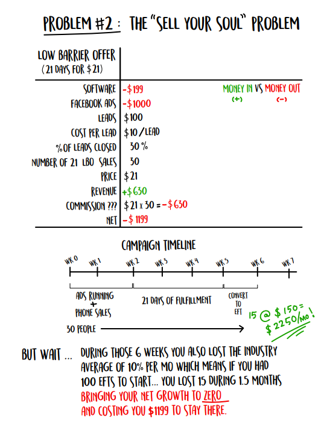

**<u>VẤN ĐỀ #2: VẤN ĐỀ "BÁN LINH HỒN"</u>**

**Sản phẩm mồi _(21 ngày với giá \$21)_**

> **Quy ước:** DÒNG TIỀN VÀO `(+)` vs DÒNG TIỀN RA `(-)`

| Hạng mục | Số liệu / Chi phí |
| :--- | :--- |
| **Phần mềm (Software)** | -\$199 |
| **Quảng cáo Facebook** | -\$1000 |
| **Số lượng khách hàng tiềm năng** | 100 |
| **Chi phí trên mỗi Lead** | \$10 / Lead |
| **Tỷ lệ chốt Lead** | 30% |
| **Số lượng bán gói LBO 21 ngày** | 30 |
| **Giá bán** | \$21 |
| **Doanh thu** | +\$630 |
| **Hoa hồng bán hàng ???** | \$21 x 30 = -\$630 |
| **LỢI NHUẬN RÒNG (NET)** | **-\$1199** |

**DÒNG THỜI GIAN CHIẾN DỊCH**

- **Tuần 0 – Tuần 1:** Chạy quảng cáo + Bán hàng qua điện thoại
- **Tuần 2 – Tuần 4:** 21 ngày thực hiện dịch vụ / đào tạo
- **Tuần 5:** Chuyển đổi sang hội viên trả phí định kỳ
  - *Kết quả dự tính:* 15 người * \$150 = **+\$2.250 / tháng!** (giả sử gói thành viên là \$150/tháng)
- **Quy mô:** 30 người xuyên suốt hành trình chiến dịch.

**NHƯNG KHOAN ĐÃ...**

Trong suốt 6 tuần đó, phòng gym của bạn cũng bị hao hụt khách theo mức trung bình của ngành là **10% mỗi tháng**. 

Điều này có nghĩa là nếu ban đầu bạn có **100 hợp đồng EFT (hội viên trả định kỳ)**... thì bạn đã **mất 15 hội viên** trong vòng 1,5 tháng.

Kết quả là: **MỨC TĂNG TRƯỞNG RÒNG VỀ BẰNG 0 (ZERO)**  

VÀ BẠN PHẢI **TỐN CHI PHÍ \$1.199** CHỈ ĐỂ ĐỨNG YÊN TẠI CHỖ.

Nghe nản không cơ chứ?

#### **Một Bộ Quy Tắc Hoàn Toàn Khác**

Nếu kịch bản trên nghe quen thuộc với bạn, thì bạn không hề cô độc đâu. Đó là cách mà chúng ta được dạy làm marketing từ các “bậc tiền bối”, những hệ thống phòng tập mega gym khổng lồ kiểu như 24 Hour Fitness hay LA Fitness. Đó là tất cả những gì chúng ta từng biết.

Tư duy cốt lõi ở đây là cho đi thật nhiều dịch vụ, thời gian và tiền bạc ở giai đoạn đầu (front-end), rồi hy vọng gỡ gạc lại ở giai đoạn sau (back-end). Vấn đề nằm ở chỗ mô hình này chỉ hoạt động khi bạn có tiềm lực tài chính cực mạnh (nói cách khác là cực kỳ lắm tiền, hay còn gọi là dòng tiền mặt dồi dào).

Và có thể bạn chưa biết, mỗi cái tên tôi vừa liệt kê bên trên thực chất đều thuộc sở hữu của các quỹ đầu tư tư nhân (private-equity groups)—những ông lớn lắm tiền nhiều của, sẵn sàng đốt tiền ngay cả khi phải mất tới một năm mới thu hồi được vốn. Họ chơi theo một bộ quy tắc hoàn toàn khác.

Điều này có nghĩa là nếu chúng ta cứ cố gắng chơi trò chơi của họ bằng luật chơi của họ, chúng ta cầm chắc phần thua. Chắc chắn là như vậy. Luôn luôn là như vậy.

Vậy thì làm thế nào để kéo khách vào cửa mà KHÔNG BỊ LỖ tiền chi phí thu hút khách, trong khi vẫn thực sự gia tăng được số lượng EFTs? 

Tin hay không thì tùy, nó cực kỳ đơn giản luôn. Tôi vẫn không thể tin nổi tại sao mình lại mất nhiều thời gian đến thế để ngộ ra điều này. Nhưng một khi bạn đã nắm được tư duy này, bạn sẽ không bao giờ—ý tôi là KHÔNG BAO GIỜ—phải lo lắng về ngân sách marketing thêm một lần nào nữa.

Nghe có vẻ hấp dẫn chứ?

Vậy thì chúng ta hãy đi thẳng vào giải pháp ngay bây giờ thôi.

### **Chương 2: Mô Hình Kiếm Khách Thực Chiến**

Bây giờ tôi muốn chỉ cho bạn một tư duy có thể thay đổi cuộc đời bạn theo đúng nghĩa đen.

Bạn đã sẵn sàng chưa?

Chỉ có đúng ba con đường để phát triển doanh nghiệp của bạn. CHỈ CÓ BA. Không đùa đâu, tôi đã mất ngủ cả đêm ngay sau khi ngộ ra điều này, bởi vì tâm trí tôi cứ chạy đua với vô vàn khả năng mở ra trước mắt.

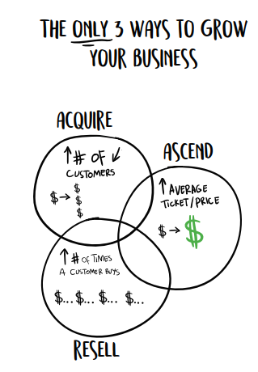

> **3 con đường duy nhất để phát triển doanh nghiệp của bạn**
> 1. thu hút (acquire)
> 2. nâng cấp (ascend)
> 3. bán lại (resell)


**Đường hướng tăng trưởng kinh doanh #1:** Kiếm thêm nhiều khách hàng mới.

**Đường hướng tăng trưởng kinh doanh #2:** Tăng giá trị trung bình trên mỗi đơn hàng, thông qua việc tăng giá bán hoặc kết hợp bán chéo (cross-sells) và bán nâng cấp (upsells).

**Đường hướng tăng trưởng kinh doanh #3:** Thúc đẩy khách hàng mua sắm thường xuyên hơn. Trong thế giới phòng tập, đây gọi là tỷ lệ giữ chân (retention)—khách hàng tiếp tục thanh toán tháng này qua tháng khác.

Chỉ thế thôi. Tất cả những gì bạn cần làm là tìm cách tận dụng một hoặc toàn bộ các đường hướng tăng trưởng này, và bạn nắm chắc phần thắng trong tay. Tôi đã tìm ra một vài cách vận hành cực kỳ hiệu quả trong ngành của mình đến mức tôi đã đăng ký thương hiệu cho cái tên _Gym Profit Levers™_ (Các Đòn Bẩy Lợi Nhuận Phòng Tập). Bạn sẽ được học về chúng ở Phần II. Có ba loại đòn bẩy: đòn bẩy giá (price levers), đòn bẩy công suất (capacity levers), và đòn bẩy chi phí vận hành (overhead levers). Khi bạn áp dụng một đòn bẩy, mọi thứ sẽ bắt đầu khởi sắc. Còn khi bạn kết hợp triển khai tất cả chúng cùng lúc, cuộc đời bạn sẽ sang trang hoàn toàn.

Nhưng bấy nhiêu đó là quá đủ cho sự dài dòng rồi—chúng ta hãy lao thẳng vào vấn đề chính thôi.

Đây là cách chúng ta sửa chữa mô hình kiếm khách đang hỏng hóc:

1. Tạo ra một gói ưu đãi giai đoạn đầu (front-end offer) cao cấp (premium)/giá trị cao (high-ticket).
2. Được trả tiền để đi kiếm khách hàng (không đùa đâu nhé).
3. Khiến họ (khách hàng nhận front-end offer) phải xuất hiện.
4. Khiến họ phải chịu xuống tiền.

Còn rất nhiều điều tôi muốn chia sẻ với bạn ở đây, nên hãy bám sát tôi nhé.

Chúng ta sẽ đi qua từng bước một trong những chương tiếp theo.

#### **Tạo Ra Gói Ưu Đãi Giai Đoạn Đầu (Front-End Offer) Cao Cấp / Giá Trị Cao**

Lý do khiến bạn không thể có lãi ở giai đoạn thu hút khách hàng vì bạn đang cạnh tranh ở một mức giá quá bèo bọt. Bạn đang bán một thứ hàng hóa đại trà, một thứ mà người tiêu dùng có thể nhìn vào rồi so sánh với chỗ khác và bảo rằng: *"Ừ, hai chỗ này giống nhau đến mức tao cứ chọn chỗ nào rẻ hơn mà vào."*

Đó là những gì xảy ra khi các ngành nghề, và những người chơi (chủ doanh nghiệp) trong đó, lao vào một cuộc đua xuống đáy (race to the bottom). Không có người thắng cuộc nào trong cuộc đua này cả, chỉ có những kẻ chán nản, cháy túi, ăn mì gói qua ngày và ngủ trên sàn nhà. Tôi từng là một kẻ như vậy—và có lẽ bạn cũng thế. 

Cách duy nhất để thoát khỏi vũng lầy đó chính là thoát ly khỏi cái mác hàng hóa đại trà (decommoditization). Nói cách khác, hãy làm cho _Offer_ của bạn trở nên độc đáo đến mức khách hàng không thể mang ra so sánh với bất kỳ ai khác. Bằng cách kết hợp các dịch vụ và sản phẩm lại theo một cách thức độc nhất vô nhị, bạn sẽ miễn nhiễm hoàn toàn với việc bị so sánh về giá. 

Cách dễ nhất để làm được điều này là tạo ra một _**lời đề nghị không thể chối từ**_ (irresistible offer). (Xin lưu ý, tôi không phát minh ra khái niệm này—tôi chỉ nghiên cứu rất nhiều và tự lắp ráp các mảnh ghép lại cho chính mình và các chủ phòng gym mà chúng tôi đang hỗ trợ). 

Dưới đây là danh sách kiểm tra của tôi về cách tạo và bán một **irresistible offer**. Món khoái khẩu của tôi là "thử thách miễn phí sáu tuần". Đây chính xác là _Offer_ mà phần lớn các khách hàng của Gym Launch đang áp dụng rất thành công, nên cứ thoải mái "copy & paste" nó vào doanh nghiệp của chính bạn. 

Giờ thì, chỉ có **irresistible offer** thôi là chưa đủ—bạn còn phải bán được nó. Có 8 bước để thiết lập **offer** sao cho chuyển đổi từ **prospects** (khách hàng tiềm năng) thành **buyers** (người mua hàng): 

1. Pre-Frame (Định khung trước) 
2. Price Anchor (Neo giá) 
3. Splinter Stack (Chia nhỏ gói dịch vụ) 
4. Scarcity (Sự khan hiếm) 
5. Urgency (Tính cấp bách) 
6. Crazy Guarantee (Cam kết điên rồ) 
7. Bribe (Mồi nhử) 
8. Downsell Your Upsell for Continuity (Bán xuống từ gói nâng cấp để duy trì doanh thu định kỳ) 

Tuyệt vời. Giờ hãy đi sâu vào từng bước và xem cách chúng giúp **offer** của bạn trở nên đỉnh hơn nữa nhé. 

Đầu tiên, tôi muốn nói rằng chúng tôi tính phí từ \$500 đến \$600 cho chương trình MIỄN PHÍ sáu tuần này. 

Hả? 

> Ý tác giả là: Có phải bạn (người đọc) đang thắc mắc tại sao MIỄN PHÍ nhưng vẫn mất tiền?

Hãy để tôi giải thích. 

Cách thức hoạt động là chúng tôi đưa ra cho họ cơ hội thử thách giảm X cân hoặc Y% mỡ thừa trong vòng sáu tuần. Nếu họ thành công, chúng tôi sẽ hoàn lại tiền mặt hoặc quy đổi thành tín dụng để họ tiếp tục tập luyện tại cơ sở của chúng tôi. Đây là một offer cực kỳ "_cool_", mọi người rất hào hứng, đạt kết quả tuyệt vời và nó hoàn toàn khác biệt. Nhưng hãy xem cách bạn làm cho nó trở nên không thể cưỡng lại được nữa. 

#### 1. PRE-FRAME (định khung trước): 


Việc **pre-frame** diễn ra ngay trên điện thoại. Bạn đặt câu hỏi cho họ và cung cấp thông tin _định vị_ phòng tập của bạn là nơi luôn đông đúc và có sức hút cực lớn. Bạn làm điều này khi đặt lịch hẹn và trước khi họ đặt chân đến phòng gym. Để **pre-frame** phòng gym của mình ở góc độ ấn tượng nhất, hãy nói những câu như: 

- Anh/chị có nghe nói về chúng tôi qua bản tin thời sự địa phương về các trại huấn luyện (bootcamp) xuất sắc nhất không? 
- Anh/chị đã nghe về chủ phòng gym của chúng tôi qua các bài báo viết về anh ấy chưa? 
- Anh ấy không có nhiều lịch trống trong ba tuần tới, nhưng tôi có thể cố gắng sắp xếp anh/chị vào tối mai vì có một ca hủy lịch phút chót. 

> **Mẹo chuyên gia:** Việc chốt đơn đã bắt đầu từ trước khi họ nhấc điện thoại gọi cho bạn. Hãy luôn ghi nhớ điều này. 

> Người dịch: Cụm từ "định vị" ám chỉ việc khiến cho khách hàng hình dụng (hoặc có ý niệm) về hình ảnh về doanh nghiệp của bạn. Trước cả khi họ thực sự gặp bạn (hoặc sử dụng dịch vụ bạn cung cấp)

Bạn cũng cần pre-frame lý do thực sự khiến họ gọi cho bạn từ ban đầu. Mọi người tìm đến chuyên gia thể hình vì họ đang gặp một nỗi đau nào đó liên quan đến cơ thể. Không nhất thiết phải là nỗi đau thể xác, nó có thể là tinh thần. Họ tăng cân vù vù, ghét vẻ ngoài hiện tại của mình, cảm thấy uể oải, nhão nhoét và muốn lấy lại sự tự tin về vóc dáng. Hoặc có thể họ từng là vận động viên và ghét cảm giác hiện tại sau nhiều năm lười vận động. Họ muốn sống thọ hơn, khỏe mạnh hơn để ở bên gia đình, và họ sợ cái chết vì sợ bỏ lại con cái bơ vơ. Dù lý do là gì đi nữa, những NỖI ĐAU đó sẽ giúp bạn kéo họ vào chương trình của mình. 

Hãy luôn yêu cầu khách hàng tiềm năng điền vào bảng câu hỏi thông tin ban đầu (intake questionnaire) trước khi bạn bắt đầu giới thiệu chương trình của mình. Điều này giúp bạn hiểu về khách hàng và mục tiêu của họ, nhưng quan trọng không kém, nó giúp bạn nắm bắt nỗi đâu của họ—lý do thực sự khiến họ liên hệ và muốn thay đổi. Và nó giữ cho nỗi đau đó luôn hiện hữu rõ mồn một trong tâm trí họ. Nó cũng giúp bạn **pre-sell** (bán trước) chương trình bằng cách khiến họ khao khát được làm việc với bạn… và chỉ bạn mà thôi. 

Bạn có thể yêu cầu họ điền vào biểu mẫu ngay khi đăng ký trực tuyến bằng hệ thống trả lời tự động, gửi email cho họ ngay sau khi họ liên hệ, hoặc đưa tận tay khi họ bước vào cơ sở của bạn. Nếu đưa trực tiếp, hãy để họ hoàn thành trước, và dành vài phút xem qua trước khi bạn bắt đầu nói chuyện về các dịch vụ. Thao tác này giúp bạn định hình bản thân là một người thực sự quan tâm đến những thử thách của họ (điều mà dĩ nhiên là bạn có thật). 

Dưới đây là một số gợi ý về câu hỏi và các câu trả lời mẫu từ khách hàng. Tôi đúc kết điều này chủ yếu từ Dustin Napier và Dallas Wicker, nhưng rất nhiều chủ phòng gym xuất sắc khác cũng đóng góp câu hỏi và góc nhìn giúp hoàn thiện danh sách này. Đây là những người chốt được 85% **COLD TRAFFIC** (lượng khách hàng lạnh) - những người bước chân vào cửa muốn trải nghiệm miễn phí, nhưng rồi ra về với túi tiền nhẹ đi \$600 và niềm tin mãnh liệt rằng cuộc đời họ chuẩn bị sang trang. 

Điều quan trọng là phải tuyên bố rõ các tiêu chí tham gia chương trình ngay từ đầu. Hãy đảm bảo họ đáp ứng các điều kiện tối thiểu đó trước khi tiến xa hơn. Một số tiêu chí có thể là… 

- Anh/chị có thể cam kết tập luyện 2 buổi/tuần không? 
- Thể trạng chung của anh/chị hiện tại có tốt không? 
- Anh/chị đang gặp chấn thương nào có thể cản trở tiến độ tập luyện không? 

Sau đó, bạn có thể tiếp tục với bảng câu hỏi. Một số câu hỏi có vẻ lặp đi lặp lại, nhưng đó là chủ ý để khách hàng phải chạm vào _nỗi đau_ của họ nhiều lần khi trả lời. 

**Bảng câu hỏi thông tin ban đầu kèm câu trả lời mẫu** 

- Bạn đến đây để làm gì? 
   - Tôi muốn giảm cân/lấy lại vóc dáng/vận động thể thao tốt hơn. 
- Tình trạng thể lực hiện tại của bạn thế nào? 
   - Tôi đang tơi tả đây. Thừa tận 20kg và người ngợm đau nhức suốt ngày. 
- Mục tiêu trong mơ của bạn là gì? 
   - Tôi muốn giảm 20kg và mặc lại vừa bộ quần áo cũ. 
- Sẽ mất bao lâu để tự mình đạt được điều này? 
   - Vô thời hạn. 
- Bạn có muốn duy trì mục tiêu đó sau khi đạt được không? 
   - Chắc chắn rồi. 
- Bạn đã mong muốn điều này trong bao lâu rồi? 
   - Kể từ khi sinh đứa con cuối cùng. Đã 10 năm rồi và tôi không sao tống khứ nổi mỡ thừa. 
- Tại sao bạn lại khao khát điều này đến vậy? 
   - Tôi sắp có buổi họp lớp kỷ niệm 10 năm tốt nghiệp và tôi muốn trông thật phong độ. 
- Bạn thừa biết là giảm cân không hề dễ dàng. Bạn có sẵn sàng tuân thủ các khuyến nghị của chúng tôi và làm theo mọi yêu cầu để đạt được mục tiêu không? 
   - Có. 
- Tại sao bạn lại đăng ký tham gia vào lúc này? 
   - Tôi muốn giảm cân, và tôi đã quá mệt mỏi với cảnh chật vật bấy lâu nay. 
- Tại sao bạn nghĩ mình sẽ thành công lần này? 
   - Vì tôi đã cam kết, và bạn tôi đã giảm cân thành công sau khi gia nhập phòng gym của các bạn. 
- Khách hàng trung bình của chúng tôi giảm từ 5kg trở lên trong 3 tháng đầu tiên. Bạn thấy ổn với điều này chứ? 
   - Quá tuyệt vời luôn. 
- Hiện trạng của bạn là gì? Trạng thái mong muốn của bạn là gì? 
   - Hiện tại tôi đang thừa 20kg. Tôi muốn về lại vóc dáng hồi đại học. 
- Bạn đã từng chật vật giảm cân trong quá khứ chưa? 
   - Rồi. 
- Bạn đã từng gặp khó khăn trong việc duy trì một chương trình tự tập luyện trong quá khứ chưa? 
   - Rồi. 
- Bạn có nghĩ mình sẽ giảm cân nhanh hơn nếu có chuyên gia đồng hành hỗ trợ không? 
   - Có chứ.
- Bạn nghĩ mình sẽ giảm cân nhanh hơn nếu có người cùng đồng hành và kiểm tra tiến độ mỗi ngày chứ?
   - Có.
- Việc bạn giảm cân nhanh chóng hay việc kết quả đó được duy trì vĩnh viễn quan trọng hơn đối với bạn?
   - Vĩnh viễn.

Việc trả lời những câu hỏi định hình trước (pre-framing) này sẽ buộc họ phải chậm lại, đưa họ vào đúng tâm thế để ra quyết định mua hàng, đồng thời nhắc nhở họ về những nỗi đau và ưu tiên thực sự của bản thân.

#### 2. Neo giá (Price Anchor)

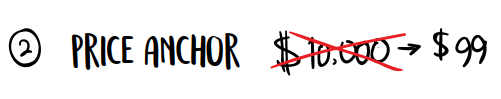

**Mốc neo giá** (Price anchor) là một mức giá cao hơn mà bạn muốn khách hàng phải suy nghĩ về nó trước khi bạn đưa ra mức giá thực tế. Do đó, trong kịch bản bán hàng (sales script), ở một thời điểm nào đó, bạn nên nhắc đến mức giá cao hơn này. Đó có thể là mức giá thông thường của bạn, hoặc có thể là số tiền mà các phòng tập khác đang thu cho một dịch vụ tương tự, hoặc thậm chí là chi phí họ sẽ phải tốn nếu tự mình làm tất cả mọi thứ. Nó chỉ cần là một con số cao hơn nhiều so với số tiền họ phải trả nếu đăng ký ngay hôm nay. Bạn thậm chí có thể tặng thêm một vài món quà (bonuses) khi họ đăng ký ngay, nhằm khiến mức giá trở nên hấp dẫn đến mức khó chối từ.

Tôi sẽ không đi sâu vào nghệ thuật giáp lá cà trong chốt sale tại đây. Bạn có thể tìm đọc thêm về điều đó ở phần còn lại của cuốn sách này. Hãy cứ áp dụng mốc neo giá và quan sát xem sự kháng cự khi mua hàng của khách hàng tiềm năng giảm đi nhiều đến thế nào khi bạn trò chuyện với họ.

#### 3. Chiến lược chia nhỏ gói sản phẩm (Splinter Stack)

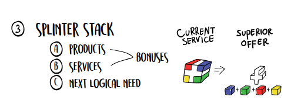

> a. Sản phẩm tặng kèm (products bonuses) 
> b. Dịch vụ (services) 
> c. Nhu cầu hợp lý tiếp theo (next logical need)

Chiến lược **chia nhỏ gói sản phẩm** (Splinter stack) cho phép bạn tính phí cao (charge a premium) cho các dịch vụ mà thực ra bạn đang làm sẵn như một phần của một gói dịch vụ trọn gói (bundle). Bạn có thể hiểu đây là hành động "rã gói" nếu thích. Đây là lúc bạn lấy tất cả những việc mình vẫn thường làm, tách chúng ra thành từng món riêng lẻ để chào bán như những phần quà tặng (bonuses) hoặc hạng mục đặc biệt.

Phương án nào nghe hấp dẫn hơn: một gói tập bootcamp hay một thử thách 6 tuần đi kèm với các đặc quyền sau?

- Thực đơn cá nhân hóa
- Danh sách đi chợ cá nhân
- Hướng dẫn chọn nhà hàng địa phương khi đi ăn ngoài và dịp đặc biệt
- Công thức nấu ăn khớp hoàn toàn với thực đơn của bạn
- Huấn luyện viên đồng hành sát sao (Accountability coach)
- Ba buổi tập mỗi tuần với PT (Trainer)
- Nhóm kiểm tra tiến độ trực tuyến (Online accountability group)
- Nền tảng trực tuyến cung cấp kiến thức giảm cân vĩnh viễn
- Hướng dẫn làm Super shake (sinh tố dinh dưỡng)
- Thực đơn bữa sáng đỉnh chóp
- Thực đơn bữa trưa ngon khó cưỡng
- Thực đơn bữa tối tuyệt hảo

Thành thật mà nói, bạn hoàn toàn có thể đưa chính xác những hạng mục y hệt vào cả hai chương trình. Nhưng khi bạn "rã gói" và liệt kê từng dịch vụ riêng lẻ trong thử thách, khách hàng sẽ có cảm giác họ nhận được nhiều hơn thế rất nhiều. Chỉ đơn giản là vì danh sách dài hơn, nên về mặt tâm lý, nó hấp dẫn hơn hẳn.

Nếu bạn chưa có sẵn những thứ đó, chẳng hạn như danh sách đi chợ hay thực đơn, hãy tự tạo ra chúng. Việc đó không hề khó. Tôi nghĩ mình đã làm tất cả số tài liệu đó chỉ trong khoảng một tuần (trong khi đang nốc rất nhiều chất kích thích). Nhưng một khi đã hoàn thành, _Offer_ của tôi trở nên độc nhất, đặc biệt và không thể so sánh với bất kỳ phòng tập nào khác trên thị trường, điều đó cho phép tôi tự tin định mức giá cao (premium prices). Bạn cũng có thể dùng một nửa số đó làm quà tặng trong ngày (same-day bonuses) nếu họ chốt đơn ngay lập tức, thúc đẩy khách hàng tiềm năng hành động chớp nhoáng.

#### 4. Sự khan hiếm (Scarcity)


**Sự khan hiếm** (Scarcity) có nghĩa là nguồn cung bị giới hạn. Giống như câu nói: "Chúng tôi chỉ còn lại X sản phẩm/Y chỗ trống." Rất nhiều người sẽ tranh giành những khung giờ tập phổ biến nhất của bạn. Vì vậy, nếu bạn nắm được khung giờ mà khách hàng muốn đến, hãy dùng nó làm chiêu thức khan hiếm để ép họ ra quyết định ngay trong ngày. Họ sẽ sợ cảm giác bị bỏ lỡ (FOMO) khung giờ đẹp đó. Bạn thực sự đang có sự khan hiếm trong tay, vậy nên hãy tận dụng tối đa lợi thế đó trong cuộc chốt sale. Chỉ cần nói đại loại như: "Anh/chị nên chốt chỗ ngay hôm nay đi, để em tranh thủ điền tên anh/chị vào trước khi lớp đầy chỗ."

#### 5. Tính cấp bách (Urgency)


**Tính cấp bách** (Urgency) có nghĩa là thời gian sắp cạn kiệt. Họ cần phải hành động ngay lập tức và không được phép trì hoãn quyết định dù chỉ một tiếng đồng hồ. Rất nhiều nhà làm marketing gom chung sự khan hiếm và tính cấp bách làm một, nhưng chúng là hai mãnh thú hoàn toàn khác nhau. Cả hai đều cần thiết, nhưng chúng khác biệt. Tính cấp bách là một thành tố thuộc về **THỜI GIAN** (TIME). Ví dụ, bạn có thể nói: "Chương trình này bắt đầu vào ngày mai, thế nên anh/chị buộc phải quyết định ngay bây giờ nếu muốn tham gia, và em cũng không biết khi nào bọn em mới chạy lại chương trình ưu đãi này nữa."

Chúng tôi khởi động một thử thách mới vào mỗi tuần, vậy nên chúng tôi luôn có cái cớ để nói rằng: "Chương trình này khởi tranh vào ngày mai, thế nên anh/chị phải đăng ký ngay bây giờ mới kịp vào nhóm này." Đó chỉ là một cú hích nhẹ, nhưng nó cực kỳ hiệu quả.

#### 6. Cam kết điên rồ (Crazy Guarantee)


**Cam kết điên rồ** (Crazy guarantee): Nhiều người cảm thấy các chính sách bảo hành/cam kết chứa đựng đầy rủi ro, nhưng thực tế không phải vậy nếu bạn thực sự giỏi trong việc mình làm. Đa số khách hàng xét cho cùng đều có bản tính thiện lương (theo quan điểm của tôi). Thế nên họ sẽ chẳng bao giờ tìm cách chơi xỏ bạn, trừ khi chính bạn chơi xỏ họ trước. Đây là bản cam kết của tôi — hãy cứ "mượn" dùng thoải mái nếu bạn thích.

> "Chúng tôi tự tin tuyệt đối vào năng lực mang lại cho bạn trải nghiệm vượt ngoài mong đợi với dịch vụ đẳng cấp thế giới, đến mức tôi sẵn sàng đưa ra một cam kết cá nhân về mức độ hài lòng của bạn. Nếu bạn đi đến cuối chương trình này mà cảm thấy bản thân không nhận được mức độ dịch vụ tương xứng hoặc vượt trội hơn số tiền đầu tư tài chính đã bỏ ra, tôi sẽ tự tay viết cho bạn một chiếc séc hoàn tiền. Kịch bản tốt nhất: tôi thay đổi cuộc đời bạn; kịch bản tồi tệ nhất: bạn được tập luyện hoàn toàn miễn phí. Bạn không hề chịu bất kỳ rủi ro nào."

Tôi đã dùng chính sách cam kết này để kiếm hàng trăm ngàn đô-la. Nhưng bạn có đoán được số lần có người bắt đền tiền hoàn lại không? Chỉ vỏn vẹn hai lần.

Nó có đáng không? Tôi nghĩ là có.

Bạn không nhất thiết phải dùng y hệt bản cam kết của tôi. Tôi có thể viết cả một cuốn sách về các chính sách cam kết, nhưng nhìn chung: càng sáng tạo càng tốt. Bản cam kết của tôi không hẳn là quá sáng tạo, nhưng nó cực kỳ hiệu quả.

#### 7. Để tạo dòng doanh thu định kỳ (continuity), hãy tặng sản phẩm/dịch vụ giá trị cao như một món quà lót tay (bribe) miễn phí để lôi kéo họ bước vào phễu doanh thu định kỳ.


> Nhận MIỄN PHÍ chương trình tập luyện trị giá \$2.000 ngay hôm nay khi bạn đăng ký trở thành hội viên.

**Món quà lót tay (Bribe):** Ai mà chẳng thích nhận đồ miễn phí. Ai lại không mê những món quà tặng kích thích (bonus incentive) cơ chứ? Do đó, bạn có thể câu dẫn khách hàng mạnh mẽ hơn trong quá trình chốt sale bằng cách tặng kèm những thứ mà bình thường bạn vẫn thu phí, coi như một món quà lót tay nếu họ chịu đăng ký làm hội viên ngay tại thời điểm đó.

Chiêu này được gọi là phương án "hoặc cái này/hoặc cái kia", hay còn gọi là "chốt sale ngầm" (assumed close). Bạn đưa cho khách hàng lựa chọn cuối cùng gồm hai phương án, và cả hai phương án đều dẫn đến việc họ mua hàng từ bạn. Một lựa chọn High-ticket (giá trị cao) và một lựa chọn Low-ticket (giá trị thấp) đi kèm dòng doanh thu định kỳ (continuity) hoặc cam kết gắn bó hàng tháng. Đừng bao giờ coi thường sức mạnh của khái niệm này.

Chiến lược này cực kỳ phổ biến và thành công ở nhiều ngành công nghiệp, đồng thời nó hoạt động hiệu quả mỹ mãn đối với các phòng tập gym. Bạn có thể tặng một "Gói Thử Thách 6 Tuần" vốn có giá thông thường là \$600 như một món quà miễn phí, với điều kiện họ chịu ký hợp đồng hội viên ngay hôm nay. Quá tuyệt vời. Quá tinh tế. Quá bùng nổ.

Nhà làm marketing đình đám Frank Kern từng sử dụng chiêu này để xây dựng bản tin (newsletter) trị giá 8 con số của ông ấy, bằng cách tặng toàn bộ các sản phẩm kỹ thuật số ông từng tạo ra (trị giá hơn \$16.000) như một món quà lót tay để đổi lấy việc mọi người đăng ký mua bản tin trị giá \$400/tháng của ông.

#### 8. Đối với doanh thu định kỳ (continuity), hãy bán phiên bản hạ cấp của gói Upsell (Downsell your upsell)...

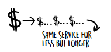

**Downsell gói Upsell của bạn (Downsell Your Upsell):** Rất nhiều người ghi nhận tôi là người tạo ra khái niệm này và nhắc tên tôi như "cha đẻ" của nó. Thú thật là tôi không hề phát minh ra nó. Tuy nhiên, tôi đã kiếm được một số tiền khổng lồ nhờ vào nó, và tôi đặc biệt khuyên bạn nên ứng dụng nó vào quy trình bán hàng và định giá của mình. Mặc dù vậy, chiến lược này chỉ thực sự phát huy tác dụng khi đi kèm với một **Front-end Offer** (sản phẩm phễu/chào sàn) giá trị cao (high-ticket). Nếu đến giờ phút này mà bạn vẫn chưa bán được, thì đây chính là thứ đòn bẩy cuối cùng đánh gục mọi sự chần chừ.

Hạ giá gói nâng cấp (downselling your upsell) liên quan đến phần phụ trợ (back-end) của gói ưu đãi, nhằm chuyển đổi khách hàng sang hình thức thành viên hàng tháng (hoặc thành viên dài hạn - continuity), phần này tôi sẽ đào sâu hơn khi bàn về bài toán khách hàng rời bỏ (attrition). Nhưng điểm mấu chốt tôi muốn đúc kết cho bạn ngay lúc này là: chẳng ai thèm mua một cái "thẻ thành viên" cả. Họ chỉ muốn kết quả và một mốc thời gian cụ thể. Vậy thì hãy cho họ thứ họ muốn. Bạn có thể dùng một món quà kèm theo (bribe) như đã nói ở trên, nhưng phần lớn thời gian, bạn cần bán cho họ một chương trình có thời hạn xác định (Defined-End Program - DEP), kéo dài trong X ngày hoặc Y tuần. Tại sao ư? Tôi chịu, chẳng biết tại sao nữa. Chỉ biết là nó hiệu quả thôi!

Khách hàng sẵn sàng trả mức giá đắt gấp 2 đến 4 lần cho một sản phẩm NẾU nó KHÔNG phải là hình thức thành viên dài hạn. Thế thì tại sao lại không thu phí cao nhất ngay lúc họ hào hứng nhất và nỗi đau của họ lớn nhất cơ chứ? Hợp lý hơn nhiều so với việc dâng cho họ mọi thứ miễn phí cho đến khi sự phấn khích nguội lạnh, rồi lúc đó mới hì hục bán gói nâng cấp (upsell), đúng không? Thế nhưng ngặt một nỗi, từ trước đến nay chúng ta toàn được dạy theo hướng ngược đời.

Ví dụ thế này: Một khách hàng tham gia chương trình DEP trị giá 100 USD/tuần trong vòng 12 tuần. Sau khi hết thời gian đó, họ có thể tiếp tục gia hạn với mức giá chỉ 50 USD/tuần.

Đọc lại câu đó đi.

Bạn đang tính giá gấp đôi ngay từ vạch xuất phát – lúc họ cam kết cao nhất, hào hứng nhất và dễ đạt kết quả đột phá nhất. Sau đó, bạn biến gói thành viên 200 USD/tháng trở thành một món hời không thể chối từ.

Các phòng gym áp dụng chiêu thức này giữ chân khách hàng ở phần phụ trợ (back-end) cao gấp đôi mức trung bình của ngành, ĐỒNG THỜI thu mức giá cao hơn tới 58%. (Vâng, bạn đọc không nhầm đâu nhé). Quá đỉnh phải không nào?

#### **Tóm tắt**

Irresistible Offer (Lời đề nghị không thể từ chối) chính là bước đầu tiên để giải quyết bài toán thu hút khách hàng (acquisition). Bạn phải có thứ gì đó độc đáo để bán thì mới dám hét giá độc đáo. Đừng bán thứ bình thường với giá trên trời, hãy bán những thứ không thể chối từ với mức giá tương xứng. Và một mức giá không thể chối từ là điều kiện cần để bạn tạo ra đủ dòng tiền mặt ngay từ đầu nhằm chạy **Paid Ads (Quảng cáo trả phí)**.

Bước tiếp theo là khiến khách hàng trả tiền để được bạn... thu hút họ. Và từ đó về sau, bạn sẽ không bao giờ cần đến ngân sách marketing nữa. 

Sao cơ?

Đọc tiếp đi rồi biết.

### **Chương 3: Được Trả Tiền Để Thu Hút Khách Hàng**

Giờ thì bạn đã có trong tay một gói ưu đãi cực chất, hãy làm cho tiền chảy về như lũ đi nào!

Như tôi đã giải thích trước đó, lý do những chuỗi phòng gym lớn có thể vung tiền qua cửa sổ cho quảng cáo và marketing mà không cần thấy lợi tức đầu tư (ROI) ngay lập tức là vì họ thuộc sở hữu của các quỹ đầu tư tư nhân với nguồn vốn khổng lồ. Phần lớn các chủ phòng gym độc lập không có được đặc quyền đó, thế nên họ cứ cắm mặt lấy tiền túi ra đốt vào marketing, để rồi chẳng còn lại đồng nào để vận hành phòng tập. Nhưng luôn có lối thoát cho cái vòng luẩn quẩn đó, và tôi chuẩn bị vén màn ngay đây. Đây chính là Bước 2 trong quy trình thu hút khách hàng được tài trợ bởi chính khách hàng (client-financed acquisition).

Bắn phá thôi nào! Dưới đây là bức tranh trực quan mô tả concept này.

**Thu hút khách hàng được tài trợ bởi khách hàng**
1. Tạo sản phẩm phễu đầu vào high-ticket 
2. Kiếm được nhiều tiền từ doanh thu đầu vào hơn chi phí lead (lead cost) ads 
3. Không bao giờ cần ngân sách marketing thêm lần nào nữa

**VÍ DỤ: MÔ HÌNH DÒNG TIỀN VÀ LỢI NHUẬN (CASH FLOW MODEL)**

| Chỉ số / Ngày | Ngày 1 | Ngày 2 | Ngày 3 | Ngày 4 *(100% Lợi nhuận)* | Ngày 5 *(100% Lợi nhuận)* |
| :--- | :---: | :---: | :---: | :---: | :---: |
| **Quảng cáo** | \$100 | \$100 | \$100 | \$100 | \$100 |
| **Khách hàng tiềm năng** | 10 | 10 | 10 | 10 | 10 |
| **Tỷ lệ chuyển đổi / Chốt đơn** | 20% | 20% | 20% | 20% | 20% |
| **Số đơn hàng chốt được** | 2 | 2 | 2 | 2 | 2 |
| **Giá bán** | \$600 | \$600 | \$600 | \$600 | \$600 |
| **Doanh thu** | \$1.200 | \$1.200 | \$1.200 | \$1.200 | \$1.200 |
| **Tiền về tài khoản** | \$0 | \$0 | \$0 | **+\$2.400** | **+\$3.600** |
| **Số dư tài khoản ngân hàng** | **-\$100** | **-\$200** | **-\$300** | **+\$2.000** | **+\$3.100** |

> **Lưu ý:** Tôi tính toán có độ trễ vì phần lớn các cổng thanh toán/xử lý thẻ (payment processors) mất khoảng 72 giờ để giải ngân tiền về tài khoản ngân hàng của bạn. Do đó, bảng này sẽ phản ánh chính xác các con số dòng tiền thực tế.

Chính nó đấy. Đây là thứ đã mang lại cho tôi một khối tài sản khổng lồ, nhiều hơn những gì tôi cần để sống đến hết đời. Đây là thứ đã giúp chúng tôi từ một cái tên vô danh trong lĩnh vực đào tạo kinh doanh phòng gym vươn lên thành ông lớn thống trị thị trường. (Và hy vọng nó sẽ giữ chân chúng tôi ở vị trí đó lâu dài, chừng nào chúng tôi còn giữ cái đầu lạnh, không ngủ quên trên chiến thắng, luôn giữ sự khiêm nhường và tận tụy phục vụ).

Đó cũng là bí quyết giúp tôi rót vốn mở từng chi nhánh phòng gym mới sau chi nhánh đầu tiên... **và khai trương với 100% công suất ngay ngày đầu tiên.**

Tôi chỉ chia sẻ điều này vì nếu bạn đã đọc đến đây, nghĩa là bạn đã vớ được mỏ vàng rồi đấy.

Khái niệm này cực kỳ đơn giản nhưng lại sắc bén và hiệu quả đến tàn nhẫn.

Nó hoạt động thế này – bám sát tôi nhé.

&emsp;Vào Ngày 1, bạn ném 100 USD vào **Paid Ads** để quảng bá cho gói ưu đãi không thể chối từ của mình.

&emsp;Bạn thu về 10 KHTN với chi phí 10 USD cho mỗi **Lead**.

&emsp;Từ 10 KHTN đó, bạn đặt lịch hẹn được với 7 người.

&emsp;Trong 7 người đó, sẽ có 3 hoặc 4 người đến đúng hẹn. Từ 3 hoặc 4 người thực sự xuất hiện, bạn chốt được 2 người mua gói Thử thách 6 tuần (6-Week Challenge) với giá 600 USD/người.

&emsp;Tức là từ 10 KHTN, bạn chốt được 2 đơn hàng, tương đương tỷ lệ chuyển đổi (conversion rate) 20%.

&emsp;Điều này có nghĩa là bạn chỉ tốn 100 USD để kiếm về 1.200 USD (2 x 600 USD).

&emsp;Tỷ suất hoàn vốn (ROI) là 1 ăn 12.

Chuyện này hoàn toàn bình thường, chẳng có gì lạ cả. Thậm chí chi phí 10 USD cho mỗi **Lead** còn cao hơn mức bình quân mà phần lớn mọi người làm được, nhưng tôi muốn giữ nguyên con số giống với gói ưu đãi 21 ngày điển hình mà tôi từng dùng lúc mới bắt đầu để dễ hình dung.

Trong ví dụ này, tính đến ngày thứ tư, bạn sẽ bỏ túi 3.600 USD (6 đơn hàng x 600 USD).

Nhưng vì tôi đã làm việc này vô số lần, tôi thừa biết các cổng thanh toán thường giữ tiền từ 2 đến 3 ngày làm việc. Do đó, ít nhất là vào ngày thứ tư của chiến dịch, doanh thu của 1 hoặc 2 ngày đầu tiên mới được chuyển vào tài khoản của bạn.

Tính ra là 2.400 USD trừ đi 400 USD tiền chạy quảng cáo, bạn đút túi khoản lợi nhuận ròng 2.000 USD.

Giờ thì với 2.000 USD này, bạn đã dư sức bù đắp chi phí thu hút khách hàng ban đầu (CAC - Cost of Acquiring Customer), và mọi khoản tiền tiếp theo bạn ném vào chiến dịch này đều là **lợi nhuận ròng 100%**.

Và chu kỳ này cứ thế tiếp diễn cho đến khi bạn kiếm được tiền từ việc... đi kiếm khách hàng.

Đọc lại câu đó lần nữa đi. Tôi muốn nó ngấm thật sâu vào đầu bạn.

Hiểu chưa?

Tốt.

Và bạn cứ tiếp tục chi tiền, tiếp tục thu lời cho đến khi phòng gym của bạn chật kín khách.

Không phải đến khi bạn cạn sạch tiền mặt.

Không phải đến khi **agency** quảng cáo bảo bạn dừng lại.

Không phải đến khi công ty ăn chia doanh thu (revenue share) lắc đầu ngán ngẩm.

Mà là dừng lại khi nào bạn thích, thế thôi!

Đó là cách chúng tôi lấp đầy phòng gym... và giữ cho chúng luôn đông nghẹt khách.

Phòng gym của bạn – và cả doanh nghiệp của bạn nữa, nếu bạn làm đúng bài bản – không bao giờ được phép tiêu đến một xu tiền túi của bạn chỉ để đi tìm khách hàng mới.

Nó giống như việc bạn bước vào sòng bạc và chỉ chơi bằng đúng số tiền lời bạn vừa thắng cược vậy.

Đó chính là bí quyết để tăng trưởng vô tận. Người ta gọi đó là **chi phí thu hút khách hàng âm (negative client-acquisition cost)**.

Bạn ĐƯỢC TIỀN khi mang về nhiều khách hàng hơn. Vậy lý do gì trên đời lại khiến bạn phải dừng lại?

Câu hỏi hay đấy. Phần lớn các chủ phòng gym của chúng tôi chỉ dừng lại khi một trong các hệ thống vận hành của họ gặp sự cố (phòng tập quá tải, phải mở thêm ca tập, thay đổi cách thức phục vụ, v.v.). Nhưng tôi sẽ chỉ cho bạn cách xử lý những rắc rối đó sau.

#### **Bí Quyết Để Tạo Ra Lead Siêu Chất Lượng Chính Là Quảng Cáo Đỉnh Cao**

Giờ thì chúng ta hãy cùng xử lý thử thách tiếp theo—xây dựng các chiến dịch quảng cáo thực chiến.

Bí quyết cốt lõi để làm ra những mẫu quảng cáo triệu view đơn giản chỉ là thử nghiệm thật nhiều ý tưởng khác nhau. Bạn không cần phải quá sáng tạo thiên tài. Bạn cũng chẳng cần phải thuê một **agency** đắt cắt cổ nào cả. Tất cả chỉ là thử và sai (trial and error), đồng thời theo dõi sát sao các chỉ số (data) để mẫu quảng cáo tiếp theo chạy mượt hơn, hiệu quả hơn.

Tôi hy vọng điều đó sẽ giúp bạn đỡ đau đầu hơn. Không có vị thần ma thuật nào tạo ra quảng cáo cả. Cũng chẳng có viên đạn bạc nào ở đây đâu. Đơn giản là liên tục thử nghiệm các mẫu quảng cáo, chọn ra những mẫu hiệu quả nhất, rồi lại tiếp tục thử nghiệm thêm. Khi chúng tôi chạy các chiến dịch thử nghiệm cho các phòng gym của mình, chúng tôi thường thử nghiệm hơn 150 mẫu quảng cáo để tìm ra 5 cú "home run" (những mẫu thắng đậm ở mọi thị trường) và khoảng 15 cú "triple" (những mẫu chiến thắng ở 2/3 thị trường). Tôi đã tự bỏ tiền túi khoảng 100.000 USD cho các quảng cáo tại hơn 100 thị trường để kiểm chứng xem cái gì đang thực sự hiệu quả. Chỉ khi đó, tôi mới trao những quảng cáo chiến thắng này cho các chủ phòng gym cấp cao nhất của chúng tôi (những người mà chúng tôi gọi là Gym Lords - Các Chúa tể Phòng gym).

Nhờ vậy, họ luôn đánh trúng những cú "home run". Họ in ra tiền. Họ trả tiền cho chúng tôi để không phải tự mò mẫm thử nghiệm nữa. Một mối quan hệ đôi bên cùng có lợi (Win-win).

Nếu bạn đã từng cạn kiệt ý tưởng không biết nên sáng tạo nội dung gì cho các quảng cáo của mình để "hái ra tiền", thì bạn không cô đơn đâu. Tôi cũng phải mất một thời gian mới nắm bắt được nó đấy. Vậy nên, để tôi giúp bạn một tay.

Đây là thứ mà tôi gọi là **Bộ trộn tạo Lead (Lead-Gen Scrambler)**. Về cơ bản, bạn sẽ dành chút thời gian để nghĩ ra càng nhiều **headlines** (tiêu đề), hình ảnh, và "body copy" (nội dung chi tiết) càng tốt. Sau đó, bạn xáo trộn chúng lên để tạo ra những quảng cáo hoàn toàn mới mẻ.

**BỘ PHỐI TRỘN TẠO LEAD (LEAD GEN SCRAMBLER)**
> *Không bao giờ phải lo cạn ý tưởng làm mới quảng cáo (Never struggle to make "fresh" ads again)*

1. **TIÊU ĐỀ (HEADLINE)**
- Thời lượng (Duration)
- Giới tính (Gender)
- Lợi ích / Nâng cao vị thế (Benefit/Status ↑)
- Gợi sự tò mò (Curiosity)
- Đối đầu nỗi sợ (Against Fear)
- Tiêu cực / Cảnh báo (Negative)
- Thử thách (Challenge)

2. **NỘI DUNG BÀI VIẾT (COPY)**
- **Độ dài & Định dạng:** Ngắn (Short) • Dài (Long) • Miễn phí (Free) • Mới mẻ (New)
- **Lý do vì sao (Reason Why)**
- **Lợi ích (Benefits)**
- **Địa vị xã hội (Status)**
- **"Để bạn có thể..." (So that you can...)**
- **Mô tả hành động, đừng chỉ kể suông (Describe, don't tell)**
- **Sự khan hiếm (Scarcity)**
- **Tính cấp bách (Urgency)**
- **Uy quyền ngầm định (Implied Authority)**

3. **TÊN TRANG / TÊN THƯƠNG HIỆU (PAGE NAME / BUSINESS NAME)**
- **Chuẩn bị nhiều phiên bản tên khác nhau (Have multiple versions)**
- **Mang tính mô tả rõ ràng (Descriptive)**
- **Góc nhìn bên thứ ba độc lập (3rd party)**

4. **HÌNH ẢNH (IMAGE)**
- **Phong cách & Thị giác:** Tăng độ tương phản (↑Contrast) • Đen / Trắng (Black/White) • Thêm biểu ngữ (Banners) • Góc chụp chéo (Diagonal)
- **Chủ đề ảnh:**
  - Ảnh chụp nhóm (Group pics)
  - Ảnh selfie (Selfie)
  - Ảnh đang tập luyện (Workout pics)
  - Ảnh lớp học đang tập (People in class)
  - Ảnh mồ hôi nhễ nhại sau buổi tập (People sweating post class)
  - Ảnh chế hài hước (Meme)
  - Đạo cụ / Vật dụng bắt mắt (Doo-dads)

5. **VIDEO**
- **Thẻ từ khóa / Bảng lật (Flash cards)** • **Hậu cảnh (Background)** • **Ngoại cảnh (Scenery)**
- **Chất lượng quay:** Máy quay chuyên nghiệp vs. Điện thoại iPhone (Pro v. iPhone)
- **Phụ đề (Subtitles)**
- **Pitching trực tiếp (Pitching)**
- **Dẫn tour tham quan phòng tập (Facility tour)**
- **Thuyết trình bảng trắng (Whiteboard)**
- **Lời chứng thực (Testimonial):**
  - Cảm nhận từ nhóm (Group testimonial)
  - Cảm nhận từ người bình thường / khách hàng điển hình (Avg joe testimonial)
  - Cảm nhận tự quay selfie (Selfie testimonial)
- **Hoạt động thực tế:**
  - Cảnh cả nhóm cùng tập đồng đều (Group exercise in unison)
  - Cảnh khách hàng khen ngợi bạn tuyệt vời ra sao (Get clients to say how great you are)

**SƠ ĐỒ BỐ CỤC QUẢNG CÁO FACEBOOK**

```text
┌──────────────────────────────────────────────┐
│ ③ Tên Trang: Joe's Fitness                   │
│ ① Tiêu đề: THỬ THÁCH 6 TUẦN MIỄN PHÍ         │
│ ② Nội dung bài viết (Copy):                  │
│    ~~~~~~~~~~~~~~~~~~~~~~~~~~~~~~~~~~~~~~~~  │
│    ~~~~~~~~~~~~~~~~~~~~~~~~~~~~~~~~~~~~~~~~  │
│ ┌──────────────────────────────────────────┐ │
│ │ ④ Hình ảnh / ⑤ Video                     │ │
│ │                    [ ▶ ] ⑤               │ │
│ └──────────────────────────────────────────┘ │
│ THỬ THÁCH 6 TUẦN MIỄN PHÍ       [ ĐĂNG KÝ ]  │
└──────────────────────────────────────────────┘
```

Hãy lấy "Tiêu đề 1" kết hợp với "Hình ảnh 8" và "Video 16" rồi đem đi thử nghiệm. Trộn lại lần nữa với "Tiêu đề 3", "Body Copy 2" và "Image 12". Càng có nhiều mảnh ghép, bạn càng có nhiều trò vui để xáo trộn chúng với nhau.

(Làm ơn đừng thấy quá tải ở đây nhé. Bạn có thể bắt đầu với số lượng ít và chỉ vài đoạn "body copy" khác nhau. Theo thời gian, bạn sẽ thu thập ngày càng nhiều mảnh ghép hiệu quả.)

Sau đó, tôi chuyển tất cả những thứ này cho đội ngũ marketing của mình để làm ra các quảng cáo mới. Kỹ thuật này mang lại cho bạn gần như vô số biến thể. Thế nên, ngay cả trong bán kính địa lý nhỏ bé bảy dặm của bạn, bạn vẫn luôn có thể tạo ra những chiếc quảng cáo mới toanh có khả năng chuyển đổi cao. (Đó là bán kính mà chúng tôi nhận thấy là "điểm ngọt" tối ưu cho một phòng gym địa phương. Không có chi nhé.)

Đã có cả những cuốn sách được viết ra chỉ để bàn về từng thành phần của một quảng cáo. Những gì bạn thấy ở trên chính là các biến số. Mỗi gạch đầu dòng là một trong những "viên kim cương" có tỷ lệ chuyển đổi tốt nhất mà tôi đúc kết được cho từng hạng mục. Đây là tấm vé gian lận (cheat sheet) chắc thắng của tôi. Bất cứ khi nào bị kẹt ý tưởng hoặc cần một ý tưởng mới cho hình ảnh, video hay "body copy", tôi lại nhìn vào đây để nhắc nhở bản thân về những nguyên tắc cốt lõi.

Vì "body copy" có thể là một trong những phần khó nhằn nhất để làm cho đúng, hãy để tôi đào sâu hơn về chủ đề này. Dưới đây là mười hai điều răn về "body copy" mà tôi dùng để kiểm tra từng mẫu quảng cáo mà chúng tôi viết. Đây cũng là danh sách kiểm tra (checklist) mà tôi giao cho đội ngũ nội bộ của mình. Tôi không giấu giếm bất cứ điều gì ở đây cả.

**1. Headline phải đứng đầu.** Đây là phần được đọc nhiều nhất của một quảng cáo và nó phải thuyết phục được khách hàng tiềm năng cho phép bạn có thêm một phần nghìn giây chú ý nữa. Sự tò mò là vua. Khác biệt là lý tưởng. Và sự hấp dẫn (sexy) luôn phát huy tác dụng. Đừng bao giờ chạy một quảng cáo nào mà không có tiêu đề.

**2. Hãy nói những gì chỉ một mình bạn nói được.** Nếu bạn đã làm được điều gì đó đáng chú ý hoặc khác biệt, hãy nói ra.

**3. Luôn gọi tên đối tượng bạn đang tìm kiếm** (và cả đối tượng bạn KHÔNG tìm kiếm—điều này thậm chí còn có sức mạnh lớn hơn việc gọi tên khách hàng mục tiêu).

**4. Lý do tại sao (Reason why).** Luôn nói cho khách hàng tiềm năng biết TẠI SAO bạn đang chạy chương trình khuyến mãi. Từ "bởi vì" (because) là một trong những từ có sức ảnh hưởng mạnh mẽ nhất trong tiếng Anh. Hãy dùng nó. *Bởi vì nó mang lại hiệu quả.*

**5. Thừa nhận điểm yếu (Damaging admission).** Hãy luôn nhận lấy các khiếm khuyết của mình. Eminem đã nhận ra rằng nếu anh ta tự phơi bày mọi điểm xấu của bản thân, sẽ chẳng ai có thể bắt bẻ được anh ta nữa. Một cú đấm uy lực khác của chiến thuật này là nó khiến những tuyên bố theo sau trở nên đáng tin cậy hơn, vì bạn đang bắt đầu bằng sự thật. Nó cũng làm cho bạn trở nên *chân thực (authentic)*. Nếu bạn có thể làm điều này với một chút sự hài hước, bạn sẽ được cộng điểm thưởng.

**6. Thể hiện, đừng kể (Show, don’t tell).** Thay vì nói "tạo ra nhiều doanh số hơn", tôi sẽ nói thế này: "Bạn sẽ ngạc nhiên đến ngỡ ngàng khi nghe khách hàng đọc số thẻ tín dụng của họ cho bạn qua điện thoại chỉ sau khi đọc xong hai câu thần chú. Cảm giác đó giống như đi nhận đơn đặt hàng vậy." Hãy chú ý đến phần mô tả và cảm xúc trong đó.

**7. Gắn lợi ích với địa vị (status) bất cứ khi nào có thể.** Rất nhiều người nói về việc "tập trung vào lợi ích thay vì tính năng", điều đó hoàn toàn đúng. Nhưng tôi thích đẩy nó tiến thêm một bước nữa. "Một cuốn sách dạy nấu ăn nhanh và dễ đến mức tất cả bạn bè của bạn sẽ phải trầm trồ tự hỏi làm sao mà bạn vừa giữ được vóc dáng cân đối VÀ vừa có thời gian nấu ăn cho gia đình mỗi tối."

**8. Sử dụng sự khẩn cấp (urgency) và sự khan hiếm (scarcity) bất cứ khi nào có thể.** Và hãy làm cho nó mang tính xác thực. Nó thực sự sẽ mang lại cho bạn nhiều tiền hơn.

**9. Uy tín ngầm ẩn (Implied authority).** Điều này quay trở lại điểm số 1. Nếu bạn là đai đen hai đẳng tuyệt mật duy nhất trong khu vực, hãy nói ra điều đó. Nếu bạn đã chuyển hóa hơn 1.000 người trong 10 năm, hãy nói ra. Nếu bạn có khách hàng là vận động viên chuyên nghiệp, hãy nói ra. Điều đó sẽ tạo ra uy tín ngầm ẩn. Và mọi người luôn lắng nghe cũng như tin tưởng các nhân vật có thẩm quyền hơn.

**10. P.S. = Câu quyền lực (power sentence).** **Headline** và phần P.S. là những phần được đọc nhiều nhất trong bất kỳ quảng cáo nào. Luôn phải có chúng. Và luôn đảm bảo rằng chúng phải thật mạnh mẽ.

**11. Các bước tiếp theo rõ ràng.** Hãy làm cho nó. Đơn giản. Một. cách. ngu. ngốc. "Nếu bạn muốn X, hãy bấm vào nút này. Ở trang tiếp theo, hãy điền thông tin của bạn. Sau đó chọn một khung giờ thuận tiện để bạn đến mà chắc chắn bạn sẽ không bỏ lỡ." Bước 1. Bước 2. Bước 3. Họ sẽ không phải đoán mò. Khi viết ra, nghe có vẻ hơi ngớ ngẩn đấy. Nhưng nó SẼ giúp bạn kiếm được nhiều tiền hơn.

**12. Trình độ lớp ba.** Phần lớn "body copy" không chuyển đổi được là vì người ta phải khựng lại để suy nghĩ mới hiểu được. Các câu văn quá phức tạp hoặc dùng từ ngữ quá hoa mỹ. Bạn không đang viết luận văn đại học. Bạn đang viết một quảng cáo chỉ có vài phần nghìn giây để thu hút sự chú ý của ai đó. Hãy làm cho quá trình đó ít ma sát nhất có thể. `Hoa mỹ = ma sát`. `Đơn giản = chốt đơn`. Tôi đưa mọi quảng cáo của mình qua một công cụ đo cấp độ đọc miễn phí và liên tục biên tập lại phần "body copy" cho đến khi nó đạt mức đọc hiểu từ lớp ba trở xuống.

Hy vọng tôi vừa giúp bạn tiết kiệm hàng ngàn đô la cho các khóa học **copywriting** (_viết quảng cáo_). Đó là mười hai "viên kim cương" đắt giá nhất để viết nên những mẫu "body copy" tuyệt đỉnh.

Swipe (Sao chép/Tham khảo). Deploy (Triển khai). Enjoy (Tận hưởng thành quả).

### **Chương 4: Khiến Họ Xuất Hiện**

Vẫn đi cùng tôi chứ? Chúng ta đang giải quyết bài toán thu hút khách hàng (client acquisition), nhớ không? Sẽ là chưa đủ nếu chỉ có một **Irresistible Offer** và một chiến lược quảng cáo tuyệt vời. Những thứ đó mới chỉ đem lại KHTN cho bạn thôi. Tuyệt vời đấy. Nhưng bây giờ thì sao nữa?

Có hai thử thách lớn ở bước này: _Khiến KHTN đặt lịch hẹn và... làm sao để họ thực sự xuất hiện tại buổi hẹn đó_. Hiển nhiên là bạn cần cả hai điều này xảy ra thì mới có thể chuyển đổi KHTN thành khách hàng trả tiền thực sự. Dưới đây là cách làm.

#### **Khiến Họ Đặt Lịch**

Cách dễ nhất để khách hàng đặt lịch hẹn là tích hợp ngay một ứng dụng lịch biểu tự động (calendar app) vào trang cảm ơn (thank-you page) của bạn. (Nghe thì đỉnh chóp thật đấy, nhưng thú thực là tôi đã không làm điều này trong suốt 5 năm đầu khởi nghiệp. Thật là quê độ).

Khoảng 70% những người truy cập trang cảm ơn của bạn sẽ tiến hành đặt lịch nếu được trao sẵn lựa chọn này—một con số khá ấn tượng. Tuy nhiên, bạn vẫn phải làm nhiều hơn thế để đảm bảo họ thực sự xuất hiện. Hãy nhớ rằng, những khách hàng này có thể đã click vào ứng dụng đặt lịch hoặc nút *"Vâng, tôi muốn tham gia"* trong một phút bốc đồng. Ngay khoảnh khắc đó, họ cảm thấy bản thân đã sẵn sàng để tạo ra một bước ngoặt lớn trong đời. Nhưng chỉ một phút sau, rất có thể họ đã quên sạch sành sanh mọi chuyện. Chìa khóa ở đây là phải kéo họ đến cơ sở của bạn thật nhanh, trước khi họ kịp chùn bước hay tụt hứng.

##### **Các Phương Thức Đặt Lịch Tối Ưu**

**Chỉ cho phép đặt lịch trong ngày hoặc ngày hôm sau.** Tôi có thể huyên thuyên mãi về vấn đề này, nhưng việc không chốt lịch ngay trong ngày hoặc ngày mai là một canh bạc vô cùng rủi ro. Khách hàng chỉ nên được phép đặt lịch cách đó từ 3 ngày trở lên trong những trường hợp cực kỳ bất đắc dĩ. Tại sao ư? Bởi vì tỷ lệ có mặt sẽ sụt giảm thê thảm sau khoảng thời gian đó. Và một khi khách đã "bỏ bom", bạn sẽ phải vượt qua ba vòng địa ngục sau mới mong biến họ thành khách hàng thực sự:

1. Họ phải chủ động đặt lịch hẹn lại.
2. Họ phải xuất hiện sau cú "bùng kèo" đầu tiên.
3. Họ phải móc ví mua hàng.

Đó là một tá chướng ngại vật mà bạn phải dắt mũi họ vượt qua. Thế nên, hãy cố gắng tối đa hóa ngay ở lần đặt lịch đầu tiên để kéo càng nhiều người đến và chốt sale càng tốt. Hãy vẽ một đường thẳng đến nút thanh toán.

Nếu ai đó đôi co với bạn về chuyện này, hãy nhắc họ nhớ rằng họ cần phải tập luyện hàng ngày hoặc cách ngày. Vậy nên, nếu lịch trình của họ bận rộn đến mức mãi tuần sau mới tạt qua được, thì rốt cuộc họ dự định khi nào sẽ tập? Hãy đặt câu hỏi này, và nó sẽ mở ra một lối đi ngách để bạn ép họ đến trực tiếp.

Dưới đây là một kịch bản mẫu:

&emsp;Bạn: *"Khi nào thì anh/chị dự định bắt đầu tập luyện?"*  
&emsp;Tracy: *"Sau giờ làm."*  

&emsp;Bạn: *"Ngày mai mấy giờ chị tan làm?"*  
&emsp;Tracy: *"Năm giờ."*  

&emsp;Bạn: *"Tuyệt vời. Lịch của tôi và cả Mark đều kín mít trong hai tuần tới, nhưng xui rủi thế nào anh ấy lại vừa có một slot trống phút chót vào ngày mai (mà ngàn năm mới có một lần đấy nhé). Chị có muốn chớp lấy suất 5 giờ rưỡi ngay sau giờ làm vào ngày mai luôn không?"*  
&emsp;Tracy: *"Ừ, được đấy."*  

&emsp;Bạn: *"Ok, đây có phải là số di động của chị không?"*  
&emsp;Tracy: *"Đúng rồi."*  

&emsp;Bạn: *"Xịn. Tôi sẽ bắn ngay cho chị một tin nhắn kèm địa chỉ và mọi thông tin chi tiết. Gặp chị sớm nhé, Tracy."* *Cạch*.  

Sau đó, hãy gửi tin nhắn đi. Kịch bản này cũng chính là bí quyết giúp bạn cúp điện thoại nhanh gọn để chuyển sang KHTN tiếp theo.

**Tận dụng tính khan hiếm và tính cấp bách.** Tôi chắc là cứ cách một ngày tôi lại kể câu chuyện này một lần cho các chủ phòng gym mới gia nhập đội ngũ của chúng tôi.

Nhiều tuần trăng trước, chúng tôi từng duy trì một đội ngũ sale gồm 8 người, chuyên lượn lờ từ phòng gym này sang phòng gym khác để chốt sale hộ các chủ phòng. Cuối cùng, việc này hóa ra lại cực kỳ khó scale (nào là tiền khách sạn x 8, xe thuê x 8, ngân sách marketing x 8, hoa hồng x 8, quản lý hơn 800 ca thanh toán mới, v.v.), nhưng bù lại chúng tôi học được rất nhiều điều. Một trong những bài học xương máu nhất tôi rút ra từ trải nghiệm đó là: trong một chiến dịch kéo dài 21 ngày, đội ngũ sale của chúng tôi luôn chốt được doanh số trong 5 ngày cuối nhiều gấp đôi tổng doanh số của 2 tuần đầu tiên cộng lại. Theo bạn, tại sao lại có chuyện ngược đời đó?

Đó là vì khi chặng nước rút điểm danh, đội ngũ sale ngộ ra rằng nếu không tóm cổ khách hàng đến tận cửa phòng tập, họ sẽ chẳng bao giờ bỏ được đồng tiền hoa hồng nào vào túi. Khi thời hạn 21 ngày cận kề, họ thay đổi cách trò chuyện với khách hàng tiềm năng, bởi vì trong đầu họ đang nhẩm tính những con số và nhận ra họ buộc phải vét thêm nhiều người ký hợp đồng hơn nữa. Và đó là sự chuyển dịch về mặt tâm thế cốt lõi, chứ không chỉ nằm ở câu chữ trong kịch bản.

Những nhân viên sale lúc này đã thấm nhuần sự cấp bách—họ muốn một tấm séc hoa hồng béo bở hơn cho chu kỳ đó. Thế nên TÔNG GIỌNG của họ đã thay đổi. Họ nói chuyện với khách hàng với một sắc thái khác. Họ chốt sale nhanh hơn. Tính khan hiếm và tính cấp bách lúc này đã trở thành SỰ THẬT HIỆN HỮU. Và kết quả là… TỶ LỆ XUẤT HIỆN CỦA KHÁCH HÀNG TĂNG GẤP ĐÔI.

Thế nào cũng sẽ có một chủ phòng gym nhảy vào nói với tôi rằng: *"Anh đang áp dụng tính khan hiếm đây chứ, anh bảo với họ là số chỗ còn lại đếm trên đầu ngón tay cơ mà, nhưng sao chẳng ăn thua gì cả?"* Vấn đề nằm ở chỗ này: bộ não con người tinh ranh lắm, nó rất thính nhạy để phát hiện ra đâu là văn vở nhảm nhí (BS). Do đó, chính bản thân bạn cũng phải *thực sự tin* rằng tính cấp bách và sự khan hiếm đó là thật.

Đây là lý do tại sao tôi tin điều đó: nếu khách hàng không bước chân được đến phòng gym, chúng tôi gần như bó tay trong việc giúp đỡ họ. Thế nên, thực tế phũ phàng là nếu người đó bỏ lỡ buổi hẹn, thì đó rất có thể là cơ hội cuối cùng để họ giữ được suất tập. Bởi vì xác suất họ chịu đặt lịch lại, xuất hiện và chốt mua hàng chỉ vỏn vẹn tầm 10%. Đó là lý do chúng tôi huy động mọi thứ có trong tay để lùa họ đến đúng hẹn ngay trong lần đặt lịch đầu tiên.

Cách tốt nhất để triệt tiêu tư tưởng phá lịch hẹn của khách hàng chính là áp dụng một chính sách cứng rắn: **Tuyệt đối không đổi lịch.** Đa số các chủ phòng gym đều thấy ngượng miệng khi làm thế này, nhưng nó đơn giản chỉ là nói thế này: *"Chúng tôi không nhận đổi lịch vì lịch hẹn đã kín mít từ trên xuống dưới rồi. Và chúng tôi chỉ làm việc với những người thực sự nghiêm túc và giữ chữ tín."*

Điều này dẫn tôi đến một kỹ thuật nhỏ tiếp theo: **Đòn bẩy cam kết danh dự (Integrity Tie-Down)**.

Kịch bản diễn ra như sau:

*"Anh/chị có tự nhận mình là một người có lòng tự trọng và sống có nguyên tắc không?"*  
*"Đương nhiên rồi."*  

*"Tuyệt vời. Bởi vì chúng tôi chỉ làm ăn với những ai có cùng hệ giá trị với mình; một khi chúng tôi đã hứa có mặt ở đâu, nghĩa là chúng tôi sẽ làm tới cùng. Vậy anh/chị có phải là tuýp người luôn giữ đúng mọi cam kết của bản thân không?"*  
*"Có chứ."*  

*"Quá chuẩn. Chúng tôi sẽ gửi cho anh/chị đúng ba tin nhắn nhắc nhở từ giờ cho đến lúc đó, như một phần trách nhiệm để giúp anh/chị hoàn thành trọn vẹn cam kết của mình. Rất mong được gặp anh/chị. Đây có phải là số di động của anh/chị không?"*  

Và phần còn lại thì bạn đã biết rồi đấy.

Chẳng ai thích làm những việc đi ngược lại với hình ảnh tích cực mà họ gán cho bản thân cả. Đây là một kỹ thuật tâm lý học được gọi là "gắn nhãn" (labeling). Bản chất của nó là bạn gán cho ai đó một phẩm chất tốt đẹp, khiến họ phải gật đầu thừa nhận nó, sau đó dẫn dắt họ thực hiện hành động mong muốn vốn đồng điệu với phẩm chất đó. Khi bạn làm vậy, phần lớn mọi người sẽ thực hiện hành động đó để củng cố lại niềm tin của họ về chính mình. Nhờ vậy, khi đến phòng gym, họ sẽ thể hiện cái phẩm chất tốt đẹp là "một người giữ chữ tín" thay vì đến chỉ vì họ trót đặt một cái lịch hẹn bâng quơ.

**Số Lần Tương Tác (Number Of Outreach Attempts):** Số lần bạn liên hệ với khách hàng tiềm năng có mối tương quan trực tiếp với số lượng người thực sự bước chân qua cánh cửa phòng gym của bạn.

Nghe thì có vẻ đơn giản, nhưng đây là một định luật bất biến trong giới sale. Bạn càng cố gắng liên hệ với một khách hàng, thì khách hàng càng có xu hướng chốt lịch, tin rằng việc này quan trọng và sẽ xách mông đến buổi hẹn.

Nhiều chủ phòng gym hay ngại ngùng, sợ làm phiền người khác hoặc cứ ôm khư khư quan điểm: *"Tôi chỉ muốn phục vụ những người không cần phải nhắc nhở, vì việc tập luyện vốn dĩ là quan trọng với họ rồi."* Nghe ngây thơ hết sức. Bởi vì chẳng ai biết ai đang gọi cho đến khi họ nhấc máy lên và trò chuyện với bạn, lúc đó bạn hoàn toàn có thể bồi thêm câu thế này: *"Tôi hiểu mà. Ngay từ TRƯỚC khi là khách hàng mà tôi đã bám riết anh/chị thế này rồi, thì cứ tưởng tượng xem tôi sẽ cuồng nhiệt cỡ nào để đảm bảo anh/chị sẽ có mặt ở phòng tập nhé."* Và chừng đó là quá đủ để chốt hạ vấn đề.

Hãy ngẫm mà xem: nếu đến con cái mà đôi khi bố mẹ còn bỏ quên ở nhà trẻ, thì việc họ quên béng mất lịch hẹn với bạn là chuyện quá đỗi bình thường. Đừng có mà tự ái hay chảnh chọe mà không dám gửi nhiều tin nhắn nhắc nhở.

Tôi khuyến nghị thực hiện 15 lần tiếp cận (**outreach**) trong 3 ngày đầu tiên (kết hợp nhắn tin, gọi điện và email) để liên lạc với khách hàng. Ngay khi họ đặt lịch hẹn, hãy gửi ít nhất một lời nhắc mỗi ngày cho đến tận ngày hẹn. 

Điều này sẽ tạo ấn tượng mạnh với họ: *"Phòng tập của Joe chắc phải huấn luyện đỉnh lắm—nhìn cách họ chăm sóc khách hàng kìa."* 

**Vào Ngày Hẹn:** Bạn nên gửi hai tin nhắn. Tin nhắn đầu tiên là một đoạn video cá nhân hóa vào buổi sáng (tôi sẽ hướng dẫn chi tiết bên dưới). Tin nhắn thứ hai là một bức ảnh bạn đang làm mặt ngộ nghĩnh, tay chỉ vào mặt tiền phòng tập kèm theo một cột mốc dễ nhận diện như *"Đối diện cửa hàng 7-Eleven trên đường số 8"* nhằm củng cố hình ảnh rằng bạn là những con người thân thiện và thực tế. 

**Tin Nhắn Dạng Video (Video Texts):** Tôi học chiến lược này từ Grant Cardone. Một nhân viên sales của ông ấy từng gửi cho tôi một đoạn video ngắn trong đó CẬY ẤY GỌI ĐÚNG TÊN TÔI. Tôi thấy chiêu này quá đỉnh nên đã áp dụng ngay lập tức và chứng kiến tỷ lệ khách đến phòng (show rate) tăng vọt. Một video đơn giản dài 15–20 giây gửi cho khách tiềm năng vào sáng ngày hẹn sẽ tạo ra những kỳ tích. 

> *Chào Tracy. Anh là Alex, một trong những HLV tại 123 Fitness. Bọn anh là người thật việc thật và đây là phòng tập của bọn anh (_quay cửa ra vào & biển hiệu_) ngay đối diện [địa điểm mốc]. Em đã có tên trong danh sách đội ngũ tham gia [tên chương trình có thời hạn cụ thể] rồi đấy. Anh thấy lịch hẹn của em là tối nay lúc [giờ hẹn], nên anh chỉ muốn gửi video này để tự giới thiệu bản thân và cho em biết rằng bọn anh rất hào hứng được gặp cũng như giới thiệu em với mọi người. Nhắn lại cho anh biết áo size gì nhé, anh giữ riêng cho một chiếc. Hẹn gặp em sớm nha (_cười tươi và vẫy tay_).* 

Nếu bạn thấy có quá nhiều việc phải làm… bạn nói chuẩn rồi đấy. Nhưng cháy túi thì cũng tệ hại chẳng kém, nên bạn hoàn toàn có thể chọn: một là làm việc chăm chỉ, hai là phá sản. 

Tin vui là bạn có thể tự động hóa toàn bộ quy trình này. Chuẩn luôn. Dĩ nhiên việc này nằm ngoài phạm vi của cuốn sách này, và các phần mềm công nghệ thì thay đổi từng giờ, nhưng toàn bộ quy trình tôi vừa phác thảo hoàn toàn có thể tự động hóa 100%. (Thực tế, chúng tôi vẫn đang hướng dẫn các chủ phòng tự làm việc này). Chỉ riêng quy trình này đã giúp các chủ phòng tập tiết kiệm trung bình 30.000 USD/năm tiền lương nhân sự, đồng thời bơm một lượng doanh thu khổng lồ vào kết quả kinh doanh nhờ tỷ lệ đến hẹn và tỷ lệ chốt sale tăng vọt. 

Vẫn còn rất nhiều điều nữa—và tôi thực sự đau lòng khi phải cắt ngắn phần này—nhưng chúng ta phải tiến lên thôi. Tôi hy vọng phần trên đã cung cấp cho bạn những kiến thức vỡ lòng về các best practice (thực tiễn tốt nhất) để kéo mọi người đến phòng tập. Nhưng một khi họ đã đặt chân đến phòng tập, làm thế nào để bạn giúp đỡ họ? 

### **Chương 5: Chốt Sale (Get Them To Buy)** 

Đây là phần mà rất nhiều chủ phòng tập (và cả những người làm kinh doanh nói chung) thường thú nhận là họ ghét cay ghét đắng. Họ không muốn làm phiền người khác, họ sợ khách hàng sẽ bỏ chạy khi bị chốt sale, hoặc họ lo rằng khách hàng sẽ từ chối. Nhưng để mang lại dịch vụ tốt nhất có thể cho khách hàng—và kiếm đủ tiền để duy trì phòng tập không chỉ hoạt động mà còn phát triển thịnh vượng cho bạn lẫn đội ngũ nhân sự—bạn bắt buộc phải nắm vững các kỹ thuật bán hàng. Trong chương này, tôi sẽ điểm qua một vài kỹ thuật yêu thích của mình. 

#### **Khiến Họ Móc Túi Trao Tiền Cho Bạn (Get Them To Give You Money)** 

Ban đầu tôi đặt một cái tên rất kêu cho phần này: *"Cách Móc Tiền Từ Những Kẻ Lạ Hoắc Chưa Từng Gặp Mặt… Và Khiến Họ Thích Điều Đó"*, nhưng cuối cùng tôi quyết định chọn một cái tên nhẹ nhàng hơn. 

Tuy nhiên, đừng có ảo tưởng, ở giai đoạn đầu, bạn buộc phải lấy tiền từ những người lạ hoắc chẳng biết bạn là ai. Lại một lần nữa, điều này khiến việc bán hàng có vẻ vô cảm. Nhưng xin hãy thay đổi tư duy về vấn đề này, bởi nếu không, chẳng ai thèm đưa tiền cho bạn đâu. Bạn phải thuyết phục họ (đó là lý do có từ "móc/lấy"), và tôi cũng tin rằng mọi người thường chú ý nhiều hơn đến những tiêu đề mạnh mẽ, thế nên là vậy đấy. 

Cuối cùng thì, bán hàng chính là phục vụ. Và bạn phải thực sự tin vào điều đó. 

Nếu bạn ghét việc bán hàng, điều đó đồng nghĩa với việc bạn ghét giúp người khác đưa ra quyết định để tự giúp chính họ—mà chắc chắn là bạn không ghét điều đó rồi, vì đó là lý do bạn bước chân vào ngành kinh doanh phòng tập từ ban đầu cơ mà. Thế nên, hãy dẹp bỏ ngay niềm tin sai lầm này đi. 

Về bản chất, bán hàng chỉ xoay quanh ba sự chuyển dịch (transfers): 

1. Sự chuyển dịch niềm tin vào sản phẩm (bạn tin tưởng tuyệt đối vào phòng tập và dịch vụ của mình) 

2. Sự chuyển dịch sự tự tin rằng khách hàng có thể đạt được mục tiêu của họ (bạn tin họ có thể thay đổi vì chính bạn và những người khác đã làm được điều đó) 

3. Sự chuyển dịch sự xác tín rằng khách hàng có thể vượt qua mọi nghịch cảnh (tất cả những lý do mà họ tự bịa ra để ngăn bản thân đưa ra quyết định thay đổi) 

Nếu không truyền tải được ba yếu tố này, bạn sẽ chẳng thể giúp được ai cả. Dưới đây là một số cách để đập tan sự kháng cự thay đổi của khách hàng. Đây không phải là lý thuyết suông. Chúng được đúc kết từ hơn 4.000 ca chốt sale **1-on-1**. Vâng… đúng vậy, 4.000 ca. Tôi đã tự mình gánh vác khâu bán hàng cho tất cả các cơ sở trong một khoảng thời gian dài, đơn giản vì tôi là một kẻ cứng đầu và tôi thích bán hàng. Và tôi thích bán hàng vì tôi làm giỏi việc đó. Tôi làm giỏi vì tôi đã làm nó tới 4.000 lần. 

#### **Vấn Đề: "Thẻ Hội Viên Giá Bao Nhiêu?"** 

Kể nhanh cho bạn nghe một câu chuyện… 

Bạn tôi, Josh Price, là một trong những khách hàng đầu tiên của tôi. (Tôi hay trêu cậu ấy vì cậu ấy là một trong những người tốt tính và khiêm tốn nhất quả đất, và cậu ấy không bao giờ để bụng khi tôi bông đùa vài câu). Vài năm trước, tôi có sang hỗ trợ Josh làm sales cho phòng tập của cậu ấy. Hôm đó, tôi đang tư vấn cho một khách tiềm năng—người đã phản hồi lại các chiến dịch quảng cáo mà chúng tôi đang chạy—và tôi đã đi được nửa chặng đường của buổi tư vấn. Tôi đang hừng hực khí thế—ở vào thời điểm không thể bỏ dở hay nhường cho người khác—thì đột nhiên có một vị khách bước cửa bước vào. 

Nghe điên rồ đúng không? Một khách vãng lai (**walk-in**). Hiếm như động vật quý hiếm. 

Josh lập tức dừng việc đang làm lại và chào đón "kỳ lân" này. 

Khách vãng lai: Tôi mới chuyển đến khu vực này, tôi muốn tìm hiểu về các gói hội viên và bảng giá bên mình. 

Josh: Tuyệt vời. Chào mừng anh. (_Đưa cho khách tấm kẹp giấy **clipboard**._) Đây là bảng giá bên em. Anh cứ xem xung quanh đi, có gì thắc mắc cứ hỏi em nhé. 

Rồi Josh quay trở lại phòng làm việc của mình. 

Cảm giác lúc đó giống như đang chứng kiến một vụ tai nạn ô tô diễn ra chậm chạp, bản thân có trong tay mọi quyền năng để ngăn chặn nhưng lại không thể lao đến kịp thời. 

Anh chàng kia nhìn lướt qua tấm kẹp giấy rồi đảo mắt ngắm nghía phòng tập. Anh ta đặt nó lên một chiếc ghế sofa ở sảnh, bước thẳng ra cửa và biến mất vĩnh viễn. 

_RẦM_ 

Đây là một ví dụ cực đoan, nhưng nó vẫn diễn ra cơm bữa mỗi ngày. Nhiều chủ phòng tập thường than thở: *"Tôi ghét bán hàng"* hoặc *"Tôi không muốn gây áp lực cho người khác"* hay đại loại thế. Nhưng thực tế là, chúng ta ai cũng ghét những thứ mình làm dở, bởi chẳng ai thích cảm giác thất bại cả. Thế nhưng thất bại, đặc biệt trong bán hàng, là một phần của cuộc chơi. 

Bạn bắt buộc phải học cách bán hàng để có thể giúp đỡ mọi người. Và bạn phải chấp nhận làm gà mờ trước khi trở thành chuyên gia. 

Tôi chẳng thể kể tên nổi một ai cực kỳ xuất sắc trong lĩnh vực sales mà lại đi ghét nó cả. 

Tất cả những gì bạn cần làm là mài giũa kỹ năng "cận chiến" trong bán hàng của mình và sẵn sàng ăn hành vài cú đấm trong những hiệp đầu tiên. Không sao cả. Bạn cứng cỏi mà. Bạn chịu được hết. 

Giống như bao kỹ năng khác, việc bạn thấy khó chỉ là do thiếu luyện tập chứ không phải do không có năng khiếu. Một khi đã nắm vững kỹ năng này, rất có thể bạn sẽ bắt đầu thấy thích thú và làm ngày càng tốt hơn. 

Và một bộ khung sales vững chắc sẽ giúp bạn tiến bộ thần tốc.

> **Mẹo chuyên gia (Pro Tip):** Lý do bạn luôn cảm thấy ai cũng chê quá đắt đỏ hoặc ai cũng than "cháy túi" là vì khi họ hỏi về **GIÁ**, bạn trả lời ngay bằng một con số cụ thể.
>
> Câu trả lời thực sự cho câu hỏi: *"Tham gia phòng tập của anh/chị tốn bao nhiêu tiền?"* phải là: *"Còn tùy thuộc vào mục tiêu của anh/chị."* Cách này giúp định hình bối cảnh giá trị, để bạn có thể thực sự bán hàng ở một phân khúc cao cấp (premium-priced). Đó cũng chính là mục tiêu của một **Irresistible Offer** (Sản phẩm cốt lõi) không thể chối từ, phải không nào?
> 
> Khách hàng chỉ hỏi giá tiền vì họ chẳng biết phải hỏi gì thêm. Phần lớn mọi người nghĩ Planet Fitness và Weight Watchers đều giống nhau. Nhiệm vụ của nhân viên bán hàng là giáo dục, thiết lập bối cảnh và đập tan những hoài nghi của khách hàng, giúp họ đưa ra quyết định thông minh và thấu đáo. Cách dễ nhất để làm điều đó là tiêu chuẩn hóa mọi cuộc trò chuyện để luôn thu về một kết quả nhất định.

Suy cho cùng, bạn cần làm cho việc bán hàng trở nên dễ dàng đối với đội ngũ của mình, sao cho ngay cả khi bạn không có mặt ở đó, lợi thế vẫn nghiêng về phía họ.

Thứ đó được gọi là **sales system** (hệ thống bán hàng). Mà hệ thống bán hàng đồng nghĩa với đòn bẩy và khả năng mở rộng quy mô (**scale**). Hãy tận dụng chúng.

Sao cơ? Bạn chưa có hệ thống bán hàng á?

Thế sao nãy giờ không nói sớm?

Của bạn đây nhé…

*(Sách này vốn không định viết về bán hàng đâu, nhưng mà tôi ngứa tay quá nên đành chịu.)*

#### **Quy trình tiếp đón, khu vực chờ và văn phòng chốt sale**

(_The Sales Greeting, Waiting Area, And Office_)

Bước đầu tiên để có một cuộc tư vấn nhất quán chính là một không gian nhất quán. Dù bạn có chủ đích hay không, sảnh chờ và không gian bán hàng của bạn cũng đang liên tục phát ra những tín hiệu ngầm tới khách hàng tiềm năng. Việc những tín hiệu đó thúc đẩy hay phá hỏng buổi chốt sale hoàn toàn nằm trong tay bạn.

Tôi sẽ cố gắng diễn đạt điều này thật ngắn gọn và súc tích. Nó đơn giản nhưng mang lại hiệu quả cực kỳ cao. Thế nên, hãy dành ra một buổi chiều để thiết lập nó một lần và mãi mãi không cần bận tâm nữa.

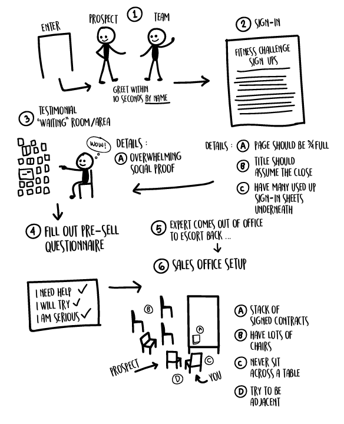

> ### QUY TRÌNH TIẾP ĐÓN & THIẾT LẬP VĂN PHÒNG CHỐT SALE
>
> 1. **Khách bước vào:** Đội ngũ chào đón khách tiềm năng **bằng tên trong vòng 10 giây**.
> 2. **Ký danh xác nhận:** Cho khách ký xác nhận vào bảng danh sách đăng ký tham dự của bạn. (Ví dụ: "FITNESS CHALLENGE SIGN UPS")
>    - **A.** Trang đăng ký nên được lấp đầy khoảng 3/4 danh sách (thể hiện những người đăng ký trước đó).
>    - **B.** Tiêu đề bảng phải mặc định tâm lý họ đã sẵn sàng chốt đơn.
>    - **C.** Kẹp nhiều tờ danh sách đã điền kín phía bên dưới để tạo hiệu ứng.
> 3. **Phòng/khu vực chờ tràn ngập câu chuyện thành công:**
>    - **A.** Rất nhiều bằng chứng xã hội (tường dán kín ảnh trước/sau khiến khách phải thốt lên *"WOW!"*).
> 4. **Điền phiếu khảo sát trước bán hàng:** Khách tự tay cam kết các câu hỏi then chốt. Ví dụ:
>    - *"Tôi cần giúp đỡ ✔"*
>    - *"Tôi sẽ cố gắng ✔"*
>    - *"Tôi thực sự nghiêm túc ✔"*
> 5. **Chuyên gia bước ra khỏi phòng dẫn khách vào...**
> 6. **Thiết lập không gian văn phòng bán hàng:**
>    - **A.** Chồng hợp đồng đã ký xếp sẵn trên bàn.
>    - **B.** Xếp nhiều ghế xung quanh để tạo cảm giác đông đúc/nhộn nhịp.
>    - **C.** Tuyệt đối không ngồi đối diện qua một chiếc bàn.
>    - **D.** Hãy cố gắng ngồi cạnh nhau / góc liền kề.

Hãy bắt đầu từ khoảnh khắc một khách hàng tiềm năng bước chân qua cửa. Dưới đây là mô hình bố trí lý tưởng cho lời chào bán hàng (sales greeting) và văn phòng của bạn nhằm tối đa hóa tỷ lệ chốt đơn.

Hãy cùng phân tích sơ đồ này từng bước một nhé.

1. Chào đón khách hàng thật nồng nhiệt bằng tên của họ trong vòng 10 giây. Đội ngũ của bạn thậm chí nên chạy tới nếu cần. Điều này tạo ấn tượng ban đầu cực kỳ vững chắc, cho khách thấy bạn rất coi trọng dịch vụ chất lượng cao.

2. Đảm bảo họ phải ký tên vào phiếu điểm danh (**sign-in sheet**). Bạn nên chuẩn bị sẵn một xấp phiếu điểm danh dày cộp. Cứ tự bịa tên nếu cần, hoặc nhờ các hội viên hiện tại viết tên họ vào đó.

3. Biến khu vực chờ thành một bức tường hoặc căn phòng tràn ngập những câu chuyện thành công (**testimonial**) khiến ai nhìn vào cũng phải kinh ngạc. Đó là những bức ảnh "trước và sau" của những người đã tập luyện cùng bạn. Dưới đây là ví dụ từ hai **Gym Lord** (Chúa tể phòng gym) của chúng tôi:


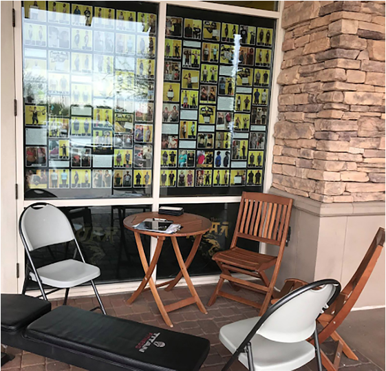

   1. Yêu cầu họ điền vào phiếu khảo sát trước khi bán hàng (**pre-sell intake questionnaire**). Việc này sẽ giúp cải thiện tỷ lệ chốt đơn của bạn và cả đội ngũ.

   2. Sau khi để họ có vài phút tự do ngắm nhìn các đánh giá, hãy dẫn họ vào khu vực tư vấn. Trước đó, bạn phải sắp xếp bàn làm việc sao cho **KHÔNG BAO GIỜ** ngồi đối diện trực diện với khách hàng tiềm năng. Bạn phải ngồi sát vai bên cạnh, cùng một phía với họ. Hãy kê thật nhiều ghế trong phòng để tạo cảm giác lúc nào cũng có đông người muốn tranh thủ sự chú ý của bạn, kèm theo một xấp hợp đồng đã ký dày bịch. (Cứ lấy mấy hợp đồng EFT ra nếu cần). Những món đồ này sẽ phát đi thông điệp ngầm rằng…

      - Bạn rất có sức hút và luôn được săn đón (**in demand**).

      - Bạn là một chuyên gia có tầm ảnh hưởng lớn (**authority & expert**).

      - Rất nhiều người đã ghé thăm gần đây.

      - Rất nhiều người đã đăng ký gói dịch vụ này rồi. (Mọi người thường thích làm theo số đông khi thấy người khác đã mua).

      - Cơ hội đang rất khan hiếm (**scarcity**) (vì bạn sắp kín chỗ) và cấp bách (**urgency**) (vì chương trình chuẩn bị bắt đầu).

Một số chủ phòng gym hoặc đội ngũ sale thường để khách tự điền phiếu khảo sát (từ Chương 2), số khác thì nhờ nhân viên lễ tân làm việc đó. Cách nào cũng được—tùy bạn quyết định. Nhưng nếu bạn trực tiếp làm, hãy ngồi xổm xuống để tầm mắt ngang bằng với họ và đọc các câu hỏi cho họ nghe. Nó cho thấy bạn thực sự quan tâm, và mọi người luôn trân trọng những ai sẵn sàng hạ mình vì họ. Thao tác này cũng giúp bạn tự tin hơn vì cả hai đang ở cùng một bình diện, xóa nhòa mọi khoảng cách tâm lý. Chi tiết nhỏ làm nên chuyện lớn.

Cuối cùng, bạn bắt đầu bước vào cuộc trò chuyện bán hàng (**sales conversation**).

Và vì tôi quá yêu quý các bạn, tôi sẽ vạch ra toàn bộ khung bán hàng của chúng tôi ngay trong chương tiếp theo.

Đọc tiếp đi nào.

### **Chương 6: Công thức C-L-O-S-E-R**

Bạn có muốn xem khung quy trình mà tôi đã truyền đạt cho vô số nhân viên và hơn 1.500 phòng gym để giúp họ chốt đơn từ **cold traffic** (khách hàng lạnh) một cách NHANH CHÓNG không? Nếu bạn nghĩ mình giỏi bán hàng nhưng chưa từng bán được cho ai ngoài khách quen được giới thiệu (**referral**), thì thực ra bạn chưa biết bán hàng là gì. Theo định nghĩa của tôi, bán hàng là việc thuyết phục một kẻ vốn chỉ đang quan tâm sương sương đến dịch vụ của bạn—một kẻ còn chả nhớ mình đã đăng ký nhận thông tin từ bao giờ và hoàn toàn mù tịt về những người từng gặp cùng bạn—móc ví đưa tiền cho bạn. Đó mới gọi là bán hàng. Và đó chính là thứ tôi sắp chỉ cho bạn đây.

Dù bạn trực tiếp đứng lớp bán hàng hay sở hữu một đội ngũ—bạn vẫn cần phải tự mình bán hàng ở một mức độ nhất định để thấu hiểu cái khung này và biết nó thần thánh đến mức nào.

Hãy học nó. Hãy dùng nó. Kiếm tiền từ nó. Sau đó truyền lại cho đội ngũ của bạn. Tôi dùng từ viết tắt **CLOSER** để bạn dễ dàng ghi nhớ. Dưới đây là cấu trúc cơ bản:

1. **C**LARIFY (Làm rõ) lý do họ có mặt ở đây.

2. **L**ABEL (Gắn nhãn) họ với vấn đề mà bạn định giải quyết.

3. **O**VERVIEW (Tổng quan) những nỗi đau và trải nghiệm trong quá khứ của họ.

4. **S**ELL (Bán) cho họ "chuyến nghỉ dưỡng" trong mơ.

5. **E**XPLAIN (Giải thích và triệt tiêu) mọi lo lắng của họ.

6. **R**EINFORCE (Củng cố) quyết định của họ… khiến họ phải há hốc mồm kinh ngạc.

Bây giờ bạn đã có một từ viết tắt cực kỳ dễ nhớ rồi, hãy cùng mổ xẻ chi tiết từng chữ cái nhé.

#### CLARIFY (Làm rõ)

> _Lý do họ tham gia/xuất hiện_
 
&emsp;_“Điều gì đưa bạn đến đây ngày hôm nay?”_ 
&emsp;_“Mục tiêu của bạn là gì?”_ 
&emsp;_“Tại sao bạn lại đăng ký tham gia [ _tên chương trình_ ] trực tuyến này?”_ 

Tôi thường hỏi nhanh cả ba câu hỏi này nối tiếp nhau, bởi vì một số khách hàng cần vài gợi ý khác nhau mới hiểu được ý bạn là gì. Mục đích của chuỗi câu hỏi này là **thiết lập KHOẢNG TRỐNG (GAP)**. Họ đang khao khát một thứ mà họ chưa thể đạt được (hoặc không giữ được sau khi đã đạt), và cách dễ nhất để tìm ra điều đó là cứ thẳng thắn hỏi họ. 

> **Người dịch:** GAP
> Ý tác giả muốn nói ở đây là: Khách hàng cần cảm nhận/hình dung được vấn đề/nỗi đau của họ.

Đôi khi họ sẽ đưa ra câu trả lời chung chung, chẳng hạn như: _“Tôi chỉ muốn tìm hiểu thêm thông tin thôi”_ hoặc _“Tôi thấy ưu đãi hời quá nên tò mò thế thôi”_. 

Để phá vỡ câu trả lời chung chung đó, hãy nói kiểu như thế này: _“Tôi xin lỗi, đáng lẽ tôi nên đặt câu hỏi trúng trọng tâm hơn để biết cách hỗ trợ bạn tốt nhất. Không biết bạn kỳ vọng đạt được hoặc cải thiện điều gì khi đến đây?”_ 

Lúc này, họ sẽ thổ lộ **VẤN ĐỀ (PROBLEM)** thực sự của mình. 

#### LABEL (Gắn nhãn) họ với vấn đề mà bạn định giải quyết 

Đây là lúc bạn làm nổi bật hoặc tóm tắt tình trạng hiện tại so với trạng thái mong muốn của họ. Hãy lấy số liệu cụ thể. 

- “Hiểu rồi, vậy là bạn muốn giảm cân. Cụ thể thì hiện tại bạn nặng bao nhiêu?” 

- “Vậy là hiện tại bạn nặng 81 kg với 28% mỡ cơ thể, và bạn cần giảm khoảng 18 kg để đạt được vóc dáng lý tưởng. Tôi nói vậy có chuẩn không?” 

- “Vậy nếu chúng tôi giúp bạn đạt được điều đó, bạn sẽ không ‘ghim’ tôi chứ nhỉ? (ha ha ha)” 

Tôi biết—nghe hơi nhạt nhẽo phải không? Nhưng tôi vẫn dùng đúng trò đùa đó, và ai cũng bật cười giả tạo một cách rập khuôn mỗi lần nghe thấy. 

#### OVERVIEW (Tổng quan) về những nỗi đau và trải nghiệm trong quá khứ 

Ở bước tiếp theo, bạn sẽ cùng họ nhìn lại những nỗi đau và thất bại trong quá khứ. (Tin tôi đi, họ chắc chắn đã nếm mùi thất bại—đó là lý do họ phải cất công lái xe đến gặp bạn, vì họ chưa thể đạt được kết quả tuyệt vời ở bất kỳ nơi nào khác.) 

- “Tuyệt vời, vậy là tôi đã nắm được bạn đang ở đâu và muốn đến đâu, thế còn trước đây bạn đã thử những cách gì rồi?” 

- “Tôi không thể giúp bạn đạt được mục tiêu nếu tôi không biết tình trạng hiện tại của bạn và bạn đã từng thử những cách nào để đạt được mục tiêu đó.” 

Khách hàng của bạn rất có thể đang cảm thấy bản thân đã thất bại ở một mức độ nào đó, và đó là lý do họ không đạt được mục tiêu thể hình trong các lần thử sức trước. 

Để thuyết phục họ rằng bạn có thể làm được điều mà những nơi khác chưa làm được, bạn sẽ muốn phân loại từng vấn đề của họ vào một bảng nhỏ như dưới đây. (Bạn có thể nhẩm trong đầu hoặc vẽ ra giấy.) Việc dùng sơ đồ trực quan này sẽ giúp bạn chỉ ra nơi và **GAP** tồn tại, từ đó chứng minh cho họ thấy rằng **đó không phải lỗi của HỌ**, mà là do việc thực thi một kế hoạch sai lầm. 

Sau đó, bạn sẽ so sánh và đối chiếu những việc họ đã làm trong quá khứ, đứng về phía những phương pháp đúng đắn và tách biệt dịch vụ của bạn khỏi những thứ họ từng ghét hoặc những thứ không mang lại kết quả. 

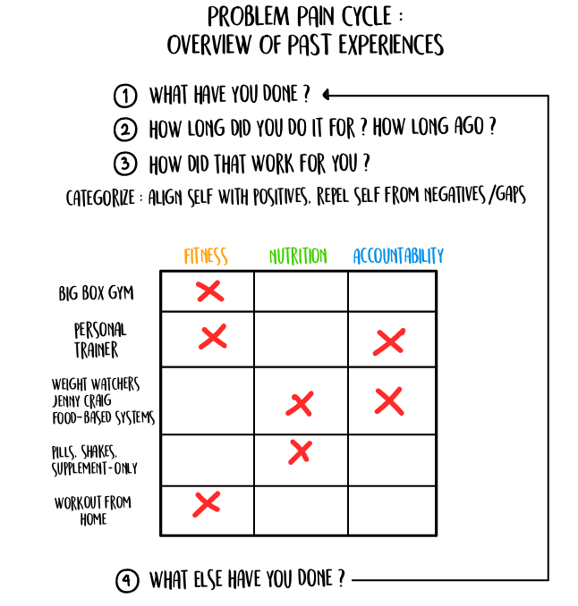

**VÒNG LẶP NỖI ĐAU & VẤN ĐỀ: TỔNG QUAN VỀ TRẢI NGHIỆM TRONG QUÁ KHỨ**
*(Problem Pain Cycle: Overview of Past Experiences)*

1. **Anh/chị đã từng làm những gì rồi?** *(What have you done?)*
2. **Anh/chị đã theo phương pháp đó trong bao lâu? Cách đây bao lâu rồi?** *(How long did you do it for? How long ago?)*
3. **Kết quả mang lại cho anh/chị ra sao?** *(How did that work for you?)*

> **PHÂN LOẠI:** Đồng thuận & gắn kết bản thân với những điểm tích cực, tách biệt bản thân khỏi những trải nghiệm tiêu cực / lỗ hổng mà họ gặp phải *(Categorize: Align self with positives, repel self from negatives/gaps)*.

| Các hình thức đã thử | TẬP LUYỆN <br>*(Fitness)* | DINH DƯỠNG <br>*(Nutrition)* | ĐỒNG HÀNH CAM KẾT <br>*(Accountability)* |
| :--- | :---: | :---: | :---: |
| **Phòng gym thương mại / chuỗi lớn**<br/>*(Big Box Gym)* | ❌ | | |
| **Huấn luyện viên cá nhân**<br/>*(Personal Trainer)* | ❌ | | ❌ |
| **Weight Watchers / Jenny Craig / Chế độ ăn sẵn**<br/>*(Food-based systems)* | | ❌ | ❌ |
| **Chỉ dùng thuốc giảm cân, bột lắc, TPCN** *(Pills, shakes, supplement-only)* | | ❌ | |
| **Tự tập luyện tại nhà**<br/>*(Workout from home)* | ❌ | | |

4. ↻ **Anh/chị còn thử qua giải pháp nào khác nữa chưa?** *(What else have you done? - Lặp lại chu trình từ câu 1)*

Sơ đồ nhỏ này sẽ kiếm cho bạn nhiều tiền hơn bạn tưởng tượng. Nó sẽ đập tan những niềm tin sai lầm của khách hàng về lý do tại sao họ từng thất bại. Tôi sẽ chia sẻ kịch bản để giải thích điều này ở phần tiếp theo. 

#### SELL (Bán) cho họ một kỳ nghỉ, đừng bán chuyến bay.

Khi đi du lịch nghỉ dưỡng, chẳng ai muốn nghe về hàng chờ kiểm tra an ninh TSA, khu nhận hành lý, các chuyến bay bị hoãn, thời gian quá cảnh hay việc đổi múi giờ cả. Họ chỉ muốn nghe về Hawaii. Thế nên, đừng nói với khách hàng tiềm năng về hệ thống bài tập, cách chọn bài, các nguyên tắc đằng sau thực đơn dinh dưỡng hay những thứ đại loại thế. 

Họ. Không. Quan. Tâm. Họ chỉ muốn "Hawaii" mà thôi. 

Hãy bán cho họ những thứ hào hứng trước, rồi sau đó mới dạy họ phần còn lại một khi họ thực sự chịu lắng nghe bạn (nói cách khác là sau khi họ móc ví đưa tiền cho bạn rồi). 

Khi chuyển sang bước chốt sale, bạn sẽ muốn gắn kết các **Lợi ích Cốt lõi (Core Benefits)** của mình với những nỗi đau mà họ từng trải qua trong quá khứ, đồng thời giải thích rằng LÝ DO khiến họ thất bại là do thiếu sự kết hợp đồng bộ của các yếu tố cốt lõi—thể hình, dinh dưỡng và tính trách nhiệm. 

Đây là lúc chúng ta sử dụng toàn bộ dữ liệu đã thu thập được từ khách hàng và giải thích lý do vì sao từng phương pháp trước đây lại thất bại trong một bức tranh tổng thể lớn hơn. Có thể họ đã làm đúng một vài điểm ở mỗi hoàn cảnh, nhưng chưa đủ tất cả. Dưới đây là một kịch bản mẫu. 
 
> Ừm, tôi nghĩ mình đã hiểu vì sao những chương trình khác không mang lại cho bạn kết quả, hay những kết quả bền vững mà bạn đang tìm kiếm. Và sau khi nghe bạn chia sẻ, việc bạn có mặt ở đây hôm nay là hoàn toàn dễ hiểu. 
> 
> Tin vui đây—tôi nghĩ bạn sẽ thích chương trình của chúng tôi đấy. Và xét theo quá khứ của bạn, bạn hoàn toàn giống với 95% khách hàng của chúng tôi—những người đã lột xác ngoạn mục nhờ các chương trình này. Tôi có thể chia sẻ với bạn về những trường hợp đó không? (_Hãy khéo léo lấy sự đồng thuận của khách hàng bằng câu hỏi này để họ cảm thấy tâm phục khẩu phục khi bạn tư vấn chốt sale_). 
> 
> Chương trình của chúng tôi dựa trên ba trụ cột chính: thể hình, dinh dưỡng và tính trách nhiệm. Bạn bắt buộc phải có đủ cả ba yếu tố này (_động tác giơ ngón tay và ra hiệu bằng tay rất phát huy tác dụng ở đây_) thì mới có được sự chuyển hóa bền vững. Bởi vì nếu bạn chỉ có một hoặc hai yếu tố, bạn sẽ chỉ tiến được một chặng đường ngắn. Nó giống như động cơ xe vậy—nếu thiếu đi dù chỉ một bộ phận quan trọng, xe sẽ không thể chạy được. 

Hãy sử dụng một trong các kịch bản sau tùy thuộc vào yếu tố mà họ từng tập trung nhiều nhất trong quá khứ. 

> **Phòng gym lớn** (chỉ có thể hình): “Vậy khi bạn đến phòng gym lớn, bạn được sử dụng các thiết bị tập. Tạm gọi là thế… nhưng họ có hướng dẫn bạn cách tập luyện cụ thể trong lúc ở đó không? Không, chắc chắn là không rồi. Họ có giúp bạn lên thực đơn ăn uống không? Và trách nhiệm duy nhất của họ là gọi cho bạn để nhắc nhở có phải là khi thẻ ngân hàng của bạn gặp lỗi thanh toán không (ha ha ha), tôi nói có đúng không nào?” (Lại là câu trò đùa quen thuộc đó… nhưng lúc nào cũng hiệu quả.) 

> **Weight Watchers / Jenny Craig** (dinh dưỡng và tính trách nhiệm): “Khi tham gia các chương trình đó, họ đưa cho bạn một chế độ ăn và thỉnh thoảng hỏi thăm bạn. Nhờ vậy bạn đã giảm được cân. Quá tuyệt vời. Vấn đề duy nhất là bạn không giữ được cân nặng đó lâu dài, đúng không? Được rồi. Vấn đề nằm ở hai điểm sau: 1) Chế độ ăn đó không bền vững (nếu không thì giờ này bạn vẫn theo đuổi nó rồi) và 2) khi bạn giảm cân, quá trình trao đổi chất của bạn thực sự bị suy giảm vì bạn chẳng hề tập tạ hay kháng lực chút nào cả. 
>
> Bạn có biết rằng mình sẽ bị mất cơ khi ăn kiêng không? Đó là lý do tại sao rất nhiều người tăng cân trở lại và thậm chí còn béo hơn trước. Đây cũng là lý do vì sao đàn ông có thể ăn nhiều hơn phụ nữ—họ có nhiều cơ nạc hơn, và cơ bắp sẽ đốt cháy mỡ thừa giúp họ. Nếu bạn ăn kiêng đúng cách, kết hợp với một kế hoạch bền vững và tập luyện kháng lực, bạn có thể giảm cân và giữ vững thành quả nhờ lượng cơ bắp mới được xây dựng. Bạn thấy điều này có hợp lý không? Đó chính là mảnh ghép còn thiếu trước đây của bạn.”
>
> **Shakes** (Dinh dưỡng): “Hiểu rồi. Vậy là bạn từng thử qua chương trình ăn sinh tố dinh dưỡng (shake), giảm được chút cân lúc đầu, nhưng rồi lại tăng cân trở lại. Kiểu này giống Weight Watchers, nhưng phần dinh dưỡng kém hơn chút, phần đồng hành cam kết (**accountability**) thì tệ hơn hẳn, và mảng tập luyện thì gần như bằng không. Không có thực đơn nào được thiết kế riêng cho chị. Chẳng có ai kèm cặp, theo sát. Và cũng chẳng có ai đợi sẵn ở phòng gym để hướng dẫn chị tập theo đúng mục tiêu cá nhân. Đúng không ạ? Chị nghĩ nếu mình có tất cả những điều đó, liệu mình có thành công không?”

Quá trình bạn vừa áp dụng với từng trường hợp trên chính là thứ mà chúng tôi gọi là **công thức phá vỡ niềm tin (belief-breaking formula)**. Tôi học được khung 5 bước nhỏ này từ người bạn Linh Trinh của mình. Bạn có thể áp dụng nó cho bất kỳ mô hình kinh doanh nào:

1. Nói ra điều họ tin.

2. Chỉ ra tại sao điều đó sai.

3. Nói ra điều gì là đúng.

4. Giải thích TẠI SAO nó đúng.

5. Đưa ra bằng chứng (bức tường minh chứng đằng sau bạn).

**CÔNG THỨC BẺ GÃY NIỀM TIN CŨ**
(_Belief-Breaking Formula_)

| # | Công thức | Ví dụ thực chiến |
| :---: | :--- | :--- |
| **1** | **Nói ra điều họ đang TIN**<br/>*(Say what they believe)* | *"Anh vẫn tin là tung ra các ưu đãi phễu đầu vào giá rẻ (cheap front-end offers) thì hiệu quả sao?"* |
| **2** | **Chỉ ra tại sao điều đó SAI**<br/>*(Say why it is wrong)* | *"Làm thế làm sao tạo đủ dòng tiền (cash flow) để tái đầu tư vào marketing hay chi trả chi phí thu hút khách hàng mới?"* |
| **3** | **Đưa ra giải pháp ĐÚNG**<br/>*(Say what is right)* | *"Hãy dùng chiến lược thu hút đầu vào giá cao (high-ticket front-end acquisition)."* |
| **4** | **Giải thích tại sao nó ĐÚNG**<br/>*(Say WHY it is right)* | *"Nó cho phép anh thoải mái chi bạo tay bao nhiêu cũng được để kéo khách về mà vẫn nắm chắc phần sinh lời."* |
| **5** | **Đưa ra BẰNG CHỨNG**<br/>*(Show proof - 3rd party stats + testimonials)* | *"Nếu không tin tôi hay các con số toán học này? ... Hãy nhìn vào hơn 1.000 phòng gym khác đã làm được."* |

Hy vọng là đến đây bạn đã nắm được mấu chốt. Bạn cần làm nổi bật cả mặt tốt lẫn mặt xấu dựa trên ba trụ cột cốt lõi: tập luyện (fitness), dinh dưỡng (nutrition) và đồng hành cam kết (accountability).

Giờ thì, sau khi đã đập tan mọi niềm tin sai lầm của khách hàng về lý do tại sao họ thất bại trong quá khứ, đã đến lúc xây dựng lại sự tự tin cho họ. Họ đã biết vì sao trước đây họ thất bại. Giờ là lúc chúng ta chuẩn bị cho họ thành công.

“Tôi nghĩ chị sẽ cực kỳ thích chương trình này đấy. Để có thể đăng ký cho bạn một trong các suất cuối cùng của chương trình, tôi cần biết liệu bạn có thể cam kết tuân thủ cả ba trụ cột mà tôi vừa nhắc đến không—gồm tập luyện, dinh dưỡng và đồng hành cam kết. Hãy bắt đầu với việc tập luyện nhé.”

<u>TẬP LUYỆN</u>: “Chị có thể đến đây tập cùng huấn luyện viên 3 ngày một tuần trong [ _khoảng thời gian_ ] tới chứ? Tuyệt vời. Quá dễ phải không nào.”

Hãy nhớ rằng, họ đã khoanh tròn khung giờ trên phiếu khảo sát trước khi mua hàng rồi. Thêm nữa, tôi không nói gì thêm về phần tập luyện, bởi vì khách hàng chẳng quan tâm đâu. Họ chỉ quan tâm đến đích đến cuối cùng của mình, chứ không phải giáo án tập ra sao.

<u>DINH DƯỠNG</u>: “Chị có thể tuân thủ theo thực đơn nếu chúng tôi thiết kế riêng cho chị chứ? Nó được phân loại theo màu sắc và cực kỳ đơn giản đến mức bọn trẻ 12 tuổi cũng làm được.” (Ai mà từ chối được cơ chứ? Ha ha.) 

&emsp;“Chúng tôi sẽ làm cho bạn...

&emsp;&emsp;- Một thực đơn cá nhân hóa

&emsp;&emsp;- Một danh sách đi chợ dành riêng cho bạn

&emsp;&emsp;- Một cẩm nang ăn ngoài hàng dành riêng cho bạn

&emsp;&emsp;- Các công thức nấu ăn khớp hoàn toàn với thực đơn của bạn

&emsp;&emsp;- Cẩm nang sinh tố siêu ngon (**super shake**)

&emsp;&emsp;- Những bữa sáng bùng nổ vị giác

&emsp;&emsp;- Những bữa trưa ngon quên sầu

&emsp;&emsp;- Những bữa tối tuyệt hảo”

> **Mẹo chuyên gia:** Đừng lược bỏ những thứ này nếu bạn đang có sẵn chúng. Khách hàng tiềm năng sẽ muốn xem xét chúng một cách chi tiết (dù thực ra họ chẳng biết mình đang nhìn cái gì đâu). Nó sẽ làm kéo dài thời gian chốt sale và thường dẫn đến những câu hỏi lạc đề, chẳng đi đến đâu. Nó chỉ tạo thêm cớ để họ phản bác (bất chấp thực tế là phần lớn bọn họ chẳng có chút kiến thức nào ngoài một bài báo trên Buzzfeed đọc được từ đời thuở nào). Hãy bán hàng trong thế giới tưởng tượng. Theo kinh nghiệm của tôi, cách này vừa tiết kiệm thời gian lại vừa hiệu quả hơn rất nhiều. Nếu họ đòi xem tận mắt những thứ này, đó là một dấu hiệu cảnh báo đỏ (**red flag**). Tôi thường chỉ lướt qua nhanh và nói rằng đây chưa phải là bản thực đơn chính thức của họ, mà chỉ là bản mẫu mà thôi. TUYỆT ĐỐI không đưa thẳng tài liệu cho họ. Chỉ trưng ra rồi cất đi ngay (tạo cảm giác đây chỉ là một bản phác thảo sơ sài của thành phẩm, khiến nó trở nên không quá quan trọng).

<u>ĐỒNG HÀNH CAM KẾT</u> (ACCOUNTABILITY): “Được rồi, phần cuối cùng là sự cam kết đồng hành. Bạn có thể lên kế hoạch tập luyện và dinh dưỡng đỉnh nhất thế giới, nhưng nếu không làm theo thì cũng bằng hòa, đúng không? Vì vậy, chúng tôi cực kỳ tự hào về việc kèm cặp và giữ cam kết với khách hàng. Chúng tôi làm điều đó theo ba cách:

- Bạn sẽ được phân công một huấn luyện viên đồng hành cá nhân (**accountability coach**).

- Bạn sẽ được mời tham gia nhóm đồng hành trực tuyến của chúng tôi, gồm những người mới bắt đầu và các cựu học viên. Nhờ vậy, bạn sẽ được sát cánh cùng những người cũng đang trải qua hành trình này lần đầu tiên, đồng thời có thể học hỏi từ những người đã về đích và đang hô hào cổ vũ bạn từ vạch đích.

- Chúng tôi cũng có các buổi kiểm tra tiến độ hàng tuần để đảm bảo chúng tôi làm tốt việc của mình và bạn cũng đang làm tốt việc của bạn. Nếu cần điều chỉnh thực đơn, chúng tôi sẽ làm ngay. Không còn kiểu ‘lên thực đơn xong rồi để đấy’ nữa. Cơ thể con người luôn thích nghi và chúng ta phải điều chỉnh cho phù hợp. Đó là một trong những lợi ích lớn nhất của việc có huấn luyện viên. Rất nhiều người vấp phải nút thắt (**plateau**) và bị mắc kẹt tại đó. Chúng tôi đã thấy cảnh này hàng trăm lần, và chúng tôi biết rằng chỉ cần một tinh chỉnh nhỏ là có thể tiếp tục giảm cân mà không bị mất đà. Có hợp lý không ạ?”

Nghe tuyệt vời quá phải không? Bạn có muốn giữ một trong những suất cuối cùng không?

À, bạn đúng là gặp may đấy, vì tôi cũng không chắc mình sẽ chạy chương trình này được bao lâu nữa—đã có quá nhiều người đăng ký rồi.”

Phần còn lại của giao dịch này diễn ra như sau:

“Chị có mang theo căn cước/CMND không?” (Tôi hỏi câu này vì nếu ai đó lấy ví ra để tìm giấy tờ tùy thân, họ sẽ không thể viện cớ là quên ví [ _nháy mắt_ ]. Đây là một cam kết vi mô **[micro-commitment]**. Sau đó, tôi bắt đầu điền hợp đồng cho họ bằng thông tin lấy từ giấy tờ mà họ vừa đưa.)

Rồi tôi nói: “Tuyệt vời—để tôi đổi chiếc CMND này lấy chiếc thẻ thanh toán mà chị muốn dùng nhé.” Và tôi trả lại giấy tờ tùy thân, ra hiệu về phía chiếc ví của họ. Bước này thường diễn ra rất thoải mái, và tôi vừa trò chuyện phiếm vừa làm thủ tục đăng ký cho họ. (Đồng thời cũng để chắc chắn rằng tôi lấy được chính xác số thẻ tín dụng điền vào hợp đồng.)

#### Explain (Giải thích/xóa bỏ) mọi lo lắng của khách hàng

Trong bất kỳ tình huống chốt sale nào, bạn chỉ phải đối mặt với đúng ba rào cản (và một rào cản phụ). Chỉ thế thôi. Thật đấy. 

&emsp;Đó là...

- Sự trì hoãn (Stalls) 
   - “Tôi cần suy nghĩ thêm.” 
   - “Ngày mai tôi sẽ gọi lại và đọc số thẻ cho bạn.” 

- Vấn đề ra quyết định (Decision-Making) 
   - “Tôi phải hỏi ý kiến chồng tôi đã.” 
   - “Tôi không bao giờ tự mình quyết định.” 

- Giá cả (Price) 
   - “Tôi không đủ tiền.” 
   - “Tôi không có ngân sách cho việc này.” 
   - “Khoản này vượt quá ngân sách của tôi rồi.” 

Xét về các **rào cản đặc thù trong ngành thể hình (fitness-specific obstacles)**, đây là những câu hỏi kinh điển mà bạn phải luôn sẵn sàng đối phó: 

- “Tôi bị đau lưng.” 
- “Tôi không thích dậy sớm.” 
- “Tôi ghét súp lơ. Tôi không bao giờ ăn bất cứ thứ gì có súp lơ.” 

Thực ra đây không phải là rào cản thật sự, thế nên đừng có hoang mang khi khách hàng tiềm năng phun ra mấy câu kỳ cục đó. Thực ra họ vẫn muốn mua hàng đấy chứ. 

Nắm được cách vượt qua những rào cản này, bạn sẽ chốt được nhiều sale hơn và giúp nhiều người khỏe mạnh hơn. (Để biết thêm chi tiết, hãy xem phần BONUS "Xử Lý Rào Cản" ở cuối sách. Nhưng đừng lật qua đó vội, bạn sẽ bị phân tâm đấy. Phần đó chỉ chứa các câu xử lý từ chối mà chúng tôi thực sự dùng để chốt sale, loại bỏ hoàn toàn những thứ sáo rỗng mà chẳng ai thèm đồng ý.) 

<u>Lưu ý:</u> Nếu bạn bán hàng tốt, bạn sẽ chẳng cần đến chúng. Nếu bạn cảm thấy mình lúc nào cũng phải chật vật tranh cãi với khách để chốt sale, có khả năng đã có gì đó sai sót ở các bước đầu trong quy trình này. (Thường là do bạn chưa dành đủ thời gian để đào sâu khoảng trống (GAP), khoét sâu nhu cầu và xoáy vào vòng lặp nỗi đau của họ). Nhưng nếu bạn đã làm tốt tất cả các bước trước đó, và bạn tràn đầy năng lượng (thật sự) cùng một nụ cười rạng rỡ (thật sự), thì những chiến thuật này sẽ giúp bạn hỗ trợ khách hàng đưa ra quyết định mà cả hai đều biết họ nên làm. 

Và bạn càng luyện tập nhiều, mọi thứ sẽ càng mượt mà, và bạn có thể lôi chúng ra sử dụng bất cứ lúc nào bạn muốn. Nghệ sĩ Eminem từng đọc cả cuốn từ điển để trang bị mọi "vũ khí" trong kho tàng của mình—anh ấy nắm rõ từng từ ngữ. Đối với một người bán hàng (sales person), danh sách các đòn chốt sale này chính là vũ khí của bạn. Hãy chắc chắn rằng bạn luôn ra sân với phong độ đỉnh cao nhất. 

#### REINFORCE (Củng cố) quyết định của họ


Bước cuối cùng trong công thức C-L-O-S-E-R giúp ngăn chặn tình trạng khách lật lọng (backouts) và là khởi đầu cho một mối quan hệ bền chặt. Nó tạo ra ấn tượng ban đầu tuyệt vời. Bạn chỉ có một cơ hội duy nhất để gây ấn tượng, vậy nên hãy làm cho nó thật hoành tráng. 

**Bộ Ba Hoàn Hảo: Vũ Khí Lựa Chọn Của Chúng Tôi** 

Ba bước chúng tôi thực hiện để củng cố quyết định gia nhập phòng tập của khách hàng là… 

- Một **thư mời viết tay** tham dự sự kiện tiếp theo của chúng tôi.

- Một **cuộc gọi từ chủ phòng tập** để chào mừng họ vào tối hôm đó hoặc sáng sớm ngày hôm sau.

- Một chiếc **áo thun hoặc quà lưu niệm (swag)**.

Ngày nay, phần lớn những việc này có thể tự động hóa bằng hệ thống và công nghệ. Nhưng bạn vẫn nên xây dựng một trải nghiệm được chuẩn bị kỹ lưỡng cho khách hàng mới, giúp họ cảm thấy mình đặc biệt và tự tin rằng họ đã đưa ra quyết định đúng đắn. 

Bạn biết thừa rằng họ đã có một quyết định sáng suốt khi đăng ký tập luyện cùng bạn. Để biến điều đó thành sự thật, bạn chỉ cần cho họ thấy sự quan tâm chân thành bằng những hành động mang dấu ấn cá nhân. Hãy dùng một hoặc tất cả những "_vũ khí_" trên để chính thức chốt hạ và chào mừng khách hàng mới vào đại gia đình của bạn. Điều này đóng vai trò vô cùng lớn trong việc giữ chân khách hàng về lâu dài. Thêm nữa, đó cũng là một cách hành xử cực kỳ đẳng cấp. 

#### **Cùng Ôn Lại Nào** 

Bạn mới đi được một phần ba chặng đường của cuốn sách này, và chúng ta đã giải quyết được một trong những vấn đề lớn nhất của phòng tập. Bạn thấy phấn khích chưa? Đến lúc này, bạn có hai lựa chọn. Bạn có thể gấp sách lại ngay bây giờ, đi áp dụng phương pháp kiếm khách hàng mới này, gom về một đống tiền, rồi sau đó quay lại đọc phần còn lại. Hoặc bạn có thể đọc tiếp và giải quyết cả ba vấn đề cùng một lúc. Dù chọn cách nào đi nữa, bạn cũng sẽ có khối thứ hay ho để trải nghiệm. 

Trước khi chọn một trong hai đường đó, hãy cùng điểm lại những gì bạn đã học được nãy giờ. 

**Quy Trình Thu Hút Khách Hàng Hiệu Quả** 

- Front-end offers giá rẻ không đem lại lợi ích gì cho bạn hay khách hàng. 

- Để khách hàng tài trợ cho việc thu hút họ (Client-financed acquisition) chính là cách tiếp cận khách hàng hoàn toàn mới… đem lại lợi nhuận ngay lập tức. 

   - Ưu đãi giá trị cao không thể chối từ (High-Ticket Irresistible Offer ) 

   - Tạo Leads liên tục bằng Lead Gen Scrambler 

   - Khiến khách hàng tiềm năng phải xuất hiện

      - Lên lịch hẹn (Scheduling) 

      - Có mặt đúng giờ (Showing Up) 

   - Khiến họ phải mua hàng

      - Câu hỏi định hướng và Bảng câu hỏi thu thập thông tin (Pre-Frame Questions and Intake Questionnaire) 

      - Phòng bán hàng (Sales Office) 

      - Chốt sale (The Sale) 

         - Công thức C-L-O-S-E-R 

Nào, sẵn sàng giải quyết vấn đề lớn thứ hai trong ngành thể hình chưa? 

Đọc tiếp để hiểu tại sao mô hình doanh thu của bạn đang bị hỏng và cách để sửa chữa nó. 

## **Phần II: Nâng cấp (Ascension): Tối ưu hóa lợi nhuận** 

Tôi chắc chắn rằng bạn biết một cái đòn bẩy (lever) trông như thế nào: một công cụ đơn giản được thiết kế để giúp bạn di chuyển hoặc nâng một vật nặng quá sức của người bình thường. Đây có lẽ là một trong những công cụ đầu tiên và mạnh mẽ nhất do nhân loại phát minh ra. Trong kinh doanh, đòn bẩy chính là cách tạo ra những cú bứt phá ngoạn mục chỉ bằng những thay đổi nhỏ trong cách vận hành doanh nghiệp. 

Trong phần này, trước hết chúng ta sẽ làm rõ vấn đề cốt tử trong mô hình phòng gym hiện tại mà hầu hết mọi người đang áp dụng. Một khi điểm nghẽn đó đã sáng tỏ, tôi sẽ chia sẻ về ba đòn bẩy **VĨ MÔ** (macro levers) mà bạn có thể vận dụng cho phòng gym của mình để vừa gia tăng lợi nhuận, vừa nâng tầm chất lượng và số lượng dịch vụ cung cấp cho khách hàng. Đòn bẩy vĩ mô là các sáng kiến chiến lược cốt lõi giúp đẩy toàn bộ cỗ máy kinh doanh của bạn tiến về phía trước. Đi sâu vào từng đòn bẩy vĩ mô, chúng ta sẽ bóc tách các đòn bẩy **VI MÔ** (micro levers) nhỏ hơn—chúng là những mắt xích giúp bạn kích hoạt đòn bẩy vĩ mô một cách chuẩn xác để gặt hái thành quả. Các đòn bẩy vi mô tuy có quy mô nhỏ hơn nhưng đóng vai trò quan trọng không kém cấu thành nên sức mạnh của đòn bẩy vĩ mô.

Hãy hình dung những đòn bẩy này giống như các tay gạt bên hông một chiếc máy quay xèng (chính là phòng gym của bạn). Kéo đủ tất cả và kéo thật chuẩn xác, tiền mặt sẽ tự động tuôn trào không ngừng.

Ba đòn bẩy vĩ mô bao gồm:

- **Đòn bẩy vĩ mô #1: Đòn bẩy về Giá (Price Levers)**

   - Đòn bẩy này liên quan đến chiến lược định giá, các gói sản phẩm/dịch vụ (packages) và các gói hội viên (memberships).

- **Đòn bẩy vĩ mô #2: Đòn bẩy về Sức chứa (Capacity Levers)**

   - Đây là đòn bẩy "nặng đô" và dày dặn nhất. Phần này sẽ mổ xẻ toàn bộ các phương thức khác nhau nhằm tối đa hóa sức chứa của cơ sở phòng gym. Yếu tố này mang tính sống còn, vì nó cho phép bạn kiếm được nhiều tiền hơn gấp bội ngay trên mặt bằng phòng gym hiện có mà không cần mở rộng diện tích.

- **Đòn bẩy vĩ mô #3: Đòn bẩy về Chi phí vận hành (Overhead Levers)**

   - Đây là đòn bẩy kém hào nhoáng nhất (_người dịch: ít được để ý bởi chủ doanh nghiệp_) trong cả ba, nhưng tầm quan trọng của nó thì không thể bàn cãi. Vấn đề không nằm ở việc bạn kiếm được bao nhiêu tiền doanh thu, mà là bạn thực sự giữ lại và mang được bao nhiêu tiền về túi. Vì vậy, chúng ta sẽ đào sâu về cơ chế trả lương/thưởng, chiến lược thực thi và bàn giao dịch vụ (fulfillment), cùng các mảnh ghép khác để tinh giản hóa bộ máy vận hành phòng gym của bạn.

Để khép lại toàn bộ phần này, tôi sẽ chỉ cho bạn cách truyền tải những thay đổi trên tới đội ngũ nhân sự và khách hàng sao cho vấp phải ít sự phản kháng nhất, đồng thời đạt được tỷ lệ đón nhận và hưởng ứng cao nhất.

Nghe ổn chứ? 

Tuyệt vời. Giờ để tôi chỉ cho bạn cách biến những phòng tập đang thua lỗ thành máy in tiền... một cách nhanh chóng. 

### **Chương 7: Công Thức Kinh Doanh Càng Làm Càng Lỗ** 

> <u>_Ghi chú của người dịch_</u>
> Nguyên văn: `The Broken Profit Model`
> Diễn giải: 
> &emsp;Là tình trạng cấu trúc kinh doanh của doanh nghiệp bị mất cân đối nghiêm trọng giữa <u>chi phí bỏ ra để có/phục vụ khách hàng</u> và <u>giá trị tiền bạc (lợi nhuận ròng) thu về từ khách hàng đó</u>.
> 
> &emsp;Nói một cách hình ảnh: Doanh nghiệp của bạn giống như một chiếc xô bị thủng đáy. Bạn càng đổ nhiều nước vào (tăng ngân sách marketing, mở rộng quy mô, chốt nhiều đơn hàng), nước chảy ra ngoài càng nhanh (lỗ lũy kế càng lớn). Vấn đề không nằm ở việc đội ngũ làm việc kém hiệu quả, mà nằm ở <u>công thức kiếm tiền ngay từ đầu đã sai</u>.

Vậy là đến giờ bạn đã nắm chắc khâu thu hút khách hàng rồi chứ? (Nếu chưa, hãy quay lại đọc sáu chương trước đi nhé). Nhưng việc nhét đầy phòng tập bằng những lô khách hàng mới chẳng có tác dụng gì nếu bạn cạn kiệt không gian hoặc mô hình kinh doanh của bạn chưa được thiết lập để tối đa hóa lợi nhuận. 

Công suất thực sự là một bài toán hóc búa kìm hãm khả năng kiếm tiền của bạn. Một lần nữa, đây là bài toán về quy mô (scale) - khả năng mở rộng để phục vụ được nhiều khách hàng hơn. Nhưng bạn hoàn toàn có thể khắc phục triệt để bằng cách áp dụng một mô hình doanh thu khác và tinh chỉnh một vài điểm trong cách vận hành doanh nghiệp của bạn.

Bạn đã sẵn sàng để nắm bắt phần cốt lõi này trong bài toán kinh doanh chưa? Hãy bắt đầu bằng việc nhìn thẳng vào vấn đề của mô hình doanh thu hiện tại mà bạn đang áp dụng.

#### **Câu chuyện của tôi, và có lẽ cũng là của bạn** 

Nếu bạn giống tôi hồi mới bắt đầu, hẳn bạn cũng từng tự tay tính toán và nghĩ rằng: *"Chỉ cần có 200 khách hàng trả 200 USD/tháng, mình sẽ đút túi 40.000 USD/tháng và thành đại gia."* Thế là bạn hào hứng ký hợp đồng thuê mặt bằng với tư duy ngây thơ kiểu "mình cứ xây lên đi, khách khắc tự đến và rủ thêm cả họ hàng bạn bè", y như phần lớn chúng ta vẫn thường làm.

Rồi thực tế vả thẳng vào mặt: tiền thuê nhà, lương nhân viên, chi phí hành chính, tiền mua phần mềm, tiền thuê dọn dẹp, việc hành chính, thiết bị hỏng hóc, chi phí sản xuất tài liệu marketing và vật phẩm (áo thun, sự kiện, biển hiệu, áp phích), chi phí quảng cáo, và... tôi đã nhắc đến việc hành chính chưa nhỉ? Thú thực, tôi chưa bao giờ nghĩ xa hơn được khoản tiền thuê mặt bằng. Tôi hoàn toàn mù tịt về việc vận hành một doanh nghiệp lại ngốn nhiều tiền đến thế. 

Và hàng loạt rắc rối khác bắt đầu xuất hiện:

- Tôi phải chật vật đấu tranh để khách hàng chịu trả 120 USD/tháng. 

- Các khung giờ tập chính trong ngày (5:30 sáng, 5:00 chiều, 6:00 chiều) bắt đầu quá tải. 

- Chi phí cố định thực tế LỚN HƠN RẤT NHIỀU so với dự tính (hệ thống tự động trả lời email, trang đích - *landing page*, nhắn tin tự động, CRM (quản lý và chăm sóc khách hàng) và nhiều thứ khác). 

- Một số chi phí tăng lên tương ứng với số lượng hội viên (chi phí nhân sự hành chính tăng, dọn dẹp nhiều hơn, thiết bị hỏng hóc/phải mua mới nhiều hơn, nâng cấp các gói phần mềm cao hơn, số giờ huấn luyện viên tăng lên). 

- Khi tôi chạy các chiến dịch marketing, phần lớn khách hàng chẳng ở lại quá vài tháng. Và các hội viên cốt lõi trong phòng tập của tôi vẫn chỉ là nhóm 70–80 "cạ cứng" (OGs - original gangsters) đã đồng hành từ những ngày đầu. 

- Ngay cả khi các khung giờ vàng đã kín chỗ, **tôi vẫn chật vật lắm mới đủ tiền trang trải qua ngày.** 

Tôi đã cố vận hành doanh nghiệp dựa trên "_mô hình tạo lợi nhuận bị lỗi_" từ trong trứng nước. Giấc mơ hào hùng về một phòng tập sinh lời, về việc giúp mọi người đạt được mục tiêu thể hình, đang lụi tàn nhanh chóng khi tôi ngày càng kiệt sức. Nhìn vào gương và nghe khách hàng nhận xét trông mình chẳng khác nào một ông già cáu kỉnh, tôi quyết định dừng lại để nhìn nhận thật nghiêm túc về mớ hỗn độn mà mình đang vướng vào, cũng như tìm cách thoát ra bằng được. 

Nếu bạn thấy mình trong những vấn đề này, rất có thể bạn cũng đang dẫm lên vết xe đổ của cái mô hình què quặt đó. Tin vui là chúng ta chuẩn bị sửa lại cho đúng. Nhưng trước khi làm điều đó, hãy nhìn thẳng vào các con số của bạn. Không gì kích thích tinh thần giải quyết vấn đề bằng việc nhìn thấy rõ ràng trắng đen trên giấy. 

Đây là bức ảnh chụp phiên bản trẻ trung và ít nếp nhăn hơn của tôi ngày trước. Nhìn lại nó, tôi gần như có thể cảm nhận lại niềm hy vọng tràn trề thuở ấy—chỉ là nó đi kèm với sự thiếu hiểu biết toàn tập về cách vận hành một doanh nghiệp. 

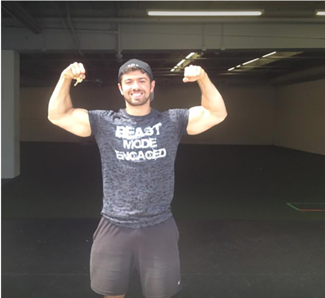

Và vâng, bức ảnh ở trang tiếp theo chính là nơi tôi đã ngủ suốt sáu tháng đầu tiên khởi nghiệp. Tôi không có đủ tiền vừa thuê căn hộ vừa thuê mặt bằng phòng tập. Tôi sống tạt ngang tạt ngửa trên xe hơi và tắm nhờ ở phòng tập LA Fitness cuối phố. 

Tôi kể bạn nghe điều này để khẳng định rằng tôi đã từng lội bùn lội ruộng hết cả rồi. Đây không phải là lý thuyết suông phát ra từ mấy tòa tháp ngà. Đây là thực chiến. Và những chiêu thức này thực sự hiệu quả. 

Đã từng có thời điểm tôi đang cố gắng chốt đơn, bắt khách hàng ký hợp đồng và quẹt thẻ, trong lúc đứa con 6 tuổi của họ đang dùng bút lông dầu vẽ bậy lên tường phòng tập của tôi—và tôi phải cố gắng hết sức để không phát điên lên, bởi vì tôi cực kỳ cần khoản đặt cọc 300 USD ngày hôm đó để kịp trả lương nhân viên. 

Tôi hiểu chứ. Tôi đã trải qua hết rồi. Nhưng như tôi đã nói, luôn có một con đường tốt hơn thế. 

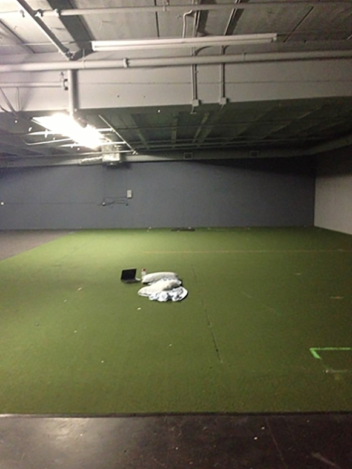

Tiến lên nào. 

Hình minh họa ở trang tiếp theo chỉ ra vấn đề cốt lõi của ngành công nghiệp microgym (phòng tập quy mô nhỏ). Nói một cách đơn giản, số lượng hội viên tính theo mức giá trung bình của thị trường để giúp một phòng tập có lãi thường vượt quá sức chứa hợp lý của không gian đó. Các lớp học trở nên đông đúc và chật kín, nhưng với mức giá trung bình của thị trường, phòng tập vẫn không thể có lãi. 

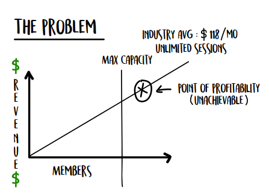

| Thông số vận hành | Giá trị |
| :--- | :--- |
| **Mô hình** | Huấn luyện nhóm lớn *(Large Group Training)* |
| **Sức chứa mỗi ca** | Tối đa 16 người / buổi *(16 people / session)* |
| **Phí hội viên bình quân (EFT)** | \$120 / tháng |
| **Số hội viên hiện tại** | 100 người |
| **Số ca tập mỗi ngày** | 7 ca / ngày |
| **Sức chứa tối đa 1 (Max Cap₁)** | **114 hội viên** *(giả định 100% người đi tập mỗi ngày)* |
| **Sức chứa tối đa 2 (Max Cap₂)** | **134 hội viên** *(giả định tỷ lệ điểm danh trung bình ngành đạt 85%)* |
| **Doanh thu tối đa (Max Rev)** | **\$16.000 / tháng** *(134 hội viên × \$120)* |

| Khoản mục chi phí<br/>(Tổng chi phí (1~6): \$14.500) | Số tiền |
| :--- | :--- |
| **1. Tiền thuê mặt bằng (Rent)** | \$4.250 |
| **2. Lương huấn luyện viên (Payroll)** | \$4.000 *(163 ca × \$25)* |
| **3. Lương quản lý / hành chính (Admin)** | \$2.750 |
| **4. Chi phí Marketing (Mktg)** | \$1.000 |
| **5. Điện nước / Phần mềm / Vệ sinh (Utilities/Software/Cleaning)** | \$1.750 |
| **6. Chi phí khác (Misc)** | \$750 |
| **7. Thu nhập chủ phòng tập (Owner Pay)** | **\$1.500** |
| **8. Lợi nhuận ròng (Profit)** | **\$0** |

> Người dịch: Lợi nhuận ròng có thể hiểu là phần mà doanh nghiệp còn giữ lại được để làm nguồn lực (hoặc dự phòng) cho doanh nghiệp mà không cần phải tăng vốn.

Hãy cùng phân tích ví dụ minh họa này. 

Tôi sẽ chia phần phân tích nhỏ này thành ba phần, tương ứng với ba đòn bẩy lợi nhuận vĩ mô (macro profit levers) mà tôi đã đề cập trước đó: 

- Đòn bẩy Giá (Price Levers) 

- Đòn bẩy Sức chứa (Capacity Levers) 

- Đòn bẩy Chi phí cố định (Overhead Levers) 

Chúng có sự liên kết chặt chẽ với nhau, nhưng tôi sẽ cố gắng tách bạch chúng ra nhiều nhất có thể để việc giải thích trở nên dễ hiểu. Trong mỗi đòn bẩy, tôi sẽ phác họa cách mà phần lớn các phòng tập đang làm, sau đó giải thích các đòn bẩy vi mô (micro levers) bạn có thể tác động để làm thay đổi các đòn bẩy vĩ mô, và rộng ra là tác động đến toàn bộ lợi nhuận của mô hình kinh doanh phòng tập. 

#### **Đòn bẩy Vĩ mô #1: Đòn bẩy Giá (Price Levers)** 

Các phòng tập thông thường mà chúng ta hay gặp có các con số trung bình như sau: 100 hội viên đóng phí định kỳ, mỗi người trả 120 USD mỗi tháng. Điều này có nghĩa là tổng doanh thu (gross revenue) của họ là 12.000 USD mỗi tháng. 

Một số nơi nhận kèm thêm huấn luyện riêng (private training) ngoài giờ—đó mới thực sự là lúc họ kiếm tiền để đút túi, còn phòng tập chỉ hoạt động như một tổ chức phi lợi nhuận để tự nuôi sống chính nó—nhưng đại loại chỉ có vậy. Để phục vụ cho phần minh họa này, tôi sẽ chỉ tập trung bàn về thành phần huấn luyện nhóm lớn. 

Các đòn bẩy vi mô tác động trực tiếp đến đòn bẩy giá vĩ mô của bạn bao gồm: 

- Số lượng hội viên 

- Chu kỳ thanh toán (ví dụ: theo tuần hay theo tháng) 

- Mức giá 

#### **Đòn bẩy Vĩ mô #2: Đòn bẩy Sức chứa (Capacity Levers)** 

Phòng tập trung bình mà chúng ta thường thấy có bức tranh về công suất hoạt động như sau: 

Họ đang duy trì lịch dạy 7 ca/ngày từ thứ Hai đến thứ Sáu và thường là 3 ca/ngày vào dịp cuối tuần, chia đều cho thứ Bảy và Chủ Nhật. Gói hội viên mà hầu hết các phòng tập bán ra là gói không giới hạn, nghĩa là khách hàng thích đến tập lúc nào cũng được. Trung bình, họ có thể phục vụ 16 người mỗi ca tập, tùy thuộc vào bài tập được lựa chọn. Mỗi buổi kéo dài một tiếng và tỷ lệ tham gia mỗi ngày thường đạt 85%. (Người dịch: Nghĩa là tổng số hội viên tham gia qua tất cả các ca tập trong một ngày)

Các đòn bẩy vi mô tác động đến đòn bẩy sức chứa vĩ mô gồm có: 

- Số buổi tập mỗi tuần 

- Thời lượng mỗi buổi (độ dài của một buổi tập và khoảng nghỉ giữa các buổi) 

- Các cấp độ hội viên (quy định số buổi tối đa một người được phép tham gia) 

- Tỷ lệ chuyên cần (tỷ lệ phần trăm số buổi đã lên lịch mà hội viên thực sự có mặt) 

- Không gian vật lý (diện tích sàn hữu dụng phục vụ cho các hoạt động thể hình) 

- Danh mục bài tập được chọn (vì bước gập gối ôm tạ - *walking barbell lunges* sẽ chiếm nhiều không gian hơn so với bài tập gập bụng - *sit-ups*) 

#### **Đòn bẩy Chi phí cố định (Overhead Levers)** 

Một phòng tập trung bình đang phải chi trả 25 USD cho chi phí nhân sự trên mỗi buổi tập, và họ tổ chức tổng cộng 38 buổi tập mỗi tuần. 

Chi phí phòng tập bao gồm tiền thuê mặt bằng, điện nước, marketing và phần mềm. Tuy nhiên, chúng ta chỉ có thể can thiệp vào ba đòn bẩy vi mô sau: 

- Số lượng buổi tập được thực hiện 

- Tổng số giờ làm việc 

- Chi phí cho những giờ làm việc đó 

**Lưu ý:** Số lượng buổi tập cũng sẽ chịu ảnh hưởng bởi những thay đổi mà chúng ta thực hiện trên đòn bẩy vĩ mô sức chứa. 

Giờ thì quay lại với ví dụ minh họa. 

Điểm tôi muốn nhấn mạnh ở đây là: một phòng tập thông thường, ngay cả khi được khai thác đến mức tối đa công suất, vẫn không thể tạo ra mức lợi nhuận mà chủ đầu tư mong muốn. Nó đã chạm ngưỡng giới hạn sức chứa TRƯỚC KHI kịp đạt đến điểm có đủ lợi nhuận, đồng nghĩa với việc bắt buộc phải có thứ gì đó thay đổi, bằng không doanh nghiệp sẽ không thể sống sót.

Dưới đây là cách bài toán tài chính được bóc tách.

Nếu bạn có thể huấn luyện 16 người mỗi ca và bạn mở 7 ca mỗi ngày, tổng cộng bạn huấn luyện được 112 người/ngày. Đó là với điều kiện mọi ca tập đều ĐẠT CÔNG SUẤT HOÀN HẢO — nghĩa là lớp nào cũng kín chỗ, điều hiếm khi xảy ra trong thế giới thực.

Vì vậy, giả sử theo mức trung bình của ngành là 85% hội viên đi tập mỗi ngày, bạn có thể đẩy tổng số hội viên của một cơ sở được phân bổ hoàn hảo này từ 112 lên 131 người. (Tôi tính bằng cách lấy 112 chia cho tỷ lệ đi tập 85%). Điều này có nghĩa là bạn có thể bán số gói hội viên vượt quá khả năng phục vụ thực tế của mình. Đây là chuyện rất bình thường trong ngành phòng gym, vì chúng ta đều biết không phải ai cũng đến tập mỗi ngày.

Nhưng ngay cả với 131 hội viên — tại một cơ sở hoạt động tối đa công suất, với lượng người tập được phân bổ HOÀN HẢO giữa các khung giờ — doanh thu gộp của bạn cũng chỉ đạt 15.720 USD mỗi tháng sau khi trừ đi các chi phí sau:

- 4.000 USD tiền thuê mặt bằng

- 4.000 USD tiền lương nhân sự, vì chúng ta có 163 ca tập mỗi tháng tính ra 25 USD mỗi ca, đã bao gồm các khoản phí liên quan đến bảng lương

- 800 USD tiền điện nước, internet (điện thoại, Wi-Fi) và dụng cụ vệ sinh

- 2.000 USD cho hệ thống quản lý quan hệ khách hàng (CRM), phần mềm và phí xử lý giao dịch

- 1.000 USD cho marketing

- 1.000 USD cho chi phí phát sinh<br/>(Nếu làm phòng gym, bạn sẽ hiểu ý tôi — thiết bị hỏng hóc, loa đài, áo thun, sự kiện, v.v. Nếu chưa có phòng gym, hãy mở sao kê ngân hàng 3 tháng gần nhất ra xem… bạn sẽ thấy ngay thôi.)

Tóm lại, lợi nhuận của bạn chỉ vỏn vẹn 2.920 USD/tháng (15.720 USD doanh thu trừ đi 12.800 USD các chi phí kể trên). Đó là tính cho một cơ sở đã tối đa hóa 100% công suất trong một thế giới hoàn hảo, với 0 USD trả cho nhân viên hành chính hay lễ tân, 0 USD tiền hoa hồng bán hàng, và 0 USD chi cho việc đào tạo nâng cao năng lực nhân sự. Danh sách những thứ LẼ RA bạn phải chi tiền để biến đây thành một cỗ máy kinh doanh tự vận hành còn dài nữa. Điều này có nghĩa là ngay cả khi bạn trả ai đó 1.000 USD/tháng để làm việc vặt hành chính, số tiền mang về nhà của bạn chỉ còn 1.920 USD/tháng — mức tiền hầu như chỉ đủ để các phòng gym thoi thóp sống qua ngày. Đây là thực trạng của phần lớn các chủ phòng gym… để rồi cuối cùng họ kiệt sức.

Tôi không rõ bạn thế nào, nhưng với việc cày cuốc hơn 80 tiếng/tuần — mức trung bình của hầu hết chủ phòng gym — thì mức thù lao thực tế trên mỗi giờ làm việc của bạn chỉ là 9,13 USD (2.920 USD thu nhập hàng tháng chia cho 320 giờ làm việc mỗi tháng).

Tôi không biết có nói hộ được lòng bạn không, nhưng tôi dám cá là mức thu nhập mang về nhà kiểu này không phải thứ mà bất kỳ ai trong chúng ta từng mơ ước khi đặt bút ký hợp đồng thuê mặt bằng 5 năm và nướng cả tiền tiết kiệm cả đời để mở phòng gym.

Nhưng đừng lo — vẫn có lối thoát, và bạn sẽ không mất quá nhiều thời gian để chạm tới nó. Trong những trang tiếp theo, tôi sẽ chia sẻ kinh nghiệm xương máu của mình, rồi sau đó đi thẳng vào cách giải quyết toàn bộ mớ hỗn độn này.

### **Chương 8: Đòn bẩy Giá cả & Lợi nhuận (Price-Profit Levers)**

Để tôi kể cho bạn nghe về Kirk Huggins. Kirk là một trong những con người tử tế nhất hành tinh này. Nếu bạn nghĩ mình quen ai đó còn tử tế hơn, tôi cá là bạn chưa gặp Kirk đâu. Anh ấy thực sự là một "người tốt hiếm có". Kirk muốn tất cả mọi người đều có thể đi tập và có huấn luyện viên riêng với mức giá vừa túi tiền. Thế nên tại phòng gym của anh ấy ở Bắc Carolina, có những gói hội viên giá thấp đến mức khó tin: chỉ 49 USD/tháng.

Và điều điên rồ là, những khách hàng trả mức giá bèo bọt đó thường lại là những kẻ gây phiền toái nhất (_Nguyên văn: PIAs - pains in the ass_).

Dù sao đi nữa, có lần tôi nhận được tin nhắn từ Kirk rằng anh ấy sắp không đủ tiền trả lương nhân viên — mà nhân tiện, việc không trả được lương nhân viên là một thảm họa LỚN HƠN rất nhiều so với việc không trả được tiền thuê mặt bằng, nếu có lúc nào đó bạn rơi vào cảnh khó khăn. Niềm tin của nhân viên là tất cả. Chủ nhà còn có thể châm chước và cho bạn khất dần theo thời gian (tiện thể chia sẻ dưới góc độ tôi từng đóng cả hai vai trò chủ nhà lẫn người thuê nhà). Hãy luôn đặt nhân viên lên hàng đầu.

Thế nên, đối với tôi, dẫu biết đó không phải là một quyết định kinh doanh khôn ngoan, tôi vẫn cho Kirk vay tiền để trả lương nhân viên. Chỉ trong vòng 5 ngày, anh ấy đã trả lại tôi đủ nguyên cục (nhờ áp dụng các chiến thuật thu hồi vốn từ khách hàng trong Phần I).

Nhưng sau vụ đó, chúng tôi thống nhất rằng anh ấy đang tự đẩy mình vào thế bờ vực. Khách hàng trả quá ít khiến mô hình kinh doanh của anh ấy không thể duy trì nổi, và chỉ cần một chi phí bất ngờ phát sinh là anh ấy lại rơi vào cảnh túng quẫn ngay.

Thế là chúng tôi tung ra một loạt thông báo gồm thư tay, tin nhắn phát tán (text blast), video và email gửi toàn bộ khách hàng của anh ấy để giải thích lý do tại sao anh ấy buộc phải tăng giá. Cuối cùng, chúng tôi chốt mức 150 USD/tháng — một cú nhảy vọt KHỔNG LỒ. Anh ấy đã ĐẠT GẤP BA lần giá cũ ngay tại một thị trường có nền kinh tế èo uột bậc nhất cả nước. Kirk buộc phải hành động vì anh chẳng còn đường lùi. Hy vọng là bạn cũng sẽ hành động trước khi rơi vào bước đường cùng đó.

Chúng tôi cũng giật đồng thời mọi đòn bẩy vĩ mô và vi mô có thể. (Tôi cực kỳ khuyến khích bạn nên làm theo cách này. Đã cắt giảm là cắt một lần cho sâu, cắt tận gốc).

Chỉ trong một nốt nhạc, công việc kinh doanh của Kirk từ chỗ đang lỗ 2.000 USD/tháng đã chuyển sang LỢI NHUẬN RÒNG 4.000 USD. Và chúng tôi làm được điều đó chỉ trong một tuần.

Những thứ này có thể thay đổi cuộc đời bạn. Và bạn không nhất thiết phải đang lâm vào cảnh khốn cùng mới cần làm. Rất có thể bạn đang chật vật xoay sở hoặc kiếm không được bao nhiêu như kỳ vọng. Nếu bạn đang ở hoàn cảnh đó, bạn hoàn toàn có thể lật ngược ván cờ, kéo lợi nhuận vọt từ 4.000 USD lên 10.000 USD/tháng chỉ nhờ những thay đổi tương tự. Hy vọng điều đó cũng khiến bạn sục sôi nhiệt huyết như tôi lúc này.

Nào, chúng ta cùng đi sâu vào chi tiết nhé.

Mục tiêu của các đòn bẩy cụ thể này là làm sao để khách hàng chi tiêu nhiều tiền hơn cho bạn. Chúng ta đang áp dụng Lộ trình Tăng trưởng #2 — Tăng Giá trị Giao dịch Trung bình (Increase Average Purchase). Do đó, chúng ta sẽ tinh chỉnh lại cách bạn thiết lập giá cả và các gói sản phẩm. Tôi sẽ chỉ cho bạn ba đòn bẩy khác nhau mà bạn có thể áp dụng ngay.

#### **Đòn bẩy vi mô về Giá #1: Tăng Lợi nhuận Trên Mỗi Hội viên**

Cách đây không lâu, tôi gặp một ông bố đơn thân nuôi hai cô con gái vô cùng xinh xắn. Anh ấy đã làm mọi cách để biến giấc mơ của mình thành hiện thực… nhưng rồi nó biến thành một cơn ác mộng thực sự. Anh ấy vừa phải dùng thẻ tín dụng để đóng tiền thuê nhà. Kiểu ác mộng dở khóc dở cười như thế đấy.

Cũng giống như Kirk, Josh Ponton đang định giá dịch vụ quá thấp. Khách hàng không hề tôn trọng thời gian hay chuyên môn của anh. Và tồi tệ nhất là, họ chẳng đạt được kết quả gì cả.

Vì Josh đã lâm vào đường cùng và chẳng còn gì để mất, anh quyết định chơi canh bạc cuối cùng (**Hail Mary**) và đăng ký đồng hành cùng chúng tôi bằng 1.000 USD cuối cùng còn sót lại trong thẻ tín dụng.

Chúng tôi bảo Josh nâng giá gói sản phẩm phễu (**front-end offer**) của anh ấy từ 21 USD lên 600 USD. Và đột nhiên, tất cả những con người này bắt đầu xuất hiện đúng giờ, tuân thủ nghiêm ngặt thực đơn dinh dưỡng và đạt được những kết quả tuyệt vời không tưởng. Ban đầu, Josh tỏ ra lưỡng lự vì anh cảm thấy áy náy khi thu phí cao đến vậy. Rồi anh nhận ra một chân lý mà rất nhiều chủ phòng gym của chúng tôi đã ngộ ra: nếu bạn thực sự muốn giúp đỡ mọi người, bạn phải khiến họ coi đó là ưu tiên hàng đầu. Và không gì làm được việc đó tốt hơn tiền bạc.

Thế nên, nếu bạn thực sự muốn giúp đỡ người khác chứ không phải chỉ nói mồm cho sang miệng, hãy thu phí cao lên. Nhưng cụ thể là bao nhiêu?

##### **Bí Mật Lớn**

Khi thiết lập giá, hầu hết các chủ phòng gym đều mở cửa hàng ra, đảo mắt nhìn xung quanh xem người khác đang thu bao nhiêu, rồi lấy số trung bình và áp dụng y hệt mức giá đó.

&emsp;Nhưng điều mà phần lớn mọi người không biết…

&emsp;&emsp;&emsp;&emsp;&emsp;&emsp;&emsp;&emsp;&emsp;&emsp;&emsp;bí mật lớn ở đây là…

&emsp;&emsp;&emsp;&emsp;&emsp;&emsp;&emsp;&emsp;&emsp;&emsp;&emsp;&emsp;&emsp;&emsp;&emsp;&emsp;&emsp;tất cả những kẻ khác đều ĐANG RÁCH TƠI TẢ.

Vậy tại sao lại đi sao chép bọn họ làm gì?

Ở một mức độ nào đó, có thể bạn cũng nhận ra điều này, bằng chứng là bạn đang đọc cuốn sách này. Bạn có muốn biết thêm một bí mật nữa không? Cách dễ nhất để kiếm nhiều tiền hơn chính là thu phí cao hơn cho cùng một mức độ phục vụ. Đơn giản vãi chưởng. Ai cũng thấy nó đơn giản, nhưng đố ai dám làm.

Nhiều người gặp khó khăn với khái niệm này, bởi nó bắt nguồn sâu xa từ giá trị bản thân và niềm tin cá nhân của họ về tiền bạc. Đó là lý do tại sao những nhân viên sale rỗng túi thường chốt sale kém—khách hàng có thể *cảm nhận* được sự tuyệt vọng. Nhưng khi bạn đã có tiền, tiền sẽ tự khắc chảy về nhiều hơn bởi vì bạn chẳng còn phải thèm khát nó nữa. Sẽ không còn sự tuyệt vọng nào cả. Nghe thì phũ phàng nhưng đó là sự thật.

Đó là lý do tại sao người giàu ngày càng giàu hơn và khoảng cách kinh tế ngày càng nới rộng. Và cách duy nhất để bạn vượt qua rào cản đó là hiểu rằng: Định giá cao (premium pricing) chính là người bạn tốt nhất của bạn. Nó cho phép bạn vượt mức kỳ vọng, chăm sóc và phục vụ khách hàng theo cách chưa từng có tiền lệ.

Dưới đây là bảng biểu đồ chúng tôi dùng để minh họa khái niệm "vòng lặp giá tích cực và tiêu cực". Bạn có thể chọn mô hình phù hợp cho doanh nghiệp của mình.

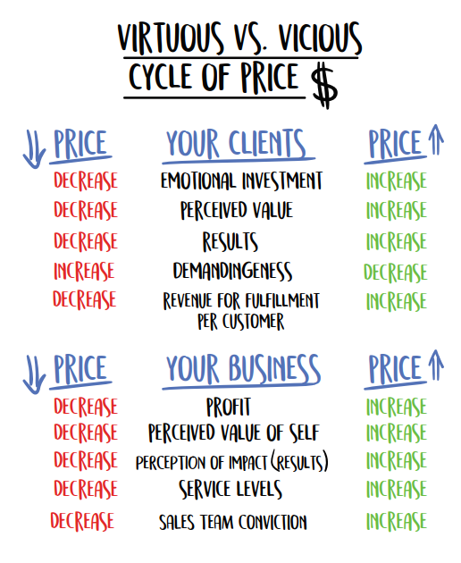

Dưới đây là cách **vòng lặp giá tiêu cực** vận hành (điều mà HẦU HẾT các phòng gym đang làm).

Khi bạn GIẢM giá…

- Mức độ đầu tư cảm xúc của khách hàng GIẢM.

- Giá trị cảm nhận về dịch vụ của bạn GIẢM.

- Kết quả GIẢM theo hệ quả của việc giảm đầu tư và giá trị cảm nhận.

- Khách hàng TĂNG mức độ đòi hỏi. (Đã bao giờ bạn để ý thấy những khách hàng trả ít tiền nhất lại là những người đòi hỏi nhiều nhất chưa?)

- Khách hàng NHẬN ĐƯỢC ÍT dịch vụ hơn vì bạn có ít tiền hơn để chi cho họ (cuộc đua xuống đáy).

Và khi bạn giảm giá, DOANH NGHIỆP của bạn sẽ…

- GIẢM lợi nhuận trên mỗi khách hàng.

- GIẢM giá trị bản thân được cảm nhận.*

- GIẢM năng lực tạo ra kết quả cho khách hàng.

- GIẢM niềm tin vào quy trình bán hàng, bởi vì bạn và đội ngũ không còn chắc chắn liệu mình có thể làm đúng cam kết với khách hàng hay không.

*Bạn cảm thấy bản thân kém giá trị đi vì bạn thu phí quá rẻ cho những gì mình làm, và liên tục cảm thấy không được trân trọng, giống như đang “cho không biếu không” vậy.

Và đây là cách **vòng lặp giá tích cực** vận hành (điều mà các phòng gym CỦA CHÚNG TÔI đang làm):

Khi bạn TĂNG giá…

- Mức độ đầu tư cảm xúc của khách hàng TĂNG.

- Giá trị cảm nhận về dịch vụ của bạn TĂNG.

- Kết quả TĂNG theo hệ quả của việc tăng đầu tư và giá trị cảm nhận.

- Khách hàng GIẢM mức độ đòi hỏi. (Đã bao giờ bạn để ý thấy những người trả bạn nhiều tiền nhất lại là những người dễ chịu nhất chưa?)

- Khách hàng NHẬN ĐƯỢC NHIỀU dịch vụ hơn vì bạn có NHIỀU tiền hơn để chi cho họ, từ đó NÂNG TẦM dịch vụ của bạn lên (cuộc đua lên đỉnh).

Và khi bạn tăng giá, DOANH NGHIỆP của bạn sẽ…

- TĂNG lợi nhuận trên mỗi khách hàng.

- TĂNG giá trị bản thân được cảm nhận. (Bạn cảm thấy mình đáng giá hơn, vì bạn thu đúng giá trị mình tạo ra và có khả năng phục vụ tốt hơn.)

- TĂNG năng lực tạo ra kết quả cho khách hàng, bởi vì bạn có nguồn lực để lan tỏa thông điệp và thực sự giúp đỡ nhiều người hơn thông qua việc tái đầu tư tiền vào kinh doanh và Marketing.

- TĂNG mức độ dịch vụ bạn cung cấp cho mỗi khách hàng.

- TĂNG niềm tin trong quy trình bán hàng, vì bạn và đội ngũ tự tin rằng mình có thể thực hiện đúng cam kết, thậm chí là đảm bảo cho điều đó.

Nếu bạn chỉ làm một điều duy nhất sau khi đọc cuốn sách này, HÃY TĂNG GIÁ.

##### **Mô hình Định giá Tích cực**

Nếu bạn cần một số con số ví dụ để có thêm động lực, đây chính là những gì tôi đang đề cập với mô hình hội viên mà chúng tôi khuyên dùng.

&emsp;**Nhóm Lớn (Large Group)**: 16+ học viên: \$167 – \$225/tháng*

&emsp;**Nhóm Trung bình/Vùng đất không người (Medium Group/No-Man’s Land)**: 5–15 học viên:<br/>&emsp;(Theo quan điểm của tôi, đây KHÔNG PHẢI là những lựa chọn phân bổ lớp học hiệu quả, tôi sẽ giải thích điều này sau.)

&emsp;**Nhóm Nhỏ (Small Group)**: Tỷ lệ 1 kèm 4: \$500 – \$700/tháng

***Lưu ý:** Trên thực tế chúng tôi không thu phí theo tháng—nhưng cách tính này hữu ích cho việc minh họa. Đó là một đòn bẩy khác, tôi sẽ đề cập đến ngay sau đây.

Đây là mức giá bạn nên vọt lên ngay lập tức. Và trước khi bạn thốt lên rằng “Nhưng thị trường của tôi khác” hay “Khách hàng không chịu trả mức giá đó đâu” hoặc bất kỳ lý do vòng vo nào khác của bạn, hãy nhớ rằng các phòng gym tôi từng cố vấn đã áp dụng thành công mô hình này ở MỌI thị trường mà chúng tôi thử nghiệm—hơn 1.500 thị trường tính đến nay.

Lý do những người khác rỗng túi đơn giản chỉ vì họ sợ hãi. Thế thôi.

Họ sợ rằng nếu mình vươn tới một tầm cao mới, họ sẽ đánh mất sự thoải mái ít ỏi đang có ở hiện tại.

Đơn giản không có nghĩa là dễ dàng, nếu không thì ai cũng làm được rồi. Bạn có thể nhận ra điều này từ công việc với các khách hàng tập fitness của mình. Nâng tạ. Ăn nhiều đạm hơn. Ăn nhiều rau hơn. Nó có gì phức tạp đâu. Nhưng hàng trăm triệu người vẫn vật lộn, bởi vì nó KHÓ… đơn giản nhưng khó.

Kiếm tiền trong kinh doanh cũng vậy. Và khái niệm đầu tiên này không có gì khác biệt. Hãy tăng giá, hoặc chịu cảnh kiệt quệ và không có lấy một đồng lợi nhuận.

Thu phí cao hơn để bạn có thể giúp đỡ nhiều người hơn.

Nếu bạn thực sự muốn giúp đỡ người khác chứ không phải chỉ nói cho sang miệng, bạn cần phải thu phí cao hơn. Trước đây tôi từng nói: “Tôi muốn ai cũng có thể tiếp cận fitness với giá rẻ.” Nhưng ngặt một nỗi, nếu họ không đánh giá cao nó, họ sẽ không dùng nó. Và khách hàng dùng chính đồng tiền của họ để bỏ phiếu cho những thứ họ trân trọng. Mọi người sẽ không bao giờ dâng thời gian của họ cho bạn cho đến khi họ chịu chi tiền.

Giá rẻ không chừa lại chút dư địa nào để mang lại những trải nghiệm KINH NGẠC cho khách hàng. Giá cao hơn cho phép tôi thực sự trao cho họ sự hỗ trợ cần thiết để lấy lại vóc dáng, và trong trường hợp của tôi, là giúp nhiều chủ phòng gym chuyển đổi mô hình kinh doanh của họ hơn. Nếu tôi chỉ thu dịch vụ của mình với giá \$1.000, tôi sẽ chẳng thể duy trì nổi một đội ngũ hỗ trợ đặc nhiệm kiểu SEAL Team 6—những người giải đáp mọi thắc mắc chưa đầy ba phút, có cam kết hẳn hoi. Và tôi cũng chẳng thể chạy Marketing để lan tỏa thông điệp. Kết quả là tôi sẽ ngồi đây với một sản phẩm làng nhàng (vì tôi có quá ít tiền để đầu tư cho khâu hỗ trợ) cùng một mức giá làng nhàng (thành thật mà nói, nó sẽ chẳng đáng giá bao nhiêu nếu thiếu đi sự coaching và hỗ trợ chiều sâu để đảm bảo chiến thắng), và hoàn toàn bế tắc trong việc tiếp cận khách hàng cũng như làm Marketing vì chẳng còn dư đồng nào.

Hãy để "_Vòng Lặp Tích Cực_" vận hành vì lợi ích của bạn, để bạn CÓ THỂ THỰC SỰ giúp đỡ mọi người, chứ không chỉ nói suông.

Như tôi vẫn thường nói với các chủ phòng gym, đằng nào bạn cũng phải đối mặt với những cuộc trò chuyện khó khăn—hoặc là với vợ/chồng và chủ nhà về việc bạn không thể nuôi nổi gia đình và trả tiền thuê mặt bằng, hoặc là với khách hàng về mức giá mới. Nhưng chỉ có một lựa chọn trong số đó giúp bạn kiếm được nhiều tiền hơn.

Tùy bạn chọn.

Ở phần cuối của Phần II, tôi sẽ vạch ra cho bạn một kế hoạch hành động cách phối hợp nhịp nhàng các đòn bẩy cùng lúc để tạo ra màn lội ngược dòng ngoạn mục. Theo kinh nghiệm của tôi, chúng hoạt động hiệu quả nhất khi được thực hiện đồng bộ.

Nhưng ngay lúc này…

Hãy nâng toàn bộ giá EFT (hội viên thanh toán định kỳ) mới của bạn lên mức tôi vừa liệt kê. Không có ngoại lệ. Giữ nguyên mức giá cũ cho các hội viên đời đầu cho đến khi phòng tập chạm ngưỡng công suất, sau đó... hãy đồng thời tăng giá đối với họ. Đó là quy luật kinh tế cơ bản: cung và cầu. Ai cũng hiểu rằng giá sẽ tăng khi nguồn cung giảm. 

#### **Đòn Bẩy Giá Vi Mô #2: Cấp Độ Thành Viên (Membership Levels) → Tối Ưu Lợi Nhuận Trên Mỗi Thành Viên** 

Để tôi kể cho bạn nghe một câu chuyện làm sáng tỏ mô hình định giá mà tôi sắp chia sẻ ngay sau đây. 

Tôi có một khách hàng khá khá giả đã đồng hành cùng tôi được vài tháng. Cô ấy có vẻ rất hài lòng. Cô ấy tham gia gói hội viên (subscription) và tiền được trừ tự động mỗi tháng. Mọi chuyện tưởng chừng chẳng có vấn đề gì. Thế nhưng bỗng một ngày đẹp trời, cô ấy hủy dịch vụ. 

Tôi liền hỏi: *"Chúng tôi có thể làm gì tốt hơn? Làm thế nào để đáp ứng nhu cầu của chị tốt hơn nữa?"* 

Cô ấy đáp: *"Ồ, tôi vừa đăng ký tập với một huấn luyện viên cá nhân rồi. Tôi chỉ muốn được kèm cặp sát sao hơn thôi."* 

Tôi thực sự chết lặng. Nhưng giờ đây tôi mới nhận ra rằng suốt quãng thời gian làm việc với cô ấy và những khách hàng khác, tôi đã quá sợ việc tăng giá. Vì thu phí quá thấp, tôi buộc phải săn đón thật nhiều khách hàng và cày cuốc liên tục. Tôi đã không thể dành cho cô ấy sự quan tâm mà cô ấy muốn, bởi vì tôi quá bận rộn loay hoay xoay sở để duy trì việc kinh doanh. Cuối cùng, tôi đã mất đi một khách hàng giá trị vào tay người có đủ thời gian và năng lực để cung cấp mức dịch vụ cao hơn. Giá như tôi thu phí gấp bốn lần và dành nhiều thời gian hơn cho cô ấy, tôi đã có thể giữ chân được vị khách đó. 

Cô ấy sẵn sàng trả nhiều tiền hơn. 

Nhưng tôi lại không dám thu cao hơn. Dù vậy, tôi đã sửa sai điều đó… cực kỳ nhanh chóng. 

##### **Đường Cong Mua Hàng (The Buying Curve)** 

Mỗi phòng tập đều có cách riêng để phân chia cấp độ thành viên và cấu trúc dịch vụ. Và như tôi đã đề cập trước đó, rất nhiều trong số đó thực sự ngớ ngẩn, vô lý và cho thấy sự mơ hồ về các nguyên tắc định giá cơ bản. Họ định giá dựa trên mức trung bình của thị trường. Hoặc họ lao vào cuộc chiến hạ giá (race to the bottom) để chơi khăm các đối thủ cạnh tranh ở địa phương. 

Lẽ ra, họ phải định giá dựa trên số tiền mà khách hàng sẵn sàng chi trả để giải quyết một vấn đề hoặc nỗi đau (pain point), CHỨ KHÔNG PHẢI dựa vào giá thị trường hay chi phí vận hành của họ. Khách hàng đăng ký tập gym bắt nguồn từ những nỗi đau của họ. Chính những nỗi đau đó thúc đẩy họ muốn thay đổi. Có thể họ tăng cân quá nhiều và cảm thấy tự ti về bản thân. Có thể họ đã thử đủ mọi phương pháp tập luyện khác nhau nhưng đều thất bại. Hoặc có thể họ đang lo lắng về một sự kiện sắp diễn ra như buổi họp lớp hay đám cưới. 

Nhưng điều quan trọng nhất cần ghi nhớ là: bạn phải thu đúng số tiền mà khách hàng sẵn sàng trả, không được thấp hơn. 

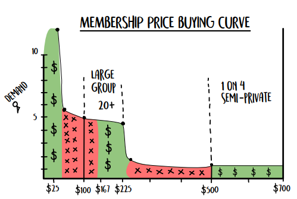

Được rồi, tôi gọi đây là đường cong quả dưa hấu (watermelon curve). (Màu sắc không thể hiện được trong sách, nhưng hãy tin tôi—nếu có màu, các phần xanh và đỏ trông giống như những lát dưa hấu có hạt bên trong). Đường cong mua hàng này mang lại những hiểu biết cực kỳ sâu sắc cho doanh nghiệp của bạn. 

Mỗi đường đứt nét thẳng phân tách các chiến lược thực thi dịch vụ (fulfillment strategies). 

- **Phần A:** Từ mốc cơ sở bên trái đến đường đứt nét đầu tiên là khu vực dành cho **dịch vụ tự phục vụ** (self-service). Đây là mô hình của Planet Fitness, LA Fitness… những chuỗi phòng tập lớn (big-box globe gyms). Họ đặt cược vào thực tế rằng 90% khách hàng sẽ không bao giờ sử dụng phòng tập của họ một cách thường xuyên. Đó là cách mô hình của họ vận hành. Bạn không thể cạnh tranh về giá với họ; họ chơi một mô hình hoàn toàn khác. 

- **Phần B:** Từ đường đứt nét thứ nhất đến đường thứ hai là không gian dành cho **tập nhóm lớn** (large-group training). Đây là mô hình quen thuộc với hơn 16 người mỗi ca. Các tổ chức liên kết (Affiliate boxes), các lớp bootcamp, v.v. 

- **Phần C:** Từ đường đứt nét thứ hai đến thứ ba là khu vực dành cho **lớp học quy mô trung bình** (medium-sized class). Kiểu như một huấn luyện viên kèm từ 5 đến 15 khách hàng. 

- **Phần D:** Từ đường thứ ba trở đi là nhóm khách hàng cao cấp (high-ticket group). Đây là cấp độ dịch vụ cao nhất của bạn, hoặc các lớp **bán riêng tư** (semi-privates). Bạn thường có thể huấn luyện từ 1 kèm 1 đến 1 kèm 4 trong phân khúc này. 

Bây giờ, khi chúng ta đã vạch ra các cấp độ thực thi dịch vụ khác nhau, hãy để tôi giải thích về màu sắc và các mức giá. 

Bất kỳ mục nào có ký hiệu dấu đô la ($) chính là phân khúc giá lý tưởng bạn nên hướng tới cho cấp độ dịch vụ đó. Bất kỳ mục nào có dấu X là vùng bạn tuyệt đối nên tránh. 

Lý do nằm ở bài toán kinh tế về công suất và khả năng sinh lời. Tôi cũng muốn bạn chú ý đến Phần C, nơi ngập tràn các dấu X. Đó là vùng thực thi cho quy mô từ 5 đến 15 người. Đây là thứ tôi gọi là Vùng Đất Câm Lặng (No Man’s Land), bởi vì MẶC DÙ bạn CÓ THỂ phục vụ ở mức giá đó, nhưng bạn sẽ không tối đa hóa được tiềm năng kinh doanh của mình. 

Trong trường hợp này, bạn đang bị kẹt giữa hai tệp khách hàng khác nhau. Một bên là những người thực sự chỉ đủ khả năng chi trả khoảng 200 USD/tháng nhưng lại phải oằn mình trả mức 300 đến 500 USD. Và một bên là những người đang bị thu phí quá rẻ, giống như trong câu chuyện của tôi—những người có thể và thực ra rất muốn nhận dịch vụ cao cấp hơn nhưng lại không nhận được sự quan tâm sát sao tương xứng. 

Vậy những bài học cốt lõi từ bốn vùng thực thi dịch vụ này là gì? 

**Giá Thấp, Dịch Vụ Thấp: 0 USD đến 99 USD mỗi tháng** 

Bạn KHÔNG HỀ muốn dấn thân vào phân khúc này chút nào. Sự cạnh tranh ở đây cực kỳ khốc liệt, và đối thủ của bạn chính là toàn bộ các chuỗi phòng tập lớn được đầu tư hàng triệu đô la. Lúc này, bạn sẽ phải cạnh tranh bằng chất lượng cơ sở vật chất. Và nếu bạn chỉ là một chủ phòng tập thông thường, bạn không đủ tiềm lực tài chính để chơi cuộc chơi đó đâu. Vì vậy, lời khuyên của tôi là hãy tránh xa. 

**Nhóm Lớn (Large Group)** 

Bạn nên đặt mức giá ở 199 USD/tháng tại đây. Trên thực tế, khoảng từ 167 đến 225 USD là biên độ chúng tôi khuyên dùng, bởi vì chúng tôi đã kiểm chứng nó mang lại hiệu quả. Bất kỳ mức nào thấp hơn bạn sẽ gặp vấn đề về công suất và bài toán lợi nhuận. Hãy tránh xa vùng giá từ 99 đến 167 USD. Đây là mức giá mà hầu hết các phòng tập đang áp dụng, nhưng nó không đủ nguồn lực tài chính để cung cấp chất lượng dịch vụ cần thiết. Và **hầu hết mọi người sẵn sàng trả nhiều hơn nếu họ nhận được giá trị tương xứng** tiến tới phân khúc cao cấp này… hãy tin tôi đi. Khoảng từ 167 đến 225 USD/tháng chính là "thiên đường" bạn cần sống trong thế giới tập nhóm lớn. 

**Nhóm Trung Bình (Medium Group)** 

Mặc dù bạn hoàn toàn có thể vận hành dịch vụ ở cấp độ này, nhưng các mức giá đi kèm lại hoàn toàn phi lý. Chúng sẽ quá đắt đỏ đối với một số khách hàng, nhưng lại quá rẻ đối với những người có khả năng chi trả nhiều hơn. Giải pháp là gì? Đừng bám trụ ở đây. Thay vào đó, hãy chia nhỏ dịch vụ của bạn thành hai cấp độ rõ ràng: nhóm lớn và nhóm nhỏ. 

**Nhóm Nhỏ (Small Group)** 

Phân khúc này được định giá hoàn toàn tương đương với hình thức huấn luyện 1 kèm 1 (personal training). Nhưng theo kinh nghiệm của tôi, khách hàng thích bầu không khí tập nhóm nhỏ nhiều hơn hoặc ít nhất là ngang bằng—họ vẫn có được sự gắn kết từ những gương mặt quen thuộc và tinh thần cộng đồng, đồng thời vẫn nhận được sự quan tâm cá nhân hóa. Bất kỳ ai từng làm việc 1 kèm 1 đều biết rằng thường có rất nhiều thời gian lãng phí trong một buổi tập. Do đó, mô hình 1 kèm 4 chính là sự kết hợp hoàn hảo giữa chất lượng thực thi đỉnh cao và mức giá tối ưu. Như vậy, bạn chỉ cần nhân 4 doanh thu trên cùng một khung giờ. Bạn cần phải sống trong khoảng giá từ 500 đến 700 USD/tháng tại đây. 

Tóm lại, bạn có thể coi tất cả mọi người ở Vùng X (X Zone) là những khách hàng có ngưỡng mua hàng hoặc bị vắt kiệt quá mức, hoặc chưa được khai thác hết tiềm năng so với lượng giá trị dịch vụ mà họ nhận được. Các Vùng \$ mới là những vùng an toàn. Đây là nơi mà giá cả, hành vi mua sắm của người tiêu dùng và chất lượng dịch vụ hòa quyện vào nhau một cách hoàn hảo.

##### **Vậy ai sẽ rơi vào nhóm nào?** 

Pain points (Điểm đau) là la bàn cực kỳ hữu ích khi bạn quyết định thiết lập các gói hội viên (membership levels). Sơ đồ bốn góc (quadrant) dưới đây thể hiện mối quan hệ giữa những nỗi đau, nhu cầu và mức giá. Một NỖI ĐAU thấp đồng nghĩa khách hàng chưa gặp quá nhiều phiền toái, trong khi NỖI ĐAU cao khiến họ thực sự "đau khổ". Những người có NỖI ĐAU cao cực kỳ khao khát thay đổi và chắc chắn sẽ sẵn sàng chi nhiều tiền hơn để giải quyết vấn đề của mình. 

Chúng ta sẽ dùng hai mức giá làm ví dụ cho trường hợp này: \$199/tháng và \$499+/tháng. 

Vậy nhóm khách hàng nào sẽ chi trả cho các mức giá này? 

- **Phân khúc \$199/tháng:** Đây là nhóm người giàu nhưng có NỖI ĐAU thấp, hoặc những người có thu nhập trung bình nhưng có NỖI ĐAU ở mức trung bình. 

- **Phân khúc \$499+/tháng:** Đây là nhóm người giàu có NỖI ĐAU từ bình thường đến cao, và những người có thu nhập trung bình nhưng có NỖI ĐAU cao. 

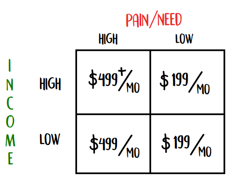

Dĩ nhiên, định nghĩa thế nào là “người giàu” và “thu nhập thấp” sẽ thay đổi tùy thuộc vào vị trí địa lý và thị trường ngách của bạn. 

Dựa vào thông tin này, bạn có thể xây dựng các cấp độ hội viên của mình. (Lại nhấn mạnh, chúng ta không tính phí theo tháng — đây chỉ là các ví dụ minh họa.) 

**Cấp độ hội viên thấp hơn:** \$167–\$225/tháng 

1. Người bình thường với NỖI ĐAU bình thường. 

2. Người giàu với NỖI ĐAU thấp. 

&emsp;Dịch vụ cung cấp: Tập 3 buổi/tuần theo nhóm lớn (16+ người). 

**Cấp độ hội viên cao hơn:** \$500–\$700/tháng 

1. Người bình thường có NỖI ĐAU CAO hoặc NHU CẦU CAO đối với dịch vụ của bạn. 

2. Người giàu có NỖI ĐAU hoặc nhu cầu BÌNH THƯỜNG HOẶC CAO đối với dịch vụ của bạn. 

&emsp;Dịch vụ cung cấp: Tập 3 buổi/tuần theo nhóm bán riêng tư (semi-private) (1 HLV kèm 4 khách hàng). 

Chắc bạn đang tự hỏi: “Tại sao cấp độ thứ hai lại có giá đắt gấp ba lần cấp độ đầu tiên?” Câu hỏi rất hay. 

Thứ nhất, vì tệp khách hàng sẵn sàng chi trả có thể vươn lên mức đó, nên bạn hoàn toàn có quyền thu mức giá ấy. Thứ hai, khách hàng luôn tuân theo quy luật phân phối 80/20 nổi tiếng: 20% khách hàng của bạn có khả năng và sẵn lòng trả mức giá cao hơn, vậy nên hãy tạo cơ hội cho họ. Và đổi lại, bạn phải cung cấp cho họ dịch vụ mà họ thực sự mong muốn và xứng đáng nhận được. 

Nếu bạn khiến 20% khách hàng chịu chi trả gấp ba lần, doanh nghiệp của bạn sẽ tăng trưởng thêm 60% doanh thu trong khi chỉ phải phục vụ một phần năm tổng lượng khách. Đó chính là sức mạnh của định giá phân khúc cao cấp (premium pricing). 

Như câu chuyện ở phần đầu đã minh họa, nếu bạn tính mức giá cao hơn, bạn có thể cung cấp dịch vụ tốt hơn cho khách hàng và giữ chân họ lâu hơn. 

**Vùng Đất Câm Lặng (No Man’s Land)** 

Nhưng tại sao lại không có mức giá ở giữa hay cấp độ số lượng người ở giữa cho mỗi buổi tập? 

Như tôi đã đề cập, tôi gọi đây là Vùng Đất Câm Lặng (No Man’s Land), và tôi khuyên bạn nên tránh nó bằng mọi giá. 

Mô hình này trông như thế này: 

&emsp;Mức giá: \$250–\$399/tháng  
&emsp;Cấp độ dịch vụ: 5–15 người/buổi 

Tại sao tôi khuyên bạn nên tránh? Bởi vì nếu bạn đặt một mức giá nằm ở ngưỡng với (a stretch) đối với nhóm khách hàng thu nhập thấp, bạn sẽ gặp nhiều khó khăn hơn trong việc thu tiền. Điều đó đồng nghĩa với việc các vấn đề thanh toán diễn ra liên tục và khách hàng cứ ra vào thất thường. Thêm vào đó, mức giá này cũng chưa đủ cao để bạn cung cấp dịch vụ đỉnh cao cho họ. Dù ở góc độ nào đi nữa, khách hàng cũng sẽ cảm thấy bất mãn khi phải trật vật trả tiền cho một dịch vụ làng nhàng. 

Khi các phòng gym tôi cố vấn áp dụng mô hình hai cấp độ này, lợi nhuận của họ đã tăng vọt từ 3 đến 5 lần chỉ trong vài tháng, đồng thời tỷ lệ khách rời bỏ giảm rõ rệt. Không nói đùa đâu — nó cực kỳ hiệu quả. 

##### **Đúc Kết Về Chiến Lược Định Giá** 

Đường cong mua hàng  cũng giống như việc thích ứng với đường cong sức mạnh trong thể hình. Bạn muốn tối ưu hóa lực cản sao cho phù hợp với khả năng sinh công của cơ bắp. Bạn mạnh nhất ở điểm cao nhất của bài gánh tạ (squat), nên bạn có thể thêm dây kháng lực hoặc xích để tăng độ khó; và bạn yếu nhất ở điểm thấp nhất, nơi tạ nhẹ hơn. Lý thuyết thể hình là bạn ép cơ bắp hoạt động ở cường độ trung bình cao hơn để từ đó trở nên mạnh mẽ hơn. 

Hãy suy nghĩ về cách định giá của bạn theo cách tương tự. Chỉ có điều, "sức mạnh" ở đây chính là khả năng chi tiền của khách hàng tiềm năng (prospects). Bạn muốn chiến lược định giá và quá trình thực thi dịch vụ (fulfillment) khớp hoàn hảo với khả năng chi trả của họ. 

##### **Hãy Giữ Mọi Thứ Thật Đơn Giản** 

Tôi luôn tin vào các mô hình định giá đơn giản, vì ba lý do sau. 

**1. Khách hàng dễ hiểu.** Một bộ não đang bối rối sẽ không bao giờ đưa ra quyết định khôn ngoan. Và nếu khách hàng tiềm năng không chắc chắn đâu là lựa chọn phù hợp, họ sẽ chẳng mua gì cả. Đơn giản vậy thôi. Tôi khuyên các phòng gym không bao giờ nên đưa ra quá ba cấp độ hội viên. Nhiều hơn nữa sẽ vượt quá khả năng tiếp thu của một người. 

Bạn có bao giờ để ý rằng Apple chỉ cung cấp một vài tùy chọn màu sắc giới hạn cho các sản phẩm của họ không? Đó là bởi vì khi số lượng lựa chọn tăng lên, sự hài lòng của khách hàng đối với quyết định của họ sẽ giảm xuống. Họ sẽ có nhiều cơ hội hơn để tự hoài nghi bản thân. 

**2. Nhân viên của bạn dễ nắm bắt.** Bạn đã bao giờ bước vào một phòng gym, hỏi về bảng giá, và nhân viên lễ tân nhìn bạn ngơ ngác như thể bạn vừa yêu cầu họ đọc tên các hành tinh theo thứ tự ngược lại với khoảng cách từ mặt trời chưa? Đúng vậy. Nhân viên không chỉ cần nắm rõ các cấp độ bạn đang có, mà còn phải giải thích chúng một cách nhanh chóng và dễ hiểu. 

**3. Các cấp độ hội viên nên được phân chia dựa trên tệp người mua, chứ không phải loại hình dịch vụ.** Hãy đọc lại câu đó một lần nữa. Rất nhiều lần, tôi thấy các phòng gym tung ra các gói hội viên thế này: 

&emsp;$119/tháng cho 3 buổi/tuần VÀ \$139/tháng tập không giới hạn 

&emsp;HOẶC 

&emsp;$129/tháng tập không giới hạn VÀ \$149/tháng tập không giới hạn kèm dinh dưỡng 

Có hàng triệu biến thể cho những gói này tùy thuộc vào việc khách muốn đến tập bao nhiêu buổi một tuần. Cuối cùng, ai nấy đều vướng vào một kế hoạch tùy chỉnh kỳ quặc mà chỉ có nhân viên tư vấn mới nhớ nổi. Và phần lớn khách hàng đang trả mức phí THẤP HƠN so với những gì họ đáng lẽ phải chi trả. 

##### **Hành Động Ngay** 

1. Gộp các tùy chọn hội viên của bạn thành hai cấp độ để phản ánh đúng hai nhóm người mua trong biểu đồ bốn góc. 

2. Cung cấp gói nhóm lớn với giá \$199/tháng cho quy mô từ 16+ người/buổi. 

3. Cung cấp gói bán riêng tư (semi-private) với giá \$599/tháng cho tỷ lệ 1 huấn luyện viên kèm 4 học viên. 

4. Xóa bỏ ngay lập tức mọi mức giá đang nằm lơ lửng ở Vùng Đất Câm Lặng (No Man’s Land). 

5. Nếu cơ sở của bạn chỉ chứa được từ 5–15 người mỗi buổi, đừng lo lắng. Chúng ta sẽ bàn về điều đó trong chương tiếp theo. 

#### **Đòn bẩy giá #3: Chu kỳ thanh toán (Billing Cycle) → Tăng Doanh Thu, Lợi Nhuận VÀ Chốt Sale Dễ Dàng Hơn** 

Trong số tất cả các đòn bẩy được đề cập trong cuốn sách, đây là đòn bẩy dễ áp dụng nhất. Tôi có thể khẳng định gần như 100% các phòng gym trong mạng lưới của chúng tôi đã áp dụng nó chỉ trong vòng hai tháng đầu hợp tác. Nó thực sự mạnh mẽ đến vậy. Tôi thường thích mở đầu mỗi phần bằng một câu chuyện thực tế để chứng minh tính hiệu quả của sự thay đổi. Nhưng trên thực tế, đòn bẩy này quá dễ kéo, đến mức mọi phòng gym trong hệ thống của chúng tôi đều đã chuyển sang áp dụng và gặt hái ngay những trái ngọt. 

Đây cũng là một trong những đòn bẩy yêu thích nhất của tôi, bởi vì hầu hết các chủ phòng gym đều không nhận ra họ đang để sót lại quá nhiều tiền trên bàn. 

Đầu tiên, hãy cùng nhìn vào các vấn đề của chu kỳ thanh toán theo tháng truyền thống.

- **Vấn đề #1: Sự lệch pha giữa dòng tiền vào và dòng tiền ra (Inflow vs. Outflow Inequality):** Hầu hết các phòng gym trả lương nhân viên 14 ngày một lần, nhưng lại thu phí hội viên theo tháng. Điều này có nghĩa là vào cuối năm, bạn phải thanh toán tới 13 kỳ lương (26 chu kỳ 2 tuần = 13 "tháng"), nhưng chỉ thu về 12 khoản tiền từ hệ thống tự động trừ tiền EFT (12 tháng). Tức là, bạn phải tự bỏ tiền túi ra để trả trọn vẹn một tháng lương. Chuẩn luôn. Hãy ngẫm lại điều này xem có đúng không.

- **Problem #2 Low Gross Margin:** Tỷ suất lợi nhuận gộp của một phòng gym thông thường chỉ vỏn vẹn 12% mỗi năm. Nói cách khác, họ đang chật vật sống qua ngày và chỉ kiếm đủ tiền để duy trì sang tháng kế tiếp. Giả sử doanh thu gộp phòng gym của bạn là \$250.000 nhưng biên lợi nhuận chỉ 12%, thì số tiền đút túi mang về nhà chỉ là \$30.000 (0.12 x \$250.000). Quá bèo bọt so với số vốn, thời gian và rủi ro mà bạn phải gánh chịu.

- **Vấn đề #3: "Quỷ quyệt" nằm ở những con số lẻ:** Hầu hết mọi người khi định giá đều quên mất một thực tế: một tháng có bốn tuần rưỡi (chính xác là 4 và 1/3 tuần). Con số 1/3 tuần đó cực kỳ quan trọng. Nó có nghĩa là, bất kể mức giá nào khách hàng đã gật đầu đồng ý về mặt cảm xúc, bạn hoàn toàn có thể đẩy giới hạn đó cao thêm khoảng 8% nữa chỉ đơn giản bằng cách thay đổi chu kỳ thanh toán.

Bài học đắt giá nhất từ phần này là: **Bạn BẮT BUỘC phải BỎ CHU KỲ THÀNH TOÁN THEO THÁNG đi nếu muốn gia tăng lợi nhuận** mà không tốn thêm một xu chi phí nào.

Nếu không thu tiền theo tháng, thì còn những lựa chọn nào? Bạn có thể thu tiền sau mỗi 7 ngày, 14 ngày, hoặc 28 ngày. Tùy bạn chọn phương án nào cũng được. Nhưng hãy chủ động đưa ra quyết định—mỗi cách đều có ưu điểm riêng. Tôi đã tổng hợp chúng vào bảng dưới đây để bạn thấy rõ sự khác biệt.

|**Tiêu chí cân nhắc**|**7 Ngày**| |14 Ngày| |28 Ngày| |Theo tháng (Monthly)|
|---|---|---|---|---|---|---|---|
|Khả năng bán hàng (Sellability)|4| |3| |2| |2|
|Khối lượng việc hành chính (Admin Work)|2| |3| |4| |4|
|Nghỉ ốm / Trống lịch (“Sick Days/Vacancy)|1| |3| |4| |4|
|**Doanh thu khớp với**<br/>**Kỳ trả lương (Revenue/Aligned w Payroll)**|4| |4| |4| |3|
|TỔNG CỘNG|11| |13| |14| |13|
|Số kỳ thu tiền mỗi năm|52| |26| |13| |12|
||↑||||||↑|

**Lựa chọn chu kỳ thanh toán mới của bạn: Cứ mỗi 7 ngày, 14 ngày, hoặc 28 ngày**

**<u>Yếu tố #1: Khả năng bán hàng (Sellability)</u>**

Người chiến thắng: Chu kỳ 7 ngày

Kẻ thua cuộc: Chu kỳ 28 ngày

Tôi biết từ *sellability* không phải là một từ chuẩn mực trong từ điển, nhưng đó là cách dễ hiểu nhất để diễn giải một thực tế: chu kỳ 7 ngày dễ chốt sales hơn chu kỳ 28 ngày. Thời gian càng ngắn, con số nghe càng rẻ. Chắc hẳn bạn đã từng thấy quảng cáo bảo hiểm kiểu như: *"Chỉ tốn chưa tới \$3,31 mỗi ngày để bảo vệ gia đình bạn."* Họ nói vậy vì \$3,31 nghe rất rẻ. Nếu tính theo ngày thì còn rẻ nữa, nhưng làm vậy thì cực kỳ rắc rối khâu thiết lập thanh toán và tốn thêm phí giao dịch. Dù sao thì chắc bạn cũng hiểu ý tôi.

Đã đến lúc xắn tay áo vào thực chiến với một vài ví dụ cụ thể.

**Ví dụ #1:** \$200/tháng so với \$49/tuần

Mức giá theo tuần nghe có vẻ nhỏ hơn, nhưng thực tế \$49/tuần sẽ thành \$211/tháng ($49 x 4.3 = \$210,70). Tuy nhiên, vì con số hiển thị có vẻ nhỏ hơn nên nó dễ bán hơn rất nhiều.

**Ví dụ #2:** Bạn muốn tăng giá từ \$34/tuần lên \$39/tuần.

Nghe có vẻ không đáng kể phải không? Bạn có thể nghĩ rằng sẽ chẳng có hội viên hiện tại nào bỏ đi vì chuyện đó, nhưng thực tế đây là một cú tăng giá khá lớn đấy.

&emsp;$34 x 4.3 = \$146,20/tháng

&emsp;$39 x 4.3 = \$167,70/tháng

Đó là một mức tăng khá ấn tượng (15%), mặc dù khi quy ra con số theo tuần thì bạn hầu như chẳng thấy gì khác biệt.

Không biết bạn thế nào, chứ tôi thà nói: *"Chúng tôi điều chỉnh giá từ \$34/tuần lên \$39/tuần"* còn hơn là nói *"Chúng tôi tăng phí từ \$146/tháng lên \$167/tháng"*. Đó chính là sức mạnh của khả năng bán hàng (sellability).

Ngày xửa ngày xưa, tôi có một người cố vấn kinh doanh từng bảo tôi rằng: *"Cậu có thể cạo lông cừu suốt đời, nhưng chỉ được lột da nó có một lần thôi."* Ông ấy là fan cuồng của việc thu những khoản tiền nhỏ với tần suất dày hơn. Bằng cách đó, số tiền bị trừ trong tài khoản hội viên trông sẽ nhỏ đi. Họ sẽ không bao giờ cảm thấy bị "sốc" nặng ví vì tiền phí tập gym.

**<u>Yếu tố #2: Khối lượng công việc hành chính và thời gian bảo lưu/nghỉ ốm</u>**

&emsp;Người chiến thắng: Chu kỳ 28 ngày

&emsp;Kẻ thua cuộc: Chu kỳ 7 ngày

Mặt trái của việc tăng chu kỳ thanh toán là giao dịch càng nhiều, công việc xử lý thanh toán càng nặng. Do đó, việc thu tiền hàng tuần sẽ tạo ra khối lượng giao dịch gấp bốn lần. Tuy nhiên, phần lớn bất lợi này hoàn toàn có thể được giải quyết bằng một chính sách hội viên rõ ràng giống như của chúng tôi.

> Chúng tôi không chấp nhận bảo lưu (freeze) thẻ trong bất kỳ khoảng thời gian nào dài hơn hoặc ngắn hơn một tháng. Cụ thể, việc bị ốm vài ngày, đi nghỉ mát một tuần hay một kỳ nghỉ cuối tuần kéo dài, hay đi công tác xa đều không đủ điều kiện để được bảo lưu hoặc hoàn tiền dưới mọi hình thức. Nếu 123 Fitness muốn, họ có thể—với điều kiện khách hàng có lịch sử thanh toán đúng hạn và tư cách tốt—cộng dồn số buổi tương ứng để phân bổ trong thời gian do 123 Fitness quyết định. Việc này nhằm giảm bớt công việc hành chính không cần thiết và bắt buộc mọi người phải có trách nhiệm đến lớp tập luyện.

Tại sao phải vượt qua bao nhiêu rào cản chỉ để đổi lấy chu kỳ thanh toán mang lại “lợi nhuận nhiều hơn khoảng 8%”? Bởi vì kinh doanh là một trò chơi toán học, và những xu lẻ cũng tích tiểu thành đại… luôn luôn là vậy. Nếu một phòng gym trung bình hoạt động với biên lợi nhuận 12% một năm, và họ chuyển chu kỳ thanh toán từ hàng tháng sang mỗi 28 ngày, họ sẽ gia tăng lợi nhuận thêm 7,7%. Nhưng trong bối cảnh này, **từ mức 12% nhảy vọt lên 19,7% lợi nhuận giữ lại tương đương với mức tăng trưởng 64% về lợi nhuận ròng.**

Giờ hãy nói về những con số tiền thật việc thật.

Một phòng gym trung bình tạo ra \$12.000 doanh thu mỗi tháng, tức là \$144.000 mỗi năm. Họ đang bỏ túi mức trung bình của ngành là 12%, tương đương khoảng \$17.280 mỗi năm. (Lưu ý nhé, nếu vài con số ở đây có chênh lệch một chút so với ví dụ trước, đừng có xoắn. Đây chỉ là ví dụ minh họa thôi).

Nếu bạn áp dụng thay đổi này và chuyển từ chu kỳ thanh toán hàng tháng sang chu kỳ 28 ngày, số tiền bỏ túi của bạn sẽ tăng từ \$17.280 lên \$29.280. Và bạn KHÔNG PHẢI THAY ĐỔI MỌI THỨ ngoại trừ chu kỳ thanh toán. Nếu bạn kết hợp chiến thuật này với một đợt tăng giá nữa, kết quả sẽ cực kỳ bùng nổ.

Đó mới là lúc để bạn thấy hào hứng chứ.

Vừa muốn ăn bánh lại vừa muốn còn bánh ư? Hoàn toàn được. Khi bán hàng, hãy tư vấn mức giá theo tuần cho khách, nhưng cấu hình hệ thống thanh toán thực tế theo chu kỳ 28 ngày để giảm tải công việc hành chính. Đây là phương án trọn vẹn đôi đường. Nhược điểm duy nhất là bạn sẽ mất đi hiệu ứng "cạo lông cừu" (giúp khách hàng không bị sốc vì khoản trừ tiền lớn). Nhưng bù lại, sự kết hợp này mang lại cho bạn toàn bộ những lợi ích sau:

- Dòng tiền vào và dòng tiền ra hoàn toàn khớp nhau.

- Bạn tận dụng được lợi thế dễ bán của mức giá theo tuần.

- Khối lượng công việc hành chính giữ nguyên như khi thu theo tháng.

- Bỏ túi thêm 8% doanh thu gộp mỗi năm (giả định không tăng giá).

Tóm lại là...

#### **Tóm tắt (Summary)**

Hãy quảng cáo mức giá là \$49/tuần cho tất cả khách hàng mới và cài đặt hệ thống thanh toán tự động theo chu kỳ 28 ngày. Chúng tôi đang áp dụng cách này cho doanh nghiệp của mình và rất hài lòng với nó. Dù chọn phương án nào đi nữa, bạn cũng sẽ thấy lợi nhuận tăng trưởng MẠNH MẼ. Và nếu bạn kết hợp việc thay đổi chu kỳ thanh toán với một đợt tăng giá, bạn sẽ chứng kiến mức lợi nhuận bùng nổ gấp 3–5 lần giống như rất nhiều chủ phòng gym khác đang đạt được.

Bạn làm được mà.

Giá cả không phải là đòn bẩy duy nhất bạn có thể dùng để cứu vãn một mô hình doanh thu đang ì ạch.

Phần tiếp theo, chúng ta sẽ khám phá sự kỳ diệu mà bạn có thể tạo ra với các đòn bẩy tối ưu công suất (capacity profit levers).

#### **Hành động ngay (Actions to Take)**

1. Cung cấp hai cấp độ dịch vụ: nhóm lớn (large group) và nhóm nhỏ (nhóm 1 kèm 4).

2. Gói nhóm lớn nên có giá từ \$39–$49/tuần hoặc \$167–$225 tính theo chu kỳ 28 ngày.

3. Hãy tin vào bản thân. Hãy nhớ rằng việc thu phí cao hơn sẽ mang lại kết quả tốt hơn cho khách hàng, và việc bạn duy trì được việc kinh doanh sẽ giúp ích cho họ nhiều hơn bất cứ điều gì khác.

### **Chương 9: Đòn Bẩy Công Suất & Lợi Nhuận (Capacity-Profit Levers)** 

Tôi vừa đặt chân đến cơ sở Gym Launch đầu tiên của mình, lúc bấy giờ là phòng tập CrossFit WSA do Josh Price làm chủ tại Towson, Maryland. Chúng tôi quen nhau qua lời giới thiệu của một người bạn chung, và tôi có mặt ở khu vực đó vì mẹ tôi đang lâm bệnh nặng. Nếu bạn đã từng phải di chuyển đi thăm một người ốm và chỉ có vài tiếng đồng hồ thăm nom, bạn sẽ hiểu rằng điều tồi tệ nhất lúc đó là ngồi yên một chỗ. Thế là tôi làm việc mà mình giỏi nhất—tôi tìm một phòng tập để giữ cho trí óc và đôi tay luôn bận rộn. 

Sau buổi họp kéo dài bốn tiếng, Josh và đối tác của anh ấy bắt đầu tranh cãi với tôi và muốn hủy bỏ toàn bộ thỏa thuận. Họ có 70 hội viên thanh toán tự động qua tài khoản (EFT) với mức phí trung bình 100 USD/người/tháng, tức tổng doanh thu là 7.000 USD/tháng, trên mặt bằng sử dụng rộng gần 300 mét vuông (3.000 feet vuông). Thế nhưng, họ cứ khăng khăng rằng mình không thể kham nổi lượng hội viên đổ dồn về như tôi đang cam kết. 

Và tôi kiểu như: “Đợi đã… cái gì cơ? Các cậu đang lỗ tiền từ các lớp học, nhưng lại khẳng định là đã kín chỗ ư? Hãy xem lại vấn đề của mình đi.” 

Sau hồi tranh luận qua lại, họ tuyên bố rằng họ chỉ có thể phục vụ tối đa 14 người mỗi lớp, mặc dù sàn tập rộng tới gần 300 mét vuông. Tất cả chỉ vì một nguyên nhân duy nhất kìm hãm quy mô lớp học của họ: nhảy dây kép (double under) **.** 

Nếu bạn chưa quen thuộc với thuật ngữ này, nhảy dây kép là một bài tập phổ biến tại các phòng tập theo mô hình phòng gym tiếp thị liên kết (box gyms affiliate), nơi bạn phải quay dây qua dưới chân hai lần trước khi chạm đất. Đây là một bài tập rèn luyện thể lực cực kỳ khắc nghiệt và hiệu quả, nhưng… 

- Chúng chiếm cực kỳ nhiều không gian. 

- Mọi người luôn quất dây vào nhau hoặc vướng dây vào nhau. 

- Hầu hết mọi người không tập bài tập này cho chuẩn được. 

- Tiềm ẩn rủi ro thực sự là hội viên bị vấp và ngã sấp mặt xuống thảm tập. 

Tôi cảm thấy vô cùng bực bội trước sự cố chấp của họ về năng lực giới hạn của phòng tập, đến mức tôi tiến lại lấy một sợi dây nhảy, giơ lên trước mũi họ và nói: “Thứ này đang bóp nghẹt việc kinh doanh của các cậu đấy. Các cậu có định để một sợi dây nhảy bức tử phòng gym của mình không?” 

Cuối cùng, họ cũng phải chấp nhận thực tế mang tính toán học đó, và việc kinh doanh bắt đầu khởi sắc. Đúng một năm sau, WSA Fitness (họ đã tách khỏi mạng lưới liên kết) đạt doanh thu trung bình 45.000 USD/tháng, trong đó hơn 30.000 USD đến từ dòng tiền EFT định kỳ. 

Có thể phòng gym của bạn không vướng phải vấn đề về sợi dây nhảy, nhưng rất có thể bạn đang có những điểm mù nào đó, nơi bạn có thể thực hiện các thay đổi để cải thiện triệt để lợi nhuận ròng (**bottom line**). Hãy để tôi chỉ cho bạn cách chúng tôi gia tăng công suất sàn tập và tinh gọn khâu vận hành (**fulfillment**) một cách bài bản. 

#### **Tối đa hóa công suất phòng tập (Maximizing Your Capacity)**

Vấn đề tại phòng gym của Josh là họ đã để một bài tập duy nhất giới hạn công suất và tạo điểm nghẽn cho toàn bộ hoạt động kinh doanh. Hậu quả là họ kiếm được ít tiền hơn mức tiềm năng trên từng mét vuông mặt bằng. Muốn phòng gym sinh lời tối đa, bạn bắt buộc phải khai thác không gian một cách vừa hiệu quả vừa tối ưu.

Dưới đây là 5 đòn bẩy vi mô giúp bạn tối đa hóa công suất:

1. **Cấp độ hội viên (Membership Levels):** Số buổi một khách hàng có thể tham gia.
2. **Tỷ lệ đi tập (Attendance):** Tỷ lệ phần trăm số buổi đã lên lịch mà khách thực tế có mặt.
3. **Thời lượng buổi tập (Duration of Sessions):** Độ dài của buổi tập và thời gian nghỉ chuyển ca ở giữa.
4. **Không gian vật lý (Physical Space):** Diện tích sàn tập luyện thực tế có thể sử dụng.
5. **Lựa chọn bài tập (Exercise Selection):** Những bài tập đưa vào lịch cho khách tập (vì bài bước chùng chân vác tạ đòn – *walking barbell lunges* – ngốn diện tích hơn gập bụng rất nhiều).

Hãy cùng mổ xẻ chi tiết từng đòn bẩy.

##### **<u>Đòn bẩy vi mô công suất #1: Cấp độ hội viên</u>**

&emsp;→ Tăng công suất trên mỗi mét vuông sàn
&emsp;→ Tăng lợi nhuận trên từng buổi tập

###### **Vấn nạn "Không giới hạn" (The “Unlimited” Problem)**

Điều này có thể gây tranh cãi, nhưng tôi tin rằng bất cứ thứ gì được gắn mác "không giới hạn" đều bị khách hàng coi là kém giá trị. Các chủ phòng gym tung ra các gói dịch vụ không giới hạn với ý định gia tăng giá trị. Nhưng theo tôi, làm như vậy chẳng khác nào bạn đang ngầm tuyên bố với khách hàng rằng: chính bạn còn coi rẻ bản thân và sản phẩm của mình đến mức sẵn sàng phát miễn phí bao nhiêu tùy thích.

Hãy nghĩ về một vài ví dụ dịch vụ "dùng tẹt ga / không giới hạn":
- Netflix: 9,99 USD*/tháng
- Planet Fitness: 10 USD/tháng
- Các chuỗi phòng gym thương mại đại trà (Globo Gyms): 29 USD/tháng  
*(Mức giá tính đến năm 2018).*

Bạn đã bao giờ nghe thấy gói "huấn luyện cá nhân (personal training) không giới hạn" bao giờ chưa? Dĩ nhiên là không, vì huấn luyện cá nhân là dịch vụ có giá trị cao.

Tôi tin rằng dịch vụ chúng ta mang lại cũng giá trị tương đương, và do đó tuyệt đối không nên bán dưới dạng không giới hạn, trừ phi rơi vào một số trường hợp rất đặc thù (tôi sẽ đề cập ngay sau đây).

###### **Vấn nạn "Không giới hạn" → Giải pháp**

**6. Gọi chúng là "buổi tập" (sessions), đừng gọi là "lớp học" (classes).** Ngôn từ cực kỳ quan trọng. Bạn cần bắt đầu trân trọng thời gian và công sức của mình hơn, và điều đó xuất phát từ việc bạn cùng đội ngũ sử dụng những từ ngữ mang tính cao cấp. "Lớp học" thì ở đâu người ta cũng kiếm được với cái giá rẻ như cho. Nếu muốn tạo sự khác biệt, hãy dùng thuật ngữ gắn liền với huấn luyện cá nhân và các dịch vụ có định lượng cụ thể. Điều này sẽ ăn sâu vào văn hóa doanh nghiệp, và rồi khách hàng cũng sẽ trân quý thời gian của bạn hệt như chính bạn vậy.

**7. Chuyển từ "không giới hạn" sang gói "3 buổi/tuần".** Chỉ một tinh chỉnh nhỏ này thôi sẽ nhân đôi số tiền cơ sở của bạn có thể kiếm được chỉ sau một đêm. Hãy chuyển tất cả mọi người sang tập cố định: hoặc Thứ Hai / Thứ Tư / Thứ Sáu, hoặc Thứ Ba / Thứ Năm / Thứ Bảy. Khi tư vấn chốt gói, hãy mở đầu bằng câu hỏi: *"Lịch Thứ Ba, Thứ Năm và Thứ Bảy có tiện cho anh/chị không?"*. Bởi vì nếu chọn phương án nào cũng được, họ sẽ gật đầu ngay với phương án đầu tiên bạn đề xuất. Nhưng nếu bạn hỏi lịch Thứ Hai / Tư / Sáu trước, ai cũng sẽ nhao vào khung giờ đó và các ca Thứ Ba / Năm / Bảy sẽ bị bỏ trống.

Nếu có ai thắc mắc tại sao phòng tập lại không có gói không giới hạn, bạn có thể giải thích đại loại như:

> *"Chúng tôi yêu cầu hội viên cam kết những ngày tập cố định, bởi vì nếu anh/chị nghĩ lúc nào đến cũng được thì rốt cuộc sẽ biến thành chẳng bao giờ đến. Chúng tôi muốn mọi người lên lịch cho buổi tập hệt như một cuộc hẹn quan trọng, có như vậy tỷ lệ đi tập đầy đủ mới cao nhất."*

HOẶC:

> *"Chúng tôi xếp các khung giờ cố định này để theo sát và chịu trách nhiệm với kết quả của anh/chị. Chúng tôi biết chính xác khi nào nên đợi anh/chị đến, để nếu vì lý do gì đó anh/chị vắng mặt, chúng tôi có thể chủ động liên hệ ngay. Nhờ vậy, chúng tôi giữ anh/chị bám sát cam kết và giúp anh/chị đạt được mục tiêu của mình."*

**8. Tăng giá.** Vâng, tôi biết chứ, tôi đã nhắc đi nhắc lại điều này rồi. Nhưng hãy nhớ rằng, khi bạn chuyển sang số buổi có giới hạn, bạn đang cung cấp nhiều dịch vụ và sự quan tâm hơn. Tôi cam đoan với bạn rằng con người luôn coi trọng những nguồn lực khan hiếm. Cứ thử đi rồi bạn sẽ thấy. Tôi đã chứng kiến không biết bao nhiêu chủ phòng gym từ chỗ chật vật bán gói không giới hạn (với giá 118 USD/tháng) chuyển sang chốt sale cái rụp với gói 3 buổi/tuần (với giá 49 USD/tuần – tức gần 200 USD/tháng). Tinh chỉnh nhỏ đó vừa nhân đôi lợi nhuận, vừa nhân đôi công suất của họ — đồng nghĩa với việc họ có tiềm năng nhân bốn lợi nhuận tương lai mà không cần mở thêm cơ sở thứ hai. Đó chính là bài toán kinh doanh tôi thích nhìn thấy từ một sự thay đổi duy nhất!

Nếu bạn còn lo lắng về việc tăng giá, bạn luôn có thể áp dụng mức giá mới cho hội viên mới trước. Sau đó, khi phòng tập chạm ngưỡng công suất, hãy áp dụng cấu trúc giá mới này cho các hội viên kỳ cựu (OGs).

##### **<u>Đòn bẩy vi mô công suất #2: Tỷ lệ đi tập (Attendance)</u>**

Đòn bẩy vi mô này bao gồm hai thành tố:

&emsp;**A.** Tỷ lệ phần trăm những người có lịch tập mỗi ngày và thực tế có mặt.

&emsp;**B.** Mức độ phân bổ đồng đều của họ giữa các khung giờ hiện có.

Hiển nhiên là với đòn bẩy này, mục đích KHÔNG PHẢI là làm cho khách hàng đi tập ít đi. Làm thế thì tỷ lệ rời bỏ (*attrition*) sẽ tăng vọt lên tận nóc nhà, và bạn sẽ rơi vào tình cảnh bi đát hơn lúc bắt đầu. Ngoài chuyện phi đạo đức ra, đó đơn giản là một cách làm kinh doanh tồi tệ.

Vì vậy, bạn phải tập trung tác động vào yếu tố (B): mức độ phân bổ hội viên và tỷ lệ "lấp đầy" trung bình của mỗi ca tập. Điều này cho phép bạn tối đa hóa số giờ đứng lớp mỗi ngày so với quy mô hội viên hiện tại.

Vấn đề là, nếu tỷ lệ này bị lệch, bạn sẽ mở ra quá nhiều ca tập vắng khách, khiến chi phí cố định/vận hành (*overhead*) âm thầm đội lên. Đây chính là căn bệnh của hầu hết các phòng gym: họ mở quá nhiều ca tập so với quy mô hội viên thực tế. (Chúng ta sẽ bàn kỹ hơn ở phần chi phí vận hành).

Nói tóm lại, làm thế nào để san đều lượng người đến tập vào các khung giờ một cách mượt mà hơn?

Mục tiêu cốt lõi ở đây là: **thúc đẩy họ đến tập và san đều họ ra nhiều nhất có thể.**

Ý tưởng chủ đạo là nâng cao hiệu suất của từng ca tập.

###### **Giải pháp #1 → Yêu cầu họ đặt lịch trước vào thời điểm THUẬN TIỆN NHẤT CHO BẠN.**

Kế thừa đòn bẩy trước đó, việc quy định 3 buổi tập mỗi tuần sẽ buộc khách hàng phải đặt lịch vào những khung giờ cụ thể. Điều này giúp bạn điều hướng mọi người vào những khung giờ có lợi nhất cho BẠN.

Hãy nói cho họ biết những khung giờ mà họ sẽ nhận được nhiều sự quan tâm nhất — nói cách khác là những ca tập còn trống chỗ nhất — nhờ đó bạn có thể phân bổ hội viên đều khắp các buổi sáng và chiều.

Khi chốt khách hàng mới, hoặc khi ngồi lại với khách cũ để giới thiệu cấu trúc gói tập mới, hãy đưa ra các khung giờ theo thứ tự ngược lại với độ đông đúc (tức giới thiệu từ ca vắng nhất đến ca đông nhất). Con người sẽ luôn tìm cách sắp xếp nếu được giao cho một bài toán để giải. Vì vậy, hãy bắt đầu bằng ca vắng nhất của bạn, chẳng hạn như Thứ Ba / Thứ Năm / Thứ Bảy lúc 8:00 sáng. Nếu họ đồng ý, bạn vừa có thêm một hội viên mà không làm quá tải các khung giờ vàng đông đúc, giúp phòng tập tiếp tục tăng trưởng trước khi chạm trần công suất.

Mẹo nhỏ này cực kỳ hiệu quả. Hãy áp dụng ngay.

###### **Giải pháp #2 → Phí phạt vắng mặt (No-Show Fee)**

Chiêu này tôi học lỏm 100% từ Orangetheory Fitness. Tôi không dám chắc họ có phải người đầu tiên nghĩ ra trò này không, nhưng dưới góc nhìn của tôi, họ là những người triển khai xuất sắc nhất.

Ý tưởng rất đơn giản: khách hàng sẽ bị tính phí nếu không đến tập mà không báo trước. Dưới góc độ bán hàng, bạn nói với khách: *"Đây là cú hích giúp anh/chị lết đến phòng tập vào những ngày bỗng dưng lười biếng."* Còn dưới góc độ kinh doanh, bạn có thể bồi thêm: *"Phòng tập chúng tôi rất đông, và việc anh/chị vắng mặt sẽ lấy mất một chỗ tập của người khác đáng lẽ rất cần."*

Mức phí hủy lịch thông thường là 15 USD cho mỗi lần vắng mặt. Hãy gọi đó là "biện pháp nâng cao tinh thần trách nhiệm" (*accountability measure*). Nhưng chỉ với một mũi tên trúng ba đích, cách làm này giúp: 
1. Tăng tỷ lệ đi tập ở các ca mong muốn; 
2. Giảm tỷ lệ rời bỏ (*attrition*), vì khách càng đi tập đều thì họ càng gắn bó lâu; 
3. Trở thành một nguồn doanh thu hoàn toàn riêng biệt cho bạn.

Về mặt công nghệ, việc sở hữu một phần mềm CRM có tích hợp tính năng đặt lịch online sẽ giúp bạn quản lý việc này dễ dàng hơn rất nhiều.

Chỉ riêng hai mẹo này thôi đã đủ giúp bạn "phết bơ đều lên miếng bánh", khai thác tối đa giá trị từ từng đồng tiền thuê mặt bằng mà bạn đang phải trả mỗi tháng.

##### **<u>Đòn bẩy vi mô công suất #3: Thời lượng buổi tập (Duration)</u>**

Tôi tin rằng đại đa số người bình thường có thể đạt được kết quả tuyệt vời chỉ bằng cách tập 3 buổi một tuần, mỗi buổi 45 phút liên tục, hoặc thậm chí chỉ cần 30 phút tập cường độ cao ngắt quãng (high-intensity interval training - HIIT).

Họ không giống chúng ta.

Chúng ta là những kẻ cuồng tập luyện. Chúng ta lên giáo án. Chúng ta tính toán chu kỳ tập trước hàng tháng trời. Chúng ta cân đo đong đếm từng chỉ số dinh dưỡng macro.

Còn khách hàng bình thường chỉ muốn vóc dáng đẹp và đảm bảo họ thực sự có mặt ở phòng gym. Dịch vụ của chúng ta phải đáp ứng nhu cầu của *họ*, chứ không phải phục vụ cái tôi hay nhu cầu của chúng ta. Nhất là khi việc chiều theo ý muốn của bản thân lại làm hy sinh biên lợi nhuận và khả năng sinh lời.

Giải pháp là nâng cao hiệu quả vận hành. Bạn phục vụ được càng nhiều người trên cùng một diện tích sàn, số tiền kiếm được trên mỗi ca tập và trên mỗi mét vuông càng cao. Điều này giúp bạn nhận được NHIỀU HƠN từ nguồn lực ÍT HƠN.

###### **Vấn nạn "Tập 60 phút / Nghỉ 15 phút" → Giải pháp**

Giải pháp cho vấn đề này rất đơn giản. Tôi khuyến nghị hầu như mọi cơ sở fitness nên chuyển sang các ca tập 45 phút chạy nối tiếp nhau liên tục (*back-to-back*), thay vì ca 60 phút tiêu chuẩn kèm 15 phút nghỉ giải lao.

Cách làm này cho phép bạn khéo léo chia đôi các khung giờ cao điểm để gia tăng công suất cơ sở. Dưới đây là ví dụ minh họa:

**Tình trạng cũ (Vấn đề):**
- 5:00 sáng
- 6:15 sáng **QUÁ TẢI 23/20**
- 8:45 sáng
- 4:00 chiều
- 5:15 chiều **QUÁ TẢI 22/20**
- 6:30 chiều

**Cách khắc phục (Giải pháp):**
- 5:00 sáng
- **5:45 sáng < Chia đôi khung giờ cao điểm, chi phí lương không đổi.**
- **6:30 sáng**
- 8:45 sáng
- 4:00 chiều
- **4:45 chiều**
- **5:30 chiều < Chia đôi khung giờ cao điểm, chi phí lương không đổi.**
- 6:15 chiều

Việc chuyển từ 3 ca sáng và 3 ca tối thành 4 ca sáng và 4 ca tối — mà không làm tăng quỹ lương — sẽ giúp bạn tăng công suất lên 33% nếu áp dụng độc lập, và tăng tới 66% nếu kết hợp đồng thời với việc đổi sang lịch 3 buổi/tuần (vì hiệu quả được nhân đôi 2 lần). Tôi biết gom ngần ấy phép tính vào một câu nghe hơi choáng ngợp, nhưng chẳng phải nó quá tuyệt vời sao?

Nhưng còn 15 phút tập luyện bị bớt đi thì sao?

Câu hỏi hay. Câu trả lời ngắn gọn và ngọt ngào là: Chẳng hề hấn gì cả. Bạn có thể nghe thấy vài tiếng cằn nhằn từ các hội viên kỳ cựu (OGs), nhưng rồi họ cũng sẽ quen thôi. Bản tính con người là ghét thay đổi, kể cả khi sự thay đổi đó tốt hơn và tiện lợi hơn cho họ. Đó là lý do tại sao tôi khuyên bạn một khi đã đổi thì phải đổi toàn bộ. Làm một lần cho xong để đối mặt với phản ứng ngược rồi bước qua nó. Đã cắt là cắt một nhát thật dứt khoát (*Cut once, cut deep*). (Tôi sẽ nói kỹ hơn về quá trình chuyển đổi này ở Chương 11).

Khi khách hàng hỏi: *"Tại sao phòng tập lại đổi lịch thế này?"*, bạn hãy trả lời đại loại như:

- *"Chúng tôi muốn bổ sung thêm khung giờ để thuận tiện nhất cho tất cả mọi người. Chúng tôi nhận thấy một số ca tập đông hơn hẳn các ca khác. Bằng cách mở thêm nhiều khung giờ, chúng tôi có thể phục vụ được nhiều người hơn."*
- *"Việc cung cấp thêm lựa chọn, đặc biệt vào những giờ cao điểm nhất, giúp chúng ta giải quyết tình trạng bãi giữ xe bị quá tải."*
- *"Chúng tôi nhận ra trước đây có quá nhiều thời gian chết lơ đãng giữa các ca tập. Với cách này, anh/chị có thể đến sớm khởi động và giao lưu, nhưng hễ chuông reo một cái là chúng ta vào bài tập ngay lập tức."*
- *"Việc chia nhỏ ca tập giúp các huấn luyện viên quan tâm sát sao hơn đến từng cá nhân vì số lượng học viên mỗi ca đã ít đi."*

*Lưu ý đặc biệt cho các cơ sở diện tích nhỏ:* Nếu phòng tập của bạn chỉ phục vụ được từ 15 người trở xuống mỗi ca, tôi đặc biệt khuyên bạn nên chuyển hẳn sang các ca tập 30 phút. Tại sao? Bởi vì nếu bạn chạy ca 30 phút và chỉ chứa được 12 người chẳng hạn, thì mỗi giờ bạn có thể đón tới 24 khách. Đó là một cú BỨT PHÁ LỚN về công suất.

Và với mức giá chúng ta đang thu, bạn phải bằng mọi giá kéo được từ 20 người trở lên cho mỗi ca tập.

Bằng không, phương án khôn ngoan hơn là bạn duy trì 2 ca tập nhóm nhỏ 1 kèm 4 (*one-on-four*) chạy song song cùng lúc và chỉ chuyên sâu vào các gói dịch vụ giá trị cao (*high-ticket*, từ 500 USD/tháng trở lên). Nhưng tôi vẫn khuyên bạn nên bán các ca tập ngắn hơn. Ca ngắn cũng dễ chốt sale hơn. Hãy nhớ rằng: nỗ lực bỏ ra là CHI PHÍ chứ không phải lợi ích. Nếu khách hàng đạt được kết quả trong thời gian ngắn hơn, họ sẽ hạnh phúc hơn, thế nên đừng để điều này làm vướng bận tâm lý của bạn. Bạn hoàn toàn có thể đẩy các ca tập ngắn đó lên mức "cháy hết mình" (*balls-to-wall hard*), để khi bước ra về, ai nấy đều lâng lâng trong cơn say endorphin mà không bị kiệt sức đến mức suy sụp.

##### **<u>Đòn bẩy vi mô công suất #4: Không gian vật lý (Physical Space)</u>**

Tại cơ sở của mình, chúng tôi đã sớm vấp phải bài toán giới hạn công suất và tôi chẳng tài nào tìm ra lối thoát. Tôi cũng sắp cạn kiệt cả trang thiết bị. Phần lớn các chủ phòng gym khi rơi vào tình cảnh này thường mặc định rằng hoàn cảnh là bất khả kháng và lập tức cuống cuồng đi tìm một mặt bằng mới rộng hơn để mở rộng quy mô. Nhưng việc đó tiềm ẩn rất nhiều rủi ro:

- **Rắc rối từ hợp đồng thuê:** Rất nhiều chủ nhà sẽ không đời nào chịu giải phóng hợp đồng cho bạn trước hạn.
- **Rắc rối từ việc chuyển địa điểm:** Bạn sẽ mất khách khi chuyển đi. Chuyển phòng tập cực kỳ tốn kém. Tóm lại, bạn rước vào mình cả một đống đau đầu mà chẳng thu lại được bao nhiêu lợi ích. Tôi cực lực khuyên bạn không nên chuyển mặt bằng trừ khi vạn bất đắc dĩ và bạn đã kéo cạn kiệt, tối ưu hóa triệt để từng đòn bẩy một.

Phòng gym của chúng tôi từng nghẽn công suất từ rất sớm. Và đây là những gì chúng tôi đã làm:

###### **Giải pháp #1 → Ghép cặp (Use partners)**

May mắn thay, giải pháp giáng xuống đầu tôi như một khối gạch vào một ngày nọ, khi tôi đang tập luyện cùng một huấn luyện viên đang đứng hỗ trợ đỡ tạ (*spot*) cho mình.

*Ghép cặp.*

Một trong những điều dễ làm nhất để nhân đôi công suất là ghép đôi tất cả mọi người lại với nhau. Một người nghỉ ngơi, đỡ tạ hoặc cổ vũ trong khi người kia thực hiện bài tập theo giáo án.

Khi tôi mang ý tưởng ghép cặp này ra chào mời các hội viên, họ mê mẩn nó ngay lập tức.

Ghép cặp giúp tăng độ an toàn, thắt chặt tính cộng đồng, gia tăng sự khích lệ lẫn nhau, và đảm bảo thời gian nghỉ ngơi hợp lý trong quá trình tập luyện sức mạnh.

Và quan trọng nhất đối với việc kinh doanh: Ghép cặp giúp NHÂN ĐÔI số lượng người bạn có thể chứa trong không gian hiện tại.

###### **Giải pháp #2 → Biến phòng làm việc thành không gian tập luyện**

Bước tiếp theo đòi hỏi một chút công sức, nhưng đây thường là bước đi kế tiếp mà chúng tôi gợi ý cho các phòng gym đã dùng hết sức chứa của mặt bằng:

Chúng tôi đập bỏ toàn bộ các phòng làm việc cá nhân.

"Phòng chốt sale" sẽ được biến thành một chiếc bàn làm việc vách ngăn di động (*cubby/cubicle*) có thể nhét gọn vào một góc sảnh đón tiếp.

Nó vẫn hoàn thành xuất sắc nhiệm vụ chốt sale. Còn các hình ảnh, câu chuyện khách hàng thành công (*social proof*) thì bạn có thể trưng bày ngay tại khu vực chờ/sảnh lễ tân.

Việc dẹp bỏ một phòng làm việc thông thường sẽ giúp bạn đón thêm được 4 người nữa cho mỗi ca tập. Tính trong 7 ca tập mỗi ngày, bạn có thêm 28 lượt tập/ngày; và với việc khách tập 3 buổi/tuần thay vì 6 buổi (lại nhân đôi công suất thêm một lần nữa), bạn có thể nâng công suất tối đa cho lượng hội viên thanh toán tự động định kỳ (*EFT*) lên thêm 56 người — tương đương bỏ túi thêm 11.000 USD/tháng. Quá hời phải không nào!

Đến đây, nếu bạn đang băn khoăn: *"Thế tôi sẽ ngồi làm việc ở đâu?"*, câu trả lời là... bất cứ đâu NGOÀI phòng gym. Nếu bạn làm đúng theo những gì được vạch ra trong cuốn sách này, thì vào thời điểm phòng gym chạm trần công suất, bạn đáng lẽ phải rút chân ra khỏi việc vận hành thường nhật để hoàn toàn bước vào vai trò của một người chủ phòng gym thực thụ. Điều đó đồng nghĩa với việc phòng gym phải tự vận hành trơn tru mà không cần bạn phải có mặt ở đó.

Dĩ nhiên, bạn hoàn toàn có thể ghé qua kiểm tra mọi thứ, nhưng đừng bao giờ cảm thấy tội lỗi vì không có mặt ở phòng tập. Bạn sẽ cống hiến cho doanh nghiệp của mình tốt hơn rất nhiều bằng cách làm việc **TRÊN** doanh nghiệp (*working ON it*), chứ không phải cắm mặt làm việc **TRONG** doanh nghiệp (*working IN it*).

##### **<u>Đòn bẩy vi mô công suất #5: Lựa chọn bài tập (Exercise Selection)</u>**

&emsp;→ **Tăng công suất trên mỗi ca tập**
&emsp;→ **Tăng lợi nhuận trên mỗi ca tập**
&emsp;→ **Nâng cao trải nghiệm khách hàng**

Được rồi, vi đòn bẩy cuối cùng này là một đòn bẩy cực kỳ quan trọng. Đây là một trong những thứ khiến vô số phòng gym phải trầy da tróc vẩy và là rào cản lớn nhất mà đội ngũ của tôi gặp phải trong các cuộc gọi tư vấn bán hàng:

*"Làm sao tôi có thể đảm bảo những người mới toanh bắt kịp với cách tập luyện ở đây?"*

Khách hàng mới bước chân vào phòng tập đáng lẽ phải là một niềm vui lớn. Nhưng thực tế nó lại là nguồn cơn gây stress vì nhiều lý do:

- Bạn muốn gây ấn tượng mạnh nhất với khách mới vì bạn BẮT BUỘC CẦN họ tiếp tục gia hạn, nhưng bạn lại gặp muôn vàn khó khăn để hòa nhập họ vào một cỗ máy đang chạy băng băng.
- Các hội viên kỳ cựu (OGs) phàn nàn rằng những "tân binh" đang làm chậm nhịp độ tập của họ.
- Bạn thường phải mở những khung giờ tập luyện kỹ năng oái oăm như 7:00 sáng hoặc 8:00 tối để rèn cho họ sẵn sàng bước vào các bài tập nặng hơn.
- Bạn phải chi thêm tiền trả lương huấn luyện viên cho các khung giờ đặc biệt mỗi khi tung ra chiến dịch quảng cáo mới, điều này càng bào mòn biên lợi nhuận đầu phễu của những gói ưu đãi rào cản thấp (*low-barrier offers*).

Vấn đề này xuất hiện thường xuyên hơn ở các cơ sở thiên về tập tạ đòn (*barbell*) và sức mạnh so với các phòng tập dạng bootcamp. Nhưng căn bệnh này có thể len lỏi vào bất kỳ loại hình phòng gym nào. Nút thắt lớn nhất là người mới rất khó hòa nhập vào cộng đồng. Họ gần như bị cô lập với các bài tập vỡ lòng vào những khung giờ kỳ cục — nếu họ thực sự có mặt — trước khi chán nản rồi bỏ cuộc. Đã vậy ngày nay còn xuất hiện tệp khách "tiền-người-mới" (*pre-beginners*) — những người mà ngay cả một cái squat bằng trọng lượng cơ thể cũng khó lòng làm nổi.

Rất khó để giữ chân mọi người quay lại khi họ không cảm thấy được chào đón tại cơ sở và khi phải đối mặt với một đường dốc học tập quá cao để bắt kịp nhịp độ chung. (Đây chính là mấu chốt của bài toán rời bỏ khách hàng mà tôi sẽ phân tích sâu ở các chương sau).

Đôi khi bạn có cảm giác như mình chẳng thể nào thắng nổi:

- **TIẾN THOÁI LƯỠNG NAN – MỘT BÊN LÀ ĐÁ:** Bạn hạ thấp tiêu chuẩn các buổi tập xuống thì châm ngòi cho một cuộc nổi loạn từ các hội viên kỳ cựu (OGs) — những người trả mức phí rẻ mạt nhưng lại là linh hồn và trái tim của phòng gym.
- **MỘT BÊN LÀ BỜ VỰC:** Bạn mở ra vài ca tập quái gở trong tuần chỉ để người mới tập riêng trong 2 tuần đầu tiên (hoặc bất kỳ mốc thời gian tùy hứng nào bạn đặt ra); việc này vừa bất tiện, chẳng có gì vui vẻ, lại vừa ngốn thêm tiền của bạn chỉ để kèm cặp một người mới vào guồng.

Vậy làm thế nào để bạn thực sự giành chiến thắng?

Việc đầu tiên cần làm là nhận diện rõ bạn đang vướng phải hai vấn đề sau:

1. **Vấn đề Onboarding (Hòa nhập hội viên mới):** Làm sao để tích hợp tệp "tiền-người-mới" và các khách hàng mới khác vào phòng gym sao cho họ có khả năng ở lại cao nhất, đồng thời giảm thiểu tối đa chi phí vận hành phát sinh (*overhead*). Vấn đề này ảnh hưởng trực tiếp đến khâu thu hút khách hàng (*acquisition*) và tỷ lệ rời bỏ (*attrition*).
2. **Vấn đề Nhảy dây (Jump Rope Problem):** Những bài tập có tỷ suất sinh lời trên diện tích sàn cực kỳ thấp, làm bóp nghẹt công suất ca tập của phòng gym.

Tin vui là chúng tôi đã tìm ra cách tháo gỡ triệt để những vấn đề này tại các phòng gym của mình, và bạn hoàn toàn có thể sao chép y nguyên.

###### **Giải pháp → Thiết lập giáo án hai cấp độ thoái lui (Regressive Two-Tier Programming)**

Đối với mỗi bài tập, hãy thiết kế thêm một bài tập thứ hai dễ hơn được thực hiện song song cùng lúc với bài tập gốc. Cách này cho phép những người mới toanh chưa có chút kinh nghiệm thể hình nào vẫn hoàn thành tốt buổi tập, trong khi vẫn cung cấp các bài tập đủ nặng cho các hội viên lâu năm (OGs). Hai bài tập này phải diễn ra song song 100% — cùng tác động vào một nhóm cơ và cùng một kiểu chuyển động (*movement patterns*), chỉ là được thoái lui độ khó (*regressive*). Điều này cũng mang lại cho người mới thêm một thước đo tiến bộ nữa bên cạnh các chỉ số thành phần cơ thể (*body composition*).

> *"Sara này, khi em mới bắt đầu ở đây 6 tuần trước, em còn chật vật mới hoàn thành nổi các bài tập Cấp độ 2 (Tier 2). Thế mà bây giờ 2/3 bài tập của em đã chuyển lên Cấp độ 1 (Tier 1) rồi đấy. Và đó mới chỉ là sau 6 tuần thôi nhé. Thử tưởng tượng xem em sẽ tiến xa đến đâu sau 6 tháng nữa!"*

**Ví dụ về Giáo án Hai cấp độ (Two-Tier Programming):**
- **Cấp độ 1 (Tier 1):** BB Back Squat (Gánh tạ đòn sau), BB Bench Press (Nằm đẩy tạ đòn), BB Row (Kéo lưng tạ đòn).
- **Cấp độ 2 (Tier 2):** Goblet Squat với tạ chuông (KB), Push-ups chống đầu gối, Double KB Row (Kéo lưng với đôi tạ chuông).

Dưới đây là một vài mẹo giúp chiến lược này phát huy hiệu quả tối đa:

- **Loại bỏ các động tác phức tạp và ngốn diện tích:** Chẳng hạn như nhảy dây đúp (*double unders*) hay các bài cử tạ Olympic. Nhờ vậy, bạn sẽ cần ít huấn luyện viên hơn trên mỗi ca tập. Người mới cũng đỡ bị ngợp vì không phải học quá nhiều kỹ thuật phức tạp. Bạn sẽ có thêm diện tích để đón nhiều người hơn, giúp tăng vọt công suất, đặc biệt là vào các khung giờ cao điểm. Và thực lòng mà nói, đại đa số mọi người đâu cần đến các bài cử tạ phức tạp mới đạt được mục tiêu vóc dáng. Họ sẽ cảm thấy thỏa mãn hơn nhiều với những bài tập đơn giản mà họ có thể nhanh chóng làm chủ.
- **Đừng thông báo rùm beng rằng bạn sắp thay đổi, cứ âm thầm đổi luôn đi.** Rất hiếm khi có ai đó bỗng dưng "nhớ ra" rằng phòng tập đã lâu không tập một bài nào đó. Cứ việc bỏ những bài tập đó đi, và nếu có ai chất vấn, hãy nói thẳng thắn sự thật: *"Chúng tôi nhận thấy bài tập đó tiềm ẩn rủi ro chấn thương cao, và tỷ lệ đánh đổi giữa rủi ro và lợi ích đối với những người tập không thi đấu là hoàn toàn không đáng."*
- **Sử dụng bạn tập (Ghép cặp).** Vâng, tôi lại nhắc lại ý tưởng này một lần nữa. Nhưng tôi thực sự tin vào việc để mọi người tập chung với bạn đồng hành, đặc biệt là trong các bài tập lớn. Cơ chế bạn tập (*buddy system*) tạo động lực cực lớn và tiết kiệm diện tích một cách khủng khiếp, bởi vì một người nghỉ ngơi trong khi người kia thực hiện động tác. Bạn có thể bán ý tưởng này dưới cái mác "hỗ trợ an toàn để tập hiệu quả hơn" (*spotting for safety*). Mô hình bạn tập cũng tạo điều kiện tuyệt vời để triển khai các bài tập superset và các hiệp tăng sức mạnh (*strength sets*).
- **Để người khỏe giúp đỡ người yếu.** Hãy để các hội viên gạo cội (OGs) đóng vai trò là người hỗ trợ đỡ tạ và là bạn tập cho các thành viên mới. Điều này tạo động lực to lớn cho cả hai bên. Để thuyết phục các OGs ủng hộ ý tưởng này, bạn có thể nói những lời như sau:

> *"Đến một lúc nào đó, việc tập cho bản thân khỏe hơn sẽ không còn mang lại cho bạn sự thỏa mãn lớn nhất nữa, mà bạn sẽ tiến lên tầm cao mới bằng cách giúp đỡ người khác. Đó là lý do tôi mở phòng tập này và là lý do tất cả các huấn luyện viên ở đây làm việc say mê mỗi ngày. Để bước lên một nấc thang mới, bạn phải cống hiến và trao đi (*pay it forward*). Hãy nhớ lại ngày đầu tiên bạn bước chân vào đây xem? Bạn còn chẳng squat nổi bằng chính trọng lượng cơ thể mình. Nhưng không một ai phán xét bạn, cũng chẳng có hội viên nào giục bạn phải nhanh lên hay kêu ca rằng bạn đang kéo chân họ lại cả. Tại sao ư? Bởi vì ở đây, người mạnh luôn dang tay giúp đỡ người yếu."*

Hệ thống này cũng vực dậy tinh thần tập thể cực tốt, bởi những hội viên cũ vốn hay cằn nhằn giờ đây lại trở thành những người dẫn dắt đầy tự hào. Họ chính thức trở thành các đại sứ thương hiệu cho phòng tập của bạn. Còn các tân binh thì nhanh chóng kết thân với những người hướng dẫn mới của mình. Sẽ không còn bầu không khí đối đầu kiểu mọi người phải tranh giành từng chút chú ý ít ỏi từ huấn luyện viên nữa.

> *"Này Sarah — lại đây gặp Tiffany nhé, một trong những hội viên ngôi sao của chúng ta! Không chỉ giảm được 9kg, cô ấy còn có thể hít đất 30 cái liên tiếp đấy! Tiffany này, hôm nay là buổi tập đầu tiên của Sarah. Em kèm cặp và chỉ bảo cho bạn ấy làm quen với nhịp độ ở đây nhé?"*

Một vài lợi ích nổi bật của mô hình giáo án hai cấp độ bao gồm:

- **Sự tự tin về tài khoản ngân hàng:** Không chỉ tinh thần tập thể đi lên — số dư tài khoản ngân hàng của bạn cũng tăng vọt theo. Bạn chẳng tốn thêm một xu chi phí nào để thực thi dịch vụ. Các hội viên mới có được một trải nghiệm trọn vẹn, sâu sắc và cảm thấy được chăm sóc chu đáo. Nó gắn kết toàn bộ cộng đồng lại với nhau mà không làm phát sinh thêm sự phức tạp về mặt nhân sự. Giảm thiểu nguy cơ huấn luyện viên tự ý "nẫng tay trên" rồi dắt khách hàng đi mất. Và trên hết, đây là một giải pháp có khả năng nhân rộng (*scalable*) tuyệt đối. Không gì có thể đánh bại được điều này. Xét về mặt con người, việc có thêm 15.000 – 30.000 USD nằm sẵn trong tài khoản sẽ trao cho bạn sức mạnh để đưa ra những quyết định khó khăn hơn (chẳng hạn như tăng giá hoặc đổi giờ tập), đồng thời giúp bạn bình thản vượt qua mọi biến động xáo trộn tạm thời, ví dụ như việc vài hội viên cũ bực bội rồi bỏ đi.
- **Tiếp thị không giới hạn (Limitless Marketing):** Khi bạn chốt được 50, 70 hay thậm chí 150 khách hàng mới chỉ trong vòng 8 tuần, toàn bộ hệ thống phải dốc toàn lực (*all hands on deck*). 

Lượng khách khổng lồ đó sẽ làm sập hầu hết mọi mô hình phòng gym thông thường. Lý do mô hình này có thể xử lý trơn tru một làn sóng khách hàng ồ ạt đổ về (nhờ các chiến dịch marketing thực sự hiệu quả), và lý do tại sao tôi luôn dạy bạn ưu tiên khâu thu hút khách hàng trước, là vì bạn sẽ có uy tín và vị thế lớn hơn rất nhiều trước các hội viên cũ (OGs) khi tuyên bố có sự thay đổi. Thật khó để duy trì các lớp bán riêng tư (*semi-privates*) kiểu 1 kèm 4 khi quy mô lớp học trung bình của bạn chỉ lèo tèo có 7 người, bạn hiểu ý tôi chứ? Khả năng tiếp nhận một làn sóng khách hàng mới đột biến cho phép bạn tạo ra một dòng tiền cực lớn đổ vào doanh nghiệp. Sở hữu một tấm đệm tài chính vững chắc sẽ giúp mọi thứ vận hành êm đẹp hơn rất nhiều.

##### **Những hành động cần làm ngay**

Hãy tạo ra hai cấp độ giáo án cho mỗi ca tập: một dành cho người mới và một dành cho những hội viên lâu năm, giàu kinh nghiệm. Cách này cho phép họ tùy chỉnh trải nghiệm tập luyện phù hợp với mức độ tự tin của bản thân, đồng thời giúp bạn giảm chi phí thu hút và phục vụ khách hàng (*acquisition/fulfillment costs*), ĐỒNG THỜI hòa nhập họ một cách mượt mà vào tệp khách hàng hiện tại. Nó cũng cho phép bạn đón nhận bao nhiêu khách hàng mới tùy thích. Chấm hết.

Tôi biết chừng đó kiến thức là rất nhiều để tiêu hóa. Nhưng tôi muốn những điều này phải mang tính thực chiến cao nhất có thể dành cho bạn.

##### **Tóm tắt các đòn bẩy lợi nhuận công suất (Capacity Profit Levers Summary)**

1. **Cấp độ hội viên:** Chuyển từ gói không giới hạn sang gói 3 buổi/tuần làm gói sản phẩm chủ lực. Hãy gọi chúng là "buổi tập" (*sessions*), đừng gọi là "lớp học" (*classes*).
2. **Tỷ lệ đi tập:** Yêu cầu tất cả mọi người đặt lịch trước và đưa ra các khung giờ theo thứ tự ngược lại với độ đông đúc (bắt đầu từ ca vắng nhất đến ca đông nhất). Áp dụng phí phạt vắng mặt (*no-show fee*) để tối ưu hóa hiệu quả.
3. **Thời lượng:** Chuyển sang các ca tập 45 phút chạy nối tiếp nhau liên tục (hoặc 30 phút nếu cơ sở của bạn chỉ chứa được từ 15 người trở xuống).
4. **Không gian vật lý:** Tập ghép cặp. Đập bỏ các bức tường phòng làm việc và chốt sale ngay tại một góc làm việc nhỏ có vách ngăn.
5. **Lựa chọn bài tập:** Thay thế các bài tập ngốn diện tích bằng các bài tốn ít không gian hơn mà không cần thông báo rùm beng. Triển khai giáo án hai cấp độ (khó và dễ) để mọi người có thể bắt đầu tập luyện trong cùng một ca.

Chà.

Tôi biết ngần ấy thứ là cả một khối lượng công việc khổng lồ. Nhưng nghĩ lại xem, viêm màng túi thì cũng đau đớn chẳng kém gì đâu. Thế nên hãy tự chọn đi: bạn muốn mọi thứ cứ dậm chân tại chỗ hay sẵn sàng chịu đựng nỗi đau của sự thay đổi?

Bây giờ, vẫn còn một đòn bẩy lợi nhuận vĩ mô cuối cùng mà tôi muốn chỉ cho bạn — đòn bẩy chi phí vận hành (*overhead lever*). Nó sẽ giúp bạn cắt giảm dòng tiền chi ra và gia tăng lợi nhuận trên từng buổi tập.

Hãy cùng đào sâu vào nó nào.

### **Chương 10: Đòn Bẩy Chi Phí Chung (The Overhead Lever)**

Quan trọng không phải bạn kiếm được bao nhiêu, mà là bạn giữ lại được bao nhiêu. Đòn bẩy vĩ mô chi phí chung là đòn bẩy nhỏ nhất. Nhưng hiểu được nó sẽ giúp bạn giữ vững mục tiêu cốt lõi và hướng đến trò chơi thực sự quan trọng — LỢI NHUẬN (PROFIT).

Và ĐỪNG bao giờ đánh giá thấp sức mạnh của điều này.

Trở lại năm 2017, tôi từng bắt gặp một phòng gym vận hành tới 189 buổi tập mỗi tháng. Đó là một CON SỐ KHỔNG LỒ về số buổi. Nhưng họ chỉ có 120 khách hàng tính phí định kỳ (EFTs). Và tất nhiên, tất cả bọn họ đều có quyền truy cập không giới hạn.

Vấn đề nằm ở chỗ các buổi tập của họ chẳng mấy khi đầy khách. Chủ phòng gym tin rằng các học viên thích quy mô lớp học nhỏ (và quả thực họ thích thế thật), nhưng đó lại là một quyết định kinh doanh tồi.

Khách hàng tất nhiên sẽ thích các buổi tập 1-1 giá 10 USD, nhưng điều đó không có nghĩa là nó hợp lý về mặt kinh doanh. Nếu học viên trung bình của bạn đến tập 20 lần một tháng và đóng 120 USD, thì tính ra họ chỉ trả cho bạn có 6 USD cho mỗi buổi tập.

Phòng gym này có trung bình sáu người trong mỗi buổi tập, thế nên anh ta gần như chỉ hòa vốn trên thứ đáng lẽ ra phải là nguồn lợi nhuận chính của mình — bán dịch vụ.

Khỏi phải nói, với mô hình này thì anh ta chẳng trụ lại được bao lâu nữa.

Cuối cùng, chúng tôi đã cắt giảm số lớp học của anh ta từ 189 buổi xuống còn 100 buổi mỗi tháng, đồng thời tăng giá gói tập lên.

Và bạn đoán xem chuyện gì đã xảy ra? Lợi nhuận tăng vọt lên tận mây xanh, và huyết áp của anh ta thì giảm xuống mức bình thường.

Một điều đáng buồn nhưng có thật (và đó là lý do tôi xin phép không nêu tên), chủ phòng gym này từng phải nhập viện cách đó chỉ 9 tháng vì cơn đau tim ở tuổi 46. Chuyện kinh doanh này đôi khi thực sự đánh đổi bằng cả sinh mạng đấy. Đừng xem nhẹ nó. Kể từ đó đến nay, anh ấy đã trải qua hơn một năm liên tục có lãi, doanh nghiệp tăng trưởng đều đặn và cuối cùng thì anh ấy cũng có thời gian dành cho gia đình. 

Hy vọng bạn đừng để mức độ căng thẳng của mình chạm đến ngưỡng tồi tệ đó. 

Bây giờ, hãy cùng đi sâu vào ba đòn bẩy vi mô (micro lever) liên quan đến chi phí vận hành chung (Overhead). 

###### **Đòn bẩy vi mô Overhead #1: Số lượng buổi tập** → **Cắt giảm Overhead và Tăng Lợi nhuận trên Mỗi Buổi tập** 

Cảm ơn bạn đã kiên trì đồng hành. Hy vọng bạn đang tận hưởng hành trình này. 

Chẳng có bí quyết thần thánh nào giúp bạn kiếm tiền từ phòng gym cả (hay thực chất là với bất kỳ loại hình kinh doanh nào). Mọi thứ chỉ đơn thuần là đưa ra các quyết định dựa trên toán học, đặt trong bối cảnh tâm lý con người. Đó chính là cốt lõi của mọi quyết định kinh doanh đúng đắn. Nào, hãy tiếp tục với bài toán dòng tiền nhé? 

**Vấn đề về những buổi tập thưa thớt:** Khoảng 90% các phòng gym mà chúng tôi làm việc cùng đang bị quá tải về số lượng buổi tập (overfulfilling)—ý tôi không phải là các buổi tập đó “quá tuyệt vời”, mà là họ đang mở ra quá nhiều buổi một cách không cần thiết. Thường thì chuyện này xảy ra khi một khách hàng nói: *"Em không kịp ca 6 giờ – anh/chị có ca 7 giờ không?"* Và các chủ phòng gym nghĩ ngay: *"Tuyệt vời. Thêm được \$120/tháng. Chắc chắn là có rồi. Bạn là khách hàng VIP."* Tôi nói điều này hơi châm biếm một chút, nhưng với rất nhiều người, mọi chuyện diễn ra đúng như vậy đấy, cho đến khi lịch trình của họ kín mít nhưng các buổi tập thì trống hoác. 

Đây là một vấn đề lớn, không chỉ vì chi phí nhân sự (payroll) đội lên, mà còn vì bạn đang lãng phí thứ lẽ ra phải là thời gian cực kỳ năng suất. Bạn còn hàng triệu việc khác phải làm thay vì đi bán thời gian của mình cho hai vị khách chỉ trả cho bạn có \$6 mỗi người — vui thật đấy (đó là câu nói mỉa mai nhé). 

Làm sao để biết bạn có đang mắc kẹt trong tình trạng này không? 

Tôi thường dùng mốc biên lợi nhuận dịch vụ 80% ([doanh thu - chi phí trả cho huấn luyện viên] / doanh thu) để làm tiêu chuẩn vàng cho các phòng gym mà chúng tôi đồng hành. Ngay khi chúng tôi giúp một phòng gym vượt qua mốc đó, nó sẽ tự động có lãi và vận hành bền vững. Ngoại trừ những phòng gym phải gánh chi phí mặt bằng (rent overhead) quá khổng lồ, thì họ sẽ cần biên lợi nhuận cao hơn. Nhưng 80% nên là tiêu chuẩn mặc định khi bạn bắt đầu. 

Dưới đây là ví dụ về một mô hình bootcamp có 100 thành viên đóng phí định kỳ (EFTs), với mức trung bình của ngành là \$118/tháng (giá trị trung bình hỗn hợp), và tổng cộng có 38 buổi tập mỗi tuần. Hãy cùng gỡ rối biên lợi nhuận của phòng gym này từng mảnh một nhé. 

Dưới đây là các con số chúng ta cần để tính ra biên lợi nhuận gộp từ dịch vụ: 

###### **#1 Số lượng buổi tập** 

Phòng bootcamp này có bảy buổi tập mỗi ngày từ Thứ Hai đến Thứ Sáu (5:30 sáng, 7:00 sáng, 9:00 sáng, 12:00 trưa, 5:00 chiều, 6:00 chiều, 7:00 tối) và ba buổi vào thứ Bảy (8:00 sáng, 9:00 sáng, 10:00 sáng). 

35 + 3 = 38 buổi mỗi tuần 
38 x 4.3 tuần mỗi tháng = **163 buổi mỗi tháng** 

###### **#2 Doanh thu trên Mỗi Buổi tập**

Số lượng hội viên đóng phí tự động (EFT - recurring members) = 100 người x \$118 (mức trung bình của ngành)

Bây giờ, chúng ta lấy số lượng hội viên EFT nhân với mức đóng trung bình hàng tháng để ra tổng doanh thu hàng tháng. 100 x \$118 = \$11.800/tháng (giả sử không có thẻ nào bị từ lỗi thanh toán).

Tiếp theo, ta chia tổng doanh thu hàng tháng cho tổng số buổi tập. Con số này cho ra doanh thu trên mỗi buổi tập (revenue per session). Nói cách khác, đó là số tiền thực tế mà doanh nghiệp thu về cho mỗi giờ huấn luyện.

$11.800 tổng doanh thu / 163 buổi = **$72 doanh thu/buổi**

###### **#3 Chi Phí Vận Hành Mỗi Buổi Tập (Cost to Fulfill Each Session)**

Bây giờ, chúng ta tính CHI PHÍ THỰC TẾ của từng buổi tập, đã bao gồm lương nhân sự (payroll). (Tôi dùng con số thực tế mà công ty dịch vụ bảng lương đã tính cho các phòng tập của tôi ở California).

Chi Phí Mỗi Buổi: \$20/giờ (nhân với 1,22 cho các khoản thuế phí nhân sự) = **$24,40/giờ**

Sau đó, chúng ta lấy số buổi tập nhân với chi phí mỗi buổi để ra **tổng quỹ lương huấn luyện**. (Đừng nhầm lẫn với tổng quỹ lương nếu bạn có nhân viên hành chính hay sales, v.v.).

163 buổi x \$24,40/buổi = \$3.977/tháng tiền lương huấn luyện

###### **#4 Tính Biên Lợi Nhuận (Margin Calculation)**

Giờ là lúc thực hiện phép tính lớn. Ta lấy số tiền kiếm được từ mỗi buổi tập (#2) trừ đi chi phí vận hành buổi tập đó (#3), rồi tiếp tục chia kết quả cho #2. Con số này cho ra tỷ lệ phần trăm doanh thu thực sự là biên lợi nhuận (margin) – dùng để chi trả các chi phí khác và cuối cùng phần dư ra sẽ thuộc về một thứ điên rồ mà chúng ta gọi là LỢI NHUẬN (PROFIT).

Doanh thu - Chi phí vận hành = Lợi nhuận gộp (Gross Margin) 
Ví dụ: \$72 doanh thu mỗi buổi - \$24,40 trả HLV = \$47,60 Lợi nhuận gộp
Lợi nhuận gộp / Doanh thu = % Lợi nhuận gộp (Gross Margin %) 
Ví dụ: \$47,60 / \$72 = 66% Lợi nhuận gộp

Hầu hết mọi người nhìn vào con số đó và nói: "Tuyệt, tôi chỉ lệch có 14% thôi mà."

Nhưng vấn đề nằm ở chỗ này: mức trung bình của ngành gym chỉ hoạt động với biên lợi nhuận 12%. Lệch đi 14% rất có thể chính là toàn bộ thu nhập thực lĩnh (take-home income) của bạn. Thật là ngây thơ khi một nhà khởi nghiệp lại nghĩ rằng 14% lợi nhuận gộp không phải là vấn đề lớn. Nó thay đổi cả cuộc chơi (gamechanging), đặc biệt trong một ngành có biên lợi nhuận thấp lịch sử.

Vấn đề ở đây là: bạn kiếm không đủ tiền trên mỗi buổi tập để bù đắp chi phí. Với nhiều người, làm ít đi thực ra lại giúp phòng tập kiếm nhiều tiền hơn. Chỉ mở các buổi tập mới khi bạn chắc chắn 100% rằng mình sẽ lấp đầy được chúng.

Hãy nhớ rằng, nếu bạn bắt đầu với biên lợi nhuận 66%, thì sau khi trả tiền thuê mặt bằng, chi phí hành chính, marketing, điện nước, phần mềm, sửa chữa cơ sở vật chất và các chi phí linh tinh khác, chẳng còn lại mấy cho bạn đâu.

Làm thế nào để cứu phòng tập này đây?

Hãy bình tĩnh theo dõi tiếp—phần này sắp trở nên cực kỳ hay ho rồi đấy.

Chúng ta chỉ có ba đòn bẩy vi mô (micro levers) ở đây: 1) số lượng buổi tập, 2) số giờ làm việc, và 3) mức thù lao cho những giờ đó.

Xin nhắc lại, tôi không thích điều chỉnh thù lao trừ khi điều đó là tối quan trọng. Và ngay cả khi đó, tôi vẫn không thích làm thế.

Vì vậy, tôi sẽ chỉ cho bạn cách tôi tính toán để xác định xem phòng tập NÊN có bao nhiêu buổi tập.

**Giải pháp** → **Cắt Giảm Buổi Tập Để Tối Ưu Hóa Hiệu Suất**

Nếu dùng các con số như trên, chúng ta biết rằng mình chỉ cần phục vụ 100 khách hàng.

Nếu chúng ta đã áp dụng giải pháp tập 3 buổi/tuần, điều đó có nghĩa là mỗi ngày chỉ cần 50 người với tỷ lệ đi tập đạt 100%.

Nhưng vì tỷ lệ đi tập trung bình là 85%, chúng ta thực tế chỉ phải phục vụ 42,5 người mỗi ngày.

Điều đó có nghĩa là trên lý thuyết, chúng ta chỉ cần tổ chức 3 buổi tập mỗi ngày là đủ.

Trong thực tế, tôi sẽ không cắt giảm xuống còn 3 buổi/ngày, nhưng tôi có thể sẽ cắt giảm xuống còn 4 buổi. Điều này cho phép họ phục vụ 64 người mỗi ngày, đồng thời vẫn chừa ra không gian rộng rãi để phát triển mà không phải mở thêm buổi tập nào trong vòng một tuần hay đại loại thế.

Vậy hãy xem việc chuyển sang 3 buổi/tuần và cắt giảm từ 7 buổi/ngày xuống còn 4 buổi/ngày thực sự tạo ra kết quả gì.

Chúng ta sẽ có 4 buổi/ngày từ Thứ Hai đến Thứ Sáu và 3 buổi vào Thứ Bảy. Tổng cộng là 23 buổi/tuần.

Bây giờ, nhân con số đó với 4,3 để tính ra số buổi mỗi tháng.

23 buổi/tuần x 4,3 tuần/tháng = 99 buổi/tháng

Điều này sẽ làm giảm số buổi tập của chúng ta từ 163 buổi/tháng xuống còn 99 buổi/tháng, tương đương mức giảm 61%.

Vậy nên, nếu quỹ lương huấn luyện trước đó của phòng tập này là 163 x \$24,40 = \$3.977, thì giờ đây nó sẽ trở thành…

99 buổi/tháng x \$24,40 chi phí/buổi = \$2.415/tháng

Chúng ta vừa tăng thu nhập cho chủ phòng tập thêm \$1.561/tháng và \$18.732/năm.

Bạn có thể nghĩ từng đó không nhiều. nhưng tích tiểu thành đại. Và bí quyết là: bạn cần phải trở nên TỐT HƠN trước khi trở nên LỚN HƠN.

Hai đòn bẩy vi mô cuối cùng—số giờ làm việc của nhân sự và thù lao theo giờ—có mối liên hệ mật tthiết với nhau, nên tôi sẽ gộp lại thảo luận chung.

###### **Giải pháp** → **Hiệu Chuẩn Lương Huấn Luyện Viên**

Tôi rất ghét—tôi xin nhắc lại, RẤT GHÉT—việc giảm lương. Nhưng đôi khi đó lại là sự thật phũ phàng. Và đôi khi—à không, RẤT NHIỀU LẦN—các HLV lại kiếm được nhiều tiền hơn cả chủ phòng tập.

Vì vậy, tôi gọi đây là "hiệu chuẩn" (calibration), hiểu theo nghĩa là chuẩn hóa lại mức lương. Rất nhiều lần, chúng tôi làm việc với các phòng tập có nhiều HLV ở các mức thù lao khác nhau.

Giả sử thù lao cho HLV trong các buổi tập nhóm lớn là \$15/giờ. Tính cả thuế phí nhân sự, con số này đội lên \$18,30/giờ.

Nếu chúng ta áp dụng mức này vào bài toán vừa rồi, nó sẽ tiếp tục kéo chi phí vận hành hàng tháng giảm từ \$2.415 xuống còn \$1.812, tạo ra khoản tiết kiệm ròng \$603/tháng.

Điều này sẽ giúp lợi nhuận ròng của doanh nghiệp tăng thêm \$7.200/năm, và kết hợp với con số \$18.732/năm mà chúng ta vừa tạo ra ở trên, tổng mức tăng sẽ đạt \$25.932 mỗi năm.

Xét việc hầu hết các chủ phòng tập hiện nay chỉ đút túi mức lợi nhuận ròng xấp xỉ con số đó, riêng giải pháp đơn giản này có thể nhân đôi thu nhập thực lĩnh của họ.

Như tôi đã nói, tôi KHÔNG THÍCH làm điều này, nhưng nếu lựa chọn là giữ cửa hàng mở hay đóng cửa, bạn bắt buộc phải nuôi sống doanh nghiệp trước tiên. Đó là nghĩa vụ của một người chủ. Nếu không làm được thế, bạn đáng bị sa thải. Và nếu bạn không tự làm, thị trường SẼ sa thải bạn bằng cách đánh sập doanh nghiệp của bạn.

###### **Tính Toán Lợi Nhuận Dịch Vụ Gộp Mới**

Hãy nhớ lại phép tính chúng ta từng làm để ra được biên lợi nhuận 66% chứ? Nào, hãy cùng nhìn lại nó một lần nữa.

Chúng ta vẫn đang kiếm được \$11.800 mỗi tháng từ doanh thu gộp, giả sử chúng ta chưa làm thêm bất kỳ động thái nào khác.

Hãy xem lại biên lợi nhuận gộp và thực hiện lại các bước tương tự.

- BƯỚC 1: Tính tổng doanh thu.
  - *(Không đổi, giả sử chúng ta không tăng giá hay làm gì khác).*
  - Tổng doanh thu = 100 EFTs x \$118/tháng = \$11.800/tháng

- BƯỚC 2: Tính doanh thu trên mỗi buổi tập.
  - Doanh thu mỗi buổi chia cho TỔNG SỐ BUỔI TẬP ĐÃ CẮT GIẢM MỚI = \$11.800 / 99 buổi.
  - Điều này có nghĩa là doanh thu mới trên mỗi buổi tập của chúng ta là \$119. Bạn còn nhớ con số \$72 trước đó chứ? Một sự cải thiện ngoạn mục.

- BƯỚC 3: Tính chi phí vận hành mỗi buổi tập.
  - \$15 x 1,22 phí nhân sự = \$18,30 mỗi buổi.

- BƯỚC 4: Tính biên lợi nhuận mới với hiệu suất từ đòn bẩy chi phí vận hành. (Doanh thu mỗi buổi - Chi phí mỗi buổi) / Doanh thu mỗi buổi
  - ($119 - \$18,30) / \$119 = Biên lợi nhuận 84,6% mỗi buổi. 
  *(Lưu ý: Nếu bạn không muốn giảm lương HLV, biên lợi nhuận sẽ là:)*
  - *($119 - \$24,40) / \$119 = Biên lợi nhuận 79,5% mỗi buổi.*

Bùm.

Dưới đây là đoạn trích đã được bản địa hóa theo đúng văn phong thực chiến, máu lửa và chuẩn xác của Alex Hormozi:

Hãy dùng công thức toán học ở trên để tính biên lợi nhuận (margin) của bạn. Và nếu con số này thấp hơn 80%, hãy tiến hành thay đổi ngay. Ngay cả khi nó chỉ “thấp hơn” 7%, thì điều đó cũng có thể ngốn ĐẾN MỘT NỬA lợi nhuận ròng của bạn. Nói cách khác, những thay đổi này có thể giúp khoản tiền mang về nhà của bạn tăng vọt 50%. Quá đáng để bận tâm đấy chứ. 

###### **Tóm tắt** 

1. Nắm vững bài toán biên lợi nhuận. 

2. Cắt giảm các buổi tập không cần thiết. 

3. Giảm xuống 3 buổi/tuần. 

4. “Cân chỉnh” lại mức lương cho HLV nếu cần thiết. 

Ở chương tiếp theo, chúng ta sẽ kết hợp tất cả những yếu tố này lại với nhau. Đúng vậy, chúng ta sẽ kéo tất cả các đòn bẩy cùng một lúc và xem chúng ta có thể làm gì để tối ưu hóa lợi nhuận cho phòng gym của bạn. 

###### **Chương 11** 

###### **Mô Hình Phòng Gym Mới Trên Giấy Của Bạn** 

Chương này mang tính toán học nhiều nhất, nhưng tôi đã chia nhỏ nó thành từng bước một để bạn dễ dàng tiêu hóa. 

Không sao cả nếu bạn không phải là một "mọt toán", nhưng bạn bắt buộc phải hiểu các phép tính này, vì đây chính là mạch máu trong kinh doanh phòng gym của bạn. Đây là cách bạn xác định xem mình có kiếm được tiền hay không, kiếm được bao nhiêu và vào lúc nào. Nên nhớ rằng, chẳng có phép toán nào ở đây vượt quá giới hạn nhân chia cơ bản cả. 

Hồi đi học tôi học toán chẳng giỏi giang gì, nhưng tôi nắm mấy món này trong lòng bàn tay. Bạn cũng sẽ thế thôi. Chúng ta chỉ sợ những gì mình không hiểu. Thế nên… tôi đang khẩn khoản van xin bạn đấy… hãy dành thời gian đào sâu mấy thứ này đi. Nó cực kỳ quan trọng. Không chỉ cho riêng bạn, mà còn cho rất nhiều cuộc đời mà bạn đang tác động đến. Gia đình bạn. Các HLV của bạn. Các hội viên của bạn. 

Sau chương này, chúng ta sẽ khép lại phần toán học nặng đô của cuốn sách (_thở phào nhẹ nhõm_). 

Toàn bộ khung chiến lược mà tôi vừa bắt bạn "kinh qua" ở chương trước là đúc kết từ tất cả những gì tôi học được từ việc quản lý 6 phòng gym của chính mình, từ vô số sai lầm, những lần đứt ruột đau đớn, và từ hơn 1.500 phòng gym mà tôi đang trực tiếp cố vấn. 

Tôi đã từng ngồi hàng giờ qua điện thoại với các chủ phòng gym, chia sẻ màn hình hiển thị toàn bộ các con số và bóc tách từng dòng một. Chẳng có quy trình hành chính rườm rà nào ở đây cả. Nó giống như việc tôi đi hỏi về tất cả những điểm vận hành kém hiệu quả mà tôi thường thấy ở họ, rồi từ đó gỡ rối dần dần. Và chúng tôi luôn kết thúc bằng việc cải thiện một cách ngoạn mục dòng tiền đáy (bottom line) của phòng gym. 

Theo thời gian, tôi đã rà soát lại tất cả các cuộc gọi đó, tổng hợp lại các hành động cần làm và liệt kê chúng thành danh mục. Sau đó, tôi phân loại chúng theo cách mà bạn đang thấy hiện tại – như những đòn bẩy vĩ mô (macro levers). 

Tôi muốn phần này của cuốn sách thắp lên cho bạn một tia hy vọng. Những buổi cố vấn như thế này cực kỳ bào mòn năng lượng của chủ phòng gym vì nó đòi hỏi mức độ tập trung và chú ý rất cao. Nhưng chỉ sau một giờ làm việc thực tâm nhìn thẳng vào những con số, bạn hoàn toàn có thể xoay chuyển tình thế cả một doanh nghiệp chỉ trong vỏn vẹn vài ngày. Tôi rất tha thiết mong bạn hãy tin tôi, bởi vì bạn có lẽ chỉ cách một giờ tập trung cao độ và một tuần thực thi để chứng kiến bước ngoặt sẽ diễn ra ở những trang sách tiếp theo. 

Hãy nhớ rằng, bạn chỉ cách những điều mình muốn vài cuộc trò chuyện khó khăn mà thôi. Bạn có thể nói chuyện đó với vợ/chồng mình và chủ nhà, hoặc bạn có thể nói chuyện đó với các HLV và hội viên của mình. Nhưng chỉ có một lựa chọn trong số đó giúp bạn kiếm được nhiều tiền hơn. 

###### **Đi Vào Chi Tiết Thực Chiến (Nitty Gritty)** 

Được rồi, đây là lúc bạn lấy bằng Tiến sĩ về nghệ thuật "Hồi Sinh Phòng Gym". 

Hoặc, nếu phòng gym của bạn đang kinh doanh tốt, đây là tấm bằng Tiến sĩ về nghệ thuật "Bùng Nổ Phòng Gym", đưa cơ sở của bạn vươn lên tầm cao mới. 

Chúng tôi có nhiều phòng gym đạt doanh thu bảy con số trong cộng đồng Gym Lords của mình hơn tổng số khách hàng của rất nhiều "guru" (chuyên gia tự phong) cộng lại. Trong thế giới của chúng tôi, đó không còn là một giấc mơ ho đường nữa; nó là một kết cục tất yếu. Hãy nghĩ xem khi nào, chứ đừng hỏi có hay không. 

Dù vậy, để giành chiến thắng ở Super Bowl, bạn cần phải nắm vững các "bài" bóng đá cơ bản. Bạn phải ghi được nhiều bàn thắng hơn đối thủ. Trong bối cảnh phòng gym, chiến thắng có nghĩa là kiếm được nhiều tiền hơn chi phí bạn bỏ ra để tạo ra nó. Và việc kéo tất cả các đòn bẩy này là cách tốt nhất mà tôi biết để biến các phòng gym thành những cỗ máy in tiền, gần như ngay lập tức. 

Trong ba chương vừa qua, chúng ta đã đi sâu vào từng đòn bẩy lợi nhuận vĩ mô: giá (price), công suất (capacity), và chi phí vận hành (overhead). 

Và tôi hy vọng bạn cảm thấy tôi đã làm tốt việc phân tách chúng ra. Bởi vì thành thật mà nói, tôi coi tất cả chúng là một hệ thống lợi nhuận khổng lồ duy nhất. Chúng phối hợp nhịp nhàng với nhau như một đội bóng, có cầu thủ phòng ngự, chuyền bóng và ghi bàn. 

Phần này chính là bức tranh toàn cảnh khi toàn bộ chiến lược được vận hành đồng bộ cùng một lúc. 

Mục đích lớn nhất của phần này là cho bạn thấy bạn đang để rơi rớt lại bao nhiêu lợi nhuận trên bàn, và lột xác phòng gym của bạn từ một "công việc vất vả" thành một cỗ máy kiếm tiền mặt. Suýt chút nữa tôi đã bỏ nội dung này ra khỏi sách, chủ yếu là vì biên tập viên của tôi bảo nó quá nhiều toán. Nhưng tôi thực sự muốn cho bạn thấy rằng đây không phải là trò bịp bợm hay chiêu trò bóng bẩy. Đây là những thứ THẬT 100%. Và tôi không bịa ra các con số từ hư vô giống như cách tôi thấy rất nhiều kẻ khác đang làm. 

Tôi muốn chỉ cho bạn những con số đó đến từ đâu, tại sao chúng đáng tin cậy, và làm thế nào bạn có thể đạt được mức lợi nhuận tương tự chỉ trong vòng một tuần, mà chẳng cần làm gì ngoài việc cải thiện mô hình hiện tại của mình. Vậy nên hãy cứ đọc tiếp, áp dụng các con số từ phòng gym của bạn (hoặc cứ lười biếng đọc lướt qua đã… tạm thời là thế), rồi xem phòng gym của bạn sẽ trông ra sao sau khi thực hiện các bước này. 

Có lẽ bạn sẽ nghĩ: “Nhưng tôi còn chẳng biết bắt đầu từ đâu cơ mà.” Rồi bạn sẽ lật sang trang tiếp theo và đọc chương kế tiếp, nơi giải thích từng bước một cách truyền đạt sự thay đổi đó đến các HLV và nhân viên của bạn. Nếu bạn không làm điều đó, thì bạn chẳng còn viện cớ gì ngoài sự sợ hãi nữa, bởi vì tất cả các bước đã được vạch ra sẵn cho bạn rồi. 

Ngoài ra, nếu các bước này có vẻ quen thuộc, thì đơn giản là tôi đã lấy trực tiếp từ phần cuối của mỗi chương. Bằng cách đó, bạn sẽ nắm rõ chính xác chuyện gì đang diễn ra. 

Tôi sẽ sử dụng các con số thống kê của một phòng gym trung bình giả định đang gặp khó khăn. Dưới đây là các thông số của họ: 

###### **Thống Kê Phòng Gym Hiện Tại** 

EFTs (Số lượng hợp đồng tự động trừ tiền) = 100 

- Giá (Price) = \$118/tháng 
- Số buổi tập/tuần = 38

# Số buổi/tháng = 163 | Thời lượng mỗi buổi = 60 phút (không nghỉ giữa giờ) | Sức chứa tối đa mỗi buổi = 16 học viên 

Chi phí Huấn luyện viên (HLV) mỗi giờ = \$25 (đã bao gồm thuế bảng lương) | Số buổi trong gói hội viên = Không giới hạn | Chu kỳ thanh toán = Hàng tháng | Doanh thu = \$11.800/tháng | Chi phí = \$10.000/tháng (Con số này khá nhỏ, nhưng tôi chỉ đang lấy mức trung bình của ngành). 

Chúng ta sẽ tận dụng mọi đòn bẩy có sẵn để cứu vãn phòng gym giả định này và biến nó thành một cỗ máy in tiền. Sẵn sàng chưa? Bắt đầu nào!

###### **Bước 1: Xác định những gì bạn có thể kiểm soát** 

Lưu ý: Tất cả các mục có dấu tích ( ✓ ) đều nằm trong tầm kiểm soát của chúng ta. 

EFTs (Số lượng thành viên thanh toán tự động) = 100 

- ✓ Giá = \$118/tháng 

- ✓ Số buổi/tuần = 38 

- ✓ Số buổi/tháng = 163 

- ✓ Thời lượng mỗi buổi = 60 phút (không nghỉ giữa giờ) 

- ✓ Sức chứa tối đa mỗi buổi = 16 học viên 

- ✓ Chi phí HLV mỗi giờ = \$25 (đã bao gồm thuế bảng lương) 

- ✓ Số buổi trong gói hội viên = Không giới hạn 

- ✓ Chu kỳ thanh toán = Hàng tháng 

- ✓ Doanh thu = \$11.800/tháng 

- ✓ Chi phí = \$10.000/tháng 

###### **Bước 2: Đòn bẩy vĩ mô #1 – Tăng giá và Đổi chu kỳ thanh toán** 

1. Lớp nhóm lớn nên có giá từ \$39–$49/tuần hoặc \$167–$225 mỗi 28 ngày. 

2. Nâng cao: Cung cấp hai cấp độ dịch vụ: lớp nhóm lớn và lớp nhóm nhỏ (tỷ lệ 1 kèm 4). 

Bước đầu tiên là tăng giá và đổi chu kỳ thanh toán. Tôi biết điều này nghe có vẻ đáng sợ, nhưng đừng lo – bạn sẽ thấy lợi nhuận tăng vọt chỉ sau vài tuần. Bạn có thể mất vài khách hàng, nhưng đó chỉ là chuyện tạm thời. Tin tôi đi, tôi đã thấy chiêu này thành công đến cả tỷ lần rồi. 

Được rồi, thừa nhận là sau khi thông báo, bạn sẽ ít hội viên hơn. Nhưng bạn đang cắt bỏ phần mỡ thừa. Rất hiếm khi khách hàng của tôi sụt giảm quá 10% khi thực hiện một cú chuyển đổi quy mô lớn như những gì chúng ta sắp làm với phòng gym của bạn. 

Đây là một chút động viên cho bạn: Tôi từng chuyển một trong những phòng gym cá nhân của mình từ gói bootcamp giá \$99/tháng sang gói bán riêng tư (semi-private) giá \$299/tháng, và tôi mất 30% khách hàng. Nhưng hãy nhớ này: chúng ta đã TĂNG GẤP BA GIÁ. Và bất chấp lượng khách sụt giảm đó, tôi vẫn kiếm được nhiều tiền hơn mỗi tháng dù phục vụ ÍT khách hàng hơn. Hơn nữa, đó lại là những người yêu quý tôi nhất. Tính ra thì tôi vẫn thắng đậm. 

Bạn chỉ đang cộng thêm \$10–$15/tuần thôi, thế nên hãy cứ thoải mái đi. 

Vậy hai thay đổi đầu tiên chúng ta làm là giá cả và chu kỳ thanh toán. 

- ✓ Giá = \$118/tháng → \$39/tuần 

- ✓ Chu kỳ thanh toán = Hàng tháng → Hàng tuần 

Tiếp theo, chúng ta sẽ chuyển hình thức thanh toán từ \$118 mỗi tháng sang \$39 mỗi TUẦN. (Tôi hoàn toàn có thể đẩy lên \$49/tuần, mức giá chắc chắn sẽ khiến mấy chủ phòng gym truyền thống "giàu trên Excel" hơn – tức là giàu trên giấy tờ – nhưng hầu hết khách hàng phòng gym của chúng tôi ban đầu đều chọn mức \$39/tuần). 

Mức tăng ròng hàng tháng: \$39 x 4,3 = \$168 - \$118 = **Tăng thêm \$50/tháng cho mỗi khách hàng** 

Giả sử tỷ lệ khách rời đi đạt mức cao nhất từng ghi nhận (10%), bạn sẽ còn lại 90 khách hàng đóng \$168, và 90 x \$168 = \$15.120. Đây là mức tăng \$3,320/tháng so với mốc khởi điểm \$11.800 (ngay cả khi đã tính đến việc mất 10% khách hàng). 

Nếu bạn muốn chơi lớn hơn nữa, bạn có thể tung ra gói tập bán riêng tư (1 kèm 4) và thuyết phục 16,6% số khách hàng còn lại nâng cấp lên gói \$129/tuần. Điều này sẽ giúp tăng thêm \$388 mỗi tháng cho mỗi khách hàng đăng ký. Trong trường hợp này, đồng nghĩa với việc bạn có thêm 15 khách hàng cao cấp (high-ticket) mới. Doanh thu gia tăng hay lợi nhuận biên từ động thái này sẽ là... 

$555 - \$167 = \$388/tháng 

Đó là số tiền BỔ SUNG bạn kiếm được nhờ có một Core Offer (sản phẩm cốt lõi) giá trị cao hơn. 

Chỉ một động thái này thôi sẽ làm doanh thu gộp của bạn tăng thêm \$5.432 mỗi tháng CỘNG DỒN VÀO khoản bạn nhận được nếu những người đó chỉ ở lại lớp nhóm lớn. Bạn có thấy bị ngợp không? 

- 90 khách hàng (còn lại sau khi tăng giá) → 16,6% (15 người) chịu nâng cấp lên dịch vụ cao cấp hơn 

- 15 x \$388 (khoản tiền chênh lệch so với việc họ chỉ mua dịch vụ thường) = THÊM \$5.820/tháng 

Tính ra là thêm \$69.840 mỗi năm. Đó chính là sức mạnh của các dịch vụ cao cấp (premium services). 

Nhưng nếu hiện tại bạn vẫn muốn đi những bước cơ bản, hoàn toàn OK thôi. Hãy cứ chuyển từ thanh toán hàng tháng sang hàng tuần (hoặc mỗi 28 ngày), và ấn định mức thanh toán thực tế là \$39 mỗi tuần. 

###### **Bước 3: Tăng sức chứa phục vụ và Cắt giảm chi phí vận hành (Overhead) bằng các Đòn bẩy Lợi nhuận** 

**1. Các cấp độ hội viên (Membership Levels)** 

   - a. Chuyển từ không giới hạn số buổi sang 3 buổi/tuần như một Core Offer (sản phẩm cốt lõi). 

   - b. Gọi chúng là các "buổi tập" (sessions) thay vì "lớp học" (classes). 

**2. Tỷ lệ chuyên cần (Attendance)** 

   - a. Bắt buộc mọi người phải đặt lịch trước, và sắp xếp họ vào các buổi tập theo thứ tự từ các lớp vắng nhất trở lên. 

   - b. Để ghi điểm tuyệt đối, hãy áp dụng phí phạt khi vắng mặt không phép (no-show fee). 

**3. Thời lượng (Duration)** 

   - a. Chuyển sang các buổi tập 45 phút nối tiếp nhau (30 phút nếu bạn chỉ có sức chứa từ 15 người trở xuống). 

**4. Không gian vật lý (Physical Space)** 

   - a. Hợp tác chung vốn/không gian (Partner up). 

   - b. Đập tường văn phòng đi và biến góc làm việc thành khu bán hàng (cubicle). 

###### **5. Lựa chọn bài tập (Exercise Selection)** 

- a. Loại bỏ các bài tập chiếm nhiều không gian để thay bằng các bài ít tốn diện tích hơn, nhưng không cần phải thông báo rùm beng. 

- b. Cung cấp hai cấp độ bài tập (nặng và nhẹ) để mọi người có thể tập chung trong một khung giờ. 

Những con số này gần như tương tự với ví dụ về đòn bẩy công suất vận hành (overhead capacity). Điểm khác biệt duy nhất là tôi cũng sẽ gia tăng SỨC CHỨA của mỗi buổi tập. Tôi gộp hai đòn bẩy vi mô cuối cùng lại vì chúng luôn song hành với nhau. Ví dụ, khi bạn chuyển sang mô hình 3 buổi/tuần làm gói chủ đạo, bạn vừa đồng thời tăng được sức chứa vừa cắt giảm được chi phí vận hành (overhead). Vì vậy, để giữ mạch liền mạch, tôi gom chúng thành một “bước” duy nhất trong công thức tính toán tài chính phòng gym mới của chúng ta. 

- ✓ Chuyển từ Không giới hạn sang 3 buổi/tuần 

- ✓ Số buổi/tuần = 38 → 23 

- ✓ Số buổi/tháng = 163 → 23 x 4,3 = 99 

- ✓ Sức chứa tối đa mỗi buổi = 16 → 20 

- ✓ Số buổi trong gói hội viên = Không giới hạn → 3 buổi/tuần 

- ✓ Hợp tác đối tác 

Thứ ba, chúng ta sẽ cắt giảm các khoản chi phí vận hành lãng phí. Một trăm con người KHÔNG HỀ cần tới 38 khung giờ tập mỗi tuần. Giờ thì tính toán nhé. Dù sao bạn cũng sẽ chuyển sang 3 buổi/tuần để tăng sức chứa, nghĩa là bạn chỉ cần phục vụ 50 người một ngày. 

Và nếu phòng gym “tiêu chuẩn” của chúng ta có thể huấn luyện 16 người mỗi buổi, thì ta cứ mặc định là họ đã tối ưu hóa diện tích sàn, dẹp bớt các bài nhảy double-unders, ghép cặp học viên với nhau, và loại bỏ các bài tập tạ đòn phức tạp (trừ các lớp bán riêng tư). 

Cho nên, dù tôi cá là bạn có thể nhồi nhét đến 24 người, tôi cứ tính là 20 đi. Điều đó có nghĩa là với tỷ lệ chuyên cần “hoàn hảo”, bạn hoàn toàn có thể xử lý gọn ghẽ trong 3 buổi/ngày. Tại sao ư? Vì sẽ luôn có 10% khách vắng mặt. Vậy nên 3 buổi một ngày với 60 hội viên tham gia (3 x 20) là đủ cân tất. 

Nhưng để cho chắc ăn trong giai đoạn chuyển đổi này, chúng ta sẽ mở dư ra thêm một buổi. Lịch trình sẽ là: 5:00 sáng, 9:00 sáng, 5:00 chiều và 6:00 chiều. Bạn có thể linh hoạt tùy tình hình thực tế, nhưng đó thường là những "khung giờ vàng" tại hầu hết các cơ sở. Cách này cũng giúp bạn có tiềm năng phục vụ tới 80 hội viên mỗi ngày – dư dả để làm hài lòng toàn bộ khách hàng hiện tại của bạn rồi.

Bạn sẽ có các khung giờ tập luyện từ Thứ Hai đến Thứ Năm, và nghỉ tối Thứ Sáu. (Cứ tận hưởng đi, đó là quà tôi tặng bạn đấy.) Hoặc nếu thích, bạn cứ giữ lại lịch đó. Vậy là từ Thứ Hai đến Thứ Sáu sẽ là 4 x 5 = 20 buổi. (Nhưng tôi vẫn khuyên bạn nên dẹpấy buổi tối Thứ Sáu đi vì đằng nào chẳng mấy ai muốn tập vào lúc đó.) 

Rồi đến sáng Thứ Bảy, bạn sẽ có 3 buổi, vì cũng như trên, lượng học viên đến lớp không thể đông bằng mấy ngày trong tuần. Vậy là tổng cộng bạn có 23 buổi một tuần, và nghỉ Chủ Nhật. Bạn phải nghỉ ngơi chứ. Việc đó sẽ giúp bạn kiếm ra tiền đấy. Tin tôi đi. 

Cuối cùng nhưng không kém phần quan trọng… 

- ✓ Thời lượng mỗi buổi tập = 60 phút (kèm 15 phút nghỉ) → Rút gọn còn 45 phút và không nghỉ giải lao 

- ✓ Chi phí trả huấn luyện viên (HLV) mỗi giờ = \$25 → \$18.30 (đều đã tính thuế nhân công) 

Điều này có nghĩa là bạn sẽ có 60 phút (15 phút chuẩn bị + 45 phút tập) vào sáng sớm và 60 phút vào buổi sáng muộn cho ca 9:00 sáng. Sau đó là 2 tiếng vào buổi tối (90 phút huấn luyện và 30 phút dọn dẹp, tổng kết). Tính ra bạn sẽ có 20 tiếng đứng lớp trong tuần và 2 tiếng 45 phút vào cuối tuần (trên thực tế là 2 tiếng 15 phút tập + 30 phút dọn dẹp). 

Tổng cộng sẽ tiêu tốn của bạn tới 22 tiếng 45 phút tiền lương nhân công. Nhưng cứ làm tròn thành 23 tiếng đi cho dễ tính. 

Giờ thì, điều cuối cùng bạn có thể làm — và tôi cũng từng làm rồi — là giảm lương HLV. Như tôi đã nói, tôi CỰC KỲ ghét phải làm điều này, nhưng nếu sự lựa chọn là đóng cửa tiệm hay tìm cách giữ nó sống sót, thì đây có lẽ là việc bắt buộc bạn phải làm. (Nếu bạn thực sự không muốn cắt giảm lương HLV, tôi có nêu một phương án khác ở phần dưới.) 

Tôi từng tìm được những HLV xuất sắc với mức giá \$15 một giờ. Ngoài ra, hãy tính đến việc các HLV của bạn sẽ có cơ hội tiếp cận tệp khách hàng sẵn có tại phòng gym để bán các gói tập bán riêng tư (semi-private). Dù vậy, chi phí thực tế sẽ rơi vào khoảng \$18.30 mỗi giờ nếu bạn cộng thêm thuế nhân công — và bạn bắt buộc phải tính khoản này. 

###### **Bước 4: Tính toán để thấy kết quả thực tế trên giấy – Doanh thu lớp Nhóm Lớn (Large-Group Revenue)** 

100 x \$118 = \$11,800 → 90 x \$168 = \$15,120 

Đó là mức tăng \$3,320 ngay cả khi tính đến trường hợp MẤT KHÁCH HÀNG TỐI ĐA — điều mà tôi hiếm khi thấy phòng gym nào thực sự gặp phải. Nếu bạn giữ chân được tất cả mọi người trong giai đoạn chuyển giao này, doanh thu sẽ tăng tới \$5,000 (100 x \$168). 

###### **Chi phí vận hành lớp Nhóm Lớn (Large-Group Training Overhead)** 

$25/giờ x 1.25 giờ/buổi x 163 buổi/tháng = \$5,100/tháng 

→ \$18.30/giờ x 0.75 giờ/buổi x 99 buổi/tháng = \$1,358/tháng 

Sự thay đổi cuối cùng này đã giúp bạn cắt giảm được tới \$3,741 chi phí vận hành (overhead). 

Nếu bạn chỉ muốn rút ngắn thời gian lớp học nhưng vẫn giữ nguyên lương của HLV, thì chi phí vận hành sẽ giảm xuống mức… 

$25 x 0.75 giờ/buổi x 99 buổi = \$1,856. 

Đây vẫn là một khoản giảm thuần \$3,244. Vẫn là một mức CẮT GIẢM KHỦNG. 

###### **Động thái nâng cao (Advanced Move)** 

###### **Doanh thu lớp Nhóm Nhỏ (Small-Group Revenue)** 

0 đến 15% khách hàng đóng phí thành viên định kỳ (EFT) chuyển sang gói \$129/tuần cho hình thức tập 1 kèm 4: 

→ 15 x \$129/tuần x 4.3 tuần/tháng = \$8,320/tháng 

Bây giờ, chúng ta sẽ trừ đi khoản doanh thu mà nhóm khách này đã đóng góp từ lớp nhóm lớn trước đó. Làm vậy để con số không bị ảo tưởng. Cách này sẽ cho bạn thấy chính xác số doanh thu THỰC SỰ ĐƯỢC CỘNG THÊM vào dòng tiền hiện tại của bạn. 

15 x \$168/tháng (từ số liệu trên) = \$2,505 

Điều này có nghĩa là doanh thu GIA TĂNG THỰC TẾ sẽ là: \$8,320 - \$2,505 = \$5,815/tháng. 

Nhưng chẳng có đồng doanh thu gia tăng nào mà lại không tốn chi phí cả. Do đó, đây là những gì bạn cần cộng thêm vào chi phí vận hành (overhead) để phục vụ cho các lớp bán riêng tư (semi-private) ở cấp độ này. 

###### **Chi phí vận hành lớp Bán Riêng Tư (Semi-Private Overhead)** 

Bạn sẽ thêm 12 buổi mỗi tuần vào các ngày Thứ Hai, Tư, Sáu (2 buổi sáng, 2 buổi chiều). 

Nếu bạn chọn cách này và trả lương theo giờ, tổng chi phí sẽ là: 12 buổi/tuần x 4.3 tuần/tháng x \$18.30/giờ = \$944/tháng chi phí vận hành cho lớp bán riêng tư. 

HOẶC nếu bạn quyết định chia sẻ doanh thu (revenue share — giải pháp được khuyến khích để tạo động lực cho nhân sự chuyển đổi), áp dụng mức chia 25% doanh thu cho HLV thì con số sẽ là \$2,080. 

Giờ thì, để chốt lại vấn đề, hãy cộng tổng số tiền mà chúng ta đã xoay chuyển được vào LỢI NHUẬN RÒNG (NET PROFIT) của cơ sở này. 

Hãy xem 3 kịch bản dưới đây. (Tôi đưa ra các phương án khác nhau để bạn tùy chọn dựa trên định hướng của cơ sở mình, tùy thuộc vào mức độ tự tin của bạn đối với những gì tôi đề xuất.) 

###### **Kịch bản số 1: Cú xoay chuyển hoàn hảo nâng cao (Thêm lớp bán riêng tư, không mất khách, giảm lương HLV)** 

+ \$5,800 doanh thu bán riêng tư > 15 x \$388 (chênh lệch giữa \$168 và \$555) 

+ \$4,250 doanh thu nhóm lớn tăng thêm (85 khách x \$50 doanh thu tăng thêm trên mỗi khách) 

+ \$1,660 tiết kiệm từ tiền lương (từ việc cắt giảm \$3,741 chi phí thực hiện nhóm lớn, trừ đi \$2,080 chi phí tăng thêm của nhóm bán riêng tư theo mô hình chia sẻ doanh thu). 

= \$11,710/tháng lợi nhuận phụ trội > **hơn \$140,520/năm** 

###### **Kịch bản số 2: Cú xoay chuyển hoàn hảo (Không thêm lớp bán riêng tư, không mất khách, giảm lương HLV)** 

+ \$5,000 doanh thu (100 khách hàng tăng EFT thêm \$50/tháng) + \$3,741 tiết kiệm chi phí (giảm số buổi và thay đổi lương HLV) = \$8,741 tổng cộng mỗi tháng, giúp bạn đút túi thêm khoảng **$105,000/năm** 

###### **Kịch bản số 3: Cú xoay chuyển chưa hoàn hảo (Không lớp bán riêng tư, mất 10% khách hàng, giữ nguyên lương HLV)** 

Ngay cả khi bị sụt giảm một phần khách hàng và giữ nguyên cấu trúc đãi ngộ, kết quả sẽ thế này… 

+ \$3,320 doanh thu (với 10% khách hàng rời đi) 

+ \$3,150 tiết kiệm chi phí (giảm số buổi, giữ nguyên lương HLV) 

= \$6,470 lợi nhuận ròng phụ trội, giúp bạn đút túi thêm khoảng **$77,640/năm** 

Hy vọng tôi không làm bạn thấy rối trí với đám toán học này. Nhưng mọi thứ là THẬT đấy. Tôi đã cố gắng tính toán đến mọi kịch bản để xua tan sự hoài nghi và thiếu tự tin của bạn hết mức có thể. 

Lấy máy tính ra đi. Cứ tính đi tính lại cho đến khi nào bạn tin chắc rằng tôi nói đúng. 

Nếu BẠN VẪN CẦN THÊM BẰNG CHỨNG, hãy truy cập vào trang IDontHateMoney.com và đọc tất cả câu chuyện thành công từ các chủ phòng gym y hệt như bạn — những người đang vận hành những cơ sở vô cùng thành công. Nhưng chỉ vào đó nếu bạn không ghét tiền thôi nhé (haha). 

###### **Những việc cần làm ngay** 

1. Tăng giá dịch vụ. 

2. Thay đổi chu kỳ thanh toán. 

3. Tối ưu hóa việc sắp xếp bài tập để tận dụng không gian hiệu quả. 

4. Tận dụng tối đa thời lượng mỗi buổi tập. 

5. Lên lịch các buổi tập ngắn hơn. 

6. Điều chỉnh lương HLV để tối ưu hóa lợi nhuận và thúc đẩy các lớp bán riêng tư. 

Có thể bạn đang thắc mắc: “Alex, nghe trên giấy thì hợp lý đấy, nhưng làm sao tôi dám mở lời thông báo chuyện này với cộng đồng hội viên hay đội ngũ nhân sự của mình cơ chứ? Tôi từng hứa với họ là sẽ giữ nguyên mức giá trọn đời và chẳng bao giờ thay đổi gì cơ mà.” 

Ừ thì, bạn gặp may đấy. Ở chương tiếp theo, tôi sẽ đưa cho bạn đúng cái lịch trình mà chúng tôi áp dụng với các chủ phòng gym để họ thông báo thay đổi tới các thành viên trong đội ngũ. 

Giờ thì bạn chẳng còn lý do gì để thoái thác nữa rồi nhé. 

###### **Chương 12** 

###### **Tạo Sự Chuyển Dịch (Making The Shift)** 

Lúc này, câu hỏi tiếp theo xuất hiện một cách rất tự nhiên là: “Được rồi, Alex… Tôi khá chắc là nếu làm thế này, hội viên sẽ ăn tươi nuốt sống tôi và mọi người sẽ bỏ đi hết cho mà xem. Nhưng cứ giả vờ như tôi tin bạn đi. Vậy tôi phải truyền đạt chuyện này thế nào đây?” 

Rất vui vì bạn đã hỏi câu đó. 

Có hai đối tượng chính mà bạn cần phải giao tiếp và thông báo: Huấn luyện viên và Hội viên. 

(Nhân tiện nói luôn, bạn không bao giờ có thể thông báo QUÁ NHIỀU lần được đâu. Giao tiếp trong các mối quan hệ là điều tốt, còn trong kinh doanh, nó là TẤT CẢ.)

###### **Nói Chuyện Với Đội Ngũ HLV** 

1. Đặt vấn đề (cho họ, cho doanh nghiệp và cho khách hàng). 

2. Giải thích tư duy xử lý vấn đề của bạn (những gì bạn đã cân nhắc, lợi và hại). 

3. Đưa ra giải pháp (và quyền lợi dành cho họ). 

Việc đầu tiên cần làm là trao đổi riêng với từng HLV. Đây 100% là một thương vụ chốt sale. Bạn đang làm cho nhân viên nhận thức rõ về một vấn đề, phân tích các kịch bản có thể xảy ra, rồi cùng nhau tìm ra giải pháp. Đó chính là bán hàng. Vậy nên, hãy chắc chắn rằng bạn đang cần sự đồng thuận (buy-in) từ họ. Điều tồi tệ nhất bạn có thể làm là áp dụng kiểu quản lý "nghe theo tôi hoặc là cút". Các HLV thừa hiểu rằng quyết định cuối cùng thuộc về bạn, nhưng để giữ cho tập thể gắn kết, sự đồng thuận là điều kiện kiên quyết. 

*Lưu ý:* Nếu bạn có một HLV nào đó luôn tỏ thái độ "bố đời thiên hạ" và bắt bẻ mọi quyết định của bạn, đã đến lúc cho họ nghỉ việc. Trước khi đưa ra quyết định sa thải, hãy ngẫm nghĩ câu nói này từ một người thầy của tôi: *"Tôi chưa từng sa thải ai mà lại không tìm được người giỏi hơn để thay thế."* Nếu trong đầu bạn thậm chí đã chớm nghĩ đến việc cho họ nghỉ, rất có thể bạn đã biết thừa mình nên làm gì rồi. 

Tôi có thể đếm trên đầu ngón tay số lần mình từng nghĩ đến chuyện sa thải ai đó nhưng cuối cùng lại không làm. Ngay khi ý nghĩ đó xuất hiện trong đầu, chuyện gì đến cũng sẽ đến; thế nên hãy làm càng sớm càng tốt thay vì trì hoãn cho đến khi không thể chịu đựng nổi. (Hoặc tệ hơn, họ có thể tự ý nghỉ việc và mang theo một nửa lượng khách hàng của bạn). 

Cuộc trò chuyện với các HLV của bạn sẽ diễn ra đại loại như thế này: 

Này Tom, anh muốn trao đổi với em vì chúng ta sắp triển khai một vài điểm mới rất thú vị liên quan đến dịch vụ hội viên, chính sách giá, các buổi tập và nhiều thứ khác nữa. 

Anh không biết em có để ý không, nhưng [ _khoảng thời gian qua_ ] doanh nghiệp của chúng ta gần như chỉ đang huề vốn mỗi tháng. Tháng nào cũng chật vật sống qua ngày. 

Điều đó thực sự gây áp lực khủng khiếp cho anh, và chắc chắn nó cũng phần nào ảnh hưởng đến em. 

Thế nên anh đã thuê các chuyên gia và coach trong ngành để giúp đỡ việc kinh doanh. 

Và sau khi nghiên cứu, đánh giá mọi thứ, có vẻ như chúng ta tìm ra cách vừa cứu được doanh nghiệp, vừa mang lại trải nghiệm tốt hơn cho khách hàng, ĐỒNG THỜI giúp các HLV kiếm được nhiều tiền hơn. 

Nhưng anh muốn chắc chắn rằng tất cả mọi người đều đồng lòng, bởi vì chúng ta sẽ phải trải qua khoảng một tháng chông gai trước khi mọi thứ đi vào quỹ đạo ổn định. 

Anh có thể chia sẻ những gì họ đã tư vấn cho chúng ta không? 

Ok, mục tiêu ở đây là chuyển sang mô hình "phân hóa" (bifurcated) hoặc mô hình hai tầng, nói đơn giản là kết hợp giữa lớp nhóm lớn (large group) và lớp nhóm bán riêng tư (semi-private). Điều này sẽ giúp các em kiếm được nhiều tiền hơn còn khách hàng nhận được dịch vụ tốt hơn. Anh chắc chắn chúng ta đều có thể điểm mặt gọi tên vài khách hàng rất muốn nhận được dịch vụ cá nhân hóa và sẵn sàng chi trả cho điều đó. 

Với những thay đổi này, em sẽ có cơ hội kiếm thêm từ 2.000 đến 6.000 USD mỗi tháng và hoàn toàn có thể làm full-time, nhưng chúng ta sẽ phải thay đổi rất nhiều thứ trong vận hành để đạt được điều đó. 

Việc đầu tiên chúng ta làm là chấm dứt việc "bán rẻ sức lao động" ở các lớp nhóm lớn. Thay vào đó, chúng ta sẽ tối ưu để các lớp này mang tính cá nhân hóa hơn một chút. Thay vì cho phép tập không giới hạn, mỗi hội viên sẽ được tập 3 buổi một tuần. Điều đó cho phép chúng ta chăm sóc họ kỹ hơn khi ở phòng tập, đồng thời tăng giá gói tập vì họ nhận được nhiều sự quan tâm hơn. 

Đừng nhìn nhận vấn đề theo hướng họ bị cắt giảm thời lượng tập, mà hãy thấy rằng họ đang nhận được nhiều sự chú ý hơn. Một buổi tập cá nhân (private training) một tuần đáng giá hơn năm buổi tập nhóm chứ, phải không? Lần thay đổi này cũng vậy. Ngoài kia, các phòng tập nhóm lớn với mức giá rẻ bèo như chúng ta mọc lên như nấm, nên chúng ta bắt buộc phải tạo sự khác biệt bằng cách cung cấp nhiều giá trị hơn. 

Nhờ những thay đổi này, chúng ta có thể cắt giảm bớt các lớp nhóm lớn để nhường chỗ cho các lớp bán riêng tư (semi-private). Điều này giúp em lấp đầy lịch trống và tận dụng những ngày ít việc bằng các lớp semi-private tỷ lệ 1 kèm 4. Chúng ta sẽ thu phí 125 USD/tuần cho 3 buổi semi-private. Bằng cách này, nếu hội viên nào muốn tập nhiều hơn nữa, họ có thể đăng ký thêm các gói semi-private kết hợp cùng lịch 3 buổi/tuần ở lớp nhóm lớn. 

Và nói thật lòng nhé, rất nhiều người ở đây đang coi phòng tập như một câu lạc bộ giao lưu xã hội. Anh muốn đảm bảo rằng họ thực sự nhận được thứ mà họ đã trả tiền để mua — đó là kết quả. Vì vậy, việc cắt giảm các lớp nhóm lớn rõ ràng sẽ làm giảm tổng số giờ dạy, nhưng nó lại mở ra nhiều thời gian trống hơn để em dạy lớp semi và kiếm được nhiều tiền hơn trên mỗi giờ làm việc. Em thấy điều này có hợp lý không? 

Tóm lại, nếu em kèm được 15 khách tập semi, con số đó tương đương khoảng 8.000 USD/tháng. Và em nhận về 25% hoa hồng. Đó là khoản tiền bỏ túi thêm 2.000 USD/tháng, chưa kể em được phục vụ khách hàng ở một đẳng cấp cao hơn. Nếu em kèm được 30 khách semi, con số sẽ là 4.000 USD/tháng cộng thêm vào thu nhập từ lớp nhóm lớn. Hãy coi lớp nhóm lớn chính là phễu để **generate leads** và chốt sale vào các gói semi của em. Em thấy chiến lược này có hợp lý hơn không? 

Mục tiêu của anh là giúp tất cả mọi người có một mức thu nhập đủ sống thoải mái chỉ bằng cách mặc đồ tập, giao lưu với bạn bè ở phòng tập cả ngày, đồng thời doanh nghiệp vẫn dư dả để vượt qua những mùa thấp điểm mà không phải lo âu gì. 

Thú thật là anh cũng hơi hồi hộp, nhưng anh rất cần sự hậu thuẫn từ em để có thể giải thích rõ ràng với phần còn lại của đội ngũ và giữ một tiếng nói thống nhất. Nếu bất kỳ thành viên nào trong team hoài nghi — hoặc tệ hơn, gieo rắc sự hoang mang cho hội viên — việc vận hành sẽ trở nên vô cùng khó khăn, và anh muốn triệt tiêu điều đó bằng mọi giá. 

Em đã sẵn sàng đồng hành cùng anh chưa? 

Hiển nhiên là buổi nói chuyện không cần phải rập khuôn từng câu chữ như vậy. Đó chỉ là khung sườn các ý chính. Hãy giải thích rằng mọi sự thay đổi đều nhằm bảo vệ doanh nghiệp, đồng thời mang lại nhiều giá trị và chất lượng dịch vụ cao hơn cho khách hàng. Và hãy luôn móc nối mọi thứ về các lớp semi sắp ra mắt như một giải pháp tự nhiên dành cho những ai muốn tập luyện nhiều hơn hoặc nhận được sự quan tâm sát sao hơn. 

Nói thẳng ra là ai cũng ghét sự thay đổi. Sẽ luôn có những tiếng la ó, phàn nàn. Nhưng thà đối mặt với những cuộc trò chuyện khó khăn đó còn hơn là phải đối đầu với chủ nhà thuê mặt bằng hay phải thông báo với team rằng bạn không đủ tiền trả lương cho họ. 

###### **Thông Báo Cho Hội Viên Của Bạn** 

Đây mới là thứ khiến ai nấy đều sợ hãi: *"Thành viên trong team sẽ nói gì hay nghĩ gì? Group Facebook có bùng nổ không? Liệu nửa đêm họ có ném bom xăng vào phòng tập và thiêu rụi những gì mình gầy dựng không?"* Như tôi đã đề cập trước đó, truyền thông minh bạch chính là chiến lược tối ưu nhất. 

Bạn sẽ muốn đưa ra thông báo qua nhiều kênh truyền thông khác nhau như… 

- Thư tín trực tiếp qua đường bưu điện (kiểu truyền thống, dán tem hẳn hoi) 

- **●** Email 

- Bài đăng mạng xã hội kèm video (và đã tắt tính năng bình luận) 

- Video ẩn danh (unlisted) trên YouTube 

- Chiến dịch nhắn tin hàng loạt (Text blast) điều hướng người xem đến các bài đăng mạng xã hội và video YouTube. 

Bức thư thông báo có thể sẽ trông giống như thế này. Cứ thoải mái "mượn" trọn bộ khung này nhé — tôi tặng bạn đấy. 

Gửi [ _Tên_ ], 

Như bạn đã biết hoặc chưa biết, tháng tới sẽ đánh dấu cột mốc phòng tập của chúng ta chính thức hoạt động được [ _số năm/tháng_ ].

Như các bạn có thể thấy, chúng ta đã đạt được sự tăng trưởng vượt bậc trong suốt thời gian qua. Một bức thư với những con chữ đen trắng chắc chắn không bao giờ có thể truyền tải hết lòng biết ơn sâu sắc của tôi khi có bạn đồng hành trên chặng đường này. Các bạn đã tin tưởng và ủng hộ chúng tôi, và tôi muốn đền đáp lại sự tin tưởng đó bằng sự minh bạch tuyệt đối cùng một bước nhảy vọt về chất lượng dịch vụ. Chúng tôi muốn kiến tạo những sự thay đổi thực sự trong cuộc sống của các bạn, chứ không chỉ nói suông.

Để xứng đáng với điều đó, tôi muốn các bạn biết rằng chúng tôi vẫn đang nỗ lực không ngừng nghỉ mỗi ngày, và những dự án sắp tới là điều mà đội ngũ HLV (coaching staff) và cá nhân tôi cực kỳ tâm huyết. Dưới đây là một số cải tiến sắp được triển khai:

###### **NHỮNG GÌ CHÚNG TÔI ĐANG LÀM** 

**Tuyển dụng và giữ chân những HLV xuất sắc nhất:** Chúng tôi nỗ lực chiêu mộ những huấn luyện viên sắc sảo, có đạo đức nghề nghiệp tuyệt vời và một trái tim ấm áp. Chúng tôi muốn xóa bỏ mô hình thể hình truyền thống—nhìn đồng hồ đếm giờ, đếm số reps, thiếu nhiệt huyết, thiếu kiến thức hoặc sự cá nhân hóa—bằng những gương mặt thân thiện nhớ rõ tên bạn, dịch vụ coaching đỉnh cao, và nguồn động lực không chỉ giúp bạn bước chân vào phòng tập, mà còn giữ chân bạn quay trở lại đều đặn.

**Đầu tư đào tạo liên tục:** Những HLV giỏi nhất trong ngành luôn giữ vững phong độ vì họ đầu tư phát triển chuyên môn. Do đó, chúng tôi liên tục đầu tư vào các chương trình đào tạo cho đội ngũ HLV của mình như [_các chứng chỉ/workshop_]. Chúng tôi huấn luyện đội ngũ để mang lại dịch vụ tốt nhất khu vực, giúp bạn đạt được kết quả mong muốn trong thời gian ngắn nhất.

**Cung cấp trang thiết bị mới:** Khi chúng tôi cập nhật các hệ thống và phương pháp tập luyện mới, chúng tôi cũng liên tục đầu tư vào các thiết bị tối tân. Điều này áp dụng cho cả thiết bị mới như [_tên thiết bị_] mà chúng tôi vừa mua, lẫn việc thay thế các thiết bị hỏng hóc như [_tên thiết bị_]. Trong vài tháng tới, chúng tôi cũng dự định mang về [_thiết bị mới_] để mang lại nhiều trải nghiệm đáng mong đợi hơn và giúp bạn tăng tốc đạt kết quả.

###### **NHỮNG GÌ SẮP TỚI** 

**Nâng cấp cơ sở vật chất:** Chúng tôi giống như con tàu _Millennium Falcon_: bề ngoài không hào nhoáng, nhưng sẽ đưa bạn tới đích... cực nhanh. Dù chúng tôi không có khăn tắm thơm mùi dưa leo hay phòng tắm lát đá cẩm thạch, nhưng bạn xứng đáng có hệ thống điều hòa và phòng tắm hoạt động tốt. Do đó, mục tiêu của chúng tôi là nâng cấp mạnh mẽ cơ sở này hoặc chuyển đến một địa điểm mới để cải thiện trải nghiệm tập luyện của bạn, sở hữu một phòng gym có chất lượng tương xứng với đẳng cấp của hội viên.

**Sự kiện cộng đồng:** Để gắn kết cộng đồng này chặt chẽ hơn và tạo cơ hội cho mọi người giao lưu, chúng tôi đang lên kế hoạch tổ chức các sự kiện để bạn có thêm những buổi sinh hoạt đáng mong chờ. (Đừng lo—bạn hoàn toàn có thể "phạm luật" chế độ ăn uống một chút vào dịp đó). Mục tiêu là để tất cả chúng ta hiểu nhau hơn giống như cách chúng tôi hiểu các bạn, mà tôi tin đó là một trong những giá trị tuyệt vời nhất khi sở hữu phòng gym này.

**Chương trình chuyên biệt (Specialty Programs):** Chúng tôi cũng sẽ tung ra các chương trình chuyên biệt dành cho những hội viên cần sự quan tâm sâu sát hơn và HLV cá nhân hóa để giải quyết các mục tiêu cụ thể, giúp bạn tiến bộ với tốc độ thậm chí còn nhanh hơn so với lớp học nhóm lớn.

**Nâng cấp TOÀN DIỆN chất lượng dịch vụ:** Đây là điều khiến chúng tôi phấn khích nhất, nhưng cũng là điều khiến tôi lo sợ nhất khi thông báo. Chúng tôi dự định chuyển đổi hình thức tập luyện từ "đến tập bất cứ lúc nào bạn muốn" sang "bạn có lịch hẹn cố định với HLV 3 lần/tuần". Việc này hoàn toàn nhằm mục đích thu nhỏ quy mô lớp học để chúng tôi có thể phục vụ bạn tốt hơn nữa. Nó cũng sẽ giải quyết một phần các vấn đề về bãi đỗ xe mà thành phố liên tục phàn nàn với chúng tôi, giúp bạn không còn phải chật vật tranh giành chỗ đậu xe nữa.

Thành thật mà nói, chúng tôi chưa bao giờ muốn trở thành một cơ sở chỉ để "đổ mồ hôi" cho xong chuyện. Chúng tôi muốn trở thành một phòng gym tự hào về những cú lột xác thực sự (cả về vóc dáng lẫn tư duy). Và chúng tôi nhận ra rằng việc để hội viên tập "lúc nào tùy thích" cuối cùng lại biến thành "không bao giờ" đối với rất nhiều người. Điều này khiến tôi thực sự trăn trở.

Chúng ta cũng nhận thấy rằng mọi người thường có kết quả rất tốt ở giai đoạn đầu, nhưng sau đó tiến độ sẽ chậm lại khi sự hào hứng ban đầu phai nhạt. Bạn vẫn tiếp tục tập luyện, điều đó rất tuyệt, nhưng tôi muốn bạn phải lột xác với sự tiến bộ liên tục.

Do đó, chúng tôi sẽ thắt chặt tính chịu trách nhiệm (accountability) bên cạnh dịch vụ thông thường. Bạn sẽ được điểm danh từ trước, và nếu vì lý do nào đó bạn bỏ lỡ buổi tập, chúng tôi sẽ "bám đuổi" và khiến bạn thấy day dứt vì điều đó (đùa thôi). Nhưng quả thực chúng tôi muốn bạn có mặt ở đây và coi nó như một cuộc hẹn quan trọng với chính mình.

Tất nhiên, tất cả những khoản đầu tư liên tục và nâng cấp chất lượng dịch vụ này sẽ đòi hỏi nguồn tài chính đáng kể để trở thành hiện thực.

Và để tiếp tục đồng hành với sứ mệnh mang lại trải nghiệm xuất sắc cho khách hàng, chúng tôi sẽ thay đổi cấu trúc thanh toán. Thay vì hình thức "tập không giới hạn bất cứ lúc nào", chúng tôi sẽ chuyển sang thanh toán theo tuần. Mức tăng sẽ dao động khoảng \$10–$15/tuần tùy thuộc vào gói hội viên hiện tại của bạn. Mức giá cuối cùng sẽ là \$39/tuần, áp dụng từ ngày [_MM/DD/YYYY_]. (_Lưu ý: Bạn cũng có thể đính kèm một bức thư hoặc biểu đồ ở mặt sau nếu có nhiều hạng mức hội viên để hiển thị mức giá cụ thể theo tuần._)

Vì chúng ta sẽ chuyển sang các buổi tập có lịch trình cố định, tôi đã đính kèm tờ lịch tập mới ở mặt sau bức thư này. Hãy xem qua và chụp lại nó nhé. Chúng tôi sẽ áp dụng khung giờ mới này kể từ ngày [_MM/DD/YYYY_]. Điều này một phần là do sự thay đổi theo mùa và xu hướng đi tập của hội viên từ năm ngoái.

[_Hãy thoải mái bỏ qua phần này nếu bạn chưa từng áp dụng chính sách giá trọn đời hoặc đưa ra cam kết nào gần đây._] Như các bạn đã biết, chỉ mới một tháng trước, tôi đã tăng giá dịch vụ. Và vào thời điểm đó, tôi đã hứa rằng mức phí của các bạn sẽ không thay đổi. Vì vậy, tôi muốn làm rõ vấn đề này ngay bây giờ.

Tôi đã dành toàn bộ tuổi trưởng thành của mình để đầu tư phát triển bản thân thành một HLV giỏi. Tuy nhiên, điểm mà tôi chưa làm tốt là vai trò của một chủ doanh nghiệp và việc thấu hiểu thực tế tài chính khi vận hành một doanh nghiệp nhỏ.

Dù vậy, cũng giống như các bạn, tôi đang nỗ lực mỗi ngày để phát triển và hoàn thiện bản thân. Và hệt như những gì chúng tôi khuyên mọi người tại đây, tôi gần đây đã đầu tư thuê các business coach và chuyên gia tư vấn hàng đầu để mổ xẻ doanh nghiệp, nắm rõ các con số tài chính, và nâng cấp sản phẩm gửi đến các bạn.

Giờ đây, khi họ buộc chúng tôi phải nhìn thẳng vào những con số với máy tính trên tay, thì việc tiếp tục phát triển và duy trì chất lượng dịch vụ cũng như cơ sở vật chất xứng đáng với bạn là điều hoàn toàn bất khả thi nếu không có sự thay đổi này.

Đối với những ai đang lo lắng về khoản tăng \$10–$15/tuần, tôi muốn bạn biết rằng chúng tôi đồng thời tung ra chương trình Giới thiệu bạn bè (Refer-a-Friend): bạn sẽ nhận ngay một tháng tập miễn phí cho mỗi người bạn được giới thiệu đăng ký làm hội viên. Chỉ cần giới thiệu 12 người bạn trong năm tới, bạn sẽ nhận được cả năm tập miễn phí hoàn toàn—đó là cách chúng tôi nói lời cảm ơn vì bạn đã giúp chúng tôi kiến tạo thêm nhiều cuộc đời thay đổi. Tôi cũng sẽ thông báo chi tiết về chương trình này qua video trong nhóm Facebook.

Bây giờ, hãy thẳng thắn với nhau nhé. Con người rất **GHÉT** sự thay đổi. Nhưng sâu thẳm trong lòng, ai cũng hiểu thay đổi là một phần của sự phát triển. Điều tôi KHÔNG MUỐN xảy ra bằng bất cứ giá nào là việc những lời đồn thổi nhảm nhí bắt đầu lan truyền. Do đó, tôi và đội ngũ của mình rất sẵn lòng giải đáp trực tiếp mọi thắc mắc của bạn về sự thay đổi này.

Không qua tin nhắn… hay FB Messenger… hay Instagram DM… hay email… hay trên một bài đăng Facebook (Chúa phù hộ cho tất cả chúng ta).

Chúng ta muốn nói chuyện TRỰC TIẾP. Bằng cách đó, sẽ có 0% cơ hội xảy ra hiểu lầm. Vì vậy, chúng tôi sẽ không cho phép bất kỳ bài đăng nào trên mạng xã hội liên quan đến “khía cạnh kinh doanh” của phòng tập. Nhóm (group) sẽ tiếp tục tập trung đúng vào mục đích ban đầu của nó—một diễn đàn để cộng đồng kết nối và động viên lẫn nhau trên hành trình lột xác này.

Tôi rất mong nhận được sự ủng hộ của các bạn để chúng tôi tiếp tục được phục vụ các bạn theo cách tốt nhất mà chúng tôi biết.

Trân trọng, _(Ký tên)_ TÊN CỦA BẠN Chủ phòng tập, TÊN PHÒNG TẬP P.S. Tôi yêu tất cả các bạn, nói thật đấy.

###### **Đối Phó Với Những Khách Hàng Làm Âm Hĩ**

Hãy tùy chỉnh kịch bản và nội dung thư cho phù hợp với doanh nghiệp của bạn. Nhớ đính kèm lịch tập mới và bảng giá (price matrix) nếu bạn cung cấp nhiều gói tập khác nhau. Thế là đủ dùng rồi.

Dù vậy, đây là một vài mẹo nhanh giúp quá trình chuyển đổi diễn ra suôn sẻ hơn.

1. Khi bạn quay video đăng lên nhóm Facebook, hãy nhớ tắt tính năng bình luận của bài viết. Bạn có thể tận dụng lại nội dung bức thư làm lời thoại cho video.

2. Gửi một thông báo hàng loạt (blast) để kéo mọi người vào nhóm Facebook, và hãy sẵn sàng đối phó với những khách hàng LÀM ÂM HĨ trong vài tuần tới. Nhưng hãy nhìn nhận nó đúng bản chất—đó chỉ là TIẾP ỒN (NOISE). Việc họ cố thuyết phục bạn ĐỪNG thay đổi hoàn toàn là vì lợi ích của chính họ.

Sẽ rất đáng sợ đấy.

Bạn sẽ tự hỏi liệu tất cả có bỏ đi hết không.

Nhưng họ sẽ không đi đâu cả.

Chi phí để rời khỏi một cộng đồng, tìm một mái nhà mới, những người bạn mới và một thói quen mới là rất cao—cao hơn nhiều con số 10–15 USD/tuần. Nếu thực sự có người dọa bỏ đi, hãy nhắc họ rằng việc từ bỏ lịch tập thể fitness sẽ khiến họ mất đi đà tiến mà họ đã gầy dựng được khi tập luyện tại cơ sở của bạn.

3. Hãy nhắc nhở những ai lo lắng về chi phí tăng thêm rằng họ hoàn toàn có thể điều chỉnh ngân sách và thói quen chi tiêu để kham nổi mức giá mới, và đây là một sự đầu tư cho sức khỏe của chính họ. Hãy kể cho họ nghe những câu chuyện về những người ở hoàn cảnh khó khăn hơn nhưng vẫn xoay sở được tiền bởi vì sức khỏe là ưu tiên hàng đầu.

4. Và hãy nhớ rằng, trên hết, nếu bạn không thực hiện thay đổi này, doanh nghiệp của bạn sẽ không bao giờ đạt được mức độ lợi nhuận mà bạn mong muốn—điều này bất lợi cho cả bạn, nhân viên và chính khách hàng của bạn. Sớm hay muộn gì bạn cũng phải làm, chi bằng làm sớm để tận hưởng thành quả ngay từ bây giờ.

Bạn có hai sự lựa chọn: con đường cầm chắc cái kết kiệt sức (burnout) hoặc cơ hội lột xác toàn diện doanh nghiệp của mình. Cả hai đều có rủi ro, nhưng chỉ có một con đường mang lại cho bạn những gì bạn muốn.

###### **<u>Phần iii</u>**

**Giữ chân khách hàng (Retention): Thôi Thúc Họ Mua Nhiều Hơn**

159

Bạn đã vượt qua phần mang nặng tính toán học này (thở phào nhẹ nhõm chưa). Vậy là bạn đã biết cách đưa họ bước qua cửa bằng chiến lược mua khách hàng tự tài trợ từ Phần I. Bạn đã biết mình phải làm gì để kiếm lợi nhuận từ việc họ có mặt tại phòng tập thông qua các đòn bẩy lợi nhuận ở Phần II. Vậy bây giờ chúng ta sẽ bàn về điều gì? Kẻ sát nhân thầm lặng của mọi phòng tập—sự thất thoát khách hàng (attrition). Hay như tôi từng gọi trước đây: cái lỗ thủng trên chiếc xô.

Tôi chỉ muốn với tay ra khỏi cuốn sách này và tát cho bạn tỉnh người để bạn hiểu thấu đáo mấy đoạn tiếp theo.

Nếu Equinox, Life Time và những cơ sở cao cấp trị giá hàng triệu đô-la khác có thể cung cấp các huấn luyện viên trình độ cao, trang thiết bị tối tân, tiện ích sang chảnh, khung giờ linh hoạt hơn, chỗ đậu xe rộng rãi hơn với mức giá rẻ hơn, thì bạn lấy gì để cạnh tranh?

Và nếu xu hướng này tiếp tục đẩy giá xuống thấp hơn nữa do tính hàng hóa hóa (commoditization), thì làm sao chúng ta có thể thắng?

Bạn giỏi hơn ở điểm nào? Bạn khác biệt ở điểm nào?

Bằng cách nhận ra một sự thật đơn giản... **bạn KHÔNG HỀ kinh doanh ngành thể fitness.**

Bạn sẽ không bao giờ đánh bại được những cơ sở đó về mặt thiết bị, tiện ích hay hệ thống âm thanh—thậm chí các buổi tập họ cung cấp cũng thuộc hàng đỉnh chóp.

Vậy một lần nữa, làm sao để bạn chiến thắng?

Bằng cách nhận thức rõ cuộc chơi mà bạn THỰC SỰ đang tham gia. Bạn KHÔNG kinh doanh ngành fitness.

Bạn đang kinh doanh sự **chịu trách nhiệm** (accountability).

Bạn đang kinh doanh **mối quan hệ** (relationship).

Bạn đang kinh doanh **cộng đồng** (community).

Bạn đang kinh doanh sự **huấn luyện** (coaching).

Nếu mảng này trong doanh nghiệp của bạn chưa được thiết lập bài bản, hệ thống hóa và triển khai một cách có chủ đích, bạn sẽ THẤT BẠI.

Nếu bạn hỏi đội ngũ của mình rằng các bạn đang kinh doanh cái gì, và họ trả lời là “fitness”, bạn sẽ THẤT BẠI.

Nếu bản thân bạn không hiểu thấu đáo lợi thế cạnh tranh cốt lõi và đề xuất giá trị (value proposition) của mình, bạn sẽ THẤT BẠI.

Hoặc là bạn cứ cắm cổ làm cho đến khi kiệt sức hoặc chật vật mãi mãi (đối với tôi, hai cái này là một).

Đây là điểm chung tôi thấy ở những phòng tập thất bại—họ không biết mình đang kinh doanh cái gì.

Các chủ phòng tập sẽ nói rằng…

“Chúng tôi mang lại kết quả tuyệt vời cho khách hàng!”

“Các bài tập của chúng tôi cực kỳ chiến.”

“Giáo trình XYZ của chúng tôi vô cùng thần kỳ.”

“Chúng tôi cần thêm nhiều người đến trải nghiệm.”

Không. Một. Ai. Quan. Tâm.

Bờm xờm ít thôi, nói thẳng ra cho vuông. Đầu tiên, các buổi tập của bạn có lẽ chỉ ở mức tầm thường. Sao tôi dám nói thế? Bởi vì hầu hết chủ phòng tập đều tiếp cận chung một nguồn nhân lực, không có quy trình hội nhập (onboarding) hay kiểm soát chất lượng bài bản, lại trả mức đãi ngộ kém hơn hẳn so với những phòng tập lớn kia. Thế nên buổi tập của bạn chắc gì đã ngon hơn của họ.

Hơn nữa, việc cứ mở miệng ra là nói “cộng đồng của chúng tôi như một gia đình” KHÔNG HỀ làm bạn trở nên đặc biệt. Chủ phòng tập nào trên thế giới này cũng nghĩ mình đang sở hữu một cộng đồng tuyệt vời. Nhưng nếu nó thực sự tuyệt vời, thì tỷ lệ rời bỏ (churn) sẽ không đều đặn ở mức 10% mỗi tháng như thế. Cộng đồng đó hình thành một cách ngẫu nhiên, bởi vì khi con người ta cứ ngồi chung một phòng hết lần này đến lần khác, họ tự khắc kết nối với nhau mà chẳng cần bạn phải nhúng tay vào làm gì.

Thế nên tôi THỰC SỰ muốn bạn khắc cốt ghi tâm khái niệm này: bạn đang kinh doanh sự chịu trách nhiệm, sự giao tiếp, sự huấn luyện, cộng đồng và các mối quan hệ. ĐÓ mới là thứ giữ chân khách hàng và khiến họ MÓC VÍ. Đó mới là giá trị cốt lõi. Còn việc bạn sở hữu một phòng tập chỉ là tình cờ thôi, chứ không phải ngược lại.

Nếu bạn thay đổi niềm tin về lĩnh vực mình đang kinh doanh, bạn sẽ thắng; còn nếu cứ bám chấp vào việc các bài tập của mình đỉnh thế nào, bạn sẽ thua. Chấm hết. Tôi đã chứng kiến đủ nhiều phòng tập dẹp tiệm để đúc kết ra điểm chung của chúng. Việc không hiểu rõ mình đang kinh doanh cái gì chính là nguyên nhân cốt lõi. Họ bỏ bê khách hàng. Họ để mọi thứ diễn ra theo số phận thay vì tự tay thiết kế lấy nó.

Nhưng bạn thì khác.

Bạn thông minh hơn thế.

Sao tôi biết á? Bởi vì bạn đã đọc qua hai phần đầu của cuốn sách này, điều đó biến bạn thành một chú kỳ lân thống kê (statistical unicorn).

Tin tốt đây…

Mặc dù đây là phần "chữa lỗi" cuối cùng của cuốn sách, nhưng rất có thể đây lại là phần quan trọng nhất. Nó sẽ định hình toàn bộ **chiến lược** (*strategy*) cho doanh nghiệp của bạn. MỤC TIÊU là quy trách nhiệm cho mọi người và chủ động xây dựng một cộng đồng nhằm nuôi dưỡng, tạo dựng các mối quan hệ xã hội mới. Con người thời nay rất cô đơn. Họ KHAO KHÁT sự chú ý. Họ sẵn sàng trả cho các chuyên gia tâm lý hàng trăm đô la mỗi giờ chỉ để LẮNG NGHE. Nếu làm được điều này, bạn sẽ không bao giờ phải đau đầu vì mất khách hàng nữa, hay phải chật vật duy trì mức giá hội viên cao hơn hẳn mặt bằng chung của thị trường.

Nhưng tại sao việc giữ chân khách hàng lại dễ dàng đến vậy ở giai đoạn đầu?

Đó là vì bạn đã chủ động vun đắp cho từng mối quan hệ cá nhân đó. Nhưng bạn lại không duy trì được nhịp độ ấy, vì mọi thứ diễn ra ngẫu nhiên chứ không được hệ thống hóa. Ai cũng có thể làm được điều đó với 40 khách hàng đầu tiên của mình (đó là lý do tại sao họ yêu mến bạn và vẫn đang tập luyện tại phòng gym của bạn). Nhưng để làm điều đó ở quy mô lớn (at scale) một cách có chủ đích, lại là một câu chuyện hoàn toàn khác. Đó chính là ranh giới phân định giữa những kẻ chiến thắng và phần còn lại.

###### **Toán học dòng tiền giữ chân khách hàng (Retention Money Math)** 

Áp dụng toàn bộ các hệ thống trong phần này, nếu bạn có thể cắt giảm tỷ lệ khách hàng rời bỏ (churn) từ 10% (mức trung bình ngành) xuống còn 3% (mức mà các phòng gym áp dụng các hệ thống này đạt được), bạn sẽ gia tăng giá trị trọn đời (LTV) của mọi khách hàng tại phòng gym lên gấp 3.3 lần.

Chi phí để giữ chân một khách hàng rơi vào khoảng 10 USD mỗi tháng (bao gồm chi phí thiệp chúc mừng và quỹ lương cho thời gian nhân viên chủ động tương tác). Nhưng việc này cho phép bạn nhân lên 3.3 lần số tiền mà khách hàng đó chi trả cho bạn. Vì vậy, nếu thời hạn thanh toán tự động EFT trung bình của bạn trước khi áp dụng các hệ thống này là 10 tháng với mức 167 USD/tháng, và sau khi áp dụng, bạn giữ chân họ được 33 tháng (10 x 3.3), bạn sẽ đút túi THÊM MỘT KHOẢN 3.841 USD (167 USD x 23). Và để đổi lấy 3.841 USD doanh thu bổ sung này, bạn chỉ đơn giản cần chi ra 10 USD/tháng trong suốt 33 tháng (bởi vì bạn không thể khôn lỏi bắt đầu tính từ tháng thứ 10 được, đúng chứ?).

Câu hỏi tu từ: Bạn có muốn bỏ ra vỏn vẹn 330 USD để đổi lấy 3.841 USD quay trở lại không? (Chưa kể đến tất cả những thứ khác họ sẽ mua, những người bạn mà họ sẽ giới thiệu (referral), và các gói dịch vụ nâng cấp (upsell) mà họ sẽ hướng tới.)

Ờ, tôi cũng thế.

Dưới đây là một ví dụ cụ thể.

**Cách Làm Cũ (Không hiểu rõ mình đang kinh doanh cái gì, phó mặc việc giữ chân khách hàng cho vận may)** 

Thời gian EFT trung bình: 10 tháng | Giá: 167 USD | Đầu tư giữ chân: 0 USD | Tổng LTV: 1.670 USD 

**Cách Làm Mới (Hiểu rõ bản chất kinh doanh, triển khai hệ thống chủ đích để giữ chân khách hàng)** 

Thời gian EFT trung bình: 33 tháng | Giá: 167 USD | Đầu tư giữ chân: 330 USD (10 USD/tháng trong 33 tháng) | Tổng LTV: 5.511 USD 

**Doanh thu bổ sung nhờ sử dụng hệ thống giữ chân khách hàng** 

LTV Mới - LTV Cũ = Doanh thu bổ sung từ khoản đầu tư giữ chân 

5.511 USD - 1.670 USD = **3.841 USD doanh thu tạo ra từ 330 USD chi phí giữ chân** (chưa tính các lượt giới thiệu (referral), các sản phẩm khác, chương trình khác, upsell và cross-sell) 

Mức hoàn vốn (ROI) tối thiểu 11:1 cho mỗi khách hàng bạn có nghe có vẻ là một khoản đầu tư hời không? Tôi nghĩ là có đấy. 

Ghi chú về đạo đức kinh doanh: Nếu bạn giúp mọi người tập thể dục và vận động lâu hơn 3.3x lần, bạn có nghĩ rằng mình THỰC SỰ đang giúp họ trở nên khỏe mạnh hơn không? Chẳng phải đó mới là mục đích cốt lõi sao? Bạn kiếm được tiền khi bạn tạo ra _giá trị_ (_value_). Đây không phải là những mẹo vặt hay chiêu trò lắt léo (*hacks*). Đây là cách bạn cung cấp dịch vụ tuyệt vời để giúp mọi người tiến bộ và chuyển hóa lối sống của họ một cách thực chất. Đó mới là điều bạn muốn từ đầu, phải không? Đừng xem đây là một gánh nặng, hãy coi nó là cách bạn thực hiện lời hứa với những con người đã trao tiền và đặt trọn niềm tin vào sức khỏe của họ cho bạn. 

Tôi đã nói điều này trước đây, và tôi sẽ nói lại lần nữa. Khách hàng đến phòng gym của bạn chỉ vì một lý do duy nhất: đạt được mục tiêu thể hình của họ. Nhưng họ _ở lại_ vì họ cảm thấy được chào đón, được hỗ trợ và trở thành một phần của cộng đồng. Họ ở lại vì những điều họ nhận được từ phòng gym mà bản thân thậm chí còn không biết mình cần đến chúng. Một lời chào thân thiện khi họ bước chân vào cửa. Một chút khích lệ từ những hội viên khác. Lời mời tham gia sự kiện tiếp theo của phòng gym. Một cuộc cạnh tranh lành mạnh nội bộ. Việc nhớ tên nhân viên và ngược lại. Những tin nhắn hỏi thăm bất chợt. Một tấm thiệp chúc mừng ngày lễ được viết tay. Cuộc gọi hỏi thăm khi họ bỏ lỡ buổi tập, nói cho họ biết rằng mọi người đang nhớ họ và hỏi khi nào họ sẽ quay lại tập. Một buổi trò chuyện riêng sau giờ tập khi họ đang gặp áp lực công việc. Bó hoa được gửi đến khi mẹ của họ qua đời. 

Trong phần này, tôi sẽ chỉ cho bạn cách chủ động xây dựng một cộng đồng tại phòng gym—nơi khiến cả khách hàng lẫn nhân viên đều muốn gắn bó lâu dài. Nơi đội ngũ của bạn gắn kết chặt chẽ, mọi người hỗ trợ lẫn nhau, và ai cũng cảm thấy được truyền cảm hứng và khích lệ để làm tốt nhất có thể. Đồng thời, tôi cũng sẽ cung cấp cho bạn hệ thống để duy trì và phát triển cộng đồng đó ở quy mô lớn. 

Tò mò muốn biết thêm chứ? 

Hãy đọc tiếp nhé. 

###### **Chương 13** 

###### **Sự thất thoát hội viên (Attrition):** 

###### **Vấn đề chiếc xô thủng đáy** 

Tóm tắt lại một chút về các vấn đề và giải pháp mà chúng ta đã đi qua cho đến thời điểm này… 

**Vấn đề chính #1:** Hệ thống chuyển đổi khách hàng tiềm năng bị hỏng (Broken Acquisition System) 

**Được giải quyết bằng:** Mô hình tài trợ từ khách hàng (Client-Financed Acquisition) 

**Vấn đề chính #2:** Mô hình doanh thu bị lỗi (Broken Revenue Model) 

**Được giải quyết bằng:** Các đòn bẩy lợi nhuận phòng gym (Gym Profit Levers) 

**Vấn đề chính #3** (_tiếng trống thu không vang lên, xin mời_)… **Vấn đề chiếc xô thủng đáy** 

Kéo khách hàng đăng ký chương trình và đến phòng tập đúng hẹn chưa phải là tất cả những thử thách mà các chủ phòng gym phải đối mặt. Một vấn đề lớn khác là làm sao để giữ chân hội viên sau khi họ chuyển sang hình thức thanh toán tự động EFT từ bất kỳ gói ưu đãi phễu trước nào (Front-end Offer). 

Các chủ phòng gym thường hỏi tôi những câu hỏi sau: 

- Tại sao phòng gym của tôi lại phát triển nhanh đến vậy ở giai đoạn đầu? 

- Tại sao cứ mỗi lần tôi chạy các chiến dịch marketing, tôi lại có cảm giác những khách hàng mới này không gắn bó lâu dài được như những hội viên kỳ cựu (OGs)? 

- Tại sao việc đạt được mức tăng trưởng ròng chỉ 5 hội viên EFT mới lại giống như việc leo núi ngược chiều gió thế này, ngay cả khi tôi đã có trong tay 80–120 hội viên EFT? 

- Tại sao phòng gym của tôi mãi chẳng thể lớn thêm được nữa? 

Hãy nhớ rằng, OGs ở đây chính là những “tay chơi cội cán”—những hội viên sáng lập, là trái tim và linh hồn của phòng gym, những người cực kỳ yêu mến bạn—những người mà bạn đã ưu ái giữ nguyên mức giá cũ 99 USD/tháng, và cũng chính họ là những người kéo mức doanh thu EFT trung bình của bạn xuống còn 118 USD/tháng khi tính toán lại, mặc dù bạn luôn quảng cáo mức giá của mình là 139–159 USD/tháng. Bạn thừa biết tôi đang nhắc đến ai mà. 

<!-- Start of picture text -->
EFT<br>EFT<br>Ngọn núi<br>mục tiêu<br>sự thất thoát hội viên<br><!-- End of picture text -->

Hãy làm quen với Sisyphus. Trong thần thoại Hy Lạp, anh chàng này bị các vị thần trừng phạt bằng cách phải lăn một khối đá khổng lồ lên đỉnh đồi, để rồi chứng kiến nó lăn ngược trở lại xuống dưới, cứ thế... lặp đi lặp lại mãi mãi. Tôi nghĩ hình ảnh này mô tả chính xác nhất cảm giác chật vật phát triển số lượng EFT khi bạn không áp dụng đúng quy trình. 

Và đó không phải lỗi của bạn. Bạn chỉ đơn giản là chưa biết, và điều đó hoàn toàn bình thường. 

Hãy đọc tiếp đi—rồi bạn sẽ biết. 

Và khi đó, bạn có thể đẩy hòn đá chết tiệt ấy qua đỉnh đồi và thở phào nhẹ nhõm. 

Chúng ta làm một vài câu hỏi đáp nhanh nhé? 

###### **Tại sao phòng gym của tôi lại phát triển nhanh chóng ở giai đoạn đầu nhưng tốc độ tăng trưởng lại chậm dần kể từ đó?** 

Lý do chính khiến bạn có thể phát triển ở giai đoạn đầu, thậm chí chỉ bằng lời truyền miệng (word of mouth), là vì tỷ lệ khách rời bỏ 10% (tỷ lệ thất thoát, hay những hội viên bỏ đi) lúc đó chưa kịp tác động đáng kể. Khi bạn chỉ có 40 hội viên, nếu mất đi 10%, bạn chỉ mất có 4 người. Việc bù đắp lại con số đó không quá khó nếu bạn cần làm thế.

Họ cũng kể cho bạn bè nghe về “cái phòng tập mới mở với một ông chủ cực kỳ tâm huyết, quan tâm đến từng chi tiết và đang có các gói ưu đãi thành viên cực hời”, nhờ đó bạn nhanh chóng bù đắp được những khoản sụt giảm doanh thu ban đầu.

Ở giai đoạn đầu, bạn cũng là kẻ lót đường. Vì quy mô còn nhỏ, bạn nhớ mặt từng người, học viên nhận được sự quan tâm sát sao cá nhân hóa, và bạn bán dịch vụ với giá siêu rẻ chỉ \$5/buổi.

###### **Tại sao thành viên mới không ở lại lâu như nhóm thành viên cốt cán (OGs)?** 

Lý do chính là chất lượng dịch vụ của bạn bắt đầu giảm xuống khi lượng khách đổ về ngày một đông. Thông thường, mức độ phục vụ này bắt đầu chững lại đối với phần lớn chủ phòng tập khi đạt mốc 70–80 hội viên. Đó là lúc bạn không còn đủ thời gian hay năng lượng để duy trì tiêu chuẩn đỉnh cao như hồi chỉ có 40 hội viên.

Khoảng 20–30 hội viên hoạt động tích cực còn lại trong phòng tập của bạn (nếu có) cũng chỉ gắn bó được vài tháng, rồi nhanh chóng bị thay thế bởi những gương mặt mới đến trải nghiệm phòng tập.

Những người này chỉ là khách vãng lai, bởi họ chưa bao giờ thực sự “thẩm thấu” được văn hóa ở đây. Họ không hòa nhập vào cộng đồng, họ thấy một nhóm chơi thân tự lập thành bè phái và hầu như phớt lờ người mới, mặc cho bạn đã cố gắng kết nối họ. Thỉnh thoảng lắm mới có một người phá vỡ được bức tường đó để gia nhập hàng ngũ hội viên cốt cán (OGs) và trở thành hội viên cốt cán “ danh dự”, nhưng chuyện này hiếm như sao buổi sớm.

Tuy nhiên, vẫn còn một nguyên nhân khác. Chiếc xô của bạn đang bị thủng một lỗ.

Sự hao hụt hội viên là điều tất yếu.

Mỗi tháng, sẽ luôn có một lượng nhất định khách hàng rời bỏ bạn. Việc của bạn là giữ tỷ lệ đó ở mức thấp nhất có thể. Vì vậy, nếu bạn tiếp tục tăng trưởng, giả sử là thêm 10 khách mỗi tháng nhưng lại mất đi 10% mỗi tháng, thì sẽ đến lúc tốc độ tăng trưởng và tỷ lệ hao hụt triệt tiêu lẫn nhau. Và bạn chẳng đi đến đâu cả, hỡi Sisyphus tội nghiệp.

Phương trình “chiếc bánh” trong sơ đồ ở trang bên thể hiện mối quan hệ toán học giữa số lượng đăng ký mới và tỷ lệ rời bỏ. (Tôi gọi nó là phương trình chiếc bánh đơn giản vì lúc nghĩ ra nó, tôi đang cắt một chiếc bánh, và khi bạn vẽ một vòng tròn quanh phân số đó, trông nó khá giống một chiếc bánh… hoặc ít nhất tôi nghĩ vậy lúc đó, vì tôi đang đói.)

Hiểu được cách vận hành của cơ chế này là một trong những chìa khóa cốt lõi để biết cách phát triển phòng tập của bạn.

Vấn đề được tóm gọn lại như thế này:

Khi lượng hội viên phòng tập tăng lên, chất lượng dịch vụ cung cấp lại giảm đi, rào cản để hội viên mới hòa nhập và kết bạn trở nên khó khăn hơn (vì các nhóm cạ cứng đã hình thành sẵn), và giờ đây, khi bạn cố gắng thu hút những người mới, họ không còn nhận được mức dịch vụ tương xứng mà đáng lẽ họ phải nhận được khi phòng tập mới có 40 hội viên, hay bầu không khí cộng đồng đầy chào đón mà nhóm hội viên cốt cán (OGs) từng có. Chính vì thế, dù bạn có tối ưu hóa khâu đầu phễu (front end) thế nào đi nữa, họ cũng không ở lại hay tích lũy dày lên như trước được nữa.

<!-- Start of picture text -->
phương trình chiếc bánh<br>doanh thu phòng tập<br>giả định tối đa<br>ví dụ:<br>3 khách giới thiệu (referral)<br>15 hợp đồng EFT<br>EFT<br>từ traffic lạnh 18 180 EFT tối đa<br>1<br>10 lượng rời bỏ (churn)<br><!-- End of picture text -->

Vậy làm thế nào để phá vỡ vòng luẩn quẩn tưởng chừng như vô tận này, để thực sự phát triển phòng tập và tạo ra lợi nhuận?

Tôi hứa là luôn có giải pháp. Cảm ơn bạn đã kiên nhẫn đồng hành cùng tôi. Bây giờ, hãy đi thẳng vào những phần hay ho nhất nhé.

Hãy để tôi dẫn dắt chủ đề này bằng cách chia sẻ về một đặc điểm cốt lõi của những chủ phòng tập thành công. Nó sẽ giúp bạn hiểu được yếu tố quan trọng nhất để giữ chân khách hàng ở lại.

###### **Lòng trắc ẩn cấp độ chiến lược (Weapons-Grade Compassion)**

Bạn đang nhìn nhận nhân viên và khách hàng của mình như thế nào?

Khi bạn áp dụng mức độ trắc ẩn này với tất cả những ai bạn tiếp xúc, bạn sẽ kích hoạt được một nguồn sức1 sáng tạo và năng lực thực thi mà trước đây bạn chưa từng biết là nó tồn tại. Bạn tạm thời bước ra khỏi cái tôi của mình để hòa vào công việc, cố gắng thấu hiểu nó từ trong ra ngoài. Rồi bỗng nhiên, việc giải quyết một thử thách trở nên sáng tỏ như ban ngày, và bạn nhận ra những gì mình từng làm trước đó là sai lầm 100%.

Tư duy này đồng nghĩa với việc bạn phải chịu trách nhiệm hoàn toàn về trạng thái của người khác, cho dù họ là nhân viên hay khách hàng của bạn, và hành động dựa trên trách nhiệm đó. Nó xuất phát từ mong muốn thực tâm trở thành một người sẵn sàng giúp đỡ, đơn giản là vì bạn có thể làm được điều đó.

Và bất cứ khi nào bạn giúp đỡ người khác, mặc định là bạn đang vận hành từ một tâm thế dư dả (abundance). Bạn có đủ mọi thứ mình cần, thế nên bạn không cần phải tập trung vào bản thân nữa, mà có thể hoàn toàn hướng về họ.

Bởi vì hãy đối mặt với thực tế đi, khi là các doanh nhân, lúc nào chúng ta nghĩ về bản thân, chúng ta chỉ toàn đăng những bức ảnh ngớ ngẩn trên Instagram để thỏa mãn cái tôi. Nhưng bất cứ khi nào chúng ta nghĩ về một ai đó hoặc điều gì đó vượt ra ngoài bản thân mình, chúng ta lại tạo ra những thứ tuyệt vời đến kinh ngạc.

Mọi người có thể *cảm nhận* được khi bạn đang vận hành từ tâm thế đó.

Lý do tôi đề cập đến tầm quan trọng của lòng trắc ẩn là bởi vì, với tư cách là một chuyên gia thể hình và một chủ phòng tập, bản chất bạn là người quan tâm đến người khác và có năng lực, nhưng có thể bạn chưa nhận ra rằng sự quan tâm sâu sắc của bạn đến hạnh phúc của người khác lại có thể trở thành một lợi thế cạnh tranh khổng lồ, giống như cách nó đã từng làm cho Gym Launch.

Chúng tôi nói điều này với tất cả mọi người, nhưng phần lớn các chủ phòng tập (hoặc các chủ doanh nghiệp nhỏ khác tham gia hội thảo của chúng tôi) đều phớt lờ nó.

Khi chúng tôi nói với những người tham gia hội thảo rằng chúng tôi bị ám ảnh bởi việc giải quyết các vấn đề của chủ phòng tập và các sản phẩm phát hành mới sẽ liên tục cải thiện mọi thứ, mọi người gật đầu tán thưởng nhưng ngay sau đó lại bắt đầu khoe khoang về việc họ nghĩ mình có thể kiếm được bao nhiêu tiền tại thị trường của họ, bởi vì trong đầu họ lúc đó chỉ toàn nghĩ về bản thân mình.

Họ hoàn toàn không nghĩ gì đến khách hàng của mình cả.

Họ chính là những kiểu người mà bạn thường nghe thấy hay phàn nàn những câu thế này:

- Khách hàng của tôi đòi hỏi cao quá.

- Khách hàng của tôi cứ nghĩ tôi phải làm thay mọi thứ cho họ.

- Khách hàng của tôi chẳng thể tự làm được những việc đơn giản nhất.

- Nhân viên gì mà đần độn thế không biết.

Sự thật là bạn nên làm càng nhiều càng tốt cho khách hàng và giúp họ giải quyết các rắc rối của họ, bất kể đó là vấn đề gì.

Thứ ban đầu kéo khách hàng bước chân vào phòng tập của bạn (giảm cân, thể hình) chính là thứ họ trả tiền để bạn giải quyết.

Nhưng thứ khiến họ *quay trở lại* lại là tất cả những giá trị khác mà bạn trao đi mà họ không hề phải trả phí — đó là cộng đồng, sự gắn kết đồng đội, sự quan tâm sát sao, và việc giúp họ khắc phục những vấn đề mà thậm chí họ còn chưa nhận ra mình đang mắc phải.

Hiện tượng này được gọi là sự trao đổi dư dả (abundant exchange). Sẽ cần phải nỗ lực rất nhiều, từ phía chính bạn cho đến đội ngũ nhân sự, để dịch chuyển tư duy của mình sang trạng thái dư dả và đầy lòng trắc ẩn. Nhưng điều đó hoàn toàn xứng đáng. Hãy tin tôi đi.

Dưới đây là một ví dụ: Gym Launch cung cấp dịch vụ hỗ trợ kỹ thuật (tech support) cho các thành viên trong chương trình của chúng tôi. Hãy thử tưởng tượng xem đội ngũ kỹ thuật của chúng tôi sẽ DỄ DÀNG rơi vào cái bẫy tư duy coi tất cả các chủ phòng tập như những kẻ mù công nghệ đến mức nào.

Hãy tưởng tượng sau khi hỗ trợ vị chủ phòng tập thứ bốn trăm kêu ca rằng mã pixel của họ không hoạt động và họ đã làm theo “đúng y hệt những gì trên video hướng dẫn”, đội ngũ hỗ trợ bắt đầu chớm có suy nghĩ: “Mấy ông chủ phòng tập này ngốc thật, mình thông minh hơn nhiều”.

Phòng tập của bạn có huấn luyện viên nào đang vận hành theo kiểu này không?

Bản thân *bạn* đã bao giờ hành xử như vậy chưa?

Hãy tưởng tượng bạn lại đang nói chuyện với một học viên mãi vẫn không thấy tiến bộ chút nào trong hành trình giảm cân của họ. “Em làm đúng y chang thực đơn hướng dẫn rồi mà,” họ thanh minh. Rồi năm phút sau, khi bạn gặng hỏi chính xác họ đã ăn những gì trong ngày, họ hồn nhiên đáp: “Ớ, trong thực đơn không có phô mai à? Ôi, em không biết.”

Thật dễ dàng làm sao khi đảo mắt ngán ngẩm và thốt lên với nhân viên của mình rằng: "Mấy người này ĐẦN thật đấy."

Bạn hiểu ý tôi chứ.

Bởi vì khi bạn nhận 100% trách nhiệm về mình, quyền kiểm soát sẽ nằm trong tay bạn. Đó là lúc bạn phải ra tay, vì khi có gì đó trục trặc trong việc kinh doanh, lỗi hoàn toàn thuộc về bạn. Là những doanh nhân, chúng ta BẮT BUỘC phải vận hành từ góc nhìn chịu trách nhiệm tuyệt đối, bởi vì người duy nhất chúng ta có thể kiểm soát chính là bản thân mình.

Hãy cứ cho đi ngay cả khi bạn cảm thấy mình chẳng còn gì trong tay. Khoảnh khắc cho đi lần đầu tiên ấy sẽ mở khóa phần sức mạnh nội tâm lớn nhất và giúp chúng ta trưởng thành hơn bất cứ điều gì. Khi bạn hoạt động với tư duy này, bạn sẽ chẳng bao giờ nghĩ rằng: "Mình cho họ quá đủ rồi." Vì đó chỉ là cái tôi của bạn đang lên tiếng. Và chừng nào khách hàng của bạn vẫn là con người, chừng nào bạn vẫn muốn giúp đỡ họ, thì việc bạn cho đi nhiều hơn số tiền họ trả có quan trọng gì chứ? (Miễn là bạn vẫn đảm bảo biên lợi nhuận – profit margin).

Sẽ chẳng có ai ghi nhận công sức của bạn nhiều như bạn nghĩ đâu. Không bao giờ có chuyện đó đâu. Thế nên hãy chấp nhận sự thật đi. Hãy thừa nhận rằng cuộc đời này không công bằng, và chọn sống trong một thế giới nơi bạn tự đặt ra luật chơi, bởi vì BẠN là người kiểm soát mức độ cho đi của chính mình.

###### **Lòng trắc ẩn trong thực chiến**

Và đây là cách mà khái niệm lòng trắc ẩn ở cấp độ "vũ khí hạng nặng" này tạo ra tác động cực kỳ mạnh mẽ đến lợi nhuận ròng (bottom line) của chúng ta.

Đối với chúng tôi, mức độ yêu thương/tận tụy/ám ảnh này thể hiện qua hai yếu tố có thể đo lường được:

1. Giá trị vòng đời khách hàng - Lifetime Value (tỷ lệ giữ chân - retention)

2. Định giá cao cấp - Premium pricing (các gói dịch vụ giá trị cao - high-ticket offers)

Tất cả quy về việc không bao giờ thỏa mãn với hiện tại và luôn mang lại giá trị. Chìa khóa ở đây nằm ở việc hoặc là bạn thực sự yêu quý khách hàng của mình, hoặc là bạn yêu công việc kinh doanh đến mức gián tiếp yêu luôn cả khách hàng (dành cho những ai đã "chán ngấy" việc giảm cân và thể hình).

Bởi vì thực tế là tôi rất yêu quý các chủ phòng gym—các bạn là "cạ cứng" của tôi—nên tôi chẳng cần phải tự ép mình phải giải quyết mọi vấn đề liên quan đến việc vận hành một phòng gym. Mọi thứ diễn ra với tôi một cách rất tự nhiên. Thêm vào đó, tôi cảm thấy như mình đang sống gián tiếp qua trải nghiệm của từng chủ phòng gym. Và với những thành công đã đạt được, tôi nhận ra rằng khách hàng ở bất kỳ lĩnh vực nào cũng có thể cảm nhận được sự tận tâm đó đối với sự phát triển và khát khao giải quyết vấn đề của họ.

Và khi một khách hàng thực sự tin rằng bạn muốn họ có mặt ở đó và muốn giải quyết vấn đề cho họ, họ sẽ ở lại.

Khi sự tận tâm đó không còn, mọi người sẽ rời đi, bởi vì họ cảm thấy mình đã "nhận được tất cả mọi thứ" và nghĩ rằng họ sẽ chẳng thể phát triển thêm được nữa.

Và nếu bạn cảm thấy mình đã cho họ "đủ" rồi, thì họ hoàn toàn có lý. Họ đã nhận được mọi thứ bạn có thể cung cấp. Và họ sẽ ra đi.

Tôi tin rằng lý do cho sự thành công của chúng tôi là vì chúng tôi thực sự quan tâm đến khách hàng. Và chúng tôi thực sự muốn mọi người cùng phát triển, kiếm được nhiều tiền hơn một cách dễ dàng hơn.

Vậy chìa khóa cho doanh nghiệp của chúng ta lúc này là: làm thế nào để chúng ta tiếp tục ép bản thân phải phát triển, và rộng ra là tiếp tục đổi mới, học hỏi rồi truyền tải những kiến thức đó cho khách hàng?

Các phòng gym cũng vậy. Sự tận tâm với khách hàng và một môi trường ngập tràn sự quan tâm chân thành sẽ giữ chân khách hàng ở lại. Không chỉ tiếp tục đóng tiền ở mức giá cũ, họ thậm chí còn sẵn sàng trả mức phí cao hơn vì họ nhận được quá nhiều giá trị từ mối quan hệ với bạn, các huấn luyện viên (PT) và phòng gym của bạn.

Quá đơn giản phải không?

Tôi sẽ để bạn suy ngẫm về những câu hỏi này trước khi chúng ta đi sâu vào các giải pháp chiến thuật (tactical solutions) cho vấn đề "thùng thủng đáy" (hole-in-the-bucket problem):

- Bạn có thể phục vụ tốt hơn đến mức nào nữa?

- Bạn còn có thể giải quyết thêm bao nhiêu vấn đề mà trước giờ bạn chưa từng tự đặt ra để giải quyết?

- Làm thế nào để bạn khiến khách hàng kinh ngạc và chứng minh sự phát triển cá nhân của bạn thông qua sự phát triển của doanh nghiệp?

###### **chương 14**

###### **Cách Tỷ Lệ Giữ Chân Khách Hàng (Retention) Nhân Lên Doanh Thu**

Việc lôi kéo những vị khách đầu tiên đến phòng gym tương đối đơn giản. Bạn có thể dùng truyền miệng (word of mouth), các mối quan hệ mạng lưới (networks), hay phương thức truyền thống là bắt tay và chào hỏi. Và cách đó hiệu quả… trong một thời gian.

Nhưng rồi… TÙNG-TÙNG-TÙNG… nó khựng lại.

Vậy chuyện gì đã xảy ra? Điều gì thay đổi?

Tại sao giai đoạn đầu việc phát triển lại dễ dàng đến thế?

Tại sao hồi đó tôi cảm thấy có nhiều khách hàng giới thiệu (referrals) hơn?

Tại sao mọi người không ở lại lâu nữa?

Tại sao các nỗ lực Marketing của tôi không hiệu quả?

Tại sao mọi người không hòa mình vào cộng đồng như những thành viên đời đầu (OGs) đã làm?

Đó là những câu hỏi cứ quay cuồng trong đầu khi chúng ta lên giường đi ngủ trong trạng thái kiệt sức sau một ngày dài đứng lớp với quy mô lớp học bình thường, nối tiếp là những cuộc trò chuyện xã giao kéo dài thêm 30 phút một cách không cần thiết. Lại thêm một đêm mà bạn chỉ vừa đủ thời gian để về nhà, hít một hơi thật sâu, để sự mệt mỏi trôi tuột đi khi bạn ngã người lên giường.

Vậy thì hãy sửa chữa nó nào.

Nếu bạn đã phát chán cảnh sống qua ngày bằng mấy mẩu vụn bánh mì, hãy quay trở lại với phần cốt lõi và thực chất nhất.

Như tôi đã giải thích ở chương trước, khi bạn mới mở phòng gym, nó phát triển ở giai đoạn đầu nhưng rồi chững lại vì số lượng người rời đi bằng đúng số lượng người bước vào. Tại sao? Bởi vì doanh nghiệp của bạn đang dần trưởng thành. Dù bạn có cảm giác mình đang làm mọi thứ y hệt như trước, thời gian luôn có cách thay đổi mọi thứ.

- Đã từng có lúc, bạn là kẻ dưới cơ (underdog), là lính mới tò te, và mọi người rất hào hứng cho bạn một cơ hội để chứng minh bản thân. Giờ đây, bạn chỉ là một doanh nghiệp bình thường như bao doanh nghiệp khác, và có thể lại có một "kẻ dưới cơ" mới xuất hiện trong khu vực rồi.

- Dịch vụ của bạn từ chỗ mới mẻ, hào hứng nay biến thành câu nói "Nó không còn được như trước nữa…" – thời điểm mà chính bạn trực tiếp đứng lớp mọi buổi tập.

- Thành viên của bạn từ suy nghĩ "Sẽ chẳng ai rời đi đâu – chúng ta là một gia đình mà" chuyển thành "Mình chẳng còn quen hết mọi người nữa – mọi thứ không còn đặc biệt như xưa." Mọi người dần chìm nghỉm giữa đám đông, và con quái vật mang tên "khách hàng rời bỏ trong im lặng" (silent churn) bắt đầu gặm nhấm doanh nghiệp của bạn.

- Cộng đồng của bạn từ một tập thể toàn người mới, cùng nhau học hỏi nay phân hóa thành nhóm thành viên đời đầu (OGs) và phần còn lại. Các hội nhóm khép kín (cliques) hình thành, khiến những người mới rất khó để chen chân vào.

- Dòng khách hàng của bạn từ những người bạn thân thiết và các lượt giới thiệu (referrals) kiểu "Hãy đến thử phòng gym mới mở này xem" biến thành traffic tự nhiên (cold traffic) và những người hoàn toàn xa lạ kiểu "Ồ, lại có đứa đang chạy quảng cáo khuyến mãi nữa kìa."

###### Chất lượng phục vụ suy giảm

||Thời gian<br>Giai đoạn đầu|Hiện tại|
|---|---|---|
|Cấp độ<br>dịch vụ|Mới mẻ, mang tính cá nhân,<br>kẻ dưới cơ (underdog), ưu đãi|Vào guồng, đồng đội<br>làm theo giờ, chủ quán,<br>mang tính đại trà (commoditized)|
|Tỷ lệ rời bỏ (churn)|Thấp|Cao|
|Cộng đồng|Cởi mở, chào đón|OGs, hội nhóm khép kín (cliques)|
|Loại Traffic|Referrals|LBOs (hoặc leads), cold traffic|

Một, hai, hoặc có lẽ là tất cả những điều này đều đang cộng hưởng với bạn. Và đôi khi bạn cảm thấy dường như không còn lối thoát. Hãy nhận ra rằng đó không phải lỗi của bạn. Những điều này xảy ra ở hầu hết mọi doanh nghiệp. Đó là quy luật của thời gian, chứ không phụ thuộc vào việc bạn quan tâm đến mức nào hay bạn làm việc chăm chỉ ra sao.

May mắn thay, khi bạn hiểu chuyện gì đang diễn ra, bạn có thể thực hiện các bước để đưa phòng gym quay trở lại quỹ đạo tăng trưởng. Hãy dành chút thời gian xem xét bài toán đằng sau tỷ lệ rời bỏ (churn) và các mô hình doanh thu định kỳ (recurring revenue).

Đây là phương trình chiếc bánh (pie equation) mà tôi đã đề cập trước đó. Đây là công thức chúng ta dùng để tính số lượng hợp đồng EFT (Electronic Funds Transfer - hình thức thanh toán định kỳ) tối đa mà bạn sẽ có trong một tháng. Và nó giúp bạn thấy rõ tỷ lệ giữ chân khách hàng (retention) cùng số lượng đăng ký mới có thể thúc đẩy tốc độ tăng trưởng của bạn mạnh mẽ đến nhường nào.

###### phương trình chiếc bánh (pie equation)

```html
<!-- Start of picture text -->
doanh thu<br>phòng gym giả định<br>tối đa<br>ví dụ:<br>3 giới thiệu<br>15 EFT (thành viên đóng phí tự động)<br>EFT<br>từ tệp khách hàng lạnh (cold traffic) 18, tối đa 180 EFT<br>1<br>10 rời bỏ (churn)<br><!-- End of picture text -->

Khi tôi đến một phòng gym để hỗ trợ vực dậy cơ sở đó, chúng tôi xem xét cả ba yếu tố sau: 

- Giữ chân khách hàng hiện tại 

- Nhận thêm nhiều giới thiệu (referrals) từ khách hàng hiện hữu 

- Thu hút thêm nhiều khách hàng bước qua cánh cửa phòng gym thông qua marketing và quảng cáo 

Nếu bạn biết chính xác có bao nhiêu người đăng ký mới mỗi tháng và tỷ lệ khách rời bỏ (churn) là bao nhiêu phần trăm, bạn có thể dựa vào những con số đó để **dự báo quy mô tối đa mà phòng gym có thể đạt được** nếu mọi thứ giữ nguyên. Và nếu bạn biết cách tác động vào những con số đó, bạn cũng có thể dự báo được mức tăng trưởng tiềm năng khi thực hiện một số cải tiến. 

Giả sử bạn đang vận hành một lớp bootcamp với 10 lượt đăng ký mới mỗi tháng và tỷ lệ rời bỏ là 10%. Hãy cùng phân tích một vài cách chúng ta có thể xoay chuyển hai con số này. 

**Ví dụ số 1: Tính toán sức chứa tối đa giả định của phòng gym (Hypothetical Gym Max - HGM) khi không có thay đổi nào.** 

Số lượng đăng ký mới (từ giới thiệu và marketing) / % khách hàng rời bỏ = HGM 

Giả sử chúng ta có 10 lượt đăng ký (2 từ giới thiệu + 8 từ marketing) và trung bình có 10% khách hàng rời khỏi phòng gym. (Chúng ta cần đổi phần trăm thành số thập phân để tính toán). 

10 / 0.1 = **100 EFT TỐI ĐA** 

Nhưng chúng ta sẽ thay đổi vài thứ để mọi thứ thú vị hơn. Hãy nhìn đây. 

**Ví dụ số 2: Tính toán công suất HGM khi gia tăng số lượng đăng ký.** 

Chuyện gì xảy ra khi số lượng đăng ký TĂNG từ 10 lên 20 người mỗi tháng nhờ các chiến dịch marketing đỉnh cao? Hãy chạy lại công thức. 

20 lượt đăng ký (2 giới thiệu + 18 marketing) / 10% tỷ lệ rời bỏ = **200 EFT TỐI ĐA** 

Chúng ta vừa NHÂN ĐÔI mức tối đa của mình. Quá ngọt ngào. 

Chúng ta còn có thể làm gì nữa? Giảm tỷ lệ rời bỏ (churn) thì sao nhỉ? 

###### **Ví dụ số 3: Tính toán công suất HGM khi giảm tỷ lệ rời bỏ.** 

Giả sử tỷ lệ rời bỏ giảm từ 10% xuống 5%, trong khi số lượng đăng ký mới giữ nguyên. 

10 lượt đăng ký (2 giới thiệu + 8 marketing) / **5% tỷ lệ rời bỏ** = **200 EFT TỐI ĐA** 

Lại một lần nữa, chúng ta nhân đôi mức tối đa giả định chỉ bằng cách thay đổi một mảnh ghép trong phương trình. 

Và đây là cách chúng tôi làm khi phát triển các phòng gym: Chúng tôi tác động vào _cả hai_ mảnh ghép của phương trình. Chúng tôi vừa đẩy số lượng đăng ký mới lên, vừa kéo tỷ lệ rời bỏ xuống cùng một lúc. 

Xem đây… 

###### **Ví dụ số 4: Tính toán SUPAH GYM với quy trình đón tiếp khách hàng (onboarding) và tính giải trình (accountability) tốt hơn.** 

Số lượng đăng ký mới tăng từ 10 lên 20 người mỗi tháng nhờ marketing mới (áp dụng mô hình mua lại khách hàng bằng chính tiền của khách hàng mà tôi đã mô tả trước đó). 

Tỷ lệ rời bỏ giảm từ 10% xuống 5%. 

20 lượt đăng ký (2 giới thiệu + 18 marketing) / 5% tỷ lệ rời bỏ 20 / 0.05 = **400 EFT TỐI ĐA** 

Bùm. Chúng ta vừa nhân BỐN số lượng EFT của phòng gym đó lên. 

Nhưng, như bố tôi vẫn hay nói: “Ai cũng có thể trở nên giàu có trên Excel.” 

Tôi đưa ra những con số này cho bạn thấy vì đây chính là cuộc chơi mà chúng ta đang tham gia. Chúng ta đang kinh doanh mô hình dịch vụ doanh thu định kỳ (recurring revenue service model). Và tỷ lệ rời bỏ (churn) trở thành vấn đề lớn nhất mà một phòng gym phải đối mặt, đặc biệt khi nó phát triển lớn mạnh. 

Những gì giúp bạn đạt mốc 100 thành viên sẽ không còn đủ để đưa bạn vượt qua mốc 200 hay 400 thành viên. Đó là một bộ kỹ năng hoàn toàn khác. Đừng lo, bạn sẽ sớm học được cách làm chủ chúng thôi. 

Tôi thích chia sẻ điều này vì tất cả những ai tôi từng trò chuyện đều muốn kéo thật nhiều khách bước chân vào cửa, nhưng lại có rất ít phòng gym nghĩ đến việc giữ chân những con số đó về lâu về dài. Rất ít chủ phòng gym chủ động làm cho dịch vụ của họ trở nên xuất sắc và đầu tư vào đội ngũ nhân sự để thành viên thực sự muốn ở lại. 

Bạn hoàn toàn có thể – và nên – phát triển phòng gym bằng cách đồng thời GIA TĂNG mức độ thu hút (acquisition) VÀ GIẢM THIỂU tỷ lệ rời bỏ (churn). 

Chúng ta đã bàn chi tiết về khâu thu hút (acquisition) rồi. Giờ thì hãy trực diện giải quyết phần tỷ lệ rời bỏ trong phương trình này. 

###### **Những Vấn Đề Ảnh Hưởng Đến Tỷ Lệ Rời Bỏ (Churn)** 

Mượn lời của Marcus Lemonis từ chương trình truyền hình _The Profit_, bất kỳ doanh nghiệp nào cũng có ba trụ cột lớn: con người (people), quy trình (process) và sản phẩm (product). Tôi cũng sẽ chia làm ba phần tương tự khi thảo luận về tỷ lệ rời bỏ và cách giải quyết nó, nhưng tôi sẽ đề cập theo một thứ tự khác. 

Đầu tiên, tôi sẽ nói về **quy trình** (processes), hay những việc bạn cần làm để mang lại cho khách hàng những trải nghiệm tuyệt vời nhằm giữ chân họ. 

Thứ hai, tôi sẽ bàn về **con người** (people) – những người thực hiện các quy trình đó, và cách cơ cấu tổ chức doanh nghiệp từ góc độ vận hành. 

Thứ ba, tôi sẽ đi sâu vào **sản phẩm** (product) – cấu trúc buổi tập thực tế và đội ngũ HLV. Tôi sẽ không bàn về bất kỳ thứ gì liên quan đến chuyên môn tập luyện. Tôi sẽ tập trung hoàn toàn vào cấu trúc tối ưu của các buổi tập dựa trên những gì chúng tôi đã đúc kết và chứng minh là hiệu quả. 

Tin vui là những yếu tố này nằm hoàn toàn trong tầm kiểm soát của bạn. Bạn chính là người làm chủ vận mệnh của chính mình. Hãy áp dụng từng bước trong mỗi phần này và chứng kiến kết quả của khách hàng cải thiện, trong khi số lượng EFT và số dư tài khoản ngân hàng của bạn cứ thế tăng vọt. 

Dưới đây là tổng quan nhanh về cách vá cái “lỗ thủng trên xô nước” – hay nói cách khác là các vấn đề về giữ chân (retention), thực hiện dịch vụ (fulfillment) và nhân sự. 

###### **QUY TRÌNH (PROCESS) > Cách Đối Xử Với Khách Hàng** 

- Xác định Vòng Đời Khách Hàng Lý Tưởng (Ideal Customer Life Cycle) 

- Năm Kỵ Sĩ Giữ Chân Khách Hàng (Five Horsemen of Retention) 

###### **CON NGƯỜI (PEOPLE) > Cách Đối Xử Với Nhân Viên** 

- Xác Định Cơ Cấu Tổ Chức và Chính Sách Đãi Ngộ Ở Từng Cấp Độ 

- Xây Dựng Cơ Cấu Truyền Thông Để Giữ Sự Linh Hoạt 

- 5 Yếu Tố Bắt Buộc Cho Mọi Vị Trí 

###### **SẢN PHẨM (PRODUCT) > Cách Tạo Ra Những Buổi Tập Đỉnh Cao** 

- Cách Động Lực Hóa Huấn Luyện Viên Về Mặt Tài Chính 

- Cách Động Lực Hóa Huấn Luyện Viên Về Mặt Cá Nhân 

- Cách Tổ Chức Những Buổi Tập Tuyệt Vời 

Đọc tiếp để tìm hiểu thêm. 

###### **chương 15** 

###### **QUY TRÌNH (PROCESS):** 

###### **Cách Tạo Ra Trải Nghiệm Khách Hàng Tuyệt Vời Một Cách Nhất Quán** 

Được rồi, hãy bắt đầu bịt kín cái xô nước đó lại. Một trong những điều khó khăn nhất khi điều hành một phòng gym là sự thiếu vắng thứ mà chúng tôi gọi là “cảnh quan lý tưởng” (ideal scene). Nói một cách đơn giản, đó là bức tranh phòng gym sẽ trông như thế nào khi mọi thứ vận hành chuẩn xác. Tất nhiên, rất khó để bắn trúng hồng tâm nếu bạn còn không biết nó nằm ở đâu. Do đó, bước đầu tiên là phải định nghĩa rõ ràng trải nghiệm khách hàng lý tưởng đó. Một khi đã định nghĩa được, chúng ta có thể nhắm đến nó và duy trì nó một cách nhất quán. Tất cả những gì cần làm là cô lập các biến số quan trọng và thực thi kế hoạch cho đến khi những lỗ thủng trên xô được bịt kín và tỷ lệ rời bỏ giảm xuống. 

Nếu hiện tại bạn chưa có một trải nghiệm khách hàng lý tưởng nào, điều đó có nghĩa là khách hàng mới không cảm thấy gắn kết với cộng đồng như những thành viên ban đầu. Khối lượng công việc đè nặng lên thời gian của bạn lớn đến mức bạn đơn giản là không thể dành nhiều thời gian vun đắp mối quan hệ với từng người mới như trước đây. Những khách hàng này rời đi không một tiếng kìm nén mà lặng lẽ chìm dần vào danh sách hủy dịch vụ vì những lý do ngẫu nhiên. 

Thành viên phòng gym có thể đăng ký dịch vụ của bạn vì họ mơ ước được mặc vừa chiếc váy đen quyến rũ đó, nhưng họ ở lại vì các mối quan hệ. Vì vậy, điều lớn nhất bạn có thể làm để giữ chân mọi người gắn kết chính là xây dựng một cộng đồng cởi mở, chào đón và thiết lập các hệ thống để họ luôn hòa nhập. Nhưng cụ thể thì nó trông như thế nào? 

Tại Gym Launch, chúng tôi đã xác định được bốn cột mốc khách hàng trên hành trình lý tưởng. Chúng tôi truyền đạt chính xác bốn cột mốc này cho tất cả các phòng gym của mình. Đây chính là các mục tiêu – những gì bạn muốn khách hàng thực hiện: 

- Kết nối (Connect) 

- Giới thiệu / Làm chứng thực (Refer/Testify) 

- Làm chứng thực / Giới thiệu (Testify/Refer) 

- Thăng hạng (Ascend) 
```

*Lưu ý: Các mục Refer (Giới thiệu) và Testify (Đánh giá) có thể xuất hiện theo thứ tự khác nhau tùy mô hình, bởi một số khách hàng giới thiệu bạn bè tập CÙNG họ, trong khi số khác chỉ giới thiệu SAU KHI đã có trải nghiệm tuyệt vời. Vì vậy, thứ tự có thể bị hoán đổi. Đừng để điều đó làm bạn phải bận tâm.*

Tôi sẽ tóm tắt nhanh từng bước ngay sau đây, và ở chương tiếp theo, tôi sẽ phác thảo 4 công cụ chúng ta sử dụng để dẫn dắt khách hàng đi suốt chu kỳ này nhằm tối đa hóa LTV (Lifetime Value - Giá trị vòng đời khách hàng).

###### **Connect (Kết nối)**

Mọi cột mốc đều quan trọng và nhìn chung chúng bổ trợ cho nhau. Hoàn toàn logic khi một người cảm thấy không có sự kết nối với doanh nghiệp của bạn thì họ sẽ chẳng đời nào để lại đánh giá (testimonial). Và một khi họ không có đủ thiện cảm để viết đánh giá, chắc chắn họ cũng chẳng buồn tốn vốn xã hội (relational capital) để giới thiệu bạn bè, cứ thế suy ra. Do đó, Kết nối chính là bước đầu tiên và quan trọng nhất để 3 bước tiếp theo phát huy tác dụng.

Ấn tượng của một hội viên mới trong vài tuần đầu tiên đóng vai trò quyết định cách họ nhìn nhận doanh nghiệp của bạn về lâu về dài. Đây cũng là giai đoạn họ tự đánh giá xem mình cảm thấy thế nào về trải nghiệm mới mẻ này. Một khi họ cảm thấy đã có mối quan hệ tốt với doanh nghiệp, họ sẽ sẵn sàng châm chước cho bạn nếu có vài thứ chưa hoàn hảo. Đó là lý do vì sao những hội viên "gạo cội" (OGs) của bạn ở lại, trong khi hội viên mới lại bỏ đi. Họ đã nhận được những điều tốt đẹp nhất từ bạn trong những tuần đầu tiên đó và họ rộng lượng hơn để tha thứ.

Chúng ta muốn xây dựng mối quan hệ kết nối này càng nhanh càng tốt.

###### **Refer/Testify (Giới thiệu/Đánh giá)**

Khi khách hàng cảm thấy gắn kết với bạn và doanh nghiệp, họ sẽ giới thiệu người khác đến với bạn. Nếu bạn đang làm điều gì đó thực sự xuất sắc, họ sẽ "nhắc nhở" (remark) về bạn với người khác. Ngược lại, nếu bạn chỉ đang làm việc ở mức tốt, trung bình hoặc nhỉnh hơn trung bình một chút, thì đừng hòng nhận được nhiều lời giới thiệu – ngoại trừ từ những thành phần kiểu "influencer" (người có ảnh hưởng) thích thể hiện.

**Fun Fact (Sự thật thú vị):** Dù tôi chi tiền marketing cho doanh nghiệp nhiều thế nào đi nữa, hơn 40% lượng khách hàng của chúng tôi vẫn đến từ giới thiệu (referral). Đây là KPI chính giúp chúng tôi đo lường mức độ phục vụ khách hàng tốt đến đâu.

Nhưng nếu bạn muốn mọi người giới thiệu, và giới thiệu điên cuồng, thì trước tiên bạn phải chấp nhận một thực tế: nếu bạn đang đọc cuốn sách này, khả năng cao là bạn đang ở mức dưới trung bình (50% cơ hội). Chuẩn đấy. Một nửa số người đọc cuốn sách này đang ở mức dưới trung bình. (Thực ra, bạn có thể đã ở mức *trên* trung bình rồi, vì ít ra bạn còn đang đọc sách cơ mà).

Nhưng tính theo toán học, cứ 2 phòng gym thì có 1 nơi dưới trung bình.

Một thập kỷ trước, điều đó có lẽ chẳng phải vấn đề lớn. Bạn vẫn có thể sống sót. Nhưng chúng ta đang sống trong một thế giới hoàn toàn mới, nơi được chi phối bởi thứ gọi là "kinh tế học danh mục" (category economics). Điều này cơ bản 

có nghĩa là toàn bộ tiền bạc trong một ngách thị trường sẽ tự động chảy về "ông vua ngách" – kẻ làm bá chủ – và chẳng để lại là bao cho những kẻ khác. Ngày nay, nếu bạn không đạt đến mức độ hoành tráng (spectacular), bạn sẽ chẳng bao giờ đạt được mục tiêu của mình. Chó lớn ăn hết phần, chó con rách việc ngồi gặm xương thừa. Sống thế thì sống làm sao được!

Vậy làm thế nào để khách hàng giới thiệu điên cuồng, ngoài việc bạn phải siêu đỉnh và áp dụng sự thấu cảm cấp độ quân sự (weapons-grade compassion) vào doanh nghiệp của mình?

###### **Testify/Refer (Đánh giá/Giới thiệu)**

Nhờ có công nghệ trong tầm tay, hầu hết những ai đang tìm kiếm một sản phẩm hoặc dịch vụ mới đều sẽ tra cứu review để xem người khác nói gì. Chẳng ai muốn mạo hiểm đưa ra một quyết định tồi chỉ vì lười tìm hiểu. Một cách tuyệt vời để tạo cảm giác cộng đồng là sở hữu vô số đánh giá (testimonial) cho thấy mọi người đang bàn tán xôn xao về doanh nghiệp của bạn như thế nào. Chúng thậm chí không cần phải tích cực 100%. Chìa khóa ở đây là khách hàng phải đủ quan tâm để bỏ công sức bàn về bạn. Dưới đây là một vài cách để thúc đẩy khách hàng viết những chiếc review "đỉnh của chóp".

**Pro Tip (Mẹo chuyên gia):** Vài đánh giá tiêu cực sẽ làm người ta cảm thấy review đó là "thật" chứ không phải dàn dựng. Nhờ vậy, chúng thực sự giúp các đánh giá tích cực của bạn phát huy tác dụng mạnh hơn. Hiển nhiên là bạn không muốn nhận quá nhiều review xấu (đương nhiên rồi). Nhưng đôi khi có mấy đứa dở hơi, hoặc đôi khi chính bạn làm hỏng việc. Dù vậy, nếu được chọn giữa một nhà hàng có 900 review đạt 4.6 sao và một nhà hàng có 29 review đạt 5 sao, bạn sẽ chọn nơi nào? Chắc chắn là nhà hàng đầu tiên. Sức mạnh của "hiệu ứng bầy đàn" mang lại sự an tâm; nếu từng ấy người đã kéo đến đó, chắc chắn nó không đến nỗi tệ. Và rủi ro đó hoàn toàn đáng thử.

- **Phương pháp #1: Tạo sự truyền cảm hứng (Inspiration)**

Bạn nhận được đánh giá tích cực nhờ làm tốt công việc của mình, nhưng bạn cũng có được chúng bằng cách khen ngợi các hội viên và cho họ thấy tiến trình của họ truyền cảm hứng thế nào cho người khác. Vì vậy, hãy nhờ họ chia sẻ câu chuyện của bản thân để thắp lên hy vọng cho những người khác nữa.

Nhiều người cảm thấy ngại ngùng khi đăng bài lên trang cá nhân công khai, nhưng khi bạn đặt vấn đề dưới góc độ "giúp đỡ người khác", họ sẽ dễ dàng gật đầu đồng ý hơn. Chỉ cần đề nghị mọi người đăng bài về kết quả tập luyện của họ (đặc biệt là sau chương trình front-end - chương trình phễu). Khi bạn ngỏ lời, họ sẽ đồng ý. Nhưng rồi họ có thể quên mất, vì bản tính con người là hay quên.

Thế nên, khi bạn nhờ họ đăng kết quả, hãy bảo họ rút điện thoại ra ngay lúc đó để bạn chụp bức ảnh "sau khi tập" (after photo). Sau đó, hãy gợi ý họ đăng lên mạng xã hội ngay lập tức để khỏi quên.

Tiếp theo, bạn có thể chụp màn hình bài đăng đó và thêm vào bộ sưu tập trên tường nhà mình. Theo thời gian, đây sẽ là một công cụ bán hàng cực kỳ mạnh mẽ. Bạn có thể xem ví dụ của chúng tôi tại IDontHateMoney.com.

- **Phương pháp #2: Biến thành điều kiện bắt buộc (Requirement)**

Chuẩn luôn. Hãy biến nó thành yêu cầu bắt buộc. Đây là cách chúng tôi đã làm với các phòng gym của mình. Để hoàn thành chương trình, khách hàng BẮT BUỘC phải viết review về phòng gym của bạn trên Yelp, Facebook và Google. Cách này sẽ giúp bạn thu về HÀNG TẤN đánh giá 5 sao. Hãy gắn liền Irresistible Offer (Lời đề nghị không thể chối từ) với việc họ hoàn thành bước này.

Lưu ý: bạn không thể ép buộc mọi người phải để lại đánh giá 5 sao. Đó là hành vi thương mại phi đạo đức và lừa đảo. Nhưng bạn CÓ THỂ biến việc viết review (dù họ thấy thế nào đi nữa) thành một phần của chương trình (vốn mang tính chất tự nguyện).

- **Phương pháp #3: Hối lộ có đạo đức (Ethical Bribe)**

Định kỳ tặng quà lưu niệm miễn phí cho những ai đã review bạn trên Yelp, Google và Facebook. Chỉ cần bảo họ chụp màn hình cả 3 đánh giá đó và đưa cho lễ tân xem khi họ đến phòng tập. Xong phim. Một chiếc áo thun trị giá 5 đô la có thể mang lại cho bạn hàng ngàn đô la từ doanh thu giới thiệu và review tích cực.

###### **Ascend (Thăng hạng/Upsell sâu hơn)**

Nói một cách hoa mỹ thì đây chính là "thứ bạn bán cho khách hàng sau khi đã bán được cho họ một món đầu tiên".

Đó có thể là dịch vụ nhiều hơn hoặc tốt hơn, hay còn gọi là upsell. Ví dụ như chuyển từ tập nhóm lớn (large-group training) sang tập bán riêng tư (semi-private training).

Một ví dụ khác của ascension là bán một dịch vụ bổ trợ hoặc nhu cầu liên quan, hay còn gọi là cross-sell (bán chéo). Ví dụ như bán thực phẩm bổ sung (supplements) cho một người vừa đến đăng ký thẻ hội viên.

Tóm lại, ascension chính là cột mốc khách hàng cuối cùng. Đây là cách chúng ta gia tăng LTV (Giá trị vòng đời khách hàng) lên một tầm cao mới. Tiền bạc lúc nào cũng nằm ở phần back-end (hậu kỳ kinh doanh). Nếu bạn không có sản phẩm cross-sell, bạn đang bỏ lỡ một mỏ vàng.

Giờ thì bạn đã nắm rõ một vòng đời khách hàng lý tưởng (customer life cycle) trông như thế nào, hãy chia sẻ nó với đội ngũ của bạn và thiết lập đó làm tiêu chuẩn mới. Giờ thì bạn đã biết chính xác mọi thứ cần phải diễn ra như thế nào rồi đấy.

Câu hỏi tiếp theo là: làm thế nào để giữ chân khách hàng đủ lâu giúp họ thực sự đạt được những cột mốc này?

Thật tuyệt vì bạn đã hỏi câu đó. Ở chương tiếp theo, tôi sẽ giới thiệu với bạn năm kỵ sĩ giữ chân khách hàng (the five horsemen of retention).

###### **chương 16**

###### **QUY TRÌNH:**

###### **Năm Kỵ Sĩ Giữ Chân Khách Hàng (The Five Horsemen Of Retention)**

Chúng ta sử dụng nhiều “vũ khí” tại mỗi điểm chạm trong vòng đời khách hàng nhằm tăng mức độ tương tác, nâng cao giá trị trọn đời (**LTV - Lifetime Value**), đồng thời dẫn dắt họ tiến xa hơn trên hành trình này. Nói cách khác, khách hàng ở lại càng lâu, họ càng có khả năng hoàn thành bốn cột mốc ở chương trước: Kết nối (Connect), Giới thiệu (Refer), Làm chứng thực (Testify), và Nâng cấp (Ascend). Do đó, mục tiêu của chúng ta là giữ chân họ càng lâu càng tốt để tăng xác suất cả bốn điều trên xảy ra—và hy vọng là diễn ra lặp đi lặp lại.

Vì vậy, để mọi thứ được bài bản, tôi sẽ bóc tách từng “vũ khí giữ chân”—hay còn gọi là năm kỵ sĩ giữ chân khách hàng—và chỉ cho bạn cách triển khai chúng một cách thực chiến ngay tại phòng gym của mình.

Dưới đây là năm kỵ sĩ giữ chân khách hàng:

1. Chủ động liên hệ / Điểm chạm (**Reach-Outs/Touch Points**)

2. Theo dõi tần suất tập luyện (**Attendance Tracking**)

3. Viết thiệp tay (**Handwritten Cards**)

4. Sự kiện cho hội viên (**Member Events**)

5. Phỏng vấn khi rời đi (**Exit Interviews**)

Nghe này, có hàng tỉ thứ khác nhau bạn có thể làm để thúc đẩy tỷ lệ giữ chân khách hàng (**Retention**). Hoặc ít ra, có hàng tỉ thứ mà mọi người *tự nhận* là giúp giữ chân khách hàng. Vấn đề là… chúng có thực sự hiệu quả không? Theo kinh nghiệm của tôi, những hệ thống đơn giản mới là tốt nhất. Có rất nhiều viên đạn chì, nhưng chỉ có vài viên đạn bạc. Năm hành động này chính là những viên đạn bạc của bạn, là những đòn bẩy cốt lõi thúc đẩy hành vi. Chúng giống như những chiếc bản lề nhỏ mở toang cánh cửa kho báu chứa đựng giá trị trọn đời của khách hàng (**LTV**). Tôi tổng hợp danh sách này dựa trên điểm chung của những phòng gym xuất sắc nhất—không phải mọi thứ họ làm, mà là một vài điều MỌI HỌ đều làm.

Nếu bạn chỉ làm đúng năm điều này, đặc biệt là hai điều đầu tiên, bạn sẽ tiến rất gần đến mục tiêu giảm thiểu tỷ lệ rời bỏ (**Churn rate**).

Chúng tôi đã vực dậy những phòng gym đang có tỷ lệ rời bỏ hàng tháng ở mức 10%, 15% hoặc cao hơn, và kéo nó xuống dưới 5% chỉ trong vòng một tháng, thậm chí dưới 3% trong vòng hai đến ba tháng chỉ bằng cách áp dụng các chiến thuật này.

Và hãy nhớ rằng, việc giảm tỷ lệ rời bỏ từ 9% xuống 3% tính theo tháng không chỉ là tăng trưởng kinh doanh 6%, mà là gia tăng giá trị trọn đời (**LTV**) đến 300%. Quỷ dữ nằm ở chi tiết. Tôi chưa từng thấy một phòng gym nào có tỷ lệ rời bỏ dưới 3% mà lại không kiếm được lợi nhuận tốt. Bạn phải làm chủ được tỷ lệ rời bỏ, nếu không nó sẽ quay lại làm chủ bạn.

Bây giờ, hãy cùng mổ xẻ kỹ hơn từng "kỵ sĩ" này.

###### **Công cụ giữ chân #1: Chủ động liên hệ (Reach-Outs)**

Tôi có thể cố làm cho nó nghe có vẻ cao siêu, nhưng tất cả những gì bạn cần làm là CÁ NHÂN HÓA việc nhắn tin qua SMS hoặc Messenger cho từng khách hàng cứ sau mỗi 14 ngày. Ai đó trong đội ngũ của bạn phải liên hệ với từng cá nhân trong phòng gym hai lần một tháng giống như một lần đo nhịp tim vậy.

Mục tiêu là để tán dương, khen ngợi tiến bộ của khách hàng, sau đó giải quyết bất kỳ rắc rối nhỏ nào họ đang gặp phải. Kênh giao tiếp này chính là nền móng của mối quan hệ. Chúng ta phải giữ cho nó luôn thông suốt để duy trì mối quan hệ đó.

Bạn nên ghi chú lại mọi sự kiện quan trọng trong đời hoặc những "chiến thắng" nhỏ của khách hàng được nhắc đến trong các buổi họp nhóm chớp nhoáng hàng ngày (team huddles). (Tôi sẽ giải thích kỹ hơn về các buổi họp nhóm này sau). Bằng cách này, mọi người có thể chia sẻ ghi chú cho nhau, và khi đến lịch bạn phải liên hệ, bạn có thể lồng ghép yếu tố cá nhân hóa vào đó. Đừng bao giờ đánh giá thấp sức mạnh của sự quan tâm cá nhân. Con người luôn khao khát được chú ý. Hãy cho họ điều đó.

Nếu ai đó mất rất nhiều thời gian (hơn 24 giờ) để phản hồi tin nhắn của bạn hoặc phớt lờ hoàn toàn, rất có thể họ đang trên con đường chuẩn bị hủy gói tập. Đây là thứ mà bạn có thể gọi là “chỉ báo dẫn dắt” (**leading indicator**). Bạn nên đẩy những khách hàng này lên mức ưu tiên cao, liên hệ nhiều lần, hoặc ghi chú vào phần mềm quản lý quan hệ khách hàng (**CRM**) để lập tức kéo họ ra trò chuyện riêng ngay khi họ bước chân tới phòng gym.

Miễn là mọi người đều được “chạm” đến tối thiểu mỗi 14 ngày một lần, bạn có thể hoàn toàn yên tâm rằng mình đã thực hiện biện pháp phòng ngừa cốt lõi để giữ chân khách hàng.

Về cơ bản, bạn có thể chia toàn bộ khách hàng thành các nhóm và phân công mỗi huấn luyện viên phụ trách một nhóm. Điều này phụ thuộc vào quy mô và cơ sở hạ tầng phòng gym của bạn. Việc liên hệ với 200 khách hàng đóng phí tự động hàng tháng (**EFT**) rất khác so với việc liên hệ 600 người trở lên. (Tôi sẽ không bàn sâu về hệ thống dành cho quy mô từ 400+ EFT với mức giá \$200/tháng, vì hầu hết những ai đang đọc sách này chưa vươn tới mức đó).

###### **Giao tiếp chân thành thu hút sự chú ý**

Bạn có biết tại sao khách hàng tập 1-1 (personal training) lại ở lại lâu hơn gấp tỉ lần so với khách hàng phòng gym thông thường không?

Đó là vì Các mối quan hệ.

Con người luôn khát khao sự kết nối. Họ thèm khát sự quan tâm. Đó là một nhu cầu cơ bản của con người. Ngay khoảnh khắc ai đó nhận ra một thông điệp là do máy móc tự động gửi đi, họ sẽ ngừng chú ý, bởi vì sự chú ý đó vốn dĩ không dành cho họ. Đó là một sự đánh đổi.

“Giao tiếp là nội dung tuyệt vời nhất.” — Tôi

Lời khuyên của tôi là hãy HỆ THỐNG HÓA quy trình giao tiếp, nhưng tuyệt đối ĐỪNG TỰ ĐỘNG HÓA nó, đặc biệt là với khách hàng hiện tại.

Ngay cả khi có hơn 1.000 khách hàng hoạt động (như mô hình Gym Lords của chúng tôi), chúng tôi vẫn sử dụng Google Sheets và các nhân sự đóng vai trò chăm sóc khách hàng (concierge) để đảm bảo mọi người đều nhận được sự quan tâm dồi dào từ chúng tôi. Chúng tôi gửi rất nhiều tin nhắn mang tinh thần “chỉ vì chúng tôi yêu quý bạn”. Thời điểm trước khi công nghệ phát triển như bây giờ, chúng tôi dùng bảng kẹp giấy ghi danh sách toàn bộ hội viên phòng gym. Việc này đòi hỏi *sự nỗ lực*, nhưng nó hoàn toàn xứng đáng. Và cảm giác đối xử với mọi người như những vị vua quả thực rất tuyệt vời.

Dưới đây là một số cách đã phát huy hiệu quả với chúng tôi:

1. Đưa hội viên mới đến tham gia một sự kiện CÀNG SỚM CÀNG TỐT. Họ BẮT BUỘC phải tham dự buổi gặp mặt chào mừng đầu tiên.

2. Viết cho họ một chiếc thiệp tay (sẽ nói chi tiết hơn ở phần dưới) mời họ tham gia sự kiện ngay ngày họ ký hợp đồng, dù sự kiện đó có diễn ra ba tuần sau đi nữa. Hãy viết nó ngay sau khi họ đăng ký để mọi chi tiết vẫn còn tươi mới trong tâm trí bạn.

3. Tặng họ quà lưu niệm (**swag**) như áo thun hoặc nhãn dán xe để họ cảm thấy mình là một phần của cộng đồng, cảm thấy thuộc về nơi này. Điều này cực kỳ hiệu quả nếu bạn trao tặng họ một cách công khai (ví dụ: sau buổi tập). Họ sẽ mặc nó hoặc trưng bày nó. Ai cũng muốn cảm thấy mình thuộc về “cội nguồn” hoặc nhóm “được chọn”. Quà tặng lưu niệm phát huy tác dụng tối đa nếu họ mặc nó đi tập đủ 5 buổi. (Đó là con số ma thuật về số buổi tập trong tháng đầu tiên để khách hàng “gắn bó” theo số liệu thống kê của Orangetheory từ Hội nghị MBO năm 2017).

4. Giới thiệu họ với một người bạn đồng hành/cố vấn kỳ cựu (OG buddy/mentor) càng sớm càng tốt. Và sắp xếp cho họ tập cùng những người kỳ cựu này trong phần khởi động ở vài tuần đầu tiên. Khuyến khích họ trao đổi số điện thoại và làm quen với tên của nhau.

5. Đảm bảo một huấn luyện viên chịu trách nhiệm giải trình (**accountability coach**) liên hệ với họ thường xuyên.

6. Lập báo cáo vắng mặt - không đến lớp (no-show report - tính năng có sẵn trên hầu hết các nền tảng phần mềm **CRM**). Khách hàng mới KHÔNG THỂ bỏ tập. Đó phải là ưu tiên số một. Hãy chủ động liên hệ và kết nối với họ.

###### **Công cụ giữ chân #2: Theo dõi tần suất tập luyện (Attendance Tracking)**

Lại một lần nữa, việc này rất đơn giản nhưng hầu hết các phòng gym lại không làm. Hãy trở nên xuất chúng bằng cách làm những việc tẻ nhạt mà không ai khác muốn làm.

Đây là quy trình bạn nên thực hiện ít nhất mỗi tuần một lần, lý tưởng nhất là vào thứ Tư hàng tuần.

Chỉ báo dẫn dắt hàng đầu (#1 leading indicator) cho thấy một khách hàng đang trên đà hủy gói tập là khi họ đến phòng gym từ hai buổi trở xuống trong một tuần.

Những đối tượng này cần được ưu tiên hàng đầu và bạn cần chủ động tiếp cận quyết liệt hơn để tái thiết lập kết nối. Ngay khi liên lạc được, hãy cho họ biết bạn nhận ra họ đã lâu không đến phòng tập, đồng thời kéo họ quay lại ngay lập tức vì bạn rất nhớ họ và muốn họ đạt được mục tiêu của mình.

Nếu họ đang gặp vấn đề với bạn, với phòng tập, hoặc với bất kỳ chuyện gì trong cuộc sống khiến họ khó đến tập, hãy cố gắng giúp họ tháo gỡ khó khăn và giảm bớt sức ỳ. Ngay cả khi chuyện đó chẳng liên quan gì đến bạn (ví dụ như áp lực cá nhân), bạn vẫn có thể nhắc họ rằng tập luyện chính là cách giải tỏa căng thẳng tuyệt vời và là khoảng lặng cần thiết để tạm quên đi rắc rối.

Hãy ghi nhớ: Sự thấu cảm và kết nối chính là lý do khiến khách hàng tiếp tục quay lại phòng tập của bạn.

Nhiều chủ phòng tập thường đợi đến cuối tháng mới làm báo cáo điểm danh. Như vậy là quá muộn. Bạn đang bỏ lỡ rất nhiều khách hàng tiềm năng. Làm báo cáo hàng tuần là một ý hay, nhưng lý tưởng nhất là bạn phải nắm được ai đã vắng mặt tính đến hết thứ Tư hàng tuần.

Triển khai ngay quy trình tiếp cận này cho nhóm khách hàng "báo động đỏ" (red-flag customers), bạn sẽ chặn đứng tình trạng khách rời bỏ dịch vụ (churn) ngay lập tức.

Làm ngay đi. Nói thật đấy.

Tôi từng chứng kiến tiến trình sụt giảm lượng đến tập diễn ra thế này:

Tuần 1: Tập 3 buổi

Tuần 2: Tập 2 buổi

Tuần 3: Tập 2 buổi

Tuần 4: Tập 1 buổi

Tuần 5: HỦY GÓI (CANCEL)

Điểm tuyệt vời là khi bạn can thiệp từ Tuần 2, bạn không chỉ giữ lại doanh thu cho doanh nghiệp mà thực chất đang **GIÚP HỌ KIÊN TRÌ VỚI LỐI SỐNG LÀNH MẠNH**. Đó mới là điều cốt lõi.

###### **Công cụ giữ chân #3: Thiệp viết tay (Handwritten Cards)**

Bạn sẽ muốn gửi thiệp viết tay ở nhiều thời điểm trong vòng đời khách hàng (customer lifecycle).

Lần đầu tiên là ngay sau khi họ đăng ký. Hãy gửi một tấm thiệp viết tay chào mừng họ gia nhập cộng đồng, kèm theo một ít quà lưu niệm (swag) và lời mời tham gia sự kiện khách hàng tiếp theo (Công cụ giữ chân #4).

Tôi khuyên bạn nên giữ mọi thứ thật đơn giản. Theo kinh nghiệm của tôi, những hệ thống phức tạp thường không mang lại hiệu quả.

Lần thứ hai thiệp viết tay phát huy tác dụng là khi bạn muốn xin lời giới thiệu (referral). Hãy áp dụng quy trình dưới đây, và mỗi huấn luyện viên (PT) sẽ có trong tay 10 KHTN "nóng" mỗi tuần.

Bước 1: Chia khách hàng thành 4 nhóm—A, B, C, D.

Bước 2: Đưa tên, số điện thoại và địa chỉ của họ vào bảng tính Excel (Hầu hết các hệ thống CRM đều có tính năng xuất dữ liệu này).

Bước 3: Giao mỗi cột cho một HLV.

Bước 4: Tiếp tục chia danh sách của từng HLV thành 4 nhóm nhỏ hơn (tương ứng với 4 tuần trong tháng).

Bước 5: HLV viết thiệp gửi cho từng người trong danh sách của tuần đó, với phần tái bút (P.S.) như sau: *"Hãy chụp lại tấm thiệp này và nhắn tin cho một người bạn tuyệt vời của bạn—người mà bạn ước gì đang ở đây cùng bạn và nhà ở gần phòng tập, tháng đầu tiên tập luyện của họ sẽ do chúng tôi tài trợ."*

Bước 6: Chính HLV đó sẽ chủ động hỏi lại khách hàng khi họ đến phòng tập trong tuần: *"Sandy, bạn đã gửi tấm thiệp của mình cho ai thế?"* (Chắc là họ quên bén và chưa gửi cho ai cả).

Bước 7: Ngay lúc đó, hãy nói: *"Đừng lo, tôi không buồn đâu. Nhưng nếu có thể, bạn *sẽ* gửi nó cho ai? Được thôi, tuyệt vời—lấy điện thoại ra ngay nào."*

Bước 8: HLV cầm điện thoại của khách, quay một video ngắn 20 giây cùng với họ. Nói đại loại như: *"Này, Sandy vừa nhắc đến bạn đấy. Nếu bạn cũng tuyệt vời như cô ấy, tôi rất muốn làm quen. Hãy ghé qua và chơi nhé."*

Bước 9: Gửi đoạn video đó qua tin nhắn nhóm cho khách hàng tiềm năng (prospect) kèm theo số điện thoại cá nhân của HLV.

Bước 10: Sau đó, HLV sẽ chủ động liên hệ từ số điện thoại của mình, lưu thông tin họ như một **Lead** và lên lịch hẹn đến tham quan phòng tập.

Bí quyết không nằm ở tấm thiệp, mà nằm ở những gì bạn làm **SAU KHI** gửi thiệp. Tấm thiệp tạo cho bạn một "vốn liếng quan hệ" (relational capital) đủ để khiến họ cảm thấy hơi áy náy vì đã không tặng suất tập miễn phí cho một người bạn. Đó là lý do phương pháp này hiệu quả.

Cách thứ ba để sử dụng thiệp là dùng chúng như một điểm chạm kết nối thuần túy. Hãy gửi thiệp vào các cột mốc—sau ba, sáu và mười hai tháng đồng hành cùng phòng tập—chỉ để nói lời cảm ơn. Bạn càng gửi nhiều thiệp mà KHÔNGnhằm mục đích vụ lợi, bạn càng nhận được sự hưởng ứng mạnh mẽ hơn khi thực sự cất lời nhờ vả.

Về tỷ lệ, tôi khuyên cứ một tấm thiệp thăm hỏi bình thường thì tấm tiếp theo sẽ là lời mời gọi/nhờ vả. Dù vậy, nội dung chính của thiệp vẫn phải là ca ngợi người nhận, và chỉ phần tái bút (P.S.) mới là chỗ để đưa ra lời đề nghị (chẳng hạn như mời tham gia sự kiện, kéo theo bạn bè cùng tập, hoặc trải nghiệm một chương trình mới).

###### **Công cụ giữ chân #4: Sự kiện thành viên (Member Events)**

Trụ cột tiếp theo là tổ chức các buổi giao lưu định kỳ cho khách hàng, chẳng hạn như một buổi tối chơi golf mini (putt-putt golf) hoặc tiệc hồ bơi (pool party). Những hoạt động này giúp mọi người gắn kết và hòa nhập sâu hơn vào cộng đồng của bạn. Suy cho cùng, trong lúc tập luyện hay lúc đến và rời phòng tập, khách hàng không có nhiều thời gian để trò chuyện—vốn là yếu tố cốt lõi giúp con người xích lại gần nhau. Các sự kiện sẽ giúp các thành viên tề tựu trong một không gian thư giãn hơn, ít áp lực về mục tiêu hơn và chỉ để xả hơi.

Hãy tổ chức sự kiện theo lịch cố định. Đừng thông báo trước khoảng thời gian giữa các sự kiện, cứ đến lịch là tổ chức. Tần suất 21 ngày một lần là một gợi ý tuyệt vời.

Dưới đây là "bí quyết gia truyền" của tôi để các sự kiện khách hàng luôn thành công rực rỡ:

1. Chúng ta sẽ trả tiền thuê người trông trẻ—thành viên chỉ việc dẫn con theo.

2. Thành viên được miễn phí tham gia (chơi golf, tiệc nướng BBQ, v.v.) nếu họ dẫn theo một người bạn.

3. Chúng ta yêu cầu tất cả khách hàng mới bắt buộc phải tham dự.

4. Chúng ta gửi thiệp mời viết tay, đặc biệt ưu tiên khách hàng mới.

Tại sao phương pháp này lại hiệu quả đến vậy? Vì nó tạo cho mọi người một cái cớ để giao du. Phần lớn mọi người chẳng có kế hoạch gì sất. Phần lớn mọi người đều tẻ nhạt. Và giờ đây, phòng tập của bạn đang "vượt kỳ vọng" (overdeliver) bằng cách mang lại giá trị vượt ra ngoài khuôn khổ tập luyện fitness.

Sự kiện mang lại tiền cho bạn theo nhiều cách. Bạn giảm được tỷ lệ rời bỏ dịch vụ nhờ việc bồi đắp mối quan hệ sâu sắc hơn với khách hàng. Cả những thành viên "cạo cội" (OGs) lẫn lính mới đều đang mở rộng quan hệ. Bạn có cơ hội tiếp cận và bán hàng cho bạn bè của họ thông qua chính sách đi kèm bạn bè. Lấy ví dụ, khi tổ chức đi chơi golf mini, bạn đã lo trọn tiền thuê người trông trẻ, nên họ đã rất vui vẻ rồi. Nhưng nếu họ chọn dẫn thêm một người bạn, bạn cũng sẽ đài thọ luôn vé chơi golf cho cả hai. Điều này đẩy nguyên lý **có qua có lại** (reciprocity) về phía bạn. Nếu bạn gặp gỡ bạn bè của khách hàng tại một sự kiện do phòng tập tài trợ, xác suất rất cao là họ sẽ ghé qua tham quan cơ sở của bạn vào một thời điểm nào đó.

**Mẹo chuyên gia:** Nếu bạn quyết định tổ chức sự kiện tại một địa điểm kinh doanh bên ngoài (thậm chí là một chuỗi cửa hàng), bạn thường có thể thương lượng mức giá ưu đãi hoặc thậm chí được miễn phí hoàn toàn địa điểm cho buổi tối hôm đó, đơn giản vì bạn đang mang lại nguồn khách hàng mới cho họ. Đây chính là cách bạn tạo dựng tầm ảnh hưởng như một "thị trưởng" trong khu phố của mình. Ai mà chẳng yêu quý một kẻ mang lại khách hàng cho họ, đúng không? Làm điều này đủ nhiều lần, họ sẽ tự khắc giới thiệu khách về lại cho bạn, kẹp thẻ giảm giá/miễn phí dịch vụ của bạn vào tờ rơi của họ, hoặc trả ơn bạn bằng một hình thức nào đó.

Tiếp nối thành công đó bằng thái độ niềm nở, thân thiện, đồng thời kết nối người bạn kia với một HLV (hoặc chính bạn), để bạn có thể vừa chơi golf vừa trò chuyện, tìm hiểu về họ. Nếu hôm sau bạn mời họ đến phòng tập thử sức một buổi, liệu họ có nỡ từ chối không? Xác suất từ chối cực kỳ thấp.

Bạn sẽ sẵn sàng trả bao nhiêu tiền để có một buổi ngồi trò chuyện trực tiếp với một khách hàng tiềm năng do người quen giới thiệu (warm referral)? Nếu bạn giống tôi, chắc chắn bạn sẽ không tiếc tiền. Và bạn hoàn toàn có đủ nguồn lực để làm điều đó, bởi vì giờ đây bạn đã có một cơ chế định giá thực sự mang lại lợi nhuận, mang đến cho khách hàng những trải nghiệm tuyệt vời, cùng với các **Irresistible Offer** (Sản phẩm cốt lõi) ở phần phễu đầu vào mang lại kết quả vượt trội mà không bắt bạn phải hy sinh cả cuộc đời mình cho công việc.

Bạn thấy đấy, mọi thứ đang dần khớp với nhau phải không?

Điều quan trọng nhất là phải tạo ra một không gian để mọi người có thể trò chuyện và giao lưu. Đi xem phim hay dự hòa nhạc có lẽ không phải là ý hay, vì ai nấy đều phải giữ trật tự và tập trung vào màn trình diễn. Dưới đây là danh sách (chưa đầy đủ) các ý tưởng tổ chức sự kiện do phòng tập tài trợ để truyền cảm hứng cho bạn:

- Tiệc BBQ 

- Bowling 

- Buổi tập Bootcamp từ thiện kết hợp BBQ 

- Rửa xe gây quỹ từ thiện 

- Đêm "xõa" ẩm thực (Cheat Meal Night) 

- Tiệc buffet tự nấu: Món tráng miệng/Món ăn lành mạnh 

- Tham quan chợ nông sản 

- Ném đĩa bay (Frisbee Golf) 

- Ăn kem sữa chua Frozen Yogurt 

- Tham quan siêu thị 

- Leo núi 

- Trượt băng 

- Thử tài đầu bếp (Iron Chef) 

- Vẽ tranh và thưởng thức rượu vang 

- Chụp ảnh nghệ thuật 

- Tiệc nướng bên lửa trại (S’mores/Fire Pit) 

- Dự án cộng đồng 

- Đánh bóng nhựa Wiffle Ball 

###### **Công cụ giữ chân khách hàng #5: Phỏng vấn khi rời đi (Exit Interviews)** 

Mảnh ghép cuối cùng trong "bộ tứ kỵ sĩ" giữ chân khách hàng cực kỳ đơn giản: phỏng vấn khi khách muốn hủy dịch vụ (exit interviews). 

Nếu làm đúng cách, bạn có thể cứu vãn một nửa — vâng, là MỘT NỬA — số lượng khách hàng định hủy gói tập. Hãy tưởng tượng bạn có thể cắt giảm một nửa tỷ lệ khách rời bỏ (churn rate) (hoặc thực tế hơn là khoảng 25%, vì một nửa số khách hủy thực ra chỉ đơn giản là những người lười gọi điện cập nhật thông tin thanh toán mới — phải, tôi hiểu điều đó vì tôi từng trải qua rồi). Dù sao đi nữa, với nửa còn lại thực sự muốn hủy dịch vụ, bạn vẫn có thể giữ lại được một nửa trong số đó. Nghe có vẻ không nhiều, nhưng những phản hồi từ các buổi phỏng vấn này có giá trị vô giá giúp bạn cải thiện dịch vụ. Và việc cứu vãn được 25% số khách hủy đồng nghĩa với việc gia tăng 33% chỉ số **LTV** (Giá trị vòng đời khách hàng) — một con số không hề nhỏ chút nào. 

Tuy nhiên, để các buổi phỏng vấn này phát huy hiệu quả, bạn cần phải đưa điều khoản phỏng vấn khi hủy dịch vụ vào ngay hợp đồng và yêu cầu các hội viên mới ký tắt vào đó khi đăng ký. Điều này giúp thiết lập trước kỳ vọng rằng bạn sẽ muốn họ thực hiện việc này nếu có ý định hủy gói tập. 

Và bạn phải BÁN ĐƯỢC những lợi ích của việc này cho họ. Dưới đây là cách tiếp cận mà bạn có thể áp dụng: 

Chúng tôi không phải kiểu cơ sở chỉ biết quẹt thẻ thu tiền của bạn hay phớt lờ mọi thứ; chúng tôi thực sự muốn biết điều gì đã sai hoặc điều gì đã đúng khiến bạn quyết định rời đi… ngay cả khi bạn hoàn toàn hài lòng với dịch vụ. 

Hầu hết các phòng tập đều không muốn nói chuyện với những khách hàng chọn rời đi, nhưng với chúng tôi, họ lại là những người tuyệt vời nhất vì họ giúp chúng tôi tạo ra trải nghiệm tối ưu và phục vụ mọi người ở tiêu chuẩn cao hơn. 

Và rất nhiều lần, qua những cuộc trò chuyện này, chúng tôi phát hiện ra vấn đề hoàn toàn chẳng liên quan gì đến phòng tập cả. Đôi khi đó là áp lực công việc, chuyện gia đình hay con cái. May mắn thay, một khi đã biết rõ nguyên nhân, chúng tôi thường có thể giúp họ tháo gỡ. Cuối cùng, đây lại thêm một cách nữa để chúng tôi đồng hành cùng mọi người giải quyết vấn đề và kiên trì bám sát mục tiêu của họ. Bởi vì việc bạn giữ được vóc dáng trong tám tuần chẳng có ý nghĩa gì lớn lao cả. Chúng tôi muốn bạn khỏe đẹp suốt đời — và đôi khi điều đó đòi hỏi sự linh hoạt và sáng tạo để tìm ra giải pháp. 

Một kịch bản giao tiếp như vậy ngay từ đầu sẽ mang lại hiệu quả kỳ diệu. Và đó là sự thật: nếu bạn giúp ai đó giải quyết được vấn đề, bạn sẽ giúp họ kiên trì đến cùng. Phỏng vấn khi rời đi cho khách hàng thấy rằng bạn thực sự quan tâm và THỰC SỰ MUỐN họ bám sát mục tiêu mà họ từng đặt ra ban đầu (điều mà bạn nên làm). 

Bản chất của kịch bản này là một đợt "bán lại" (re-sell). Hãy áp dụng khung tư duy **C-L-O-S-E-R**: 

- **C (Customer's Original Goal - Mục tiêu ban đầu):** “Điều gì đã đưa bạn đến với chúng tôi khi bạn quyết định đăng ký ban đầu?” 

- **L (Label/Validate - Xác nhận mục tiêu):** “À hóa ra là bạn muốn giảm cân — tôi hiểu rồi.” 

- **O (Outcome & Obstacles - Kết quả & Rào cản):** “Bạn đã giảm được bao nhiêu cân rồi? Đâu là rào cản lớn nhất kìm hãm bạn lại?” 

Lúc này, thay vì nhắc lại những trải nghiệm TRONG QUÁ KHỨ, họ sẽ chia sẻ với bạn về trải nghiệm HIỆN TẠI của họ với bạn. Và một khi đã tìm ra chướng ngại vật lớn nhất, bạn có thể giải quyết nó. 

Đó có thể là tần suất tập luyện, và nếu vậy, bạn cần đào sâu vào vấn đề. Là do khung giờ tập? Do huấn luyện viên? Do âm nhạc? Hay do các bài tập? Cứ nói thẳng thừng đi — chẳng có lý do gì phải uyển chuyển vòng vo vào lúc này cả. 

- **S (Solve the Problem - Giải quyết vấn đề):** Bạn cần đào sâu để tìm ra gốc rễ vấn đề, sau đó đưa ra giải pháp. 

- **E (Empathize & Ease tension - Thấu hiểu & Xoa dịu):** Và phân nửa thời gian, bạn không thực sự mất đi khách hàng đó đâu. Họ chỉ cần được xả giận và được lắng nghe thôi. Đỉnh điểm là đôi khi họ chỉ đang cảm thấy bực bội chính bản thân mình mà thôi. 

- **R (Reinforce & Roadmap - Củng cố & Lên lộ trình):** Vì vậy, hãy đưa ra sự động viên khích lệ và vạch ra một kế hoạch mà họ có thể thực hiện và kiên trì bám sát. 

Đó mới chính là bản chất của coaching (huấn luyện). 

Dù sao đi nữa, đây là quy trình giữ chân khách hàng thứ năm và cũng là quy trình cuối cùng mà bạn cần phải triển khai ngay lập tức. 

Ngay cả khi hợp đồng của khách hàng không có điều khoản về phỏng vấn khi hủy dịch vụ, hãy cứ yêu cầu họ đến trực tiếp phòng tập để làm thủ tục hủy. Tối thiểu nhất, hãy gọi cho họ một cuộc điện thoại. Bạn sẽ ngạc nhiên khi thấy một đôi tai biết lắng nghe và một tư duy huấn luyện có thể xoay chuyển cục diện cuộc trò chuyện như thế nào. 

Làm thế nào để quản lý tất cả những việc này một cách ngăn nắp? Một câu hỏi tuyệt vời. Những bài hướng dẫn qua bảng tính hay demo phần mềm rất khó để chuyển hóa trọn vẹn vào sách vở. Nhưng tóm lại một câu, bạn chỉ đơn giản là phải dành thời gian cho nó. Hãy trích ra vài tiếng đồng hồ để hoàn tất những việc này. Hãy coi những sự điều chỉnh này chính là một phần công việc của bạn, quan trọng không kém gì những việc khác bạn làm để vận hành doanh nghiệp. 

Bạn có thể theo dõi thông tin này trên một bảng tính tổng (master spreadsheet) hoặc bất kỳ hệ thống **CRM** nào bạn đang dùng. Dù bằng cách nào đi nữa, bạn cũng cần phải có một cái nhìn toàn cảnh (1,000-foot view) về tất cả khách hàng của mình và nắm bắt tình hình của họ. 

Đó là cách bạn nhân rộng sự chăm sóc cá nhân hóa (personal touch). Đó là cách bạn nhân lên **LTV** của khách hàng và kéo giảm tỷ lệ **Churn** (khách hàng rời bỏ) một cách đo lường được. 

Năm công cụ này chính là các điểm nối kết nối 4 cột mốc trong vòng đời khách hàng lại với nhau: 

Connect (Kết nối) → Refer (Giới thiệu) → Testify (Làm chứng/Review) → Ascend (Nâng cấp) 

###### **Chương 17** 

###### **CON NGƯỜI:** 

###### **Cách Xây Dựng Đội Ngũ Trong Mơ Của Bạn** 

Mặt thứ hai trong bài toán cộng đồng này chính là con người thực tế đang vận hành doanh nghiệp của bạn, chứ không chỉ là các quy trình mà họ đang thực thi. Quá nhiều lần tôi thấy các chủ phòng tập đối xử với đội ngũ nhân sự của mình tệ hại như hủi và rồi lại ngạc nhiên tự hỏi tại sao khách hàng của họ lại chẳng hề vui vẻ. 

Hãy đối xử với đội ngũ của bạn như vàng, và họ sẽ đối xử với khách hàng của bạn như vàng. 

Hãy đối xử với đội ngũ của bạn như rác, và họ sẽ đối xử với khách hàng của bạn như rác. Giờ thì chúng ta đã gạt xong vấn đề đó sang một bên, sẽ rất hữu ích khi nhận ra rằng hầu hết các chủ phòng tập đều thiếu sự **CLARITY** (Sự minh bạch/Rõ ràng) trên một số phương diện: 

1. Sơ đồ tổ chức nên trông như thế nào ở thời điểm hiện tại và khi chúng ta phát triển quy mô? 

2. Cần thiết lập cấu trúc giao tiếp nào để mọi thứ vận hành trơn tru? 

3. Mỗi vị trí công việc đòi hỏi những yếu tố gì để thành công? 

Đây là những điều tôi sẽ cố gắng làm rõ một cách đơn giản nhất có thể dựa trên kinh nghiệm thực chiến của chúng tôi với hàng ngàn phòng tập. 

Giờ thì hãy cùng nhau giải quyết vấn đề số #1 nhé. Tôi nghĩ dùng hình ảnh minh họa sẽ trực quan hơn, vì vậy tôi đã làm sẵn cho bạn một biểu đồ. Các vị trí bạn cần tuyển dụng được sắp xếp theo thứ tự từ trái sang phải. Và khi phòng tập của bạn lớn mạnh dần, đội ngũ của bạn cũng sẽ phình to ra theo (cột đầu tiên hiển thị số lượng khách hàng, hay còn gọi là số lượng hội viên định kỳ hoặc **EFTs**). 

||Admin|NA|$0|NA|$0|NA|$0|NA|$0|2 x 20 hrs|$10/hr||
|---|---|---|---|---|---|---|---|---|---|---|---|---|
||Sales Manager (Quản lý Kinh doanh)|NA|$0|NA|$0|NA|$0|NA|$0|2 x 20 hrs|$1K+|Hoa hồng|
|Retention Manager (Quản lý Giữ chân Khách hàng)|NA|$0|NA|$0|20 hrs|$1.300/tháng|20 hrs|$1.300/tháng|20 hrs|$1.300/tháng||
|Challenge Manager (Quản lý Thử thách)|NA|$0|20 hrs|$1.300/tháng|20 hrs|$1.300/tháng|20 hrs|$1.300/tháng|20 hrs|$1.300/tháng||
|Operations Manager (Quản lý Vận hành)|20 hrs|$1.300/tháng|20 hrs|$1.700/tháng|40+ hrs|$3.400/tháng|40+ hrs|$3.400/tháng|40+ hrs|$3.4K + 10%|Chia sẻ Lợi nhuận|
|Trainers (HLV) / Khác|Theo giờ ($)|1–2|$15–$20|2–4|$15–$20|4–6|$15–$20|6–8|$15–$20|6–8|$15–$20||
||Chủ doanh nghiệp (Owner)|1||1||1||1||1|||
|Số lượng Khách hàng|**0–100**||**100–175**||**175–250**||**250–325**||**400+**|||

Tôi muốn gửi lời tán dương đến Joey Huber, một trong những "Gym Lord" thuộc hệ thống của chúng tôi. Phòng tập của cậu ấy đã vượt xa thành công của tôi nhờ áp dụng triệt để các hệ thống mà chúng tôi đã xây dựng.

Cậu ấy đã thành công nâng số lượng thành viên đóng phí định kỳ hàng tháng (EFT) từ 250 người lên tới hơn 800 người. Tất cả chỉ diễn ra tại một cơ sở duy nhất, với mức giá cao cấp từ 200 USD/tháng trở lên. Đây cũng chính là lý do tại sao tôi luôn kịch liệt ủng hộ việc sở hữu một phòng tập siêu lợi nhuận thay vì dàn trải thành nhiều cơ sở chỉ đủ hòa vốn (vốn là chuyện rất phổ biến trong ngành này).

Joey đã chinh phục được "thành tích chạy 1 dặm dưới 4 phút" (phá vỡ giới hạn). Đây là mô hình cấu trúc tổ chức lai tạo giữa cấu trúc của cậu ấy và của tôi.

Hãy cùng phân tích chi tiết mô hình này.

Mỗi cấp độ sẽ cho bạn thấy lượng công việc cần thiết tương ứng với các mốc tăng trưởng 75 khách hàng. Khi khối lượng công việc còn nhỏ, một người có thể đảm nhận nhiều vai trò. Nhưng khi quy mô phình to, họ cần phải tập trung toàn lực để làm tốt duy nhất một việc. Đó là lý do vì sao các tập đoàn lớn luôn phải tiếp tục phân nhỏ và chuyên môn hóa, bởi vì khối lượng kinh doanh của họ quá lớn.

**Mẹo chuyên gia (Pro Tip):** Hãy tuyển dụng TRƯỚC KHI bạn thực sự cần vị trí đó. Việc này sẽ cho bạn thời gian để tìm được người phù hợp, tuyển dụng, đào tạo họ và thử thách xem họ có trụ lại được không. Quá trình này có thể cần vài lần thử nghiệm. Bạn chắc chắn không muốn rơi vào cảnh vội vàng tuyển người chỉ vì đang cần gấp. Hãy đưa ra những lựa chọn khôn ngoan. Khi bạn làm được điều này, doanh nghiệp sẽ tiếp tục tăng trưởng theo một quỹ đạo vững chắc trong thời gian dài mà không hề vấp phải những giai đoạn chững lại (plateau). Sự chững lại chỉ xảy ra khi doanh nghiệp thiếu hụt nhân sự hoặc thiếu quy trình, gây ra sự "rò rỉ" nguồn lực.

###### **Tại sao lại cần nhiều nhân sự đến vậy?**

Khi chúng tôi mới bắt đầu Gym Launch, chúng tôi chỉ có duy nhất một nhân viên hỗ trợ (support rep). Cô ấy phải lo tất cả mọi thứ cho tất cả mọi người. Giờ đây, chúng tôi có hơn 37 nhân viên hỗ trợ. 

Ban đầu, mỗi nhân viên đều được đào tạo chéo để họ nắm rõ toàn bộ bức tranh tổng thể và cách mọi thứ vận hành ăn khớp với nhau. Sau giai đoạn đào tạo nền tảng đó, họ sẽ được phân công vào các vai trò hẹp hơn và chuyên môn hóa hơn như chạy quảng cáo (Paid Ads), thiết lập tự động hóa (automation) và xây dựng phễu bán hàng (Funnel).

Song song với đó, chúng tôi lồng ghép hệ thống hỗ trợ chiến lược từ các huấn luyện viên là chuyên gia đầu ngành (SME - Subject Matter Expert), hay những "Gym Lord" đã chứng minh được năng lực siêu việt hoặc sự thông thạo tuyệt đối trong một ngách cụ thể. Ví dụ, chúng tôi có các SME chuyên trách về vận hành, SME bán hàng qua điện thoại (phone sales), SME bán hàng giá trị cao (high-ticket sales), SME giữ chân khách hàng (retention) và SME tự động hóa.

Bằng cách này, chúng tôi kiểm soát tốt cả hai mặt trận: con người lẫn công nghệ, đồng thời có chuyên gia cao cấp cho từng lĩnh vực.

Điều này giải thích lý do tại sao bộ máy tổ chức phải phình to lên khi số lượng thành viên ngày một tăng.

###### **Chính sách đãi ngộ (Compensation)**

Tôi tạm loại chủ doanh nghiệp ra khỏi bảng này, nhưng người đầu tiên bạn cần đưa vào bảng lương chính là BẠN. Bạn sẽ nhận thấy bên dưới mỗi mục phân bổ số giờ làm việc chính là mức đãi ngộ tương ứng. Con số này có thể chênh lệch MỘT CHÚT tùy theo thị trường, nhưng đây là một mức chuẩn (benchmark) rất tốt.

Bạn cũng sẽ thấy rằng các quản lý kinh doanh (sales manager) xuất hiện ở tận bước cuối cùng. Tại sao vậy? Bởi vì đây là một trong những vị trí đắt đỏ nhất để tuyển dụng, không phải xét về mặt TIỀN LƯƠNG, mà xét về mặt chi phí cơ hội bị bỏ lỡ. Hiếm có ai bán hàng giỏi bằng chính chủ doanh nghiệp/nhà sáng lập. Thế nên, doanh nghiệp sẽ phải gánh lỗ từ những cơ hội bị bỏ lỡ đó.

Điều này làm tăng chi phí có được khách hàng (CAC) và làm sụt giảm doanh thu. Tuy nhiên, đến một thời điểm nhất định, chủ doanh nghiệp đơn giản là sẽ không còn đủ sức và thời gian để tiếp tục bán hàng nữa. Đây là một trong những vị trí cuối cùng tôi khuyên bạn nên thay thế, chủ yếu là vì quá trình đào tạo một người mới đòi hỏi rất nhiều thời gian và công sức — và đôi khi bạn phải trả giá bằng vài "sai lầm" — trước khi tìm được đúng chàng trai hay cô gái phù hợp cho công việc.

Trong suốt khoảng thời gian đó, bạn liên tục bị thất thoát doanh thu và cơ hội. Đó là lý do vì sao chúng tôi khuyên bạn nên để việc này đến cuối cùng, chỉ khi bạn đã có biên lợi nhuận lành mạnh và một khoản tiền kha khá trong ngân hàng.

Nhưng đó cũng là một phần của kinh doanh. Doanh nghiệp là một thực thể hữu cơ bao gồm con người. Và con người không phải là máy móc — họ cần được tưới tắm và chăm sóc hệt như một khu vườn.

Một câu chuyện cảnh tỉnh: Tôi chứng kiến cảnh này hoài. Chúng tôi vực dậy một phòng tập từ bờ vực phá sản cho đến kín chỗ chỉ trong vòng vài tháng. Ngay lập tức, chủ phòng tập sẽ liên hệ và tuyên bố: "Tôi chuẩn bị mở cơ sở thứ hai đây." Nhưng họ lại quên bén mất một trong những mục tiêu cốt lõi của kinh doanh — KIẾM TIỀN. Họ thấy công việc kinh doanh cuối cùng cũng chịu chạy, nhưng thực tế họ còn chưa thực sự bỏ túi được đồng lợi nhuận thực sự nào từ đó. Trên thực tế, những chủ phòng tập ôm đồm nhiều cơ sở thường kiếm được ÍT TIỀN HƠN, bởi vì họ đang nhân bản những vấn đề rắc rối chứ không phải nhân bản quy trình.

Sẽ có thời điểm thích hợp để mở cơ sở thứ hai, nhưng thời điểm đó thường đến muộn hơn rất nhiều so với sự chuẩn bị tâm lý của hầu hết các nhà sáng lập.

1. Bạn phải duy trì được dòng tiền mặt tích lũy ổn định (lợi nhuận 20.000 USD/tháng) liên tục trong sáu tháng.

2. Đội ngũ nhân sự của bạn phải tự vận hành trơn tru mọi khâu, bao gồm cả bán hàng, trong suốt khoảng thời gian đó.

3. Phòng tập phải tiếp tục tăng trưởng trong suốt sáu tháng đó.

4. Bạn phải có TỐI THIỂU 200.000 USD trong ngân hàng trước khi bắt đầu đi tìm mặt bằng mới.

Đó là tiêu chuẩn vàng mà tôi đặt ra cho các phòng tập trước khi họ dám NGHĨ đến chuyện mở cơ sở thứ hai. Hầu hết các trường hợp đều kết thúc bằng việc họ nhận ra mình cần tích lũy nhiều tiền hơn dự tính ban đầu, và phải lật đật quay lại cơ sở cũ vài bận để chấn chỉnh mọi thứ, tuyển dụng lại và đào tạo lại nhân sự.

Tôi thường khuyên các chủ phòng tập nên bán bớt các cơ sở phụ để lấy lại sự tập trung và tâm trí, nhờ đó chúng tôi mới có thể cứu vãn cơ sở chính 

và biến nó thành một cỗ máy siêu lợi nhuận bằng các hệ thống tôi đã phác thảo trong cuốn sách này. Chỉ khi nào họ đạt được các mốc tiêu chuẩn mới, chúng ta mới bàn tiếp về chuyện mở rộng chi nhánh.

Thực tế phũ phàng: Đa phần các chủ doanh nghiệp sau khi nghe lời khuyên này, bắt đầu đạt mức lợi nhuận 20.000 USD/tháng thì chợt nhận ra họ còn có thể làm thêm vô số thứ tại cơ sở hiện tại để vét thêm lợi nhuận. Và thế là họ làm theo, hệt như cách mà Joey đã làm. Hầu hết những ai lao đầu đi mở cơ sở thứ hai hay thứ ba đều vì họ không biết cách tối đa hóa doanh thu từ phòng tập hiện tại của mình. Họ ngây thơ tin rằng cơ hội tăng trưởng duy nhất nằm ở chữ NHIỀU HƠN thay vì TỐT HƠN.

Hãy áp dụng cấu trúc tổ chức này. Trả lương theo đúng khung này. Đừng bỏ qua bước nào hay nôn nóng "cầm đèn chạy trước ô tô". Và đừng bao giờ tơ tưởng đến cơ sở thứ hai cho đến khi bạn đã thiết lập hoàn chỉnh tất cả những điều này.

###### **Chương 18**

###### **CON NGƯỜI:**

###### **Chu Kỳ và Tần suất Giao tiếp (Communication Cycles And Cadences)**

Nếu bạn đã từng tìm hiểu về thế giới của tôi, chắc chắn bạn biết rằng tôi thích ví kinh doanh như một khu vườn hơn là một cỗ máy. Nó có sinh, có diệt. Nó cần được tưới tắm và chăm sóc. Sẽ luôn có cỏ dại mọc lên bên trong tâm lý nhân viên và hội viên, và chúng phải bị nhổ bỏ, vứt đi. Đó chính là hành động tỉa cành, làm cỏ cho khu vườn. Đôi khi nó có thể gây ra những nỗi đau ngắn hạn, nhưng lại là điều kiện tối quan trọng cho sức khỏe của cả một thực thể.

"Nguồn nước" nuôi sống doanh nghiệp chính là chu kỳ giao tiếp của bạn. Đó là hệ thống tưới tiêu của bạn. Đó là cách bạn giữ cho đội ngũ của mình luôn bám sát mục tiêu, không ngừng phát triển, và qua đó, kéo theo sự tăng trưởng của toàn bộ doanh nghiệp.

Nếu bạn không thiết lập một chu kỳ giao tiếp rõ ràng, tức là bạn đang phó mặc sự tăng trưởng của doanh nghiệp cho sự may rủi. 

Và nếu bạn đang đọc cuốn sách này, tôi chắc chắn đó không phải là điều bạn muốn. 

Vậy một quy trình giao tiếp chuẩn chỉnh trông sẽ như thế nào? 

Có ba thực hành giao tiếp cốt lõi mà bạn bắt buộc phải áp dụng ngay lập tức. Nếu bạn đã có sẵn một vài trong số đó, hãy thực thi chúng thật kỷ luật và cứng rắn. Chúng phải diễn ra đều đặn và chắc chắn như mặt trời mọc mỗi sáng. Đội ngũ của bạn phải ngầm hiểu đây là việc phải làm và xuất hiện như một phản xạ có điều kiện. 

Đó là… 

- Họp nhanh đầu ngày (Daily Huddles) 
- Họp đội ngũ hằng tuần (Weekly Team Meetings) 
- Họp 1-1 hằng tuần (Weekly One-on-Ones) 

Đủ đơn giản phải không? Vậy thì hãy gia nhập nhóm 5% doanh nghiệp hàng đầu thực sự làm những việc này đi. 

*Lưu ý:* Ban đầu, bạn sẽ là người chủ trì các cuộc họp này. Nhưng theo thời gian, Giám đốc Vận hành (Operations Manager) của bạn nên là người đứng mũi chịu sào, còn bạn chỉ ngồi ghế phụ (nói cách khác: hãy ngậm miệng lại và để họ điều hành). Bạn muốn mình trở thành một kẻ "không thể thiếu"? Vậy thì hãy biến mình thành một kẻ "không cần thiết" đi. 

###### **Họp nhanh đầu ngày (Daily Huddles)** 

Họp nhanh đầu ngày chính là mạch máu nuôi sống doanh nghiệp. Đây là cách giúp bạn nắm bắt nhịp đập của toàn bộ hoạt động đang diễn ra. TỐT NHẤT là nên đưa cả các huấn luyện viên (trainers) vào buổi họp này. Nếu không thể, thì ít nhất hãy bao gồm toàn bộ nhân sự phi huấn luyện. 

Các buổi họp nhanh này không nên kéo dài quá 10 phút. Thậm chí, nhiều khi chúng ta có thể làm xong trong thời gian ngắn hơn thế. Bạn chỉ cần điểm qua các con số của ngày hôm trước, ví dụ như số lượng đơn hàng (sales), số lượng hủy gói tập. Bạn cũng có thể trao đổi về các hội viên bỏ tập và tỉ lệ điểm danh hiện tại. Sau đó, thảo luận nhanh về những điểm được hoặc chưa được trong ngày của khách hàng, rồi đưa ra vài thông báo nhanh gọn. Kết thúc bằng một chút động lực "cay cay" đầy khích lệ cùng lời cảm ơn, thế là xong việc! 

Những buổi họp này giúp tất cả mọi người tập trung vào mục tiêu tối thượng—PHÁT TRIỂN DOANH NGHIỆP. Các buổi họp nhanh cực kỳ giá trị và đảm bảo mọi người đều nắm bắt được tình hình chung. Bạn cũng sẽ dễ dàng phát hiện ra bất kỳ dấu hiệu "bất thường" nào để xử lý ngay lập tức thay vì để nó bốc mùi trầm trọng hơn. 

###### **Họp đội ngũ hằng tuần (Weekly Team Meetings)** 

Cuộc họp này phải được lên kịch bản một cách cực kỳ chi tiết. Mỗi cá nhân sẽ có một khung thời gian cố định để phát biểu. Họ sẽ trình bày về các mục tiêu của tuần trước, mục tiêu của tuần này, và bất kỳ sự hỗ trợ nào họ cần từ phần còn lại của đội ngũ. 

Dưới đây là một mẫu chương trình nghị sự tham khảo: 

**9:00–9:12 sáng** > Các Huấn luyện viên thảo luận về bầu không khí của cộng đồng (vibe), những thành tích của hội viên và bất kỳ vấn đề phát sinh nào cần giải quyết. Những ai vắng mặt hoặc nằm trong danh sách "cờ đỏ" (xem các chương về QUY TRÌNH - PROCESS). Các vấn đề liên quan đến bài tập, âm nhạc, v.v. 

**9:12–9:28 sáng** > Quản lý chương trình Thử thách (Challenge Manager) điểm qua tiến độ của tất cả người tham gia thử thách, cũng như những ai đang gặp rắc rối và kế hoạch giải quyết của họ. 

**9:28–9:41 sáng** > Giám đốc Vận hành (Operations Manager) báo cáo các con số của tuần qua và kế hoạch cho tuần này. Các vấn đề về thanh toán, những cá nhân cần gọi riêng ra nhắc nhở, mục tiêu doanh số bán thực phẩm bổ sung (supplements), v.v. 

**9:41–10:00 sáng** > Chủ doanh nghiệp phổ biến chương trình khuyến mãi nội bộ mới. Lịch phát hành video và bài viết để quảng bá chương trình đó. Nhắc nhở về việc viết thiệp tay chăm sóc khách hàng. Tuyên dương những thành viên trong đội ngũ làm tốt. 

Nếu bạn đã nói xong trước thời gian được phân bổ, hãy kết thúc sớm. Chẳng có lý do gì phải cố nói tiếp chỉ vì bạn đang là người cầm mic. Điều đó sẽ làm tăng hiệu suất cuộc họp của bạn. Và tất cả mọi người đều thích những cuộc họp kết thúc sớm. Khi có thêm nhiều người gia nhập đội ngũ, thời gian phát biểu của mỗi cá nhân sẽ ngắn lại và tập trung hơn. Và vâng, bạn vẫn trả lương cho nhân viên khi họ tham gia cuộc họp này. 

###### **Họp 1-1 hằng tuần (Weekly One-on-Ones)** 

Nếu bạn hỏi tôi đâu là yếu tố duy nhất giúp doanh nghiệp của chúng tôi tăng trưởng nhanh đến vậy, câu trả lời của tôi sẽ là: mô hình tài trợ khách hàng mua hàng (client-financed acquisition). Nhưng nếu bạn đem câu hỏi đó ra hỏi vợ tôi, Leila (người THỰC SỰ vận hành và phát triển doanh nghiệp), cô ấy sẽ trả lời rằng: đó là những buổi họp 1-1 hằng tuần. 

Tại sao ư? 

Bởi vì để phát triển một doanh nghiệp, bạn PHẢI PHÁT TRIỂN CON NGƯỜI. Nhất là trong một ngành dịch vụ. 

Khi bạn phát triển và thời gian của bạn trở nên giá trị hơn, bạn sẽ dừng việc kèm cặp trực tiếp khách hàng. Nhưng thực ra bạn không bao giờ ngừng việc kèm cặp (coaching). Bạn chỉ đơn giản là đang coaching con người ở một tầm cao mới. 

Còn ai có thể mang lại cho bạn một khoản ROI (Tỷ suất sinh lợi) tuyệt vời như vậy cho thời gian coaching của bạn nữa chứ? 

*Tiếng trống dồn dập* … 

###### ĐỘI NGŨ CỦA BẠN. 

Nếu bạn đang cố gắng tự nhân bản chính mình, xây dựng một nền văn hóa vững mạnh, và đảm bảo không có một HLV nào cuỗm sạch khách hàng của bạn cao chạy xa bay, bạn cần phải đầu tư thời gian và tâm huyết vào họ. Đúng vậy, bạn cần phải rót tài sản quý giá nhất của mình (ngoài sự chú ý) vào họ. 

Trên thực tế, bất cứ khi nào chúng tôi khảo sát đội ngũ của mình, thứ mà họ thích nhất chính là các buổi họp 1-1. 

Thế tụi mình nói về cái gì trong đó? Tóm lại là: BẠN KHÔNG NÓI VỀ CÁI GÌ CẢ. Thay vào đó, phần lớn thời gian bạn sẽ chỉ lắng nghe và đặt câu hỏi. Nếu bạn muốn ai đó tự nhận thức ra một vấn đề, đừng có RA LỆNH; hãy đặt những câu hỏi mang tính định hướng. Nhưng HỌ phải là người tự tìm ra câu trả lời—bằng không, bạn sẽ chẳng bao giờ tự giải thoát mình ra khỏi cái vai trò đó được. Các câu hỏi chính cần đặt ra là… 

- Đang có việc gì tiến triển tốt? 
- Việc gì đang không suôn sẻ? 
- Tôi có thể giúp bạn đạt kết quả tốt hơn bằng cách nào? 

Và nếu bạn có cảm giác ai đó đang mơ hồ về việc họ đang làm, nguyên nhân THƯỜNG KHÔNG PHẢI vì họ là một kẻ ăn cắp vặt, một nhân viên ăn bám chỉ chăm chăm vơ vét tiền của bạn. Mà nguyên nhân THƯỜNG LÀ do BẠN đã làm không tốt việc định nghĩa rõ vai trò, hoặc không đưa ra cho họ những kết quả kỳ vọng, quy trình hướng dẫn, hay chương trình đào tạo rõ ràng. 

Kết quả rõ ràng = Nhân viên có động lực 

Theo thời gian, Giám đốc Vận hành của bạn sẽ tiếp quản các buổi họp 1-1 này với đội ngũ nhân sự tuyến đầu (front-line staff), và bạn sẽ chỉ họp 1-1 với các cấp quản lý. 

Nếu bạn có nhân sự bán thời gian (part-time), bạn có thể làm việc này cách tuần, nhưng tôi khuyên chân thành là cứ làm hằng tuần với tất cả mọi người cho lành. 

Các buổi họp 1-1 này nên kéo dài khoảng 30 phút. Hãy xếp lịch chúng nối tiếp nhau trong cùng một ngày nếu có thể. Tôi thích làm việc này vào các buổi chiều, nhưng tùy bạn quyết định. 

Hãy dùng cuộc gọi điện thoại nếu cần thiết. Vẫn cực kỳ hiệu quả và có phần thuận tiện hơn cho nhân sự của bạn. 

Đây chính là ba chu kỳ giao tiếp lớn mà bạn cần triển khai để giúp mô hình kinh doanh phòng gym của mình phát triển xanh tốt như một khu vườn được chăm bón kỹ lưỡng. Điều này sẽ củng cố toàn bộ các quy trình mà bạn đã học ở các chương trước. Đây là cách bạn đảm bảo mọi thứ thực sự được thi hành triệt để. 

###### **Hành động ngay** 

1. Tiến hành họp nhanh đầu ngày (Daily huddles). 
2. Tiến hành họp đội ngũ hằng tuần (Weekly team meetings). 
3. Tiến hành họp 1-1 hằng tuần với tất cả các thành viên trong đội ngũ. 
4. Khi doanh nghiệp lớn mạnh, với tư cách là CEO, bạn sẽ chỉ họp 1-1 với các cấp quản lý, và họ sẽ chịu trách nhiệm họp 1-1 với đội ngũ nhân sự tuyến đầu. 

###### **Chương 19** 

###### **CON NGƯỜI: Năm Yếu Tố Mọi Vai Trò Trong Gym Của Bạn Đều Cần** 

Bạn có thể nhìn vào sơ đồ tổ chức (org chart) và hiểu được vai trò cơ bản của từng người. 

Nhưng điều đó trông sẽ như thế nào trong thực tế hằng ngày? 

Một trong những thứ sẽ khiến mọi chủ phòng gym ngập ngụa trong vũng lầy chính là việc liên tục lãng phí thời gian cho những nhân sự mới và những người không phù hợp. 

Hoặc tồi tệ hơn nữa, là không thể tìm ra đúng người. 

Đối với mỗi vai trò mà tôi vừa phác thảo trong cơ cấu tổ chức, bạn cần có NĂM quy trình. 

Năm yếu tố này phản ánh chính xác một phễu bán hàng (sales pipeline), chỉ có điều thay vì nhắm đến khách hàng tương lai, nó nhắm đến những nhân viên tương lai. 

Phễu khách hàng trông như thế này: 

Tạo Leads (Lead Generation) → Nuôi dưỡng Leads (Lead Nurture) → Bán hàng (Sales) → Thực thi dịch vụ (Fulfillment) → Giữ chân & Upsell/Cross-sell (Retention/Ascension) 

Phễu nhân sự cũng đòi hỏi mức độ chi tiết và sự chú tâm tương tự nếu bạn muốn hệ thống hóa doanh nghiệp của mình. Nó trông như thế này: 

---

Application (Đơn ứng tuyển) → Applicant Nurture (Chăm sóc ứng viên) → Interviewing (Phỏng vấn) → Training (Đào tạo) → Management (Quản lý) 

Thật thú vị khi thấy hai quy trình này là bản sao của nhau, đúng không? 

###### **Application (Đơn ứng tuyển)** 

Bạn luôn cần phải có nguồn hồ sơ đổ về (inflow) cho từng vị trí. Điều này giúp bạn không bao giờ bị biến thành "con tin" của bất kỳ nhân viên nào, đồng thời nắm đằng chuôi trong mọi tình huống. Không phải để thao túng hay đè đầu cưỡi cổ ai cả, nhưng ai cũng phải hiểu một thực tế: không có ai là không thể thay thế. 

Chìa khóa ở đây là sở hữu một quy trình tạo KHTN (khách hàng tiềm năng/hồ sơ tiềm năng) đáng tin cậy. Đây là lúc các mẫu **ad copy** (nội dung quảng cáo) phát huy tác dụng. Dưới đây là ba mẫu quảng cáo hiệu quả nhất của chúng tôi mà bạn có thể dùng để tuyển dụng cho những vị trí chắc chắn sẽ cần đến. 

###### **Tuyển Giám đốc Vận hành (Operations Manager)** 

###### **CẦN TUYỂN GẤP: GIÁM ĐỐC VẬN HÀNH** 

Các sếp của chúng tôi đang NGẬP NGỤA trong đống việc quá tải, và tôi cần tuyển gấp một quản lý có tổ chức, cực kỳ cẩn thận và để ý đến từng chi tiết cho họ. 

Họ đang làm chủ một phòng gym phát triển “thần tốc” tại [ _địa điểm_ ], và tôi không thể cứ trơ mắt nhìn cả hai người họ tiếp tục làm việc đến tận khuya khoắt. 

Vì tốc độ tăng trưởng quá chóng mặt, họ đang bị chìm nghỉm trong công tác vận hành hằng ngày: từ hóa đơn, lịch trình cho đến tương tác với khách hàng. Nhưng ÔI TRỜI—những việc này ngốn của họ quá nhiều thời gian. Tôi cần họ dồn "siêu năng lực" của mình vào những việc tầm vóc hơn. 

**:P** 

Bạn có thể giúp tôi… giúp họ được chứ? 

Chúng tôi đang tìm kiếm một "chiến thần GSD" (get-sh*t-done – chuyên gia hành động để ra kết quả), người luôn đặt khách hàng làm trọng tâm nhưng cũng biết cách hoàn thành mục tiêu và lãnh đạo toàn bộ đội ngũ. 

- Cực kỳ cỏi trong việc xử lý chi tiết và quản lý con người 

- Sống chết vì việc, cực kỳ chăm chỉ và tận tụy 

- Luôn làm đến nơi đến chốn và không bao giờ trễ deadline 

- Năng suất đến mức sếp cũ của bạn từng cân nhắc tuyển tận hai người để thay thế sau khi bạn nghỉ việc 

- Giao tiếp đỉnh, kỹ năng máy tính mượt mà 

- Thoải mái chiến đấu trong môi trường doanh nghiệp nhỏ, tốc độ cao, nơi các ưu tiên có thể thay đổi xoành xoạch 

- Cực thích làm việc cùng các chủ doanh nghiệp 

- Cân được “tất tần tật mọi thể loại vai trò” 

Nếu nghe thấy giống bạn đấy chứ, HÃY ĐỌC TIẾP PHẦN CÒN LẠI của bản mô tả và nộp đơn ngay bên dưới nhé! 

###### **Tuyển Nhân viên Kinh doanh (Salesperson)** 

###### **CẦN TUYỂN GẤP CÁC NGÔI SAO SALES!** 

Nếu đến giờ mà bạn vẫn chưa biết về [ _TÊN PHÒNG GYM CỦA BẠN_ ] là ai, thì xin thưa: chúng tôi là một doanh nghiệp đang TĂNG TRƯỞNG TỐC ĐỘ ÁNH SÁNG và hiện đang ngập ngụa trong đống KHTN. Thật đấy, đội ngũ của chúng tôi MỖI NGƯỜI đang phải ôm hơn 10 cuộc gọi sales mỗi ngày vì chúng tôi đang cực kỳ khát nhân lực để cùng thay đổi cả cái ngành này! 

Không gọi điện làm phiền người lạ (Cold Calling) 

Không mất tiền mua leads 

Không ép khách giới thiệu bạn bè một cách gượng gạo 

Toàn bộ là các khách hàng tiềm năng đã được **qualified** (chọn lọc), những người đang cần nói chuyện với một chuyên gia có thể tư vấn và định hướng cho họ về công ty chúng tôi. 

VUI LÒNG ĐỪNG NỘP ĐƠN NẾU… 

Cái tôi của bạn to hơn cả vòng ba của Kim Kardashian. 

Bạn không có tinh thần đồng đội. 

Bạn KHÔNG CÓ NỖI ÁM ẢNH phải trở nên xuất sắc. 

Bạn méo quan tâm đến THỨ MÌNH ĐANG BÁN là gì. (Xin hãy dành suất cho những ai có đạo đức nghề nghiệp cao.) 

Bạn là kẻ chuyên hút cạn niềm vui của người khác và tối nghĩa về khiếu hài hước. 

Bạn ghét tiền và ghét luôn cả các chủ phòng gym. 

LƯU Ý QUAN TRỌNG: Nếu bạn căm ghét kiểu người vừa mô tả ở trên nhiều như chúng tôi, hãy nộp đơn SỬ DỤNG ĐƯỜNG DẪN BÊN DƯỚI. (Chúng tôi KHÔNG nhận đơn qua tin nhắn Facebook). 

Hướng dẫn cực kỳ đơn giản, anh em ạ. Thành thật mà nói, nhờ danh tiếng bán hàng các sản phẩm giá trị cao (**high-ticket selling**), chúng tôi thường nhận được hơn 50 hồ sơ chỉ trong ngày đầu tiên đăng tuyển. 

Thế nên nếu bạn đang chờ một điềm báo tâm linh nào đó để nộp đơn, tôi khuyên bạn NÃY LÀM LUÔN ĐI trước khi chúng tôi đủ chỉ tiêu. NỘP ĐƠN BẰNG ĐƯỜNG DẪN NÀY 

###### **Tuyển Huấn luyện viên (Trainer)** 

###### **CẦN GẤP NGÔI SAO THỂ HÌNH TẠI [ _KHU VỰC CỦA BẠN_ ]** Lương \$30K–$60K/năm tùy thuộc vào năng suất lao động 

Phòng gym tư nhân, chuyên áp dụng mô hình tập luyện nhóm (bootcamp/semi-private) đang quá tải khách và cần tuyển thêm HLV. Lượng khách mới muốn và cần được hướng dẫn đang ngập đầu, và chúng tôi đang CẦN BẠN. 

Bản chất phải là một hoạt náo viên nhiệt huyết nhưng phong cách huấn luyện thì chuẩn "trung sĩ thép". Phải yêu thương con người. 

Phải cuồng nhạc hay và tự tin mix ra những playlist cực sung. Thoải mái đập tay "high five" đẫm mồ hôi với khách. 

Thoải mái check-in selfie đẫm mồ hôi sau buổi tập. 

Phải đúng giờ. Luôn luôn là thế. 

Khung giờ làm việc: Sáng sớm từ 5h–10h và Chiều tối từ 4h–7h. ĐỪNG NỘP ĐƠN NẾU… 

Bạn không biết cách chơi tập thể. 

Bạn chỉ biết nghĩ cho bản thân mình. 

Bạn quá nghiêm túc và thiếu muối. 

Bạn thấy mình quá ngầu để tham gia "Thứ Tư Tất Chân Kỳ Quặc" hay các sự kiện theo chủ đề. Cái tôi to hơn cả vòng ba của Kim Kardashian. 

Hơn một nửa ảnh Instagram của bạn là ảnh selfie cởi trần trong nhà vệ sinh. 

Nếu bạn đã đọc đến đây, đích thị bọn tôi đang tìm bạn rồi đấy. 

Chúng tôi cần lấp đầy từ 6 đến 16 suất huấn luyện mỗi tuần. Nếu bạn "cân" tốt, cơ hội kiếm tiền từ đây là vô biên. 

Chúng tôi đang lớn mạnh từng ngày, và có vô vàn cơ hội thăng tiến nội bộ. 

Bấm vào link và làm theo hướng dẫn nếu bạn thấy phong cách này hợp với gu của mình. 

Ba mẫu ad trên là sự khởi đầu hoàn hảo cho bạn. 

###### **Applicant Nurture (Chăm sóc ứng viên)** 

Đừng để cái tôi lấn át lý trí. Hãy chăm sóc ứng viên y hệt cách bạn chăm sóc KHTN vậy. Đừng nghĩ kiểu: "Nếu họ đúng là người mình tìm, họ tự khắc tìm đến mình." Ấu trĩ thật đấy. Chẳng ai sống trên đời để phục vụ bạn cả. Bạn phải nhắc nhở họ và cho họ một lý do (tiền thôi là chưa đủ) để nhấc điện thoại lên nói chuyện với bạn. Nếu CV trông sáng giá, hãy bày tỏ sự quan tâm, bám sát thật nhanh và chốt cuộc gọi ngay. 

###### **Interviewing (Phỏng vấn)** 

Khi phỏng vấn HLV, tôi thường nắm bắt được năng lực của họ chỉ trong 30 phút đầu. Sau đó, nếu họ trông có vẻ tích cực và tràn đầy năng lượng, tôi sẽ đưa họ ra sàn tập để quan sát (**shadow**) một lớp học. Tiếp theo, chúng tôi để họ đứng lớp thử. Nếu mọi chuyện diễn ra tương đối ổn, chúng tôi sẽ góp ý về MỘT ĐIỂM DUY NHẤT mà họ cần cải thiện. Nếu họ khắc phục được điểm đó ở buổi dạy tiếp theo, tôi biết rằng đây là một nhân tố có thể đào tạo được (**coachable**). Còn nếu họ không sửa đổi, hoặc lớp học họ dạy tệ hại đến mức thảm họa, chúng tôi dừng phỏng vấn ngay tại đó. 

Khi phỏng vấn nhân viên sales, bạn cần săm soi 5 yếu tố sau: 

- Đạo đức nghề nghiệp (Work Ethic) 

   - Đo lường bằng tốc độ phản hồi nhanh chóng ngay sau khi bạn bày tỏ sự quan tâm 

- Thành tựu trong quá khứ (Past Success) 

- Tính tò mò (Curiosity) 

   - Họ đặt ra cho bạn bao nhiêu câu hỏi? 

   - Họ có độc thoại xuyên suốt buổi phỏng vấn không? 

- Khả năng tiếp thu hướng dẫn (Coachability) 

   - Yêu cầu họ bán hàng cho bạn, sau đó đưa ra feedback. 

   - Gửi trước kịch bản (**script**) trước buổi phỏng vấn. 

- Năng lượng (Energy) 

   - Họ có tích cực và vui vẻ không? (Yếu tố này phụ thuộc vào trực giác—bạn phải có thiện cảm với họ cái đã.) 

Tôi thường đánh giá các ứng viên vị trí Giám đốc Vận hành (Operations Manager) và Giám đốc Điều hành (General Manager) dựa trên năng lực ra quyết định và sự cẩn thận đến từng chi tiết. Họ phải đảm nhận được vai trò "Mẹ ngỗng" trong phòng gym và là một nhà quản lý đích thực từ trong máu. 

###### **Onboarding/Training (Hội nhập & Đào tạo)** 

Bạn cần thực hiện các bước sau với mọi nhân sự mới: 

1. Giới thiệu họ với toàn đội ngũ. 

2. Giới thiệu họ với khách hàng. 

3. Lên lịch trình chi tiết cho tuần làm việc đầu tiên. 

4. Hướng dẫn họ truy cập website để tìm hiểu về giá trị cốt lõi và sứ mệnh của công ty. 

5. Vạch ra lộ trình thăng tiến rõ ràng (bao gồm cả chế độ đãi ngộ, lương thưởng). 

6. Phổ biến chu kỳ giao tiếp và báo cáo (**communication cycle**). 

7. Mô tả rõ một ngày làm việc hoàn hảo của họ trông sẽ thế nào. 

8. Đảm bảo họ nắm rõ các chỉ số (targets/metrics) cần phải đạt được để thành công. 

###### **Management/Ascension (Quản lý & Thăng tiến)** 

Chu kỳ giao tiếp chính là công cụ cốt lõi để bạn quản lý và đo lường mục tiêu. Hãy nhớ khắc cốt ghi tâm điều này: Bạn phải KHEN NGỢI nhân viên để giúp họ thành công. Hãy khắc sâu điều đó vào não. Đó là con đường duy nhất. 

Khái niệm "Ascension" (thăng tiến) áp dụng cho nhân sự chính là việc thăng chức cho họ. Đó là lý do bạn cần tìm những con người thấu hiểu và hoàn toàn tin tưởng vào tầm nhìn của doanh nghiệp. Những "ngôi sao sáng" (rock star) sẽ nhanh chóng lộ diện. Khi điều đó xảy ra, bạn phải vẽ ra cho họ một lộ trình phát triển rõ ràng – cả về cá nhân lẫn sự nghiệp. Với các huấn luyện viên (PT), hãy cho họ thấy cách phát triển tập khách hàng semi-private (bán cá nhân hóa) của riêng họ. Với đội ngũ hành chính và vận hành, hãy mở ra cơ hội chia sẻ doanh thu khi dòng tiền EFT (thu phí tự động hàng tháng) tăng trưởng. Với đội ngũ sale (bán hàng), hãy giúp họ hình dung ra số lượng hợp đồng họ có thể chốt và điều đó mang lại gì cho sự phát triển kỹ năng cũng như thu nhập của họ.

Uầy, đoạn vừa rồi dài thật đấy!

Vậy là bạn đã nắm trong tay những mảnh ghép cần thiết cho hai phần đầu tiên của hệ thống giữ chân khách hàng (retention system)—quy trình (process) và con người (people). Cuối cùng, chúng ta chuyển sang phần thứ ba: sản phẩm (product). Ở phần này, tôi sẽ đào sâu vào đội ngũ HLV và các buổi tập để bạn có thể mang lại những trải nghiệm đỉnh cao một cách nhất quán cho khách hàng của mình.

###### **CHƯƠNG 20** 

###### **SẢN PHẨM: Cách Truyền Lực Cho Những HLV "Thiếu Động Lực"** 

Mắt xích cuối cùng trong hệ thống giữ chân khách hàng chính là sản phẩm. Nhìn nhận theo một cách nào đó, các HLV đứng ở vị trí độc lập. Về bản chất, họ chính là "sản phẩm cốt lõi" mà bạn – chủ phòng gym – đang đem đi bán. Thời gian và chuyên môn của họ. Thế nên, nếu muốn sở hữu một phòng gym đỉnh cao, bạn buộc phải có những buổi tập đỉnh cao, và hệ quả tất yếu là cần những HLV đỉnh cao. 

Sản phẩm bao gồm hai yếu tố: huấn luyện viên và cấu trúc buổi tập. Trong chương này, tôi sẽ điểm qua một số phương pháp bổ sung để khơi gợi động lực cho HLV. Sang chương tiếp theo, tôi sẽ mổ xẻ cấu trúc hiệu quả nhất cho các buổi tập, kèm theo một vài tinh chỉnh nhỏ giúp nâng cấp trải nghiệm của khách hàng và bỏ túi thêm vài đồng lợi nhuận. 

###### **Bài Toán Về HLV "Thiếu Động Lực"** 

Nếu khách hàng đang rời bỏ phòng gym của bạn, nguyên nhân là vì sản phẩm hoặc dịch vụ của bạn đang kém chất lượng. 

Tất cả quy về đội ngũ của bạn. Và nếu đội ngũ không đạt hiệu suất, lỗi thuộc về bạn. Chấm hết. 

Đừng có ngồi đấy mà trầm cảm hay than thân trách phận. Xác định vấn đề, cải thiện và vượt qua nó. 

Phần này cũng là một trong những phần khiến tôi hào hứng nhất, bởi đây từng là điểm yếu của tôi. Hầu hết các kỹ năng và khung tư duy tôi cần phát triển trong quá khứ khi làm việc với các chủ phòng gym đều xoay quanh chủ đề này. Giá như tôi biết được những gì mình biết ở hiện tại vào ngày đầu khởi nghiệp, tôi đã có thể tối ưu hóa rất nhiều hệ thống cũ kỹ của mình. 

Thật may mắn cho bạn là TÔI ĐÃ BIẾT những gì cần biết, và giờ thì bạn cũng vậy. Bạn sẽ có thể tận dụng những khung tư duy "vượt thời gian" này để kiếm tiền ngay từ bây giờ. Quá hời. 

###### **Động Lực Của Huấn Luyện Viên** 

Có hai cách để thúc đẩy con người: ngoại tại (extrinsic) và nội tại (intrinsic). Động lực ngoại tại nghĩa là họ bị tác động bởi các yếu tố bên ngoài. Ví dụ kinh điển nhất chính là tiền bạc. Đây là cách tiếp cận đầu tiên trước khi họ thực sự đặt niềm tin vào bạn. 

Động lực nội tại xảy ra khi một người được thúc đẩy bởi một sứ mệnh lớn lao hơn hoặc mục đích bên trong. Ví dụ điển hình là khi mọi người tình nguyện cống hiến thời gian và tiền bạc cho một từ thiện mà họ tin tưởng. Đây (hy vọng là) điều họ tự nguyện làm xuất phát từ bên trong. Họ chấp nhận đánh đổi thời gian và tiền bạc để đổi lấy cảm giác thỏa mãn, mục đích sống và sự cống hiến. Đây mới là đích đến cuối cùng của bạn. Đây là lúc mọi người sẵn sàng "lao vào biển lửa" vì bạn, đơn giản bởi họ tin vào những giá trị mà bạn và doanh nghiệp đại diện. 

Giờ thì bắt đầu với những thứ dễ dàng trước nhé. 

###### **Động Lực Ngoại Tại: Chế Độ Đãi Ngộ** 

Như bạn đã thấy ở phần trước, các HLV phòng gym thường nhận mức lương cơ bản từ 15 đến 20 USD mỗi giờ. Điểm thú vị thực sự nằm ở phần chia sẻ doanh thu (rev share) và hoa hồng. 

Trong mô hình phòng gym của tôi, HLV có ba cách để kiếm thêm tiền ngoài các lớp tập nhóm lớn (large-group sessions): 

- Bán thực phẩm bổ sung (supplements) 

- Bán các chương trình thử thách nội bộ (internal challenges - cho hội viên hiện tại) 

- Duy trì và chăm sóc khách hàng tập bán cá nhân hóa (semi-private clients - nhận 25% doanh thu gộp) 

Tôi từng vận hành phòng gym mà không áp dụng lựa chọn thứ ba. Tôi trả mức lương cho các lớp nhóm lớn cũng y hệt như các lớp nhóm nhỏ. 

Nhưng nếu được làm lại từ đầu, tôi sẽ sẵn sàng hy sinh một chút lợi nhuận để các HLV của mình cảm thấy thoải mái hơn. Tôi đã rất may mắn khi tìm được nhiều nhân sự tuyệt vời sẵn sàng làm việc với mức lương 15 USD/giờ mà tôi đưa ra. Tuy nhiên, phần lớn thời gian, việc này cực kỳ khó khăn và không đáng để tốn quá nhiều thời gian đi tuyển dụng HLV. 

*Ghi chú bên lề:* Bán hàng (Sales) là con đường chính giúp họ kiếm thêm nhiều tiền hơn. Nhiều chủ phòng gym thường hỏi tôi về việc để HLV kiêm luôn nhiệm vụ bán hàng. Dựa trên kinh nghiệm của tôi, họ thường bị giằng xé giữa đam mê huấn luyện và áp lực doanh số. Và phần lớn các HLV chẳng mặn mà gì với việc bán hàng cả. Tôi thích phân công một vị trí chuyên biệt cho việc đó hơn. Dù vậy, thỉnh thoảng bạn vẫn sẽ tìm thấy một "chú kỳ lân" thích cả hai việc. Khi đó, bạn có thể giao cho họ 20 giờ sales mỗi tuần kết hợp với giờ đứng lớp chuyên môn. (Nhưng một khi họ đã bắt đầu kiếm được số tiền của một nhân viên sales thực thụ, họ thường chẳng muốn làm gì khác nữa). 

Mọi phòng gym đều muốn chăm sóc tài chính cho HLV của mình, nhưng đôi khi lại lực bất tòng tâm. 

Dưới đây là cách bạn tìm ra nguồn tiền nếu họ không trực tiếp bán hàng. Hãy làm một bài toán siêu nhỏ thế này nhé (Đã lâu rồi không tính toán đúng không nào?). 

Giả sử bạn có 100 khách hàng EFT và trung bình mỗi tháng có 30 người đăng ký chương trình phễu đầu phễu (front-end program). 

Giả sử vị HLV này đang dạy 20 giờ mỗi tuần cho lớp nhóm lớn (large group) và 9 buổi mỗi tuần cho lớp nhóm nhỏ (small group) với trung bình 3 học viên mỗi buổi, tổng cộng có 9 học viên duy trì đều đặn (recurring), mang lại 150 USD/tuần. 

- Khách hàng hiện tại: 100 
- Khách hàng mới đăng ký chương trình CFA: 30 
- Lương cơ bản: 20 giờ x 15 USD/giờ = 300 USD/tuần = **15.600 USD/năm** 
- Khách hàng bán cá nhân hóa (Semis): 150 USD x 0.25 x 9 = 337,50 USD/tuần = **17.550 USD/năm** 

Chỉ tính riêng số tiền kiếm thêm từ 9 khách hàng semi-private, thu nhập của HLV đã tăng gấp đôi so với trước đó. Cụ thể là một con số vững chắc 33.150 USD/năm. Tốt hơn rất nhiều so với mức 15.600 USD nghèo nàn. Với nhiều HLV, đây là tất cả những gì họ muốn và cần. 

(Đừng có bĩu môi cười chê nhé. Thu nhập ròng của một chủ phòng gym trung bình còn thấp hơn con số đó mỗi năm đấy.) 

Nhưng hãy xem một HLV mang tư duy kinh doanh (entrepreneurial trainer) còn có thể đạt được những gì. 

Nếu mỗi tháng có 30 khách hàng mới đăng ký, đồng nghĩa với việc họ có thêm cơ hội bán thực phẩm bổ sung cho nhóm này. 

Giả sử họ tiếp cận được một nửa số khách hàng mới và chốt đơn thành công 80% trong số đó mua gói thực phẩm bổ sung – một tỷ lệ hoàn toàn khả thi. Mức hoa hồng trung bình khoảng 15 USD. 

- 15 khách hàng tiềm năng nghĩa là có khoảng 12 người mua thực phẩm bổ sung (15 x 0,8) 
- 12 người x 15 USD hoa hồng trung bình mỗi đơn = 180 USD/tháng = **2.160 USD/năm** 

Ok. Giờ thì thu nhập đã nhích lên mức 35.310 USD/năm. Mức lương này cao hơn khoảng 10.000 USD/năm so với một cảnh sát mới vào nghề hoặc giáo viên trường công. 

Nhưng hãy đi nốt bước cuối cùng: bán các thử thách nội bộ cho các hội viên hiện tại. Giả sử HLV này chỉ làm ca tối. Khi đó, họ sẽ chỉ có cơ hội tiếp cận 65 trong tổng số 130 khách hàng đang hoạt động (100 người duy trì và 30 người vẫn đang trong chương trình phễu đầu vào).

Giả sử họ chốt được 25% trong số 65 học viên đó tham gia vào một chương trình nội bộ (internal play) giá 150 USD, và họ kiếm thêm từ 25–50 USD cho mỗi giao dịch tùy thuộc vào chương trình đó. Họ có cơ hội kiếm thêm 600 USD mỗi tháng.

Điều này có nghĩa là bỏ túi thêm 7.200 USD. Giờ đây, thu nhập hàng năm của họ đã chạm mốc 42.510 USD. Đó là một mức sống hoàn toàn ổn chỉ để mặc quần đùi áo thun đến phòng gym mỗi ngày và giao lưu với những người bạn thích.

Hy vọng điều này minh họa rõ ràng tiềm năng thu nhập và cách mà kết quả của bạn và của họ không hề mâu thuẫn với nhau. Trên thực tế, chúng gắn kết chặt chẽ.

Và để làm một thử nghiệm tư duy vui vẻ: nếu bạn đơn giản là nhân đôi số lượng khách hàng tập luyện nhóm bán riêng tư (semi-private) do huấn luyện viên này quản lý từ 9 lên 18 người, thì họ sẽ đút túi hơn 60.000 USD mỗi năm.

Cơ hội luôn rộng mở cho những ai không sợ khổ. Khi đưa ra một cấu trúc trả lương mới, như cái mà tôi vừa vạch ra, bạn phải bán được bức tranh tương lai của những gì có thể đạt được. Điều sẽ thực sự diễn ra là các huấn luyện viên sẽ TỰ NGUYỆN muốn đứng lớp nhóm đông để chốt đơn và upsell khách hàng vào chương trình semi-private giá trị cao (high-ticket). Một mũi tên trúng hai đích (Win-win).

Giờ thì, hãy chuyển sang phần hấp dẫn hơn—động lực nội tại (intrinsic motivation).

###### **Động lực nội tại (Intrinsic Motivation)**

Trước hết, bạn không thể lãnh đạo điều mà chính bạn không sống cùng nó. Nếu bạn cảm thấy các huấn luyện viên không tôn trọng mình, thì bạn chẳng thể đổ lỗi cho ai ngoài chính bản thân. Văn hóa là do bạn. Hiệu suất làm việc của họ là do bạn. Niềm tin của họ lung lay cũng là do bạn. Vậy nên, đừng đổ lỗi cho ai nữa, được chứ? Vì nếu làm thế, bạn đang trao quyền kiểm soát doanh nghiệp của mình vào tay người khác, và đó không phải là thứ bạn muốn khi khởi nghiệp.

Giờ thì gạt chuyện đó sang một bên… làm thế nào để tạo động lực nội tại cho huấn luyện viên?

Chúng ta dựa vào sáu nhu cầu cơ bản của con người. Lưu ý nhé, cách này áp dụng được cho cả các vị trí khác, chỉ là hầu hết các phòng gym đều vật lộn với việc quản lý và tạo động lực cho đội ngũ huấn luyện viên, nên tôi mới đặc biệt nhắc đến họ.

Sáu nhu cầu con người đó là…

- Sự quan trọng (Significance) & Sự kết nối (Connection)

- Sự đa dạng (Variety) & Sự chắc chắn (Certainty)

- Sự phát triển (Growth) & Sự cống hiến (Contribution)

###### **Sự quan trọng & Sự kết nối**

Về sự quan trọng, hãy luôn bắt đầu bằng việc khen ngợi huấn luyện viên và công khai công nhận họ.

Hãy khen ngợi trong các cuộc họp, và vinh danh công khai một huấn luyện viên xuất sắc nhất tháng (trainer of the month) hàng tháng.

Về sự kết nối, hãy đảm bảo họ tham gia vào các sự kiện và việc viết thiệp tay gửi khách hàng. Điều này giúp họ thấu cảm nhiều hơn với khách hàng. Mặc định là họ sẽ bắt đầu quý mến khách hàng nhiều hơn.

###### **Sự đa dạng & Sự chắc chắn**

Về tính đa dạng, hãy để họ tự lên các bài tập. Tôi nhớ rõ các huấn luyện viên của tôi ghét cỡ nào khi tôi tước quyền thiết kế giáo án (programming) khỏi tay họ. Đó là thứ họ rất háo hức được tự tay nhào nặn. Hãy để họ góp phần tạo nên sự phong phú cho giáo án.

Nếu bạn có một huấn luyện viên lười biếng, hãy làm theo cách trung dung mà chúng tôi từng áp dụng: bạn quy định sẵn các nhóm chuyển động (movement patterns) và số hiệp/lần lặp (rep schemes), nhưng để họ tự nghĩ ra bài tập chính và bài tập kết thúc buổi (finishers). Đó là điểm cân bằng hoàn hảo giữa kỷрядок cấu trúc và sự tự do.

Về sự chắc chắn, hãy trả lương cho họ đúng hạn, không ngoại lệ, vào mọi thời điểm. Không bao giờ có chuyện trễ hạn. Khoảnh khắc bạn chậm lương, niềm tin đó sẽ tan vỡ vĩnh viễn. Và nó thường không bao giờ hàn gắn lại được.

Và hãy thể hiện phong thái của một nhà lãnh đạo nhất quán. Không có những cơn dao động cảm xúc thất thường. Hãy đặt câu hỏi và giữ bình tĩnh. Hãy tìm cách thấu hiểu trước, và bạn sẽ ngạc nhiên khi phát hiện ra rằng phần lớn sai lầm xảy ra là do hiểu lầm trong giao tiếp, chứ không phải do phẩm chất kém.

###### **Sự phát triển & Sự cống hiến**

Huấn luyện viên là những người cực kỳ khao khát phát triển bản thân. Đây là điều tôi đúc rút được qua cả sự nghiệp quản lý họ và giúp người khác quản lý họ. Họ thích làm việc để phát triển cá nhân.

Hãy hỏi câu hỏi này trong các buổi họp 1-1 (one-on-one): anh/chị có thể mua cuốn sách nào cho bạn để giúp bạn làm nghề giỏi hơn?

Hoặc đề nghị trả lương cho 30 phút phát triển bản thân mỗi tuần, khi họ đến sớm hơn để học chứng chỉ hoặc tham gia một khóa học về bán hàng, huấn luyện hay dinh dưỡng.

Đó là những việc nhỏ, nhưng chúng cho huấn luyện viên thấy rằng bạn không chỉ quan tâm đến việc họ có thể làm gì cho *bạn*, mà bạn còn sẵn sàng làm điều gì đó cho họ.

Để khuyến khích sự cống hiến, hãy gắn kết các huấn luyện viên vào tầm nhìn của doanh nghiệp. Hãy kéo họ vào cuộc. Hỏi xem họ nghĩ bạn có thể làm gì tốt hơn để phục vụ khách hàng. Bạn sẽ phải ngạc nhiên trước một số ý tưởng xuất hiện đấy. Và điều điên rồ là gì?—họ sẽ hoàn toàn "tự chủ" và chịu trách nhiệm đến cùng với bất kỳ ý tưởng nào do chính họ nghĩ ra.

Đó cũng là lý do tại sao bạn nên bắt đầu các cuộc họp bằng những thành tựu của khách hàng (client wins) và những lời chứng thực (testimonials). Nó mang lại góc nhìn và bối cảnh cho sự vất vả trong ngành thể hình. Đây là lý do chúng ta làm việc này. Nó cũng nhắc nhở tất cả mọi người rằng chúng ta đều có chung một mục tiêu.

Tóm lại, hãy tạo động lực ngoại tại (extrinsic) cho huấn luyện viên bằng các cơ hội kiếm tiền như…

- Bán thực phẩm bổ sung (supplements).

- Bán các thử thách nội bộ (internal challenges) cho hội viên hiện tại.

- Phục vụ và giữ chân khách hàng tập semi-private (hưởng 25% doanh thu gộp).

Tạo động lực nội tại cho họ bằng cách…

- Đọc to những thành quả của khách hàng trong mọi cuộc họp.

- Trả lương cho họ để tiếp tục học hỏi và lấy chứng chỉ mới.

- Hỏi xem công ty còn có thể làm gì khác để phục vụ khách hàng của họ.

- Xướng tên huấn luyện viên của tháng một cách công khai.

- Khen ngợi cá nhân họ trước toàn đội.

- Khích lệ họ trong các buổi họp 1-1 và đưa ra ba lời khen cho mỗi một lời góp ý sửa đổi.

###### **chương 21**

###### **SẢN PHẨM: Cách Điều Hành Một** 

###### **Buổi Tập Tuyệt Vời Trong Mọi Hoàn Cảnh** 

Trở thành một huấn luyện viên xuất sắc cần có thời gian và sự luyện tập. Nó vừa là nghệ thuật vừa là khoa học. Để tạm dừng những chiến thuật nặng đô, hãy để tôi kể cho bạn nghe một câu chuyện vui có thể sẽ chạm đến cảm xúc của bạn.

Ngày xửa ngày xưa, tôi có một huấn luyện viên tên là Brian. (Tôi đã đổi tên để bảo mật danh tính của anh ấy).

Brian là huấn luyện viên đầu tiên tôi tuyển dụng. Cậu ấy là con trai của một khách hàng, và chẳng có tí kinh nghiệm huấn luyện nào.

Thành thật mà nói, tôi cảm thấy mình giống như một người anh lớn của Brian. Cậu ấy 19 tuổi, vừa tốt nghiệp cấp ba và chưa biết mình muốn làm gì với cuộc đời. Mẹ cậu ấy nghĩ tôi là một người tử tế để con mình lui tới (có chí tiến thủ các thứ), thế nên bà đã ủng hộ mối quan hệ công việc này.

Tôi thương cậu ấy như em ruột.

Và đôi khi tôi chỉ muốn vả cho mấy phát lệch quai hàm.

Brian cuồng nhạc gangster rap. Cậu ấy mở nhạc ở phòng gym to đến mức tôi bị thành phố phạt vì tiếng ồn. Cậu ấy luôn xin lỗi và nói rằng khách hàng muốn nghe nhạc to hơn. (Tôi đang cười và lắc đầu khi gõ những dòng này, vì tôi đã để cậu ấy lờ đi rất nhiều quy tắc).

Cậu ấy thuộc tuýp người tiếp thu cái mới rất chậm, nhưng một khi đã hiểu, cậu ấy sẽ giữ nguyên phong độ đó trong mọọọọtl thời gian dài. Điều đó khiến cậu ấy cực kỳ ổn định. Quá ổn định luôn.

Trước khi tôi có các hệ thống để thu thập phản hồi từ khách hàng, một người phụ nữ đã đến gặp tôi sau lớp học một ngày và hỏi: "Anh có một phút chứ?" Tôi gật đầu và cô ấy ngồi xuống bàn làm việc của tôi.

“Tôi rất ngại phàn nàn vì tôi yêu phòng gym và tôi cũng quý Brian… nhưng tụi mình đã đẩy xe trượt (sleds) suốt 38 ngày liên tiếp rồi. Tôi biết chắc vì tôi đã đếm.”

Tôi cảm thấy vô cùng muối mặt. Trừ một góc nhỏ trong tôi thấy chuyện đó buồn cười không chịu được.

Tôi nhớ có lần Brian phát hiện ra rằng nếu bạn bảo khách làm động tác burpees trong lúc chờ bạn tập cùng đẩy xe trượt về, thì gần như 100% người mới sẽ nônốc tại chỗ. Hồi đó tôi còn trẻ, chẳng biết gì về “ấn tượng ban đầu”, “khoảnh khắc thảm họa” hay mấy thứ đại loại thế. Khỏi phải nói, cuối cùng tôi là đứa phải dọn nhà vệ sinh mệt nghỉ do khách mới nôn ra chiến tích trong ngày đầu tiên.

Đôi khi tôi tự hỏi sao cơ sở đầu tiên của mình lại có thể sống sót qua nổi giai đoạn đó nữa.

Dù sao thì, Brian là một thanh niên rất… kiên định. Cứ khi nào tôi không có mặt để bật mấy bản nhạc đã được kiểm duyệt, là thể nào hắn cũng cắm điện thoại vào loa và thả nhạc gangsta rap cực đại giữa cái phòng gym ở Huntington Beach, Quận Cam – nơi có đến 75% hội viên là nữ (*tự vạt trán*).

Hắn thực sự không thể hiểu tại sao lại có người không thích dòng nhạc của mình. Chuyện đó nghe cứ như tấu hài. Có lần tôi bảo hắn đổi thể loại nhạc đi, và không đùa đâu, hôm sau hắn hớ hở bước vào với một bản mix mới mà hắn CHẮC CHẮN là tôi sẽ thích và phê duyệt.

“Thể loại hoàn toàn khác luôn. Đảm bảo sếp sẽ mê.”

Hắn chuyển từ rapper Bờ Tây sang rapper Bờ Đông. Có bịa ra chắc tôi cũng không nghĩ nổi kịch bản này.

Dù sao đi nữa, tôi kể bạn nghe câu chuyện đó để nói rằng tôi đã từng trải qua tất cả. Tôi đã mắc trọn bộ mọi sai lầm có thể mắc phải. Không sót cái nào. Đến thời điểm hiện tại, tôi có thể nhận ra ngay lập tức rằng một người như Brian có thái độ rất đúng đắn nhưng năng lực lại không ổn chút nào, và anh ta là kiểu không chịu tiếp thu, hoặc không thể tiếp thu nhanh đủ mức cần thiết.

Nào, giờ thì đi thẳng vào vấn đề chính. Làm thế nào mà từ một kẻ bật nhạc gangsta rap inh ỏi ở một phòng gym toàn nữ tại Quận Cam – nơi khiến khách mới thi nhau nôn thốc nôn tháo ngay buổi tập đầu tiên – tôi lại có thể mở rộng quy mô kinh doanh, và giờ đây trở thành cố vấn giúp nhiều phòng gym vượt mốc doanh thu bảy con số hơn bất kỳ ai trong ngành?

###### **Bài Tập Chiếc Hamburger** 

Cuối cùng, tôi nhận ra rằng mỗi buổi tập chính là sản phẩm của mình. Nó giống như một chiếc bánh hamburger vậy. Và cách các nguyên liệu được xếp lớp chồng lên nhau sẽ quyết định khả năng khách hàng có một trải nghiệm tập luyện tuyệt vời hay không.

Dưới đây là các nguyên liệu tạo nên một buổi tập đỉnh cao: 

**Công Tác Chuẩn Bị**

1. Đảm bảo nhà vệ sinh luôn sạch sẽ, vì đó là nơi hầu hết mọi người dùng để thay đồ.

2. Danh sách phát nhạc (playlist) phải luôn tươi mới mỗi ngày. Đúng vậy, là MỖI NGÀY. Nhạc phải thật cuốn, thật sung (FIRE). Âm nhạc cực kỳ quan trọng và chiếm phần lớn trải nghiệm của khách. Đừng bao giờ cắt xén khâu này. Playlist cũng phải là bản sạch, không chứa từ ngữ tục tĩu (Bạn hoàn toàn có thể mua các phiên bản này).

**Khi Khách Bước Vào Cửa**

1. Chào tên khách hàng trong vòng 10 giây kể từ khi họ bước vào cửa.

2. Check-in họ vào hệ thống.

3. Khuyến khích họ check-in trên mạng xã hội.

4. Giới thiệu khách mới với các hội viên cũ trong mọi buổi tập của tuần đầu tiên (Bạn có thể phân biệt bằng thẻ tên khác màu, hoặc đơn giản là khuyến khích khách mới đeo thẻ tên. Dùng vòng đeo tay cũng được).

5. Ghép mỗi người mới với một hội viên kỳ cựu (OG) làm bạn tập trong tuần đầu tiên.

6. Nhạc phải có hai mức âm lượng cố định: một mức giữa các hiệp/buổi tập, và một mức sau khi buổi tập bắt đầu. Tuyệt đối không bật cao hơn mức đã cài đặt sẵn.

7. Sử dụng micro. Bạn có thể thấy hơi ngại khi nghĩ đến điều này. Nhưng trong một phòng gym lớn, chẳng ai nghe rõ bạn nói gì giữa tiếng ồn xung quanh, tiếng trò chuyện và tiếng vang vọng cả. Đây cũng là cứu cánh CỰC KỲ lớn cho sức bền của các huấn luyện viên (PT). Họ có thể huấn luyện nhiều buổi hơn mà không cần phải gào thét. Hệ thần kinh trung ương của họ cũng nhờ thế mà “dễ thở” hơn.

8. Đưa ra các thông báo TRONG LÚC khởi động.

9. Sử dụng đồng hồ đếm giờ tự động. PT không phải mất sức đếm số rep hay theo dõi thời gian. Việc của họ là HUẤN LUYỆN.

10. Chỉ thị phạm tối đa hai bài tập trước khi bắt đầu yêu cầu mọi người thực hiện. Bằng không, họ sẽ quên sạch và lại phải nhờ PT đến nhắc lại từ đầu.

11. Trong mỗi buổi tập, hãy gọi tên mỗi người ít nhất hai lần để khen ngợi một điều gì đó họ làm tốt.

12. Đưa ra hai lời nhắc chỉnh sửa kỹ thuật (correctional cues) cho mỗi người trong buổi tập để họ cảm thấy số tiền mình bỏ ra hoàn toàn xứng đáng.

13. Khi kết thúc buổi tập, yêu cầu mọi người dọn dẹp, sắp xếp lại thiết bị/vị trí tập cuối cùng rồi tập trung ra giữa phòng.

14. Kéo mọi người lại gần nhau với khoảnh khắc chụm tay đồng đội (hands-in).

15. Nhắc lại các thông báo và chuyền tay nhau bảng kẹp giấy (clipboard) cho bất kỳ chương trình khuyến mãi nội bộ nào để hội viên đăng ký ngay tại chỗ. (Đây là những cú chốt sale siêu dễ giúp PT kiếm thêm hoa hồng từ mỗi buổi tập).

16. Khen ngợi công khai một hoặc hai người, đặc biệt là người mới, vì họ đã làm rất tốt. (Những sự công nhận nhỏ này đóng vai trò cực kỳ lớn trong việc xây dựng lòng trung thành).

17. Kết thúc bằng màn hô khẩu hiệu đếm ngược 3-2-1 để khép lại buổi tập.

Quy trình “chiếc hamburger” này có thể áp dụng cho bất kỳ hình thức tập luyện nào. Các nguyên lý cốt lõi vẫn sẽ luôn giữ nguyên. Ngay cả một PT kém cỏi nếu áp dụng và thực thi triệt để quy trình này cũng sẽ giúp khách hàng cảm thấy tốt hơn hẳn khi họ bước ra so với lúc bước vào.

###### **Tóm Tắt Về Sản Phẩm** 

Danh mục sản phẩm của các chủ phòng gym là sự kết hợp giữa cấu trúc bài tập và những con người trực tiếp thực thi nó.

Bạn đã học được cách tạo động lực cho PT cả từ bên ngoài lẫn bên trong. Năng lượng, thần thái và nụ cười của họ sẽ là nam châm thu hút khách hàng một cách mạnh mẽ. Một PT giỏi làm việc trong một cấu trúc lỏng lẻo vẫn sẽ đem lại kết quả tốt hơn một PT tồi làm việc trong một cấu trúc hoàn hảo. Hãy làm thỏa mãn nhu cầu của khách hàng và khen ngợi họ trên con đường chạm đến thành công.

Dù vậy, tội gì mà không xây dựng một cấu trúc tuyệt vời, dễ áp dụng để ngay cả những PT tầm trung cũng trở thành xuất sắc, phải không?

Chắc là bạn đã áp dụng được phần lớn danh sách trên rồi, nhưng có thể vẫn còn thiếu vài mảnh ghép. Hoặc có thể các bước chưa được thực thi một cách nhất quán. Việc thiết lập sẵn cấu trúc này sẽ giúp nâng cấp các PT tầm thường trở nên tốt hơn, và cuối cùng là giúp bạn cung cấp một trải nghiệm đồng bộ, ổn định hơn cho khách hàng.

Hãy ghi nhớ các yếu tố quy trình/con người/sản phẩm trong việc giữ chân khách hàng (retention), bao gồm "Năm Kỵ Sĩ" (five horsemen): tương tác chủ động (reach-outs), tỷ lệ chuyên cần (attendance), thiệp viết tay (handwritten cards), sự kiện (events), và phỏng vấn khi khách rời đi (exit interviews). Hãy bắt đầu triển khai các quy trình đó NGAY HÔM NAY và chứng kiến tỷ lệ khách rời bỏ (attrition) tụt dốc không phanh trong khi giá trị trọn đời khách hàng (LTV) bứt phá.

Hãy thiết lập cấu trúc và chu kỳ giao tiếp rõ ràng cho doanh nghiệp của bạn. Điều này sẽ giúp bạn nắm bắt được “nhịp đập” của phòng gym, đảm bảo mọi thứ được thực thi trơn tru trong lúc bạn đang đào tạo và phát triển đội ngũ nhân sự. Hãy cho họ thấy tương lai của doanh nghiệp và những vị trí tiếp theo mà bạn sẽ cần tuyển dụng. Điều này sẽ kéo họ vào chung một chí hướng với sự phát triển của phòng gym.

Đối xử tốt với các PT, đáp ứng các nhu cầu tài chính và cá nhân của họ để họ đối xử tốt lại với khách hàng của bạn và trao cho khách cấu trúc để thành công.

Làm tốt tất cả những điều này, tôi hứa với bạn rằng vấn đề “thùng thủng đáy” của phòng gym sẽ biến mất, và bạn sẽ phải đối mặt với một vấn đề hoàn hảo hơn: “Làm sao để chứa hết ngần này con người đây?”

###### **Sống Trọn Với Những Gì Bạn Dẫn Dắt**

Như tôi đã nói từ đầu, bạn không thể dẫn dắt người khác nếu bản thân bạn không sống theo những gì mình giảng dạy. Là một chủ phòng gym, nếu bạn không phải là người sẵn sàng đỗ xe ở phía bên kia đường để nhường những vị trí đỗ xe thuận lợi nhất cho khách hàng, thì nhân viên của bạn cũng sẽ chẳng bao giờ làm thế. Doanh nghiệp luôn là tấm gương phản chiếu chính người chủ, và nếu bạn không thích những gì mình nhìn thấy trong đó, thì bạn chẳng thể đổ lỗi cho ai ngoài kẻ đang trừng trừng nhìn lại bạn trong gương.

Vì vậy, hãy đối xử với nhân viên của bạn tốt như cách bạn đối xử với khách hàng. Cho đáng mặt lên, hãy đối xử với TẤT CẢ MỌI NGƯỜI như bậc đế vương. Rồi bạn sẽ sống một cuộc đời vương giả.

###### **Tổng Kết Ba Vấn Đề Chính**

✔ Vấn đề 1: Hệ thống thu hút khách hàng gãy đổ → Mô hình Thu hút khách hàng được tài trợ bởi chính khách hàng (Client-Financed Acquisition)

✔ Vấn đề 2: Mô hình doanh thu gãy đổ → Các đòn bẩy lợi nhuận (Profit Levers)

✔ Vấn đề 3: Lỗ thủng trong chiếc xô → Hệ thống giữ chân khách hàng (Quy trình / Nhân sự / Sản phẩm)

Bạn đã làm được. Bạn đã nắm được cách giải quyết ba vấn đề cốt lõi mà các chủ phòng gym đang phải đối mặt. Giờ thì có thể thở phào nhẹ nhõm được rồi.

Lúc này, trong đầu bạn đã rõ mình cần phải làm gì để vực lại phòng gym hiện tại. Điều đó đã đưa bạn bắt nhịp với hiện tại. Nhưng bây giờ, tôi muốn đưa bạn phóng tầm mắt đến tương lai, cho bạn thấy những "Gym Lord" (Bố già phòng gym) hàng đầu của chúng tôi đang làm gì, và hé lộ mô hình đang tạo ra các cơ sở triệu đô ($1M+) nhanh hơn bất cứ mô hình nào khác ngoài kia.

Sẽ rất khó để biết bạn sẽ mất bao lâu nếu bạn không xác định rõ mình đang ở đâu và muốn đi đến đâu. Giờ thì bạn đã biết vị trí hiện tại của mình, phần tiếp theo sẽ chỉ cho bạn biết bạn nên tiến về đâu.

Bạn sẽ thích phần tiếp theo này cho mà xem. Nó sẽ giúp bạn kiếm ra tiền. Tôi hứa đấy.

###### **<u>Phần IV</u>**

###### **Nướng Bánh**

241

Bạn là một trong số ít những người kiêu hãnh đã vượt qua mốc ba phần tư chặng đường của cuốn sách này. Thực tế là, phần lớn mọi người còn chẳng đọc qua nổi chương đầu tiên của bất kỳ cuốn sách nào. Thế nên, việc bạn đang đọc những dòng này đồng nghĩa với việc bạn là một chú kỳ lân độc bản. Xin chúc mừng.

Để thưởng cho bạn, phần này sẽ bật mí thêm một vài "viên kim cương" cực kỳ đắt giá. Đọc đến đây cũng có nghĩa là khả năng bạn áp dụng những gì tôi sắp chia sẻ vào thực tế là cao hơn rất nhiều. Lại phải nhân đôi lời khen ngợi cho bạn.

Những gì tôi sắp phác thảo dưới đây chính là mô hình tiên tiến nhất và là đúc kết sâu sắc nhất của chúng tôi về mô hình kinh doanh microgym (phòng gym quy mô nhỏ).

Đây chính là mô hình mà chúng tôi đang áp dụng để "đúc" ra các cơ sở triệu đô ($1M+) mới vào mỗi quý.

Khái niệm này rất đơn giản—giống như một chiếc bánh cưới (wedding cake). Có hai động lực chính tạo nên tính lợi nhuận của Mô hình Phòng Gym Bánh Cưới (Wedding Cake Gym Model).

###### **Động lực chính #1: Đường cong mua sắm thích ứng (Accommodating Buying Curve)**

Động lực đầu tiên trong mô hình này là tối đa hóa lợi nhuận trên mỗi khách hàng. Mỗi người đều chi tiền cho rất nhiều thứ khác nhau. Việc bạn cần làm là tối đa hóa số tiền mình có thể "móc" từ khách hàng dựa trên ưu tiên và sức mua của họ trong một ngách duy nhất.

Trước đó, tôi đã đưa ra phép so sánh trong thể hình về "đường cong sức mạnh thích ứng" (accommodating strength curve)—nơi mà lợi thế cơ học trong một động tác càng lớn, thì mức tạ lẽ ra càng phải nặng hơn. Một ví dụ đơn giản là gắn thêm dây kháng lực (bands) vào máy đạp đùi (leg press). Bạn khỏe hơn ở nửa trên của động tác và yếu hơn ở nửa dưới. Nếu bạn tập mà không có dây kháng lực, thực chất bạn chỉ đang tập nửa dưới của động tác mà thôi, bởi vì nửa trên không đủ nặng để tạo ra tác động thích ứng cho cơ bắp.

Về mặt lý thuyết, việc sử dụng sức cản thích ứng cho phép bạn tập luyện tối đa cho cơ bắp xuyên suốt toàn bộ biên độ chuyển động (range of motion). Điều này hoàn toàn trái ngược với việc chỉ nặng ở một điểm và nhẹ nhàng ở phần còn lại của động tác. Về lý thuyết, một đường cong sức mạnh thích ứng sẽ giúp bạn to ra và khỏe lên nhanh hơn.

Tôi nhận thấy hành vi chi tiêu của khách hàng cũng diễn ra theo cách tương tự. Chúng ta cần tạo ra một **đường cong mua sắm thích ứng (accommodating buying curve)**. Điều này khuyến khích những khách hàng có khả năng và sẵn sàng chi nhiều tiền hơn được thỏa mãn nhu cầu đó, đồng thời vẫn tạo điều kiện cho những khách hàng "yếu thế" hơn chi tiêu trong giới hạn của họ.

Hãy tưởng tượng chúng ta chọn ngẫu nhiên 10 khách hàng tại phòng gym của bạn. Theo quy tắc 80/20 quen thuộc, khả năng cao bạn sẽ có 8 khách hàng chi tiêu ít và 2 khách hàng chi tiêu nhiều. Giờ đây, chúng ta muốn trao cho 2 khách hàng chi tiêu nhiều đó cơ hội để đưa cho chúng ta nhiều tiền hơn.

Khi làm được điều này, vì những người giàu thường giàu HƠN RẤT NHIỀU so với mức nghèo của người nghèo, nên rất nhiều lần bạn có thể thu về giá trị gấp 3x, 4x, 5x, hoặc thậm chí 10x từ chính khách hàng đó. Tôi dùng các con số đơn giản ở đây chỉ để dễ minh họa thôi nhé.

###### **VÍ DỤ: Phòng Gym Thông Thường**

10 khách hàng được đối xử y hệt nhau
10 x \$100 = Tổng doanh thu hàng tháng \$1.000
Giá trị trung bình hàng tháng trên mỗi khách hàng = \$100

###### **VÍ DỤ: Đường Cung Mua Sắm Thích Ứng**

8 khách hàng "yếu" x \$100 = \$800
2 khách hàng "mạnh" x \$600 = \$1.200
$800 + \$1.200 = \$2.000
Trung bình mỗi khách hàng hàng tháng = \$200 ($2.000 / 10)

Vậy là chỉ bằng cách bổ sung tầng thứ hai này, bạn đã nhân đôi doanh thu VÀ phục vụ khách hàng đúng với cách họ mong muốn được phục vụ nhất.

Và điều này, đổi lại, cho phép bạn gia tăng tổng LTV (Giá trị vòng đời khách hàng) cho TẤT CẢ mọi khách hàng, bởi vì bạn đã tạo cơ hội cho những ai muốn chi nhiều tiền hơn được thỏa nguyện. Khi bạn kiếm được gấp đôi doanh thu trên mỗi khách hàng, nó cũng cho phép bạn chi mạnh tay hơn cho việc thu hút khách hàng (acquisition), tiếp cận nhiều người hơn, và thay đổi thế giới của bạn. Đây là một tín hiệu tuyệt vời.

Đó là cách đầu tiên để chúng ta tối đa hóa lợi nhuận trên mỗi khách hàng.

###### **Động lực chính #2: Tối đa hóa các đường cong mua sắm trên mỗi khách hàng**

Cách thứ hai để tối đa hóa lợi nhuận trên mỗi khách hàng là khai thác các "ví tiền" hoặc các ngách chi tiêu khác nhau.

Mỗi người có những ưu tiên và giới hạn chi tiêu khác nhau tùy thuộc vào thứ họ đang mua.

Lấy ví dụ một khách hàng chi \$150/tháng cho dịch vụ tại phòng gym của bạn, nhưng họ cũng chi \$200/tháng cho thực phẩm bổ sung (supplements), \$100/tháng cho đồ tập Lululemon, và \$500/tháng cho dịch vụ chuẩn bị bữa ăn (meal prep). Sẽ rất hữu ích nếu bạn nhắc nhở khách hàng tiềm năng rằng họ đang vung tiền cho đủ loại thứ mà thực ra họ không thực sự CẦN, và số tiền đó hoàn toàn có thể được đầu tư hiệu quả hơn để cải thiện sức khỏe và thể chất của bản thân.

Nếu bạn chỉ cung cấp MỘT trong số các dịch vụ này, ngay cả khi đã khai thác triệt để, bạn cũng chỉ đang chạm được vào một khía cạnh duy nhất trong LTV thực tế của khách hàng đó.

Bạn càng khai thác được nhiều trung tâm giá trị (value centers) này, bạn càng kiếm được nhiều tiền, và hệ quả là bạn càng có tiềm lực tài chính mạnh mẽ hơn để chi tiêu và thu hút khách hàng một cách có lãi.

Đó là cách bạn thay đổi thế giới. Bạn tối đa hóa tầm với của mình. Và cách để làm điều đó là phục vụ khách hàng ở càng nhiều cấp độ và càng cao cấp càng tốt. Đó chính là GIÁ TRỊ (VALUE). Đó là cách bạn chiến thắng. Và đó là cách các phòng gym của chúng ta được thiết kế để trở thành những cỗ máy in tiền.

###### **CẢNH BÁO**

Trước khi chúng ta đi quá xa, mô hình tôi sắp trình bày KHÔNG CÓ NGHĨA là lời cổ vũ bạn xách mông lên và đi mở thêm năm công ty khác. Làm vậy với đại đa số người khác chẳng khác nào tự sát.

Nhiều cơ sở kinh doanh không đủ năng lực tài chính, nguồn lực, nhân sự hay hạ tầng để thực sự làm tốt bất cứ thứ gì ngoài dịch vụ cốt lõi của họ.

Tuy nhiên, nếu bạn vắt óc suy nghĩ một chút, bạn vẫn có thể tận dụng từng dòng doanh thu này để nuôi sống doanh nghiệp và mang lại giá trị cho khách hàng. Chúng tôi đã xây dựng sẵn các hệ thống để làm điều này mà không làm tăng độ phức tạp của doanh nghiệp (và không phải mạo hiểm dù chỉ một đô-la tiền túi). Toàn là lãi, không rủi ro. Đó mới là cuộc chơi chúng ta muốn tham gia.

Hãy cùng nhìn kỹ hơn vào Mô hình Bánh Cưới.

###### **chương 22**

###### **Mô Hình Lợi Nhuận Phòng Gym Bánh Cưới (The Wedding Cake Gym Profit Model)**

Tôi xin thú nhận ngay: mô hình mà tôi chuẩn bị mổ xẻ cho bạn đây còn đỉnh hơn và hiệu quả hơn bất kỳ mô hình nào tôi từng dùng ở cả sáu phòng gym của mình trước đây. Lý do là vì những phòng gym cũ của tôi chỉ mang "phiên bản 1.0". Chúng vận hành ổn, nhưng vẫn còn quá nhiều điểm cần cải tiến.

Mô hình tôi sắp vạch ra cho bạn dưới đây là thành quả của quá trình liên tục lặp đi lặp lại và tinh chỉnh, đúc rút từ hàng ngàn giờ gọi điện, phỏng vấn và thảo luận bàn tròn với những chủ phòng gym cùng các chuyên gia xuất sắc nhất của chúng tôi. Mục đích duy nhất: chạm đến **bản chất thực sự của những gì đang mang lại hiệu quả**.

Điều tuyệt vời (nhưng cũng đáng tiếc) là chúng tôi vẫn đang tiếp tục hoàn thiện mô hình này, đồng nghĩa với việc nó đã được nâng cấp đáng kể kể từ khi tôi viết cuốn sách này. Đây là phần khó viết nhất đối với tôi, bởi vì trong suốt sáu tháng hoàn thiện cuốn sách, mô hình này đã không ngừng tiến hóa và tối ưu. Tuy nhiên, những gì bạn đang cầm trên tay lúc này đã vượt trội hơn 99% các phòng gym ngoài kia đang vận hành, thế nên nó vẫn sẽ mở ra cho bạn một khoảng không gian tăng trưởng khổng lồ. Vì vậy, nếu điều này làm bạn thấy phấn khích, hãy chờ đến khi bạn tận mắt chứng kiến những gì chúng tôi đang làm ngay lúc này, theo thời gian thực.

Để bạn dễ hình dung, phòng gym top đầu trong chương trình của chúng tôi đang trên đà cán mốc doanh thu 1,8 triệu đô-la trong năm 2018 chỉ từ một cơ sở duy nhất. (Dù rằng khi bạn đọc những dòng này, rất có thể chúng tôi đã cải tiến mô hình đó lên một tầm cao mới rồi).

Quy trình chúng tôi dùng để đổi mới rất đơn giản:

1. Xác định một vấn đề mà rất nhiều chủ phòng gym đang phải chật vật đối mặt, thuộc một trong các mảng sau: tạo Leads, nuôi dưỡng Leads (lead nurture), chốt sales, thực thi dịch vụ (fulfillment), hoặc thăng hạng/giữ chân khách hàng (ascension/retention).

2. Chọn ra 20 phòng gym tại 20 thị trường đang gặp phải vấn đề này TRẦM TRỌNG NHẤT.

3. Trao đổi với top 10 phòng gym đang XỬ LÝ GỌN GÀNG vấn đề đó, sau đó hệ thống hóa các kỹ thuật của họ thành một tài liệu dễ giảng dạy và chuyển giao.

4. Triển khai các kỹ thuật này ở những phòng gym yếu thế hơn, và kiểm chứng xem nó có mang lại kết quả cho ít nhất 80% trong số đó hay không.

5. Nếu thành công, chúng tôi sẽ chuẩn hóa và đơn giản hóa nó để triển khai trên diện rộng, rồi bàn giao cho cộng đồng Gym Lords của mình. Ngược lại, nếu thất bại, chúng tôi sẽ phân tích nguyên nhân để khắc phục, HOẶC thử một phương pháp khác để giải quyết vấn đề và lặp lại các bước trên.

Cứ như vậy, tất cả mọi người đều thích nghi, triển khai và tăng trưởng với tốc độ chóng mặt.

ĐÓ là cách chúng tôi duy trì vị thế dẫn trước và tiếp tục mang lại giá trị cho những chủ phòng gym xuất sắc nhất của mình. Chúng tôi bán cho họ những hệ thống đã được chứng minh là chạy tốt, để họ chỉ việc "cắm vào là chạy" (plug and play) mà không phải gánh chịu chi phí của thất bại hay lãng phí thời gian, công sức. Đó cũng là lý do vì sao rất nhiều người leo lên nấc thang lợi nhuận nhanh đến vậy. Khi bạn có trong tay thông tin đúng đắn, bạn sẽ chẳng mất nhiều thời gian để tạo ra những bước ngoặt khổng lồ.

Chúng tôi chi hơn 100.000 đô-la mỗi tháng chỉ để thử nghiệm các chiến lược cho khách hàng của mình. (Và chắc chắn con số đó còn cao hơn nữa vào thời điểm bạn đọc cuốn sách này). Đó là cách chúng tôi chắc chắn rằng phương pháp của mình luôn hiệu quả… ngay lúc này… ở thời điểm hiện tại.

Một lưu ý nhỏ bên lề: đây chính là lý do vì sao thông tin là thứ giá trị nhất trên thế giới. Bởi vì nó mua cho bạn THỜI GIAN. Thông tin càng chất lượng, bạn triển khai càng nhanh, thấy kết quả càng sớm và có thể "nhảy cóc" qua cả chặng đường mò mẫm cũ. Đó là cách chúng tôi giúp một phòng gym từ chỗ chật vật kiếm được vài trăm ngàn đô-la mỗi năm vươn lên mốc trên một triệu đô chỉ trong vòng sáu tháng. Không phải chủ phòng gym bỗng dưng mọc ra đôi cánh thần kỳ, mà đơn giản là họ đã nắm bắt được một bộ kỹ năng mới dựa trên những thông tin ưu việt hơn.

Các chủ phòng gym sở hữu đạo đức nghề nghiệp và tinh thần cày cuốc đáng nể hơn bất kỳ nhóm đối tượng nào tôi từng gặp. Làm việc 12 tiếng một ngày là chuyện cơm bữa. Thế nên, nếu phòng gym của bạn vẫn dậm chân tại chỗ, không phải vì bạn cần làm việc chăm chỉ hơn — mà là bạn cần áp dụng sự chăm chỉ đó vào một mô hình tốt hơn. Khi bạn làm được điều đó, phép màu sẽ xuất hiện.

###### **Mô hình Bánh Cưới (The Wedding Cake Model)**

Vậy bạn đã sẵn sàng đào sâu vào những phần "ngon nghẻ" nhất chưa?

Chính xác thì Mô hình Lợi nhuận Phòng gym Bánh Cưới (Wedding Cake Gym Profit Model) là gì? Và tại sao nó lại giúp vô số chủ phòng gym bình thường trở nên giàu có mà không cần mở thêm cơ sở hay bán mạng làm việc suốt ngày đêm?

Hãy "bóc trứng thấy lòng" luôn nhé: tại sao mô hình này lại được gọi là chiếc bánh?

Chà, phần lớn là vì tôi thấy bức ảnh mình tự vẽ trông khá đẹp, với lại lúc đó tôi đang ăn kiêng khi tổng hợp mọi thứ lại với nhau.

Ở phần mở đầu Chương IV, bạn đã đọc về hai động lực tạo ra doanh thu trong mô hình của chúng tôi: 1) tạo ra một đường đua mua hàng linh hoạt (accommodating buying curve) bằng cách khuyến khích những khách hàng có nhiều tiền chi tiêu mạnh tay hơn, và 2) chồng các đường đua này lên nhau bằng cách bán các loại sản phẩm/dịch vụ khác nhau cho cùng một khách hàng.

Mô hình Bánh Cưới đáp ứng trọn vẹn cả hai động lực này. Các tầng và lớp của chiếc bánh cho phép khách hàng vừa chi nhiều tiền hơn cho thể hình, vừa mua thêm các dịch vụ bổ trợ đi kèm.

Ở mức độ chi tiết hơn, còn một sự phân chia nữa cần phải làm rõ. Sự phân khúc doanh thu này cũng chính là điều đã gợi cho tôi ý tưởng về chiếc bánh.

Có hai thành phần chính trong mỗi tầng của Mô hình Lợi nhuận Phòng gym Bánh Cưới:

- Lớp kem phủ (Icing)
- Phần cốt bánh (Cake)

Bất kỳ chiếc bánh ngon nào cũng phải có đủ cả hai thứ này. (Và nếu bạn giống vợ tôi, bạn sẽ tin rằng một chiếc bánh ngon thực thụ phải có thật nhiều kem). Nhưng vấn đề là, chúng kết hợp với nhau một cách bổ trợ (synergistically), và thực tế là chẳng thể có bên nào tồn tại độc lập nếu thiếu bên kia.

###### **Lớp kem phủ (Icing)**

Lớp kem phủ đại diện cho dòng tiền mặt ở giai đoạn đầu (front-end cash flow) từ những khách hàng mới. Điều này giúp bạn có được khách hàng một cách có lãi, đồng thời cung cấp nguồn lực tài chính để mang lại cho họ những trải nghiệm tuyệt vời. Nó cũng cho phép bạn tự do chi trả cho bất kỳ nền tảng truyền thông nào bạn muốn, bởi vì bạn có thể "mua sự chú ý" (buy eyeballs) bằng chính dòng tiền mà khách hàng mang lại. Đây là cách giúp bạn không bao giờ phải lo đói vốn nữa.

Về mặt cảm xúc, bạn sẽ cảm thấy mình thực sự được trả công xứng đáng cho một dịch vụ. Thế nên, ngay cả khi ai đó không chuyển đổi thành hội viên dài hạn (EFT - Electronic Funds Transfer), bạn vẫn có lãi từ tương tác đó chứ không bị xem thời gian và dịch vụ bỏ ra là một khoản lỗ.

Nhưng bạn không thể sống hoàn toàn dựa vào dòng tiền mặt ban đầu này. Nếu bạn gặp sự cố vì bất kỳ lý do gì, chẳng hạn như nhân viên sales đi nghỉ mát hoặc tài khoản quảng cáo bị khóa, bạn sẽ không thể chịu nổi nếu dòng tiền đột ngột ngưng trệ.

Vì vậy, bạn không thể làm ra một chiếc bánh chỉ toàn kem phủ, cho dù nó có hấp dẫn và ngon miệng đến đâu đi nữa.

###### **Phần cốt bánh (Cake)**

Cốt bánh đại diện cho dòng tiền định kỳ (recurring cash flow) từ những khách hàng cũ đang thăng hạng và tiếp tục chi tiêu. Đây chính là doanh thu từ hội viên dài hạn (EFT) của bạn. Nó là xương sống và là trụ cột vững chắc cho sự ổn định của doanh nghiệp. Bởi vì khi ngày nắng gắt đến và lớp kem phủ tan chảy mỏng tang (điều chắc chắn sẽ xảy ra), bạn sẽ rất cần một tập khách hàng quen thuộc đóng phí đều đặn để vượt qua giông bão.

Do đó, bạn cần cả hai nguyên liệu này. Ở mọi cấp độ, kem phủ và cốt bánh (tiền mặt ban đầu và doanh thu định kỳ) kết hợp bổ trợ cho nhau để tạo nên một mô hình kinh doanh vô cùng "ngon miệng" (nếu tôi được phép tự hào thốt lên như vậy).

Hiểu được hai cốt lõi này chính là ranh giới phân định giữa phần lớn các phòng gym của chúng tôi với những nơi đang chật vật ngoài kia. Bạn phải nắm vững cả hai mặt trận thì mới mong sở hữu một microgym (phòng gym quy mô nhỏ) bùng nổ thực sự.

Dĩ nhiên, chúng ta không đời nào thỏa mãn với một chiếc bánh ngọt trà chiều nhỏ xinh ở đây. Chúng ta đang xây dựng một mô hình bánh cưới hoành tráng nhiều tầng. Vậy các tầng khác nhau bao gồm những gì?

###### **Tổng quan về Mô hình Bánh Cưới (Wedding Cake Overview)**

Mô hình bánh cưới chính gồm có ba tầng — mỗi tầng đều có các lớp kem phủ (dòng tiền ban đầu) và cốt bánh (dòng tiền định kỳ). Điều này có nghĩa là từ ba tầng này, thực chất bạn đang sở hữu tới sáu nguồn doanh thu. Nghe hời hơn hẳn một nguồn đơn lẻ phải không nào?

Bạn có thể quan sát cấu trúc ba tầng được phác thảo trong hình minh họa dưới đây.

<!-- Start of picture text -->
Lớp kem phủ bề mặt (Icing Cake)<br>Tiền mặt ban đầu & Tiền định kỳ<br>3 6 12 tháng<br>tự động gia hạn (autoship)<br>500 - 700 /tháng<br>1 : 4 tập bán riêng tư (semis eft)<br>ghi nợ định kỳ (recurring eft)<br>500 - 5000<br>Gói cao cấp 12 tuần (high ticket)<br>1500 - 3000<br>167 - 225 /tháng<br>Các gói tập (Packages)<br>200 - 400 /tháng<br>thử thách và<br>chương trình có thời hạn<br>400 - 1000<br>chiến dịch<br>nội bộ<br>tầng 3<br>thực phẩm bổ sung (supps)<br>tầng 2<br>bán riêng tư (semis)<br>tầng 1<br>nhóm lớn<br><!-- End of picture text -->

Bạn nên triển khai các hình thức theo đúng thứ tự sau: tập luyện nhóm lớn (large-group), tập bán riêng tư (semi-private), và bán thực phẩm bổ sung (supplements).

Đây là bộ ba chiến lược cốt lõi (trifecta) mà tôi tin rằng mọi phòng gym đều nên áp dụng.

Trong phần này, tôi sẽ chia sẻ cách chúng ta đóng gói và bán từng sản phẩm này để tạo ra cả "lớp kem" (dòng tiền mặt ban đầu - front-end cash flow) lẫn "phần cốt bánh" (dòng tiền định kỳ - recurring cash flow).

Sau đó, tôi sẽ bóc tách một khái niệm gọi là "chiến dịch nội bộ" (internal plays) – một trong những bí mật lớn nhất đằng sau thành công của chúng tôi. Trong phiên bản trước của Mô hình Bánh cưới (Wedding Cake Model), tôi từng xem đây là tầng thứ tư, nhưng thực chất nó là một nguồn traffic (nguồn khách truy cập/tiềm năng) nuôi sống tất cả các tầng còn lại. Thế nên, giờ tôi gọi nó là "những hạt kim tuyến rắc bánh" (sprinkles). Dù bạn có nhìn nhận thế nào đi nữa, nó vẫn cực kỳ quan trọng và chi phối toàn bộ mô hình. Đừng có bỏ qua chương đó nhé.

Tiếp theo, tôi sẽ vạch ra các trung tâm lợi nhuận dễ hái ra tiền khác mà bạn có thể tận dụng, cùng những việc bạn có thể làm để mang lại nhiều giá trị hơn cho khách hàng lẫn nhân viên của mình. Những điều này mang lại cho đội ngũ của bạn những quyền lợi phi vật chất nhưng giá trị thì cứ cộng dồn theo thời gian. Về bản chất, đây đều là những tầng "tiền chùa" (free money) mà bạn nên triển khai ngay khi có đủ nguồn lực và thời gian (bandwidth).

Tôi có thể hứa với bạn rằng, một khi bạn tận mắt chứng kiến mọi cách thức chúng tôi kiếm tiền từ phòng gym, và cách chúng tôi vận hành nó với mức độ phức tạp tăng dần cho doanh nghiệp, bạn sẽ mê mẩn chúng cho mà xem… mê tơi luôn ấy chứ.

###### **Con Số Thực Tế**

Hình ảnh phía trên cung cấp cho bạn cái nhìn tổng quan về từng tầng của chiếc bánh. Nhưng tôi muốn bổ sung thêm các con số cụ thể để cho bạn thấy những gì hoàn toàn khả thi.

Lưu ý rằng, đây là các con số trung bình từ một cơ sở không do chủ trực tiếp vận hành, nghĩa là rất nhiều trong số chúng đã bị ĐÁNH LÊN GẤP BA HOẶC HƠN THẾ NỮA bởi các "Gym Lord" (Bố già phòng gym) trong hệ thống của chúng tôi. Và tôi cá là bạn cũng có thể phá đảo những con số này.

Đây là những cột mốc hoàn toàn trong tầm tay mà bạn có thể đạt được chỉ bằng cách để những con người bình thường thực hiện các quy trình kinh doanh bình thường, tẻ nhạt. Còn nếu bạn đang sở hữu một đội ngũ toàn những ngôi sao (rock stars), kết quả bạn đạt được sẽ còn khủng hơn thế nữa.

###### **Các Giả Định**

- 30 khách hàng mới mỗi tháng từ nguồn tài chính do khách hàng tự tài trợ (client-financed acquisition)

- 4 khách hàng cao cấp (high-ticket) mới mỗi tháng từ nguồn tài chính do khách hàng tự tài trợ

- 65% tỷ lệ chuyển đổi từ các gói front-end (sản phẩm phễu) sang gói định kỳ (recurring)

- 8% tỷ lệ rời bỏ (attrition rate) cho cả nhóm tập bán riêng tư và nhóm lớn

- 23% tỷ lệ rời bỏ đối với các đơn hàng thực phẩm bổ sung định kỳ (đây là con số thực tế)

Một lưu ý về các con số trên: tỷ lệ rời bỏ 8% và tỷ lệ chuyển đổi 65% thực ra khá làng nhàng, tầm thường. Và việc chỉ kiếm được 30 khách hàng đăng ký mới mỗi tháng cho một chương trình front-end có thời hạn cũng chỉ ở mức trung bình mà thôi. (Bạn có thể xem hơn 800+ đánh giá từ các phòng gym đạt kết quả khủng khiếp hơn thế nhiều tại đây: IDontHateMoney.com).

Và việc có một khách hàng mỗi tuần cho các gói high-ticket cũng chẳng có gì là ghê gớm. Trên thực tế, hầu hết các phòng gym chỉ tung ra chương trình front-end high-ticket của họ vài lần một năm, bởi vì họ sẽ chốt được 10 khách hàng chỉ trong 14 ngày rồi sau đó tạm ngưng một thời gian. Thế nên, con số một khách hàng mỗi tuần chỉ là trung bình toán học, chứ ngoài đời thực không diễn ra đều đặn như vậy. Thực tế, lượng khách đổ về sẽ dồn cục theo đợt (clumpier).

Tất cả những điều này để nói lên rằng: tôi đang cố tình sử dụng những con số thấp đến mức dễ dàng đạt được để bạn có thể thấy được sức mạnh khủng khiếp của mô hình này.

###### **Tầng số #1: Nhóm Lớn (Large Group)**

ICING (KEM PHỦ): Tầng Doanh Thu Ban Đầu (Front-End Revenue Layer): 30 x \$500 = \$15.000/tháng 

CAKE (CỐT BÁNH): Tầng Doanh Thu Định Kỳ (Recurring Revenue Layer)

30 khách hàng mới x 0,65 (tỷ lệ chuyển đổi sang định kỳ) / 0,08 (tỷ lệ rời bỏ) = 243

243 khách hàng định kỳ x \$167 = \$40.581/tháng

###### **TỔNG CHO TẦNG SỐ #1 = \$55.581**

###### **Tầng số #2: Tập Bán Riêng Tư (Semi-Privates)**

ICING (KEM PHỦ): Tầng Doanh Thu Ban Đầu: 4 x \$2.500 = \$10.000/tháng

CAKE (CỐT BÁNH): Tầng Doanh Thu Định Kỳ

4 khách hàng mới x 0,65 (tỷ lệ chuyển đổi) / 0,08 = 32 khách hàng định kỳ

32 x \$550/tháng = \$17.600/tháng

###### **TỔNG CHO TẦNG SỐ #2 = \$27.600**

###### **Tầng số #3: Thực Phẩm Bổ Sung (Supplements)**

ICING (KEM PHỦ): Tầng Doanh Thu Ban Đầu

34 (30 nhóm lớn + 4 nhóm nhỏ) x 0,85 (tỷ lệ mua hàng - take rate) = 29 người mua

29 người mua x \$200 (giá vé trung bình - average ticket price) = \$5.800

Không có bước chuyển đổi nào ở đây cả, nên toàn bộ số này sẽ đổ thẳng vào doanh thu định kỳ. Khoản này sẽ không được cộng dồn vào tổng doanh thu của tầng, vì doanh thu định kỳ đã gộp luôn lần bán đầu tiên này trong công thức dưới đây, nhưng tôi nghĩ sẽ hữu ích nếu bạn thấy cách mình kiếm tiền ngay lập tức từ chi phí khách hàng tự tài trợ (acquisition).

CAKE (CỐT BÁNH): Tầng Doanh Thu Định Kỳ

29 lượt đăng ký mới / 0,23 (tỷ lệ rời bỏ) = 126 khách hàng mua thực phẩm bổ sung định kỳ mỗi tháng

126 x \$200 = \$25.200

###### **TỔNG CHO TẦNG SỐ #3 = \$25.200**

Tổng Doanh Thu Cho Mô Hình Bánh Cưới (chỉ tính 3 tầng đầu, chưa gồm hạt kim tuyến) = **$108.381/tháng**

Tôi chỉ đang mong bạn hãy đặt trọn niềm tin vào tôi. Và hy vọng rằng sự tò mò của bạn vẫn đang bị kích thích để muốn khám phá chi tiết cách vận hành của từng tầng bánh này.

Vậy thì, hãy bắt đầu từ phần đế của chiếc bánh: chương trình tập luyện nhóm lớn.

###### **Chương 23**

###### **Tầng 1:**

###### **Tập Luyện Nhóm Lớn (Large-Group Training)**

Tầng đế của chiếc bánh cưới đại diện cho các lớp tập luyện nhóm lớn của bạn. Ở một số cơ sở, con số này là hơn 40 người mỗi buổi; ở những nơi khác thì chỉ có 20. Dù thế nào đi nữa, đây vẫn là nhóm có quy mô lớn hơn trong hai nhóm hình thức tập luyện của bạn.

###### **Kem Phủ Nhóm Lớn: Tiền Mặt Ban Đầu (Front-End Cash)**

Hãy nhớ rằng, lớp kem phủ chính là tiền mặt ban đầu, có nghĩa là bạn cần phải bán thứ gì đó ở đây với mức giá cao (high-ticket). Thành thật mà nói, tôi không cho mức giá \$400–$1.000 là cao (high-ticket), nhưng phần lớn các chủ phòng gym mà chúng tôi trò chuyện hồi đầu đều nghĩ thế.

Đây chính là chương trình phễu có thời hạn ở giai đoạn đầu mà bạn sẽ chào bán để thu hút khách hàng từ các chiến dịch marketing của mình. (Đó chính là lời đề nghị không thể chối từ - irresistible offer mà bạn đã học ở phần đầu cuốn sách). Nói cách khác, đó là thử thách 42 ngày, 6 tuần, hay 28 ngày, hoặc bất cứ thứ gì bạn tự tay thiết kế để dụ người ta bước chân đến phòng gym của bạn.

Nó cũng đóng vai trò là chương trình "tẩy não/nhập môn" (indoctrination) – một chiến dịch khiến họ phải đổ đứ đừ bạn. Thế nên, ngay cả khi ai đó bước vào phòng gym thông qua lời giới thiệu (referral), bạn vẫn nên đưa họ trải qua chương trình có thời hạn này trước tiên. Lý do là vì:

- Một khi các hệ thống đã đi vào quỹ đạo, nó sẽ chạy hoàn toàn tự động.

- Họ bắt đầu cùng một nhóm đồng hành (cohort), qua đó nuôi dưỡng tình đồng đội và sự gắn kết.

- Nó giúp bạn nhận được một khoản cam kết tiền mặt lớn ngay từ đầu, khiến họ ít có khả năng bỏ cuộc, nản lòng hay chuyển sang tập ở chỗ khác.

Các con số trông sẽ ra sao?

Cơ sở trung bình mà chúng tôi đồng hành chốt được khoảng 30–40 khách hàng kiểu này mỗi tháng, tức là khoảng 7–10 người mỗi tuần. Đây có vẻ là một con số rất bền vững cho hầu hết mọi người, không làm quá tải đội ngũ nhân sự hay lượng khách hàng hiện tại của bạn. Nếu bạn đang nhẩm tính ở nhà, thì đó là khoảng \$15.000 đến \$20.000/tháng doanh thu ban đầu đấy, và chúng ta mới chỉ bắt đầu thôi nhé.

Dưới đây là bản dịch tiếng Việt theo đúng chuẩn văn phong thực chiến, năng lượng và giữ nguyên các thuật ngữ chuyên ngành từ chương sách của Alex Hormozi:

***

Đúng là một số chủ phòng gym kiểu "săn sale" của chúng tôi có thể chốt được 200 hội viên chỉ trong vỏn vẹn 3 tuần với giá 600 đô, rồi hào hứng khoe với tất cả mọi người. Nhưng phần lớn mọi người sẽ bị quá tải trước lượng khách khủng đó, ngay cả khi họ đã chốt sales thành công. Và những ai chạm được mốc đó thường cuối cùng lại phải thu hẹp quy mô cho đến khi họ tối ưu hóa được khâu vận hành dịch vụ (hệ thống kiểu "thủng lỗ chỗ"). Đã có vô số phòng gym thoát khỏi cảnh khốn đốn, tạo ra một nguồn tiền mặt khổng lồ chảy vào tài khoản, và kịp lấy lại hơi thở để hoàn thiện phần hệ thống còn lại nhờ áp dụng mô hình Front-end High-ticket (sản phẩm phễu giá trị cao) này.

Trên thực tế, đây là bức ảnh mà Robyn Thrasher đã gửi cho tôi. Cô ấy đã trả được 28.000 đô tiền nhà nợ đọng chỉ trong vòng ba tuần nhờ áp dụng những phương pháp này.

Tóm lại là như vậy. Rất đơn giản. Phần kem phủ chính là chương trình mà bạn đem đi quảng cáo. Tại thời điểm viết cuốn sách này, **Irresistible Offer** (Gói ưu đãi cốt lõi) có tỷ lệ chuyển đổi cao nhất của chúng tôi là Thử thách 6 tuần (6-Week Challenge). Tại sao ư? Ai mà biết được!

Lý thuyết của tôi là Thử thách 6 tuần (42 ngày) vừa đủ dài để mọi người tin rằng một kết quả hoặc sự thay đổi đáng kể có thể xảy ra, nhưng lại vừa đủ ngắn để họ nghĩ rằng mình thực sự làm được. Chúng tôi đã đốt thẳng tay cả triệu đô tiền mặt để chạy thử nghiệm các gói ưu đãi, và không bàn cãi gì nữa, đây chính là "vua". Thế nên chúng tôi cứ thế mà làm thôi. Khi nào nó hết "hot", chắc chắn sẽ có một gói ưu đãi khác và một nền tảng khác để quảng cáo. Đừng có mà lo lắng. Và một khi bạn đã sở hữu một hệ thống **Acquisition** (Thu hút khách hàng) siêu lợi nhuận, thì việc mua **Traffic** (Lưu lượng truy cập) chỉ là chuyện nhỏ, nhờ vào mô hình **Client-Financed Acquisition** (Thu hút khách hàng tài trợ bởi chính doanh thu từ khách).

Nhưng giờ chúng ta đã có phần kem phủ ngon lành, thế còn phần cốt bánh bên trong thì sao?

###### **Bản chất của nhóm khách hàng lớn: Gói EFT** 

Nhà marketing đại tài Frank Kern từng nói: *"Số tiền bạn kiếm được tỷ lệ thuận với lượng thiện cảm (goodwill) mà bạn tích lũy được trên thị trường nhân với số lượng lời đề nghị (offer) mà bạn đưa ra."* Nhưng việc liên tục đưa ra **Offer** lại có xu hướng làm giảm đi lượng thiện cảm đó, đồng nghĩa với việc bạn thực sự phải LÀM THẬT TỐT khâu này. Suy cho cùng, đó mới là điều quan trọng nhất.

Vậy làm thế nào để "nướng" ra chiếc bánh ngon lành này? Làm thế nào để bán được gói thành viên định kỳ **EFT** (Electronic Funds Transfer - Trừ tiền tự động)? Chúng ta sẽ thực hiện BA lần chốt sales trong suốt sáu tuần đầu tiên của một hội viên.

Hả… gì cơ? Chuẩn đấy, ba lần.

###### **Lần chốt sales đầu tiên: Chiêu bài "Đòn bẩy" (Bribe)** 

Cách này nhắm thẳng vào nhóm khách hàng phản ứng cực kỳ nhanh nhạy. Một số người vừa bước chân vào phòng gym là mê mẩn ngay lập tức và nói chuyện cứ như thể họ sẽ cắm rễ ở đây cho đến cuối đời. Bạn có thể chốt họ ngay từ cơ hội đầu tiên này.

Chúng ta dùng một món quà dụ. Cụ thể là chúng ta đặt giá niêm yết cho gói ưu đãi ở mức khá cao, khoảng 599 đô, rồi nói rằng: *"Đây là gói tập. Rất nhiều người đã tham gia và cực kỳ mê nó. Nhưng nếu bạn muốn, chúng tôi sẽ tặng bạn toàn bộ chương trình này MIỄN PHÍ nếu bạn đăng ký làm hội viên ngay hôm nay."* Lúc đó, chúng ta sẽ bắt họ trả trước tiền cho 6 tuần đầu tiên hoặc bất kỳ khoảng thời gian nào mà chúng ta bán, nhưng đồng thời cài đặt luôn chế độ thanh toán định kỳ cho các kỳ tiếp theo.

Thế nên, nếu ai đó nói: *"Ừ được chứ, tôi lấy gói đó,"* thì bạn sẽ bắt họ trả 49 đô/tuần trong 6 tuần (tổng cộng 294 đô) ngay lập tức và thiết lập khoản thanh toán tiếp theo vào 6 tuần sau đó. Khi đó, họ đã có bước chuyển dịch tâm lý từ một khách hàng mua sản phẩm phễu (**Front-end**) trở thành một hội viên chính thức. Về mặt tâm lý, điều này cực kỳ quan trọng.

**Mẹo chuyên gia:** Nếu bạn thực sự muốn tất tay với gói ưu đãi này — điều mà tôi đặc biệt khuyến nghị nếu bạn biết chắc **LTV** (Giá trị vòng đời khách hàng) của gói EFT lớn hơn 5 tháng — thì bạn nên đẩy mức giá mốc (**Price Anchor**) lên cao hơn nữa. Hãy chào bán chương trình phễu với giá 799 đô hoặc cao hơn. Điều này sẽ khiến lựa chọn gói thành viên trở nên hấp dẫn hơn nữa, và 90% khách hàng sẽ chọn nó. Cần lưu ý là vẫn có một số ít người chịu mua gói 799 đô. Đó là những khách hàng tuyệt vời, những người sẵn sàng MUA MỌI THỨ. Thế nên hãy để mắt tới họ nhé.

Dù sao đi nữa, gói ưu đãi này thực sự là "hàng khủng". Nó dễ chốt sales hơn. Nó tạo ra thiện cảm (**goodwill**). Nó mang lại cảm giác như một món quà. Và nó làm được một điều tưởng chừng như bất khả thi — khiến những khách hàng mới ký hợp đồng hội viên ngay từ Ngày đầu tiên. 

Bùm.

Bây giờ, nếu bạn đang cần thêm tiền mặt ngay lập tức vì đang gặp khó khăn hoặc chỉ đơn giản là muốn tài khoản ngân hàng của mình có thêm một khoản đệm, hãy bỏ qua...

...và nhảy thẳng đến lần chốt sales EFT thứ 2. Đây là cách mà PHẦN LỚN các phòng gym mới bắt đầu của chúng tôi áp dụng, bởi vì họ cần dòng tiền bơm vào cho vô số lý do mà tôi đã nêu ra ở phần trước.

###### **Lần chốt sales thứ hai: Chiêu bài "Buông bỏ hy vọng" (Abandon Hope Sale)** 

Vậy nếu bạn là một trong số những người đang cần gấp tiền mặt (hoàn toàn hiểu được), bạn sẽ thu trước 500 hoặc 600 đô cho chương trình, và lần chốt sales này (Chiêu bài Buông bỏ hy vọng) sẽ là nỗ lực đầu tiên của bạn để chốt gói EFT định kỳ. Đây ĐÁNG LẼ phải là điểm chuyển đổi lớn nhất của bạn, nếu bạn đã chọn bỏ qua lần #1.

Lần chốt sales này diễn ra vào Tuần thứ 3, hoặc vào thời điểm giữa của chương trình nếu bạn áp dụng khung thời gian khác. (Tại sao tôi lại gọi nó là Chiêu bài Buông bỏ hy vọng ư? Tôi từng dùng nó trong một buổi họp nhân viên như một trò đùa, và cái tên đó cứ thế ám ảnh mãi cho đến nay).

Để bán được gói EFT, bạn đang cố gắng giúp khách hàng nhận ra rằng việc họ tự xây dựng hoặc duy trì các kết quả thể hình lâu dài chỉ trong vòng vỏn vẹn sáu tuần là điều BẤT KHẢ THI. Trớ trêu thay, bạn đang "bẻ lái", phủ nhận lại những gì mà bạn đã bán ở giai đoạn đầu (**front-end**).

Cấu trúc cơ bản của buổi chốt sales này như sau: 

1. Lên lịch hẹn giữa kỳ với khách hàng để trao đổi về tiến độ tập luyện của họ. Buổi này nên được đặt tên là "Cuộc họp giữa kỳ bắt buộc." (Tất nhiên, chẳng ai BẮT BUỘC phải làm gì cả, nhưng cái tên này chắc chắn giúp cải thiện tỷ lệ phản hồi). 

2. Khi đã gặp mặt, hãy chia sẻ các mẹo và hướng dẫn dinh dưỡng. Bạn PHẢI cung cấp GIÁ TRỊ. 

3. Đưa ra sự khích lệ. Rất nhiều người cần sự công nhận rằng họ đang làm mọi thứ đúng hướng. Đôi khi, khách hàng đang LÀM RẤT TỐT nhưng họ chẳng biết có nên ăn mừng hay không cho đến khi bạn nói cho họ biết. Đôi khi con người ta cần được "cho phép" cảm thấy vui vẻ. Và bạn chính là người trao cho họ quyền đó. Không đùa đâu. Hãy đập tay chúc mừng họ với BẤT KỲ mức độ tiến bộ nào (giảm cân, năng lượng, lối sống, mặc vừa quần áo, hiệu suất tập luyện). Và hãy làm cho nó trở nên hoành tráng — bởi vì nó xứng đáng như vậy. Đó mới là bản chất của một huấn luyện viên giỏi. 

4. Một lần nữa, khi họ đã ở trạng thái tâm lý cởi mở, hãy đặt lại những câu hỏi chốt sales lớn mà bạn từng hỏi họ ở giai đoạn đầu về: a) mục tiêu dài hạn, b) kết quả bền vững, và c) việc giảm cân vĩnh viễn. Việc đặt những câu hỏi này sẽ tái định khung toàn bộ cuộc trò chuyện sắp tới. 

5. Giờ thì bạn chỉ việc tung ra một lời đề nghị không thể chối từ: *"Này, tôi nghĩ bạn rất phù hợp với chương trình chuyển đổi lâu dài của chúng tôi. Nếu tôi có thể giúp bạn tiết kiệm tiền bằng cách tiếp tục ở lại tập luyện, bạn có muốn nghe về nó không?"* Gần như ai cũng sẽ nói "Có" ở điểm này. 

6. Khi họ rướn người chú ý lắng nghe, bạn giải thích gói ưu đãi: *"Nếu bạn đăng ký ngày hôm nay, tôi sẽ trừ toàn bộ số tiền bạn đã trả cho chương trình phễu này vào chi phí của gói hội viên một năm. Chưa hết, tôi sẽ để bạn hoàn thành nốt chương trình hiện tại — hoàn toàn miễn phí, không thu thêm một đồng nào. Tức là bạn được miễn phí 6 tuần đầu tiên, và được hưởng mức giá ưu đãi trọn đời nhờ việc ở lại."* 

7. Sau đó, bạn lấy giấy tờ ra, điền sẵn thông tin và đưa họ ký tên để chốt ngay mức giá ưu đãi trọn đời đó.

Đây là kỹ thuật chốt đơn ngầm (assumed close). Nếu làm đúng cách này, bạn có thể chốt được 95% khách hàng ngay tại thời điểm giữa chặng đường này. Phần lớn nhân viên kinh doanh chỉ đạt tỷ lệ khoảng 50% trong lần đầu tiên, và dao động trong khoảng 70%–80% sau khi đã quen thuộc với mô hình chuyển đổi này. Nhưng những “sát thủ doanh số” thì có thể chốt được hầu như tất cả mọi người. Chìa khóa nằm ở việc nắm quyền kiểm soát và định hướng khách hàng phải làm gì với tư cách là một chuyên gia thể hình (fitness consultant), chứ không phải là một nhân viên bán hàng.

Dưới đây là một ví dụ:

###### **Bài toán doanh số "Hết đường chối từ" (Abandon Hope Sales Math)**

Thời điểm: Tuần thứ 3 / Chính giữa chặng đường của Thử thách 6 tuần (6-Week Challenge)

Chi phí tham gia thử thách: \$600

Ưu đãi: Miễn phí hoàn toàn 3 tuần còn lại nếu họ đăng ký hợp đồng EFT (trừ tiền tự động) kéo dài 12 tháng.

Mức EFT mong muốn (số tiền thực tế bạn muốn họ phải trả): \$49/tuần, nhưng khi giải thích, bạn hãy quy đổi ra theo tháng vì khách hàng sẽ dễ hình dung hơn, vậy nên hãy nói là \$199/tháng.

Mức EFT niêm yết (đã thổi phồng): \$249/tháng

Dưới đây là kịch bản bạn có thể áp dụng:

Nếu anh/chị đăng ký ngay hôm nay, tôi sẽ trực tiếp quy đổi khoản phí \$600 vừa rồi vào chương trình chuyển đổi vóc dáng kéo dài một năm của chúng ta. Chương trình này bao gồm toàn bộ những gì anh/chị đang nhận được hiện tại, nhưng với mức phí rẻ hơn. Nghe hợp lý chứ ạ? Thay vì phải trả mức giá thông thường là \$249/tháng, chúng ta sẽ giảm trực tiếp \$50/tháng, đưa mức phí xuống còn khoảng \$200 một tháng. Và vì bên em áp dụng chu kỳ thanh toán theo tuần, nên thực tế anh/chị sẽ chỉ phải trả \$49/tuần thôi. Như một món quà thứ hai dành tặng anh/chị, em sẽ giữ nguyên mức giá ưu đãi này trong suốt thời gian anh/chị đồng hành cùng chúng ta. Nhưng đây sẽ là cơ hội duy nhất anh/chị nhận được ưu đãi này. Mình dùng luôn chiếc thẻ đang lưu sẵn trên hệ thống nhé? Tuyệt vời. Anh/chị ký tên ở góc dưới này giúp em, viết tắt vào đây cạnh phần giá tiền và điều khoản, còn số thẻ em sẽ điền giúp anh/chị sau nhé.

Mọi chuyện đơn giản thế đấy. Bạn chỉ cần đạt được con số mong muốn bằng cách tính toán sẵn từ trước. Ai cũng cảm thấy mình nhận được 6 tuần tập miễn phí và kèm theo ưu đãi giảm giá, nhưng nếu bóc tách dòng tiền, tất cả những gì thực sự diễn ra là: họ đã đóng \$600 và ba tuần sau đó, họ tiếp tục đăng ký một gói EFT định kỳ hàng tuần (bắt đầu ngay khi giai đoạn khuyến mãi kết thúc) với mức giá đầy đủ. Tất cả nằm ở cách bạn định vị vấn đề mà thôi.

Cần phải hiểu rằng chúng ta đang "thao túng những con số", chứ không phải thao túng con người. Việc khách hàng đăng ký và gắn bó lâu dài hoàn toàn mang lại lợi ích tốt nhất cho họ, bởi vì bạn sẽ chăm sóc họ và giúp họ đạt được mục tiêu của mình, đúng chứ? Do đó, bạn phải bán gói dịch vụ này theo cách khiến họ thấy hợp lý và giúp họ tự tin vào quyết định của mình. Đó là tất cả những gì bạn làm khi nhào nặn các con số để ra được kết quả như ý muốn. Đôi khi, khách hàng cần được nghe trình bày theo những cách khác nhau trước khi đặt bút ký.

Khoảng 90% các gói EFT của chúng tôi được chốt dựa trên chiến lược bán hàng tại thời điểm giữa chặng đường. Vì vậy, hãy nắm thật rõ phần toán học ở đây, và tự tính ngược lại (back into) bất kỳ con số EFT nào mà bạn muốn đạt được.

Cảnh báo: Bạn không được phép đưa ra các mức giá khác nhau cho những khách hàng khác nhau đối với cùng một dịch vụ. Đó là hành vi phân biệt giá (price discrimination). Đây là điều tối kỵ, tuyệt đối không được làm. Đó là lý do tại sao mọi khách hàng đều phải trải qua chương trình front-end (phễu sản phẩm đầu phễu) đã được định sẵn. Bằng cách đó, mức giá áp dụng cho tất cả mọi người sẽ đồng nhất. Kể cả khách hàng giới thiệu (referrals). Ai cũng phải trải qua cùng một quy trình làm quen (indoctrination process) như nhau. Điều này giúp mọi thứ tự động hóa, nhất quán và giúp bạn không gặp rắc rối.

###### **Lần chuyển đổi thứ ba: Cơ hội cuối cùng (Last Chance)**

Phần lớn khách hàng đều đã được chốt đơn ở các bước trước trong quy trình. Nhưng nếu vẫn còn sót lại những khách hàng chần chừ, chúng ta sẽ chốt họ ở giai đoạn back-end thông qua ưu đãi “cơ hội cuối cùng”.

Ở đây, chúng ta sẽ tặng khách hàng một khoản điểm thưởng (credit) trừ thẳng vào gói hội viên dựa trên số cân nặng hoặc lượng mỡ thừa mà họ đã giảm được. Tại sao ư? Bởi vì hoặc là bạn bớt cho họ một khoản tiền dựa trên một con số bất kỳ, hoặc là bạn mất khách hàng vĩnh viễn. Và ai mà chẳng thích được hời. Do đó, nhiệm vụ của chúng ta với tư cách là chủ doanh nghiệp là thiết kế ưu đãi sao cho ngay cả khi khách hàng cảm thấy họ đang được “món hời”, thì chúng ta vẫn nằm trong biên độ lợi nhuận an toàn.

Việc chốt đơn này mang tính linh hoạt cao hơn, vì mỗi khách hàng có một mức điểm thưởng và ngưỡng chi trả khác nhau. Bạn không được phép thay đổi giá dịch vụ—điều đó là vi phạm pháp luật và là hành vi phân biệt giá, một điều cấm kỵ lớn như tôi đã nói. NHƯNG bạn CÓ THỂ thay đổi các điều khoản—mà thực ra, điều đó quyết định tất cả. Bạn có thể trích dẫn câu nói này của tôi.

###### **Bài toán doanh số "Cơ hội cuối cùng" (Last Chance Sales Math)**

Giả sử bạn hoặc đội ngũ sale của bạn không quá giỏi trong việc áp dụng Chiêu thức chốt đơn "Hết đường chối từ" (Abandon Hope Sale). Hoặc bạn quên mất. Hoặc vì bất kỳ lý do gì đó mà bạn không thể chốt được khách hàng. Lúc này, bạn chỉ còn DUY NHẤT MỘT CƠ HỘI.

Bất chấp cảm nhận của một số người về việc chốt sale ép buộc (hard closing), đôi khi bạn buộc phải bán hàng bằng mọi giá. Ngày cân đo lại (The weigh-out), hay ngày cuối cùng của chương trình khuyến mãi đầu phễu (front-end promotion), chính là cú chốt đơn cam go nhất mà bạn từng thực hiện. Không phải vì nó khó, mà xét về tính quyết định một mất một còn của quyết định. Nên nhớ rằng, cuộc trao đổi này thường diễn ra không quá 15 phút, vì vậy hãy nhanh chóng nhập cuộc và liên tục chốt các gói EFT.

**Mẹo chuyên gia:** Sau khi làm việc này hàng tỷ lần, chúng tôi nhận thấy một điều khá thú vị—những khách hàng *chưa đạt được mục tiêu* lại CÓ KHẢ NĂNG đăng ký gói EFT cao hơn những người đã đạt mục tiêu nhưng vẫn chưa chịu chốt đơn tính đến thời điểm này. Thật kỳ lạ phải không? Nhưng tôi nghĩ điều này liên quan đến tâm lý học thành công. Họ đã thấy được sự tiến bộ nhưng chưa chạm tới đích. Thế nên họ gần như là những "con mồi chắc ăn" nếu bạn có thể kéo họ đến buổi cân đo cuối kỳ—vốn là thử thách thực sự. Làm cho họ cảm thấy tự hào về sự tiến bộ của bản thân, ngay cả khi họ chưa đạt hoàn toàn mục tiêu, chính là chìa khóa để kéo những người đã sát vạch đích bước chân vào cửa. Một khi đã lôi kéo được họ đến nơi, bạn gần như sẽ chốt được họ. Vì vậy, đừng bỏ qua các bước theo dõi (follow-ups) và nhắc nhở. Những buổi hẹn cân đo này quan trọng không kém gì (thậm chí còn hơn) các buổi cân đo ban đầu của bạn.

###### **Không có ngoại lệ**

Bây giờ, hãy thay đổi nhanh tư duy về Lần chốt đơn Cơ hội Cuối cùng (Last Chance Sale). Bạn cần phải tin vào những gì tôi sắp nói ngay sau đây về những lời viện cớ mà khách hàng thường đưa ra vào thời điểm này:

- Không ai cần phải “suy nghĩ thêm cả”.

- Không ai cần phải về bàn với vợ/chồng.

- Không ai cần phải kiểm tra lại tài chính hay ngân sách.

Tại sao ư?

Vì chẳng còn gì để mà suy nghĩ nữa. Họ đã trải nghiệm dịch vụ suốt 6 tuần qua, và họ thừa biết đồ ăn có vị ra sao. Nếu họ không nói đồng ý ngay lập tức, đơn giản là họ đang sợ phải đưa ra quyết định, bởi vì con người ta rất sợ mắc sai lầm. Do đó, hãy giúp họ đưa ra quyết định phục vụ tốt nhất cho chính họ: TIẾP TỤC Ở LẠI. Bằng cách đó, họ sẽ không bị tụt lùi. Nếu họ không ở lại, cả bạn và họ đều thừa biết họ sẽ quay lại với chính xác những thói quen cũ trước đây.

Chắc chắn chẳng có chuyện họ cần phải bàn bạc với vợ/chồng đâu, bởi vì họ đã từng đăng ký một lần rồi, và người kia rõ ràng hoàn toàn ổn với việc họ tập luyện cũng như những kết quả mà họ đang đạt được. Có hàng triệu cách để kiếm ra \$49/tuần, và họ vốn đã có khả năng chi trả \$100/tuần trong suốt 6 tuần qua, thế nên chẳng có lý do gì họ lại không thể tiếp tục ở lại với mức giá bằng một nửa như vậy.

Cho nên, đừng chấp nhận bất kỳ lời viện cớ nào. Hãy bắt khách hàng đối mặt với quyết định của họ. Và nếu họ muốn bỏ đi, hãy để họ đi. Nhưng tuyệt đối đừng để bất kỳ ai bước ra ngoài mà vẫn còn lửng lơ chưa quyết định, bởi vì đây đích thị là một buổi chốt sale—đừng nghĩ khác đi. Bây giờ, hãy xem thêm một ví dụ tính toán EFT nữa nhé.

Chi phí Thử thách: \$600 
Mức EFT mong muốn: \$49/tuần 
Mức EFT niêm yết (đã thổi phồng): \$250/tháng 
Cân nặng đã giảm: 13 pound 
Mức điểm thưởng (Credit) quy đổi: \$25/pound 
Tổng tiền thưởng: \$325

Giả sử một học viên nam giảm được 6 kg (13 pounds). Để khuyến khích họ tiếp tục tập luyện, chúng ta có thể thưởng cho họ 25 USD cho mỗi kg giảm được dưới dạng tiền trừ vào phí thành viên (credit) — xem như một phần thưởng cho nỗ lực của họ. Vấn đề là, làm sao để họ sử dụng khoản tiền này mà không thốt lên: *"Tuyệt, vậy là tôi được dùng miễn phí tháng rưỡi tới nhé."*

Tôi phải gửi lời cảm ơn đến Justin Blum tại Raw Fitness ở Las Vegas vì ý tưởng này. Trong năm đầu tiên hoặc năm thứ hai làm chủ phòng gym, tôi đã ghé qua cơ sở của anh ấy, tận mắt thấy anh ấy áp dụng chiêu trừ dần khoản credit này và mê mẩn nó ngay lập tức. Khi đó, câu trả lời đập thẳng vào mặt tôi — đó chính là **điều kiện kèm theo** (terms).

Nếu bạn kiểm soát được các điều kiện đi kèm khoản tiền thưởng đó, bạn có thể bẻ lái con số theo bất kỳ ý muốn nào.

Trong ví dụ này, chúng ta sẽ chia đều khoản tiền đó trong 6 tháng, tương đương mức giảm 54 USD/tháng ($325 chia cho 6). Lấy 250 USD trừ đi 54 USD sẽ ra... *tiếng trống nổi lên*... 

**196 USD/tháng!**

Mọi thứ quay lại vạch xuất phát với mức **EFT** (doanh thu định kỳ hàng tháng - Estimated Future Transit/Estimated Monthly Revenue) lý tưởng ban đầu.

Tất cả những gì chúng ta làm ở đây là rút ngắn thời gian từ 12 tháng xuống còn 6 tháng để bài toán tài chính khớp với nhau. Sau mốc 6 tháng đó, bạn có thể chọn tăng phí lên, nhưng cá nhân tôi thích để nguyên mức giá đó như một chút thiện chí (goodwill) trong quá trình bán hàng.

Dưới đây là một vài ví dụ khác để minh họa cho cách thay đổi điều kiện nhằm đạt được mức giá EFT lý tưởng:

- Một nữ sinh giảm được 8 kg (18 pounds). Khoản credit tương ứng là 450 USD (18 lbs x \$25/lb). Tôi sẽ chia nhỏ khoản này trong 9 tháng, tức là giảm 50 USD/tháng trong 9 tháng tiếp theo. Mức giá sẽ chuyển từ 250 USD/tháng xuống còn 200 USD/tháng.

- Một phụ nữ giảm được 4,5 kg (10 pounds). Khoản credit là 250 USD (10 lbs x \$25/lb). Tôi sẽ chia đều trong 5 tháng, giảm 50 USD/tháng trong 5 tháng tiếp theo. Mức giá giảm từ 250 USD/tháng xuống còn 200 USD/tháng.

- Một anh chàng giảm được 2,7 kg (6 pounds). Khoản credit là 150 USD (6 lbs x \$25/lb). Tôi sẽ chia thành 50 USD mỗi tháng trong vòng 3 tháng. Mức giá giảm từ 250 USD/tháng xuống còn 200 USD/tháng.

Hy vọng qua đây bạn thấy rằng dù kết quả đầu vào có thế nào đi nữa, bạn hoàn hảo có thể bẻ lái nó về bất kỳ mức giá mong muốn nào. Nên nhớ, tôi luôn cố gắng "bán theo mục tiêu" (sell to goal), nghĩa là thời hạn của gói tập hoàn toàn nằm trong tầm kiểm soát của tôi. Tôi chỉ việc tính ngược lại để ra con số EFT cần đạt được. Tôi khuyên bạn cũng nên làm như vậy. Đây chính là cách chúng ta tạo ra lý do hợp lý cho các điều kiện gói tập khác nhau mà chúng ta chào bán.

Cuộc chốt sale có thể diễn ra thế này:

*Anh/chị cần giảm thêm khoảng 7 kg (15 pounds) nữa để chạm mốc mục tiêu cả đời. Một khi đã đạt được cân nặng lý tưởng, chúng ta sẽ chuyển từ tỷ lệ mỡ cơ thể 28% xuống còn 18%. Với tốc độ giảm cân hiện tại của anh/chị, quá trình này sẽ mất 4 tháng. Sau đó, chúng ta bước sang giai đoạn tái cấu trúc cơ thể (recomposition), thường mất thêm từ 2,5 đến 3 tháng — cứ tính là 3 tháng cho chắc ăn. Nghĩa là trong vòng 7 tháng, chúng ta có thể đưa anh/chị đến vóc dáng mơ ước.*

*Nhưng anh/chị vẫn muốn duy trì nó chứ? Chắc chắn rồi. Vì vậy, tôi khuyết khích mọi người dành ra một khoảng thời gian duy trì (maintenance) ít nhất bằng với thời gian ăn kiêng, để điểm thiết lập (set points) của cơ thể được thiết lập lại. Khi đó, mức cân nặng này sẽ trở thành cân nặng thực tế hàng ngày của anh/chị chứ không phải mức cân nặng "ảo" lúc mới giảm. Dễ hiểu chứ ạ?*

*Tuyệt vời, vậy tính ra mất khoảng 14 tháng là chúng ta có thể giúp anh/chị sở hữu thân hình diện bikini vĩnh viễn đúng bằng thời cấp 3, thậm chí còn săn chắc cơ bắp và trao đổi chất tốt hơn nữa. Nghe ổn chứ?*

Tôi cố tình dùng các con số khác nhau ở đây để minh họa cho tất cả các biến số mà bạn có thể tận dụng.

Tôi hy vọng qua ví dụ nhỏ này, bạn thấy mọi thứ linh hoạt đến thế nào. Giai đoạn duy trì hay "giai đoạn ổn định" (stabilization phase) là kiến thức tôi học được từ người bạn thân Cris Cawley, chủ sở hữu của Thinique — một chuỗi nhượng quyền giảm cân cực kỳ thành công. Tôi không phát minh ra nó, nhưng ngay lần đầu tiên nghe đến "giai đoạn duy trì" như một bước thực tế trong quy trình bán hàng, tôi đã chết mê chết mệt. Nó trao cho tôi quyền tự do tuyệt đối trong việc điều chỉnh gói thành viên, giúp tôi luôn bẻ lái được mức giá mong muốn (thường là mức giá tôi muốn tất cả mọi người phải trả), và tôi chỉ việc xoay vầng các điều kiện để chạm đến con số đó.

### Lời kết về Phần Bổ trợ (Back-End Cakiness)

Giờ thì khép lại lớp này nhé. Nếu bạn chốt được 30 khách hàng mỗi tháng nhờ các chương trình khuyến mãi mặt tiền (ICING) này và giữ chân được 65% số họ,

Điều đó có nghĩa là lượng EFT của bạn đang tăng trưởng khoảng 20 khách mỗi tháng (CAKE). Nếu tỷ lệ rời bỏ (attrition) của bạn ở mức trung bình ngành là 8%, bạn vẫn có thể đẩy lượng EFT lên tới 250 người (20 / 0.08 = 250). Đồng nghĩa với việc EFT của bạn có thể đạt khoảng 40.700 USD/tháng, cộng thêm 15.000 USD (30 x 500 USD) từ doanh thu mặt tiền.

Tất nhiên, bạn hoàn toàn có thể thu 600 USD ở mặt tiền để bỏ túi thêm 3,000 USD nếu thích. Tôi dùng hai con số 500 USD và 600 USD thay thế cho nhau, nên đừng quá bận tâm về nó nhé.

Khá ngọt ngào phải không nào? Khoảng tiền hậu kỳ (back-end) cộng với doanh thu tiền kỳ (front-end) này đưa chúng ta chạm mốc khoảng 55.000 USD/tháng cho đến lúc này.

Những con số này hoàn toàn có thật và diễn ra mỗi ngày đối với các chủ phòng gym y như bạn ở đủ mọi loại thị trường. Thế nên, nếu nó cao hơn nhiều so với mức bạn quen thuộc, thì không sao cả. Đó là lý do người ta gọi là phá vỡ giới hạn niềm tin (breaking beliefs). Nhiệm vụ của tôi là cho bạn thấy những gì hoàn toàn khả thi.

Giờ thì tiến đến tầng tiếp theo của chiếc bánh cưới lợi nhuận phòng gym nào.

###### **Chương 24**

###### **Tầng 2:**

###### **Lớp Bán Cá Nhân / Nhóm Nhỏ (1 chọi 4 - Semi-Privates)**

Đây có lẽ là phần tôi thích nhất trong toàn bộ mô hình kinh doanh này (dù hình như lúc nào tôi cũng nói thế với mọi phần). Tôi thực sự có tình yêu sâu sắc với ngành kinh doanh phòng gym. Có quá nhiều dấu ấn cá nhân mà một người chủ có thể thỏa sức thể hiện trong khuôn khổ cấu trúc này — thật tuyệt vời. Nó hiệu quả với mọi mô hình: từ hộp tập CrossFit (boxes), lớp bootcamps, studio tập nhóm nhỏ, võ thuật, kickboxing cho đến tất cả mọi hình thức khác.

Nhưng dù sao đi nữa, quẩy lên nào!

Chúng tôi gọi tầng này là **HTP**, viết tắt cho hai ý nghĩa:

- Với khách hàng, nó có nghĩa là **h**ybrid **t**raining **p**rotocol (Giao thức - hoặc chương trình - tập luyện kết hợp).

- Với bạn và các HLV, nó có nghĩa là **h**igh-**t**icket **p**rogram (Chương trình giá trị cao).

Tôi rất thích kiểu chơi chữ có hai tầng nghĩa này để ai cũng gọi được cùng một cái tên, dù ý nghĩa hiểu theo cách nào cũng đúng. Khách hàng sẽ kiểu: *"Tôi CỰC KỲ MÊ HTP"* và chúng ta — những người chủ — cũng sẽ thốt lên: *"Tôi cũng yêu HTP lắm."* Giờ hãy mổ xẻ lý do tại sao tôi lại cuồng các chương trình này đến vậy.

Như bạn còn nhớ, mức giá cho các lớp bán cá nhân (semi-private) dao động từ 500 đến 700 USD/tháng, tính ra khoảng 125 USD đến 175 USD mỗi tuần cho 3 buổi tập. Xin nhắc lại, tôi thích mô hình 1 chọi 4 ở đây, bởi vì bạn có thể bán với mức giá ngang ngửa các buổi Personal Training (PT 1 kèm 1), nhưng lại thu về doanh thu gấp 4 lần trên mỗi buổi tập mà chi phí vận hành vẫn giữ nguyên. Quá đỉnh!

Đây là một trong những dịch vụ có biên lợi nhuận cao nhất mà bạn có thể cung cấp trong phòng gym của mình — một mô hình kinh doanh vốn dĩ có biên lợi nhuận thấp trong lịch sử ngành. Cuối cùng, việc chứng kiến một chủ phòng gym bắt đầu bán được các gói **High-ticket** (giá trị cao) là một trải nghiệm tuyệt vời. Họ được tận mắt thấy **BIÊN LỢI NHUẬN THỰC SỰ** và nhanh chóng mê mẩn nó. Đã có rất nhiều chủ phòng gym hỏi tôi sau chiến dịch high-ticket đầu tiên của họ rằng: *"Tôi có thể bán món này suốt phần đời còn lại được không?"*

Câu trả lời là có, dĩ nhiên rồi. Nhưng tốt nhất là bạn nên vận hành cả hai gói ưu đãi vào đúng thời điểm, và tôi sẽ giải thích điều đó ngay sau đây.

###### **Tạo ra Nhu cầu (Creating Demand)**

Lý do bạn triển khai lớp bán cá nhân ở vị trí thứ hai là vì bạn cần lấp đầy các lớp nhóm lớn trước đã. Một khi lớp nhóm lớn đã kín chỗ, nó sẽ tự nhiên "tràn" sang cấp độ dịch vụ tiếp theo. Nhờ đó, bạn tạo ra nhu cầu cho một dịch vụ trước cả khi bạn thực sự cần đến nó (tương tự như câu nói *"đào giếng trước khi khát"*).

Việc quảng cáo một trải nghiệm "đặc quyền" dạng 1-đối-4 sẽ chẳng có mấy ý nghĩa nếu quy mô lớp học trung bình của bạn là 1-đối-8 trong một căn phòng chứa được tận 25 người, đúng không? Thế nên, bạn phải lấp đầy các lớp nhóm lớn (large-group) trước để tạo ra sức hút và nhu cầu cho các gói dịch vụ cao cấp hơn từ những khách hàng thực sự khao khát và có khả năng chi trả.

Thế nào là "đầy" đối với dịch vụ nhóm lớn ở phân khúc cơ bản? Với tôi, đó là khi các lớp học đạt 85% công suất. Con số này đồng nghĩa với việc các khung giờ vàng đã kín chỗ, còn khung giờ thấp điểm đạt khoảng 60%–70%. Đây không phải là khoa học phức tạp, cứ dùng trực giác của bạn là được. Hãy nhớ: đừng tự chuốc thêm rắc rối vào vận hành cho đến khi bạn đã làm tốt những nền tảng cốt lõi.

Nếu bạn chỉ triển khai chương trình bán-riêng-tư (semi-private) sau khi các lớp nhóm lớn đã kín chỗ và bạn đang quản lý từ 200+ hội viên thanh toán định kỳ (**EFTs** - Electronic Fund Transfers), bạn sẽ dễ dàng thuyết phục được 10% (tương đương 20 người) nâng cấp gói tập chỉ thông qua một chiến dịch nội bộ nhỏ.

Dù con số 20 nghe có vẻ không lớn, nhưng với mức giá \$600/tháng, đó là một cú hích tuyệt vời mang lại dòng tiền mới đều đặn thêm \$8.000/tháng. Khoản doanh thu gia tăng này là \$8.000 thay vì \$12.000, bởi vì bạn phải trừ đi số tiền mà những khách hàng này vốn đã trả cho bạn từ trước. Giả sử trước khi ra mắt chương trình semi-private, họ đang đóng \$200/tháng, thì ngay khi đăng ký gói mới, mức chi tiêu của họ sẽ nhảy vọt từ \$200 lên \$600/tháng. Như vậy, mức tăng ròng là \$400/tháng cho mỗi khách hàng (20 khách nâng cấp x \$400/tháng = doanh thu tăng thêm \$8.000).

Về mặt chi phí, bạn chỉ vận hành 15 buổi một tuần (mỗi thứ Hai - Tư - Sáu có 5 buổi). Với mỗi buổi như vậy, bạn bỏ túi \$186 ($139 chi phí hàng tuần / 3 buổi x 4 học viên mỗi buổi). Chi phí thực thi (fulfillment) vẫn giữ nguyên ($20 trả cho HLV, hoặc nếu bạn đã áp dụng chia sẻ lợi nhuận, thì 25% thuộc về họ).

Để dễ bề tính toán, tôi sẽ giả định rằng bạn đang áp dụng mức chia sẻ lợi nhuận 25% cho các lớp semi-private như tôi từng đề cập ở phần "lủng đáy thùng". Vậy là bây giờ, bạn đang đút túi khoản lợi nhuận \$139 từ mỗi buổi tập x 15 buổi, tức là kiếm thêm \$2.0005/tuần từ những khách hàng tái tục. Quá hời cho 15 buổi tập phụ trội mỗi tuần và một đám huấn luyện viên cười toe toét.

Dành cho những ai đang chú ý kỹ: tôi hoàn toàn thoải mái nếu các lớp semi-private vận hành ở biên lợi nhuận (margin) 75%, thay vì 80% trở lên như các lớp nhóm lớn (**large-group**).

Tôi sẽ không đi sâu vào chi tiết cách thực thi ở đây, nhưng về cơ bản, đây phải là dịch vụ cấp độ cao nhất của bạn. Hãy chủ động hỏi thăm và viết thiệp tay cho những khách hàng này (thực ra bạn nên làm điều đó cho tất cả mọi người). Về nội dung tập luyện, nhìn chung bạn nên nhấn mạnh nhiều hơn vào các bài tập với thanh tạ (barbell), bởi đây là lúc bạn có môi trường lý tưởng để kèm cặp họ sát sao. Tuy nhiên, điểm bán hàng chủ lực (**selling point**) vẫn nằm ở tỷ lệ huấn luyện viên trên học viên. Đừng hiểu lầm ý tôi nhé: TẤT CẢ các cấp độ đào tạo của bạn đều phải mang lại kết quả; nhưng chương trình Huấn luyện Thể hình Cao cấp (**HTP** - High-Ticket Fitness) sẽ giúp họ đạt kết quả đó nhanh hơn, theo một format cá nhân hóa và thú vị hơn.

Đừng quá căng thẳng về điều này. Nếu trước giờ bạn chưa từng làm dịch vụ semi-private, việc chuyển từ nhóm lớn sang nhóm nhỏ sẽ tự động khiến mọi người cảm thấy mình đặc biệt, và nó không hề khó nhằn như bạn tưởng đâu.

Bây giờ, chúng ta hãy cùng đi đến cách lấp đầy các buổi tập này.

###### **Tầng 2: Semi-Privates (Lớp kem phủ bề mặt) - Dòng tiền Front-End**

Chúng tôi bán HTP như một chương trình chuyển đổi ngoại hình **front-end** kéo dài 12 tuần với mức giá dao động từ \$2.000 đến \$3.000.

Có hai điểm khác biệt chính giữa chương trình **front-end** HTP và chương trình **front-end** nhóm lớn. Thứ nhất là khâu nhắm mục tiêu (**targeting**). Đối tượng mục tiêu thực tế và thông điệp ("body copy") bạn dùng trong quảng cáo phải nhắm thẳng vào những người khá giả. Thứ hai là quy trình bán hàng (**sales process**).

Với quy trình bán hàng truyền thống mà tôi từng phác thảo, bạn chỉ cần kéo mọi người đến lịch hẹn mà không cần qua bất kỳ bước sàng lọc (**qualification**) thực sự nào. Với mức giá từ \$500 đến \$1.000, bạn hoàn toàn có thể làm vậy. Khách hàng sẵn sàng chi chừng đó cho chuyện tập tành ngay trong lần ghé thăm đầu tiên.

Nhưng để khiến ai đó vung ra từ \$2.000 đến \$3.000 ngay trong lần đầu tiên bước chân tới, bạn cần phải "bán hàng" kỹ lưỡng hơn trước khi họ đặt chân qua cánh cửa phòng tập.

Một câu châm ngôn cực hay mà bạn nên khắc cốt ghi tâm trong nghệ thuật bán hàng là: *"Đường băng càng dài, cú cất cánh càng hoành tráng."* Nói cách khác, bạn càng đầu tư nhiều thời gian và công sức để bán hàng cho một ai đó, thì phần thưởng tiềm năng thu về sẽ càng lớn.

Do đó, để chốt sale kỹ hơn trước khi khách hàng đến gặp trực tiếp, chúng ta sẽ sử dụng quy trình bán hàng 2 bước (**two-step sales process**).

Điều này có nghĩa là, trước khi đến gặp "chuyên viên chốt đơn" (**closer** — có thể là bạn hoặc nhân viên khác), khách hàng sẽ phải trao đổi qua điện thoại với một "chuyên viên đặt lịch" (**setter**).

Nếu đội ngũ nhân sự hiện tại của bạn chưa đủ mạnh để phân chia rách nhiệm này, bạn hoàn toàn có thể tự mình làm cả setter lẫn closer. Tôi đã từng làm thế rồi. (Đôi khi, bạn buộc phải làm những gì cần làm thôi).

Và đây là kịch bản chúng tôi sử dụng.

**Kịch bản Tư vấn & Bán hàng cho Gói tập Thể hình High-Ticket**

Trò chuyện xã giao: Tạo thiện cảm và giúp khách hàng tiềm năng cảm thấy thoải mái. Hãy tìm điểm chung nếu việc đó diễn ra một cách tự nhiên.

Nào, chúng ta bắt đầu nhé. Tôi chỉ có đúng [#] phút thôi, và tôi thực sự muốn đảm bảo rằng đến cuối cuộc gọi này, bạn sẽ nhận được sự rõ ràng và những giá trị thiết thực. Được chứ? Vì vậy, tôi xin phép hỏi bạn vài câu hỏi. Nghe có vẻ giống như tôi đang tra khảo bạn vậy, nhưng thực chất là chúng ta đang đi thẳng vào vấn đề để hiểu rõ bạn đang ở đâu và cần giúp đỡ điều gì. Và ở phần cuối, điều duy nhất tôi muốn biết là liệu giải pháp này có hợp lý với bạn không và chúng ta có thể giúp gì cho bạn hay không. Nghe ổn chứ?

Hãy đợi họ xác nhận "Đồng ý" rồi mới tiếp tục. (Các câu hỏi đóng/mở kiểu đồng thuận được lồng ghép một cách có chủ đích vào cuộc hội thoại).

Tuyệt vời. Vậy điều gì đã thôi thúc bạn dành thời gian trong ngày hôm nay để đặt lịch gọi cho chúng tôi? Tại sao lại là tôi và tại sao lại là lúc này?

Hãy để họ giải thích lý do tại sao họ muốn nói chuyện, tại sao lại muốn nói chuyện với BẠN, và tại sao lại là ngay lúc này, sau đó bắt đầu khai thác vào nỗi đau của họ.

Mục tiêu & Chẩn đoán (**Goals & Diagnostics**)

Tuyệt vời… cảm ơn bạn đã chia sẻ điều đó. Chắc chắn chúng tôi sẽ giúp được bạn và vạch ra cho bạn những bước đi để đạt được điều đó. Nào, hãy đưa tôi bay bổng đến 12 tháng sau trong tương lai và mô tả chi tiết cuộc sống hoàn hảo của bạn trông sẽ như thế nào. Nói cách khác, điều gì phải xảy ra trong 12 tháng tới để bạn cảm thấy mình thực sự có những bước tiến vượt bậc?

Dẫn dắt tương lai (**Future pace**)... hãy để họ vẽ ra bức tranh về cái đích lý tưởng của họ.

Hiểu rồi, vậy bạn muốn đạt size quần áo X và giảm Y cân. Nghe rất khả thi. Tại sao điều đó lại quan trọng với bạn? Bạn kỳ vọng điều đó sẽ mang lại cho bạn những gì? Nó sẽ tác động thế nào đến các khía cạnh khác trong cuộc sống của bạn?

Đào sâu hơn vào các chi tiết. Bạn không quan tâm họ muốn giảm bao nhiêu cân; bạn muốn biết con số đó thực sự có ý nghĩa gì đối với họ. Hãy để họ nói, dừng lại một nhịp, và để những lời họ vừa nói ngấm sâu vào tâm trí họ. Hãy để khoảng lặng đó trôi qua. Hãy để họ tự nghe thấy những điều sâu sắc phát ra từ chính miệng mình.

À hóa ra là bạn muốn thực sự đủ sức bơi lội, chạy nhảy cùng lũ trẻ và trở thành tấm gương về sức khỏe cho chúng noi theo. Thật tuyệt vời. Và điều đó quan trọng với bạn ở điểm nào? Các con bạn hiện tại vẫn ổn chứ, hay mục tiêu ở đây là gì nếu bạn trở thành tấm gương cho chúng?

Đào sâu hơn nữa... bạn đang đi tìm chữ "TẠI SAO" (**WHY**) chứa đầy cảm xúc mãnh liệt.

Tuyệt vời, hiểu rồi. Vậy là hiện tại, các con của bạn cũng đang ăn uống không lành mạnh, và chúng đang lặp lại chính những thói quen xấu ngày bé của bạn. Cho nên, nếu cứ tiếp đà này, bạn chẳng hề có chút tự tin nào về việc chúng có thể lớn lên thành những người trưởng thành khỏe mạnh cả.

Bùm. Hiển nhiên đây chỉ là một kịch bản giả định cụ thể, nhưng bạn sẽ thường xuyên nhận được những câu trả lời kiểu này. Sau đó, bạn chuyển sang các câu hỏi như…

- Ồ, vậy bạn đã làm những gì để đạt được mục tiêu này rồi?

- Hiện tại bạn đang làm gì để đạt được mục tiêu của mình?

- Bạn đã giảm được bao nhiêu cân hoặc đạt được kết quả thế nào tính đến thời điểm này?

- Bạn muốn thấy những thay đổi gì trong 12 tuần tới?

- Động lực nào thúc đẩy bạn làm điều đó?

- Điều gì đang cản trở bạn tự mình đạt được kết quả đó?

Bạn sẽ xoáy sâu vào việc TẠI SAO họ cần bạn.

Bạn đã thử X, nhưng không hiệu quả. Tại sao vậy? Ồ tuyệt vời, cảm ơn bạn. Vậy dựa trên tất cả những gì bạn vừa chia sẻ, nếu tôi có thể giúp bạn giảm cân cực kỳ nhanh chóng và lấy lại năng lượng, để từ đó các con bạn có một tấm gương mà noi theo và trở thành những người trưởng thành khỏe mạnh, bạn muốn đợi bao lâu nữa mới bắt đầu hành động để biến điều này thành hiện thực?

Nếu họ trả lời bất cứ điều gì ngoài câu “Ngay và luôn chứ còn gì nữa!”, hãy cho họ thêm một cơ hội nữa vì có thể họ chưa hiểu ý bạn. 

Hừm… ý bạn là, dù chỉ mất 12 tuần, nhưng bạn vẫn sẵn sàng chờ thêm 8 tháng nữa rồi mới bắt đầu giải quyết chuyện này sao? Tôi cứ ngỡ là bạn muốn chuyện này được giải quyết nhanh chóng vì nó đang ảnh hưởng trực tiếp đến gia đình bạn chứ. Tôi đã hiểu lầm ý bạn à?

Đa số thời gian, họ sẽ đáp rằng: “Ồ không. Tôi muốn làm ngay bây giờ chứ, tôi cứ tưởng bạn đang hỏi tôi nghĩ quá trình đó sẽ mất bao lâu cơ.”

Nếu họ vẫn không bắt được nhịp, hãy nói thẳng: “Đáng tiếc là tôi nghĩ mình không thể giúp bạn được rồi. Cảm ơn thời gian của bạn nhé. Chào bạn.” (Đến lúc đó, họ đã tự loại mình ra khỏi cuộc chơi).

Nếu bạn cảm thấy đầy triển vọng với khách hàng tiềm năng này, hãy tóm tắt lại những gì bạn có thể làm cho họ, gợi mở để họ hình dung về kết quả đó, và hỏi xem điều ấy đáng giá bao nhiêu đối với họ (quy ra giá trị bằng tiền mặt).

Ngay khi họ đã nói với bạn “Tôi muốn bắt đầu NGAY LẬP TỨC”, hãy chuyển sang bước chốt sale (Close).

Tuyệt vời. À này, tôi có một giải pháp mà tôi nghĩ là sinh ra để dành cho bạn đấy. Cho tôi biết nếu bạn muốn nghe về nó nhé.

Sau đó, HÃY NGẬM MIỆNG LẠI. Đừng nói gì thêm nữa. Hãy để sự im lặng bao trùm. Khách hàng tiềm năng phải là người CHỦ ĐỘNG YÊU CẦU bạn kể về nó.

Nếu họ hỏi chưa rõ ý, hãy diễn đạt lại câu hỏi. “Ồ thế ý bạn là muốn tôi chia sẻ về nó chứ gì?”

“Tuyệt vời, vậy chương trình này sẽ thế này nhé…”

Điền vào các chi tiết dựa trên những gì khách hàng vừa nói là họ muốn. Trong trường hợp này, nó sẽ đại loại như thế này:

Chương trình này được thiết kế để giúp bạn THON GỌN và SĂN CHẮC chỉ trong 12 tuần. Một người bình thường có thể giảm tới 30 pound mỡ, con số này vượt qua cả mục tiêu của bạn, điều đó có nghĩa là ngay cả khi bạn chỉ làm được một phần, bạn vẫn sẽ chạm mốc mục tiêu một cách dễ dàng. Và chương trình được thiết kế để đưa bạn về đích SIÊU TỐC—chỉ trong 12 tuần—để bạn có thể đạt được mục tiêu của mình càng sớm càng tốt và đưa gia đình cũng như các con bạn đi đúng quỹ đạo như chúng ta vừa bàn. Chúng ta sẽ làm việc cùng nhau [_chèn chi tiết ngắn gọn về chương trình_]. Nghe ổn chứ?

Chờ họ nói đồng ý. Nếu họ có thắc mắc, hãy giải đáp.

TUYỆT ĐỐI KHÔNG nói cho họ biết giá. Nếu họ không nói gì, hãy bồi thêm câu: “Tuyệt, vậy bước tiếp theo chúng ta nên bắt đầu từ đâu đây?” Hãy ép họ phải hỏi giá của bạn. Ngay khi họ hỏi, bạn có thể tiết lộ.

Vậy thỏa thuận thế này nhé. Mục tiêu của bạn là giảm 20 pound, đúng chứ? Quá tuyệt vời, và chúng tôi hoàn toàn có thể giúp bạn đạt được điều đó, nhưng rõ ràng những gì bạn đang làm từ trước tới nay không mang lại hiệu quả, thế nên chúng ta sẽ cần phải đồng hành sát sao cùng nhau. Và chúng tôi cam kết 100% sẽ giúp bạn đạt được mục tiêu đó, một cột mốc sẽ thay đổi hoàn toàn cuộc đời bạn, đúng chứ? Vậy tôi cũng cần một sự cam kết 100% từ phía bạn. Thống nhất thế nhé? Vậy tổng khoản đầu tư là \$2.497, nhưng vì bạn đã có mặt trong cuộc gọi ngày hôm nay và tỏ ra cực kỳ phù hợp, tôi có thể hỗ trợ bạn mức giá ưu đãi là \$1.997.

Hãy để họ lên tiếng. Hoặc họ sẽ có thắc mắc về chương trình, hoặc họ sẽ thốt lên “QUÁ ĐÃ, CHƠI LUÔN!”, trong trường hợp đó bạn chỉ cần điềm tĩnh đáp: “Tuyệt vời. Bạn muốn thanh toán khoản đầu tư này theo hình thức nào?”

Hãy đảm bảo rằng nếu bạn đang làm nhiệm vụ đặt lịch (setting), bạn đã chốt được tất cả các yếu tố sau vào cuối cuộc gọi:

- Thông tin thẻ tín dụng và khoản đặt cọc từ \$50–100 cho buổi tư vấn Tối thiểu nhất, hãy giữ thông tin thẻ và tính phí \$50 nếu họ "bùng" hẹn (no-show).

- Họ phải có mặt cùng người ra quyết định hoặc đã được người ra quyết định phê duyệt trước.

- Phương thức thanh toán—đảm bảo họ mang theo bất cứ thứ gì họ muốn dùng để thanh toán khi đến phòng tập.

- Lưu ý đặc biệt: Tùy chọn dựa trên năng lực của người đặt lịch (setter): đề cập đến tổng giá hoặc mức đầu tư tối thiểu là \$500.

- “Vậy khi bạn gặp Brad, huấn luyện viên trưởng của chúng tôi, vào thứ Tư tới, bạn có sẵn sàng đặt cọc trước \$500 cho chương trình nếu anh ấy thấy bạn thực sự phù hợp không?”

- Một setter non tay sẽ chỉ chốt phí tư vấn và nói rằng giá cụ thể sẽ do Brad quyết định.

Tuyệt đối không xếp lịch cho họ trừ khi họ nói đồng ý với tất cả các điều kiện trên. Hãy đề nghị mức đặt cọc \$50–\$100 để giữ mức giá (đã giảm) trong trường hợp họ cần về bàn bạc lại với vợ/chồng trước.

Nghe này, việc gặp phải những lời từ chối (objections) là chuyện hết sức bình thường. Chỉ cần nhắc lại cho họ nghe những gì họ từng chia sẻ rằng họ muốn gì, và nhắc họ nhớ rằng chính họ là người muốn bắt tay vào giải quyết vấn đề ngay lập tức.

**Mẹo chuyên gia:** Thực ra chúng tôi dùng chung một kịch bản cho cả việc đặt lịch (setting) lẫn chốt sale (closing). Điểm khác biệt duy nhất là khi đến bước chốt, bạn sẽ biến tấu phần cuối thành: “Giá cuối cùng sẽ do Brad quyết định, nhưng để bạn có thể gặp trực tiếp anh ấy, chúng tôi thu một khoản tiền đặt cọc [_\$50–\$100_], vì lịch trình của anh ấy cực kỳ bận rộn.” Lúc đó, bạn chính thức khép lại buổi gặp mang tính thăm dò, và việc có muốn nhận họ làm khách hàng hay không sẽ hoàn toàn do Brad quyết định. Đến lúc này, bạn đã thiết lập được vị thế cao cấp (premium positioning) và hoàn toàn có thể "bơm" một gói trị giá \$3.000 ngay trong lần ghé thăm đầu tiên của họ.

**Mẹo chuyên gia:** Setter phải luôn biết cách nâng tầm (edify) người chốt sale (closer) trong suốt toàn bộ quá trình. Họ cần hành xử giống như một người gác cổng quyền uy, miêu tả "Brad" tựa như một vị thần hạ thế. Tôi nói câu này nửa đùa nửa thật, nhưng bạn thực sự phải tỏa ra cái khí chất đó. Tuy nhiên, phần quan trọng nhất vẫn là chốt được phí tư vấn. Đó là tất cả vấn đề. Bạn có thể bật mí giá qua điện thoại nếu muốn, hoặc nói rằng mọi thứ tùy thuộc vào quyết định của Brad. Điều này tùy thuộc vào độ "cứng" của setter. Nhưng có một điều chúng tôi chắc chắn: Buổi đặt lịch (The set) chính là buổi chốt sale (the close).

Nếu bạn chốt được khoản phí tư vấn \$100, bạn chắc chắn sẽ chốt được họ khi họ đặt chân đến phòng tập. Nếu bạn KHÔNG chốt được \$100 qua điện thoại, có tới 90% khả năng bạn sẽ tạch khi gặp mặt trực tiếp. Vậy nên đừng mất thời gian nữa. Nếu không lấy được thông tin thẻ tín dụng, đừng cố gắng xếp lịch làm gì cho mất công. Chúng tôi đã thử nghiệm điều này với hàng trăm phòng tập. Thỉnh thoảng lại có ai đó thích vẽ vời phát minh lại cái bánh xe. Đừng làm thế. Hoặc là chốt được khoản phí tư vấn \$50–\$100, hoặc dẹp luôn khỏi cần gọi.

Buổi đặt lịch chính là buổi chốt sale. Hãy lẩm bẩm trong giấc ngủ đi… *đặt lịch là chốt sale… đặt lịch là chốt sale*… rồi nó sẽ ngấm sâu vào máu bạn.

Vậy nên bạn có thể thắc mắc, tại sao tụi anh ở Gym Launch lại dùng nhiều quy trình bán hàng khác nhau đến vậy? Bởi vì QUY TRÌNH bán hàng luôn phải đồng điệu với CHIẾN LƯỢC QUẢNG BÁ (Promotion) và KHÁCH HÀNG TIỀM NĂNG (Prospect).

Nhưng giờ khi đã có trong tay kịch bản này, bài toán con số sẽ hoạt động ra sao?

###### **Toán Tài Chính (Money Math)**

Thông thường, chi phí cho mỗi **lead** sẽ dao động trong khoảng từ 10 đến 50 đô-la. Tại sao khoảng giá lại rộng thế? Vì các thị trường khác nhau.

Nhưng điều đó có quan trọng không? Không hề. Dù chỉ là một chút cũng không.

Một trong những chủ phòng gym đầu tiên áp dụng chiến dịch HTP đúng y như công thức là Ryan Karas. Anh ấy chi khoảng 42 đô-la cho mỗi **lead**, chốt đơn thành công 50% số **lead** cho một gói tập trị giá 2.500 đô-la, và thu về 135.000 đô-la chỉ trong vòng ba tuần. Không có lỗi in ấn nào ở đây cả. Lần tiếp theo chạy chiến dịch đó, anh ấy gom về hơn 300.000 đô-la trong ba tuần.

Bạn nghĩ anh ấy có bận tâm đến khoản chi phí 40 đô-la cho một **lead** không? Ừ, tôi cũng nghĩ là không.

Bạn cũng sẽ nhận ra rằng với những **lead** kiểu này, bạn có thể chốt sale với tỷ lệ cao hơn hẳn, đơn giản vì đây là những **lead** chất lượng tốt hơn. Họ phản hồi lại những nội dung quảng cáo (copy) nhắm thẳng đến nhóm khách hàng có thu nhập khá VÀ một chương trình khuyến mãi tuyệt đối không chứa từ "miễn phí" (free) ở bất cứ đâu. Thế nên, họ đã sẵn sàng tinh thần để móc hầu bao.

Nhưng nếu bạn muốn nhìn vào mấy con số toán học cực kỳ thú vị này…

Bỏ ra 4.000 đô-la để đổi lấy 100 **lead**.

Bán được 55 suất với mức phí giữ chỗ 100 đô-la không-hoàn-lại (chi phí **Paid Ads** coi như đã được thu hồi).

Sau đó, bán gói 2.500 đô-la cho 50/55 người đó, và bạn sẽ thu về con số chính xác đến từng xu mà Ryan đã đạt được.

Quá gọn gàng đúng không nào?

Nhưng nếu bạn muốn vận hành theo đúng những con số mà tôi đã hứa—một cơ sở vận hành thuê ngoài (outsourced facility) có quản lý sale hẳn hoi—thì phần kem phủ bề mặt (front-end icing) sẽ trông thế này:

1 sale/tuần với giá 2.500 đô-la = 4 sale/tháng = 10.000 đô-la/tháng

Trên thực tế, như tôi đã nói trước đó, dòng tiền sẽ đến theo đợt chứ không đều tăm tắp, nên bạn có thể chỉ cần chạy chiến dịch này vài lần một năm. Vì vậy, con số 10.000 đô-la tiền doanh thu front-end chỉ là mức trung bình. Thực tế có thể tháng này bạn kiếm thêm tận 30.000 đô-la khi chạy chiến dịch, rồi hai tháng sau thu về 0 đô-la, tính ra trung bình vẫn là 10.000 đô-la mỗi tháng ở front-end.

Lấy ví dụ, trong năm đầu tiên Ryan đồng hành cùng chúng tôi, anh ấy chỉ chạy chương trình khuyến mãi này có hai lần. Tại sao? Vì anh ấy chẳng cần chạy nhiều hơn, các lớp tập nhóm bán riêng tư (semis) đã kín chỗ ngay từ phát súng đầu tiên.

Đó là toàn bộ bức tranh về phần KEM PHỦ (ICING).

###### **Gói Bán Riêng Tư, Tầng 2: Phần Bánh Gato (Cake)**

Giờ thì, nếu bạn nãy giờ vẫn bám sát các con số, chắc bạn đã nhận ra con số 2.500 đô-la thực ra tương đương khoảng 200 đô-la/tuần và 3.000 đô-la là 250 đô-la/tuần.

Tại sao chúng tôi lại thiết lập cấu trúc giá như vậy?

Vì nó giúp bạn dễ dàng **DOWNSELL** (bán sản phẩm giá thấp hơn) **CHO SẢN PHẨM UPSELL** của mình hơn.

Sau khi khách hàng trải qua 12 tuần tập nhóm bán riêng tư với một huấn luyện viên mà họ yêu mến, đồng thời nhận được những trải nghiệm tuyệt vời, thì khả năng họ muốn tiếp tục ở lại với mức giá rẻ hơn gần một nửa là bao nhiêu? Rất cao.

Thế là bạn "downsell" họ xuống gói dài hạn hoặc hợp đồng 12 tháng với mức giá 125 đô-la/tuần.

Một lần nữa, bạn có thể áp dụng tư duy trừ tiền đã đóng (credit-the-money), nhưng theo kinh nghiệm của chúng tôi, điều đó là không cần thiết. Những người này chính là nhóm khách hàng chất lượng cao nhất trong doanh nghiệp của bạn. Chỉ cần đối xử với họ cho đàng hoàng, họ sẽ chẳng bao giờ bỏ đi đâu cả.

Trớ trêu thay, họ cũng là những người ít tốn công chăm sóc nhất, dù lại là người trả nhiều tiền nhất. Điên rồ thật đấy, đúng là vòng tròn kỳ diệu của giá cả (virtuous cycle of price). Tỷ lệ giữ chân khách hàng (retention) ở tầng cao nhất này phải xấp xỉ 100%. Trong các ví dụ về phần bánh gato, tôi toàn dùng những con số thấp hơn mức bình thường một cách lố bịch. Đa số mọi người đều giữ chân được gần như 100% khách hàng ở phần back-end cho các lớp bán riêng tư này.

Và điều cực kỳ hay ho ở đây là, khi bạn bắt đầu tính toán các chỉ số **LTV** (Giá trị vòng đời khách hàng) của những khách hàng này, con số sẽ cực kỳ khủng khiếp. Tôi biết có những phòng gym chỉ chạy đúng một chiến dịch HTP duy nhất, lấp đầy chương trình với 20 khách hàng, và gần như chẳng bao giờ cần chạy lại nữa vì họ chỉ muốn phục vụ từng đó là đủ rồi.

Thế còn các con số trung bình thì sao?

Hầu hết các nhân viên sale sẽ chốt được từ 15 đến 30 khách hàng ngay trong lần đầu tiên chạy, với khoảng một nửa đến từ việc nâng cấp khách hàng nội bộ (internal upgrades) và một nửa đến từ **Cold Traffic**. Tôi đưa ra những con số này để bạn không bị nản lòng nếu chỉ chốt được 12 khách từ nguồn **Paid Ads** bên ngoài. Bạn sẽ làm tốt hơn ở những lần sau.

Những chủ phòng gym có kinh nghiệm chỉ chạy các chiến dịch này mỗi quý một lần hoặc nửa năm một lần, bởi vì tỷ lệ giữ chân khách hàng (stick rate) quá cao. Thế nên, trớ trêu thay, những người dày dạn kinh nghiệm nhất mà tôi từng làm việc cùng có lẽ chỉ chạy nó tối đa ba hoặc bốn lần, và chính họ mới là những người chốt được 50% số **lead**, vì họ đã nắm vững quy trình này như một bộ môn khoa học chính xác.

###### **Tổng Kết Về Dịch Vụ Bán Riêng Tư (Semi-Privates)**

Kem Phủ (Icing): 12 x 2.500 đô-la = 30.000 đô-la (nhưng được rải đều qua nhiều tháng = khoảng 10.000 đô-la/tháng)

Phần Bánh Gato (Cake): Tăng trưởng lên khoảng 50 hội viên với mức 550 đô-la/tháng = 27.500 đô-la/tháng

Tổng doanh thu tầng thứ hai = 37.500 đô-la/tháng khi chương trình HTP đạt công suất 40 người

Chúng ta đã đút túi nhẹ nhàng 55.000 đô-la/tháng từ nhóm lớn (large group) và 37.500 đô-la từ nhóm nhỏ (small group). Đưa tổng doanh thu vọt lên mức khủng 92.500 đô-la/tháng từ bốn dòng doanh thu đầu tiên (tiền mặt từ front-end và back-end của tầng #1 và tầng #2).

Bây giờ, chúng ta sẽ tiến đến tầng thứ ba của Mô Hình Bánh Cưới (Wedding Cake Model) nền tảng: Thực phẩm bổ sung (supplements).

###### **Chương 25**

###### **Tầng 3:**

###### **Bán Thực Phẩm Bổ Sung (Supplement Sales)**

Tôi đã đổ biết bao mồ hôi nước mắt để tìm ra cách bán thực phẩm bổ sung hơn bất cứ thứ gì khác trong sự nghiệp kinh doanh của mình. Thực tế, phần này có chiều sâu đến mức tôi sẽ viết hẳn cuốn sách tiếp theo về nó mang tên *Supplement Selling Secrets* (Bí Mật Bán Thực Phẩm Bổ Sung).

Đây là một quy trình mà chúng tôi triển khai ở mọi cơ sở mới hợp tác cùng mình. Chỉ trong vòng 14 đến 21 ngày, chúng tôi có thể gia tăng trung bình 1.000 đô-la doanh thu định kỳ (recurring revenue) cho mỗi 7 khách hàng đăng ký thanh toán tự động EFT (**EFTs**). Vậy nên, nếu bạn có 100 **EFTs**, bạn hoàn toàn có thể tạo ra khoảng 14.000 đô-la doanh thu định kỳ trong vòng 14 đến 21 ngày tiếp theo. Nghe cứ như trò đùa ấy nhỉ.

Và vâng, tôi thừa nhận những con số tôi tuyên bố nghe có vẻ điên rồ và phóng đại. Nếu tôi ở vị trí của bạn, tôi cũng chẳng đời nào tin sái cổ thế đâu. Nhưng chúng tôi đã giúp hàng trăm phòng gym hiện thực hóa điều này bằng chính các hệ thống trong cuốn sách này.

Nếu nó dễ thế, tại sao không phải ai cũng làm?

- A. Tất cả mọi người **đang** làm ngay khi họ biết cách.

- B. Nếu họ chưa làm, đơn giản là họ chưa biết về nó thôi… nhưng sẽ sớm biết thôi.

- C. Nếu họ đã nghe nói đến nhưng vẫn chưa làm, thì đó là do họ đang vướng phải một vài niềm tin giới hạn kỳ quặc nào đó về tiền bạc mà chúng ta sẽ không bàn sâu ở đây.

Bây giờ, trước khi bạn nổi đóa lên, tôi không hề đang chào bán mô hình kinh doanh đa cấp nào đâu nhé. Và nếu bạn vẫn còn đang lăn tăn về chuyện bán thực phẩm bổ sung, chẳng hạn như…

- Không tin tưởng vào chất lượng sản phẩm

- Sợ nó làm ảnh hưởng đến doanh số bán thẻ thành viên

- Nghĩ rằng biên lợi nhuận không đủ dày

- Không muốn bỏ tiền túi ra nhập hàng

- Sợ bị Amazon ép giá

- Sợ khách hàng nghĩ rằng thực phẩm bổ sung có thể thay thế cho chế độ ăn uống và tập luyện

…tôi khuyên bạn nên ngẫm thật kỹ phần tổng quan của tôi về việc tối đa hóa **LTV** của khách hàng. Tôi mặc định rằng bạn đã thông suốt tư tưởng về việc bán thêm nhiều dịch vụ hơn cho những khách hàng vốn đã muốn mua và đằng nào họ cũng sẽ mua chúng. Và tôi cũng cho rằng bạn muốn có dư dả tiền tài để phục vụ khách hàng của mình ở mức độ tuyệt vời nhất có thể.

Ý chính của tôi là: thà rằng họ mua thực phẩm bổ sung từ bạn, vì ít nhất bạn có thể hướng họ đi đúng đường và đảm bảo họ mua được hàng chuẩn chất lượng. Bạn cũng có thể dùng số tiền này để quay vòng, đi **acquire** (chiêu mộ) thêm khách hàng mới hoặc tái đầu tư để nâng cấp dịch vụ lên một tầm cao mới.

Đến đây, vì hệ thống bán hàng này là một tác phẩm nghệ thuật thực thụ và còn quá nhiều thứ tôi muốn truyền đạt trước khi chúng ta khép lại cuốn sách này, tôi sẽ chỉ tóm tắt ngắn gọn về cách bán thực phẩm bổ sung trong sách thôi. (Tuy nhiên, bạn có thể tìm thấy hướng dẫn chi tiết theo kiểu "làm cái này trước, làm cái kia sau" trong video dài 90 phút của tôi tại trang SupplementSellingSecrets.com.)

Và đây là cách bạn bán thực phẩm bổ sung chuẩn chỉnh.

Đầu tiên, bạn cần hợp tác với một công ty thực phẩm bổ sung đáp ứng đầy đủ các tiêu chí sau:

- Vận hành theo mô hình ký gửi/giao hàng trực tiếp từ kho (drop-ship), giúp bạn không phải ôm hàng, không tốn vốn đầu bán và không bao giờ sợ hết vị.

- Cung cấp các gói sản phẩm 3, 6 và 12 tháng để bạn có thể bán ngay từ đầu dưới dạng gói giá trị cao (**high-ticket**).

- Hỗ trợ trả góp 0% cho các gói **high-ticket** trị giá từ 2.000 đến 5.000 USD này. Khách hàng chỉ cần trả 200 đến 400 USD mỗi tháng, nhưng bạn vẫn nhận được tiền thanh khoản ngay lập tức. 

(Khoản này cộng dồn lên NHANH ĐẾN PHÁT SỢ.)

- Tích hợp tính năng tự động giao hàng định kỳ (**autoship**) cực kỳ mượt mà, giúp bạn tạo ra dòng tiền đều đặn (**recurring cash flow**).

- Chính sách hoa hồng gắn kết (**sticky commissions**): Nếu sau đó khách hàng mua thêm hoặc mua các sản phẩm khác từ công ty đó, bạn vẫn được chia hoa hồng.

- Theo dõi dữ liệu chi tiết đến từng nhân viên kinh doanh (**sales rep**), nhờ đó các huấn luyện viên của bạn có thể nhận hoa hồng phụ định kỳ (**recurring sub-commissions**) và có động lực giữ chân khách hàng dùng sản phẩm dài hạn.

- Niêm yết giá bán lẻ trên website cao hơn 40% so với giá bạn bán. Nhờ vậy, khách hàng không bao giờ bị sốc vì so sánh giá (**price-shopped**), và việc đặt hàng qua bạn luôn trông giống như một món hời lớn.

- Định vị phân khúc giá cao cấp (**premium price positioning**) giúp bạn tối đa hóa biên lợi nhuận (**margin**).

- Cung cấp các tài liệu bảo chứng từ người nổi tiếng, chuyên gia có học vị tiến sĩ (PhD), vận động viên Olympic và vận động viên chuyên nghiệp để bạn củng cố mạnh mẽ hơn nữa sự định vị cao cấp này.

- Sử dụng công thức độc quyền (**proprietary blends**) cho các thành phần phổ biến và công khai định lượng chính xác đối với các thành phần đắt đỏ. Điều này giúp bạn nhấn mạnh thực tế rằng không có sản phẩm nào khác trên thị trường sở hữu hàm lượng dưỡng chất đắt giá tương tự, qua đó một lần nữa khẳng định sự vượt trội của sản phẩm bạn bán.

- Chỉ phân phối các sản phẩm có biên lợi nhuận cao (**high-margin products**), giúp bạn không lãng phí ngân sách của khách hàng vào những mặt hàng kém lợi nhuận, đồng thời gia tăng mức doanh thu trung bình trên mỗi khách hàng.

- Cung cấp một không gian trưng bày bán lẻ (**retail selection**) cực kỳ bắt mắt mà bạn không phải bỏ trước hàng đống tiền để nhập 100+ lọ sản phẩm. Nhờ đó, bạn tận dụng tối đa cơ hội kinh doanh bán lẻ béo bở ngay tại sảnh phòng tập.

- Sở hữu dòng sản phẩm thực sự tốt nhất thị trường – được nghiên cứu và bào chế bởi các chuyên gia hóa sinh có học vị tiến sĩ dành riêng cho các đội tuyển Olympic. Điều này giúp bạn tự tin bán hàng bằng cả trái tim thay vì phải nói dối hay cảm giác như đang lừa gạt người khác.

- Tự động thực hiện marketing chăm sóc sau mua (**follow-up marketing**) cho mọi khách hàng để đẩy giá trị đơn hàng trung bình (**average ticket**) tăng thêm 30%, giúp bạn kiếm thêm tiền mà không tốn chút công sức nào.

- Thanh toán hoa hồng hai lần một tháng (bimonthly), giúp bạn có sẵn nguồn tiền để trả lương hoặc hoa hồng ngay từ doanh số bán sản phẩm thay vì phải mòn mỏi chờ đợi 30 hay 60 ngày như hầu hết các công ty **dropship** khác trên thị trường.

Vì trên thị trường không có sẵn công ty nào đáp ứng được toàn bộ những kỳ vọng đó, tôi quyết định tự thành lập một công ty riêng mang tên Prestige Labs. Chúng tôi đã đổ vào đây gần 8 con số để khởi nghiệp, đồng thời tận dụng lợi thế quy mô (**economies of scale**) để tối ưu hóa lợi nhuận cho chủ phòng tập mà vẫn đảm bảo chất lượng sản phẩm tuyệt đối. Đó chính là thử thách lớn nhất. Chìa khóa nằm ở việc phải nhập số lượng khủng – hơn 50.000 sản phẩm. Nói cách khác, chúng tôi đặt mua đúng 50.000 hộp cho một hương vị duy nhất của một dòng sản phẩm, rồi lại 50.000 hộp cho hương vị tiếp theo, v.v.

Đây là những điều tôi không bao giờ có thể tự làm được với tư cách là một chủ phòng tập, ngay cả khi sở hữu trong tay 6 cơ sở. Tôi cũng chẳng có đủ nguồn vốn để thuê các tiến sĩ nghiên cứu công thức tạo ra sản phẩm hoàn hảo đến vậy.

Đó chính là lợi thế từ vị thế hiện tại của chúng tôi: chúng tôi có thể cung cấp những giải pháp mà trước đây là bất khả thi.

Nhưng mục đích của tôi không phải để quảng cáo cho công ty của mình. Tôi muốn chỉ cho bạn cách bổ sung thêm một tầng bánh mới vào chiếc "bánh cưới" kinh doanh của bạn.

Bây giờ, hãy cùng mổ xẻ xem thực phẩm bổ sản phẩm bổ sung khớp nối vào mô hình chiếc bánh như thế nào và trở thành một cỗ máy in tiền khổng lồ cho doanh nghiệp phòng tập ra sao.

Có 4 cách chính để chúng ta bán thực phẩm bổ sung cho khách hàng:

- Tung chiến dịch cho tập khách hàng hiện tại (**Existing client base launch**): Chúng ta chạy một chiến dịch kỷ niệm nội bộ nhắm đến tệp khách hàng đang có; cách này áp dụng hiệu quả bất kể trước đó bạn có bán thực phẩm bổ sung hay không.

- Bán kèm (**Bolt-on sale**) cho khách hàng mới vừa bước chân vào phòng tập.

- Lồng ghép vào các hoạt động vận hành nội bộ diễn ra liên tục (**ongoing basis**).

- Các chiến dịch phát mẫu dùng thử (**Sampling sprees**).

Lý do tất cả các chiến lược này hiệu quả là vì thực phẩm bổ sung đại diện cho nấc thang đầu tiên trong chuỗi đường cong mua sắm "chồng tầng" (**stacking buying curves**). Nói một cách dễ hiểu, bán thực phẩm bổ sung chính là tầng đầu tiên chạm đến một "túi tiền" hoàn toàn mới của khách hàng. Chúng ta đã móc ví họ cho dịch vụ "lớp tập thể hình" (**fitness classes**); giờ là lúc họ mở tiếp "ví mua thực phẩm bổ sung". Càng đáp ứng được nhiều nhu cầu, chúng ta càng chạm tay vào nhiều túi tiền hơn, và cuối cùng là kiếm được nhiều tiền hơn từ chính một vị khách hàng đó.

Tôi đã nói điều này trước đó, nhưng phải nhắc lại để bạn chắc chắn không bỏ lỡ: **Chủ doanh nghiệp nào khiến khách hàng tiềm năng của họ trở nên giá trị hơn đối với doanh nghiệp mình so với đối thủ, người đó chiến thắng.** Đây thực chất là một biến thể mang tính chiến thuật hơn của câu nói kinh điển: *"Ai sẵn sàng chi nhiều tiền hơn để có được một khách hàng, kẻ đó thắng."* Câu trả lời cho câu hỏi "Nhưng bằng cách nào?" nằm ngay ở câu nói đầu tiên: Bạn làm cho họ trở nên giá trị hơn. Và bạn thực hiện điều đó bằng cách khuyến khích họ chi tiêu nhiều hơn cho các dịch vụ giá trị cao (**high-ticket service**) ĐỒNG THỜI thỏa mãn càng nhiều nhu cầu của họ càng tốt.

Tôi xem việc bán thực phẩm bổ sung là một trong những sản phẩm cốt lõi (**core offerings**) của mọi phòng tập, bởi vì nó dễ làm đến mức nếu không làm thì quả là ngớ ngẩn.

###### **Lớp kem phủ: Doanh số thực phẩm bổ sung (Supplement Sales Icing)**

Phần "kem phủ" từ doanh số thực phẩm bổ sung chính là dòng tiền mặt đầu phễu (**front-end cash flow**) được tạo ra. Cách chính chúng ta triển khai việc này là bán hàng cho khách hàng mới.

Cách chúng ta làm là lồng ghép chúng vào gói dinh dưỡng mà chúng ta khuyến nghị ngay trong chương trình đầu phễu (**front-end program**).

Vì những vị khách này hoàn toàn mới, họ sẽ chẳng mảy may nghi ngờ và mặc định rằng bạn vẫn luôn bán thực phẩm bổ sung từ trước đến nay, ngay cả khi bạn chỉ vừa mới bắt đầu kinh doanh mặt hàng này.

Việc bán những sản phẩm này dễ đến mức phát sợ.

Dựa trên số liệu thực tế, chúng ta thường chốt đơn thành công hơn 85% khách hàng mới mua gói thực phẩm bổ sung. Đó chỉ là con số trung bình. Thậm chí một số "Bậc thầy phòng tập" (**Gym Lords**) của chúng tôi còn chốt được gần 100%. Tỷ lệ cao ngất ngưởng này là vì họ không còn là khách hàng tiềm năng (**prospects**) nữa, mà họ đã là **khách hàng thực sự** (**customers**). Và khách hàng thì khác xa so với khách hàng tiềm năng. Họ đã trao tiền cho bạn, do đó về mặt bản chất, họ đặt niềm tin vào bạn nhiều hơn hẳn so với những người mới chỉ đứng ngoài quan sát.

Đó là lý do tại sao tỷ lệ chốt đơn lại cao đến vậy. Đây không phải là một giao dịch bán hàng truyền thống; đây là một cú bán gia tăng (**upsell**). Có một sự khác biệt rất lớn ở đây. Hơn thế nữa, đây là một dạng bán gia tăng theo kiểu mặc định chốt đơn và kê đơn (**prescriptive assumed close upsell**) – hình thức bán hàng có sức sát thương mạnh mẽ nhất. Đó chính là thứ mà các công ty dược phẩm đã áp dụng từ thủa hồng hoang: một người có thẩm quyền **kê đơn** thuốc và bạn chỉ việc đi mua. Giá cả lúc này không còn quan trọng nữa. Bạn cứ thế làm theo. Chúng ta đang ứng dụng chính xác quy trình đó. Đó là lý do tại sao nó lại mang lại hiệu quả đáng sợ đến vậy.

Hơn thế nữa, chúng ta tuyệt đối không bán những mặt hàng này ngay trong buổi ghé thăm đầu tiên. Cách đó chẳng bao giờ mang lại kết quả tốt đẹp. Bạn cần cho khách hàng thời gian để hạ nhiệt sau cú chốt đơn đầu tiên (gói dịch vụ thể hình).

Cách chúng ta bán hàng là vào buổi gặp mặt thứ hai với họ. Đây là buổi định hướng dinh dưỡng (**nutrition orientation**), nơi chúng ta khiến họ phải trầm trồ trước một trải nghiệm được dàn dựng công phu, để rồi kết thúc bằng một cú chốt đơn mặc định kèm theo "đơn thuốc" gồm các loại thực phẩm bổ sung mà họ bắt buộc phải dùng cho chương trình vừa mua vài ngày trước đó.

###### **Toán học dòng tiền từ Lớp kem phủ (Front-End Cash Money Math)**

Bạn đưa 30 khách hàng mỗi tháng vào lớp nhóm lớn (large group), 4 khách hàng vào gói cao cấp (high-ticket), và chốt đơn 85% trong số họ mua gói thực phẩm bổ sung định kỳ trị giá 200 USD. Nếu bạn sử dụng các công ty mà chúng tôi khuyên dùng (Prestige Labs… *hắng giọng*), biên lợi nhuận của bạn sẽ đạt từ 40% đến 50%. Lưu ý: Con số này cao gấp hai đến ba lần so với mức mà hầu hết các chủ phòng gym làm được. Và điểm tuyệt vời nhất là: Không cần khâu vận hành (fulfillment). Không buổi tập nào hết. Không đo đạc chỉ số. Không đếm nhịp. Không điểm danh. Không gì cả. Chỉ là tiền kiếm được nhờ vài câu chữ tư vấn thêm.

Nhưng điều này đồng nghĩa với việc bạn sẽ đút túi **lợi nhuận ròng từ 80 đến 100 USD** ngay lập tức tính trung bình cho mỗi khách hàng mới bước chân qua cửa. Nếu ĐÓ LÀ TẤT CẢ những gì bạn bán, kể cả khi bạn không kiếm được lợi nhuận từ gói dịch vụ chính, bạn vẫn dư sức chi thêm 20 USD cho mỗi **Lead** (với giả định tỷ lệ chốt đơn là 20%–25%). Đối với hầu hết các học viên của chúng tôi, doanh thu từ thực phẩm bổ sung không chỉ dư sức bù đắp chi phí quảng cáo (Paid Ads) mà mọi thứ còn lại đều là "tiền thưởng" (gravy).

Lưu ý: Vẫn có cả một quy trình bán các gói thực phẩm bổ sung trị giá từ 2.000 đến 5.000 USD mà tôi đã đề cập trước đó. Tôi đã đúc kết quy trình bán hàng chuẩn xác này từ người bạn của mình – Cris Cawley (cựu chủ sở hữu thương hiệu nhượng quyền giảm cân Thinique) và nhân viên Sales xuất sắc nhất của cô ấy. Nó thực sự rất bùng nổ (pure fire). Do đó, những con số tôi đưa ra với giá trị đơn hàng trung bình (average ticket) chưa bao gồm các gói high-ticket này.

Bạn sẽ khó mà tin nổi cho đến khi tận mắt chứng kiến hệ thống bán hàng này thực chiến. Vì vậy, hiện tại chúng ta sẽ chỉ tập trung vào gói đăng ký định kỳ đơn giản và bài toán tài chính đằng sau nó.

Quay lại vấn đề chính nhé.

Vậy nếu bạn chốt đơn thành công với 29 người mỗi tháng (30 khách nhóm lớn + 4 khách gói cao cấp = khách hàng mới x tỷ lệ chốt 85%) với mức giá 200 USD/tháng, bạn đã có thể bỏ túi thêm gần 70.000 USD doanh thu mỗi năm.

<!-- Start of picture text -->
34 x .85 = 29<br><!-- End of picture text -->

29 x \$200 x 12 tháng = \$69,600

Nhưng đó mới chỉ là khởi đầu. Phép thuật thực sự xảy ra khi dòng tiền từ các đơn hàng định kỳ (recurring sales) được cộng dồn (stacking).

###### **Sự ngọt ngào từ thực phẩm bổ sung (Dòng tiền định kỳ)**

Bên cạnh khả năng bán các gói thực phẩm bổ sung giá trị cao ngay từ đầu, bạn bắt buộc phải có nguồn doanh thu định kỳ (recurring payouts).

Tại thời điểm viết cuốn sách này (tháng 12 năm 2018), tỷ lệ khách hàng rời bỏ (attrition hoặc churn) trung bình của Prestige Labs là 23%.

Điều đó có nghĩa là với mỗi gói đăng ký 200 USD, giá trị trọn đời (LTV - Lifetime Value) thực tế mà bạn thu về là 869 USD ($200 / .23).

Vậy nếu bạn bán sản phẩm trị giá 869 USD cho 29 người, bạn sẽ thu về 25.201 USD mỗi tháng từ thực phẩm bổ sung.

Một cách khác để nhìn nhận bài toán này là cách nó thực sự diễn ra trong thực tế: số lượng khách hàng mua sẽ tăng lên mỗi tháng cho đến khi đạt mức công suất tối đa theo điểm cân bằng giữa dòng khách vào và khách ra (tức là số khách bạn ký mới bằng đúng số khách rời đi).

###### **Tháng 1**

29 đăng ký / 0 rời đi > 29 subscriber mới

Bạn chốt thành công 29 người mua gói định kỳ. Không ai rời đi cả, vì bạn chưa có khách hàng nào từ tháng trước. Do đó, bạn giữ nguyên **29 subscriber**.

###### **Tháng 2**

29 đăng ký / 7 rời đi > 29 người mới tháng này + 22 subscriber còn lại từ tháng trước

Sang tháng thứ hai, bạn chốt thêm 29 người đăng ký mới. Hãy tính đến việc khoảng 7 người sẽ rời đi (vì bạn mất 23% trên tổng số 29 đăng ký ban đầu). Vậy bạn còn lại 22 subscriber từ tháng trước chuyển sang.

###### 29 + 22 = **Tổng 51 subscriber**

###### **Tháng 3**

29 đăng ký / 11 rời đi > 29 (mới) + 22 (Tháng 2) + 18 (Tháng 1). Bạn chốt thêm 29 người đăng ký mới. Sau đó 11 người rời đi, vì bạn mất 23% trên tổng số 51 subscriber của hai tháng trước. Như vậy, bạn còn lại 40 subscriber từ hai tháng đầu (22 + 18). Sau đó, bạn cộng thêm 29 subscriber mới để ra tổng số **69 người vào cuối Tháng 3**.

###### **Tháng 4**

29 đăng ký / 16 rời đi > 29 (mới) + 22 (Tháng 3) + 18 (Tháng 2) + 13 (Tháng 1)

Hy vọng bạn đã hiểu rõ cơ chế vận hành của bài toán tỷ lệ rời bỏ này.

Nhưng rồi mọi thứ cũng sẽ chững lại ở điểm cân bằng, khi tỷ lệ rời đi ngang bằng với tỷ lệ đăng ký mới. Đó là lúc bạn đạt đến mức tối đa giả định. Trong ví dụ này, đó là thời điểm mà 23% tổng số subscriber bằng đúng số lượng khách hàng mới bạn ký được mỗi tháng. Với chúng tôi, điều đó có nghĩa là 126 subscriber x 23% tỷ lệ mất đi = 29 người. Tại mốc 126 người, lượng khách bạn kiếm được và mất đi sẽ bằng nhau (29 khách hàng), đồng nghĩa với việc doanh thu định kỳ từ thực phẩm bổ sung đã ổn định.

Và với mức 200 USD/tháng, con số này đưa chúng ta quay trở lại mức doanh thu 25.201 USD/tháng mà chúng ta đã tính toán ban đầu.

Lưu ý: Đây chính là phương trình chiếc bánh hình tròn (pie equation) mà tôi đã trình bày trước đó.

Vì vậy, chỉ một nguồn doanh thu nhỏ này thôi cũng cộng dồn lên tới 25.201 USD mỗi tháng, tương đương với **120.000 USD lợi nhuận ròng tăng thêm mỗi năm** (khi tính ở mức biên lợi nhuận 40%).

Con số này còn lớn hơn tổng lợi nhuận ròng của rất nhiều phòng gym, thậm chí còn vượt qua cả tổng lợi nhuận gộp của một số nơi khác.

Đây là tầng cuối cùng trong mô hình ba tầng của Mô hình Lợi nhuận Gym Bánh Cưới (Wedding Cake Gym Profit Model). Bây giờ, tôi muốn đưa bạn đi qua phần cuối cùng – những hạt rắc trang trí (sprinkles).

(Chiếc bánh cưới của bạn có thể trang trí hoa hồng—còn tôi thích hạt rắc hơn).

###### **Chương 26**

###### **Hạt rắc: Các chiến dịch nội bộ (Internal Plays)**

Chiến dịch nội bộ là một chiến dịch Marketing mà bạn nhắm trực tiếp đến tệp khách hàng hiện tại của mình. Chiến dịch này thường là một loại dịch vụ hoặc quyền lợi bổ sung vượt ra ngoài cấp độ hội viên hiện tại của họ. Phần khó nhất để thực hiện một chiến dịch nội bộ thành công – tức là chiến dịch mà đông đảo khách hàng hiện tại đồng ý tham gia – chính là tạo ra một **HOOK** (Cái móc câu/Thông điệp thu hút) thật xuất sắc.

Một Marketing Hook là một điều GÌ ĐÓ MỚI MẺ HOẶC KHÁC BIỆT nhằm khơi gợi sự tò mò hoặc khao khát ở khách hàng tiềm năng hoặc khách hàng hiện tại. Tôi sử dụng ba loại Hook cho chiến dịch nội bộ:

- Dựa trên Dinh dưỡng (Nutrition-Based)

- Dựa trên Thể hình/Tập luyện (Fitness-Based)

- Dựa trên Cộng đồng/Trải nghiệm (Community/Experience)

Hook dựa trên Dinh dưỡng: Đây là dạng khó làm nhất, đòi hỏi chiều sâu nhất để xây dựng và quản lý, nhưng bù lại thường có thể bán với mức giá cao nhất. Nếu bắt buộc phải chọn, đây sẽ là loại tôi yêu thích nhất, bởi vì các hook kiểu này cực kỳ thuận lợi cho việc **upsell** các dịch vụ bổ trợ khác. (Tôi sẽ đề cập đến điều này ở chương tiếp theo). Lưu ý rằng, BẠN SẼ PHẢI DÙNG CẢ BA LOẠI. Bạn buộc phải làm thế, nếu không mọi thứ sẽ trở nên nhàm chán, cũ kỹ.

Ví dụ:

- Giảm cân ngay cả khi đang uống rượu bia → Giảm cân trong cơn say (Lose While You Booze) / Thon gọn đón Giáng sinh (Slim Down For Santa)

- Giảm cân nhưng vẫn được ăn kẹo và chocolate → Thon gọn trước Halloween (Lean By Halloween)

- Giải độc/Phục hồi/Thanh lọc cơ thể → Thanh lọc 21 ngày (21-Day Detox)

- Ăn toàn bộ thức ăn vào ban đêm (Nhịn ăn gián đoạn - Intermittent Fasting) → Giảm cân đêm muộn / Thử thách bữa ăn thứ tư / Ăn nhiều hơn để giảm cân nhiều hơn

- Chế độ Keto → Thử thách ăn chất béo để giảm mỡ

- Nhiều Carb / Ít Fat → Thử thách ăn đường để ngọt ngào dáng vóc

Hook dựa trên Thể hình: Các hook này thường dựa trên một nhóm cơ hoặc một bộ phận cụ thể trên cơ thể, cực kỳ dễ bán và dễ thực thi. Thông thường, mức giá sẽ mềm hơn một chút vì chúng ít phức tạp hơn, và bạn chủ yếu dạy mọi người cách thực hiện, tư thế (form), cùng các bài tập mới. Thật khó để tạo ra một sự thay đổi mang tính lột xác cho cơ bắp chỉ trong vòng sáu tuần, trong khi với một thử thách về dinh dưỡng, bạn có thể tạo ra sự khác biệt lớn hơn rất nhiều. Ví dụ:

- Thử thách mông quả đào (Big Booty Bootcamp)

- Đánh bay Cellulite (Cellulite Dynamite)

- Sở hữu cơ bụng 6 múi trong 6 tuần (6-Week 6-Pack)

- Thử thách đánh bay mỡ bụng cứng đầu (Stubborn Belly Fat Challenge)

- Săn chắc cơ tay và vai (Buns & Guns)

- Tấm lưng ong quyến rũ (Sexy Back)

Hook dựa trên Cộng đồng/Trải nghiệm: Đây là những hook dễ thực hiện (fulfillment) nhất nhưng lại khó chứng minh giá trị nhất. Bạn đang tạo ra... đội nhóm và sự cạnh tranh. Đó chính là giá trị cốt lõi: tạo ra động lực ngoại sinh cho khách hàng của bạn. Những hoạt động này cũng cực kỳ "hợp rơ" với các chiến dịch từ thiện hay phong trào giới thiệu bạn bè (**referral pushes**). Theo kinh nghiệm của tôi, nếu bạn kết hợp chúng với một sự kiện hoặc một bữa tiệc vào phút chót, hiệu quả sẽ tăng lên gấp bội. Các chiến dịch từ thiện không chỉ khiến khách hàng sẵn sàng rút hầu bao mà còn tạo cảm hứng để bạn viết những nội dung quảng cáo (**ad copy**) cực kỳ hài hước. Ví dụ, trong một chương trình nội bộ quyên góp một nửa số tiền thu được cho quỹ Toys for Tots (Đồ chơi cho trẻ em nghèo), bạn có thể nói đùa rằng: *"Lý do duy nhất khiến bạn từ chối tham gia chương trình này là vì... bạn ghét trẻ con."*

### Ví dụ 

- Thử thách Dắt-bạn-cùng-vào (**Bring-A-Friend Challenge**) 

- Thử thách Trách nhiệm giải trình (**Accountability Challenge**) 

- Thử thách Đội nhóm (**Team Challenge**)*** 

- Thử thách Vợ chồng (**Spouse Challenge**) 

- Trận chiến giữa các giới tính (**Battle Of The Sexes**) 

- Thử thách Đồng nghiệp (**Coworker Challenge**) 

***Hãy để các huấn luyện viên đứng ra bán gói này và tự lập đội của riêng họ.**

###### **Ghi chú nâng cao** 

Bạn không nhất thiết phải giới hạn chương trình nội bộ trong một danh mục cố định. Hoàn toàn có thể kết hợp chúng lại với nhau. Chẳng hạn, nếu bạn đang làm thử thách đánh bay mỡ bụng cứng đầu, hãy lồng ghép thêm yếu tố dinh dưỡng. Nhưng dinh dưỡng không phải là cái móc câu (**hook**) thu hút chính. Bạn chỉ cần hướng dẫn họ các bài tập cơ bụng và áp dụng mức thâm hụt calo vừa phải. Không cần phải làm gì quá đao to búa lớn cả. 

Các mùa trong năm là thứ có thể tạo ra cú hích cực mạnh. Nếu bạn gắn một thử thách với một dịp lễ sắp tới, bạn sẽ được cộng điểm thưởng. Nó cũng giúp trả lời câu hỏi "Tại sao?". Khách hàng tiềm năng (**prospects**) thường tự hỏi: *"Tại sao họ lại làm chương trình này nhỉ?"*, và việc bám lấy một ngày lễ lớn sẽ giải đáp thắc mắc đó một cách cực kỳ gọn gàng.

###### Ví dụ theo các dịp lễ 

- Đập tan mỡ thừa đón hè sang (**Slim Down For Summer**) 

- Thon gọn hóa thân Halloween (**Lean By Halloween**) 

- Săn chắc đón Lễ Tạ ơn (**Turkey Tone-Up**) 

- Siết dáng xinh đón Giáng sinh (**Slim Down For Santa**) 

- Thử thách giữ kỷ luật mùa lễ hội (**Holidays Accountability Challenge**) 

- Detox giải ngấy sau lễ hội (**Holiday Hangover Detox**) 

Tự tạo ra các sự kiện và thời hạn chót (**deadlines**) là những vũ khí tối thượng khi đi kèm với một chiến dịch nội bộ. Đây cũng là cách tuyệt vời để gia tăng giá trị (**stack value**). Lấy ví dụ như việc tổ chức một sự kiện độc quyền dành riêng cho hội viên – nghe thì cực kỳ xịn sò... nhưng chỉ những ai tham gia chiến dịch nội bộ mới được mời tới. Những buổi chụp hình nghệ thuật vào cuối chương trình là động lực khổng lồ để mọi người ép cân. Thường thì bạn có thể đổi chác với thợ ảnh: họ chụp miễn phí cho hội viên, đổi lại bạn giới thiệu họ với một loạt khách hàng tiềm năng nếu bức ảnh đẹp xuất sắc. Cách này hoạt động cực tốt với các chương trình kiểu như "Thử thách chiếc váy đen quyến rũ" (Little Black Dress Challenge). 

Sẽ có rất nhiều người muốn tham gia những sự kiện này. Hội chứng sợ bỏ lỡ (**FOMO** – fear of missing out) là có thật. Hãy tận dụng những cơ hội này để bỏ túi nhiều tiền hơn, đồng thời mang đến cho mọi người những sự kiện vui nổ trời để họ ngóng chờ. Nếu ai đó vừa mua vé tham dự một sự kiện bạn tổ chức sau 8 tuần nữa, bạn nghĩ khả năng họ hủy tư cách hội viên từ giờ đến lúc đó là bao nhiêu phần trăm? Đáng để suy ngẫm đấy chứ. 

Tôi cực kỳ thích thêm vào mấy món quà vặt vãnh ngộ nghĩnh ở cuối chương trình và dựng lên một cái bục trao giải giả để người chiến thắng bước lên. Mấy thứ nhỏ nhặt này lại có võ phết đấy. Tôi cũng thích bắt họ tự thiết kế áo đấu và băng roll đội nhóm để treo ngoài sảnh nhằm thổi bùng ngọn lửa **FOMO**. Bạn có thể mua áo lưới phân nhóm (pinnies) với giá siêu rẻ trên mạng. Sắm thêm vài bình sơn xịt và để họ tự do sáng tạo. Mọi người mê mẩn mấy trò này lắm. 

Hãy nhớ đăng tải các video quay cảnh mọi người tập luyện những bài tập phụ trội – vốn chỉ dành riêng cho những ai mua gói chương trình nội bộ này. Và cũng giống như mọi bài đăng mạng xã hội chất lượng khác, nó phải cho thấy ai nấy đều đang có khoảng thời gian tuyệt vời như thể cuộc đời này hoàn toàn hoàn hảo. 

Yêu cầu khách hàng chụp những bức ảnh "ướt đẫm mồ hôi" (sweaty selfies) để đăng lên khi check-in mạng xã hội và gắn thẻ (**tag**) doanh nghiệp của bạn nhằm tối ưu hóa cơ hội marketing không đồng. 

Thêm nữa, hãy luôn áp dụng một mức giá khác dành cho người bên ngoài. Hoặc miễn phí cho bạn bè của hội viên, hoặc miễn phí cho chính hội viên nếu họ kéo theo một người bạn. Có tỉ thứ hay ho bạn có thể làm. Nếu triển khai mượt mà, bạn có thể kiếm được khoảng một phần ba tổng số lượng đăng ký mới từ bên ngoài. Đăng ký MỚI HOÀN TOÀN MIỄN PHÍ – đó là một tín hiệu cực kỳ đáng mừng. 

Bạn hoàn toàn có thể trả lời nhu cầu này bằng các buổi tập bổ sung. Tôi thích xếp chúng vào khung giờ vắng khách, chủ yếu là cuối tuần. Bạn không cần phải ôm đồm quá nhiều đâu. Rất nhiều chủ phòng tập trong hệ thống Gym Lords của chúng tôi đã hốt bạc nhờ áp dụng bài tập tại nhà, kèm theo các công cụ theo dõi như ảnh selfie đẫm mồ hôi và vài chiêu trò khác mà tôi vừa kể trên. Điều đó có nghĩa là bạn đang bỏ túi tiền tươi thóc thật mà chi phí phát sinh bổ sung bằng đúng \$0. Quá ngọt ngào phải không nào. 

(Cá nhân tôi chưa từng làm theo cách này, nhưng đây là một trong những sáng kiến và cách thực hiện đột phá từ cộng đồng của chúng tôi. Còn tôi thì luôn thích các buổi tập trực tiếp mặt đối mặt, vì những lý do mà tôi sẽ trình bày ngay sau đây). 

Tôi có thể liệt kê dài hoài về mấy món này, nhưng bấy nhiêu thôi cũng đủ để bạn khởi động ngon lành rồi. 

###### **Tại sao chiến dịch nội bộ lại tác động đến toàn bộ "chiếc bánh doanh thu"?** 

Lý do khiến các chiến dịch nội bộ không đứng thành một tầng riêng biệt là vì thực chất chúng giống một nguồn traffic (lưu lượng khách hàng) hơn. 

Chúng nuôi sống các tầng còn lại chứ bản thân không phải là một trung tâm lợi nhuận độc lập. Nhưng khi được nhồi nhét chung với các nguyên liệu khác, chúng chỉ làm mọi thứ mạnh lên mà thôi. Lớp đường rắc trang trí (sprinkles) chính là thứ làm cho chiếc bánh của chúng ta ngon miệng hơn gấp bội! 

Chiến dịch nội bộ là một trong những bí mật lớn nhất làm nên thành công của chúng tôi. Việc thiếu vắng các chiến dịch này thường là lỗ hổng toác hoác nhất mà tôi từng thấy ở các mô hình phòng tập. Ý tôi là có lẽ chỉ khoảng 5% số phòng tập tôi biết là thực sự làm đúng bài bản khâu này. 

Điểm ăn tiền của chiến dịch nội bộ là chúng ngốn gần như bằng không công sức vận hành, toàn bộ đều là lợi nhuận, chúng khuấy động mức độ tương tác của hội viên bằng cách kéo thêm khách tiềm năng bên ngoài vào, VÀ đóng vai trò như một phễu (**funnel**) thứ hai dẫn dắt khách hàng vào các chương trình chính. Ồ, và bạn có thể triển khai món này ngay ngày mai, với số thời gian chuẩn bị bằng số không tròn trĩnh. 

Theo góc nhìn của tôi, đó chính là một cú đánh **Grand Slam** (thắng lợi tuyệt đối). 

###### **Monetization (Kiếm tiền hóa)** 

Có vô vàn cách để kiếm tiền từ những chiến dịch nội bộ này. Nhưng đây là 3 hướng đi mà tôi sẽ xoáy sâu vào: 

- Gia tăng giá trị khách hàng nhóm lớn (tỷ lệ giữ chân **retention** và doanh thu trung bình quy đổi **blended EFT**) 

- Phễu dẫn dắt vào gói huấn luyện bán cá nhân HTP (semi-privates) 

- Điểm chuyển đổi doanh thu cho thực phẩm bổ sung (**supplements**) 

Bạn còn nhớ biểu đồ ba vòng tròn – Thu hút (**Acquire**), Nâng tầm (**Ascend**), Bán lại (**Resell**) – ở Chương 2 chứ? Kiếm thêm khách hàng, tăng giá trị giỏ hàng trung bình, và khiến họóc mua hàng nhiều lần hơn. Chiến dịch nội bộ thỏa mãn trọn vẹn cả ba yếu tố này. 

###### **Gia tăng giá trị khách hàng nhóm lớn (Retention & Blended EFT)** 

Hầu hết các phòng tập sẽ thu về trung bình từ \$3.000 đến \$10.000 mỗi 6 tuần từ các chiến dịch nội bộ. Vậy nên hãy cứ lấy con số trung bình khoảng \$4.500/tháng đi. Không phải dạng vừa đâu, và biên độ lợi nhuận (**margin**) lên tới khoảng 90%. 

Mặc dù nó không tạo ra một cú nổ tiền mặt khủng khiếp như chiến dịch ngoại vi (**external play**) hay thử thách bên ngoài, nhưng đó vẫn là tiền, và nó bơm máu cho doanh nghiệp của bạn. Và đây sẽ là **SỐ TIỀN KIẾM DỄ NHẤT** đời bạn, ngoại trừ việc bán thực phẩm bổ sung. 

Chiến dịch nội bộ suy cho cùng chỉ là những thứ bạn đem ra chào hàng với những khách hàng hiện tại của mình. 

Bạn đã học về nó ở phần trước như một cách để xây dựng sự kết nối và cộng đồng. Và đoán xem? Chúng cũng là con đường ngắn nhất để đẩy lợi nhuận của bạn phi mã. 

Chiến dịch nội bộ thực chất là các gói bán gia tăng (**upsells**) cho phép những ai đang muốn có một cú hích ngắn hạn thỏa mãn nhu cầu mua sắm hoặc nhận được sự chăm sóc đặc biệt hơn. Điều này thường xảy ra khi họ đặt ưu tiên cao độ cho việc tập luyện, chẳng hạn như trước một chuyến du lịch hay một đám cưới. 

Đối với những khách hàng "ít dư dả về kinh tế" hơn, điều này mang đến cho họ một hương vị của cuộc sống thượng lưu (gói HTP). Còn với những ai rủng rỉnh hơn một chút, nó đóng vai trò như một cơ hội dùng thử trước khi quyết định xuống tiền mua gói lớn. 

Dù theo cách nào đi nữa, chúng ta phục vụ tốt hơn và kiếm được nhiều tiền hơn. Cả hai cùng thắng (Win-win). 

Thế nên các con số thường chạy thế này… 

Giả sử bạn là một phòng tập tầm trung với 120 tài khoản EFT hoạt động ổn định...

Từ lượng khách hàng đó, thường có khoảng 25% chốt các **Irresistible Offer** nội bộ. (Các phòng gym xuất sắc nhất của chúng tôi đạt tỷ lệ tương tác thành viên khoảng 60% với các chiến dịch nội bộ này). Đây cũng là một cách tuyệt vời để đo lường mức độ thiện cảm (goodwill) bạn đang có, cũng như sức mạnh của văn hóa và cộng đồng. Một chiếc "nhiệt kế" hoàn hảo để đo sức khỏe của phòng gym.

Lấy ví dụ thế này: Chiến dịch "Mông Cong Đón Tết" (Big Booty Bootcamp).

Tại sao lại gọi là cái tên đó? Bởi vì cái hội thảo "6 Tuần Chinh Phục Deadlift và Squat" của tôi thực sự không thể chuyển đổi nổi với đối tượng khách hàng mục tiêu chính là... phụ nữ. Marketing là phải thực tế. Bạn có thể chọn làm một kẻ bảo thủ giáo điều, hoặc một kẻ thực tế. Tôi chọn vế sau, và khuyên bạn cũng nên thế.

Chúng tôi marketing cho những khóa bootcamp này bằng cách "dội bom" khách hàng bằng những email hài hước, bài đăng Facebook, poster, và loạt tin nhắn SMS/text dồn dập trong đồng hồ đếm ngược 10 ngày trước khi khai giảng.

Mỗi ngày, tôi sẽ yêu cầu một huấn luyện viên quay một video hài hước (sự hài hước là chìa khóa sống còn ở đây), đăng lên nhóm, sau đó gửi email và tin nhắn giục họ xem video. Bằng cách đó, chẳng ai cảm thấy bạn đang làm phiền họ cả — đó gọi là "giải trí trá hình" (advertainment). Và cách này cực kỳ hiệu quả... theo đúng nghĩa đen.

Vì bạn thường có 25% trên tổng số 120 người nhận offer, tính ra sẽ có khoảng 30 người trong ví dụ này. (Nhưng chúng tôi từng chứng kiến những phòng gym có hơn 100 khách hàng đăng ký tham gia chiến dịch nội bộ một cách đều đặn. Giới hạn duy nhất là bầu trời.)

Mức giá thường dao động từ \$150 đến \$199. Đây là những sản phẩm phân khúc thấp (low-ticket) vì không hề tốn chi phí **marketing**. Bạn đã sẵn có những data khách hàng này rồi, nên chẳng cần phải "gồng" chi phí thu hút khách hàng (CAC) nữa. Tính toán nhanh nhé: Bạn tốn \$0 đồng chi phí và thu về 30 x \$150 = \$4.500 (nói cách khác: tiền rơi từ trên trời xuống).

**Cách thực hiện (Fulfillment):** Một buổi tập "đặc biệt" mỗi tuần kéo dài 60 phút với HLV theo mô hình 1 chọi 10 vào sáng thứ Bảy hoặc Chủ Nhật (tùy thời gian nào thuận tiện cho nhân sự của bạn).

Tính ra là: 3 buổi x 6 tuần = 18 buổi, mỗi buổi 10 học viên.

Vậy là bạn vừa bỏ túi \$4.500 từ gói 18 buổi, tính ra là \$250 mỗi buổi. Đây chính là PHẦN KEM TRÊN BÁNH (ICING). Bạn thực sự kiếm được tiền ngay trong quá trình thu hút một khách hàng HTP (High-Ticket Program - Chương trình giá trị cao) tiềm năng.

Trả lương HLV \$25, bạn đút túi \$225 cho mỗi buổi tập, tương đương biên lợi nhuận (margin) 90% cho dịch vụ này.

Bạn có thấy vui không nếu kiếm thêm được \$4.000 mỗi sáu tuần mà lại xây dựng được một tệp khách hàng gắn kết hơn?

Hầu hết các "Đế vương Gym" (Gym Lords) của chúng tôi đều rất thích điều này.

Để đạt được Mục tiêu Tăng trưởng #2: Tăng giá trị trung bình trên mỗi giao dịch (Average Ticket), đây là bài toán:

120 hội viên đóng phí thành viên định kỳ (EFTs)

$4,500 trong vòng 6 tuần = ~$3,000/tháng

Nếu bạn bỏ túi thêm \$3.000/tháng vào doanh thu, đó là thêm \$25 cho mỗi khách hàng mỗi tháng và gần như toàn bộ là lợi nhuận. Dễ như ăn kẹo.

###### **Đưa Các Chiến Dịch Nội Bộ Vào HTP (Funnel)**

Đây là cách quan trọng để duy trì liên tục trung tâm lợi nhuận tuyệt vời gồm mô hình bán riêng tư 1 kèm 4 (semi-private). Giờ thì bạn cũng thấy cơ chế kiếm tiền đầu tiên đã gia tăng giá trị EFT trung bình của nhóm lớn như thế nào rồi đấy. Điều này cho phép bạn "bơm" khách hàng lên tầng thứ hai của chiếc bánh ngọt và mở rộng tệp khách hàng bán riêng tư (quá trình thăng hạng - ascension).

Thực ra rất đơn giản. Vào cuối một chiến dịch nội bộ như thế này, bạn sẽ bất ngờ khi thấy rất nhiều người mê mẩn nó và hỏi xem họ có thể tiếp tục tham gia nữa không. Đó là lúc bạn nói: *"Tất nhiên rồi. Và thực ra bạn có thể tham gia 3 buổi như thế này mỗi tuần với mức giá suýt soát những gì bạn vừa trả."* (Số tiền này tương đương với phí hội viên cộng với chi phí chiến dịch nội bộ).

Tuy nhiên, ở phần **backend**, bạn thường sẽ chốt được khoảng 25%–35% khách hàng chuyển sang gói HTP, tức là khoảng 8–10 người.

Dòng khách hàng đổ vào này gần như tự động duy trì chương trình HTP mà không cần đến một chiến dịch **Paid Ads** hoành tráng nào bên ngoài. Và bạn không bắt buộc phải thiết lập sẵn HTP mới bắt đầu chạy mấy chiến dịch này; nó chỉ là điểm thưởng thôi vì sẽ có rất nhiều người muốn học tiếp. Rất nhiều phòng gym từng làm việc với chúng tôi — dù chưa sẵn sàng cho HTP — vẫn chạy chiến dịch nội bộ, rồi cứ thế lặp lại khung giờ, ngày tháng, chỉ đổi **hook** hoặc điểm nhấn đi là xong. Cơ hội là vô tận.

Vấn đề ở đây là có hàng triệu lẻ một cách để làm marketing với khách hàng hiện tại của bạn. Hãy chắc chắn rằng bạn làm điều đó, giữ chân họ tương tác, thể hiện sự quan tâm bằng cách tạo ra những trải nghiệm mới mẻ, thú vị, và tiện thể bỏ túi thêm một khoản tiền kha khá.

###### **Điểm Chuyển Đổi Cho Thực Phẩm Bổ Sung (Supplements)**

Một trong những ưu thế lớn nhất của các chiến dịch nội bộ là chúng cho phép bạn tự thiết lập một buổi tư vấn bán hàng có trả phí (paid-for-sales-consultation).

Về cơ bản, khách hàng sẽ trả tiền để bắt đầu tham gia chương trình của bạn. Sau đó, bạn có thể chọn cách "giao nhiều giá trị hơn mong đợi" (overdeliver) và gặp riêng họ để thảo luận xem chương trình sẽ giúp họ đạt mục tiêu thế nào. Đây gọi là buổi tư vấn bán hàng.

Bí quyết ở đây là PHẢI TRAO GIÁ TRỊ. Bạn phải giữ đúng lời hứa ban đầu. Bất kỳ **hook** nào bạn dùng để bán hàng ở phần đầu (front end), đây là lúc bạn phác thảo và tổng quan lại những gì sẽ diễn ra tiếp theo. Điểm hay ho là nó cho phép bạn hoặc nhân sự tăng cường tương tác với tệp khách hàng hiện tại và "yêu chiều" họ một chút.

Và bạn làm được điều này vì bạn có thể bù đắp chi phí bằng cách bán **supplements** (thực phẩm bổ sung).

Hãy tưởng tượng bạn đang gặp khách hàng cho một liệu trình thanh lọc (cleanse) kéo dài 30 ngày. Chẳng phải sẽ rất hợp lý nếu bán cho họ một sản phẩm hoặc combo detox, bên cạnh thực đơn ăn uống mà bạn cung cấp sẵn sao? Bùm. Nguồn doanh thu thứ hai xuất hiện. Và bạn hoàn toàn có thể làm điều này ngay cả khi cơ sở của bạn chưa thiết lập xong gói HTP.

Hy vọng là bạn bắt đầu thấy được sức mạnh của việc "chồng tầng" các dòng doanh thu (stacking revenue streams).

Thứ vốn chỉ là một chiến dịch đơn lẻ giúp bạn kiếm \$99 nay có thể lột xác thành thế này:

Tỷ lệ chốt (%) / Chi phí ($ / Danh mục chi tiêu theo chiều dọc, Sản phẩm hoặc Dịch vụ / Giá trị đơn hàng gia tăng

100% / \$99 / Dịch vụ Nhóm Lớn / Chương trình Tập luyện Thanh lọc & Thực đơn / **$99**

90% / \$167 / Thực phẩm bổ sung (Supplements) / Combo Detox / **$150** (Giá trị đơn hàng gia tăng)

25% / \$550 / Dịch vụ Bán riêng tư (Semi-Private) / **$137** (Giá trị đơn hàng gia tăng - tính riêng Tháng 1)

**Tổng trung bình trên mỗi khách hàng: \$99 + \$150 + \$137 = \$386**

Vậy nếu bạn chốt được 30 khách và chồng các dịch vụ phụ trợ này lên nhau, bạn sẽ nhảy vọt từ việc kiếm 30 x \$99 = \$2.970 thành 30 x \$386 = **$11.580**. Và tôi mới chỉ tính doanh thu tháng đầu tiên của gói bán riêng tư thôi đấy, để con số không bị bay bổng quá mức phi thực tế.

Thế này thì chắc chắn là có cái để khoe với mọi người rồi đấy.

Hãy tin tôi khi tôi nói rằng bạn có thể kiếm một số tiền khủng từ phòng gym của mình mà không cần phải vắt kiệt sức làm việc đầu tắt mặt tối hay mở thêm cơ sở mới. Bạn chỉ cần đối xử với nó như một doanh nghiệp thực thụ.

###### **Tóm Tắt Chiến Dịch Nội Bộ (Sprinkles)**

- Khoảng 25% hội viên của bạn nên chốt các offer nội bộ.

- Đặt mức giá dao động từ \$150 đến \$199.

- Đạt biên lợi nhuận 90% cho các chiến dịch này.

- Chạy mỗi 6 tuần một lần. Chương trình khuyến mại nên kéo dài từ 4 đến 6 tuần.

- Nếu bạn có chương trình HTP, hãy upsell 25%–35% khách hàng sang gói đó ở phần **backend**.

- Tổ chức các buổi tập này vào cuối tuần trong khung giờ thấp điểm.

- Bán các dịch vụ và sản phẩm phụ trợ như **supplements** để tối đa hóa giá trị.

###### **Lời Kết**

Phù... bạn đã về đích.

Tôi chắc rằng lúc này bạn đang cảm thấy ngợp trước một rừng thông tin, nhưng đừng lo. Phải mất tới 6 năm tôi mới đúc kết được các tư duy trong cuốn sách này, nhưng chúng đã được thực chiến và chứng minh thành công trong chính doanh nghiệp của tôi, tại các phòng gym của người khác và trên hàng trăm thị trường khác nhau. Để đổi lấy những kiến thức này, tôi đã phải chi hơn 500.000 USD cho việc cố vấn (coaching & mentoring), cùng hàng triệu đô-la trả giá qua sai lầm (mà phần lớn là sai lầm). Biết được điều đó, bạn hoàn toàn có thể tự tin bước tiếp vì những chiến thuật này chắc chắn sẽ hiệu quả.

Tôi kỳ vọng bạn sẽ xem cuốn sách này như một "lối tắt" khổng lồ giúp bạn sở hữu phòng gym hằng ao ước — và miễn là bạn có tâm sáng muốn giúp đỡ người khác — đó chính là thành quả xứng đáng dành cho bạn. Tôi ước gì mình đã có được những tài liệu này ngay từ những ngày đầu khởi nghiệp. Nó sẽ giúp tôi tiết kiệm khối thời gian và tiền bạc, và tôi hy vọng nó cũng làm được điều tương tự cho bạn. Một cách ích kỷ, tôi thực sự rất thích thú khi viết cuốn sách này, bởi tôi cảm thấy mình đang tiếp nối ngọn lửa, truyền lại giá trị cho một ngành công nghiệp đã đối xử với tôi quá đỗi tuyệt vời.

Các sơ đồ trực quan (infographics) trong mỗi chương cũng sẽ giúp bạn nhanh chóng ghi nhớ kiến thức khi bắt tay vào triển khai từng bước được vạch ra trong sách.

###### **Tóm tắt**

Dưới đây là điểm nhanh những gì bạn đã học được:

- Hệ thống thu hút khách hàng bị lỗi (The Broken Acquisition System)

   - Thu hút khách hàng tự tài trợ chi phí (Client-Financed Acquisition)

   - Offer không thể chối từ (Irresistible Offers)

   - Chăm sóc Leads (Lead Nurture)

   - Bán hàng (Sales)

- Mô hình lợi nhuận bất khả thi (The Impossible Profit Model)

   - Các đòn bẩy định giá (Pricing Levers)

   - Các đòn bẩy công suất (Capacity Levers)

   - Các đòn bẩy chi phí vận hành (Overhead Levers)

   - Truyền thông sự thay đổi (Communicating the Change)

- Vấn đề "thủng đáy thùng" (The Hole-In-The-Bucket Problem)

   - Quy trình (Process)

   - Con người (People)

   - Sản phẩm (Product)

- Phòng Gym hoàn hảo: Phần kem phủ và Cốt bánh (The Perfect Gym: Icing & Cake)

   - Nhóm lớn (Large Group)

   - Nhóm nhỏ (Small Group)

   - Thực phẩm bổ sung (Supplements)

   - Các chiến lược nội bộ (Internal Plays)

Ở phần đầu cuốn sách, tôi đã hứa sẽ mang lại cho bạn một khoản **ROI** (lợi tức đầu tư) xứng đáng để đổi lấy tài sản giá trị nhất của bạn — sự tập trung. Tôi hy vọng bạn cảm thấy tôi đã giữ đúng lời hứa đó. Tôi cũng từng nói rằng mục tiêu của mình là chiếm trọn niềm tin từ bạn. Tôi thừa hiểu rằng việc đọc xong một cuốn sách không đồng nghĩa với việc bạn bỗng chốc muốn trở thành bạn thân của tác giả, nhưng tôi hy vọng đây sẽ là một màn chào hỏi tốt đẹp cho bước đầu chúng ta kết nối với nhau.

Nếu bạn có chút nào giống tôi, chắc hẳn bạn sẽ thấy mình xứng đáng nhận được một phần thưởng vì đã thực sự kiên trì hoàn thành một việc gì đó. Vì vậy, hy vọng bạn sẽ cho phép tôi dành tặng bạn vài món quà đi kèm (bonuses).

Dưới đây là 8 cách MIỄN PHÍ khác mà tôi có thể giúp bạn kiếm thêm nhiều tiền hơn từ phòng gym của mình.

- NẾU BẠN MUỐN ĐÀO TẠO MIỄN PHÍ…

   - Nếu bạn muốn học cách bán thực phẩm bổ sung (supplements) và cách chúng tôi áp dụng chúng vào bất kỳ quy mô mô hình thể hình nào để giúp chủ doanh nghiệp kiếm thêm tiền, đồng thời giúp hội viên đạt kết quả tốt hơn với mức rủi ro bằng không, bạn có thể đăng ký khóa huấn luyện miễn phí tại: SupplementSellingSecrets.com.

- NẾU BẠN MUỐN XEM CÁC CASE STUDY (NGHIÊN CỨU TÌNH HUỐNG)…

   - Để tải xuống các case study chi tiết về cách chúng tôi vận dụng quy trình thu hút khách hàng tự tài trợ để vực dậy phòng gym một cách chớp nhoáng, hãy bấm vào: GymLaunchSecrets.com/quiz.

- NẾU BẠN THÍCH ĐẶT CÂU HỎI & XEM VIDEO…

   - Nếu bạn muốn tiếp cận những video cực chất cùng cộng đồng hơn 10.000+ chủ phòng gym, hãy tham gia nhóm Facebook hoàn toàn MIỄN PHÍ của chúng tôi tại: AlexsGroup.com.

- NẾU BẠN THÍCH XEM VIDEO ĐẸP MẮT HƠN…

   - Bạn có thể ghé thăm kênh YouTube của chúng tôi, nơi có rất nhiều video đào tạo chiều sâu để bạn có thể "cày" xuyên màn đêm tại: AlexsYouTube.com.

- NẾU BẠN THÍCH NGHE PODCAST… Hãy truy cập AlexsPodcast.com.

- NẾU BẠN MUỐN TRÒ CHUYỆN TRỰC TIẾP VỚI CON NGƯỜI… Nếu bạn cần hỗ trợ triển khai bất kỳ bước nào trong cuốn sách này, bạn có thể đặt lịch hẹn gọi 1-1 miễn phí với một thành viên trong đội ngũ của tôi tại: IReadAlexsBook.com.

NẾU BẠN MUỐN TÌM HIỂU VỀ CÔNG TY VÀ BLOG CỦA CHÚNG TÔI…

Hãy ghé thăm GymLaunch.com để thấy đội ngũ của chúng tôi đang lớn mạnh từng ngày và chúng tôi làm những gì.

- NẾU BẠN CHỈ THÍCH HÌNH ẢNH MINH HỌA ĐẸP MẮT…

   - Hãy lật đến phần Phụ lục (Appendix) để xem toàn bộ các sơ đồ infographics được tổng hợp lại một nơi.

Tôi hy vọng bạn đã tận hưởng cuốn sách này nhiều như cách tôi dồntâm huyết để chắp bút vì bạn. Đây thực sự là một tác phẩm được viết ra từ tất cả sự đam mê và tình yêu thương. 

Và dù chúng ta chưa từng quen biết, nhưng nếu bạn là một chủ phòng gym, bạn chính là "đồng đội" của tôi, và tôi hy vọng nội dung trong những trang sách này sẽ phục vụ bạn thật tốt.

Cảm ơn bạn đã dành thời gian đồng hành cùng tôi. Hẹn gặp lại bạn sớm nhé.

Alex Hormozi

P.S. Các chủ phòng gym là đỉnh nhất. P.P.S. #gymlords (Đế chế phòng gym)

###### **BONUS: Xử lý từ chối (Obstacle Overcomes)**

Bạn muốn xem thêm nữa ư?? Ngon luôn. Tôi vẫn còn đây. Phần này ban đầu nằm trong mục bán hàng (sales), nhưng biên tập viên của tôi sợ mọi người sẽ bị ngợp. Thêm nữa, tôi rất thích ý tưởng có một phần bonus chuyên trị các rào cản từ chối. Thế nên nó đã xuất hiện ở đây.

Trong phần này, tôi sẽ mổ xẻ những lời từ chối cụ thể mà bạn có thể gặp phải khi đang chốt đơn (closing) với khách hàng tiềm năng. Tôi đã gom chúng thành 4 nhóm chính mà tôi từng đề cập trong phần bán hàng của cuốn sách:

- Trì hoãn / Kéo dài thời gian (Stalls/Delays)
- Người ra quyết định (Decision-Maker)
- Giá cả (Price)
- Liên quan đến Thể hình / Chương trình tập (Fitness/Program-Related)

Chỉ đơn giản vậy thôi. Nếu bạn nhuyễn cách vượt qua 4 nhóm từ chối cốt lõi này, bạn sẽ trở thành một "bậc thầy" chốt đơn và trang bị cho mình một kỹ năng nuôi sống bản thân đến cuối đời.

Các đòn chốt (closes) thường phát huy tác dụng cực mạnh khi được đánh kết hợp (stacked together). Nghĩa là, bạn càng uyển chuyển chuyển đổi mượt mà từ đòn này sang đòn khác, hiệu quả mang lại càng cao. Mỗi đòn chốt sẽ đập tan một phần sự e dè, hoài nghi và thiếu tự tin của khách hàng tiềm năng. Khi dùng chung với nhau, giống như một tổ hợp đòn đánh trong quyền Anh, chúng sẽ mang lại sát thương cực kỳ khủng khiếp.

Thế nên, dành cho các "sate-closer" (tay chốt đơn sừng sỏ) ngoài kia, tôi đã xếp chồng các tổ hợp đòn đã thực chiến hiệu quả nhất (Jab – Jab – Uppercut – Hook / Xốc – Xốc – Móc ngược – Móc ngang). Bạn hãy thử nhẩm lại và cảm nhận độ mượt mà của chúng trong đầu xem.

Bán hàng cũng giống như đánh quần vợt vậy, bạn đánh trả được bóng càng nhiều lần, cơ hội chiến thắng càng cao. Sở hữu một vài cú đánh hiểm hóc có thể đưa bạn đi xa, nhưng nắm trong tay vô số chiêu thức phản công cũng lợi hại không kém. Bạn hoàn toàn có thể làm kiệt sức đối thủ theo cách đó, thay vì chỉ chăm chăm tung ra những cú smash (đập cầu/đập bóng) từ trên cao. Cả hai cách đều có chỗ đứng riêng, và kỹ năng của bạn sẽ quyết định việc biết khi nào nên dùng chiêu nào, khi nào cần xông lên lưới, và khi nào nên thủ ở vạch baseline (đường biên cuối sân).

Tôi đã hệ thống hóa tất cả các đòn chốt đơn thành các nhóm: đầu tiên phân loại theo rào cản mà chúng xử lý, sau đó chia nhỏ thành các bộ sưu tập nhỏ hơn tùy theo đòn nào kết hợp với đòn nào là "bén" nhất.

**Mẹo chuyên gia:** Nếu bạn nghe bản sách nói (audiobook), việc lắng nghe cách phát âm sẽ giúp ích cho bạn rất nhiều. Ngữ điệu (tonality) chiếm phần lớn thành công trong bán hàng, nhưng thường bị mất đi trong văn bản chữ viết. Đó cũng là ranh giới phân định giữa một seller đỉnh cao và một seller tầm trung, dẫu cho họ có dùng chung một câu từ đi chăng nữa.

**Mẹo chuyên gia:** LUÔN LUÔN ĐỒNG TÌNH với khách hàng tiềm năng. Hãy bắt đầu mọi cú chốt bằng câu *"Tôi hoàn toàn đồng ý"* hoặc *"Tôi rất hiểu cảm giác của bạn"*. Sau đó chuyển hướng sang *"Cho tôi hỏi bạn một câu nhé..."* hoặc đặt câu hỏi trực tiếp. Tuyệt đối không dùng từ *"nhưng"* hay *"tôi không nghĩ vậy"*. Đó là cách nhanh nhất đẩy khách hàng vào thế phòng thủ. Họ phải là người tự đưa ra kết luận rằng họ nên làm điều này; nếu không, họ sẽ có cảm giác bị ép buộc.

Nào, nói thế là đủ rồi, chúng ta quẩy thôi!

Chắc hẳn bạn đã từng đụng độ những chiêu trò trì hoãn và câu giờ kinh điển, chẳng hạn như khách hàng tiềm năng bảo rằng: *"Để tôi suy nghĩ thêm đã"* hoặc *"Mai tôi gọi lại và đưa thông tin thẻ cho bạn nhé"*.

Bạn sẽ đáp lại thế nào đây? Tôi đã thử nghiệm và kiểm chứng những câu và cụm từ xử lý từ chối dưới đây qua hơn 100 thương vụ bán hàng. Bạn chỉ cần chọn ra vài câu mà bạn thấy thuận miệng và tự tin nhất là đủ.

Điều quan trọng ở đây là bạn phải nắm rõ luận điểm mà mình đang đưa ra. Về bản chất, tất cả các cách xử lý từ chối (overcome) đều hướng đến một thông điệp chung: “Bạn phải đưa ra quyết định NGAY HÔM NAY.” Tuy nhiên, mỗi cách lại khai thác một khía cạnh khác nhau để phá băng tâm lý khách hàng. Một số giúp họ hiểu rõ các tiêu chí quan trọng khi ra quyết định, số khác nhấn mạnh được và mất của sự trì hoãn, và có những cách mang tính thăm dò để tìm hiểu xem họ còn đang vướng mắc ở điểm nào.

Mọi người sợ ra quyết định bởi vì họ sợ mắc sai lầm. Do đó, trách nhiệm của bạn là thuyết phục họ rằng SAI LẦM THỰC SỰ chính là việc KHÔNG đưa ra quyết định nào cả. Và việc không ra quyết định thực chất cũng là một quyết định—một quyết định khiến họ tiếp tục chìm đắm trong tình trạng sức khỏe tệ hại.

Dưới đây là một số câu trả lời yêu thích của tôi để xử lý các tình huống ngập ngừng và trì hoãn.

###### **Khách hàng từ chối: “Tôi để quên ví ở nhà mất rồi.”** 

Không vấn đề gì. Anh/chị có mang theo điện thoại không? Tuyệt vời. Hãy mở ứng dụng ngân hàng lên, vào phần sao kê, số tài khoản sẽ hiển thị ở góc trên cùng bên phải. Tôi sẽ tra cứu số định danh ngân hàng (routing number) trong lúc anh/chị thao tác. 

*(Nếu hiện tại bạn chưa áp dụng hình thức thanh toán tự động qua cổng thanh toán ACH [Automated Clearing House], thì bạn nên làm ngay. Bên cạnh chi phí thấp hơn, ít bị lỗi hết hạn hay đổi tài khoản, lại giảm thiểu rủi ro bị khiếu nại bồi hoàn [chargebacks], bạn luôn có thể chốt một khách hàng mới ngay cả khi họ quên mang ví. Chúng tôi từng cứu ván sale thành công vô số lần nhờ cách này. Cực kỳ hữu ích.)* 

###### **Khách hàng từ chối: [Nói bất cứ điều gì ngoài từ "Đồng ý" khi bạn hỏi họ đã sẵn sàng bắt đầu chưa]** 

Hãy hỏi ngay: “Mối bận tâm lớn nhất của anh/chị lúc này là gì?” 

Câu hỏi này sẽ loại bỏ phần lớn những lời thoái thác và văn vở ngoài lơ lửng. Nó cũng ngăn chặn việc họ chuồn mất với lý do “Để tôi về suy nghĩ thêm”, bởi vì bạn đang chủ động khuyến khích họ thảo luận. Đây có lẽ là kỹ năng xử lý từ chối số #1 mà tôi hay dùng nhất để thúc đẩy thương vụ tiến về phía trước. Bản thân câu hỏi này không chốt được đơn ngay, nhưng nó đẩy cuộc trò chuyện sang một hướng mới mà bạn CÓ THỂ giải quyết được. 

Sau đó, tôi tiếp tục bằng câu: “Hãy cùng cân nhắc các lựa chọn nhé,” và phân tích chi tiết như sau: 

Nếu bây giờ anh/chị bước chân ra khỏi cửa/cúp máy ngay lúc này, tức là anh/chị đang chủ động chọn cách giữ nguyên vị trí cũ giống như lúc mới bước chân vào/gọi đến đây. Mà chúng ta thừa biết là anh/chị không hề muốn điều đó, vì đó chính là lý do khiến anh/chị tìm đến chúng tôi từ đầu. Một khi khách hàng đã bước ra ngoài, họ sẽ chẳng bao giờ quay lại nữa—chỉ riêng việc bước chân vào được đến đây thôi đã là một thử thách rồi. Thế nên, hãy đưa ra quyết định ngay bây giờ, khi tôi đang ở đây để giải đáp mọi thắc mắc cho anh/chị. 

Lựa chọn 1: Anh/chị quyết định không đồng hành cùng chúng tôi và tự nhủ rằng mình sẽ dùng cái thẻ tập của 24 Hour Fitness. Vấn đề là, cả tôi và anh/chị đều biết anh/chị sẽ chẳng đời nào làm thế, vì anh/chị vừa thú nhận với tôi là cả năm nay có bén mảng đến đó đâu. Và ngay cả khi có đi tập, anh/chị cũng chẳng thu lại kết quả gì, bởi vì anh/chị sợ bị thương, chẳng dám ép bản thân nặng đô hơn, và cũng chẳng biết thêm bài tập mới nào. 

Lựa chọn 2: Anh/chị thuê một huấn luyện viên cá nhân (personal trainer) để giữ cho mình có động lực và kỷ luật. Nhưng chi phí sẽ ngốn từ 600 đến 1.000 đô-la/tháng, mà tính ra anh/chị cũng chỉ tập được chừng hai đến ba buổi một tuần, tương đương 60 đô-la cho mỗi buổi. Hầu hết mọi người không đủ tiềm lực tài chính cho khoản này. Anh/chị có đủ không? Tôi thì chịu đấy. 

Lựa chọn 3: Anh/chị có thể theo đuổi một giải pháp hoàn toàn dựa vào ăn kiêng như Weight Watchers hay Nutrisystem. Nhưng vì những lý do tôi vừa nêu, anh/chị thừa biết Weight Watchers không thể hiệu quả về lâu dài, bởi vì anh/chị cần phải xây dựng cơ bắp để giữ cân, nhờ đó mới có thể ăn uống như một người bình thường mà KHÔNG bị béo lên. Và anh/chị cũng biết rằng với Nutrisystem hay bất kỳ chương trình làm sẵn nào, anh/chị sẽ chẳng bao giờ học được cách tự kiểm soát, để rồi cuối cùng lại tăng cân trở lại, thậm chí còn mập hơn trước. 

Lựa chọn Cuối cùng: Anh/chị có toàn bộ sự đồng hành và kèm cặp mà mình hằng mong muốn. Anh/chị nhận được một thực đơn dinh dưỡng giúp _dạy_ anh/chị cách ăn uống lành mạnh thay vì chỉ _ra lệnh_ phải ăn thế nào, một thực đơn linh hoạt để áp dụng suốt đời. Anh/chị có huấn luyện viên cá nhân kèm sát trong từng buổi tập. Anh/chị nhận được một cuốn sách nấu ăn giúp anh/chị THỰC SỰ THÍCH THÚ với việc ăn uống lành mạnh để không bao giờ muốn bỏ cuộc nữa, vì mọi thứ quá ngon miệng. Anh/chị thuộc về một cộng đồng gồm toàn những người giống như mình—những con người bình thường, vui vẻ, đang cố gắng ưu tiên cho mục tiêu giảm cân và sức khỏe. Anh/chị có cả một cổng thông tin trực tuyến cung cấp các mẹo sống khỏe với lộ trình rõ ràng để đạt được sức khỏe và vóc dáng tự do bền vững. 

Hãy để chúng tôi giúp anh/chị chinh phục MỤC TIÊU TRONG MƠ mà anh/chị đã đặt chân đến đây để tìm kiếm. Và nếu vì lý do nào đó mà anh/chị không thích chúng tôi hoặc thấy chúng tôi làm ăn tệ hại, chúng tôi sẽ vui vẻ hoàn tiền 100%. Hơn nữa, anh/chị lại được gặp TÔI mỗi ngày, chỉ riêng điều đó thôi cũng đáng giá lắm rồi chứ bộ. Hãy để chúng tôi làm tốt nhất những gì chúng tôi giỏi và giúp đỡ anh/chị. Chiến thôi nào! 

###### **Kỹ thuật chốt "Ghế bập bênh" (Rocking Chair Close)** 

Và nói thật nhé, khi chúng ta nói câu “Để tôi về suy nghĩ thêm”, chúng ta có thực sự về nhà, ngồiệ chiếc ghế bập bênh rồi trân trân nhìn lên bức tường không? Ý tôi là, anh/chị sẽ không làm thế thật chứ? Chắc chắn là không rồi. Anh/chị rời khỏi đây, rồi đầu óc sẽ bị lấp đầy bởi chuyện đi siêu thị mua đồ ăn, nấu bữa tối, giặt giũ quần áo, đón con cái tan trường và hàng triệu thứ linh tinh khác bủa vây cuộc sống thường nhật. 

Rồi bốn ngày sau, có thể khi vô tình lướt qua gương hoặc thấy cái quần mặc không còn vừa vặn nữa, toàn bộ lý do khiến anh/chị bước chân đến đây ban đầu sẽ ùa về trong tâm trí. Nhưng ngay khoảnh khắc đó, anh/chị sẽ tặc lưỡi: “Thôi kệ đi, đằng nào dạo này mình cũng bận ngập đầu.” Và thế là hết chuyện. Chỉ trong hai giây ngắn ngủi đó, anh/chị đã tự đưa ra quyết định rồi đấy. 

Thế nên, tôi thà rằng chúng ta giải quyết dứt điểm quyết định đó ngay tại đây—rằng anh/chị có thực sự muốn làm gì đó với lý do mình đã cất công đến đây hay không. Tôi có thể bật mí cho anh/chị nghe một bí mật không? Dường như chẳng ai có thời gian cho bất cứ việc gì cả, nhưng đó lại là một tư duy sai lầm. Chúng ta LUÔN DÀNH THỜI GIAN cho những thứ mà mình khao khát nhất. Vừa rồi anh/chị chẳng bảo là mình cực kỳ có động lực để thay đổi cơ hội này là gì? Vậy đây chính là lúc để kiểm chứng xem anh/chị có nói thật hay không. Anh/chị có muốn để chúng tôi làm tốt việc của mình và giúp anh/chị sở hữu vóc dáng hằng mong ước bấy lâu nay không? 

Sự thật phũ phàng là các quyết định không tốn thời gian, chúng tốn thông tin, bởi vì tư duy diễn ra chỉ trong tích tắc. Vậy nên chúng ta có thể cùng nhau đối mặt với nó ngay lúc này để tiết kiệm thời gian cho anh/chị trong tương lai. Chỉ có ba lý do duy nhất khiến mọi người từ chối: họ không thích chương trình, không thích con người, hoặc không thích giá tiền. Đâu là vấn đề chính trong ba điều này? Nỗi sợ lớn nhất của anh/chị khi đặt bút ký hợp đồng là gì? 

Khoảnh khắc duy nhất tôi không mua thứ gì đó là khi tôi sợ mắc sai lầm. Anh/chị cũng giống vậy phải không? Thế nên tôi hay tự nhủ, trường hợp tốt nhất và tệ nhất có thể xảy ra là gì? Điều tồi tệ nhất có thể xảy ra nếu anh/chị làm điều này là gì? Cứ nhìn thẳng vào nó xem nào—anh/chị bỏ ra 600 đô-la và chúng tôi cuỗm luôn số tiền đó chạy mất tăm, đúng chứ? Vấn đề là, tôi không nghĩ đó thực sự là viễn cảnh tồi tệ nhất đâu, bởi vì nếu anh/chị nhận được mức độ dịch vụ mà tôi đang cam kết, chẳng phải anh/chị sẽ giảm được cân thật sao?

Trường hợp ngược lại là bạn không nhận được mức độ dịch vụ như tôi đã cam kết, và khi đó, chúng tôi sẽ hoàn lại tiền cho bạn. Vậy kịch bản tuyệt vời nhất là cuộc đời bạn sẽ thay đổi hoàn toàn và mãi mãi, giống như tất cả những học viên đang tập luyện ở phòng gym lúc này và những người trên bức tường kia. Còn kịch bản tồi tệ nhất là bạn có sáu tuần đồng hành cùng đội ngũ của tôi để giải quyết vấn đề của mình, và nếu chúng tôi không làm được, bạn nhận lại tiền. Tóm lại là không có rủi ro nào cả, nhưng bạn lại có cơ hội đạt chính xác những gì mình muốn. Ngược lại, nếu bạn bước chân ra khỏi cánh cửa kia, bạn chắc chắn SẼ KHÔNG BAO GIỜ đạt được mục đích mà mình đã bước vào đây tìm kiếm.

**Lời từ chối của khách hàng tiềm năng: “Tôi không đưa ra quyết định nhanh chóng.” / “Tôi cần suy nghĩ thêm.”** 

Tôi hoàn toàn đồng ý, và việc bạn nói "đồng ý" ngay lúc này không bao giờ được coi là một quyết định vội vàng, bởi vì bạn đã cần đến nó từ nhiều năm nay rồi. Quyết định ngay bây giờ mới là điều hợp lý (bạn đã cất công đến đây chính vì thời điểm này là lúc thích hợp, dù bạn đã đắn đo suy nghĩ về nó râm ran suốt mấy năm qua). Thế nên, nếu có gì đó để nói, thì việc đăng ký ngay lúc này mới là quyết định logic nhất mà bạn có thể đưa ra sau bao năm mòn mỏi mong mỏi điều này.

HOẶC

Tôi hoàn toàn hiểu chứ, nhưng bạn đã "ngâm cứu" quyết định này suốt ba năm qua rồi, đó là lý do tại sao bạn từng thử qua X, Y, Z hết lần này đến lần khác. Bạn đã sớm hạ quyết tâm là mình muốn giảm cân—và tất cả những gì chúng ta đang làm lúc này chỉ là tìm ra phương pháp phù hợp để thực hiện nó mà thôi. Giờ thì chúng ta đã rõ lý do tại sao bạn thất bại trong quá khứ: đó là do thiếu các yếu tố về thể lực, dinh dưỡng, hoặc sự kèm cặp chịu trách nhiệm (accountability). Nhưng hiện tại, chúng ta đã giải quyết trọn vẹn cả ba vấn đề đó kèm theo một cơ hội tuyệt vời có một không hai dành cho bạn, và nó sắp biến mất rồi. Vậy nên, bắt đầu ngay thôi nào!

###### **Lời từ chối của khách hàng tiềm năng: “Chắc là tôi bận lắm.”** 

Sẽ chẳng bao giờ có cái gọi là "thời điểm hoàn hảo" đâu. Bạn sẽ luôn bận rộn. Hết hôm nay là XYZ, tháng sau đến Lễ Hóa Trang (Halloween), rồi tiếp đến là Lễ Tạ ơn (Thanksgiving), Giáng Sinh, sinh nhật người này, sinh nhật bạn thân người kia, để rồi bạn chợt nhận ra mình đang nốc bánh donut chỉ vì đó là một ngày Thứ Ba bất kỳ. Sẽ luôn có lý do này hay lý do khác cản trở. Nhưng câu hỏi đặt ra là: việc sở hữu ngoại hình mơ ước có quan trọng hơn chiếc bánh ngọt đó không? Nếu bạn muốn đạt được vóc dáng mà bạn hằng ao ước, bạn buộc phải thừa nhận một thực tế rằng: cuộc đời này sẽ không bao giờ tạo ra điều kiện thuận lợi cho bạn đâu—đó chính là lý do tại sao rất ít người đạt được thứ họ muốn. Vấn đề nằm ở chỗ bạn có thực sự muốn giải quyết rắc rối mà bạn đã bước chân vào đây để nhờ giúp đỡ hay không. Vì tôi có thể nói thẳng với bạn rằng: nếu bạn muốn biến nó thành một phong cách sống (lifestyle), thì thời điểm TỐT NHẤT để thích nghi chính là lúc bạn đang bận rộn. Bởi vì nếu bạn đã xoay sở được khi bận rộn, thì khi cuộc sống trôi qua nhẹ nhàng hơn, mọi thứ sẽ dễ như ăn kẹo. Ngược lại, nếu bạn cứ mãi chờ đợi một cuộc sống thảnh thơi không bận rộn, thì ngay khoảnh khắc công việc bận rộn quay trở lại, bạn sẽ lại "đứt gánh giữa đường" ngay lập tức. Do đó, chúng ta phải xử lý chuyện này ngay bây giờ, để dứt điểm cái vắc-xin trị tận gốc vấn đề này luôn.

Sự thật là dù thế nào đi nữa, bạn vẫn đang đưa ra một quyết định. Hoặc là bạn quyết định tiếp tục chìm đắm trong hiện tại, hoặc là bạn quyết định giành lấy những gì xứng đáng thuộc về mình. Câu hỏi ở đây là: bạn sẽ tự thưởng cho bản thân một thứ mà bạn thực sự cần và muốn, hay tiếp tục bám lấy những thứ bạn không muốn, chẳng cần, và đã từ lâu không còn giải quyết nổi rắc rối của bạn nữa?

**Lời từ chối của khách hàng tiềm năng: “Tôi bận con cái và lịch tập đá bóng của chúng, nên sẽ khó lắm.”** 

Tôi hoàn toàn hiểu, và đó cũng là lý do tại sao chúng tôi có cả một cộng đồng các bà mẹ ở đây—những người luôn sẵn sàng hỗ trợ lẫn nhau. Thậm chí, Jessica là một mẹ đơn thân nuôi bốn đứa con và phải làm thêm ca kíp để có tiền đến đây tập luyện, nhưng cô ấy từng nói: “Nếu tôi không chăm sóc nổi bản thân mình, tôi sẽ chẳng thể chăm sóc được cho các con. Tôi chẳng còn chút năng lượng hay sức bền nào cả.”

Thế nên, nếu ngay lúc này bạn đang kiệt sức và đầu óc rối bời, thì đó không phải vì bạn có quá nhiều việc phải làm, mà là vì chúng ta cần phải nâng cao "năng lực tiếp nhận và xử lý" của bạn lên. Đó là lý do mọi người bắt đầu tập thể dục và ăn uống lành mạnh, bởi vì hoàn cảnh gia đình bạn sẽ chẳng thay đổi trong một sớm một chiều đâu. Do đó, nếu cứ ngóng chờ điều đó tự thay đổi thì thật là ngây ngô. Chúng ta phải làm sao để guồng quay này khớp với lịch trình hiện tại của bạn, chứ không phải một lịch trình lý tưởng trong mơ, bởi vì cái ngày đó sẽ chẳng bao giờ đến đâu.

Trên thang điểm từ 1 đến 10—với 1 là bạn muốn đi thẳng về nhà, ăn bánh ngọt và kem suốt đời, bị tiểu đường, chết sớm hơn 15 năm, truyền lại những thói quen xấu cho con cái... 

...và 10 là bạn muốn lột xác hoàn toàn cuộc đời mình, sống trường thọ, trở thành một siêu-mẹ và hành động ngay hôm nay—thì bạn đang ở mức nào? Tuyệt vời.

Tại sao lại là số 7 chứ không phải số 2? Tại sao nó không phải là số 10 với từng ấy lý do vô cùng thuyết phục mà bạn vừa chia sẻ với tôi?

Cuộc trò chuyện có thể sẽ tiếp tục theo hướng này...

Khách hàng: “À, thì tôi vướng con cái, và tôi không thể đặt việc này lên ưu tiên hàng đầu nếu điều đó khiến bọn trẻ bị ảnh hưởng.”

Bạn: “Sẽ thế nào nếu việc thực hiện điều này lại giúp bạn làm tốt tất cả những việc khác, để bạn có thể trở thành một người vợ, người mẹ, người bạn và người con gái tuyệt vời nhất? Chẳng phải điều đó sẽ biến mức độ ưu tiên thành điểm 10 tròn trịa hay sao?”

Khách hàng: “Vâng, chắc là vậy.”

Bạn: “Được rồi, nếu đây là điểm 10, nghĩa là nó là ưu tiên hàng đầu. Vậy thì chúng ta bắt đầu thôi.”

**Lời từ chối của khách hàng tiềm năng: “Tôi cần thời gian suy nghĩ.”** 

Không thành vấn đề. Bạn cần hai, ba ngày hay hai, ba tháng để suy nghĩ về nó? (_Đương nhiên họ sẽ nhìn bạn với ánh mắt kì cục khi bạn thốt ra khoảng thời gian hai đến ba tháng_). Lý do tôi hỏi câu đó là vì thực ra khoảng thời gian dài bao lâu cũng không quan trọng—dù thế nào đi nữa, sớm muộn gì bạn cũng phải đối mặt với quyết định và trả lời ba câu hỏi cốt lõi. Tôi có thể bật mí đó là những câu hỏi nào không?

Sau mỗi câu hỏi, hãy hỏi: “Đúng hay sai? / Có hoặc không?” và kiên nhẫn chờ phản hồi của họ.

1. Bạn có nghĩ chương trình này sẽ giúp bạn giảm cân không?

2. Bạn có sẵn số tiền \$X trong tài khoản ngân hàng, hạn mức thẻ tín dụng ở thời điểm hiện tại, hoặc có thể xoay sở từ ai đó, hay bạn sắp nhận lương trong vòng 30 ngày tới?

3. Tôi có phải là người, và đây có phải là cơ sở mà bạn muốn đứng sau hỗ trợ mình trong suốt hành trình này không?

- Quá tuyệt vời. Vậy là chúng ta đã có đủ những câu trả lời cần thiết. Tiến hành thôi nào!

Lý do phương pháp này hiệu quả đến vậy là vì con người ta thường sợ mắc sai lầm và không biết cách ra quyết định, thế nên việc của bạn là dắt tay họ đi qua toàn bộ quy trình ra quyết định đó. Đừng bao giờ coi thường sức mạnh của một chút dẫn dắt—nó có thể giúp khách hàng tiến một đoạn đường rất xa trong việc gạt bỏ nỗi sợ để ra quyết định đấy.

Bạn không định giữ nguyên tình trạng này mãi mãi phải không? Sớm muộn gì bạn cũng sẽ đăng ký để làm một cái gì đó với nó thôi, đúng chứ? Thế thì chi bằng làm sớm đi để bắt đầu tận hưởng thành quả ngay từ bây giờ, bởi vì sẽ chẳng bao giờ có cái gọi là "thời điểm hoàn hảo" đâu.

###### HOẶC

Tôi hoàn toàn hiểu. Giả sử chương trình này hoàn hảo tuyệt đối và bạn biết chắc chắn rằng ngay khi đặt bút ký đăng ký, chỉ sau sáu tuần là bạn sẽ sở hữu ngay body trong mơ, liệu bạn có đăng ký tham gia không? Tuyệt vời. Vậy thì chương trình này đang thiếu điểm gì mà khiến bạn thấy nó chưa hoàn hảo? Do chương trình, do giá cả, do tôi, hay do phòng gym này? Rốt cuộc là do đâu?

Việc thúc giục khách hàng tiềm năng tự gọi tên những lý do xác đáng thường là một nước đi cực kỳ thông minh, bởi vì phần lớn mọi người chẳng biết mình đang tìm kiếm điều gì, điều đó đồng nghĩa với việc họ thực chất chỉ đang sợ hãi việc phải đưa ra quyết định để cứu lấy chính mình mà thôi. Và một khi họ đã chỉ ra được một vấn đề cụ thể, bạn có thể ngay lập tức giải quyết chính xác chướng ngại vật đó.

###### HOẶC

Hoàn toàn hiểu ý bạn. Vậy hãy cho tôi một ước tính, theo thang điểm từ 1 đến 10, nếu 1 nghĩa là “Còn lâu nhé, Alex. Anh quá tệ, phòng tập của anh cũng dở tệ và tôi ghét anh,” và 10 nghĩa là “Chắc chắn rồi, tôi tham gia 100%. Tôi xuống tiền và đăng ký ngay đây.” Bạn đang ở mức nào? (_Câu trả lời thế nào không quan trọng_). Tuyệt vời, vậy cần điều gì để đưa bạn từ mức 6 lên mức 10?

Sau đó, họ sẽ nói cho bạn biết, và việc của bạn chỉ là giải quyết đúng vấn đề đó.

Những kẻ duy nhất thất bại trong chương trình là những kẻ phải suy nghĩ đắn đo, bởi vì ngay từ đầu họ đã không đủ quyết tâm để đưa ra lựa chọn.

Đây thực chất là một lời định hướng phủ đầu (preset). Trong lúc giải thích, trước khi bạn bắt đầu, bạn có thể tung ra câu này — đặc biệt trong các buổi chốt sale nhóm, nó mang lại hiệu quả điên rồ…

Chúng tôi có một quy tắc duy nhất về những người tham gia chương trình này: họ phải đưa ra quyết định ngay trong ngày. Lý do duy nhất chúng tôi làm vậy là vì trong quá khứ, khi không áp dụng quy tắc này, những ai trì hoãn quyết định thường là người gió chiều nào theo chiều ấy — họ nói họ muốn thứ này, nhưng thực ra không hẳn thế, nên họ đăng ký, rồi sau đó lại bỏ cuộc giữa chừng.

Và sau khi chứng kiến đủ nhiều người đòi “về suy nghĩ thêm” rồi quay lại, rồi lại bỏ cuộc, giờ đây chúng tôi thừa biết rằng đó chính là những kẻ không thể thành công. Nhưng khi khách hàng bước vào và đăng ký ngay từ phút đầu, họ lại làm cực kỳ tốt. Thế nên bây giờ, chúng tôi chỉ đơn giản là yêu cầu mọi người đưa ra quyết định — vì lợi ích của chính họ và của cả chúng tôi — để không phải ôm thêm những hội viên lúc nào cũng bày cái chân trong chân ngoài.

Những kẻ duy nhất thất bại trong chương trình là những kẻ phải suy nghĩ đắn đo, bởi vì ngay từ đầu họ đã không đủ quyết tâm để đưa ra lựa chọn.

###### HOẶC 

Hoàn toàn hiểu ý bạn. Thực ra chúng tôi không cho phép ai tham gia chương trình này chỉ sau một lần tìm hiểu. Trước đây chúng tôi từng làm vậy, nhưng sau khi tối ưu hóa việc theo dõi các chỉ số (metrics), chúng tôi nhận ra rằng 78% những ca thất bại là do họ không chắc chắn khi đặt bút ký. Kể từ khi áp dụng chính sách này, tỷ lệ thành công đã tăng vọt. Giờ đây, khi mọi người đăng ký, cả chúng tôi và họ đều biết chắc rằng họ đã sẵn sàng chiến và nắm chắc phần thắng trong tay. 

###### HOẶC (Câu hỏi "Điều gì xảy ra nếu") 

Tôi hoàn toàn hiểu sự e ngại của bạn. Một điều khiến nhiều người sợ hãi là nếu họ đăng ký, họ sẽ thực sự giảm cân và làm tất cả những điều cần thiết cho sự thay đổi đó. Đôi khi, việc đối mặt với điều đó không hề dễ dàng.

Tất cả những gì tôi có thể nói với bạn là, sau khi thấy quảng cáo, sắp xếp thời gian biểu và có mặt ở đây ngày hôm nay, việc bỏ cuộc khi đã ở vạch đích sẽ là một bước lùi quá lớn cho mục tiêu của bạn. Đôi khi tôi tự hỏi: “Điều gì xảy ra nếu ngày trước mình quyết định không tham gia chương trình đã thay đổi cuộc đời mình? Giờ này mình đang ở xó nào rồi?” 

Nếu bạn bước ra khỏi đây bây giờ, có lẽ sẽ mất một thời gian rất dài nữa sức khỏe mới lại trở thành ưu tiên của bạn. Dù sao thì bạn cũng phải đưa ra quyết định — một ngã rẽ sẽ đẩy bạn ra xa mục tiêu, và ngã rẽ kia sẽ kéo bạn tiến lại gần nó. Tại sao không chọn con đường tạo ra sự khác biệt tích cực cho cuộc đời bạn? 

###### HOẶC (Chốt Sale Kỳ Lân - Unicorn Close) 

Bạn cần phải suy nghĩ thêm. Tôi hoàn toàn hiểu. Vậy nếu bạn định tham gia một chương trình khác, nó sẽ có những gì mà chúng tôi đang thiếu? Kiểu như, bạn đang tìm kiếm một chương trình kỳ lân (unicorn) nào vậy? Bởi vì bạn sẽ cần tất cả những thứ sau: 

- Thực đơn cá nhân hóa (personalized meal plan) 

- Danh sách đi chợ riêng 

- Cẩm nang ăn uống ngoài hàng 

- Các công thức nấu ăn khớp chuẩn từng milimet với thực đơn 

- Cẩm nang siêu sinh tố (super shake guide) 

- Bữa sáng bùng nổ vị giác 

- Bữa trưa ngon đến ngón tay cũng phải nuốt 

- Bữa tối cực phẩm 

- Tập luyện cùng huấn luyện viên tối đa 3 lần/tuần 

- Huấn luyện viên đồng hành (accountability coach) riêng cho bạn 

Vậy chương trình kia thiếu cái gì cơ chứ? Tôi phải biết chứ. Nếu bạn chẳng có lý do gì để từ chối chương trình này và nó đã có mọi thứ bạn cần để chạm tới mục tiêu, thì thứ duy nhất đang ngáng đường chính là BẠN. 

Vậy nên hãy làm luôn đi và bước đi bước đầu tiên đó. Bằng không, vấn đề này sẽ mãi là thứ hành hạ bạn, là thứ mà bạn cứ gõ cửa rồi lại chạy mất, rồi lại gõ cửa, rồi lại chạy mất. Nhưng chúng tôi đang đứng đây với vòng tay rộng mở, sẵn sàng giúp đỡ. 

Rồi, đó là toàn bộ các phương án đối phó với chiến thuật trì hoãn. Tập hợp phương án tiếp theo dành cho những kẻ viện lý do cần phải bàn bạc với người khác trước khi đưa ra quyết định. 

**Lời thoái thác của Khách hàng tiềm năng (Prospect): “Tôi cần nói chuyện với chồng tôi cái đã,” hoặc “Tôi không bao giờ tự mình quyết định.”** 

Thực ra chỉ có 3 cách chính để xử lý tình huống này: 

1. Giải thích rằng chồng họ chắc chắn sẽ đồng ý và ủng hộ quyết định này. Cách này dựa trên những thỏa thuận trong quá khứ. Do đó, chúng ta khơi gợi lại những điều mà chồng họ từng phê duyệt, từ đó lập luận rằng việc này cũng giống như những lần trước, đồng thời lấp đầy khoảng trống bằng giả định rằng anh ấy cũng sẽ gật đầu với việc này. 

2. Vượt qua lớp phòng thủ của họ và hỏi xem người chồng sẽ phản đối điều gì. Điều này giúp hướng sự chú ý lệch sang một trở ngại khác mà bạn có thể dễ dàng xử lý hơn. 

3. Nhắc nhở họ rằng họ là một cá thể độc lập và nên tự đưa ra quyết định cho chính mình. 

Nói thật, đây là trở ngại tôi GHÉT NHẤT vì nó cho thấy họ không nắm quyền kiểm soát cuộc đời mình, điều mà tôi cực kỳ dị ứng. Nó cũng gần như là bất khả thi để xử lý nếu ai đó khẳng định họ không thể tự đưa ra quyết định mua hàng. Dù vậy, tôi sẽ xâu chuỗi tất cả các chiêu chốt sale này lại với nhau một cách mượt mà. Chúng trôi chảy đến mức dù bạn có quên vài ý thì nó vẫn cứ là "đòn chí mạng". Xem đây này. 

Tôi thích bắt đầu bằng những câu hỏi đồng thuận sau: 

Chồng chị có biết chị đang ở đây lúc này không? Anh ấy có biết là chị đang không hài lòng với ngoại hình của mình không? 

Anh ấy có muốn chị khỏe mạnh và cảm thấy tốt hơn không? 

Vậy có lý do gì để anh ấy nói "không" với việc này, trong khi anh ấy thừa biết chị đang ở đây, biết chị đang tự ti về ngoại hình, và lại ủng hộ chị khỏe mạnh lên? 

Nếu cách đó không ăn thua, tôi bồi thêm các chiêu xử lý trở ngại tiếp theo. 

**Chuỗi phản ứng #1: Chồng chị nói "không" thì sao?** Phản ứng 1: “Thì tôi vẫn cứ làm.” 

Tuyệt vời. Vậy đưa tôi xin căn cước để giữ chỗ cho chị nhé. 

Phản ứng 2: “Thế thì tôi không làm nữa.” 

Hoàn toàn hợp lý. Chị nghĩ điều gì ở chương trình này khiến chồng chị không duyệt? Chị nghĩ mối bận tâm lớn nhất của anh ấy là gì? Giá cả ư? Chương trình ư? Hay là tôi? (haha). 

Đến lúc đó, bạn chuyển hướng (pivot) để đè bẹp bất kỳ trở ngại mới nào mà họ lòi ra. 

###### **Chuỗi phản ứng #2: Chồng chị có chấp nhận tình trạng hiện tại của chị không?** 

Chồng chị có thấy hài lòng với tình trạng hiện tại của chị không? Anh ấy nghĩ chị đang vui vẻ với cân nặng này à? Anh ấy có biết là chị đang khóc rấm rứt vì nó không? Ồ thế hóa ra nếu anh ấy biết chị KHÔNG HÀI LÒNG, thì tức là anh ấy KHÔNG CHẤP NHẬN tình trạng hiện tại của chị rồi còn gì. Vậy thì tại sao anh ấy lại phản đối việc chị cải thiện bản thân?

Tôi nói thế này nhé. Cứ giữ chỗ cho bạn trước đã để khỏi bỏ lỡ, rồi bạn cứ về nhà nói với vợ/chồng mình rằng bạn vừa giải quyết một vấn đề mà họ vốn chẳng ưng gì, và họ sẽ bảo rằng: *"Không anh/em yêu, em muốn anh/em làm một tấm gương xấu cho con cái, sống thiếu động lực, thiếu năng lượng, thiếu tự tin vào bản thân và giảm thọ đi 10 năm cơ,"* thì lúc đó tôi sẵn sàng hoàn lại tiền cọc cho bạn.

###### HOẶC

Một câu hỏi nhanh thế này nhé — đây có phải là việc thực sự bạn muốn làm không? Vì nếu không, điều tôi ngại nhất là đi thuyết phục bạn tập luyện để khỏe mạnh nếu bạn không thích điều đó. Ôi tuyệt, vậy là bạn CÓ muốn làm đúng không? Tuyệt vời. Tôi biết chắc chắn vợ tôi sẽ không bao giờ từ chối những gì tôi thực sự muốn, cũng như tôi sẽ không từ chối cô ấy, bởi vì tôi biết cô ấy xứng đáng nhận được điều đó. Cuối cùng, nếu tôi phải cắt giảm chi tiêu ở khoản khác, tôi sẽ làm. Nhưng rốt cuộc, chúng tôi luôn xoay sở được mọi thứ.

Bạn cũng có thể bồi thêm câu này: *"Thà xin lỗi còn hơn xin phép. Đôi khi điều đó hợp lý hơn rất nhiều khi nó liên quan đến sức khỏe của chúng ta."*

###### **Chốt Đơn Trì Hoãn Thanh Toán (Delayed Payment Close)**

Okay, trường hợp xấu nhất, nếu tôi giữ chỗ cho bạn mà không cần bạn đặt cọc ngay bây giờ, bạn vẫn muốn tham gia chứ? Có. Tuyệt vời. Cho tôi xin căn cước của bạn nhé. Hay quá, để tôi đổi sang chiếc thẻ mà bạn thực sự muốn dùng. Tôi sẽ chỉ giữ chỗ và dời ngày thanh toán cọc sang đúng ngày chương trình bắt đầu. Bằng cách đó, nếu từ giờ đến lúc đó mà vợ/chồng bạn bảo họ muốn bạn cứ mãi ốm yếu và không cần nhận sự giúp đỡ này, tôi sẽ xé phéng cái thẻ này đi. Sau đó, tôi sẽ gọi điện cho nửa kia của bạn để góp ý về cách họ nên ủng hộ bạn nhiều hơn. (*Tôi nói đùa đấy nhé*).

Nãy giờ tôi đã xử lý xong các chiến thuật trì hoãn và lời từ chối từ người ra quyết định. Bây giờ, chúng ta hãy chuyển sang các lời từ chối về giá của chương trình.

###### **Lý do từ khách hàng tiềm năng: “Tôi không kham nổi,” “Tôi không có tiền,” “Nó vượt ngân sách mất rồi.”**

Tôi muốn bạn ngấm thật sâu điều này: con người ta CÓ THỂ CHẾT vì những thói quen xấu. Họ không được nhìn thấy cháu chắt của mình, họ bỏ lỡ bao nhiêu năm cuộc đời. Họ đi lại trong một màn sương u ám, thiếu tự tin và luôn nơm nớp lo sợ tai họa giáng xuống. Bản chất của những người đưa ra lời từ chối này là họ hoàn toàn không hiểu giá trị của việc lột xác cuộc đời và vóc dáng của chính họ.

Nếu bạn bán cho họ một ngôi nhà trị giá 500.000 USD với giá chỉ 2.000 USD, chắc chắn họ sẽ tìm ra cách để lo đủ số tiền đó. Con người ta LUÔN LUÔN tìm ra cách kiếm tiền nếu họ nhìn thấy đủ giá trị. Việc bạn cần làm là giúp họ nhận ra rằng cuộc sống họ hằng mơ ước và sự thỏa mãn họ khát khao sẽ còn bùng nổ mạnh mẽ hơn từ một cuộc cách mạng phong cách sống, chứ không chỉ là một ngôi nhà 500.000 USD.

Đây là câu chuyện về thứ tự ưu tiên và giá trị sống. Nếu bạn đập tan được rào cản tư duy này của họ, bạn sẽ tạo ra những cú lột xác ngoạn mục. Đây có lẽ là kiểu từ chối tôi thích xử lý nhất (nếu được phép chọn một vật cản yêu thích).

###### **Trường hợp Tốt nhất / Xấu nhất (Best Case/Worst Case)**

Đúng vậy, công nhận là SỐ TIỀN KHÔNG HỀ NHỎ. Nhưng bất cứ khi nào tôi sợ phải chi một khoản tiền lớn, tôi luôn tự hỏi: *"Trường hợp tốt nhất và xấu nhất là gì?"* Thế nên, trường hợp tốt nhất là bạn tham gia chương trình, và trong 6 tuần, bạn giảm được 12kg, đồng thời nhận lại 100% số tiền đã đóng dưới dạng tín dụng để tiếp tục đồng hành cùng chúng tôi. Bạn có thấy vui không?

Quá tuyệt. Đó là trường hợp tốt nhất, và nếu điều đó xảy ra, bạn quá ổn rồi.

Ngay cả khi bạn không dùng **Irresistible Offer** không thể chối từ đó, bạn vẫn có thể nói: *"Nếu bạn đạt được mục tiêu mơ ước của mình, bạn sẽ rất hạnh phúc đúng không?"*

Giờ hãy nói đến trường hợp xấu nhất. Điều tồi tệ nhất có thể xảy ra là gì? Chúng tôi lấy hết tiền của bạn và gửi sang Algeria để bắt bạn làm việc trong mỏ kim cương mà bạn lại chẳng giảm được lạng nào. Vấn đề là, đó không phải là kịch bản tồi tệ nhất thực sự. Tồi tệ nhất là khi chúng tôi không mang lại chất lượng dịch vụ như đã hứa với bạn. Nhưng trong trường hợp đó, tôi sẽ tự tay viết cho bạn một tấm séc hoàn lại toàn bộ số tiền bạn đã trả. Tại sao tôi lại làm thế? Vì trong số hàng ngàn người đã tham gia chương trình này, chỉ có đúng hai người yêu cầu tôi thực hiện lời hứa hoàn tiền. Thế nên tôi có thể tự tin đưa ra cam kết dịch vụ 100% rằng bạn sẽ nhận được giá trị vượt xa số tiền bạn bỏ ra. Và nếu vào ngày cuối cùng, bạn thấy chúng tôi làm ăn như hạch, tôi sẽ trả lại toàn bộ tiền cho bạn.

Điều này đúng 100%. Tôi luôn đưa ra cam kết dịch vụ cá nhân cho mọi thứ mình bán tại các phòng tập, và trong suốt 5 năm vận hành, chỉ có đúng hai người đòi lại tiền. (Việc dùng cụm từ *"Tôi sẽ viết cho bạn một tấm séc"* thực sự tạo ra sức nặng rất lớn). Và thú thật, đó là những người mà ngay từ đầu tôi đã không nên bán hàng cho họ. Là một chủ doanh nghiệp, bạn chẳng việc gì phải sợ các cam kết trừ khi bạn cung cấp dịch vụ tồi. Tôi hứa với bạn là bạn sẽ kiếm được NHIỀU tiền hơn rất nhiều nếu đưa ra cam kết này thay vì né tránh nó. Nó cũng định vị bạn là một kẻ cực kỳ có tầm và chơi lớn.

###### **Phương án Thay thế: Tốt nhất / Xấu nhất**

Tôi hoàn toàn hiểu, ĐÚNG LÀ MỘT KHOẢN TIỀN LỚN. Nhưng tin vui là bạn làm tôi nhớ đến Rosie, người đã đến đây vài tháng trước. Cô ấy cũng nói y hệt như vậy, nhưng cuối cùng cô ấy vẫn tham gia. Bạn biết tại sao không? Vì tôi đã nói với cô ấy rằng: *"Nếu bạn quan tâm đến tiền bạc đến mức này, thì TÔI CHẮC CHẮN bạn sẽ thành công, bởi vì điều đó có ý nghĩa rất lớn với bạn. Chúng tôi nói được làm được. Và trong trường hợp này, bạn không nên 'ngậm đắng nuốt cay' vì tiếc tiền. Vậy điều tồi tệ nhất có thể xảy ra là gì?"*

Khách hàng tiềm năng: *"Tôi mất 600 USD."*

Đúng vậy, thế 600 USD có ý nghĩa lớn với bạn phải không? Tôi không nghĩ bạn sẽ trả tiền rồi bỏ bê không thèm tập, vì tôi tin bạn sẽ cực kỳ tận tụy với chương trình nếu đã dốc ngần ấy tiền vào đó. Thế nên, kịch bản tồi tệ nhất thực sự là bạn bước chân ra khỏi cánh cửa này ngay lúc này và chẳng đạt được kết quả quái gì cả.

Bạn có thể bồi thêm câu này...

À, bạn có hai sự lựa chọn. Cả hai đều không rủi ro, nhưng chỉ có một con đường mang lại cho bạn vóc dáng bạn muốn. Con đường còn lại chắc chắn sẽ để lại cho bạn một cơ thể y nguyên như lúc bạn bước vào... hoặc thậm chí còn nặng cân hơn. Vậy bạn thích cánh cửa nào hơn: cánh cửa không rủi ro giúp bạn có thân hình mơ ước, hay cánh cửa không rủi ro đảm bảo BẠN SẼ KHÔNG BAO GIỜ có được vóc dáng mình muốn?

###### **Quần áo đắt tiền**

Món quần áo, phụ kiện hoặc đôi giày đắt nhất mà bạn mua trong ba năm qua (không tính váy cưới) là gì? Đôi giày cao gót hàng ngàn đô hả. Hiểu rồi. Và bạn đã đi đôi giày đó bao lâu rồi? Hai năm. Okay. Bạn đã đi nó bao nhiêu lần? Khoảng 4 lần một năm, tổng cộng là 8 lần. Mỗi lần đi trong bao lâu? Bốn tiếng mỗi lần hả? Okay, tuyệt vời. Vậy là bạn đã chi 1,000 USD để đi đôi giày đó 8 lần, tổng cộng là 32 tiếng. Tính ra bạn tốn 33 USD cho mỗi tiếng mang giày đó. Đúng không? Vậy nếu bạn chi 2,500 USD cho chương trình này, bạn sẽ mang theo cơ thể của mình đi muôn nơi trong bao nhiêu lần?

Ối giời ơi. Những "quả bom sự thật" chuẩn bị phát nổ đây rồi. Chúng ta đang nói về khoản tiền 2,500 USD và bạn sẽ dùng nó 24/7—không chỉ lúc đi chơi, mà còn ở bên chồng, bên con, bên bạn bè, và trong mọi bức ảnh cho đến hết cuộc đời. Hơn nữa, mọi bộ quần áo bạn mặc lên người đều sẽ được tôn lên nhờ vóc dáng mà bạn đang sở hữu. Thế có đáng không? Bạn có nghĩ đó là một khoản đầu tư hời hơn rất nhiều để sở hữu vóc dáng mơ ước của mình không?

###### **Hoán đổi danh tính (Identity Swap)** 

Tôi hoàn toàn hiểu mà. Tôi từng gặp một khách hàng giống hệt bạn, chung hoàn cảnh [ _công việc, số con, những áp lực trong cuộc sống_ ]. Cô ấy cũng đi đến cùng một kết luận: không đủ tiền để tham gia chương trình. Thế nên tôi đã kể cho cô ấy nghe câu chuyện về hai cô gái tại một cửa hàng mỹ phẩm—câu chuyện đã thay đổi cuộc đời tôi mãi mãi. Bạn có phiền không nếu tôi chia sẻ lại điều đó?

Tuyệt vời. Thực tế là chúng ta thường "bỏ phiếu" bằng chính tiền túi của mình cho những thứ chúng ta thực sự quan tâm, đúng không? Bởi vì chúng ta có thể NÓI là mình quan tâm đến A, B, C, nhưng xét cho cùng, điều THỰC SỰ quan trọng là chúng ta tiêu tiền vào đâu. Những gì chúng ta thực sự để tâm, chúng ta mới rút hầu bao. Thế nên, nếu muốn thay đổi những ưu tiên trong đời, chúng ta phải thay đổi cách "bỏ phiếu" bằng đồng tiền của mình.

Câu chuyện này sẽ mổ xẻ chính cái sự chuyển dịch trong nhận thức mà người phụ nữ kia đã trải qua—và sớm muộn gì bạn cũng phải trải qua nếu thực sự muốn đạt được những mục tiêu vóc dáng mà sâu thẳm bạn đang khao khát.

Có một cô bé 14 tuổi bước vào Sephora, Mac hoặc một cửa hàng mỹ phẩm nào đó cùng bạn của mình.

Nhân viên bán hàng bảo: “Em cần một cây chì kẻ này… một thỏi son này… một ít mascara…” Nói chung là một bộ trang điểm cơ bản. Chị nhân viên bảo tiếp: “Ừm, từ bây giờ em phải hiểu là mình đã lớn rồi nhé, nên em cần bắt đầu lên ngân sách cho những thứ thế này đi, vì đây là những món mà từ nay em sẽ phải chi tiền mua thường xuyên đấy, chịu không nào?”

Và tôi thấy điều đó CỰC KỲ thú vị, bởi vì khoản chi tiêu đó khiến cô bé vô cùng phấn khích kiểu như: “Tuyệt vời—em CHƠI KHÔ MÁU LUÔN,” vì nó đánh dấu cột mốc chuyển giao từ một đứa trẻ sang việc chấp nhận một danh tính mới: một người phụ nữ trưởng thành. Và đi kèm với danh tính mới đó là những ưu tiên mới.

Vậy nên, thứ chúng ta đang bàn tới lúc này chính là việc bạn chuyển từ một người phụ nữ đang không hài lòng với ngoại hình của mình—một người mà những thói quen hệt như cũ đã đẩy cô ấy đến hoàn cảnh hiện tại—sang một người phụ nữ HOÀN TOÀN hài lòng với vóc dáng lẫn cảm xúc của bản thân, một người sở hữu những thói quen tốt hơn, đúng chứ? Bạn muốn có được danh tính của một người sống lành mạnh, thon gọn, và một phần của danh tính mới đó đi kèm với những ưu tiên mới về chuyện bạn sẽ tiêu tiền vào đâu.

Và nếu bạn thực sự tính toán kỹ, chúng ta chỉ đang nói đến mức 8 đô-la mỗi ngày. Hơn thế nữa, đây là điều mà hầu hết phụ nữ không nhìn thấy trước, nhưng lại nhận ra sau khi dấn thân vào thử thách: đi kèm với danh tính mới ấy là những khoản TIẾT KIỆM mới. Bạn sẽ không la cà quán xá tốn kém như trước, không vung tiền cho đồ ăn vặt hay các hóa đơn khám bệnh nữa. Rất nhiều thứ tuyệt vời khác sẽ xuất hiện cùng danh tính mới này và giúp bạn tiết kiệm bộn tiền.

Việc chúng ta cần làm lúc này là mang theo những ưu tiên mới đó cùng bạn, để củng cố cú lích-xê về mặt danh tính… để bạn CÓ ĐƯỢC thứ mình đang tìm kiếm, chứ không phải lúc nào cũng chỉ “cố gắng giảm cân” nữa, mà là thực sự lột xác thành một con người mới—một người phụ nữ thon gọn hơn, phiên bản tốt hơn của chính mình. Bởi vì NGƯỜI ĐÓ mới là người sẵn sàng chi tiền cho sức khỏe, thực phẩm bổ sung và coaching (huấn luyện) để trở thành phiên bản tuyệt vời nhất của chính mình.

Tin vui là bạn chỉ phải lên ngân sách cho việc này có một lần duy nhất. Và nếu bạn thực sự muốn trở thành con người mới đó, thì sớm muộn gì bạn cũng phải nói LỜI ĐỒNG Ý. Vậy thì chi bằng làm luôn ngay bây giờ. Bắt đầu thôi nào!

###### **Đằng nào chả phải tiêu (Gonna Spend It Anyways)** 

Trong ba tháng tới, đằng nào thì bạn cũng sẽ tiêu từng ấy tiền thôi. Vậy câu hỏi đặt ra là: bạn muốn nướng nó vào vài bữa tối ngoài hàng chẳng giúp bạn khỏe lên chút nào, một chiếc áo mua về rồi cất xó tủ, hay một bộ móng tay sẽ bong tróc sau hai tuần? Hay bạn muốn đầu tư vào chính mình để tạo ra một sự thay đổi giúp mọi buổi tối đi chơi trở nên tuyệt vời hơn, mọi bộ quần áo bạn mặc đều vừa vặn hơn, và khiến bạn rạng rỡ đến mức chẳng ai còn thèm để ý xem móng tay hay kiểu tóc của bạn thế nào nữa, bởi vì họ đã bị lóa mắt bởi thần thái từ vóc dáng tuyệt mỹ mới, nguồn năng lượng tràn trề và sự tự tin ngút ngàn của bạn?

###### **Bạn đã từng mua một thứ vượt quá khả năng tài chính chưa? (Have You Ever Bought Something You Couldn’t Afford?)** 

Tôi hiểu chứ. Số tiền ĐÚNG LÀ không nhỏ. Vậy để tôi hỏi bạn một câu nhé: bạn đã bao giờ mua một món đồ mà thực ra mình chưa đủ tiền trang trải chưa?

Nếu họ trả lời là có…

Thế thì tôi đoán là bạn không đến nỗi phải vô gia cư hay chết đói vì hết lương thực nhỉ, đúng không? (Mặc dù ngẫm lại, nếu tham gia một chế độ giảm cân mà bạn hết sạch tiền mua đồ ăn, thì có khi lại giúp bạn đạt mục tiêu nhanh hơn đấy). Nhưng bạn hiểu ý tôi mà—chúng ta thường hay lo bò trắng răng, nhưng cuối cùng thì mọi chuyện vẫnâu vào đấy hết thôi.

Bạn đang ngồi ở đây cơ mà, phải không? Cứ chia nhỏ các khoản thanh toán theo đúng kỳ lương của bạn và quất thôi. Tôi thậm chí còn có một bà mẹ đơn thân phải chạy Uber một ngày vào cuối tuần để đủ tiền tham gia chương trình này đấy. Vấn đề chỉ nằm ở sự ưu tiên thôi. Điều này có quan trọng với bạn không? Tuyệt vời. Vậy chúng ta hãy biến nó thành hiện thực.

Nếu họ trả lời là không…

Thế thì với bao nhiêu mồ hôi công sức bạn đã bỏ ra cho công việc, bạn hoàn toàn xứng đáng được đầu tư cho chính mình. Và đây là thứ bạn đang cần. Nói cho cùng, nếu bạn có thể tự làm được mà không cần sự hỗ trợ, thì bạn đã làm được nó từ 10 năm trước rồi.

###### **Chốt đơn trả góp (Delayed Payment Close)** 

Nếu hôm nay bạn chưa thể thanh toán toàn bộ, không thành vấn đề. Thực tế là có tới 95% khách hàng của chúng tôi chọn hình thức chia nhỏ thanh toán. Mà nhân tiện, lúc nãy bước vào bạn có thấy Becky đi ra ở cửa không? Không á? Ồ, thế thì tôi thề là hai bạn trông như sinh đôi cuộc đời luôn. Cô ấy cũng tầm tuổi bạn, có một cậu con trai và cũng là y tá. Becky rất muốn tham gia chương trình nhưng không thể trả hết một lần hôm nay, thế nên chúng tôi đã hỗ trợ cô ấy chia nhỏ khoản thanh toán. Bao nhiêu lâu thì bạn nhận lương một lần? Hai tuần một lần vào thứ Sáu à? Tuyệt, Becky cũng thế. Những gì chúng tôi làm với cô ấy là thanh toán một nửa vào hôm nay, và nửa còn lại vào kỳ lương tới—thứ Sáu tuần sau. Phương án đó ổn với bạn chứ?

###### **Nếu điều này có ý nghĩa lớn với bạn, tôi biết bạn sẽ thành công (If This Means A Lot To You, I Know You Will Succeed)** 

Đúng là nó đắt thật. Và tin hay không tùy bạn, việc khoản này vượt quá ngân sách khiến bạn giống hệt 95% những người từng tham gia chương trình này. Lý do chúng tôi đạt được tỷ lệ thành công cao như vậy chính là vì đây là một khoản đầu tư lớn. Mọi người đều làm thật ăn thật và cực kỳ nghiêm túc. Vậy bạn có chút nghi ngờ nào về việc nếu mình tuân thủ thực đơn, tập luyện chăm chỉ với PT (huấn luyện viên cá nhân) và có một accountability coach (huấn luyện viên đồng hành đốc thúc) sát sao, mà bạn lại không thể thành công không? Chắc chắn là không rồi—số tiền bạn bỏ ra chính là thứ giữ cho bạn kỷ luật đến cùng. Nếu nó chỉ có 10 đô-la, bạn sẽ chẳng mảy may bận tâm, hệt như những lần bỏ dở trước đây. Đây là một khoản đầu tư, và đó là lý do tôi có thể nhìn thẳng vào mắt bạn và khẳng định rằng: bạn CHẮC CHẮN sẽ thành công.

###### **Xử lý đối thủ giá rẻ: “Tôi có thể đến LA Fitness chỉ với 29 đô.” (Cheap Comparison Close)** 

Nếu mọi điều kiện đều như nhau, và bạn có lựa chọn giữa 6 tuần tự tập ở phòng gym hoặc tham gia chương trình 6 tuần của chúng tôi, bạn sẽ chọn bên nào? Chương trình 6 tuần. Tuyệt vời. Tại sao vậy? ( _Hãy liên tục hỏi "tại sao" để khai thác nhiều lý do, khiến họ phải tự thuyết phục chính mình_ ). Giờ thì bạn đã hiểu tại sao chương trình của chúng tôi có giá cao hơn rồi đấy, bởi vì khi tham gia, bạn chắc chắn sẽ nhìn thấy kết quả thực tế.

###### **Đằng nào bạn cũng phải trả giá thôi (You’ll Pay Either Way)** 

Tôi đồng ý là số tiền không nhỏ chút nào, nhưng đằng nào thì bạn cũng phải trả giá thôi. Bạn sẽ chẳng phải ngồi đây nếu chịu đầu tư khoản này sớm hơn, và số tiền lẫn thời gian bạn phải đánh đổi sẽ chỉ càng phình to ra nếu bạn tiếp tục trì hoãn. Thế nên, hãy giải quyết nó ngay bây giờ nào.

###### **Hai lựa chọn: Đồ rẻ hay thứ bạn thực sự cần (Two Choices: Cheap Or What You Need)**

Cuối cùng thì bạn chỉ có hai sự lựa chọn: Hoặc là mua thêm một thứ vớ vẩn nào đó chẳng tốn bao nhiêu tiền – vì cả tôi và bạn đều thừa biết nó chẳng có tích sự gì – hoặc là đầu tư nghiêm túc vào bản thân để giải quyết dứt điểm vấn đề này một lần và hoài. Hãy nghĩ đến giá trị thời gian của bạn, nghĩ đến việc sở hữu một vóc dáng chuẩn chỉnh trong mọi bức ảnh, mọi sự kiện, mọi kỳ nghỉ hè cùng con cái và những khoảnh khắc đáng nhớ khác trong đời. Bạn có thấy khoản đầu tư này hoàn toàn xứng đáng không?

###### **Đừng Để Những Sai Lầm Trong Quá Khứ Kìm Kẹp Bạn Thêm Lần Nữa**

Tôi hoàn toàn hiểu việc bạn đã đổ rất nhiều tiền vào chương trình XYZ trước đây mà chẳng thu lại kết quả gì. Nhưng điều tồi tệ nhất bạn có thể làm là để trải nghiệm tồi tệ đó ám ảnh bạn đến hai lần. Không chỉ vì nó thất bại trong quá khứ, mà giờ đây, bạn đang dùng chính cú vấp ngã đó để ngăn bản thân chạm tay đến những gì mình khao khát – trong khi chính miệng bạn thừa nhận rằng mình đang rất cần điều này. Hành động đó chẳng khác nào việc thề không bao giờ hẹn hò nữa chỉ vì một buổi đi chơi tệ hại hồi cấp hai cả. Thật nực cười phải không? Vậy nên, đừng để thứ logic ngớ ngẩn đó cản trở bạn lấy lại những gì mình xứng đáng.

###### **Nó Đắt Vì Nó Giúp Bạn Tiết Kiệm Cả Đống Thời Gian**

Đúng là nó tốn không ít tiền, nhưng mức giá đó hoàn toàn xứng đáng với lượng thời gian mà nó sẽ tiết kiệm cho bạn. Bạn đã khao khát điều này bao lâu rồi nhỉ? Kể từ khi bạn còn nhớ được, đúng chứ? 

Giả sử 10 năm trước, bạn đưa ra một quyết định giúp cho 10 năm vừa qua của cuộc đời trở nên khỏe mạnh và đỉnh cao nhất, thì điều đó có đáng với số tiền chúng tôi đang đề nghị không? Chắc chắn là có rồi, phải không nào? Vậy thì hãy làm một việc tốt cho "Bản-thân-trong-tương-lai" đi: hãy để cô ấy/anh ấy nhìn lại 10 năm tới với sự hào hứng tột độ vì đã đưa ra một quyết định thay đổi cuộc đời mãi mãi.

###### HOẶC

Đúng là nó rất đắt. Nhưng nó có giá đó vì những gì nó giúp bạn tiết kiệm được chính là thời gian. Trong 10 năm qua, bạn đã ném bao nhiêu tiền vào việc tập luyện rồi? Thế mà bạn vẫn giậm chân tại chỗ so với ngày xuất phát. Lý do những phương án đó rẻ là vì chúng hoàn toàn vô dụng, chẳng thể đưa bạn đến đích. Còn chương trình này thì có, đó là lý do tại sao nó đắt hơn. Đây là khoản đầu tư sẽ giải quyết triệt để vấn đề của bạn.

Bạn có thể tung ra đòn chí mạng cuối cùng này để thuyết phục những khách hàng đang còn chần chừ, lưỡng lự.

###### **Sẽ Đáng Giá Bao Nhiêu Nếu Chương Trình Này Chỉ Giúp Bạn…**

Suy cho cùng, nếu tất cả những gì chương trình này làm được chỉ là giúp bạn ních vừa lại bộ đồ nhỏ nhất của mình, thì nó có đáng giá không? Ý tôi là, hiện tại bạn đang có bao nhiêu bộ quần áo muốn mặc mà đành chịu vì chúng không còn vừa vặn như ý muốn nữa? Nào, thử cộng tổng giá trị của đống quần áo đó lại xem? Nếu chúng ta không giải quyết vấn đề này, chẳng khác nào bạn đang vứt đống tiền đó ra sọt rác. Thế nên, chi bằng bạn hãy bỏ ra một khoản tiền nhỏ ngay hôm nay để "vớt" toàn bộ số tiền đó trở lại túi mình.

Giải pháp thay thế thậm chí còn tồi tệ hơn: bạn sẽ phải vứt luôn cả những bộ đồ đang mặc trên người, cộng thêm đống đồ đã bị vứt xó từ lâu. Chi phí sẽ chỉ ngày càng đắt đỏ hơn theo thời gian, nhưng chúng ta có thể đảo ngược tình thế ngay lúc này. Nói thật nhé, nếu chúng tôi có thể giúp bạn mặc vừa lại những bộ đồ đó, thì có đáng không? Tuyệt vời – bắt đầu ngay thôi nào!

###### **Dành Cho Những Nam Khách Hàng Nói “Tôi Không Đủ Tiền”**

Thật á?? Tôi không nghĩ anh lại là kiểu người phải căng não vì chuyện tiền bạc thế này. Anh thực sự không đủ tiền, hay đằng sau đó còn lý do nào khác?

Cách này mang lại hiệu quả CỰC KỲ cao với đàn ông, bởi chẳng gã nào muốn thừa nhận mình túng thiếu cả. Kết quả là họ sẽ nêu ra một trở ngại khác, và đó chính là lúc bạn dễ dàng đánh bại nó.

Phù. Bạn vẫn đang theo dõi chứ? Tốt lắm. Chúng ta đã giải quyết xong các phản đối về thời gian, người ra quyết định và giá cả. Giờ thì chuyển sang những lời từ chối đặc thù trong ngành thể hình nhé.

Phần lớn đây chỉ là những câu hỏi hoặc lời phàn nàn, chứ không phải rào cản thực sự. Kiểu như: *"Tôi bị đau lưng"*, *"Tôi không thích dậy sớm"* hoặc *"Tôi ghét bông cải xanh. Có bắt buộc phải ăn không?"*. Việc của bạn là chuẩn bị sẵn câu trả lời để cuộc trò chuyện diễn ra mượt mà và tự nhiên nhất.

###### **Kịch Bản Xử Lý Các Vấn Đề Về Tập Luyện**

Trước mỗi buổi tập, chúng tôi yêu cầu bạn thông báo cho các huấn luyện viên về bất kỳ cơn đau hay vấn đề nào đang gặp phải để họ đưa ra các bài tập thay thế phù hợp. Họ cũng sẽ hướng dẫn một số động tác giãn cơ nhằm cải thiện tình trạng đó. Những chấn thương này chính là lý do cốt lõi khiến bạn nên đăng ký tập tại một cơ sở có huấn luyện viên, bởi bạn cần sự đồng hành của chuyên gia khi bắt đầu học một thứ mới, đặc biệt là khi cơ thể đang gặp chấn thương. Chúng tôi nhận thấy phần lớn những cơn đau dai dẳng này xuất phát từ việc mất cân bằng cơ bắp hoặc thiếu hụt sức mạnh ở các vùng cơ quanh khớp, khiến khớp phải chịu áp lực lớn hơn. Vì vậy, khi chúng ta tăng cường sức mạnh cho cơ bắp, khớp sẽ được cố định vững chắc và những cơn đau sẽ biến mất.

*Lưu ý: Cách này cũng áp dụng cực tốt cho lời từ chối “Tôi quá già” hoặc “Tôi từng bị chấn thương trước đây”.*

###### **“Nhỡ tôi bị thương thì sao?”**

Khả năng bạn gặp chấn thương là cực kỳ thấp. Tỷ lệ này thấp hơn rất nhiều so với việc bạn tự mày mò tập luyện một mình không ai giám sát. Dù vậy, nếu chẳng may bạn gặp chấn thương, chúng tôi sẽ điều chỉnh bài tập phù hợp để bạn không bị gián đoạn tiến độ.

###### **“Nhỡ tôi không thích các bài tập thì sao?”**

Chà, tôi có thể khẳng định với bạn là nó sẽ không giống mấy lớp Zumba hay chạy trên bãi biển tóc bay phấp phới đâu; nhưng nó sẽ là NHỮNG GÌ CƠ THỂ BẠN CẦN để có được vẻ ngoài như mơ ước. Và tôi biết chắc chắn mọi người đều thích các bài tập này. Bằng chứng là nếu không, chúng tôi đã dẹp tiệm từ lâu vì chẳng có ma nào thèm quay lại cả. Thế nên bạn chẳng cần phải lo lắng quá đâu.

###### **“Nhỡ tôi thấy chán thì sao?”**

Chúng tôi thay đổi các bài tập liên tục. Bản chất của sự nhàm chán thường đến từ việc dậm chân tại chỗ, không có sự tiến bộ. Nếu mỗi lần đến phòng tập, bạn lại thấy mình khỏe hơn, nhanh nhẹn hơn và giỏi hơn, bạn nghĩ điều đó sẽ khiến bạn chán ngản hay tràn đầy động lực? Hầu hết mọi người cảm thấy chán nản chỉ vì họ không biết cách tiến bộ. Sự tiến bộ chính là thứ khiến việc tập luyện trở nên gây nghiện, và đó cũng là toàn bộ mục đích của chương trình này.

###### **“Tôi có thể tập thử một buổi trước được không?”**

Thực tế là chúng tôi không áp dụng chính sách tập thử cho những ai đăng ký chương trình này. Lý do rất đơn giản: điều đó không cần thiết. Bạn sẽ phải tập cardio để đốt cháy tối đa calo, và tập tạ (resistance training) để săn chắc cơ bắp, trao đổi chất mạnh mẽ hơn. Nhưng suy cho cùng, bạn thừa biết đó là những việc mình phải làm. Sẽ không có Zumba đâu. Bạn sẽ phải đổ mồ hôi. Sẽ có lúc ê ẩm cơ thể. Nhưng bù lại, bạn sẽ nhận được thứ mà mình bước chân vào đây để tìm kiếm: con số như mơ trên chiếc cân và một vóc dáng chuẩn người mẫu.

###### **“Nhỡ tôi bị đau nhức cơ quá mức thì sao?”**

Chúng tôi đã có sẵn các phác đồ chuyên biệt để xử lý tình huống này. Trong buổi định hướng dinh dưỡng đầu tiên, chúng tôi sẽ trao đổi với bạn rất kỹ về vấn đề đó. Nói thật, đây chính là một trong những lý do khiến mọi người chọn chương trình này thay vì những nơi khác.

*Lưu ý: Mẹo này cũng dùng được luôn cho câu từ chối “Tôi không muốn bị đô con quá mức”.*

###### **Rào Cản Về Thời Gian Bắt Đầu**

###### **“Tôi không thể bắt đầu cho đến tuần sau.”**

Không vấn đề gì. Chúng tôi có một nhóm mới khai giảng vào ngày đó, bạn tham gia là vừa kịp lúc.

*Lưu ý: Cách này cũng xài tốt cho câu “Tôi bận túi bụi đến tận thứ Sáu tuần sau”.*

###### **“Tôi bắt đầu ngay bây giờ được không?”**

Bạn hoàn toàn có thể bắt đầu ngay bây giờ, nhưng sau khi chứng kiến cảnh này hàng trăm lần, tôi khuyên bạn nên dành ra một tuần để chuẩn bị tâm lý. Về mặt cảm xúc, thử thách này sẽ gian nan hơn nhiều so với thể chất. Do đó, chúng tôi nhận thấy giải pháp tốt nhất là bạn cứ thư thả trong tuần này. Hãy ăn nốt những món mình đang thèm cho bõ đi. Hãy hiểu rằng chúng chỉ là đồ ăn thôi, rồi tuần tới hãy quay lại, cùng xuất phát với cả đội và sẵn sàng bùng nổ.

###### **“Lỡ tôi phải chuyển đi nơi khác trong thời gian tham gia chương trình thì sao?”** 

Thì chúng tôi sẽ vui vẻ hoàn lại nửa số tiền cho bạn. 

###### **“Lỡ tôi bỏ cuộc nửa chừng thì sao?”** 

Đó là lý do chúng tôi có mặt ở đây—để đảm bảo chuyện đó không bao giờ xảy ra. 

###### **“Lỡ tôi vắng mặt không báo trước thì sao?”** 

Đó là lý do bạn trả tiền để chúng tôi quản lý trách nhiệm của bạn. Nếu chúng tôi vận hành phòng tập theo kiểu như LA Fitness—vốn chỉ sống dựa trên giả định rằng 90% khách hàng sẽ bỏ tập—thì chúng tôi đã chẳng cần cam kết đồng hành. Nhưng thật may cho cơ thể bạn (và cả tâm hồn chúng tôi), chúng tôi thực sự quan tâm đến bạn. Thế nên, chúng tôi sẽ bám sát bạn cho đến khi bạn bảo chúng tôi biến đi cho khuất mắt… rồi bám sát thêm vài lần nữa cho chắc ăn. Vậy nên cứ yên tâm đi. Lo gì, có chúng tôi đây rồi. 

###### **“Các bạn có những chứng chỉ gì?”** 

Anh/chị đang tìm kiếm chứng chỉ nào thế? *(Họ chẳng bao giờ biết câu trả lời).* Thôi được rồi, để tôi nói cho nghe. Sở dĩ tôi hỏi câu đó vì hầu hết mọi người không biết rằng toàn bộ cái ngành này chỉ là một trò hề. Một tấm chứng chỉ thực chất chỉ tốn 500 đô la và học trong một dịp cuối tuần. Thế nên, thay vì dùng chứng chỉ ngoài, chúng tôi tự xây dựng chương trình đào tạo nội bộ để ép các huấn luyện viên của mình phải đạt chuẩn cao nhất. Chúng tôi cũng yêu cầu các HLV phải trực tiếp đứng lớp hơn một nghìn buổi thì mới được phong danh hiệu Huấn luyện viên Trưởng (Master Trainer). Và toàn bộ nhân sự của chúng tôi, trừ đúng một người, đều là Huấn luyện viên Trưởng. Vậy nên bạn chẳng có gì phải xoắn cả. 

###### **Giải đáp thắc mắc về các trường hợp đặc biệt** 

###### **“Tôi đang cho con bú. Giảm cân lúc này có ổn không?”** 

Hoàn toàn ổn và rất tự nhiên. Tuy nhiên, nếu đang trong giai đoạn này, bạn không nên đặt ra mục tiêu giảm cân cụ thể nào cả. Chúng tôi không muốn bạn cắt giảm calories quá đà làm ảnh hưởng đến lượng sữa cho con bú. Thay vào đó, chúng ta sẽ tập trung vào các bài tập thể lực, làm săn chắc cơ bắp và thúc đẩy trao đổi chất, khi ấy cân nặng sẽ tự động giảm một cách tự nhiên nhất. Điều tối kỵ là để bạn bị mất sữa. Tôi cũng khuyên bạn nên bổ sung yến mạch vào thực đơn như một trong những nguồn tinh bột chính, vì nó rất lợi sữa. 

###### **“Tôi bị suy giáp.”** 

Lần gần đây nhất bạn đi xét nghiệm là khi nào? Chỉ số của bạn là bao nhiêu? Bạn đang uống loại thuốc gì? Tin vui là phương pháp này cực kỳ hiệu quả với những người có trao đổi chất chậm và bị suy giáp. Không có cách nào chữa khỏi dứt điểm bệnh này, nhưng rất nhiều học viên của chúng tôi đã có thể ngừng hoàn toàn thuốc nhờ chế độ ăn uống và tập luyện. 

*Lưu ý: Cẩn trọng khi dùng từ ngữ liên quan đến việc "chữa trị" hoặc "điều trị" bệnh. Mục tiêu ở đây đơn giản là giúp họ cảm thấy thoải mái để xuống tiền đăng ký.* 

Cách tiếp cận này cũng áp dụng được luôn với câu hỏi kiểu *"Tôi có cơ địa trao đổi chất chậm"*. 

###### **“Tôi đang mắc bệnh XYZ.”** 

Tôi rất tiếc—chắc hẳn đó là một gánh nặng lớn. Tin vui là bất kỳ bác sĩ nào bạn gặp cũng sẽ đồng ý rằng việc ăn uống lành mạnh và vận động cơ thể là hoàn toàn tốt. (Còn nếu bác sĩ nào bảo không, thì hãy quay xe ngay lập tức). Thế nên bạn không cần phải lo lắng quá mức. Chỉ cần báo cho huấn luyện viên biết nếu bạn có bất kỳ vấn đề gì, chúng tôi sẽ luôn có các bài tập thay thế phù hợp dành riêng cho bạn. Dù thế nào đi nữa, nếu bạn muốn khỏe mạnh hơn và giảm cân, thì ăn uống khoa học và vận động chính là con đường duy nhất dẫn đến đích. 

###### **Giải đáp về các điều chỉnh trong chương trình** 

###### **“Mục tiêu có vẻ bất khả thi / phi thực tế quá.”** 

Hầu hết mọi thứ đều có vẻ phi thực tế cho đến khi bạn hiểu rõ bối cảnh. Nếu bạn làm việc ở một trung tâm có từ 10 đến 15 người mỗi tuần đến cân đo và đều đạt được mục tiêu XYZ, bạn có nghĩ nó còn phi thực tế nữa không? Chắc chắn là không rồi. Hơn nữa, chúng tôi kiếm tiền không phải từ chương trình này—chúng tôi kiếm tiền từ phí thành viên dài hạn. Khoản đầu tư ban đầu này chỉ ra đời để tạo động lực và giữ bạn có trách nhiệm với bản thân. Tin hay không thì tùy, trước đây chúng tôi từng mở chương trình này mà không cần tiền đặt cọc và đã có hơn 100 người đăng ký, nhưng bạn đoán xem điều gì đã xảy ra? Chẳng có ai hoàn thành cả, đơn giản vì họ chẳng có chút "lợi ích gắn liền" (skin in the game) nào ở đó. 

Thế nên như tôi đã nói, nếu có thể đăng ký thẳng khách hàng làm hội viên luôn thì chúng tôi đã làm rồi, nhưng đây có vẻ là bước đệm đầu tiên tốt nhất để giúp mọi người đạt kết quả nhanh chóng và có được đà tâm lý cần thiết để thay đổi cuộc đời. Cứ nhìn bức tường phía sau tôi mà xem. 

###### **“Tôi có được uống rượu bia không?”** 

Không, nhưng bạn có thể chơi ma túy thoải mái tùy thích (đùa đấy). Đáng tiếc là, lối sống đã đưa bạn đến đây sẽ không thể đưa bạn đến đích cuối cùng. Nhưng sau giai đoạn này, chúng tôi sẽ cung cấp cho bạn một chế độ ăn uống lâu dài với danh mục thực phẩm đa dạng hơn rất nhiều. Danh mục thực phẩm cho phép ở thời điểm hiện tại được thiết kế nhằm đơn giản hóa mọi thứ cho bạn khi bắt đầu. Chúng tôi loại bỏ triệt để trước khi tính đến chuyện dung hòa, bởi vì theo kinh nghiệm của chúng tôi, rất ít người có thể kiểm soát chỉ uống/ăn "đúng một chút", thế nên tốt nhất là đừng thử thách số phận. 

###### **“Có ngày xả cơ / ăn gian (cheat day) không?”** 

Sau khi sáu tuần kết thúc thì hoàn toàn có. Nhưng chúng tôi thích cắt giảm triệt để trước khi tính đến chuyện dung hòa, và thường thì những ngày ăn gian này chỉ khiến bạn thèm ăn hơn chứ chẳng bớt đi đâu. Đôi lúc chúng tôi cũng áp dụng các chiến lược nạp lại năng lượng (re-feeds), nhưng điều đó tùy thuộc vào từng trường hợp cụ thể. Đó là một trong những lợi thế khi đến một trung tâm chuyên môn hóa như thế này—chúng tôi có thể điều chỉnh linh hoạt theo thời gian thực, giúp bạn không bao giờ rơi vào cảnh dậm chân tại chỗ—cơn ác mộng khiến hầu hết mọi người thất bại. Chúng tôi làm việc này mỗi ngày, thế nên việc phá vỡ các điểm nghẽn (plateaus) chỉ là chuyện nhỏ ở đây thôi. 

###### **“Chế độ ăn này có vẻ quá khắt khe.”** 

À, nếu cái gì cũng ăn thoải mái thì đâu gọi là thay đổi nữa. Bố tôi vẫn thường nói: *"Muốn thay đổi thì phải chịu đổi thay"*, và trường hợp này không ngoại lệ. Nhưng bạn thừa biết điều đó rồi. Đừng lo—đã có những người thiếu động lực hơn bạn, bước vào với sự tự tin bằng không nhưng vẫn càn quét sạch mục tiêu của họ. Bạn cũng sẽ làm được thôi. 

Thế là hết. Bạn nghĩ mình đã có đủ phương án để đối phó với mọi tình huống chưa? 

Tôi cũng nghĩ vậy. 

###### **Phụ lục** 

###### Vấn đề 2: Vấn đề "bán rẻ linh hồn" 


<!-- Start of picture text -->
199 tiền thu vào vs tiền chi ra<br>1000<br>100<br>10 lead<br>30<br>30<br>21<br>630<br>21 X 30 630<br>1199<br>low barrier offer (ưu đãi rào cản thấp)<br>21 ngày với giá 21<br>phần mềm<br>quảng cáo facebook<br>leads<br>chi phí trên mỗi lead (CPL)<br>số lượng lead chốt được<br>Số lượng gói LBO 21 ngày bán ra<br>giá<br>doanh thu<br>hoa hồng ???<br>lợi nhuận ròng<br><!-- End of picture text -->

###### tiến độ chiến dịch 


<!-- Start of picture text -->
chạy quảng cáo chuyển đổi<br>21 ngày thực hiện đến<br>chốt sale qua điện thoại chuyển khoản (EFT)<br>30 người<br>tuần 0 tuần 1 tuần 2 tuần 3 tuần 4 tuần 5 tuần 6 tuần 7<br><!-- End of picture text -->

- nhưng khoan đã... trong suốt 6 tuần đó, bạn cũng mất đi tỷ lệ rời bỏ trung bình của ngành là 10% mỗi tháng, đồng nghĩa với việc nếu bạn khởi đầu với 100 gói EFT... bạn đã mất 15 khách hàng trong 1,5 tháng, đưa mức tăng trưởng ròng về con số không và tốn mất 1.199 đô la chỉ để đứng giậm chân tại chỗ. 

###### 3 cách duy nhất để phát triển doanh nghiệp của bạn 

<!-- Start of picture text -->
thu hút (acquire)<br>nâng cấp (ascend)<br>bán lại (resell)<br>
<!-- End of picture text -->

###### Danh sách kiểm tra Offer không thể chối từ (Irresistible Offer Checklist)
* **Pre-frame:** Xây dựng uy tín (Authority)
* **Social Proof:** Bằng chứng xã hội
* Dịch vụ tương đương nhưng giá rẻ hơn nhưng cam kết dài hạn hơn
* **Price Anchor:** Neo giá
* **Splinter stack:**
  a. Sản phẩm / Quà tặng (Bonuses)
  b. Dịch vụ
  c. Nhu cầu hợp lý tiếp theo (Next logical need)
* **Scarcity (Sự khan hiếm):** Còn lại [x] suất, [y] chỗ trống
  - Số lượng đơn vị / Khả năng đáp ứng
* **Urgency (Sự cấp bách):** Trước ngày [x]
  - Gắn liền với thời gian
* **Crazy guarantee:** Chính sách bảo hành "điên rồ"
* Đối với mô hình **Continuity (Thu phí định kỳ)**: Tặng kèm sản phẩm/dịch vụ giá trị cao như một món "hối lộ" miễn phí.
* Đối với mô hình **Continuity**: Hãy downsell (bán gói thấp hơn) sản phẩm upsell của bạn.

###### Client-Financed Acquisition (Khách hàng tự tài trợ chi phí chiêu mộ)
Tạo ra sản phẩm phễu giá trị cao (High-ticket front-end product) để kiếm được nhiều tiền hơn từ doanh số ban đầu so với chi phí quảng cáo (Lead cost/Ads), giúp bạn KHÔNG BAO GIỜ cần đến ngân sách Marketing nữa.

**Ví dụ:**
* **Ví dụ:** Lợi nhuận \$100 mỗi ngày
  - Ngày 1 | Ngày 2 | Ngày 3 | Ngày 4 | Ngày 5
  - Chi tiêu (Spend): 100 | 100 | 100 | 100 | 100
  - Leads: 10 | 10 | 10 | 10 | 10
  - Sales: 2 | 2 | 2 | 2 | 2
  - Giá (Price): 600 | 600 | 600 | 600 | 600
  - Doanh thu (Rev): 1200 | 1200 | 1200 | 1200 | 1200
  - Tiền về (Deposit): 0 | 0 | 0 | 2400 | 3600
  - Số dư ngân hàng (Bank acct): -100 | -200 | -300 | 2000 | 3100

*Lưu ý:* Tôi cho thấy có độ trễ vì hầu hết các cổng thanh toán mất 72 giờ để giải ngân dòng tiền. Điều này giúp bạn thấy được dòng tiền thực tế (Cash flow).

###### Máy trộn nội dung Lead Gen (Lead Gen Scrambler) - Không bao giờ phải chật vật nghĩ quảng cáo mới nữa!

* **Tiêu đề (Headline):** 
  - Thời lượng (-duration) 
  - Giới tính (-gender) 
  - Lợi ích (-benefit) 
  - Trạng thái (status) 
  - Sự tò mò (-curiosity) 
  - Phản kháng nỗi sợ (-against fear) 
  - Tiêu cực (-negative) 
  - Thách thức (-challenge)
* **Nội dung (Copy):** 
  - Ngắn (-short) 
  - Dài (-long) 
  - Miễn phí (-free) 
  - Mới (-new) 
  - Lý do tại sao (-reason why) 
  - Lợi ích (-benefits) 
  - Trạng thái (-status) 
  - Để mà bạn có thể (-so that you can) 
  - Miêu tả, đừng kể lể (-describe, dont tell) 
  - Sự khan hiếm (-scarcity) 
  - Sự cấp bách (-urgency) 
  - Quyền uy ngầm định (-implied authority)
* **Tên trang doanh nghiệp (Page name business):** 
  - Tên 
  - Có nhiều phiên bản 
  - Mang tính mô tả 
  - Bên thứ 3 (-3rd party)
* **Hình ảnh (Image):** 
  - Tương phản (-contrast) 
  - Đen trắng (-black & white) 
  - Biểu ngữ (-banners) 
  - Đường chéo (-diagonal) 
  - Ảnh nhóm (-group pics) 
  - Selfie 
  - Ảnh tập luyện (-workout pics) 
  - Mọi người trong lớp (-people in class) 
  - Mọi người đổ mồ hôi sau lớp (-people sweating post class) 
  - Meme 
  - Đồ chơi/phụ kiện (-doo-dads)
* **Video:** 
  - Thẻ flashcard (-flash cards) 
  - Phông nền (-background) 
  - Cảnh quan (-scenery) 
  - Quay chuyên nghiệp hoặc bằng iPhone (-pro vs. iphone) 
  - Phụ đề (-subtitles) 
  - Pitching (Thuyết trình bán hàng) 
  - Tour tham quan cơ sở (-facility tour) 
  - Bảng trắng (-whiteboard) 
  - Testimonial (Lời chứng thực) nhóm 
  - Testimonial của người bình thường (Avg joe) 
  - Testimonial selfie 
  - Bài tập nhóm đồng đều (-group exercise in unison) 
  - Khiến khách hàng ca ngợi bạn tuyệt vời thế nào

<!-- Start of picture text -->
Trang cần phải đầy ắp | Tiêu đề cần mặc định khách đã chốt đơn | Có nhiều bảng điểm danh đã dùng qua | Bên dưới là chồng hợp đồng đã ký | Có nhiều ghế ngồi | Không bao giờ ngồi đối diện qua bàn | Hãy cố gắng ngồi lệch góc/kế bên | Chào hỏi bằng tên trong vòng 10 giây | Điền bảng câu hỏi tiền bán hàng (pre-sell questionnaire) | Chi tiết: Bằng chứng xã hội ngập tràn | Chuyên gia bước ra từ phòng làm việc để dẫn vào trong... | Khu vực phòng chờ Testimonial | Chi tiết: Thiết lập phòng bán hàng | Đội ngũ tiềm năng | Điểm danh | Tôi cần giúp đỡ | Tôi sẽ thử | Tôi rất nghiêm túc | Đăng ký thử thách thể hình (Fitness challenge) | Khách hàng tiềm năng bước vào | Bạn
<!-- End of picture text -->

###### Công thức The Closer Formula 

* **C**larify why they took action & showed up (Làm rõ lý do họ hành động và xuất hiện)
* **L**abel them with the problem you plan to solve (Gắn nhãn vấn đề của họ bằng vấn đề bạn định giải quyết)
* **O**verview their past pains & experiences (Tổng quan lại những nỗi đau và trải nghiệm quá khứ của họ)
* **S**ell them the vacation, not the flight (Bán cho họ "kỳ nghỉ dưỡng", chứ không bán "chuyến bay")
* **E**xplain away their concerns (Giải tỏa mọi mối bận tâm của họ)
* **R**einforce their decision (Củng cố quyết định của họ)

###### VÒNG LẶP NỖI ĐAU VÀ VẤN ĐỀ: TỔNG QUAN VỀ CÁC TRẢI NGHIỆM QUÁ KHỨ 

Bạn đã làm những gì? Bạn làm trong bao lâu? Cách đây bao lâu rồi? Nó hiệu quả với bạn ra sao? 

Phân loại: Gắn kết bản thân với những điểm tích cực, tách biệt bản thân khỏi những điểm tiêu cực và các khoảng trống (gaps).

<!-- Start of picture text -->
Phòng gym lớn (Big box gym) | Personal Trainer (PT cá nhân) | Weight Watchers | Jenny Craig | Hệ thống dựa trên thực phẩm | Chỉ dùng thuốc, shakes, thực phẩm bổ sung | Tập luyện tại nhà | Thể hình - Dinh dưỡng - Sự cam kết chịu trách nhiệm (Fitness nutrition accountability)
<!-- End of picture text -->

###### Bạn đã làm gì khác nữa chưa?

###### Công thức phá vỡ niềm tin (Belief-breaking formula)

* **Ví dụ:** Công thức
* **Nói lên niềm tin của họ:** Vậy bạn tin rằng các offer phễu giá rẻ sẽ mang lại hiệu quả?
* **Nói lý do tại sao điều đó sai:** Điều này không tạo ra dòng tiền để làm marketing hoặc chiêu mộ khách hàng.
* **Nói đâu là điều đúng:** Sử dụng mô hình chiêu mộ khách hàng giá cao (High-ticket front end acquisition).
* **Nói lý do tại sao điều đó đúng:** Nó sẽ cho phép bạn chi tiêu bất cứ khoản nào cần thiết để đưa khách hàng vào một cách có lãi.
* **Đưa ra bằng chứng:** Đừng tin tôi hay mấy con số toán học này... hãy tin 1000+ phòng gym khác.

idonthatemoney.com

<!-- Start of picture text -->
Trung bình ngành: $118/tháng | Buổi tập không giới hạn | Công suất tối đa | Điểm hòa vốn không thể đạt được | Doanh thu | Thành viên
<!-- End of picture text -->

**Ví dụ:** Một cơ sở huấn luyện nhóm lớn có giới hạn tối đa 16 người/buổi, EFT (Phí thu định kỳ) trung bình \$120/tháng, số thành viên hiện tại 100, buổi tập hàng ngày: 7, công suất tối đa: 114 (giả sử 100% đến mỗi ngày), công suất tối đa: 134 (giả sử 85% - mức trung bình ngành tham gia), doanh thu tối đa: \$16.000/tháng (134 x \$120). 
Tiền thuê nhà: \$4.250 | Lương: \$4.000 (163 buổi x \$25) | Quản lý/Marketing: \$2.750 | Tiện ích/Phần mềm/Vệ sinh: \$1.000 | Khác: \$1.750 | Lương chủ gym: \$750 | Lợi nhuận: 0

###### Vòng lặp nhân quả vs. Vòng lặp luẩn quẩn của giá cả

###### Giá (Price)
Giảm -> Giảm -> Giảm -> Tăng -> Giảm

###### Khách hàng của bạn (Your clients)
Đầu tư cảm xúc | Giá trị cảm nhận | Kết quả | Tính đòi hỏi khắt khe | Doanh thu tối ưu hóa dịch vụ trên mỗi khách hàng

###### Giá (Price)
Tăng -> Tăng -> Tăng -> Giảm -> Tăng

###### Giá (Price)
Giảm -> Giảm -> Giảm -> Giảm -> Giảm

###### Doanh nghiệp của bạn (Your business)
Lợi nhuận | Giá trị cảm nhận của bản thân | NHẬN THỨC về Tác động & Kết quả | Mức độ dịch vụ | Sự xác tín của ĐỘI NGŨ BÁN HÀNG (Sales team)

###### Giá (Price)
Tăng -> Tăng -> Tăng -> Tăng -> Tăng

###### <u>ĐƯỜNG CONG MUA HÀNG THEO GIÁ TRỊ THÀNH VIÊN</u>

<!-- Start of picture text -->
\$25 - \$100 - \$167 | \$499/tháng - \$199/tháng | \$499/tháng - \$199/tháng | \$20 | Cao - Thấp | Cao | Nhóm lớn | 1 kèm 4 | Bán riêng tư (Semi-private) | NỖI ĐAU & NHU CẦU | THU NHẬP Thấp | 10 | 5 | \$225 - \$500 - \$700 | Nhu cầu (Demand)
<!-- End of picture text -->

<!-- Start of picture text -->
EFT | EFT | Đỉnh núi | Mục tiêu | Tỷ lệ rời bỏ (Attrition)
<!-- End of picture text -->

###### Phương trình "Chiếc bánh" (The pie equation)

<!-- Start of picture text -->
Doanh thu phòng gym giả định | Tối đa | Ví dụ: 3 khách giới thiệu (referral), 15 EFTs, EFTs từ traffic lạnh (cold traffic): 18 | 180 EFTs tối đa | 10 khách rời bỏ (churn)
<!-- End of picture text -->

###### Sự suy giảm chất lượng dịch vụ (Deteriorating Service Delivery)

| Mức độ dịch vụ | Giai đoạn đầu (Beginning) | Giai đoạn trưởng thành (Broken-in) |
|---|---|---|
| | Mới mẻ, mang tính cá nhân, kẻ dưới (underdog), nhiều ưu đãi | Đội ngũ nhân sự tính lương theo giờ, chủ phòng gym, bị thương mại hóa (commoditized) |
| **Tỷ lệ rời bỏ (Churn)** | Thấp | Cao |
| **Cộng đồng** | Cởi mở, chào đón | Bè phái, hội nhóm độc quyền |
| **Loại Traffic** | Khách giới thiệu (Referrals) | LBOs, Traffic lạnh (Cold traffic) |

<!-- Start of picture text -->
Lớp kem phủ (Icing) & Cốt bánh (Cake) | Tiền mặt front-end & Tiền mặt định kỳ | 3, 6, 12 tháng tự động trừ tiền (autoship): \$500 - \$700/tháng | 1 kèm 4 bán riêng tư EFT: \$500 - \$5.000 | EFT định kỳ: \$167 - \$225/tháng | Gói High-ticket 12 tuần: \$1.500 - \$3.000 | Gói tập (Packages): \$200 - \$400/tháng | Thử thách & Chương trình giới hạn thời gian: \$400 - \$1.000 | Các chiến thuật nội bộ (Internal plays) | Tầng 3: Thực phẩm bổ sung (Supps) | Tầng 2: Bán riêng tư (Semis) | Tầng 1: Nhóm lớn (Large group)
<!-- End of picture text -->

###### **Lời cảm ơn (Acknowledgements)**

Rất nhiều người đã dìu dắt tôi có được ngày hôm nay để cuốn sách này ra đời. Kể tên tất cả bọn họ chắc phải viết thành một cuốn sách riêng. Nhưng để súc tích nhất _…_

Tôi xin gửi đến bạn bản dịch tiếng Việt hoàn chỉnh, được trau chuốt theo đúng văn phong thực chiến, mạnh mẽ và giàu năng lượng của Alex Hormozi, đồng thời đáp ứng đầy đủ các tiêu chuẩn khắt khe về bản hóa tài liệu kinh doanh:

***

Tôi muốn gửi lời cảm ơn đến Dan Kennedy. Tôi mang ơn con người này rất nhiều. Ông đã dạy tôi vô số điều, đập tan những lề lối cũ kỹ và thay đổi cuộc đời tôi mãi mãi, dù chúng tôi chưa từng gặp mặt. Khi nghiền ngẫm những trang sách của ông hết lần này đến lần khác, tôi đã tự hứa với bản thân rằng trong cuốn sách đầu tay của mình, cái tên Dan Kennedy chắc chắn phải được vinh danh.

Tôi muốn cảm ơn Russell Brunson vì đã tin tưởng tôi, cũng như đã tạo ra một cộng đồng các nhà sáng lập — nơi chào đón một chủ phòng gym trẻ tuổi như tôi và truyền cho tôi sự quyết đoán để phá vỡ mọi khuôn mẫu. Tôi thực sự không biết mình sẽ trôi dạt về đâu nếu không gia nhập Inner Circle của anh chỉ vì một quyết định bốc đồng vào ngày tháng Hai định mệnh ấy. Hàng nghìn chủ phòng gym — và rộng ra là hàng trăm nghìn con người — sẽ không có được sự thay đổi tích cực này nếu thiếu đi sự dẫn dắt và tư duy phá cách từ anh.

Cảm ơn Alex Charfen vì tình bạn tuyệt vời của anh. Sự thấu hiểu sâu sắc của anh về "bản ngã" của những người làm kinh doanh đã giúp tôi sống thật với chính mình hơn. Anh đã giúp tôi biến sự khác người — thứ mà phần lớn xã hội gọi là lập dị — thành lợi thế. Anh đã mang lại sự bình yên trong tâm hồn nhờ vào hệ thống cấu trúc bài bản. Đội ngũ của chúng tôi, các khách hàng, và cả những mối quan hệ cá nhân của tôi sẽ không thể có được ngày hôm nay nếu thiếu đi điều đó.

Cảm ơn Tiến sĩ Trevor Kashey vì nỗ lực không mệt mỏi mà anh đã bỏ ra cho dòng sản phẩm thực phẩm bổ sung. Hàng trăm nghìn cuộc đời đã thay đổi nhờ sự tận tụy của anh, và giờ đây các chủ phòng gym cuối cùng cũng có thể tự tin bán ra một sản phẩm chất lượng thực sự.

Tôi muốn cảm ơn Henry Ospitia vì đã dạy cho tôi giá trị của sự chú ý (**attention**).

Tôi muốn cảm ơn Travis Jones vì đã giúp tôi định hình từ những ngày đầu. Tôi sẽ không bao giờ quên điều đó.

Tôi muốn cảm ơn Carlos Negrete và John Waite vì đã dạy tôi cách vận hành mối quan hệ đối tác và đã tin tưởng tôi ngay từ những bước đi đầu tiên.

Tôi muốn cảm ơn Sam Bakhtiar vì đã phản hồi email của tôi và mở rộng cửa chào đón tôi từ rất lâu về trước.

Và xin cảm ơn Julie Eason cùng đội ngũ của cô đã hiện thực hóa cuốn sách này.

###### **Về Tác Giả** 

Khi Alex mở phòng gym đầu tiên và nhận ra tiền thuê mặt bằng còn nhiều hơn số dư trong tài khoản ngân hàng, anh nhanh chóng nhận ra mình phải tìm ra cách chuyển đổi khách hàng tiềm năng (KHTN) thành khách hàng đến trực tiếp (**walk-ins**), rồi chốt sales thành công. Và anh đã làm được. Kể từ đó, anh đã tự tay chốt hơn 4.000 giao dịch 1-1 và huấn luyện một đội ngũ sales gồm 10 người đạt được kết quả tương tự. Hiện tại, anh đang điều hành công ty Gym Launch — chuyên cung cấp các giải pháp tạo phễu khách hàng tiềm năng giá trị cao (**high-ticket lead generation**) và kỹ năng bán hàng cùng đội ngũ sales tinh nhuệ dành cho các mô hình bootcamp, crosscut và studio tập luyện nhóm nhỏ. Anh giúp các phòng gym chuyển mình từ con số không đến mức lấp đầy công suất chỉ trong 30 ngày hoặc ít hơn.

